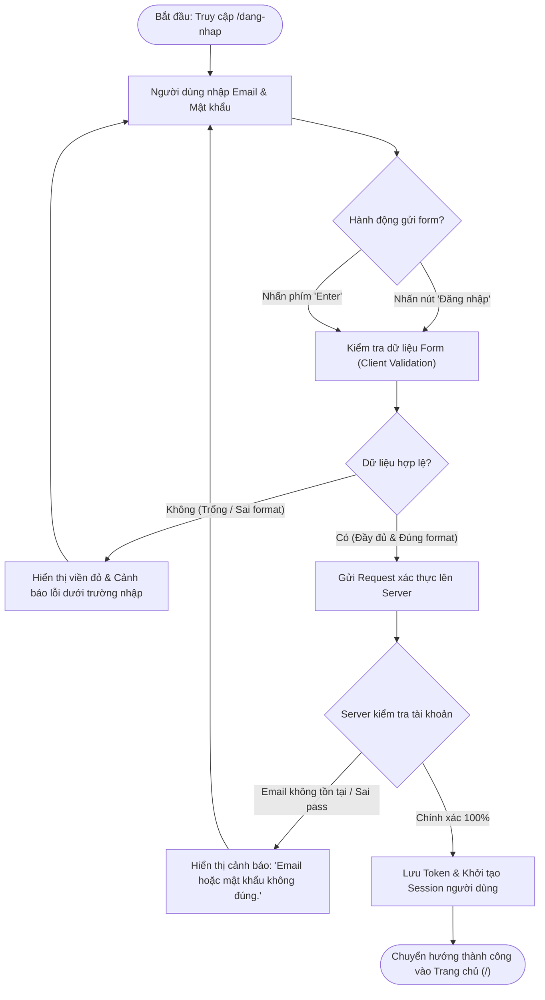
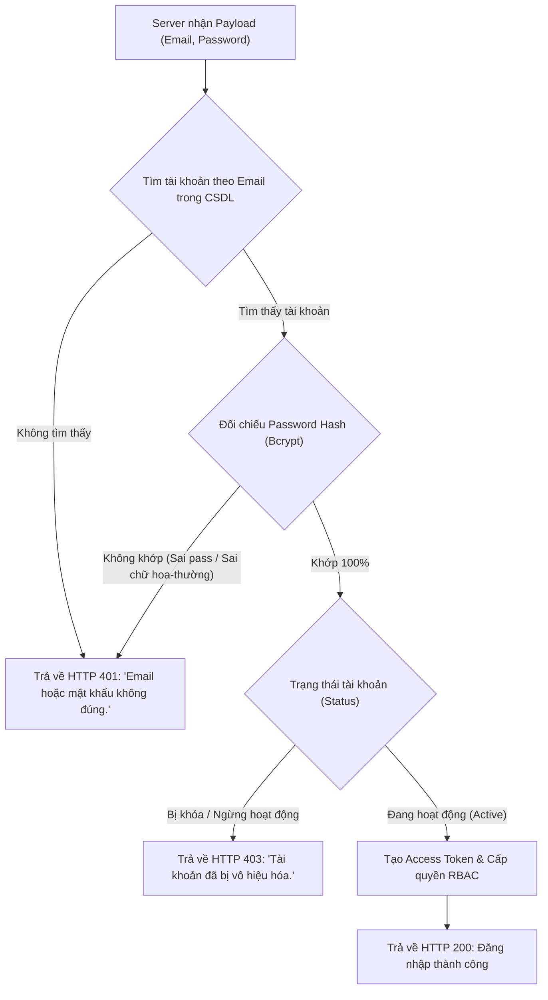
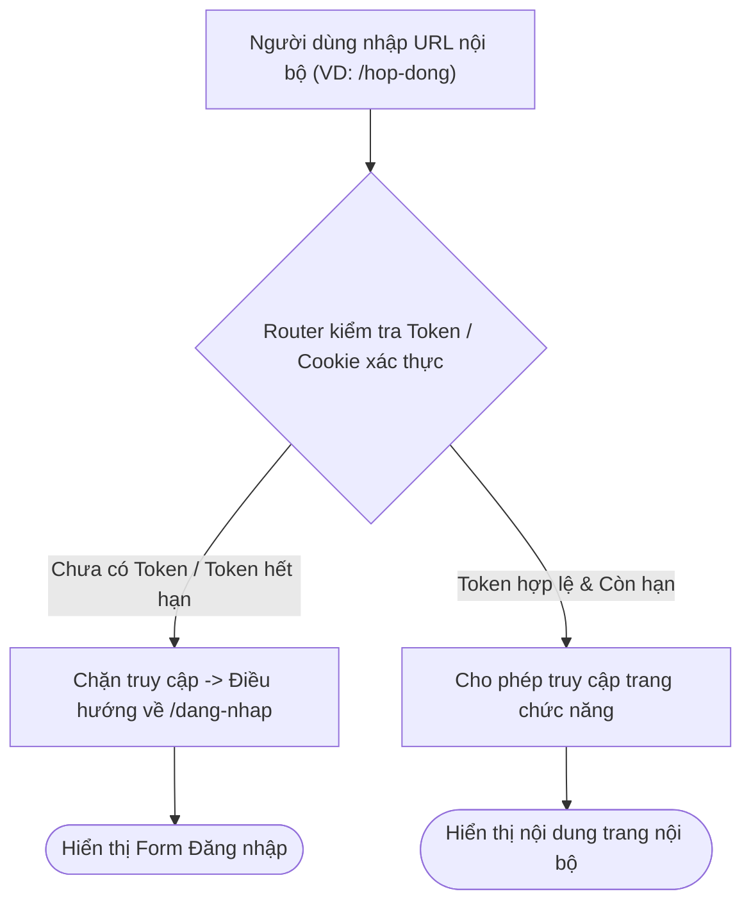

# 📋 TÀI LIỆU ĐẶC TẢ YÊU CẦU CHỨC NĂNG (REQUIREMENTS SPECIFICATION)
## Phân hệ: Xác thực & Phân quyền — Hệ thống VNTEST LIMS
### Tính năng: Màn hình Đăng nhập & Kiểm soát phiên (Login Screen)

---

| Thông tin tài liệu | Chi tiết |
| :--- | :--- |
| **Mã tài liệu** | `REQ_VNTEST_AUTH_LOGIN` |
| **Tính năng / Màn hình** | Màn hình Đăng nhập & Xác thực hệ thống (Login & Authentication) |
| **Đường dẫn truy cập** | `/dang-nhap` (hoặc `/login`) |
| **Đối tượng sử dụng** | Quản trị viên (Admin), Lãnh đạo, Trưởng phòng thử nghiệm, Kỹ thuật viên (KNV), Nhân viên kinh doanh, Kế toán |
| **Trạng thái tài liệu** | `Approved / Ready for Development & Testing` |
| **Cơ sở dữ liệu liên kết** | `users`, `roles`, `permissions`, `audit_logs` |
| **Test Script Playwright** | [`src/tests/auth/login.spec.ts`](file:///home/thai.hoang.dinh/VNTEST_Automation/src/tests/auth/login.spec.ts) (14 Test Cases) |
| **Page Object Model** | [`src/pages/login.page.ts`](file:///home/thai.hoang.dinh/VNTEST_Automation/src/pages/login.page.ts) |
| **Dữ liệu kiểm thử** | [`test-data/users.json`](file:///home/thai.hoang.dinh/VNTEST_Automation/test-data/users.json) |

---

## 📑 MỤC LỤC ĐIỀU HƯỚNG NHANH
1. [1. Định vị màn hình & Tổng quan tính năng (Overview & UI Wireframe)](#1-định-vị-màn-hình--tổng-quan-tính-năng-overview--ui-wireframe)
2. [2. Sơ đồ phân tích luồng trực quan (Mermaid Flowcharts)](#2-sơ-đồ-phân-tích-luồng-trực-quan-mermaid-flowcharts)
3. [3. Phân quyền & Điều kiện kích hoạt (Access & Permissions)](#3-phân-quyền--điều-kiện-kích-hoạt-access--permissions)
4. [4. Đặc tả chi tiết các Use Cases chức năng (Functional Use Cases)](#4-đặc-tả-chi-tiết-các-use-cases-chức-năng-functional-use-cases)
5. [5. Đặc tả chi tiết trường dữ liệu (Field Specifications Matrix)](#5-đặc-tả-chi-tiết-trường-dữ-liệu-field-specifications-matrix)
6. [6. Ma trận nút bấm & Tương tác giao diện (Action Buttons Matrix)](#6-ma-trận-nút-bấm--tương-tác-giao-diện-action-buttons-matrix)
7. [7. Quy tắc nghiệp vụ & Luồng xử lý lỗi (Business Rules & Error Handling)](#7-quy-tắc-nghiệp-vụ--luồng-xử-lý-lỗi-business-rules--error-handling)
8. [8. Kế hoạch kiểm thử & Ma trận Test Cases Automation (14 Test Cases)](#8-kế-hoạch-kiểm-thử--ma-trận-test-cases-automation-14-test-cases)

---

## 1. ĐỊNH VỊ MÀN HÌNH & TỔNG QUAN TÍNH NĂNG (OVERVIEW & UI WIREFRAME)

### 1.1. Mục đích tính năng
* **Cổng xác thực tập trung:** Xác thực danh tính người dùng trước khi cho phép truy cập vào các chức năng nội bộ của hệ thống VNTEST LIMS.
* **Cấp phát phiên & Token:** Sau khi xác thực hợp lệ, cấp phát Access Token (JWT) và khởi tạo phiên làm việc bảo mật lưu trong Storage State / Session Cookie.
* **Bảo vệ toàn vẹn tuyến đường (Auth Guard):** Ngăn chặn mọi hành vi cố tình nhập trực tiếp URL nội bộ khi chưa đăng nhập.

### 1.2. Sơ đồ Wireframe Bố cục Giao diện (ASCII Text Wireframe)

```text
+-----------------------------------------------------------------------------------+
|                                 VNTEST LIMS                                       |
|             HỆ THỐNG QUẢN LÝ PHÒNG THÍ NGHIỆM VNTEST LIMS                         |
+-----------------------------------------------------------------------------------+
|                                                                                   |
|                                   ĐĂNG NHẬP                                       |
|                                                                                   |
|   [ Banner thông báo lỗi hệ thống / Lỗi xác thực: "Email hoặc mật khẩu không đúng." ] |
|                                                                                   |
|   Email *                                                                         |
|   +---------------------------------------------------------------------------+   |
|   | admin@vntest.vn                                                           |   |
|   +---------------------------------------------------------------------------+   |
|   ( Câu cảnh báo lỗi đỏ: "Vui lòng nhập email." )                                 |
|                                                                                   |
|   Mật khẩu *                                                                      |
|   +---------------------------------------------------------------------+-----+   |
|   | •••••••••••••                                                       | 👁 |   |
|   +---------------------------------------------------------------------+-----+   |
|   ( Câu cảnh báo lỗi đỏ: "Vui lòng nhập mật khẩu." )                              |
|                                                                                   |
|   [x] Ghi nhớ đăng nhập                                      Quên mật khẩu?       |
|                                                                                   |
|   +---------------------------------------------------------------------------+   |
|   |                              [ ĐĂNG NHẬP ]                                |   |
|   +---------------------------------------------------------------------------+   |
|                                                                                   |
+-----------------------------------------------------------------------------------+
```

---

## 2. SƠ ĐỒ PHÂN TÍCH LUỒNG TRỰC QUAN (MERMAID FLOWCHARTS)

### 2.1. Sơ đồ luồng tổng quan quá trình Đăng nhập (End-to-End Master Flow)



### 2.2. Sơ đồ xử lý xác thực Backend & Phân nhánh kết quả



### 2.3. Sơ đồ cơ chế Bảo vệ tuyến đường (Auth Guard Flow)



---

## 3. PHÂN QUYỀN & ĐIỀU KIỆN KÍCH HOẠT (ACCESS & PERMISSIONS)

### 3.1. Ma trận phân quyền truy cập (RBAC Matrix)

| Vai trò người dùng (Role) | Quyền truy cập URL `/dang-nhap` | Hành vi khi đã đăng nhập | Hành vi khi chưa đăng nhập | Quyền ghi nhớ phiên |
| :--- | :---: | :--- | :--- | :---: |
| **Khách vãng lai / Chưa đăng nhập** | ✅ Cho phép | Không áp dụng | Hiển thị form đăng nhập đầy đủ | ✅ Cho phép |
| **Quản trị viên (Admin)** | ✅ Cho phép | Tự động chuyển hướng về trang chủ (`/`) | Đăng nhập và nhận toàn quyền quản trị | ✅ Cho phép |
| **Nhân viên / KNV / Kế toán / Sales** | ✅ Cho phép | Tự động chuyển hướng về trang chủ (`/`) | Đăng nhập và nhận quyền theo từng phân hệ | ✅ Cho phép |
| **Tài khoản bị khóa (Suspended / Inactive)** | ✅ Cho phép | Không áp dụng | Chặn đăng nhập, thông báo tài khoản bị khóa | ❌ Không |

---

## 4. ĐẶC TẢ CHI TIẾT CÁC USE CASES CHỨC NĂNG (FUNCTIONAL USE CASES)

### UC-01: Đăng nhập thành công với tài khoản quản trị viên (Happy Path)
* **Tác nhân (Actor):** Quản trị viên (Admin) hoặc nhân sự có tài khoản hợp lệ.
* **Tiền điều kiện:** Đang ở trang `/dang-nhap`.
* **Luồng sự kiện chính (Basic Flow):**
  1. Người dùng nhập địa chỉ Email vào ô **"Email"** (`admin@vntest.vn`).
  2. Người dùng nhập mật khẩu vào ô **"Mật khẩu"** (`Admin@123456`).
  3. Người dùng nhấn nút **"Đăng nhập"**.
  4. Hệ thống gửi thông tin xác thực lên server, phản hồi mã HTTP 200 thành công.
  5. Trình duyệt lưu Token xác thực, chuyển hướng về trang chủ (`/`).
* **Hậu điều kiện:** Header hiển thị đúng tên người dùng: **"Admin User"**.

---

### UC-02: Đăng nhập nhanh bằng phím "Enter" trên bàn phím
* **Tác nhân:** Người dùng hợp lệ.
* **Tiền điều kiện:** Đang ở trang `/dang-nhap`.
* **Luồng sự kiện chính:**
  1. Người dùng nhập Email hợp lệ.
  2. Người dùng nhập Mật khẩu hợp lệ.
  3. Tại ô Mật khẩu, người dùng nhấn phím **Enter** trên bàn phím.
  4. Hệ thống bắt sự kiện submit và kích hoạt luồng xác thực giống như khi click nút "Đăng nhập".
* **Hậu điều kiện:** Chuyển hướng thành công vào trang chủ hệ thống.

---

### UC-03: Xác thực thất bại do sai mật khẩu
* **Tác nhân:** Người dùng nhập sai thông tin.
* **Tiền điều kiện:** Đang ở trang `/dang-nhap`.
* **Luồng sự kiện chính:**
  1. Người dùng nhập Email hợp lệ đã tồn tại (`admin@vntest.vn`).
  2. Người dùng nhập sai mật khẩu (`WrongPassword@999`).
  3. Người dùng nhấn nút **"Đăng nhập"**.
  4. Hệ thống kiểm tra thấy mật khẩu không khớp, từ chối cấp token.
* **Luồng ngoại lệ (Exception Flow):**
  * Giữ nguyên người dùng tại màn hình `/dang-nhap`.
  * Hiển thị thông báo lỗi trên đầu form: **"Email hoặc mật khẩu không đúng."**.

---

### UC-04: Xác thực thất bại do Email không tồn tại
* **Tác nhân:** Người dùng nhập email lạ.
* **Tiền điều kiện:** Đang ở trang `/dang-nhap`.
* **Luồng sự kiện chính:**
  1. Người dùng nhập Email chưa từng được đăng ký trong hệ thống (`nonexistent_user@vntest.vn`).
  2. Người dùng nhập Mật khẩu bất kỳ.
  3. Người dùng nhấn nút **"Đăng nhập"**.
  4. Hệ thống không tìm thấy bản ghi tài khoản tương ứng.
* **Luồng ngoại lệ:**
  * Giữ nguyên tại trang đăng nhập.
  * Hiển thị thông báo bảo mật chung: **"Email hoặc mật khẩu không đúng."** (không làm lộ thông tin tài khoản có tồn tại hay không).

---

### UC-05: Phân biệt chữ hoa và chữ thường trong mật khẩu (Case Sensitivity)
* **Tác nhân:** Người dùng nhập mật khẩu sai ký tự viết hoa.
* **Tiền điều kiện:** Đang ở trang `/dang-nhap`.
* **Luồng sự kiện chính:**
  1. Người dùng nhập Email của tài khoản có mật khẩu chứa chữ hoa (`casesensitive@vntest.vn`).
  2. Người dùng cố tình gõ mật khẩu bằng chữ thường (`password123` thay vì `Password123`).
  3. Người dùng nhấn nút **"Đăng nhập"**.
* **Luồng ngoại lệ:**
  * Hệ thống mã hóa Bcrypt và đối chiếu không khớp.
  * Từ chối đăng nhập và hiển thị thông báo lỗi: **"Email hoặc mật khẩu không đúng."**.

---

### UC-06: Kiểm tra bắt buộc và định dạng trường Email (Field Validation)
* **Tác nhân:** Người dùng thao tác form.
* **Tiền điều kiện:** Đang ở trang `/dang-nhap`.
* **Kịch bản 1 (Bỏ trống):** Để trống trường Email ➔ Nhấn "Đăng nhập" ➔ Ô Email viền đỏ, hiển thị: **"Vui lòng nhập email."**.
* **Kịch bản 2 (Sai định dạng):** Nhập `email_sai_dinh_dang` ➔ Nhấn "Đăng nhập" ➔ Trình duyệt kích hoạt HTML5 `typeMismatch = true`, hiển thị tooltip cảnh báo yêu cầu nhập ký tự `@`.

---

### UC-07: Kiểm tra bắt buộc trường Mật khẩu
* **Tác nhân:** Người dùng thao tác form.
* **Tiền điều kiện:** Đang ở trang `/dang-nhap`.
* **Kịch bản 1 (Bỏ trống mật khẩu):** Nhập Email nhưng để trống Mật khẩu ➔ Nhấn "Đăng nhập" ➔ Ô Mật khẩu viền đỏ, hiển thị: **"Vui lòng nhập mật khẩu."**.
* **Kịch bản 2 (Bỏ trống cả hai):** Để trống cả Email và Mật khẩu ➔ Nhấn "Đăng nhập" ➔ Cả 2 ô đồng thời viền đỏ và hiển thị cả 2 câu cảnh báo tương ứng.

---

### UC-08: Tiện ích ẩn/hiện mật khẩu và Ghi nhớ phiên (UI/UX)
* **Tác nhân:** Người dùng tương tác.
* **Tiền điều kiện:** Đang ở trang `/dang-nhap`.
* **Mặc định:** Trường mật khẩu ở dạng ẩn dấu chấm tròn (`type="password"`).
* **Toggle con mắt:** Bấm icon con mắt lần 1 ➔ Chuyển sang `type="text"` (hiện rõ mật khẩu); bấm lần 2 ➔ Chuyển về `type="password"`.
* **Ghi nhớ đăng nhập:** Bấm vào checkbox chuyển sang `checked = true`; bấm lại chuyển về `checked = false`.

---

### UC-09: Cơ chế bảo vệ tuyến đường nội bộ (Auth Guard)
* **Tác nhân:** Khách chưa xác thực.
* **Tiền điều kiện:** Trình duyệt mở tab ẩn danh, chưa có Token đăng nhập.
* **Luồng sự kiện chính:**
  1. Người dùng cố tình nhập trực tiếp URL nội bộ (`https://vntest-lims.pirago.work/` hoặc `/hop-dong`) trên thanh địa chỉ.
  2. Router Auth Guard kiểm tra thấy không có session token.
  3. Hệ thống lập tức chặn truy cập và tự động điều hướng người dùng về trang `/dang-nhap`.

---

## 5. ĐẶC TẢ CHI TIẾT TRƯỜNG DỮ LIỆU (FIELD SPECIFICATIONS MATRIX)

| Tên trường | UI Label | Kiểu dữ liệu | Bắt buộc | Ràng buộc & Validation Rules | Giá trị mặc định / Placeholder | Ghi chú |
| :--- | :--- | :--- | :---: | :--- | :--- | :--- |
| `email` | **Email** | `text` (email) | **Bắt buộc** | • Không được để trống.<br>• Đúng chuẩn RFC email format.<br>• Kích hoạt HTML5 typeMismatch khi sai cú pháp. | Placeholder: `Nhập địa chỉ email...`<br>Mặc định: Rỗng `""` | Tự động trim khoảng trắng thừa ở đầu/cuối |
| `password` | **Mật khẩu** | `password` | **Bắt buộc** | • Không được để trống.<br>• Phân biệt chữ hoa / chữ thường.<br>• Thuộc tính `type="password"` mặc định. | Placeholder: `Nhập mật khẩu...`<br>Mặc định: Rỗng `""` | Đi kèm nút icon con mắt toggle type `password` / `text` |
| `rememberMe` | **Ghi nhớ đăng nhập** | `checkbox` | Không | • Nhận giá trị boolean `true`/`false`. | Mặc định: `false` (chưa tích) | Kéo dài thời hạn sống của cookie phiên |

---

## 6. MA TRẬN NÚT BẤM & TƯƠNG TÁC GIAO DIỆN (ACTION BUTTONS MATRIX)

| Tên nút (Button) | Vị trí | Icon / Class | Trạng thái mặc định | Điều kiện kích hoạt | Hành vi khi click | Modal / Thông báo đi kèm |
| :--- | :--- | :--- | :---: | :--- | :--- | :--- |
| **Đăng nhập** | Chân form đăng nhập | `.btn-login` / `type="submit"` | **Kích hoạt** | Luôn sẵn sàng | Kiểm tra validate form ➔ Gửi API đăng nhập | Chuyển trang chủ hoặc hiện thông báo lỗi |
| **Icon con mắt** | Cạnh phải ô Mật khẩu | `.btn-toggle-password` | **Kích hoạt** | Khi ô mật khẩu có mặt | Bật / tắt hiển thị giữa dạng chấm tròn và chữ rõ | Đổi icon mắt mở ⮂ mắt đóng |
| **Quên mật khẩu?** | Dưới ô Mật khẩu | `.link-forgot-password` | **Kích hoạt** | Luôn sẵn sàng | Điều hướng sang màn hình khôi phục mật khẩu | Mở màn hình quên mật khẩu |

---

## 7. QUY TẮC NGHIỆP VỤ & LUỒNG XỬ LÝ LỖI (BUSINESS RULES & ERROR HANDLING)

| Mã lỗi (Code) | Quy tắc nghiệp vụ (Business Rule) | Điều kiện kích hoạt | Vị trí hiển thị | Câu thông báo lỗi hiển thị (Error Message) |
| :--- | :--- | :--- | :--- | :--- |
| `ERR_EMAIL_REQUIRED` | Trường Email bắt buộc | Bỏ trống ô Email khi nhấn Đăng nhập | Dưới chân ô nhập Email | **"Vui lòng nhập email."** |
| `ERR_EMAIL_FORMAT` | Email phải đúng định dạng | Nhập thiếu ký tự `@` hoặc sai tên miền | Tooltip trình duyệt | **"Vui lòng bao gồm '@' trong địa chỉ email."** |
| `ERR_PASS_REQUIRED` | Trường Mật khẩu bắt buộc | Bỏ trống ô Mật khẩu khi nhấn Đăng nhập | Dưới chân ô nhập Mật khẩu | **"Vui lòng nhập mật khẩu."** |
| `ERR_AUTH_FAILED` | Xác thực thông tin thất bại | Nhập sai mật khẩu HOẶC email không tồn tại | Banner đầu form đăng nhập | **"Email hoặc mật khẩu không đúng."** |
| `ERR_UNAUTHORIZED` | Bảo vệ tài nguyên nội bộ | Chưa đăng nhập cố tình vào URL nội bộ | Router chuyển hướng | Chuyển hướng về `/dang-nhap` |

---

## 8. KẾ HOẠCH KIỂM THỬ & MA TRẬN TEST CASES AUTOMATION (14 TEST CASES)

| Mã TC | Phân nhóm luồng | Tên kịch bản | Thao tác & Dữ liệu kiểm thử | Kết quả mong đợi | Mức độ ưu tiên | Mapping Page Object |
| :--- | :--- | :--- | :--- | :--- | :---: | :--- |
| **TC_AUTH_001** | Bố cục & Hiển thị | Kiểm tra thành phần giao diện đăng nhập | Mở URL `/dang-nhap`, quan sát toàn bộ các thành phần hiển thị trên trang. | Hiển thị đầy đủ tiêu đề "ĐĂNG NHẬP", mô tả hệ thống, 2 ô nhập liệu Email và Mật khẩu, checkbox Ghi nhớ đăng nhập, nút Đăng nhập và icon con mắt. | `Low` | `loginPage.heading`, `loginPage.emailInput`, `loginPage.loginButton` |
| **TC_AUTH_002** | Luồng thành công | Đăng nhập thành công với tài khoản Admin | 1. Nhập Email: `admin@vntest.vn`<br>2. Nhập Mật khẩu: `Admin@123456`<br>3. Nhấn nút `"Đăng nhập"`. | Điều hướng thành công vào trang chủ (`/`), Header hiển thị huy hiệu tài khoản `"Admin User"`. | `High` | `loginPage.enterEmail()`, `loginPage.enterPassword()`, `loginPage.clickLoginButton()` |
| **TC_AUTH_003** | Luồng thành công | Đăng nhập thành công bằng phím Enter | 1. Nhập Email: `admin@vntest.vn`<br>2. Nhập Mật khẩu: `Admin@123456`<br>3. Nhấn phím `Enter` tại ô Mật khẩu. | Hệ thống tiếp nhận submit từ bàn phím và điều hướng thành công vào trang chủ (`/`). | `Normal` | `loginPage.pressEnterOnPassword()` |
| **TC_AUTH_004** | Luồng thất bại | Đăng nhập thất bại khi nhập sai mật khẩu | 1. Nhập Email: `admin@vntest.vn`<br>2. Nhập Mật khẩu: `WrongPassword@999`<br>3. Nhấn nút `"Đăng nhập"`. | Giữ nguyên tại trang đăng nhập, hiển thị thông báo lỗi: `"Email hoặc mật khẩu không đúng."`. | `High` | `loginPage.globalErrorMessage` |
| **TC_AUTH_005** | Luồng thất bại | Đăng nhập thất bại khi Email không tồn tại | 1. Nhập Email: `nonexistent_user@vntest.vn`<br>2. Nhập Mật khẩu: `Admin@123456`<br>3. Nhấn nút `"Đăng nhập"`. | Từ chối truy cập, hiển thị thông báo bảo mật: `"Email hoặc mật khẩu không đúng."`. | `High` | `loginPage.globalErrorMessage`, `loginPage.loginButton` |
| **TC_AUTH_006** | Form Validation | Bỏ trống trường Email | 1. Email: `""` (để trống)<br>2. Nhập Mật khẩu: `Admin@123456`<br>3. Nhấn nút `"Đăng nhập"`. | Không gửi request, ô Email viền đỏ và báo lỗi: `"Vui lòng nhập email."`. | `High` | `loginPage.emailErrorMessage` |
| **TC_AUTH_007** | Form Validation | Nhập sai định dạng Email | 1. Nhập Email: `email_sai_dinh_dang`<br>2. Nhập Mật khẩu: `Admin@123456`<br>3. Nhấn nút `"Đăng nhập"`. | Trình duyệt kích hoạt HTML5 `typeMismatch = true`, hiển thị tooltip cảnh báo thiếu `@`. | `Normal` | `loginPage.emailInput.evaluate(...)` |
| **TC_AUTH_008** | Form Validation | Bỏ trống trường Mật khẩu | 1. Nhập Email: `admin@vntest.vn`<br>2. Mật khẩu: `""` (để trống)<br>3. Nhấn nút `"Đăng nhập"`. | Không gửi request, ô Mật khẩu viền đỏ và báo lỗi: `"Vui lòng nhập mật khẩu."`. | `High` | `loginPage.passwordErrorMessage` |
| **TC_AUTH_009** | Form Validation | Bỏ trống đồng thời cả hai trường | 1. Email: `""`<br>2. Mật khẩu: `""`<br>3. Nhấn nút `"Đăng nhập"`. | Đồng thời viền đỏ cả 2 ô và hiển thị 2 thông báo lỗi bắt buộc tương ứng. | `High` | `loginPage.emailErrorMessage`, `loginPage.passwordErrorMessage` |
| **TC_AUTH_010** | Luồng thất bại | Phân biệt chữ hoa/thường mật khẩu | 1. Nhập Email: `casesensitive@vntest.vn`<br>2. Nhập Mật khẩu: `password123` *(đúng là `Password123`)*<br>3. Nhấn nút `"Đăng nhập"`. | Từ chối đăng nhập do sai chữ hoa/thường, báo lỗi: `"Email hoặc mật khẩu không đúng."`. | `Normal` | `loginPage.globalErrorMessage` |
| **TC_AUTH_011** | Tiện ích UI | Mặc định ẩn mật khẩu dưới dạng chấm | Nhập mật khẩu bất kỳ vào ô Mật khẩu và kiểm tra thuộc tính thẻ. | Ký tự mật khẩu bị ẩn dạng chấm tròn, input có thuộc tính `type="password"`. | `High` | `loginPage.passwordInput` |
| **TC_AUTH_012** | Tiện ích UI | Bật/tắt hiển thị mật khẩu bằng icon mắt | 1. Nhập mật khẩu<br>2. Bấm icon con mắt lần 1<br>3. Bấm icon con mắt lần 2. | Lần 1: Chuyển sang `type="text"` hiện rõ mật khẩu; Lần 2: Chuyển về `type="password"` ẩn mật khẩu. | `Normal` | `loginPage.passwordToggleButton` |
| **TC_AUTH_013** | Tiện ích UI | Tích chọn và bỏ tích "Ghi nhớ đăng nhập" | 1. Click checkbox "Ghi nhớ đăng nhập"<br>2. Click lại checkbox lần 2. | Bước 1: Checkbox ở trạng thái `checked = true`; Bước 2: Trạng thái về `checked = false`. | `Low` | `loginPage.rememberCheckbox` |
| **TC_AUTH_014** | Bảo mật hệ thống | Chặn truy cập trực tiếp (Auth Guard) | Khi chưa đăng nhập, cố tình nhập URL nội bộ `https://vntest-lims.pirago.work/` trên thanh địa chỉ. | Auth Guard chặn truy cập và tự động điều hướng người dùng về trang `/dang-nhap`. | `High` | `page.goto('/')` ➔ `expect(page).toHaveURL(/.*dang-nhap.*/)` |
