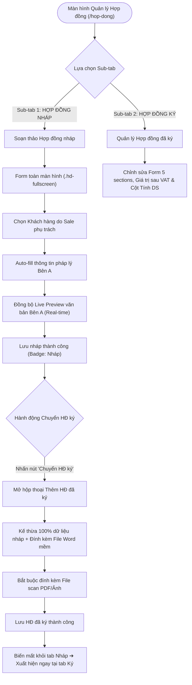
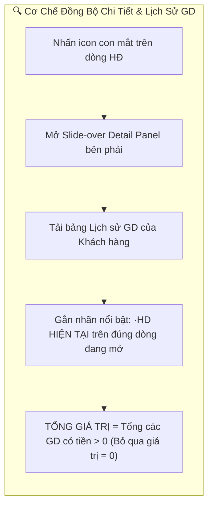

<h1 align="center">UI Test Cases: Contracts Management Module</h1>

> **Target App:** Hệ thống Quản lý Phòng thí nghiệm VNTEST LIMS (v1.0.0)  
> **Base URL:** `https://vntest-lims.pirago.work/hop-dong`  
> **Auth Scheme:** Session Cookie / JWT Storage State (Local Storage)  
> **Source Page Object:** [`src/pages/contracts.page.ts`](file:///home/thai.hoang.dinh/VNTEST_Automation/src/pages/contracts.page.ts)  
> **Test Suite (Playwright):** [`src/tests/contracts/contracts.spec.ts`](file:///home/thai.hoang.dinh/VNTEST_Automation/src/tests/contracts/contracts.spec.ts)  
> **Test Data:** [`test-data/users.json`](file:///home/thai.hoang.dinh/VNTEST_Automation/test-data/users.json), `test-data/files/sample-scan.pdf`  
> **Tag / Module:** `Contracts Management (/hop-dong)`  
> **Quy chuẩn áp dụng:** ISO/IEC/IEEE 29119, Equivalence Partitioning (EP), Boundary Value Analysis (BVA), Page Object Model (POM), `manual_testing_rules.md`.  

---

## 📋 Feature & Flow Catalog (Module Contracts)

| # | Flow / Feature | Screen / Path | Description | Access / Role | Total Test Cases |
| :---: | :--- | :--- | :--- | :--- | :---: |
| 1 | Bố cục & Thanh công cụ | `/hop-dong` | Chuyển đổi 2 sub-tab Nháp/Ký, trạng thái toolbar theo dòng chọn, quản lý cột | Kinh doanh, Quản lý | 6 |
| 2 | Tìm kiếm từ khóa mở rộng | `/hop-dong` | Tìm kiếm đa tiêu chí: Mã HĐ, Số HĐ, Tên HĐ, Tên KH, Mã KH, CTV, Tên Sale | Kinh doanh, Kế toán | 14 |
| 3 | Bộ lọc Thời gian | `/hop-dong` | Lọc theo 3 tiêu chí: Ngày ký, Hết hiệu lực, Ngày hết hạn (Từ/Đến/Khoảng ngày) | Toàn quyền xem | 9 |
| 4 | Bộ lọc Trạng thái & Loại HĐ | `/hop-dong` | Lọc 8 loại HĐ, lọc 4 trạng thái vòng đời (Chưa / Đang thực hiện / Hoàn thành) | Toàn quyền xem | 5 |
| 5 | Quản lý Hợp đồng nháp | `/hop-dong` | Soạn thảo toàn màn hình, Live Preview real-time, Auto-fill Bên A, Sửa, Xóa HĐ | Sale phụ trách | 14 |
| 6 | Luồng nút "Chuyển HĐ ký" | `/hop-dong` | Tự động kế thừa dữ liệu HĐ nháp, đính kèm scan PDF, chuyển sang tab Ký | Sale, Kế toán | 5 |
| 7 | Quản lý Hợp đồng đã ký | `/hop-dong` | Form 5 sections, giá trị sau VAT, giảm trừ phí, ràng buộc cột Tính DS | Kế toán, Lãnh đạo | 6 |
| 8 | Khung Xem Chi tiết (Detail) | `/hop-dong` | So sánh panel HĐ nháp vs HĐ ký, Lịch sử GD khách hàng, công thức Tổng GT | Toàn quyền xem | 15 |
| 9 | Cảnh báo Chưa lưu | `/hop-dong` | Cơ chế Unsaved Changes Guard ("Đóng hộp thoại?") khi form đang có dữ liệu dở | Người dùng thao tác | 4 |
| **Tổng** | | | | | **78 Test Cases** |

---

## 🔄 Business Workflow & Architecture (Sơ Đồ Phân Tích Luồng)

---

## 🧪 Detailed Test Cases (Kịch Bản Kiểm Thử Chi Tiết)

### 1. Bố cục, Điều hướng & Trạng thái thanh công cụ (UI & Navigation)

| TC ID | Feature | Test Case Title_1 | Test Case Title_2 | Pre-Condition | Test Steps | Test Data | Expected Result | Priority |
| :--- | :--- | :--- | :--- | :--- | :--- | :--- | :--- | :---: |
| **TC_NAV_01** | Bố cục & Thanh công cụ | Hiển thị thành phần tổng quan | | Đang ở `/hop-dong` | 1. Mở trang Quản lý Hợp đồng.  2. Quan sát cấu trúc tổng thể màn hình. | URL: `/hop-dong` | 1. Hiển thị cụm tab module `KH - ĐT - HĐ`, tab `HỢP ĐỒNG` đang active kèm tổng số lượng (VD: `128`).  2. Hiển thị 2 sub-tab `Hợp đồng nháp` và `Hợp đồng ký`, thanh công cụ, bộ lọc, ô tìm kiếm và bảng dữ liệu. | Normal |
| **TC_NAV_02** | Bố cục & Thanh công cụ | Chuyển đổi giữa 2 sub-tab | | Đang ở `/hop-dong` | 1. Nhấp chọn giữa 2 sub-tab `Hợp đồng nháp` và `Hợp đồng ký`. | | 1. Tab `Hợp đồng nháp`: Toolbar có 4 nút `"Thêm"`, `"Sửa"`, `"Xóa"`, `"Chuyển HĐ ký"`; bộ lọc ẩn dropdown `TT`.  2. Tab `Hợp đồng ký`: Toolbar chỉ có 2 nút `"Thêm"`, `"Sửa"` (không có nút Xóa); bộ lọc hiện thêm `TT: Tất cả`; bảng có thêm 4 cột: `GIÁ TRỊ SAU VAT`, `GIẢM TRỪ PHÍ`, `TÀI LIỆU`, `TÍNH DS`. | Normal |
| **TC_NAV_03** | Bố cục & Thanh công cụ | Trạng thái Toolbar khi chưa chọn dòng | 0 dòng được chọn | Đang ở danh sách HĐ | 1. Mở danh sách, chưa tích chọn ô checkbox nào. | | 1. Các nút `"Sửa"`, `"Xóa"`, `"Chuyển HĐ ký"` (ở tab Nháp) và nút `"Sửa"` (ở tab Ký) ở trạng thái vô hiệu hóa (`disabled`), mờ đi. | Normal |
| **TC_NAV_04** | Bố cục & Thanh công cụ | Trạng thái Toolbar khi chọn đúng 1 dòng | 1 dòng được chọn | Đang ở danh sách HĐ | 1. Tích chọn duy nhất 1 dòng hợp đồng bất kỳ. | | 1. Các nút `"Sửa"`, `"Xóa"`, `"Chuyển HĐ ký"` sáng lên (kích hoạt).  2. Hiển thị dòng trạng thái: `Đang chọn 1 HĐ`. | Normal |
| **TC_NAV_05** | Bố cục & Thanh công cụ | Trạng thái Toolbar khi chọn nhiều dòng | $\ge 2$ dòng được chọn | Đang ở danh sách HĐ | 1. Tích chọn từ 2 dòng trở lên (hoặc tích chọn tất cả ở Header). | | 1. Nút `"Sửa"` và nút `"Chuyển HĐ ký"` tự động vô hiệu hóa (chỉ cho phép thao tác đơn lẻ).  2. Nút `"Xóa"` (ở tab Nháp) vẫn kích hoạt (cho phép xóa hàng loạt). | Normal |
| **TC_NAV_06** | Bố cục & Thanh công cụ | Quản lý ẩn/hiện cột và Phân trang | | Đang ở danh sách HĐ | 1. Nhấn nút "Quản lý cột".  2. Chuyển trang (`1`, `2`) và đổi số dòng/trang (`20`). | | 1. Popover mở cho phép tích/bỏ tích cột hiển thị.  2. Bảng phân trang mượt mà đúng số bản ghi. | Low |

---

### 2. Tìm kiếm từ khóa mở rộng (Comprehensive Search)

| TC ID | Feature | Test Case Title_1 | Test Case Title_2 | Pre-Condition | Test Steps | Test Data | Expected Result | Priority |
| :--- | :--- | :--- | :--- | :--- | :--- | :--- | :--- | :---: |
| **TC_SRC_01** | Tìm kiếm từ khóa | Tìm chính xác theo Mã HĐ | | Đang ở danh sách HĐ | 1. Nhập Mã HĐ chính xác vào ô tìm kiếm. | `HĐ-00231` (Nháp) / `HĐ-00230` (Ký) | Hiển thị duy nhất 1 bản ghi khớp chính xác Mã HĐ. | High |
| **TC_SRC_02** | Tìm kiếm từ khóa | Tìm một phần theo tiền tố / hậu tố Mã HĐ | | Đang ở danh sách HĐ | 1. Nhập một phần chuỗi mã HĐ. | `HĐ-0022` hoặc `00231` | Lọc ra danh sách tất cả các hợp đồng chứa cụm ký tự tương ứng. | Normal |
| **TC_SRC_03** | Tìm kiếm từ khóa | Tìm Mã HĐ không phân biệt hoa / thường | | Đang ở danh sách HĐ | 1. Nhập mã HĐ bằng chữ thường. | `hđ-00231` hoặc `Hđ-00231` | Không phân biệt hoa/thường, trả về đúng bản ghi `HĐ-00231`. | Normal |
| **TC_SRC_04** | Tìm kiếm từ khóa | Tìm chính xác toàn bộ Số hợp đồng | Ký tự `.`, `/`, `_` | Đang ở danh sách HĐ | 1. Nhập toàn bộ Số HĐ văn bản thực tế. | `28.286.001/HĐDV/VNTEST_1` | Trả về đúng bản ghi có Số HĐ tương ứng. | High |
| **TC_SRC_05** | Tìm kiếm từ khóa | Tìm một phần Số HĐ | Theo cụm đầu / giữa / đuôi | Đang ở danh sách HĐ | 1. Nhập phân đoạn của Số HĐ. | `28.286.001`, `BIEN.031D`, `/HĐDV/VNTEST` | Lọc ra các hợp đồng có chứa cụm phân đoạn đó. | Normal |
| **TC_SRC_06** | Tìm kiếm từ khóa | Tìm chính xác / một phần Tên HĐ | | Đang ở danh sách HĐ | 1. Nhập từ khóa tên hợp đồng. | `Hợp đồng kiểm nghiệm mẫu_22`, `mẫu_14` | Lọc chính xác các hợp đồng có tên chứa từ khóa. | High |
| **TC_SRC_07** | Tìm kiếm từ khóa | Tìm Tên HĐ chữ thường / không dấu | | Đang ở danh sách HĐ | 1. Nhập tên HĐ không dấu hoặc chữ thường. | `hợp đồng kiểm nghiệm mẫu_22`, `Hop dong` | Trả về đúng bản ghi tương ứng. | Normal |
| **TC_SRC_08** | Tìm kiếm từ khóa | Tìm theo Tên Khách hàng | Cá nhân & Doanh nghiệp | Đang ở danh sách HĐ | 1. Nhập tên khách hàng vào ô tìm kiếm. | `Thái test`, `Công ty TNHH ABC Việt Nam` | Lọc ra tất cả hợp đồng thuộc về khách hàng đó. | High |
| **TC_SRC_09** | Tìm kiếm từ khóa | Tìm Tên KH có ký tự đặc biệt | Ký tự `&`, `#`, `()` | Đang ở danh sách HĐ | 1. Nhập tên đơn vị có ký tự đặc biệt. | `Sơn & Hóa chất`, `(Đơn vị #495)`, `#498` | Lọc chính xác các doanh nghiệp có ký tự đặc thù. | Normal |
| **TC_SRC_10** | Tìm kiếm từ khóa | Mở rộng tìm theo Mã KH / Mã CTV / Tên Sale | | Đang ở danh sách HĐ | 1. Nhập mã định danh phụ trợ vào ô tìm kiếm. | `KH-0164`, `CTV-002`, `Admin User` | Kiểm tra phạm vi lọc các trường mã định danh phụ trợ trên bảng. | Normal |
| **TC_SRC_11** | Tìm kiếm từ khóa | Tìm kiếm có khoảng trắng thừa đầu/cuối | | Đang ở danh sách HĐ | 1. Nhập từ khóa có khoảng trắng bao quanh. | `"   HĐ-00231   "`, `"  Thái test  "` | Hệ thống tự động trim khoảng trắng thừa, trả về kết quả đúng. | Low |
| **TC_SRC_12** | Tìm kiếm từ khóa | Tìm với từ khóa không tồn tại / ký tự lạ | | Đang ở danh sách HĐ | 1. Nhập từ khóa không tồn tại. | `KHONG_TON_TAI_99999`, `@#$%^&*~` | Bảng hiển thị thông báo: `"Không tìm thấy hợp đồng nào phù hợp."`. | Low |
| **TC_SRC_13** | Tìm kiếm từ khóa | Xóa từ khóa tìm kiếm bằng nút "Hủy" | | Đang có từ khóa tìm kiếm | 1. Nhấn nút "Hủy" (`.clear-btn`) trong ô tìm kiếm. | | Ô tìm kiếm về rỗng, nút `"Hủy"` ẩn đi, bảng khôi phục đầy đủ số lượng ban đầu. | Normal |
| **TC_SRC_14** | Tìm kiếm từ khóa | Giữ từ khóa khi chuyển đổi giữa 2 sub-tab | | Đang ở tab Nháp | 1. Nhập `Thái test` tại tab Nháp.  2. Chuyển sang tab Ký. | Từ khóa: `Thái test` | Từ khóa giữ nguyên trên ô tìm kiếm, tab Ký hiển thị đúng hợp đồng `HĐ-00230` của `Thái test`. | Normal |

---

### 3. Bộ lọc Thời gian theo 3 Tiêu chí Ngày (Date Range Filters)

| TC ID | Feature | Test Case Title_1 | Test Case Title_2 | Pre-Condition | Test Steps | Test Data | Expected Result | Priority |
| :--- | :--- | :--- | :--- | :--- | :--- | :--- | :--- | :---: |
| **TC_DATE_01** | Bộ lọc Thời gian | Hiển thị dropdown loại ngày và lịch | | Đang ở danh sách HĐ | 1. Nhấn mở dropdown loại ngày.  2. Nhấn ô `TỪ dd/mm/yyyy`. | | 1. Dropdown hiện đủ 3 lựa chọn: `Ngày ký` (mặc định), `Hết hiệu lực`, `Ngày hết hạn`.  2. Popup lịch có đủ nút `Hôm nay`, `Xóa`. | Normal |
| **TC_DATE_02** | Bộ lọc Thời gian | Lọc theo Ngày ký | Chỉ chọn TỪ ngày | Đang ở danh sách HĐ | 1. Tiêu chí: `Ngày ký`.  2. Chọn `TỪ`: `28/10/2026`, để trống `ĐẾN`. | `TỪ`: `28/10/2026` | Mọi dòng hiển thị đều có cột **`NGÀY KÝ` $\ge$ `28/10/2026`** (VD: `28/10`, `30/10`, `31/10`, `01/11`). | High |
| **TC_DATE_03** | Bộ lọc Thời gian | Lọc theo Ngày ký | Chỉ chọn ĐẾN ngày | Đang ở danh sách HĐ | 1. Tiêu chí: `Ngày ký`.  2. Chọn `ĐẾN`: `27/10/2026`, để trống `TỪ`. | `ĐẾN`: `27/10/2026` | Mọi dòng hiển thị đều có cột **`NGÀY KÝ` $\le$ `27/10/2026`** (VD: `27/10`, `26/10`, `01/10`). | High |
| **TC_DATE_04** | Bộ lọc Thời gian | Lọc theo Ngày ký | TỪ ngày trùng ĐẾN ngày | Đang ở danh sách HĐ | 1. Tiêu chí: `Ngày ký`.  2. Chọn `TỪ`: `28/10/2026`, `ĐẾN`: `28/10/2026`. | `28/10/2026` | Mọi dòng hiển thị đều có cột **`NGÀY KÝ` = `28/10/2026`** (`HĐ-00228`, `HĐ-00226` ở tab Nháp; `HĐ-00227` ở tab Ký). | High |
| **TC_DATE_05** | Bộ lọc Thời gian | Lọc theo Ngày ký | Khoảng TỪ ngày < ĐẾN ngày | Đang ở danh sách HĐ | 1. Tiêu chí: `Ngày ký`.  2. Chọn khoảng từ `26/10/2026` đến `31/10/2026`. | `26/10/2026 - 31/10/2026` | Mọi dòng hiển thị đều có cột **`NGÀY KÝ`** nằm trong đoạn `[26/10/2026, 31/10/2026]`. | High |
| **TC_DATE_06** | Bộ lọc Thời gian | Lọc theo Hết hiệu lực | Đầy đủ 4 trường hợp | Đang ở danh sách HĐ | 1. Đổi tiêu chí sang `Hết hiệu lực`.  2. Lọc khoảng từ `27/11/2026` đến `30/11/2026`. | `27/11/2026 - 30/11/2026` | Mọi dòng hiển thị đều có cột **`HẾT HIỆU LỰC`** thỏa mãn đúng mốc thời gian đã lọc. | High |
| **TC_DATE_07** | Bộ lọc Thời gian | Lọc theo Ngày hết hạn | Đầy đủ 4 trường hợp | Đang ở danh sách HĐ | 1. Đổi tiêu chí sang `Ngày hết hạn`.  2. Lọc khoảng từ `25/12/2026` đến `31/12/2026`. | `25/12/2026 - 31/12/2026` | Mọi dòng hiển thị đều có cột **`NGÀY HẾT HẠN`** thỏa mãn đúng mốc thời gian đã lọc. | High |
| **TC_DATE_08** | Bộ lọc Thời gian | Chuyển đổi qua lại giữa 3 loại ngày | Giữ nguyên khoảng ngày | Đang chọn `26/10 - 31/10` | 1. Đổi từ `Ngày ký` sang `Hết hiệu lực` ➔ Đổi sang `Ngày hết hạn`. | | Khoảng ngày giữ nguyên, bảng lập tức tính toán lọc lại dữ liệu đối chiếu sang cột tương ứng mới. | Normal |
| **TC_DATE_09** | Bộ lọc Thời gian | Xóa bộ lọc ngày | Nút hủy lọc `[×]` | Đang có khoảng ngày lọc | 1. Nhấn nút [×] cạnh bộ lọc ngày. | | Cả 2 ô `TỪ` và `ĐẾN` đều trở về `dd/mm/yyyy`, bảng khôi phục toàn bộ danh sách ban đầu. | Normal |

---

### 4. Bộ lọc Trạng thái (TT) & Loại hợp đồng (Loại HĐ)

| TC ID | Feature | Test Case Title_1 | Test Case Title_2 | Pre-Condition | Test Steps | Test Data | Expected Result | Priority |
| :--- | :--- | :--- | :--- | :--- | :--- | :--- | :--- | :---: |
| **TC_FLT_01** | Bộ lọc Trạng thái & Loại HĐ | Hiển thị dropdown TT theo Tab | | Đang ở `/hop-dong` | 1. Quan sát tab `Hợp đồng nháp` và tab `Hợp đồng ký`. | | Tab Nháp ẩn dropdown `TT`; tab Ký hiển thị dropdown `TT: Tất cả` gồm: `Tất cả`, `Chưa thực hiện`, `Đang thực hiện`, `Hoàn thành`. | Normal |
| **TC_FLT_02** | Bộ lọc Trạng thái & Loại HĐ | Lọc theo từng Trạng thái tại tab Ký | | Đang ở tab Ký | 1. Lần lượt chọn `Chưa thực hiện`, `Đang thực hiện`, `Hoàn thành`. | | Cột `TRẠNG THÁI` của tất cả các dòng hiển thị đều khớp chính xác với trạng thái đã chọn (VD: `HĐ-00227` với Chưa thực hiện; `HĐ-00230` với Hoàn thành). | High |
| **TC_FLT_03** | Bộ lọc Trạng thái & Loại HĐ | Lọc theo 8 Loại hợp đồng | | Đang ở danh sách HĐ | 1. Chọn từng loại trong 8 loại HĐ từ dropdown `Loại HĐ`. | 8 Loại HĐ của hệ thống | Cột `LOẠI HĐ` của mọi dòng hiển thị đều khớp chính xác với loại đã chọn (VD: chọn `Đấu thầu` ra `HĐ-00223`). | High |
| **TC_FLT_04** | Bộ lọc Trạng thái & Loại HĐ | Kết hợp đồng thời TT + Loại HĐ | Tại tab Ký | Đang ở tab Ký | 1. Chọn `TT: Đang thực hiện`.  2. Chọn `Loại HĐ: Kiểm nghiệm thông thường`. | `Đang thực hiện` + `Kiểm nghiệm` | Chỉ hiển thị các hợp đồng vừa Đang thực hiện, vừa thuộc loại Kiểm nghiệm thông thường (`HĐ-00224`). | High |
| **TC_FLT_05** | Bộ lọc Trạng thái & Loại HĐ | Kết hợp TT + Loại HĐ không có bản ghi | | Đang ở tab Ký | 1. Chọn `TT: Chưa thực hiện`.  2. Chọn `Loại HĐ: Đấu thầu`. | | Bảng hiển thị thông báo `"Không tìm thấy hợp đồng nào phù hợp."`. | Low |

---

### 5. Quản lý Hợp đồng nháp (Tạo mới, Live Preview, Auto-fill & Phân quyền Sale)

| TC ID | Feature | Test Case Title_1 | Test Case Title_2 | Pre-Condition | Test Steps | Test Data | Expected Result | Priority |
| :--- | :--- | :--- | :--- | :--- | :--- | :--- | :--- | :---: |
| **TC_DFT_01** | Quản lý Hợp đồng nháp | Mở và đóng màn hình Tạo HĐ nháp | | Đang ở tab Nháp | 1. Nhấn nút "Thêm" trên tab Nháp.  2. Nhấn nút "Đóng". | | Mở giao diện soạn thảo toàn màn hình (`.hd-fullscreen`); nhấn `"Đóng"` (khi chưa sửa gì) thì đóng về danh sách. | Normal |
| **TC_DFT_02** | Quản lý Hợp đồng nháp | Validate trường bắt buộc khi tạo HĐ nháp | | Màn hình Tạo HĐ nháp | 1. Để trống các trường bắt buộc (`Khách hàng`, `Số HĐ`, `Tên HĐ`...).  2. Nhấn nút "Lưu nháp". | Trường trống `""` | Báo lỗi đỏ dưới trường (`"Vui lòng chọn khách hàng."`) và thông báo nổi `"Thông tin nhập chưa hợp lệ. Vui lòng kiểm tra lại."`. | High |
| **TC_DFT_03** | Quản lý Hợp đồng nháp | Phân quyền trường Khách hàng | Chỉ hiện khách do Sale phụ trách | Màn hình Tạo HĐ nháp | 1. Nhấn dropdown `— Chọn khách hàng —`. | Tài khoản Sale | Hiển thị chú thích `⚡ Chỉ hiện khách hàng do bạn phụ trách.`. Danh sách chỉ hiện khách thuộc Sale đăng nhập, không có khách của Sale khác. | High |
| **TC_DFT_04** | Quản lý Hợp đồng nháp | Phân quyền trường Báo giá | Chỉ hiện báo giá do Sale phụ trách | Màn hình Tạo HĐ nháp | 1. Nhấn dropdown `— Chọn báo giá —`. | Tài khoản Sale | Hiển thị `⚡ Chỉ hiện báo giá do bạn phụ trách.`. Danh sách chỉ trả về các báo giá của Sale hiện tại. | High |
| **TC_DFT_05** | Quản lý Hợp đồng nháp | Auto-fill Bên A khi KH có đủ thông tin | | Màn hình Tạo HĐ nháp | 1. Chọn khách hàng có đầy đủ hồ sơ pháp lý. | KH đầy đủ thông tin | Tự động điền đầy đủ: `ĐỊA CHỈ TRỤ SỞ`, `ĐIỆN THOẠI`, `MÃ SỐ THUẾ`, `TÊN ĐẠI DIỆN`, `CHỨC VỤ`, `EMAIL KHÁCH HÀNG`, `SỐ TÀI KHOẢN`, `TÊN NGÂN HÀNG`. | High |
| **TC_DFT_06** | Quản lý Hợp đồng nháp | Auto-fill khi KH bị khuyết / thiếu trường | | Màn hình Tạo HĐ nháp | 1. Chọn khách hàng chỉ có MST, thiếu SĐT/Email/STK. | KH thiếu trường | Các trường có dữ liệu thì điền; các trường thiếu thì **để trống hoàn toàn `""`**, không hiển thị `undefined` hay lỗi. | Normal |
| **TC_DFT_07** | Quản lý Hợp đồng nháp | Trường "DANH XƯNG" là tự chọn độc lập | | Màn hình Tạo HĐ nháp | 1. Chuyển đổi giữa `Ông` và `Bà`. | `Ông` / `Bà` | Người dùng tự do chọn `Ông`/`Bà`, không bị ghi đè bởi auto-fill. | Low |
| **TC_DFT_08** | Quản lý Hợp đồng nháp | Đồng bộ Live Preview sang văn bản HĐ | Real-time Sync | Màn hình Tạo HĐ nháp | 1. Nhập/đổi Tên KH, Địa chỉ, SĐT, MST, Người đại diện, Chức vụ, Danh xưng ở form trái. | | Văn bản hợp đồng bên phải (`CỘNG HÒA XÃ HỘI CHỦ NGHĨA VIỆT NAM...`) tại mục `BÊN A` tự động cập nhật khớp từng chữ ngay lập tức. Trường nào thiếu thì hiển thị dấu `...`. | High |
| **TC_DFT_09** | Quản lý Hợp đồng nháp | Nhấn nút "Auto" sinh Số hợp đồng | | Màn hình Tạo HĐ nháp | 1. Nhấn nút "Auto" cạnh ô `SỐ HỢP ĐỒNG *`. | | Tự động sinh số hợp đồng mới theo định dạng chuẩn (VD: `29.xxx.001/HĐDV/VNTEST`). | Normal |
| **TC_DFT_10** | Quản lý Hợp đồng nháp | Tự động tính ngày HẾT HIỆU LỰC | | Màn hình Tạo HĐ nháp | 1. Đổi Ngày ký hoặc đổi số ngày hiệu lực (mặc định `30`). | Ngày ký, Hiệu lực | Ô `HẾT HIỆU LỰC` tự động cộng dồn số ngày chính xác; đồng bộ sang điều khoản Điều 3 của văn bản hợp đồng bên phải. | High |
| **TC_DFT_11** | Quản lý Hợp đồng nháp | Tạo mới Hợp đồng nháp thành công | | Màn hình Tạo HĐ nháp | 1. Điền đầy đủ thông tin hợp lệ.  2. Nhấn nút "Lưu nháp". | Thông tin hợp lệ | Đóng màn hình soạn thảo; bản ghi mới xuất hiện đầu danh sách `Hợp đồng nháp` với trạng thái `Nháp`. | High |
| **TC_DFT_12** | Quản lý Hợp đồng nháp | Tiện ích "Xuất Word" và "In" | | Màn hình Tạo HĐ nháp | 1. Nhấn nút "Xuất Word" và nhấn nút "In". | | Kích hoạt tải về file Word `.docx` và mở cửa sổ in ấn trình duyệt. | Normal |
| **TC_DFT_13** | Quản lý Hợp đồng nháp | Chỉnh sửa HĐ nháp & Đồng bộ 3 màn hình | Form, List, Detail | Đang ở tab Nháp | 1. Tích chọn 1 HĐ nháp ➔ Nhấn nút "Sửa".  2. Thay đổi: Tên HĐ mới, chọn KH mới, đổi Ngày ký, Thời hạn.  3. Nhấn nút "Lưu nháp".  4. Mở xem chi tiết và mở lại form sửa. | Thông tin sửa mới | 1. Hiển thị thông báo lưu thành công và đóng màn hình soạn thảo.  2. **Đồng bộ ngoài List:** Dòng HĐ cập nhật thông tin mới tại các cột tương ứng.  3. **Đồng bộ trong Detail Panel:** Mở xem chi tiết hiển thị đúng Tên HĐ mới trên header, Loại HĐ, Mã KH mới, dòng `[HĐ-N] ... ·HD HIỆN TẠI` cập nhật đúng.  4. **Lưu giữ khi mở lại:** Toàn bộ form và Live Preview giữ nguyên 100% dữ liệu mới. | High |
| **TC_DFT_14** | Quản lý Hợp đồng nháp | Xóa Hợp đồng nháp | Xóa đơn lẻ & Hàng loạt | Đang ở tab Nháp | 1. Tích chọn 1 hoặc nhiều HĐ nháp ➔ Nhấn nút "Xóa".  2. Kiểm tra Hủy xóa / Xác nhận xóa. | | Hủy thì giữ nguyên; Xác nhận xóa thì bản ghi biến mất khỏi danh sách, giảm số đếm badge `Hợp đồng nháp`. | High |

---

### 6. Luồng Nút chức năng "Chuyển HĐ ký" (Kế thừa & Chuyển đổi)

| TC ID | Feature | Test Case Title_1 | Test Case Title_2 | Pre-Condition | Test Steps | Test Data | Expected Result | Priority |
| :--- | :--- | :--- | :--- | :--- | :--- | :--- | :--- | :---: |
| **TC_CNV_01** | Chuyển HĐ ký | Điều kiện kích hoạt nút "Chuyển HĐ ký" | | Đang ở tab Nháp | 1. Thử khi: (1) Chưa chọn dòng, (2) Chọn 1 dòng, (3) Chọn $\ge 2$ dòng. | | (1) 0 dòng: `disabled`; (2) Chọn 1 dòng: `enabled` (sáng xanh); (3) Chọn $\ge 2$ dòng: tự động `disabled`. | Normal |
| **TC_CNV_02** | Chuyển HĐ ký | Tự động kế thừa dữ liệu HĐ nháp | | Đang ở tab Nháp | 1. Chọn dòng `HĐ-00231` (`Thái test`).  2. Nhấn nút "Chuyển HĐ ký". | `HĐ-00231` | Mở hộp thoại `Thêm hợp đồng đã ký`: mục ① gắn sẵn `HĐ-00231...`; mục ② sao chép 100% (Số HĐ, Loại HĐ, Tên HĐ, Khách hàng, Mã KH `KH-0164` readonly, Ngày ký, Hiệu lực); mục ④ tự động gắn **File Word mềm** (`HD-28-286-001-HĐDV-VNTEST_1.docx`) nhãn `OK`. | High |
| **TC_CNV_03** | Chuyển HĐ ký | Đổi HĐ nháp nguồn khác trong hộp thoại | | Hộp thoại chuyển HĐ | 1. Chọn sang `HĐ-00229` tại dropdown nguồn. | `HĐ-00229` | Toàn bộ mục ② và tên File Word mềm tại mục ④ tự động cập nhật lại theo `HĐ-00229`. | Normal |
| **TC_CNV_04** | Chuyển HĐ ký | Validate bắt buộc File scan hợp đồng | | Hộp thoại chuyển HĐ | 1. Nhấn nút "Lưu hợp đồng đã ký" khi chưa đính kèm file scan. | Chưa đính kèm file scan | Viền cam báo lỗi `has-error`, hiển thị thông báo lỗi và Toast: **`"Vui lòng đính kèm ít nhất một bản scan hợp đồng đã ký."`**. | High |
| **TC_CNV_05** | Chuyển HĐ ký | Hoàn tất chuyển HĐ nháp sang HĐ ký (E2E) | | Hộp thoại chuyển HĐ | 1. Nhập Giá trị sau VAT, Giảm trừ phí, Trạng thái.  2. Đính kèm file scan PDF.  3. Nhấn nút "Lưu hợp đồng đã ký". | File: `sample-scan.pdf` Giá trị: `20.000.000` | 1. Hợp đồng vừa chuyển **biến mất khỏi tab `Hợp đồng nháp`** (badge giảm 1).  2. Hợp đồng **xuất hiện ngay tại tab `Hợp đồng ký`** (badge tăng 1) với đủ Giá trị sau VAT, Giảm trừ phí, Trạng thái, và cột `TÀI LIỆU` hiển thị `2` (Word mềm + Scan). | High |

---

### 7. Quản lý & Chỉnh sửa Hợp đồng đã ký (Form 5 Sections & Ràng buộc Cột Tính DS)

| TC ID | Feature | Test Case Title_1 | Test Case Title_2 | Pre-Condition | Test Steps | Test Data | Expected Result | Priority |
| :--- | :--- | :--- | :--- | :--- | :--- | :--- | :--- | :---: |
| **TC_SGN_01** | Hợp đồng đã ký | Thêm mới HĐ đã ký trực tiếp | Tự nhập từ đầu | Đang ở tab Ký | 1. Tại tab `Hợp đồng ký`, nhấn `"Thêm"`.  2. Nhập thông tin 5 sections và đính kèm scan PDF.  3. Nhấn nút "Lưu hợp đồng đã ký". | Form 5 sections hợp lệ | Nhập đầy đủ Số HĐ, Loại HĐ, Tên HĐ, Khách hàng, Ngày ký, Hiệu lực, Giá trị sau VAT, đính kèm file scan PDF ➔ Lưu thành công lên đầu danh sách tab Ký. | High |
| **TC_SGN_02** | Hợp đồng đã ký | Validate các trường bắt buộc Form 5 sections | | Hộp thoại thêm HĐ ký | 1. Để trống Số HĐ, Tên HĐ, KH, Giá trị sau VAT, hoặc chưa đính kèm file scan.  2. Nhấn nút "Lưu hợp đồng đã ký". | Trường trống `""` | Báo lỗi tương ứng tại từng trường bắt buộc có dấu `*`, chặn không cho lưu. | High |
| **TC_SGN_03** | Hợp đồng đã ký | Định dạng tiền tệ và tính toán tài chính | Mục ③ | Hộp thoại thêm HĐ ký | 1. Nhập `GIÁ TRỊ HỢP ĐỒNG SAU VAT` (`20000000`) và `GIẢM TRỪ PHÍ` (`200000`). | `20000000`, `200000` | Ô input tự định dạng dấu chấm phân cách `20.000.000` và `200.000`. Ngoài bảng danh sách hiển thị đúng `20.000.000 đ` và `−200.000 đ`. | Normal |
| **TC_SGN_04** | Hợp đồng đã ký | Chỉnh sửa HĐ đã ký & Đồng bộ 3 màn hình | Form, List, Detail | Đang ở tab Ký | 1. Tích chọn 1 HĐ đã ký ➔ Nhấn nút "Sửa".  2. Sửa: Tên HĐ mới, Trạng thái (`Hoàn thành`), Giá trị mới, Giảm trừ mới, đổi tích chọn `TÍNH VÀO DOANH SỐ THÁNG`.  3. Nhấn nút "Lưu hợp đồng đã ký".  4. Mở xem chi tiết và mở lại form sửa. | Thông tin sửa mới | 1. Hiển thị thông báo lưu thành công và đóng hộp thoại.  2. **Đồng bộ ngoài List:** Cập nhật Tên HĐ mới, Trạng thái (`Hoàn thành`), Giá trị mới (`đ`), Giảm trừ mới (`đ`), Cột `TÍNH DS` cập nhật trạng thái tích chọn mới.  3. **Đồng bộ trong Detail Panel:** Mở xem chi tiết hiển thị đúng Tên HĐ mới trên header, Badge Trạng thái (`● Hoàn thành`), dòng `[HĐ] ... ·HD HIỆN TẠI` hiển thị đúng tiền mới, mục `ĐỢT THANH TOÁN` cập nhật đúng tổng giá trị.  4. **Lưu giữ khi mở lại:** Toàn bộ trường và file đính kèm giữ nguyên 100% dữ liệu mới. | High |
| **TC_SGN_05** | Hợp đồng đã ký | Ràng buộc Cột TÍNH DS ngoài bảng | Display-only (Readonly) | Đang ở tab Ký | 1. Thử nhấp chuột trực tiếp vào checkbox tại cột `TÍNH DS` ngoài bảng danh sách. | Thao tác nhấp chuột | Checkbox có thuộc tính `disabled`, **hoàn toàn không cho phép tích/bỏ tích trực tiếp từ ngoài bảng**; trạng thái checked/unchecked không thay đổi. | High |
| **TC_SGN_06** | Hợp đồng đã ký | Cập nhật trạng thái Cột TÍNH DS qua Form | | Đang ở tab Ký | 1. Mở sửa hợp đồng ➔ Tích hoặc bỏ tích ô `TÍNH VÀO DOANH SỐ THÁNG (Có tính)` tại Mục ③ ➔ Lưu form. | Checkbox form | Ngoài bảng danh sách, ô tại cột `TÍNH DS` của dòng đó tự động cập nhật tương ứng: tích xanh `[✓]` (nếu có tính) hoặc ô xám rỗng `[ ]` (nếu không tính). | High |

---

### 8. Khung Xem Chi tiết bên trong (Detail Panel — HĐ Nháp vs HĐ Ký)

| TC ID | Feature | Test Case Title_1 | Test Case Title_2 | Pre-Condition | Test Steps | Test Data | Expected Result | Priority |
| :--- | :--- | :--- | :--- | :--- | :--- | :--- | :--- | :---: |
| **TC_DTL_01** | Khung Xem Chi tiết | Hiển thị Header & Metadata trên HĐ nháp | | Đang ở tab Nháp | 1. Nhấn biểu tượng con mắt tại dòng `HĐ-00231`. | `HĐ-00231` | 1. Header hiển thị: Icon văn bản + `Tên hợp đồng` + Nút đóng `[×]`.  2. Dòng metadata: `MÃ HĐ: HĐ-00231`, `KH: KH-0164`, `LOẠI: KIỂM NGHIỆM THÔNG THƯỜNG`, Badge xám `● Nháp`. | Normal |
| **TC_DTL_02** | Khung Xem Chi tiết | Bảng LỊCH SỬ GD trên HĐ nháp | Nhãn "·HD HIỆN TẠI" | Đang ở tab Nháp | 1. Mở xem chi tiết HĐ nháp (`HĐ-00231`) của khách hàng (`KH-0164`).  2. Quan sát danh sách các dòng giao dịch. | `HĐ-00231` | 1. Tiêu đề: `🕒 LỊCH SỬ GD` kèm thông tin mã KH và tổng số giao dịch (VD: `KH KH-0164 · 4 GD`).  2. Liệt kê toàn bộ lịch sử giao dịch: các **Hợp đồng cũ** (`[HĐ-N]`, `[HĐ]`) và các **YCTN cũ** (`[YCTN]`).  3. **Chỉ duy nhất bản ghi HĐ nháp hiện tại** được gắn thêm note nổi bật màu xanh ngọc: **`[HĐ-N] HĐ-00231 ·HD HIỆN TẠI`**.  4. Cột `GIÁ TRỊ (Đ)` của HĐ nháp hiện tại hiển thị `0`. | High |
| **TC_DTL_02B** | Khung Xem Chi tiết | Công thức tính "TỔNG GIÁ TRỊ" trên HĐ nháp | Bỏ qua giá trị = 0 | Đang ở detail HĐ nháp | 1. Quan sát từng dòng giao dịch và đối chiếu dòng chân bảng `TỔNG GIÁ TRỊ` của khách `KH-0164`. | | 1. Hệ thống tự động tính tổng: **chỉ cộng dồn các giao dịch có tiền `GIÁ TRỊ (Đ) > 0`** (dòng `HĐ-00230` có giá trị `20.000.000`).  2. Các giao dịch bằng `0` (như HĐ nháp `HĐ-00231` = `0`, YCTN `TR152300046` = `0`) **tuyệt đối KHÔNG được cộng vào tổng**.  3. Dòng chân bảng hiển thị đúng: **`TỔNG GIÁ TRỊ: 20.000.000 đ`**.  4. Với khách hàng có tất cả giao dịch bằng `0`, dòng chân bảng hiển thị `TỔNG GIÁ TRỊ: 0 đ`. | High |
| **TC_DTL_03** | Khung Xem Chi tiết | Mục "ĐỢT THANH TOÁN" trên HĐ nháp | | Đang ở detail HĐ nháp | 1. Quan sát mục Đợt thanh toán của HĐ nháp. | | 1. Tiêu đề hiển thị: `📁 ĐỢT THANH TOÁN (0)` kèm tỷ lệ `Đã thu 0 / 0 đ`.  2. Nội dung hiển thị icon ví tiền kèm thông báo: `Chưa có đợt thanh toán nào.`. | Low |
| **TC_DTL_04** | Khung Xem Chi tiết | Kiểm tra KHÔNG có tài liệu trên HĐ nháp | | Đang ở detail HĐ nháp | 1. Kiểm tra toàn bộ chiều dọc panel chi tiết của HĐ nháp. | | Hợp đồng nháp **hoàn toàn KHÔNG hiển thị** mục `BÁO GIÁ & TÀI LIỆU ĐÍNH KÈM` (vì bản nháp chưa được ký và chưa đính kèm file scan). | Normal |
| **TC_DTL_05** | Khung Xem Chi tiết | Mục "GHI CHÚ" nội bộ trên HĐ nháp | | Đang ở detail HĐ nháp | 1. Nhập/sửa ghi chú mới.  2. Nhấn nút `"Lưu ghi chú"`. | Ghi chú nội bộ | Nút `Lưu ghi chú` kích hoạt khi có thay đổi; lưu thành công và nội dung được bảo toàn khi mở lại. | Normal |
| **TC_DTL_06** | Khung Xem Chi tiết | Nhấn nút "Chỉnh sửa" tại chân panel HĐ nháp | | Đang ở detail HĐ nháp | 1. Nhấn nút "Chỉnh sửa" ở chân panel.  2. Sửa thông tin ➔ Nhấn nút "Lưu nháp". | | Đóng panel chi tiết và mở thẳng màn hình soạn thảo toàn màn hình **`📝 Chỉnh sửa hợp đồng nháp`** với đúng dữ liệu của hợp đồng đó. | Normal |
| **TC_DTL_07** | Khung Xem Chi tiết | Đóng panel HĐ nháp bằng nút "Đóng" hoặc [×] | | Đang mở panel chi tiết | 1. Nhấn nút "Đóng" ở chân panel hoặc nút `[×]` ở góc trên. | | Panel trượt đóng lại mượt mà, trả lại toàn bộ không gian danh sách bảng. | Low |
| **TC_DTL_08** | Khung Xem Chi tiết | Hiển thị Header & Badge vòng đời trên HĐ ký | | Đang ở tab Ký | 1. Nhấn biểu tượng con mắt tại dòng `HĐ-00230`. | `HĐ-00230` | 1. Header hiển thị đúng Tên HĐ, `MÃ HĐ: HĐ-00230`, `KH: KH-0164`, Loại HĐ.  2. **Badge trạng thái có màu theo vòng đời**: hiển thị `● Hoàn thành` (xanh lá), `● Đang thực hiện` (xanh dương), hoặc `● Chưa thực hiện` (xám). | Normal |
| **TC_DTL_09** | Khung Xem Chi tiết | Bảng LỊCH SỬ GD trên HĐ ký | Nhãn "·HD HIỆN TẠI" | Đang ở tab Ký | 1. Mở xem chi tiết HĐ ký (`HĐ-00230`) của khách hàng (`KH-0164`). | `HĐ-00230` | 1. Liệt kê toàn bộ các Hợp đồng cũ (`[HĐ-N]`, `[HĐ]`) cùng các YCTN cũ (`[YCTN]`).  2. **Chỉ duy nhất dòng HĐ ký hiện tại** được gắn thêm note nổi bật màu xanh ngọc: **`[HĐ] HĐ-00230 ·HD HIỆN TẠI`**.  3. Cột `GIÁ TRỊ (Đ)` của dòng HĐ hiện tại hiển thị chính xác giá trị sau VAT (`20.000.000`). | High |
| **TC_DTL_09B** | Khung Xem Chi tiết | Công thức tính "TỔNG GIÁ TRỊ" trên HĐ ký | Cộng dồn các GD có tiền | Đang ở detail HĐ ký | 1. Quan sát từng dòng giao dịch và dòng chân bảng `TỔNG GIÁ TRỊ` trong panel chi tiết HĐ ký. | | 1. Giá trị sau VAT của HĐ ký hiện tại được **tính cộng dồn vào `TỔNG GIÁ TRỊ`** cùng các giao dịch có tiền khác (`GIÁ TRỊ > 0`).  2. Các giao dịch bằng `0` không được cộng thêm vào tổng.  3. Dòng chân bảng hiển thị chuẩn xác khớp với phép tính tổng. | High |
| **TC_DTL_10** | Khung Xem Chi tiết | Mục "ĐỢT THANH TOÁN" trên HĐ ký | | Đang ở detail HĐ ký | 1. Quan sát tiến độ thu tiền trên HĐ ký. | | Hiển thị đúng tỷ lệ thanh toán theo giá trị thực tế của hợp đồng: **`Đã thu 0 / 20.000.000 đ`** (tử số là số tiền đã thu, mẫu số là tổng giá trị sau VAT). | Normal |
| **TC_DTL_11** | Khung Xem Chi tiết | Mục "BÁO GIÁ & TÀI LIỆU" và nút "Tải về" | | Đang ở detail HĐ ký | 1. Quan sát danh sách tài liệu đính kèm trên panel HĐ ký.  2. Nhấn nút `"Tải về"` (`.btn-download-atc`). | File đính kèm | 1. Hiển thị mục `BÁO GIÁ & TÀI LIỆU ĐÍNH KÈM` gồm đầy đủ các file đã đính kèm (File scan PDF/ảnh, File Word mềm).  2. Bên cạnh mỗi file có nút icon `"Tải về"`.  3. Nhấn vào nút `"Tải về"` kích hoạt tải file về máy tính thành công. | High |
| **TC_DTL_12** | Khung Xem Chi tiết | Mục "GHI CHÚ" nội bộ trên HĐ ký | | Đang ở detail HĐ ký | 1. Nhập và lưu ghi chú nội bộ cho HĐ đã ký. | Ghi chú nội bộ | Lưu thành công nội dung ghi chú và hiển thị đúng khi mở lại. | Low |
| **TC_DTL_13** | Khung Xem Chi tiết | Nhấn nút "Chỉnh sửa" tại chân panel HĐ ký | | Đang ở detail HĐ ký | 1. Nhấn nút "Chỉnh sửa" ở chân panel chi tiết HĐ ký.  2. Sửa thông tin ➔ Nhấn nút "Lưu hợp đồng đã ký".  3. Mở lại danh sách và mở lại panel chi tiết. | | 1. Đóng panel chi tiết và mở thẳng hộp thoại **`Chỉnh sửa hợp đồng đã ký`** (Form 5 sections) với đầy đủ thông tin cũ.  2. Sau khi lưu: Thông tin mới cập nhật ngay ngoài bảng danh sách và bên trong panel chi tiết. | High |

---

### 9. Cơ chế Cảnh báo Thay đổi Chưa lưu "Đóng hộp thoại?"

| TC ID | Feature | Test Case Title_1 | Test Case Title_2 | Pre-Condition | Test Steps | Test Data | Expected Result | Priority |
| :--- | :--- | :--- | :--- | :--- | :--- | :--- | :--- | :---: |
| **TC_WRN_01** | Cảnh báo chưa lưu | Đóng form khi CHƯA có thay đổi | Clean State | Mở form Tạo mới/Sửa | 1. Mở form Tạo mới hoặc Sửa.  2. Chưa gõ bất kỳ ký tự nào.  3. Nhấn nút "Đóng" / `"Hủy"` / nút `[×]`. | Chưa sửa gì | Đóng form ngay lập tức, **KHÔNG** hiện popup `"Đóng hộp thoại?"`. | Normal |
| **TC_WRN_02** | Cảnh báo chưa lưu | Kích hoạt cảnh báo khi ĐÃ có thay đổi | Dirty State | Mở form Tạo mới/Sửa | 1. Đã nhập/sửa ít nhất 1 trường dữ liệu.  2. Nhấn nút "Đóng" / `"Hủy"` / nút `[×]` / Nhấn chuột ra ngoài (Backdrop). | Form bị dirty | Hiển thị hộp thoại cảnh báo: Tiêu đề: **`"Đóng hộp thoại?"`**; Nội dung: **`"Bạn có thay đổi chưa lưu. Đóng sẽ mất các thay đổi này."`**; có 2 nút `"Tiếp tục nhập"` và `"Đóng"`. | High |
| **TC_WRN_03** | Cảnh báo chưa lưu | Chọn "Tiếp tục nhập" trên popup cảnh báo | | Đang mở popup cảnh báo | 1. Nhấn nút "Tiếp tục nhập" (hoặc nút `[×]` trên popup cảnh báo). | Nhấn nút "Tiếp tục nhập" | Popup cảnh báo đóng lại; form Tạo mới/Sửa vẫn giữ nguyên cùng toàn bộ dữ liệu đang nhập dở. | Normal |
| **TC_WRN_04** | Cảnh báo chưa lưu | Chọn "Đóng" trên popup cảnh báo | | Đang mở popup cảnh báo | 1. Nhấn nút "Đóng" (màu xanh) trên popup cảnh báo. | Nhấn nút "Đóng" | Đóng hoàn toàn form Tạo mới/Sửa, hủy bỏ mọi thay đổi chưa lưu, quay về danh sách. | Normal |

---

## 💻 Automation Implementation Mapping (Playwright Code)

| Khối Chức Năng | POM Methods / Locators ([`contracts.page.ts`](file:///home/thai.hoang.dinh/VNTEST_Automation/src/pages/contracts.page.ts)) | Test Block ([`contracts.spec.ts`](file:///home/thai.hoang.dinh/VNTEST_Automation/src/tests/contracts/contracts.spec.ts)) |
| :--- | :--- | :--- |
| **Khối 01: Bố cục & Toolbar** | `contractsPage.subtabDraft`, `contractsPage.subtabSigned`, `contractsPage.btnAdd`, `contractsPage.btnEdit`, `contractsPage.btnDelete`, `contractsPage.btnConvertSigned` | `test.describe('KHỐI 01: Bố cục, Điều hướng & Thanh công cụ')` (6 TCs) |
| **Khối 02: Tìm kiếm mở rộng** | `contractsPage.search()`, `contractsPage.clearSearch()`, `contractsPage.searchInput` | `test.describe('KHỐI 02: Tìm kiếm từ khóa mở rộng')` (14 TCs) |
| **Khối 03: Bộ lọc Thời gian** | `contractsPage.filterByDateRange()`, `contractsPage.clearDateFilter()`, `contractsPage.dateTypeTrigger` | `test.describe('KHỐI 03: Bộ lọc Thời gian theo 3 Tiêu chí Ngày')` (9 TCs) |
| **Khối 04: Bộ lọc Trạng thái** | `contractsPage.filterByStatus()`, `contractsPage.filterByContractType()`, `contractsPage.statusFilterTrigger` | `test.describe('KHỐI 04: Bộ lọc Trạng thái & Loại hợp đồng')` (5 TCs) |
| **Khối 05: Quản lý HĐ nháp** | `contractsPage.openCreateDraftModal()`, `contractsPage.fillDraftCustomer()`, `contractsPage.autoGenerateContractNumber()`, `contractsPage.saveDraft()` | `test.describe('KHỐI 05: Quản lý Hợp đồng nháp')` (14 TCs) |
| **Khối 06: Luồng Chuyển HĐ ký**| `contractsPage.clickConvertSigned()`, `contractsPage.fillSignedContractModal()`, `contractsPage.saveSignedContract()` | `test.describe('KHỐI 06: Luồng nút chức năng "Chuyển HĐ ký"')` (5 TCs) |
| **Khối 07: Quản lý HĐ đã ký** | `contractsPage.openEditSignedModal()`, `contractsPage.fillSignedContractModal()`, `contractsPage.saveSignedContract()` | `test.describe('KHỐI 07: Quản lý Hợp đồng đã ký & Ràng buộc cột Tính DS')` (6 TCs) |
| **Khối 08: Khung Xem Chi tiết** | `contractsPage.openDetailPanel()`, `contractsPage.closeDetailPanel()`, `contractsPage.detailHistoryRows`, `contractsPage.detailTotalValue` | `test.describe('KHỐI 08: Khung Xem Chi tiết bên trong (Detail Panel)')` (15 TCs) |
| **Khối 09: Cảnh báo Chưa lưu** | `contractsPage.confirmCloseUnsavedDialog()`, `contractsPage.cancelCloseUnsavedDialog()`, `contractsPage.unsavedDialog` | `test.describe('KHỐI 09: Cảnh báo Thay đổi Chưa lưu "Đóng hộp thoại?"')` (4 TCs) |
