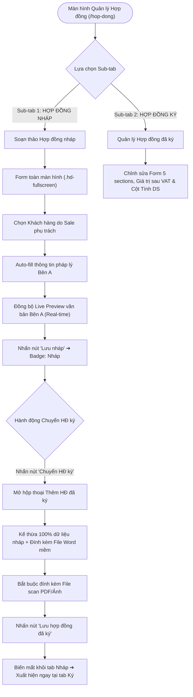
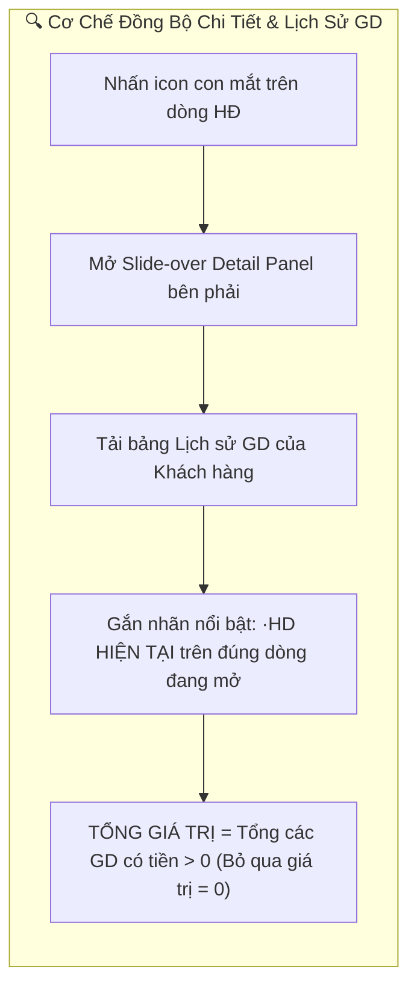
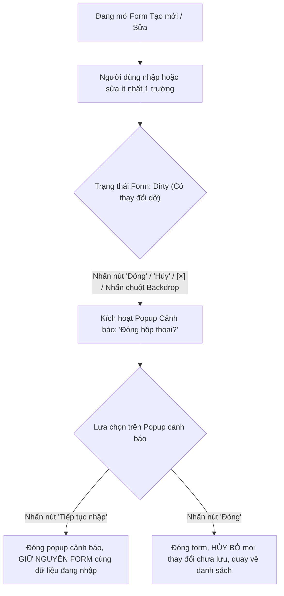

# 📋 TÀI LIỆU ĐẶC TẢ YÊU CẦU CHỨC NĂNG (REQUIREMENTS SPECIFICATION)
## Phân hệ: Kinh doanh & Khách hàng — Hệ thống VNTEST LIMS
### Tính năng: Quản lý Hợp đồng (Contracts Management Screen)

---

| Thông tin tài liệu | Chi tiết |
| :--- | :--- |
| **Mã tài liệu** | `REQ_VNTEST_CONTRACTS` |
| **Tính năng / Màn hình** | Quản lý Hợp đồng (Contracts Management) |
| **Đường dẫn truy cập** | `/hop-dong` |
| **Đối tượng sử dụng** | Nhân viên Kinh doanh (Sale), Kế toán, Lãnh đạo (Giám đốc / Trưởng phòng), Quản trị viên (Admin) |
| **Trạng thái tài liệu** | `Approved / Ready for Development & Testing` |
| **Cơ sở dữ liệu liên kết** | `contracts`, `customers`, `contract_attachments`, `users`, `audit_logs` |
| **Test Script Playwright** | [`src/tests/contracts/contracts.spec.ts`](file:///home/thai.hoang.dinh/VNTEST_Automation/src/tests/contracts/contracts.spec.ts) (78 Test Cases) |
| **Page Object Model** | [`src/pages/contracts.page.ts`](file:///home/thai.hoang.dinh/VNTEST_Automation/src/pages/contracts.page.ts) |
| **Dữ liệu kiểm thử** | [`test-data/users.json`](file:///home/thai.hoang.dinh/VNTEST_Automation/test-data/users.json), `test-data/files/sample-scan.pdf` |

---

## 📑 MỤC LỤC ĐIỀU HƯỚNG NHANH
1. [1. Định vị màn hình & Tổng quan tính năng (Overview & UI Wireframe)](#1-định-vị-màn-hình--tổng-quan-tính-năng-overview--ui-wireframe)
2. [2. Sơ đồ phân tích luồng trực quan (Mermaid Flowcharts)](#2-sơ-đồ-phân-tích-luồng-trực-quan-mermaid-flowcharts)
3. [3. Phân quyền & Điều kiện kích hoạt (Access & Permissions)](#3-phân-quyền--điều-kiện-kích-hoạt-access--permissions)
4. [4. Đặc tả chi tiết các Use Cases chức năng (Functional Use Cases)](#4-đặc-tả-chi-tiết-các-use-cases-chức-năng-functional-use-cases)
5. [5. Đặc tả chi tiết trường dữ liệu (Field Specifications Matrix)](#5-đặc-tả-chi-tiết-trường-dữ-liệu-field-specifications-matrix)
6. [6. Ma trận nút bấm & Tương tác giao diện (Action Buttons Matrix)](#6-ma-trận-nút-bấm--tương-tác-giao-diện-action-buttons-matrix)
7. [7. Quy tắc nghiệp vụ & Luồng xử lý lỗi (Business Rules & Error Handling)](#7-quy-tắc-nghiệp-vụ--luồng-xử-lý-lỗi-business-rules--error-handling)
8. [8. Kế hoạch kiểm thử & Ma trận Test Cases Automation (78 Test Cases)](#8-kế-hoạch-kiểm-thử--ma-trận-test-cases-automation-78-test-cases)

---

## 1. ĐỊNH VỊ MÀN HÌNH & TỔNG QUAN TÍNH NĂNG (OVERVIEW & UI WIREFRAME)

### 1.1. Mục đích tính năng
* **Quản trị vòng đời Hợp đồng 2 giai đoạn:** Tách biệt rõ ràng 2 phân nhánh nghiệp vụ: **Hợp đồng nháp** (soạn thảo điều khoản, thỏa thuận với khách hàng) và **Hợp đồng ký** (hợp đồng pháp lý đã ký kết và đính kèm bản scan).
* **Soạn thảo toàn màn hình & Live Preview:** Hỗ trợ Sale nhập liệu nhanh với cơ chế tự động điền thông tin pháp lý Bên A từ Khách hàng, đồng bộ trực tiếp sang bản xem trước hợp đồng (Live Preview).
* **Chuyển đổi kế thừa tự động (Chuyển HĐ ký):** Kế thừa 100% dữ liệu từ bản nháp sang hợp đồng chính thức, tự động đính kèm file Word mềm đã biên soạn, bắt buộc kiểm soát file scan PDF trước khi lưu.
* **Cơ chế Unsaved Changes Guard:** Cảnh báo người dùng khi vô tình đóng form hoặc nhấp ra ngoài khi dữ liệu đang nhập dở, ngăn chặn tối đa việc mất mát dữ liệu nhập liệu.

### 1.2. Sơ đồ Wireframe Bố cục Giao diện (ASCII Text Wireframe)

```text
+-----------------------------------------------------------------------------------------------------------------------+
|  [ KH - ĐT - HĐ ]  >  [ HỢP ĐỒNG (128) ]                                                                             |
+-----------------------------------------------------------------------------------------------------------------------+
|  [ Hợp đồng nháp (42) ]    [ Hợp đồng ký (86) ]                                                                       |
+-----------------------------------------------------------------------------------------------------------------------+
|  TOOLBAR:                                                                                                             |
|  [+ Thêm]   [ Sửa ]   [ Xóa ]   [ Chuyển HĐ ký ]  |  [Lọc Ngày: Ngày ký v] [Từ] [Đến]  |  [Loại HĐ v]  | [TT: Tất cả v]   |
|  Ô tìm kiếm: [ Nhập mã HĐ, số HĐ, tên HĐ, khách hàng...                    [x] ]                                     |
+-----------------------------------------------------------------------------------------------------------------------+
|  [x] | MÃ HĐ    | SỐ HỢP ĐỒNG              | LOẠI HĐ     | KHÁCH HÀNG              | NGÀY KÝ    | GIÁ TRỊ SAU VAT | ... |
|  [ ] | HĐ-00231 | 28.286.001/HĐDV/VNTEST_1 | Dịch vụ     | Công ty TNHH ABC        | 28/10/2026 | 20.000.000 đ    | (👁)|
|  [ ] | HĐ-00230 | 28.286.002/HĐDV/VNTEST   | Nguyên tắc  | Thái test               | 27/10/2026 | 15.000.000 đ    | (👁)|
+-----------------------------------------------------------------------------------------------------------------------+
|  Đang chọn: 1 HĐ  |  Hiển thị 1 - 20 / 128 bản ghi  |  Trang [ 1 ] 2 3 ...  |  [ Quản lý cột v ]                      |
+-----------------------------------------------------------------------------------------------------------------------+
|  SLIDE-OVER DETAIL PANEL (Mở từ bên phải khi nhấn icon con mắt 👁):                                                    |
|  +-----------------------------------------------------------------------------------------------------------------+  |
|  | [X] CHI TIẾT HỢP ĐỒNG: HĐ-00231 · 28.286.001/HĐDV/VNTEST_1                                    [ Chỉnh sửa ]     |  |
|  | 1. Thông tin hợp đồng: Loại HĐ: Dịch vụ | Khách hàng: Công ty TNHH ABC | Ngày ký: 28/10/2026                     |  |
|  | 2. File mềm & Bản scan đính kèm: [File Word] HD-28.docx | [File Scan] hopdong_signed.pdf (OK)                   |  |
|  | 3. Lịch sử giao dịch của khách hàng:                                                                            |  |
|  |    - [HĐ-00231] Hợp đồng thử nghiệm mẫu 22 · HD HIỆN TẠI --------------------------------------- 20.000.000 đ    |  |
|  |    - [HĐ-00190] Hợp đồng nguyên tắc năm 2025 ------------------------------------------------ 50.000.000 đ    |  |
|  |    => TỔNG GIÁ TRỊ GIAO DỊCH: 70.000.000 đ                                                                      |  |
+-----------------------------------------------------------------------------------------------------------------------+
```

---

## 2. SƠ ĐỒ PHÂN TÍCH LUỒNG TRỰC QUAN (MERMAID FLOWCHARTS)

### 2.1. Sơ đồ Master Flow Vòng đời Quản lý Hợp đồng



### 2.2. Sơ đồ Cơ chế Đồng bộ Chi tiết & Lịch sử Giao dịch (Detail Panel)



### 2.3. Sơ đồ Cơ chế Cảnh báo Chưa lưu (Unsaved Changes Guard)



---

## 3. PHÂN QUYỀN & ĐIỀU KIỆN KÍCH HOẠT (ACCESS & PERMISSIONS)

### 3.1. Ma trận phân quyền truy cập (RBAC Matrix)

| Vai trò người dùng (Role) | Xem danh sách HĐ | Soạn thảo HĐ nháp | Chuyển HĐ ký | Thêm / Sửa HĐ đã ký | Xóa HĐ nháp | Quản lý cột & Xuất file |
| :--- | :---: | :---: | :---: | :---: | :---: | :---: |
| **Quản trị viên (Admin)** | Toàn quyền | Toàn quyền | Toàn quyền | Toàn quyền | Toàn quyền | Cho phép |
| **Lãnh đạo / Giám đốc** | Toàn quyền | Xem & Duyệt | Toàn quyền | Toàn quyền | Toàn quyền | Cho phép |
| **Nhân viên Kinh doanh (Sale)** | Xem HĐ phụ trách | Tạo & Sửa HĐ của mình | Được phép | Tạo mới có scan | HĐ nháp của mình | Cho phép |
| **Kế toán** | Toàn quyền xem | Không | Xác nhận ký | Cập nhật giá trị, Tính DS | Không | Cho phép |
| **Kỹ thuật viên / KNV** | Không có quyền | Không | Không | Không | Không | Bị chặn |

---

## 4. ĐẶC TẢ CHI TIẾT CÁC USE CASES CHỨC NĂNG (FUNCTIONAL USE CASES)

### UC-01: Bố cục, Điều hướng & Trạng thái thanh công cụ (Toolbar States)
* **Tác nhân:** Người dùng có quyền truy cập module Hợp đồng.
* **Tiền điều kiện:** Đã đăng nhập vào hệ thống và điều hướng tới `/hop-dong`.
* **Luồng sự kiện chính:**
  1. Khi chưa chọn dòng nào (0 dòng): Các nút `"Sửa"`, `"Xóa"`, `"Chuyển HĐ ký"` ở trạng thái vô hiệu hóa (`disabled`).
  2. Khi tích chọn đúng 1 dòng: Các nút trên sáng lên, kích hoạt cho phép thao tác đơn lẻ.
  3. Khi tích chọn từ 2 dòng trở lên: Nút `"Sửa"` và `"Chuyển HĐ ký"` tự động vô hiệu hóa; nút `"Xóa"` (tại tab Nháp) vẫn sáng cho phép xóa hàng loạt.
  4. Chuyển đổi giữa 2 sub-tab `Hợp đồng nháp` và `Hợp đồng ký` làm thay đổi các nút chức năng và cột hiển thị tương ứng.

### UC-02: Tìm kiếm từ khóa mở rộng (Comprehensive Search)
* **Tác nhân:** Người dùng muốn tra cứu hợp đồng.
* **Luồng sự kiện chính:**
  1. Người dùng nhập từ khóa vào ô tìm kiếm: Mã HĐ, Số HĐ, Tên HĐ, Tên khách hàng, Mã KH, CTV hoặc Tên Sale.
  2. Hệ thống tự động trim khoảng trắng thừa ở đầu/cuối, không phân biệt hoa/thường hay có dấu/không dấu.
  3. Bảng dữ liệu tự động lọc kết quả phù hợp ngay lập tức; nhấn nút `"Hủy"` (`[×]`) để xóa tìm kiếm và khôi phục toàn bộ danh sách.

### UC-03: Bộ lọc Thời gian theo 3 Tiêu chí Ngày (Date Range Filters)
* **Tác nhân:** Người dùng cần lọc hợp đồng theo mốc thời gian.
* **Luồng sự kiện chính:**
  1. Người dùng chọn 1 trong 3 tiêu chí: `Ngày ký` (mặc định), `Hết hiệu lực`, hoặc `Ngày hết hạn`.
  2. Người dùng có thể lọc theo `Từ ngày`, `Đến ngày`, cả 2 ngày trùng nhau hoặc một khoảng ngày cụ thể.
  3. Bảng chỉ hiển thị các hợp đồng thỏa mãn điều kiện thời gian của tiêu chí đã chọn.

### UC-04: Quản lý Hợp đồng nháp & Cơ chế Live Preview (Full-screen Editor)
* **Tác nhân:** Nhân viên Kinh doanh (Sale).
* **Luồng sự kiện chính:**
  1. Nhấn nút `"Thêm"` tại tab Nháp để mở màn hình soạn thảo toàn màn hình.
  2. Chọn Khách hàng: Hệ thống tự động auto-fill toàn bộ thông tin pháp lý Bên A (Tên, Địa chỉ, Đại diện, Chức vụ, MST, SĐT).
  3. Nhấn nút `"Auto"`: Hệ thống tự động sinh Số hợp đồng mới theo mẫu chuẩn quy định.
  4. Mọi thông tin Bên A tự động đồng bộ sang khung Live Preview văn bản hợp đồng ở nửa bên phải màn hình theo thời gian thực.
  5. Nhấn nút `"Lưu nháp"`: Bản ghi được lưu và hiển thị đầu danh sách tab Nháp với trạng thái `Nháp`.

### UC-05: Luồng nút chức năng "Chuyển HĐ ký" (Kế thừa & Chuyển đổi)
* **Tác nhân:** Nhân viên Kinh doanh, Kế toán.
* **Luồng sự kiện chính:**
  1. Chọn 1 hợp đồng nháp và nhấn nút `"Chuyển HĐ ký"`.
  2. Hộp thoại mở ra kế thừa 100% dữ liệu từ bản nháp và tự động đính kèm file Word mềm đã biên soạn.
  3. Người dùng bắt buộc phải đính kèm ít nhất 1 file scan PDF/Ảnh hợp đồng có chữ ký/con dấu.
  4. Nhấn nút `"Lưu hợp đồng đã ký"`: Hồ sơ biến mất khỏi tab Nháp và xuất hiện ngay tại tab Ký.

### UC-06: Quản lý Hợp đồng đã ký & Ràng buộc cột Tính DS
* **Tác nhân:** Kế toán, Lãnh đạo.
* **Luồng sự kiện chính:**
  1. Form HĐ đã ký gồm 5 sections hoàn chỉnh: Thông tin chung, Giá trị & Chiết khấu, Đính kèm scan, Điều khoản, Tính doanh số.
  2. Tại bảng danh sách bên ngoài, cột `TÍNH DS` hiển thị checkbox ở chế độ chỉ đọc (`readonly`/`disabled`), tuyệt đối không cho phép nhấp chuột sửa trực tiếp từ ngoài bảng để tránh sai lệch số liệu doanh số.

### UC-07: Khung Xem Chi tiết (Detail Panel — HĐ Nháp vs HĐ Ký)
* **Tác nhân:** Người dùng tra cứu chi tiết hợp đồng.
* **Luồng sự kiện chính:**
  1. Nhấn icon con mắt trên dòng hợp đồng để mở Slide-over Detail Panel bên phải.
  2. Panel hiển thị đầy đủ thông tin hợp đồng và danh sách Lịch sử giao dịch của khách hàng tương ứng.
  3. Dòng hợp đồng đang xem được gắn nhãn nổi bật `·HD HIỆN TẠI`.
  4. Hệ thống tự động tính `TỔNG GIÁ TRỊ GIAO DỊCH` bằng tổng các hợp đồng có giá trị $> 0$.

### UC-08: Cơ chế Cảnh báo Thay đổi Chưa lưu "Đóng hộp thoại?"
* **Tác nhân:** Người dùng đang thao tác trên form Tạo mới hoặc Chỉnh sửa.
* **Luồng sự kiện chính:**
  1. Khi form ở trạng thái Dirty (đã nhập/sửa ít nhất 1 ký tự), nếu người dùng nhấn nút `"Đóng"`, `"Hủy"`, icon `[×]` hoặc nhấp chuột ra ngoài vùng tối (Backdrop), hệ thống lập tức hiển thị hộp thoại cảnh báo: `"Đóng hộp thoại? Bạn có thay đổi chưa lưu. Đóng sẽ mất các thay đổi này."`.
  2. Nhấn nút `"Tiếp tục nhập"`: Hộp thoại cảnh báo đóng lại, form giữ nguyên dữ liệu đang nhập dở.
  3. Nhấn nút `"Đóng"`: Hộp thoại và form đóng lại, hủy toàn bộ thay đổi chưa lưu.

---

## 5. ĐẶC TẢ CHI TIẾT TRƯỜNG DỮ LIỆU (FIELD SPECIFICATIONS MATRIX)

| Tên trường | UI Label | Kiểu dữ liệu | Bắt buộc | Ràng buộc & Validation Rules | Giá trị mặc định / Placeholder | Ghi chú |
| :--- | :--- | :--- | :---: | :--- | :--- | :--- |
| `contractCode` | **Mã HĐ** | `text` | Hệ thống sinh | Định dạng `HĐ-xxxxx` tự tăng. Readonly. | Tự động sinh | Khóa không cho phép sửa |
| `contractNumber` | **Số hợp đồng** | `text` | **Bắt buộc** | Định dạng: `28.xxx.001/HĐDV/VNTEST`. Có nút `"Auto"` sinh tự động. | Nhập số HĐ hoặc nhấn Auto | Kiểm tra trùng lặp trên hệ thống |
| `contractType` | **Loại hợp đồng** | `dropdown` | **Bắt buộc** | Chọn 1 trong 8 loại: Dịch vụ, Nguyên tắc, Đơn lẻ, Khung... | Mặc định: `Dịch vụ` | Quy định mẫu điều khoản tương ứng |
| `customerId` | **Khách hàng** | `dropdown/search` | **Bắt buộc** | Chọn từ danh mục khách hàng đã có trong hệ thống. | `Chọn khách hàng...` | Auto-fill toàn bộ thông tin Bên A |
| `signedDate` | **Ngày ký** | `date` | **Bắt buộc** | Định dạng `dd/mm/yyyy`. Không vượt quá ngày hiện tại. | Mặc định: Ngày hiện tại | Dùng để tính ngày hết hiệu lực |
| `durationDays` | **Thời hạn (ngày)** | `number` | **Bắt buộc** | Số nguyên dương $> 0$. | Mặc định: `30` | Tự động cộng Ngày ký ra Ngày hết hiệu lực |
| `totalValueVat` | **Giá trị sau VAT** | `currency` | Không (HĐ ký) | Số tiền VNĐ $\ge 0$. Format có dấu chấm ngăn cách hàng nghìn. | Mặc định: `0 đ` | Áp dụng cho tab Hợp đồng ký |
| `deductionFee` | **Giảm trừ phí** | `currency` | Không (HĐ ký) | Số tiền VNĐ $\ge 0$. | Mặc định: `0 đ` | Giảm trừ hoa hồng / chiết khấu ngoài |
| `scanAttachment`| **File scan đính kèm**| `file` | **Bắt buộc (HĐ ký)** | Chấp nhận `.pdf`, `.png`, `.jpg`. Dung lượng tối đa 20MB. | Chưa có tệp nào | Bắt buộc kiểm tra khi Lưu HĐ đã ký |
| `calculateCommission`| **Tính doanh số** | `checkbox` | Không | Giá trị boolean `true`/`false`. | Mặc định: `true` | Readonly ngoài bảng danh sách |

---

## 6. MA TRẬN NÚT BẤM & TƯƠNG TÁC GIAO DIỆN (ACTION BUTTONS MATRIX)

| Tên nút (Button) | Vị trí | Icon / Class | Trạng thái mặc định | Điều kiện kích hoạt | Hành vi khi nhấn | Modal / Thông báo đi kèm |
| :--- | :--- | :--- | :---: | :--- | :--- | :--- |
| **Thêm** | Toolbar trên bảng | `.btn-add` | **Kích hoạt** | Luôn sẵn sàng | Mở màn hình soạn thảo HĐ nháp (toàn màn hình) hoặc form HĐ ký | Mở modal / editor |
| **Sửa** | Toolbar trên bảng | `.btn-edit` | **Vô hiệu hóa** | Tích chọn duy nhất 1 dòng | Mở màn hình chỉnh sửa hợp đồng tương ứng | Tải dữ liệu cũ vào form |
| **Xóa** | Toolbar tab Nháp | `.btn-delete` | **Vô hiệu hóa** | Tích chọn $\ge 1$ dòng nháp | Mở hộp thoại xác nhận xóa hợp đồng | Popup: `"Bạn có chắc muốn xóa...?"` |
| **Chuyển HĐ ký** | Toolbar tab Nháp | `.btn-convert` | **Vô hiệu hóa** | Tích chọn duy nhất 1 dòng nháp | Mở hộp thoại kế thừa dữ liệu chuyển sang HĐ ký | Modal: `"Thêm hợp đồng đã ký"` |
| **Auto** | Cạnh ô Số hợp đồng | `.btn-auto-num` | **Kích hoạt** | Đang mở form tạo mới | Tự động sinh Số HĐ chuẩn theo tiền tố phòng ban | Điền chuỗi số HĐ mới |
| **Xuất Word** | Header form soạn thảo | `.btn-export-doc`| **Kích hoạt** | Đang ở form soạn thảo | Xuất toàn bộ nội dung Live Preview thành file `.docx` | Tải file về máy |
| **In** | Header form soạn thảo | `.btn-print` | **Kích hoạt** | Đang ở form soạn thảo | Mở hộp thoại in ấn của trình duyệt | Mở Print Preview trình duyệt |
| **Lưu nháp** | Chân form soạn thảo | `.btn-save-draft`| **Kích hoạt** | Form hợp lệ | Lưu thông tin hợp đồng vào hệ thống | Thông báo: `"Đã lưu hợp đồng nháp."` |
| **Lưu HĐ đã ký** | Chân form HĐ ký | `.btn-save-signed`| **Kích hoạt** | Form hợp lệ + Có file scan | Lưu hợp đồng chính thức vào tab Ký | Thông báo: `"Thêm hợp đồng đã ký thành công."` |
| **Tiếp tục nhập** | Popup cảnh báo chưa lưu| `.btn-continue` | **Kích hoạt** | Đang mở popup cảnh báo | Đóng popup cảnh báo, tiếp tục giữ form soạn thảo | Đóng popup cảnh báo |
| **Đóng / Hủy** | Chân modal & popup | `.btn-close` / `[×]` | **Kích hoạt** | Luôn sẵn sàng | Kiểm tra dirty state trước khi đóng form | Đóng form hoặc mở popup cảnh báo |

---

## 7. QUY TẮC NGHIỆP VỤ & LUỒNG XỬ LÝ LỖI (BUSINESS RULES & ERROR HANDLING)

| Mã lỗi (Code) | Quy tắc nghiệp vụ (Business Rule) | Điều kiện kích hoạt | Vị trí hiển thị | Câu thông báo lỗi hiển thị (Error Message) |
| :--- | :--- | :--- | :--- | :--- |
| `ERR_CONTRACT_NUM_REQ` | Số hợp đồng là bắt buộc | Bỏ trống ô Số hợp đồng khi nhấn Lưu | Dưới ô Số hợp đồng | **"Vui lòng nhập số hợp đồng."** |
| `ERR_CUSTOMER_REQ` | Khách hàng là bắt buộc | Chưa chọn khách hàng khi nhấn Lưu | Dưới dropdown Khách hàng | **"Vui lòng chọn khách hàng."** |
| `ERR_SCAN_FILE_REQ` | Bắt buộc đính kèm File scan | Chuyển HĐ ký hoặc Thêm HĐ ký mà thiếu file scan | Khu vực đính kèm file | **"Vui lòng đính kèm ít nhất một bản scan hợp đồng đã ký."** |
| `ERR_DIRTY_CLOSE` | Cảnh báo mất dữ liệu chưa lưu | Đóng form khi đã chỉnh sửa ít nhất 1 trường | Popup giữa màn hình | **"Đóng hộp thoại? Bạn có thay đổi chưa lưu. Đóng sẽ mất các thay đổi này."** |
| `RULE_COMMISSION_RO` | Cột Tính DS chỉ đọc ngoài bảng | Nhấp chuột vào checkbox cột Tính DS ngoài bảng | Trạng thái ô checkbox | Checkbox có thuộc tính `disabled`, không thay đổi trạng thái |

---

## 8. KẾ HOẠCH KIỂM THỬ & MA TRẬN TEST CASES AUTOMATION (78 TEST CASES)

### 8.1. Khối 01: Bố cục, Điều hướng & Trạng thái thanh công cụ (6 Test Cases)

| Mã TC | Phân nhóm luồng | Tên kịch bản | Thao tác & Dữ liệu kiểm thử | Kết quả mong đợi | Mức độ ưu tiên | Mapping Page Object |
| :--- | :--- | :--- | :--- | :--- | :---: | :--- |
| **TC_NAV_01** | Bố cục & Thanh công cụ | Hiển thị thành phần tổng quan | 1. Mở trang Quản lý Hợp đồng.<br><br>2. Quan sát cấu trúc tổng thể màn hình. | 1. Hiển thị cụm tab module `KH - ĐT - HĐ`, tab `HỢP ĐỒNG` đang active kèm tổng số lượng (VD: `128`).<br><br>2. Hiển thị 2 sub-tab `Hợp đồng nháp` và `Hợp đồng ký`, thanh công cụ, bộ lọc, ô tìm kiếm và bảng dữ liệu. | Normal | `contractsPage.subtabDraft`, `contractsPage.subtabSigned` |
| **TC_NAV_02** | Bố cục & Thanh công cụ | Chuyển đổi giữa 2 sub-tab | 1. Chuyển đổi giữa 2 sub-tab `Hợp đồng nháp` và `Hợp đồng ký`. | 1. Tab `Hợp đồng nháp`: Toolbar có 4 nút `"Thêm"`, `"Sửa"`, `"Xóa"`, `"Chuyển HĐ ký"`; bộ lọc ẩn dropdown `TT`.<br><br>2. Tab `Hợp đồng ký`: Toolbar chỉ có 2 nút `"Thêm"`, `"Sửa"` (không có nút Xóa); bộ lọc hiện thêm `TT: Tất cả`; bảng có thêm 4 cột: `GIÁ TRỊ SAU VAT`, `GIẢM TRỪ PHÍ`, `TÀI LIỆU`, `TÍNH DS`. | Normal | `contractsPage.switchSubtab()` |
| **TC_NAV_03** | Bố cục & Thanh công cụ | Trạng thái Toolbar khi chưa chọn dòng | 1. Mở danh sách, chưa tích chọn ô checkbox nào. | 1. Các nút `"Sửa"`, `"Xóa"`, `"Chuyển HĐ ký"` (ở tab Nháp) và nút `"Sửa"` (ở tab Ký) ở trạng thái vô hiệu hóa (`disabled`), mờ đi. | Normal | `contractsPage.btnEdit`, `contractsPage.btnDelete`, `contractsPage.btnConvertSigned` |
| **TC_NAV_04** | Bố cục & Thanh công cụ | Trạng thái Toolbar khi chọn đúng 1 dòng | 1. Tích chọn duy nhất 1 dòng hợp đồng bất kỳ. | 1. Các nút `"Sửa"`, `"Xóa"`, `"Chuyển HĐ ký"` sáng lên (kích hoạt).<br><br>2. Hiển thị dòng trạng thái: `Đang chọn 1 HĐ`. | Normal | `contractsPage.selectSingleRow()` |
| **TC_NAV_05** | Bố cục & Thanh công cụ | Trạng thái Toolbar khi chọn nhiều dòng | 1. Tích chọn từ 2 dòng trở lên (hoặc tích chọn tất cả ở Header). | 1. Nút `"Sửa"` và nút `"Chuyển HĐ ký"` tự động vô hiệu hóa (chỉ cho phép thao tác đơn lẻ).<br><br>2. Nút `"Xóa"` (ở tab Nháp) vẫn kích hoạt (cho phép xóa hàng loạt). | Normal | `contractsPage.selectAllCheckbox` |
| **TC_NAV_06** | Bố cục & Thanh công cụ | Quản lý ẩn/hiện cột và Phân trang | 1. Nhấn nút `"Quản lý cột"`.<br><br>2. Chuyển trang (`1`, `2`) và đổi số dòng trên trang (`20`, `50`). | 1. Popover hiển thị đầy đủ danh sách cột; bỏ tích cột nào thì cột đó ẩn ngay trên bảng.<br><br>2. Phân trang tải đúng số lượng dòng và cập nhật chỉ số dòng tương ứng. | Normal | `contractsPage.manageColumns()` |

### 8.2. Khối 02: Tìm kiếm từ khóa mở rộng (14 Test Cases)

| Mã TC | Phân nhóm luồng | Tên kịch bản | Thao tác & Dữ liệu kiểm thử | Kết quả mong đợi | Mức độ ưu tiên | Mapping Page Object |
| :--- | :--- | :--- | :--- | :--- | :---: | :--- |
| **TC_SRC_01** | Tìm kiếm từ khóa | Tìm chính xác Mã HĐ chữ hoa | 1. Nhập Mã HĐ chữ hoa vào ô tìm kiếm: `HĐ-00231`. | Bảng dữ liệu tự động lọc và chỉ hiển thị đúng 1 dòng có Mã HĐ `HĐ-00231`. | High | `contractsPage.search('HĐ-00231')` |
| **TC_SRC_02** | Tìm kiếm từ khóa | Tìm theo số của Mã HĐ | 1. Nhập phần số của Mã HĐ: `00231` hoặc `231`. | Trả về đúng bản ghi `HĐ-00231`. | Normal | `contractsPage.search('00231')` |
| **TC_SRC_03** | Tìm kiếm từ khóa | Tìm Mã HĐ chữ thường | 1. Nhập `hđ-00231` hoặc `Hđ-00231`. | Không phân biệt hoa/thường, trả về đúng bản ghi `HĐ-00231`. | Normal | `contractsPage.search('hđ-00231')` |
| **TC_SRC_04** | Tìm kiếm từ khóa | Tìm chính xác toàn bộ Số hợp đồng | 1. Nhập toàn bộ Số HĐ văn bản thực tế: `28.286.001/HĐDV/VNTEST_1`. | Trả về đúng bản ghi có Số HĐ tương ứng. | High | `contractsPage.search('28.286.001/HĐDV/VNTEST_1')` |
| **TC_SRC_05** | Tìm kiếm từ khóa | Tìm một phần Số HĐ | 1. Nhập phân đoạn của Số HĐ: `28.286.001`, `BIEN.031D`, `/HĐDV/VNTEST`. | Lọc ra các hợp đồng có chứa cụm phân đoạn đó. | Normal | `contractsPage.search('28.286.001')` |
| **TC_SRC_06** | Tìm kiếm từ khóa | Tìm chính xác / một phần Tên HĐ | 1. Nhập từ khóa tên hợp đồng: `Hợp đồng kiểm nghiệm mẫu_22`, `mẫu_14`. | Lọc chính xác các hợp đồng có tên chứa từ khóa. | High | `contractsPage.search('Hợp đồng kiểm nghiệm mẫu_22')` |
| **TC_SRC_07** | Tìm kiếm từ khóa | Tìm Tên HĐ chữ thường / không dấu | 1. Nhập tên HĐ không dấu hoặc chữ thường: `hợp đồng kiểm nghiệm mẫu_22`, `Hop dong`. | Trả về đúng bản ghi tương ứng. | Normal | `contractsPage.search('Hop dong')` |
| **TC_SRC_08** | Tìm kiếm từ khóa | Tìm theo Tên Khách hàng | 1. Nhập tên khách hàng vào ô tìm kiếm: `Thái test`, `Công ty TNHH ABC Việt Nam`. | Lọc ra tất cả hợp đồng thuộc về khách hàng đó. | High | `contractsPage.search('Thái test')` |
| **TC_SRC_09** | Tìm kiếm từ khóa | Tìm Tên KH có ký tự đặc biệt | 1. Nhập tên đơn vị có ký tự đặc biệt: `Sơn & Hóa chất`, `(Đơn vị #495)`, `#498`. | Lọc chính xác các doanh nghiệp có ký tự đặc thù. | Normal | `contractsPage.search('Sơn & Hóa chất')` |
| **TC_SRC_10** | Tìm kiếm từ khóa | Mở rộng tìm theo Mã KH / CTV / Sale | 1. Nhập mã định danh phụ trợ vào ô tìm kiếm: `KH-0164`, `CTV-002`, `Admin User`. | Kiểm tra phạm vi lọc các trường mã định danh phụ trợ trên bảng. | Normal | `contractsPage.search('KH-0164')` |
| **TC_SRC_11** | Tìm kiếm từ khóa | Tìm kiếm có khoảng trắng thừa | 1. Nhập từ khóa có khoảng trắng bao quanh: `"   HĐ-00231   "`, `"  Thái test  "`. | Hệ thống tự động trim khoảng trắng thừa, trả về kết quả đúng. | Low | `contractsPage.search('   HĐ-00231   ')` |
| **TC_SRC_12** | Tìm kiếm từ khóa | Tìm từ khóa không tồn tại | 1. Nhập từ khóa không tồn tại: `KHONG_TON_TAI_99999`, `@#$%^&*~`. | Bảng hiển thị thông báo: `"Không tìm thấy hợp đồng nào phù hợp."`. | Low | `contractsPage.search('KHONG_TON_TAI_99999')` |
| **TC_SRC_13** | Tìm kiếm từ khóa | Xóa từ khóa bằng nút "Hủy" | 1. Nhấn nút `"Hủy"` (`[×]`) trong ô tìm kiếm. | Ô tìm kiếm về rỗng, nút `"Hủy"` ẩn đi, bảng khôi phục đầy đủ số lượng ban đầu. | Normal | `contractsPage.clearSearch()` |
| **TC_SRC_14** | Tìm kiếm từ khóa | Giữ từ khóa khi chuyển đổi sub-tab | 1. Nhập `Thái test` tại tab Nháp.<br><br>2. Chuyển sang tab Ký. | Từ khóa giữ nguyên trên ô tìm kiếm, tab Ký hiển thị đúng hợp đồng `HĐ-00230` của `Thái test`. | Normal | `contractsPage.switchSubtab()` |

### 8.3. Khối 03: Bộ lọc Thời gian theo 3 Tiêu chí Ngày (9 Test Cases)

| Mã TC | Phân nhóm luồng | Tên kịch bản | Thao tác & Dữ liệu kiểm thử | Kết quả mong đợi | Mức độ ưu tiên | Mapping Page Object |
| :--- | :--- | :--- | :--- | :--- | :---: | :--- |
| **TC_DATE_01** | Bộ lọc Thời gian | Hiển thị dropdown loại ngày và lịch | 1. Nhấn mở dropdown loại ngày.<br><br>2. Nhấn ô `TỪ dd/mm/yyyy`. | 1. Dropdown hiện đủ 3 lựa chọn: `Ngày ký` (mặc định), `Hết hiệu lực`, `Ngày hết hạn`.<br><br>2. Popup lịch có đủ nút `Hôm nay`, `Xóa`. | Normal | `contractsPage.dateTypeTrigger` |
| **TC_DATE_02** | Bộ lọc Thời gian | Lọc Ngày ký — Chỉ chọn TỪ ngày | 1. Tiêu chí: `Ngày ký`.<br><br>2. Chọn `TỪ`: `28/10/2026`, để trống `ĐẾN`. | Mọi dòng hiển thị đều có cột **`NGÀY KÝ` $\ge$ `28/10/2026`** (VD: `28/10`, `30/10`, `31/10`, `01/11`). | High | `contractsPage.filterByDateRange()` |
| **TC_DATE_03** | Bộ lọc Thời gian | Lọc Ngày ký — Chỉ chọn ĐẾN ngày | 1. Tiêu chí: `Ngày ký`.<br><br>2. Chọn `ĐẾN`: `27/10/2026`, để trống `TỪ`. | Mọi dòng hiển thị đều có cột **`NGÀY KÝ` $\le$ `27/10/2026`** (VD: `27/10`, `26/10`, `01/10`). | High | `contractsPage.filterByDateRange()` |
| **TC_DATE_04** | Bộ lọc Thời gian | Lọc Ngày ký — TỪ ngày = ĐẾN ngày | 1. Tiêu chí: `Ngày ký`.<br><br>2. Chọn cả `TỪ` và `ĐẾN` đều là: `28/10/2026`. | Chỉ hiển thị các hợp đồng có `NGÀY KÝ` đúng ngày `28/10/2026`. | Normal | `contractsPage.filterByDateRange()` |
| **TC_DATE_05** | Bộ lọc Thời gian | Lọc Ngày ký — Khoảng ngày (TỪ < ĐẾN) | 1. Tiêu chí: `Ngày ký`.<br><br>2. Chọn `TỪ`: `25/10/2026` ➔ `ĐẾN`: `28/10/2026`. | Mọi dòng hiển thị đều có `NGÀY KÝ` nằm trong khoảng từ `25/10/2026` đến `28/10/2026`. | High | `contractsPage.filterByDateRange()` |
| **TC_DATE_06** | Bộ lọc Thời gian | Lọc Hết hiệu lực — Khoảng ngày | 1. Đổi tiêu chí sang: `Hết hiệu lực`.<br><br>2. Chọn khoảng từ `20/11/2026` đến `30/11/2026`. | Mọi dòng hiển thị đều có ngày hết hiệu lực nằm trong khoảng chỉ định. | High | `contractsPage.filterByDateRange()` |
| **TC_DATE_07** | Bộ lọc Thời gian | Lọc Ngày hết hạn — Khoảng ngày | 1. Đổi tiêu chí sang: `Ngày hết hạn`.<br><br>2. Chọn khoảng ngày hết hạn thực tế. | Lọc chính xác các hợp đồng theo ngày hết hạn thực tế. | Normal | `contractsPage.filterByDateRange()` |
| **TC_DATE_08** | Bộ lọc Thời gian | Xóa bộ lọc ngày bằng nút "Hủy" | 1. Đang có điều kiện lọc ngày.<br><br>2. Nhấn nút `"Hủy"` (`[×]`) cạnh bộ lọc ngày. | Cả 2 ô `TỪ` và `ĐẾN` được xóa trắng, bảng khôi phục đầy đủ số lượng bản ghi ban đầu. | Normal | `contractsPage.clearDateFilter()` |
| **TC_DATE_09** | Bộ lọc Thời gian | Giữ bộ lọc ngày khi đổi sub-tab | 1. Đặt bộ lọc ngày tại tab Nháp.<br><br>2. Chuyển sang tab Ký và ngược lại. | Bộ lọc ngày giữ nguyên tiêu chí và khoảng ngày đã chọn, bảng tab Ký áp dụng đúng điều kiện lọc đó. | Normal | `contractsPage.switchSubtab()` |

### 8.4. Khối 04: Bộ lọc Trạng thái (TT) & Loại hợp đồng (5 Test Cases)

| Mã TC | Phân nhóm luồng | Tên kịch bản | Thao tác & Dữ liệu kiểm thử | Kết quả mong đợi | Mức độ ưu tiên | Mapping Page Object |
| :--- | :--- | :--- | :--- | :--- | :---: | :--- |
| **TC_TYP_01** | Bộ lọc Trạng thái | Lọc theo từng Loại hợp đồng | 1. Lần lượt chọn 8 loại: `Dịch vụ`, `Nguyên tắc`, `Đơn lẻ`, `Khung`... | Bảng chỉ hiển thị các hợp đồng có cột `LOẠI HĐ` khớp với lựa chọn. | High | `contractsPage.filterByContractType()` |
| **TC_TYP_02** | Bộ lọc Trạng thái | Lọc Loại HĐ trả về danh sách rỗng | 1. Chọn loại hợp đồng chưa có bản ghi phát sinh (VD: `Đào tạo`). | Bảng hiển thị thông báo danh sách trống `"Không có dữ liệu"`. | Low | `contractsPage.filterByContractType()` |
| **TC_TYP_03** | Bộ lọc Trạng thái | Reset bộ lọc Loại HĐ về "Tất cả" | 1. Chọn lại `Loại HĐ: Tất cả`. | Bảng hiển thị lại đầy đủ tất cả các loại hợp đồng. | Normal | `contractsPage.filterByContractType('all')` |
| **TC_TYP_04** | Bộ lọc Trạng thái | Lọc Trạng thái (TT) tại tab Ký | 1. Chuyển sang tab Ký.<br><br>2. Lần lượt lọc: `Chưa thực hiện`, `Đang thực hiện`, `Hoàn thành`. | Bảng lọc đúng theo từng trạng thái vòng đời của hợp đồng đã ký. | High | `contractsPage.filterByStatus()` |
| **TC_TYP_05** | Bộ lọc Trạng thái | Kết hợp đồng thời 3 bộ lọc | 1. Kết hợp: Tìm kiếm `Thái` + Lọc `Loại HĐ: Dịch vụ` + `TT: Hoàn thành`. | Bảng áp dụng đồng thời cả 3 điều kiện (logic AND), trả về bản ghi chính xác. | High | `contractsPage.search()`, `filterByContractType()`, `filterByStatus()` |

### 8.5. Khối 05: Quản lý Hợp đồng nháp & Live Preview (14 Test Cases)

| Mã TC | Phân nhóm luồng | Tên kịch bản | Thao tác & Dữ liệu kiểm thử | Kết quả mong đợi | Mức độ ưu tiên | Mapping Page Object |
| :--- | :--- | :--- | :--- | :--- | :---: | :--- |
| **TC_DFT_01** | Hợp đồng nháp | Mở màn hình Tạo HĐ nháp toàn màn hình | 1. Nhấn nút `"Thêm"` tại tab Nháp. | Mở giao diện soạn thảo toàn màn hình (`.hd-fullscreen`); có 2 cột: Cột trái nhập liệu, cột phải `Live Preview`. | High | `contractsPage.openCreateDraftModal()` |
| **TC_DFT_02** | Hợp đồng nháp | Validate các trường bắt buộc | 1. Để trống các trường bắt buộc.<br><br>2. Nhấn nút `"Lưu nháp"`. | Viền đỏ các trường bắt buộc: `Số hợp đồng`, `Khách hàng`, `Ngày ký`, `Hiệu lực`; hiển thị câu cảnh báo lỗi tương ứng. | High | `contractsPage.saveDraft()` |
| **TC_DFT_03** | Hợp đồng nháp | Dropdown KH chỉ hiện KH do Sale quản lý | 1. Nhấn mở dropdown Khách hàng. | Danh sách chỉ hiển thị các khách hàng được phân quyền quản lý cho Sale đang đăng nhập. | High | `contractsPage.draftCustomerDropdown` |
| **TC_DFT_04** | Hợp đồng nháp | Tìm kiếm khách hàng trong dropdown | 1. Nhập từ khóa tên/mã KH vào dropdown. | Dropdown lọc nhanh danh sách khách hàng khớp từ khóa. | Normal | `contractsPage.searchCustomerInDraft()` |
| **TC_DFT_05** | Hợp đồng nháp | Tự động điền thông tin pháp lý Bên A | 1. Chọn khách hàng doanh nghiệp có đầy đủ hồ sơ pháp lý. | Tự động điền đầy đủ: `Đơn vị`, `Địa chỉ`, `Người đại diện`, `Chức vụ`, `Mã số thuế`, `Số điện thoại`. | High | `contractsPage.fillDraftCustomer()` |
| **TC_DFT_06** | Hợp đồng nháp | Chọn KH thiếu một số trường phụ trợ | 1. Chọn KH cá nhân hoặc đơn vị thiếu MST / Người đại diện. | Các trường có sẵn tự động điền, các trường thiếu để trống bình thường mà không gây lỗi crash. | Normal | `contractsPage.fillDraftCustomer()` |
| **TC_DFT_07** | Hợp đồng nháp | Cho phép sửa tay thông tin pháp lý Bên A | 1. Chỉnh sửa thủ công: Đổi Người đại diện, đổi SĐT Bên A. | Cho phép sửa trực tiếp; dữ liệu sửa được lưu lại theo hợp đồng mà không ghi đè vào hồ sơ gốc của khách hàng. | High | `contractsPage.draftRepresentInput` |
| **TC_DFT_08** | Hợp đồng nháp | Đồng bộ Live Preview văn bản thời gian thực | 1. Gõ thay đổi Tên đơn vị, Người đại diện tại form bên trái. | Văn bản hợp đồng bên phải tự động cập nhật ngay lập tức theo từng ký tự gõ. | High | `contractsPage.draftPreviewPanel` |
| **TC_DFT_09** | Hợp đồng nháp | Nhấn nút "Auto" sinh Số hợp đồng | 1. Nhấn nút `"Auto"` cạnh ô `Số hợp đồng`. | Tự động sinh số hợp đồng mới theo định dạng chuẩn (VD: `29.xxx.001/HĐDV/VNTEST`). | Normal | `contractsPage.autoGenerateContractNumber()` |
| **TC_DFT_10** | Hợp đồng nháp | Tự động tính ngày Hết hiệu lực | 1. Đổi Ngày ký hoặc đổi số ngày hiệu lực (mặc định `30`). | Ô `Hết hiệu lực` tự động cộng dồn số ngày chính xác; đồng bộ sang điều khoản Điều 3 của văn bản hợp đồng bên phải. | High | `contractsPage.draftDurationDaysInput` |
| **TC_DFT_11** | Hợp đồng nháp | Tạo mới Hợp đồng nháp thành công | 1. Điền đầy đủ thông tin hợp lệ.<br><br>2. Nhấn nút `"Lưu nháp"`. | Đóng màn hình soạn thảo; bản ghi mới xuất hiện đầu danh sách `Hợp đồng nháp` với trạng thái `Nháp`. | High | `contractsPage.saveDraft()` |
| **TC_DFT_12** | Hợp đồng nháp | Tiện ích "Xuất Word" và "In" | 1. Nhấn nút `"Xuất Word"` và nhấn nút `"In"`. | Kích hoạt tải về file Word `.docx` và mở cửa sổ in ấn trình duyệt. | Normal | `contractsPage.btnExportWord`, `contractsPage.btnPrint` |
| **TC_DFT_13** | Hợp đồng nháp | Chỉnh sửa HĐ nháp & Đồng bộ 3 màn hình | 1. Tích chọn 1 HĐ nháp ➔ Nhấn nút `"Sửa"`.<br><br>2. Thay đổi: Tên HĐ mới, chọn KH mới, đổi Ngày ký.<br><br>3. Nhấn nút `"Lưu nháp"`.<br><br>4. Mở xem chi tiết và mở lại form sửa. | 1. Hiển thị thông báo lưu thành công và đóng màn hình soạn thảo.<br><br>2. Đồng bộ ngoài List và trong Detail Panel.<br><br>3. Khi mở lại: Toàn bộ form và Live Preview giữ nguyên 100% dữ liệu mới. | High | `contractsPage.saveDraft()` |
| **TC_DFT_14** | Hợp đồng nháp | Xóa Hợp đồng nháp đơn lẻ & Hàng loạt | 1. Tích chọn 1 hoặc nhiều HĐ nháp ➔ Nhấn nút `"Xóa"`.<br><br>2. Kiểm tra Hủy xóa / Xác nhận xóa. | Hủy thì giữ nguyên; Xác nhận xóa thì bản ghi biến mất khỏi danh sách, giảm số đếm badge `Hợp đồng nháp`. | High | `contractsPage.btnDelete` |

### 8.6. Khối 06: Luồng Nút chức năng "Chuyển HĐ ký" (5 Test Cases)

| Mã TC | Phân nhóm luồng | Tên kịch bản | Thao tác & Dữ liệu kiểm thử | Kết quả mong đợi | Mức độ ưu tiên | Mapping Page Object |
| :--- | :--- | :--- | :--- | :--- | :---: | :--- |
| **TC_CNV_01** | Chuyển HĐ ký | Điều kiện kích hoạt nút "Chuyển HĐ ký" | 1. Thử khi: (1) Chưa chọn dòng, (2) Chọn 1 dòng, (3) Chọn $\ge 2$ dòng. | (1) 0 dòng: `disabled`; (2) Chọn 1 dòng: `enabled` (sáng xanh); (3) Chọn $\ge 2$ dòng: tự động `disabled`. | Normal | `contractsPage.btnConvertSigned` |
| **TC_CNV_02** | Chuyển HĐ ký | Tự động kế thừa dữ liệu HĐ nháp | 1. Chọn 1 dòng HĐ nháp ➔ Nhấn nút `"Chuyển HĐ ký"`. | Mở hộp thoại `Thêm hợp đồng đã ký`: mục ① gắn sẵn mã nguồn; mục ② sao chép 100% thông tin pháp lý; mục ④ tự động gắn File Word mềm đã biên soạn. | High | `contractsPage.clickConvertSigned()` |
| **TC_CNV_03** | Chuyển HĐ ký | Đổi HĐ nháp nguồn khác trong hộp thoại | 1. Chọn sang mã HĐ nháp khác tại dropdown nguồn. | Toàn bộ mục ② và tên File Word mềm tại mục ④ tự động cập nhật lại theo hợp đồng mới. | Normal | `contractsPage.convertSourceDropdown` |
| **TC_CNV_04** | Chuyển HĐ ký | Validate bắt buộc File scan hợp đồng | 1. Nhấn nút `"Lưu hợp đồng đã ký"` khi chưa đính kèm file scan. | Viền cam báo lỗi `has-error`, hiển thị thông báo lỗi: `"Vui lòng đính kèm ít nhất một bản scan hợp đồng đã ký."`. | High | `contractsPage.saveSignedContract()` |
| **TC_CNV_05** | Chuyển HĐ ký | Hoàn tất chuyển HĐ nháp sang HĐ ký E2E | 1. Nhập Giá trị sau VAT, Giảm trừ phí, Trạng thái.<br><br>2. Đính kèm file scan PDF.<br><br>3. Nhấn nút `"Lưu hợp đồng đã ký"`. | 1. Hợp đồng chuyển đổi biến mất khỏi tab `Hợp đồng nháp`.<br><br>2. Xuất hiện ngay lập tức tại đầu danh sách tab `Hợp đồng ký` với đầy đủ thông tin và file scan đính kèm. | High | `contractsPage.saveSignedContract()` |

### 8.7. Khối 07: Quản lý Hợp đồng đã ký & Ràng buộc cột Tính DS (6 Test Cases)

| Mã TC | Phân nhóm luồng | Tên kịch bản | Thao tác & Dữ liệu kiểm thử | Kết quả mong đợi | Mức độ ưu tiên | Mapping Page Object |
| :--- | :--- | :--- | :--- | :--- | :---: | :--- |
| **TC_SGN_01** | Hợp đồng đã ký | Thêm mới HĐ đã ký trực tiếp | 1. Nhấn nút `"Thêm"` tại tab Ký.<br><br>2. Điền đầy đủ 5 sections + đính kèm file scan PDF.<br><br>3. Nhấn nút `"Lưu hợp đồng đã ký"`. | Tạo thành công hợp đồng đã ký trực tiếp mà không cần qua bước tạo nháp. Bản ghi xuất hiện đầu danh sách tab Ký. | High | `contractsPage.saveSignedContract()` |
| **TC_SGN_02** | Hợp đồng đã ký | Validate các trường bắt buộc Form 5 sections | 1. Để trống các trường bắt buộc và không đính kèm file scan.<br><br>2. Nhấn nút `"Lưu hợp đồng đã ký"`. | Hệ thống chặn lưu, báo lỗi tại các trường bắt buộc: Số HĐ, Khách hàng, Ngày ký, File scan. | High | `contractsPage.saveSignedContract()` |
| **TC_SGN_03** | Hợp đồng đã ký | Kiểm tra tính toán Giá trị sau VAT & Giảm trừ phí | 1. Nhập `Giá trị sau VAT` và `Giảm trừ phí`. | Format tiền tệ có dấu phân cách hàng nghìn; hiển thị chính xác ngoài bảng danh sách và trong panel chi tiết. | High | `contractsPage.signedValueVatInput` |
| **TC_SGN_04** | Hợp đồng đã ký | Chỉnh sửa HĐ đã ký & Đồng bộ 3 màn hình | 1. Tích chọn 1 HĐ ký ➔ Nhấn nút `"Sửa"`.<br><br>2. Sửa Giá trị sau VAT, Trạng thái, đính kèm thêm scan.<br><br>3. Nhấn nút `"Lưu hợp đồng đã ký"`. | Lưu thành công; thông tin mới cập nhật ngay ngoài bảng danh sách, bên trong Detail Panel và lưu giữ khi mở lại form sửa. | High | `contractsPage.saveSignedContract()` |
| **TC_SGN_05** | Hợp đồng đã ký | Ràng buộc Cột Tính DS ngoài bảng | 1. Thao tác nhấp chuột trực tiếp vào checkbox tại cột `TÍNH DS` ngoài bảng. | Checkbox có thuộc tính `disabled`, hoàn toàn không cho phép tích/bỏ tích trực tiếp từ ngoài bảng để tránh sai lệch doanh số. | High | `contractsPage.tableCommissionCheckboxes` |
| **TC_SGN_06** | Hợp đồng đã ký | Thay đổi trạng thái Tính DS bên trong form sửa | 1. Mở form sửa HĐ đã ký.<br><br>2. Bật/tắt checkbox `Tính doanh số` bên trong form ➔ Nhấn nút `"Lưu hợp đồng đã ký"`. | Trạng thái checkbox `TÍNH DS` ngoài bảng danh sách cập nhật chính xác theo giá trị mới vừa lưu. | High | `contractsPage.signedCommissionCheckbox` |

### 8.8. Khối 08: Khung Xem Chi tiết (Detail Panel — 15 Test Cases)

| Mã TC | Phân nhóm luồng | Tên kịch bản | Thao tác & Dữ liệu kiểm thử | Kết quả mong đợi | Mức độ ưu tiên | Mapping Page Object |
| :--- | :--- | :--- | :--- | :--- | :---: | :--- |
| **TC_DTL_01** | Khung Xem Chi tiết | Mở panel chi tiết của HĐ nháp | 1. Nhấn icon con mắt trên dòng HĐ nháp. | Mở Slide-over Detail Panel bên phải với tiêu đề `CHI TIẾT HỢP ĐỒNG` và mã HĐ tương ứng. | High | `contractsPage.openDetailPanel()` |
| **TC_DTL_02** | Khung Xem Chi tiết | Cấu trúc nội dung panel HĐ nháp | 1. Quan sát các phần thông tin trong panel HĐ nháp. | Hiển thị: Thông tin HĐ, Bên A, Thời hạn hiệu lực; File mềm có nhãn `Chưa ký`; mục `Lịch sử GD của khách hàng`. | Normal | `contractsPage.detailInfoSection` |
| **TC_DTL_03** | Khung Xem Chi tiết | Hiển thị danh sách Lịch sử GD khách hàng | 1. Kiểm tra bảng Lịch sử GD bên dưới. | Liệt kê tất cả các hợp đồng (cả nháp và ký) thuộc về khách hàng đó. | High | `contractsPage.detailHistoryRows` |
| **TC_DTL_04** | Khung Xem Chi tiết | Nhãn nổi bật "·HD HIỆN TẠI" | 1. Quan sát dòng HĐ đang mở trong bảng Lịch sử GD. | Đúng dòng của hợp đồng đang xem có gắn nhãn nổi bật: `·HD HIỆN TẠI`. | High | `contractsPage.detailCurrentBadge` |
| **TC_DTL_05** | Khung Xem Chi tiết | Công thức tính Tổng giá trị giao dịch | 1. Quan sát dòng `TỔNG GIÁ TRỊ` ở chân bảng Lịch sử GD. | Bằng tổng giá trị sau VAT của tất cả các hợp đồng trong lịch sử (chỉ cộng các HĐ có tiền $> 0$, bỏ qua các HĐ nháp $0$đ). | High | `contractsPage.detailTotalValue` |
| **TC_DTL_06** | Khung Xem Chi tiết | Nhấn nút "Chỉnh sửa" tại chân panel HĐ nháp | 1. Nhấn nút `"Chỉnh sửa"` ở góc trên/dưới panel chi tiết. | Đóng panel chi tiết và mở thẳng màn hình soạn thảo toàn màn hình với đầy đủ dữ liệu cũ. | High | `contractsPage.detailBtnEdit` |
| **TC_DTL_07** | Khung Xem Chi tiết | Đóng panel chi tiết bằng nút [×] | 1. Nhấn nút `[×]` ở góc trên bên phải panel chi tiết. | Panel chi tiết trượt đóng lại, quay về danh sách bình thường. | Normal | `contractsPage.closeDetailPanel()` |
| **TC_DTL_08** | Khung Xem Chi tiết | Mở panel chi tiết của HĐ đã ký | 1. Chuyển sang tab Ký ➔ Nhấn icon con mắt trên dòng HĐ ký. | Panel mở ra với đầy đủ thông tin của hợp đồng đã ký. | High | `contractsPage.openDetailPanel()` |
| **TC_DTL_09** | Khung Xem Chi tiết | Cấu trúc nội dung panel HĐ đã ký | 1. Quan sát nội dung panel HĐ đã ký. | Hiển thị đủ: Giá trị sau VAT, Giảm trừ phí, Trạng thái thực hiện, File Word mềm + File scan PDF đính kèm nhãn `OK`. | High | `contractsPage.detailSignedBadge` |
| **TC_DTL_10** | Khung Xem Chi tiết | Xem trước / Tải file scan từ panel chi tiết | 1. Nhấp vào tên file scan hoặc nút tải file. | Mở xem trước file scan PDF hoặc kích hoạt tải tệp về máy. | Normal | `contractsPage.detailFileScanLink` |
| **TC_DTL_11** | Khung Xem Chi tiết | Lịch sử GD trong panel HĐ ký | 1. Kiểm tra bảng Lịch sử GD trong panel HĐ ký. | Liệt kê đầy đủ các giao dịch của khách hàng, dòng hiện tại có nhãn `·HD HIỆN TẠI`. | High | `contractsPage.detailHistoryRows` |
| **TC_DTL_12** | Khung Xem Chi tiết | Khách hàng chỉ có duy nhất 1 HĐ | 1. Mở xem chi tiết HĐ của khách hàng mới chỉ có 1 HĐ. | Bảng Lịch sử GD chỉ có đúng 1 dòng kèm nhãn `·HD HIỆN TẠI`, Tổng giá trị bằng chính giá trị của HĐ đó. | Normal | `contractsPage.detailHistoryRows` |
| **TC_DTL_13** | Khung Xem Chi tiết | Nhấn nút "Chỉnh sửa" tại chân panel HĐ ký | 1. Nhấn nút `"Chỉnh sửa"` tại panel chi tiết HĐ ký. | Đóng panel chi tiết và mở thẳng hộp thoại `Chỉnh sửa hợp đồng đã ký` (Form 5 sections). | High | `contractsPage.detailBtnEdit` |
| **TC_DTL_14** | Khung Xem Chi tiết | Mở lần lượt các HĐ khác nhau | 1. Mở xem chi tiết HĐ A ➔ Đóng ➔ Mở xem chi tiết HĐ B. | Dữ liệu cập nhật chính xác theo từng bản ghi, không bị lưu cache dữ liệu cũ. | Normal | `contractsPage.openDetailPanel()` |
| **TC_DTL_15** | Khung Xem Chi tiết | Nhấn ra ngoài backdrop để đóng panel | 1. Đang mở panel chi tiết ➔ Nhấn chuột ra vùng tối bên ngoài (Backdrop). | Panel chi tiết đóng lại mượt mà. | Low | `contractsPage.detailBackdrop` |

### 8.9. Khối 09: Cơ chế Cảnh báo Thay đổi Chưa lưu "Đóng hộp thoại?" (4 Test Cases)

| Mã TC | Phân nhóm luồng | Tên kịch bản | Thao tác & Dữ liệu kiểm thử | Kết quả mong đợi | Mức độ ưu tiên | Mapping Page Object |
| :--- | :--- | :--- | :--- | :--- | :---: | :--- |
| **TC_WRN_01** | Cảnh báo chưa lưu | Đóng form khi CHƯA có thay đổi (Clean State) | 1. Mở form Tạo mới hoặc Sửa.<br><br>2. Chưa gõ bất kỳ ký tự nào.<br><br>3. Nhấn nút `"Đóng"` / nút `"Hủy"` / nút `[×]`. | Đóng form ngay lập tức, **KHÔNG** hiện popup `"Đóng hộp thoại?"`. | Normal | `contractsPage.cancelCloseUnsavedDialog()` |
| **TC_WRN_02** | Cảnh báo chưa lưu | Kích hoạt cảnh báo khi ĐÃ có thay đổi (Dirty State) | 1. Đã nhập/sửa ít nhất 1 trường dữ liệu.<br><br>2. Nhấn nút `"Đóng"` / nút `"Hủy"` / nút `[×]` / Nhấn chuột ra ngoài (Backdrop). | Hiển thị hộp thoại cảnh báo: Tiêu đề: `"Đóng hộp thoại?"`; Nội dung: `"Bạn có thay đổi chưa lưu. Đóng sẽ mất các thay đổi này."`; có 2 nút `"Tiếp tục nhập"` và `"Đóng"`. | High | `contractsPage.unsavedDialog` |
| **TC_WRN_03** | Cảnh báo chưa lưu | Chọn "Tiếp tục nhập" trên popup cảnh báo | 1. Nhấn nút `"Tiếp tục nhập"` (hoặc nút `[×]` trên popup cảnh báo). | Popup cảnh báo đóng lại; form Tạo mới/Sửa vẫn giữ nguyên cùng toàn bộ dữ liệu đang nhập dở. | Normal | `contractsPage.cancelCloseUnsavedDialog()` |
| **TC_WRN_04** | Cảnh báo chưa lưu | Chọn "Đóng" trên popup cảnh báo | 1. Nhấn nút `"Đóng"` (màu xanh) trên popup cảnh báo. | Đóng hoàn toàn form Tạo mới/Sửa, hủy bỏ mọi thay đổi chưa lưu, quay về danh sách. | Normal | `contractsPage.confirmCloseUnsavedDialog()` |
