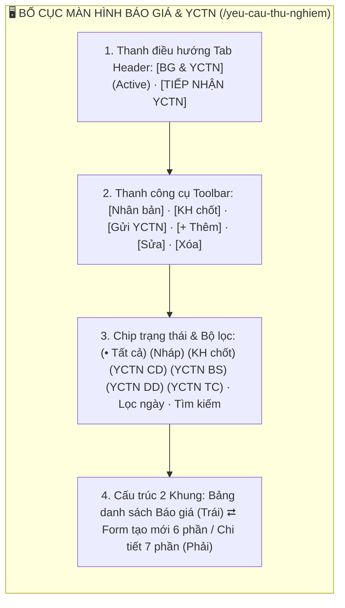
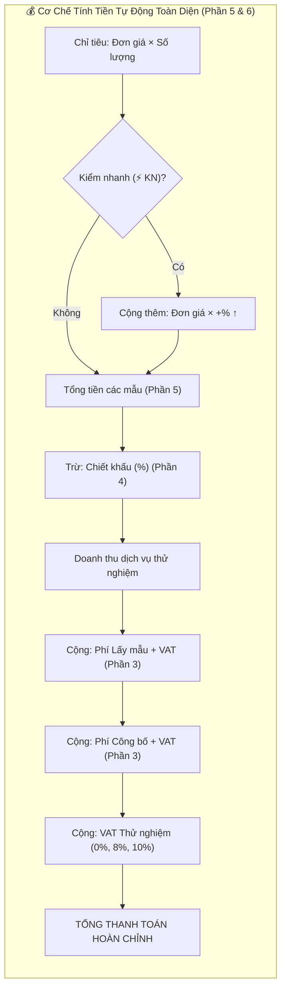
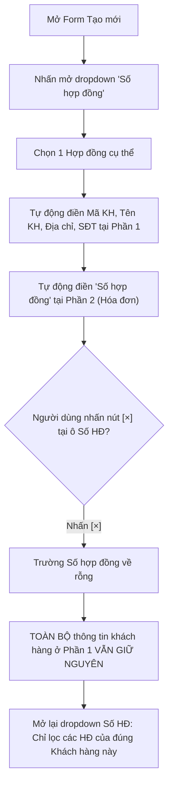

# 📋 TÀI LIỆU ĐẶC TẢ YÊU CẦU CHỨC NĂNG (REQUIREMENTS SPECIFICATION)
## Phân hệ: Kinh doanh & Dịch vụ thử nghiệm — Hệ thống VNTEST LIMS
### Tính năng: Quản lý Báo giá & Yêu cầu thử nghiệm (Test Requests Screen)

---

| Thông tin tài liệu | Chi tiết |
| :--- | :--- |
| **Mã tài liệu** | `REQ_VNTEST_TEST_REQUESTS` |
| **Tính năng / Màn hình** | Quản lý Báo giá & Yêu cầu thử nghiệm (Test Requests & Quotations) |
| **Đường dẫn truy cập** | `/yeu-cau-thu-nghiem` |
| **Đối tượng sử dụng** | Nhân viên Kinh doanh (Sale), Bộ phận Tiếp nhận mẫu, Trưởng phòng Kỹ thuật, Lãnh đạo, Admin |
| **Trạng thái tài liệu** | `Approved / Ready for Development & Testing` |
| **Cơ sở dữ liệu liên kết** | `quotations`, `test_requests`, `customers`, `contracts`, `sample_matrices`, `criteria`, `users` |
| **Test Script Playwright** | [`src/tests/test-requests/test-requests.spec.ts`](file:///home/thai.hoang.dinh/VNTEST_Automation/src/tests/test-requests/test-requests.spec.ts) (47 Test Cases) |
| **Page Object Model** | [`src/pages/test-requests.page.ts`](file:///home/thai.hoang.dinh/VNTEST_Automation/src/pages/test-requests.page.ts) |
| **Dữ liệu kiểm thử** | [`test-data/users.json`](file:///home/thai.hoang.dinh/VNTEST_Automation/test-data/users.json), `test-data/test-requests.json` |

---

## 📑 MỤC LỤC ĐIỀU HƯỚNG NHANH
1. [1. Định vị màn hình & Tổng quan tính năng (Overview & UI Layout)](#1-định-vị-màn-hình--tổng-quan-tính-năng-overview--ui-layout)
2. [2. Sơ đồ phân tích luồng trực quan (Mermaid Flowcharts)](#2-sơ-đồ-phân-tích-luồng-trực-quan-mermaid-flowcharts)
3. [3. Phân quyền & Điều kiện kích hoạt (Access & Permissions)](#3-phân-quyền--điều-kiện-kích-hoạt-access--permissions)
4. [4. Đặc tả chi tiết các Use Cases chức năng (Functional Use Cases)](#4-đặc-tả-chi-tiết-các-use-cases-chức-năng-functional-use-cases)
5. [5. Đặc tả chi tiết trường dữ liệu (Field Specifications Matrix)](#5-đặc-tả-chi-tiết-trường-dữ-liệu-field-specifications-matrix)
6. [6. Ma trận nút bấm & Tương tác giao diện (Action Buttons Matrix)](#6-ma-trận-nút-bấm--tương-tác-giao-diện-action-buttons-matrix)
7. [7. Quy tắc nghiệp vụ & Luồng xử lý lỗi (Business Rules & Error Handling)](#7-quy-tắc-nghiệp-vụ--luồng-xử-lý-lỗi-business-rules--error-handling)
8. [8. Kế hoạch kiểm thử & Ma trận Test Cases Automation (47 Test Cases)](#8-kế-hoạch-kiểm-thử--ma-trận-test-cases-automation-47-test-cases)

---

## 1. ĐỊNH VỊ MÀN HÌNH & TỔNG QUAN TÍNH NĂNG (OVERVIEW & UI WIREFRAME)

### 1.1. Mục đích tính năng
* **Quản trị vòng đời Báo giá & Yêu cầu thử nghiệm (YCTN):** Số hóa quy trình từ khâu lập báo giá thương mại cho khách hàng (`Nháp`), chốt phương án thử nghiệm (`KH chốt`), đến chuyển giao sang phòng Tiếp nhận (`Gửi YCTN` ➔ `YCTN Chờ duyệt`).
* **Cấu trúc Form 6 Phần toàn diện:** Thiết lập chi tiết từng hạng mục: (1) Thông tin chung & KH, (2) Thông tin xuất hóa đơn, (3) Dịch vụ bổ sung, (4) Điều khoản thương mại, (5) Danh sách Nền mẫu & Chỉ tiêu phân tích, (6) Bảng tổng tính tài chính tự động.
* **Cơ chế tính toán tài chính tự động (Real-time Calculator):** Tự động tính tiền theo đơn giá, số lượng, hệ số kiểm nhanh (+% ↑), chiết khấu thương mại, giá sàn tối thiểu, biên lợi nhuận (Margin) và VAT của từng hạng mục.
* **Đồng bộ thông minh giữa Hợp đồng & Khách hàng:** Chọn Hợp đồng tự động điền toàn bộ thông tin pháp lý khách hàng ở Phần 1 và Số hợp đồng xuất hóa đơn ở Phần 2; khi xóa hợp đồng bằng nút `[×]` thì thông tin khách hàng vẫn được giữ nguyên vẹn.

### 1.2. Bố cục Giao diện & Các Phân khu Chức năng (UI Layout Matrix)

| Phân khu (Section) | Vị trí hiển thị | Thành phần giao diện chính | Mục đích & Nghiệp vụ |
| :--- | :--- | :--- | :--- |
| **1. Header Tabs** | Trên cùng trang | Cụm tab: `BG & YCTN` (active), `TIẾP NHẬN YCTN`, nút `Xuất`, `In` | Điều hướng giữa quản lý báo giá và tiếp nhận mẫu LAB |
| **2. Thanh công cụ (Toolbar)** | Dưới Header | Nút `"Nhân bản"`, `"KH chốt"`, `"Gửi YCTN"`, `"Thêm"`, `"Sửa"`, `"Xóa"` | Quản trị toàn diện vòng đời Báo giá từ Nháp đến khi gửi YCTN |
| **3. Chip trạng thái & Bộ lọc** | Dưới Toolbar | 7 Chip trạng thái hồ sơ, bộ lọc khoảng ngày, ô tìm kiếm từ khóa | Phân loại và lọc nhanh hồ sơ theo giai đoạn thương mại |
| **4. Bảng danh sách (Khung trái)**| Nửa bên trái | Cột: Mã BG, Mã YCTN, Khách hàng, Ngày nhận, Ngày trả, Trạng thái, Tổng tiền | Quan sát tổng thể danh sách hồ sơ báo giá đã lập |
| **5. Form & Chi tiết (Khung phải)**| Nửa bên phải | Form 6 phần: Khách hàng/Hợp đồng, Hóa đơn, DV bổ sung, Thương mại, Nền mẫu/Chỉ tiêu, Tổng chi phí | Nhập liệu báo giá, tự động tính tiền, chiết khấu, VAT và Margin |

---

## 2. SƠ ĐỒ PHÂN TÍCH LUỒNG TRỰC QUAN (MERMAID FLOWCHARTS)

### 2.1. Sơ đồ Master Flow Vòng đời Báo giá & Yêu cầu thử nghiệm

### 2.2. Sơ đồ Cơ chế Tính tiền tự động toàn diện (Phần 5 & 6)

### 2.3. Sơ đồ Tương tác Hợp đồng & Đồng bộ Dữ liệu

---

## 3. PHÂN QUYỀN & ĐIỀU KIỆN KÍCH HOẠT (ACCESS & PERMISSIONS)

### 3.1. Ma trận phân quyền truy cập (RBAC Matrix)

| Vai trò người dùng (Role) | Xem danh sách | Tạo Báo giá mới | Sửa Báo giá (Nháp) | Thao tác "KH chốt" | Thao tác "Gửi YCTN" | Xóa hồ sơ |
| :--- | :---: | :---: | :---: | :---: | :---: | :---: |
| **Quản trị viên (Admin)** | Toàn quyền | Toàn quyền | Toàn quyền | Toàn quyền | Toàn quyền | Toàn quyền |
| **Lãnh đạo / Giám đốc** | Toàn quyền | Xem & Tạo | Toàn quyền | Toàn quyền | Toàn quyền | Cho phép |
| **Nhân viên Kinh doanh (Sale)** | Hồ sơ của mình | Được phép | Được phép | Được phép | Được phép | Hồ sơ Nháp của mình |
| **Tiếp nhận YCTN** | Xem hồ sơ gửi | Không | Không | Không | Tiếp nhận duyệt | Không |
| **Kiểm nghiệm viên (KNV)** | Không có quyền | Không | Không | Không | Không | Bị chặn |

---

## 4. ĐẶC TẢ CHI TIẾT CÁC USE CASES CHỨC NĂNG (FUNCTIONAL USE CASES)

### UC-01: Bố cục, Điều hướng Tab & Thanh công cụ (Toolbar States)
* **Tác nhân:** Người dùng truy cập hệ thống.
* **Tiền điều kiện:** Đã đăng nhập vào hệ thống và điều hướng tới `/yeu-cau-thu-nghiem`.
* **Luồng sự kiện chính:**
  1. Khi chưa chọn dòng nào: Nút `"Thêm"` sáng; các nút `"Nhân bản"`, `"KH chốt"`, `"Gửi YCTN"`, `"Sửa"`, `"Xóa"` ở trạng thái vô hiệu hóa (`disabled`).
  2. Khi tích chọn 1 dòng `Nháp`: Kích hoạt `"Nhân bản"`, `"KH chốt"`, `"Sửa"`, `"Xóa"`; nút `"Gửi YCTN"` bị vô hiệu hóa vì chưa chốt giá.
  3. Khi tích chọn 1 dòng `KH chốt`: Kích hoạt nút `"Gửi YCTN"`, `"Nhân bản"`, `"Sửa"`, `"Xóa"`; nút `"KH chốt"` bị vô hiệu hóa.
  4. Khi tích chọn 1 dòng `YCTN DD` (Đã duyệt): Chỉ cho phép `"Nhân bản"`; khóa toàn bộ các nút sửa/xóa/gửi để bảo toàn dữ liệu.

### UC-02: Tìm kiếm, Bộ lọc 7 Chip Trạng thái & Quản lý Cột
* **Tác nhân:** Người dùng tra cứu báo giá và YCTN.
* **Luồng sự kiện chính:**
  1. Người dùng nhấn chọn các chip trạng thái: `"Tất cả"`, `"Nháp"`, `"KH chốt"`, `"YCTN Chờ duyệt"`, `"YCTN Bổ sung"`, `"YCTN Đã duyệt"`, `"YCTN Từ chối"` để lọc nhanh danh sách.
  2. Nhập từ khóa tìm kiếm theo Mã Báo giá (`BG...`) hoặc Tên khách hàng; nhấn nút `"Hủy"` (`[×]`) để khôi phục toàn bộ danh sách.
  3. Sử dụng popover `"Quản lý cột"` để ẩn/hiện các cột hiển thị trên bảng linh hoạt.

### UC-03: Khung Xem Chi tiết Hồ sơ (Khung Phải 7 Phần)
* **Tác nhân:** Người dùng xem chi tiết báo giá.
* **Luồng sự kiện chính:**
  1. Nhấn chọn 1 dòng bất kỳ trong bảng danh sách: Khung bên phải lập tức hiển thị đủ 7 khối thông tin chi tiết.
  2. Đối với hồ sơ ở trạng thái `YCTN Đã duyệt`: Khung chi tiết tự động hiển thị banner cảnh báo chỉ đọc (`readonly banner`), không cho phép sửa trực tiếp.

### UC-04: Thêm mới, Validation & Tính tiền tự động (Form 6 Phần)
* **Tác nhân:** Nhân viên Kinh doanh (Sale).
* **Luồng sự kiện chính:**
  1. Nhấn nút `"Thêm"` trên toolbar: Mở form tạo mới Báo giá gồm 6 phần nhập liệu tại khung phải.
  2. Kiểm tra tính hợp lệ: Nếu để trống các trường bắt buộc (Khách hàng, Ngày nhận, Nền mẫu/Chỉ tiêu) và nhấn nút `"Lưu"`, hệ thống chặn lưu và viền đỏ cảnh báo lỗi.
  3. Thiết lập dịch vụ bổ sung: Chuyển thời gian kiểm cập nhật Hệ số kiểm nhanh; chọn hình thức lấy mẫu / công bố tự động tính phí có VAT và cộng dồn vào Tổng thanh toán.
  4. Tính toán toàn diện: Tự động tính Thành tiền chỉ tiêu, cộng dồn mẫu, áp dụng kiểm nhanh `+% ↑`, trừ chiết khấu `%`, tính VAT và biên lợi nhuận Margin.

### UC-05: Quản lý Vòng đời Báo giá ("Nháp")
* **Tác nhân:** Nhân viên Kinh doanh.
* **Luồng sự kiện chính:**
  1. Tạo mới Báo giá nháp hợp lệ và nhấn nút `"Lưu"`: Bản ghi xuất hiện đầu danh sách tab Nháp.
  2. Sửa thông tin mẫu và lưu lại: Dữ liệu cập nhật ngay ngoài bảng danh sách.
  3. Nhân bản (`Clone`): Tự động sao chép toàn bộ thông tin sang một hồ sơ mới giúp tiết kiệm thời gian nhập liệu.
  4. Xóa dọn dẹp: Hỗ trợ xóa đơn lẻ và xóa hàng loạt với hộp thoại xác nhận an toàn.

### UC-06: Luồng Chuyển trạng thái & Gửi YCTN sang Tiếp nhận (E2E)
* **Tác nhân:** Sale và Bộ phận Tiếp nhận.
* **Luồng sự kiện chính:**
  1. Chọn hồ sơ `Nháp` ➔ Nhấn nút `"KH chốt"`: Trạng thái hồ sơ chuyển sang `KH chốt`.
  2. Chọn hồ sơ `KH chốt` ➔ Nhấn nút `"Gửi YCTN"`: Hệ thống hiển thị thông báo `"Đã gửi 1 YCTN sang duyệt."`, hồ sơ chuyển sang chip `YCTN Chờ duyệt`.
  3. Tại tab `"TIẾP NHẬN YCTN"` (`/tiep-nhan-yctn`): Bản ghi vừa gửi hiển thị ngay trên đầu danh sách với trạng thái `YCTN CD`, sẵn sàng cho bộ phận tiếp nhận kiểm tra và bàn giao mẫu.

### UC-07: Bộ lọc Thời gian nâng cao (Ngày nhận & Ngày trả)
* **Tác nhân:** Người dùng tra cứu theo mốc ngày nhận mẫu hoặc ngày hẹn trả kết quả.
* **Luồng sự kiện chính:**
  1. Hỗ trợ lọc linh động theo: Chỉ chọn `Từ ngày`, chỉ chọn `Đến ngày`, cả 2 ngày trùng nhau, hoặc một khoảng ngày cụ thể.
  2. Bảng lọc chính xác các bản ghi thỏa mãn điều kiện và dễ dàng xóa điều kiện bằng nút xóa bộ lọc ngày.

### UC-08: Nghiệp vụ Liên kết Hợp đồng & Đồng bộ Thông tin
* **Tác nhân:** Nhân viên Kinh doanh.
* **Luồng sự kiện chính:**
  1. Dropdown `"Số hợp đồng"` hiển thị danh sách tất cả các hợp đồng có trong hệ thống khi chưa chọn khách hàng.
  2. Chọn Hợp đồng: Tự động điền thông tin khách hàng ở Phần 1 và Số hợp đồng ở Phần 2.
  3. Nhấn nút `[×]` xóa hợp đồng: Reset trường Số hợp đồng về rỗng, toàn bộ thông tin khách hàng đã điền vẫn giữ nguyên.
  4. Mở lại dropdown Số hợp đồng: Tự động lọc thông minh chỉ hiển thị các hợp đồng thuộc sở hữu của khách hàng đó.

---

## 5. ĐẶC TẢ CHI TIẾT TRƯỜNG DỮ LIỆU (FIELD SPECIFICATIONS MATRIX)

| Tên trường | UI Label | Kiểu dữ liệu | Bắt buộc | Ràng buộc & Validation Rules | Giá trị mặc định / Placeholder | Ghi chú |
| :--- | :--- | :--- | :---: | :--- | :--- | :--- |
| `quotationCode` | **Mã Báo giá** | `text` | Hệ thống sinh | Định dạng `BG-xxxx-xxx` tự tăng. Readonly. | Tự động sinh | Khóa không cho sửa |
| `contractId` | **Số hợp đồng** | `dropdown/search` | Không | Chọn từ danh sách hợp đồng. Đi kèm nút `[×]` xóa nhanh. | `Chọn hợp đồng...` | Auto-fill thông tin KH |
| `customerId` | **Mã khách hàng** | `dropdown/search` | **Bắt buộc** | Chọn khách hàng có trong hệ thống. | `Chọn khách hàng...` | Trường bắt buộc tạo BG |
| `receivedDate` | **Ngày nhận** | `date` | **Bắt buộc** | Định dạng `dd/mm/yyyy`. Mặc định ngày hiện tại. | Ngày hiện tại | Dùng để tính tiến độ LAB |
| `returnDate` | **Ngày trả** | `date` | **Bắt buộc** | Định dạng `dd/mm/yyyy`. Phải $\ge$ Ngày nhận. | Mặc định: `+3` ngày | Ngày hẹn trả kết quả |
| `copyCustomerCheckbox`| **Lấy từ KH** | `checkbox` | Không | Khóa khi chưa có KH; kích hoạt khi đã chọn KH. | Mặc định: `false` | Sao chép Tên, MST, Địa chỉ sang P2 |
| `testDuration` | **Thời gian kiểm** | `dropdown` | **Bắt buộc** | `Mặc định (×1,0)`, `24h (×2,5)`, `48h (×2,0)`, `72h (×1,5)`, `Khác`. | `Mặc định (×1,0)` | Cập nhật HS kiểm nhanh P6 |
| `sampleFee` | **Phí lấy mẫu** | `currency` | Không | Số tiền VNĐ $\ge 0$. Kèm dropdown VAT (`0%`, `8%`, `10%`). | `0 đ` | Mở khóa khi chọn Nhận tận nơi |
| `declarationFee`| **Phí công bố** | `currency` | Không | Số tiền VNĐ $\ge 0$. Kèm dropdown VAT (`0%`, `5%`, `10%`). | `0 đ` | Mở khóa khi chọn Công bố "Có" |
| `discountRate` | **Chiết khấu (%)** | `number` | Không | Giá trị từ $0\%$ đến $100\%$. | `0%` | Trừ vào doanh thu thử nghiệm |
| `matrixId` | **Nền mẫu** | `dropdown/search` | **Bắt buộc** | Chọn từ danh mục nền mẫu chuẩn của phòng LAB. | `Chọn nền mẫu...` | Khối chứa các chỉ tiêu |
| `criterionId` | **Chỉ tiêu** | `dropdown/search` | **Bắt buộc** | Chọn chỉ tiêu phân tích kèm đơn giá và phương pháp. | `Chọn chỉ tiêu...` | Mỗi mẫu ít nhất 1 chỉ tiêu |

---

## 6. MA TRẬN NÚT BẤM & TƯƠNG TÁC GIAO DIỆN (ACTION BUTTONS MATRIX)

| Tên nút (Button) | Vị trí | Icon / Class | Trạng thái mặc định | Điều kiện kích hoạt | Hành vi khi nhấn | Modal / Thông báo đi kèm |
| :--- | :--- | :--- | :---: | :--- | :--- | :--- |
| **Thêm** | Toolbar trên bảng | `.btn-add` | **Kích hoạt** | Luôn sẵn sàng | Mở form tạo mới Báo giá tại khung bên phải | Form 6 phần khung phải |
| **Sửa** | Toolbar trên bảng | `.btn-edit` | **Vô hiệu hóa** | Tích chọn 1 dòng (trừ YCTN DD) | Mở form chỉnh sửa hồ sơ tại khung bên phải | Tải dữ liệu cũ vào form |
| **Nhân bản** | Toolbar trên bảng | `.btn-clone` | **Vô hiệu hóa** | Tích chọn duy nhất 1 dòng bất kỳ | Sao chép 100% dữ liệu sang form tạo mới để lưu bản sao | Điền dữ liệu bản sao |
| **KH chốt** | Toolbar trên bảng | `.btn-confirm-cust`| **Vô hiệu hóa** | Tích chọn 1 dòng trạng thái `Nháp` | Chuyển hồ sơ sang trạng thái `KH chốt` | Thông báo chuyển trạng thái |
| **Gửi YCTN** | Toolbar trên bảng | `.btn-send-yctn` | **Vô hiệu hóa** | Tích chọn 1 dòng trạng thái `KH chốt` | Gửi YCTN sang duyệt tại tab Tiếp nhận YCTN | Thông báo: `"Đã gửi 1 YCTN sang duyệt."` |
| **Xóa** | Toolbar trên bảng | `.btn-delete` | **Vô hiệu hóa** | Tích chọn $\ge 1$ dòng (trừ YCTN DD) | Mở hộp thoại xác nhận xóa hồ sơ | Popup: `"Bạn có chắc muốn xóa...?"` |
| **Thêm mẫu** | Trong Phần 5 | `.btn-add-sample` | **Kích hoạt** | Đang ở form tạo/sửa | Thêm một khối mẫu mới vào bên dưới nền mẫu | Tăng thứ tự Mẫu 2, Mẫu 3... |
| **Lưu** | Chân form khung phải | `.btn-save` | **Kích hoạt** | Đang mở form | Kiểm tra validate và lưu hồ sơ Báo giá | Thông báo: `"Đã lưu báo giá."` |
| **Huỷ** | Chân form khung phải | `.btn-cancel` | **Kích hoạt** | Đang mở form | Đóng form tạo mới/sửa, hủy bỏ thay đổi | Khung phải về trạng thái trống |
| **Quản lý cột** | Dưới chân bảng | `.btn-manage-col` | **Kích hoạt** | Luôn sẵn sàng | Mở popover danh sách các cột để bật/tắt hiển thị | Popover danh sách cột |

---

## 7. QUY TẮC NGHIỆP VỤ & LUỒNG XỬ LÝ LỖI (BUSINESS RULES & ERROR HANDLING)

| Mã lỗi (Code) | Quy tắc nghiệp vụ (Business Rule) | Điều kiện kích hoạt | Vị trí hiển thị | Câu thông báo lỗi hiển thị (Error Message) |
| :--- | :--- | :--- | :--- | :--- |
| `ERR_CUSTOMER_REQUIRED` | Khách hàng là trường bắt buộc | Nhấn Lưu khi chưa chọn khách hàng | Dưới ô Khách hàng | **"Vui lòng chọn khách hàng."** |
| `ERR_DATE_REQUIRED` | Ngày nhận và Ngày trả bắt buộc | Nhấn Lưu khi để trống ngày nhận/trả | Dưới ô Ngày | **"Vui lòng chọn ngày nhận mẫu và ngày hẹn trả."** |
| `ERR_SAMPLE_REQUIRED` | Hồ sơ phải có ít nhất 1 mẫu & chỉ tiêu | Nhấn Lưu khi chưa có Nền mẫu/Chỉ tiêu | Khu vực Phần 5 | **"Vui lòng thêm ít nhất một mẫu và một chỉ tiêu phân tích."** |
| `RULE_LIFECYCLE_GUARD` | Chặn gửi YCTN khi chưa chốt giá | Hồ sơ ở trạng thái `Nháp` | Trạng thái Toolbar | Nút `"Gửi YCTN"` bị vô hiệu hóa (`disabled`) |
| `RULE_APPROVED_RO` | Bảo toàn dữ liệu hồ sơ đã duyệt | Hồ sơ ở trạng thái `YCTN Đã duyệt` | Đầu khung chi tiết | Hiển thị readonly banner; vô hiệu hóa nút Sửa/Xóa/Gửi |

---

## 8. KẾ HOẠCH KIỂM THỬ & MA TRẬN TEST CASES AUTOMATION (47 TEST CASES)

### 8.1. Khối 01: Bố cục & Hiển thị màn hình (3 Test Cases)

| Mã TC | Phân nhóm luồng | Tên kịch bản | Thao tác & Dữ liệu kiểm thử | Kết quả mong đợi | Mức độ ưu tiên | Mapping Page Object |
| :--- | :--- | :--- | :--- | :--- | :---: | :--- |
| **TC_YCTN_001** | Bố cục & Hiển thị | Thanh điều hướng tab và tiện ích Xuất, In | 1. Mở trang Báo giá & Yêu cầu thử nghiệm.  2. Quan sát cụm tab điều hướng trên cùng.  3. Quan sát các nút tiện ích bên phải. | 1. Tab `"BG & YCTN"` đang ở trạng thái kích hoạt (`active`) và tab `"TIẾP NHẬN YCTN"` hiển thị bên cạnh.  2. Hiển thị đầy đủ nút `"Xuất"` và nút `"In"`. | Normal | `testRequestsPage.bgAndYctnTab`, `testRequestsPage.receiveYctnTab` |
| **TC_YCTN_002** | Bố cục & Hiển thị | Chip lọc trạng thái, bộ lọc ngày và Toolbar | 1. Quan sát dãy chip lọc trạng thái hồ sơ.  2. Quan sát bộ lọc khoảng ngày và ô tìm kiếm.  3. Quan sát thanh công cụ thao tác nghiệp vụ. | 1. Hiển thị đầy đủ 7 chip trạng thái: `"Tất cả"` (mặc định active), `"Nháp"`, `"KH chốt"`, `"YCTN Chờ duyệt"`, `"YCTN Bổ sung"`, `"YCTN Đã duyệt"`, `"YCTN Từ chối"`.  2. Hiển thị bộ lọc ngày gồm dropdown loại ngày, ô `Từ ngày`, ô `Đến ngày` và ô tìm kiếm.  3. Hiển thị đầy đủ 6 nút thao tác: `"Nhân bản"`, `"KH chốt"`, `"Gửi YCTN"`, `"Thêm"`, `"Sửa"`, `"Xóa"`. | Normal | `testRequestsPage.chipAll`, `testRequestsPage.addButton` |
| **TC_YCTN_003** | Bố cục & Hiển thị | Cấu trúc bảng danh sách, phân trang và khung phải | 1. Quan sát cấu trúc bảng danh sách bên trái.  2. Quan sát chân bảng và khung chi tiết bên phải. | 1. Bảng danh sách hiển thị các cột tiêu đề chuẩn: checkbox, `MÃ BG`, `MÃ YCTN`, `KHÁCH HÀNG`, `NGÀY NHẬN`, `NGÀY TRẢ`, `TRẠNG THÁI`, `TỔNG TIỀN`.  2. Dưới chân bảng hiển thị thông tin phân trang và nút `"Quản lý cột"`.  3. Khung bên phải ở trạng thái mặc định: `"Chọn một báo giá để xem chi tiết"`. | Normal | `testRequestsPage.table`, `testRequestsPage.manageColumnsButton` |

### 8.2. Khối 02: Trạng thái Toolbar & Điều kiện kích hoạt (5 Test Cases)

| Mã TC | Phân nhóm luồng | Tên kịch bản | Thao tác & Dữ liệu kiểm thử | Kết quả mong đợi | Mức độ ưu tiên | Mapping Page Object |
| :--- | :--- | :--- | :--- | :--- | :---: | :--- |
| **TC_YCTN_004** | Trạng thái Toolbar | Trạng thái ban đầu khi chưa chọn dòng nào | 1. Mở danh sách, chưa tích chọn ô checkbox nào.  2. Quan sát trạng thái 6 nút trên Toolbar. | 1. Nút `"Thêm"` ở trạng thái kích hoạt (`enabled`).  2. Các nút `"Nhân bản"`, `"KH chốt"`, `"Gửi YCTN"`, `"Sửa"`, `"Xóa"` ở trạng thái vô hiệu hóa (`disabled`), mờ đi. | Normal | `testRequestsPage.addButton`, `testRequestsPage.editButton` |
| **TC_YCTN_005** | Trạng thái Toolbar | Tích chọn 1 hồ sơ trạng thái "Nháp" | 1. Nhấn chip `"Nháp"`.  2. Tích chọn 1 dòng hồ sơ nháp bất kỳ.  3. Quan sát trạng thái Toolbar. | 1. Kích hoạt các nút: `"Nhân bản"`, `"KH chốt"`, `"Sửa"`, `"Xóa"`.  2. Nút `"Gửi YCTN"` ở trạng thái vô hiệu hóa (`disabled`) vì chưa qua bước KH chốt. | High | `testRequestsPage.selectRow()`, `testRequestsPage.confirmCustomerButton` |
| **TC_YCTN_006** | Trạng thái Toolbar | Tích chọn 1 hồ sơ trạng thái "KH chốt" | 1. Nhấn chip `"KH chốt"`.  2. Tích chọn 1 dòng hồ sơ KH chốt.  3. Quan sát trạng thái Toolbar. | 1. Kích hoạt nút `"Gửi YCTN"` (sáng xanh, sẵn sàng gửi sang Tiếp nhận YCTN).  2. Kích hoạt các nút: `"Nhân bản"`, `"Sửa"`, `"Xóa"`.  3. Nút `"KH chốt"` bị vô hiệu hóa vì hồ sơ đã ở trạng thái này. | High | `testRequestsPage.sendYctnButton` |
| **TC_YCTN_007** | Trạng thái Toolbar | Tích chọn 1 hồ sơ trạng thái "YCTN DD" (Đã duyệt) | 1. Nhấn chip `"YCTN Đã duyệt"`.  2. Tích chọn 1 dòng hồ sơ đã duyệt.  3. Quan sát trạng thái Toolbar. | 1. Nút `"Nhân bản"` được kích hoạt (cho phép clone hồ sơ đã duyệt để tái sử dụng).  2. Toàn bộ các nút tác động dữ liệu (`"KH chốt"`, `"Gửi YCTN"`, `"Sửa"`, `"Xóa"`) ở trạng thái vô hiệu hóa (`disabled`) để bảo toàn dữ liệu phòng LAB. | High | `testRequestsPage.cloneButton` |
| **TC_YCTN_008** | Trạng thái Toolbar | Tích chọn từ 2 hồ sơ trở lên | 1. Tích chọn từ 2 dòng hồ sơ trở lên (hoặc chọn checkbox tất cả ở tiêu đề bảng).  2. Quan sát trạng thái Toolbar. | 1. Các nút thao tác đơn lẻ (`"Sửa"`, `"Nhân bản"`) tự động vô hiệu hóa (`disabled`).  2. Nút `"Xóa"` vẫn giữ trạng thái kích hoạt nếu tất cả các dòng được chọn đều ở trạng thái cho phép xóa hàng loạt. | Normal | `testRequestsPage.selectAllCheckbox` |

### 8.3. Khối 03: Tìm kiếm, Bộ lọc Chip & Quản lý cột (4 Test Cases)

| Mã TC | Phân nhóm luồng | Tên kịch bản | Thao tác & Dữ liệu kiểm thử | Kết quả mong đợi | Mức độ ưu tiên | Mapping Page Object |
| :--- | :--- | :--- | :--- | :--- | :---: | :--- |
| **TC_YCTN_009** | Tìm kiếm & Bộ lọc | Lọc danh sách theo từng chip trạng thái | 1. Lần lượt nhấn các chip: `"Nháp"`, `"KH chốt"`, `"YCTN Chờ duyệt"`, `"YCTN Đã duyệt"`, `"Tất cả"`.  2. Quan sát cột `TRẠNG THÁI` của các dòng hiển thị. | 1. Khi nhấn chip nào, bảng chỉ hiển thị đúng các bản ghi có trạng thái tương ứng với chip đó.  2. Nhấn chip `"Tất cả"`: Danh sách khôi phục đầy đủ toàn bộ các trạng thái. | High | `testRequestsPage.filterByChip()` |
| **TC_YCTN_010** | Tìm kiếm & Bộ lọc | Tìm kiếm theo Mã Báo giá (MÃ BG) | 1. Nhập Mã Báo giá vào ô tìm kiếm: `BG-2610-001`.  2. Quan sát kết quả lọc.  3. Nhấn nút xóa `"Hủy"` (`[×]`) trong ô tìm kiếm. | 1. Bảng chỉ hiển thị dòng bản ghi có cột `MÃ BG` khớp từ khóa.  2. Sau khi nhấn xóa: Ô tìm kiếm về rỗng, bảng khôi phục đầy đủ danh sách ban đầu. | High | `testRequestsPage.search()`, `testRequestsPage.clearSearch()` |
| **TC_YCTN_011** | Tìm kiếm & Bộ lọc | Tìm kiếm theo Tên khách hàng | 1. Nhập tên khách hàng thực tế vào ô tìm kiếm.  2. Xóa và nhập từ khóa không tồn tại: `KHONG_TON_TAI_99999`. | 1. Với từ khóa thực tế: Bảng hiển thị các hồ sơ thuộc khách hàng đó.  2. Với từ khóa không tồn tại: Bảng hiển thị thông báo danh sách trống `"Không có dữ liệu"`. | Normal | `testRequestsPage.search()` |
| **TC_YCTN_012** | Tìm kiếm & Bộ lọc | Mở và kiểm tra popover "Quản lý cột" | 1. Nhấn nút `"Quản lý cột"` ở góc dưới bảng.  2. Quan sát popover hiển thị danh sách cột.  3. Thử bỏ chọn 1 cột rồi tích chọn lại. | 1. Popover mở ra với danh sách các checkbox tương ứng các cột của bảng.  2. Khi bỏ tích cột nào, cột đó ẩn ngay trên bảng; tích lại cột hiển thị lại tức thì. | Normal | `testRequestsPage.manageColumnsButton` |

### 8.4. Khối 04: Xem Chi tiết Hồ sơ (Khung Phải — 2 Test Cases)

| Mã TC | Phân nhóm luồng | Tên kịch bản | Thao tác & Dữ liệu kiểm thử | Kết quả mong đợi | Mức độ ưu tiên | Mapping Page Object |
| :--- | :--- | :--- | :--- | :--- | :---: | :--- |
| **TC_YCTN_013** | Xem Chi tiết | Hiển thị đầy đủ 7 phần chi tiết khi chọn dòng | 1. Nhấn chọn 1 dòng bất kỳ trong bảng.  2. Quan sát khung chi tiết bên phải. | 1. Khung bên phải chuyển từ trạng thái trống sang hiển thị đầy đủ thông tin chi tiết.  2. Hiển thị đủ 7 khối thông tin: Thông tin chung & KH, Hóa đơn, Dịch vụ bổ sung, Điều khoản thanh toán, Nền mẫu & Chỉ tiêu, Tổng chi phí, Lịch sử xử lý. | High | `testRequestsPage.selectRow()`, `testRequestsPage.detailPanel` |
| **TC_YCTN_014** | Xem Chi tiết | Banner cảnh báo chỉ đọc cho hồ sơ "YCTN DD" | 1. Nhấn chip `"YCTN Đã duyệt"`.  2. Nhấn chọn 1 hồ sơ đã duyệt để mở khung chi tiết. | Đầu khung chi tiết hiển thị banner cảnh báo chỉ đọc (`readonly banner`): thông báo hồ sơ đã được phê duyệt, không được phép chỉnh sửa trực tiếp. | Normal | `testRequestsPage.readonlyBanner` |

### 8.5. Khối 05: Thêm mới, Validation & Tính tiền tự động (Form 6 Phần — 9 Test Cases)

| Mã TC | Phân nhóm luồng | Tên kịch bản | Thao tác & Dữ liệu kiểm thử | Kết quả mong đợi | Mức độ ưu tiên | Mapping Page Object |
| :--- | :--- | :--- | :--- | :--- | :---: | :--- |
| **TC_YCTN_015** | Thêm mới & Validation | Mở form Thêm mới và Hủy thao tác | 1. Nhấn nút `"Thêm"` trên Toolbar.  2. Quan sát giao diện form tại khung phải.  3. Nhấn nút `"Huỷ"` ở chân form. | 1. Khung phải mở form tạo mới Báo giá gồm 6 phần nhập liệu.  2. Nhấn nút `"Huỷ"`: Form đóng lại, khung phải quay về trạng thái chưa chọn hồ sơ ban đầu. | Normal | `testRequestsPage.openAddForm()`, `testRequestsPage.cancelForm()` |
| **TC_YCTN_016** | Thêm mới & Validation | Kiểm tra các trường tự động sinh ở chế độ chỉ đọc | 1. Mở form tạo mới.  2. Kiểm tra các trường: `Mã báo giá`, `Ngày tạo`, `Người tạo`. | Các trường `Mã báo giá`, `Ngày tạo`, `Người tạo` hiển thị giá trị mặc định hệ thống và ở chế độ chỉ đọc (`readonly`), người dùng không thể tự sửa. | Normal | `testRequestsPage.quotationCodeInput` |
| **TC_YCTN_017** | Thêm mới & Validation | Bỏ trống các trường bắt buộc khi nhấn nút "Lưu" | 1. Mở form tạo mới, không nhập dữ liệu.  2. Nhấn nút `"Lưu"`. | Hệ thống chặn lưu và viền đỏ báo lỗi các trường bắt buộc: Khách hàng, Ngày nhận mẫu, Ngày trả kết quả, đồng thời báo lỗi chưa có Nền mẫu/Chỉ tiêu phân tích. | High | `testRequestsPage.saveForm()` |
| **TC_YCTN_018** | Thêm mới & Validation | Tích chọn "Lấy từ khách hàng" tự động sao chép sang Hóa đơn | 1. Kiểm tra checkbox `"Lấy từ khách hàng"` ở Phần 2 ban đầu.  2. Chọn khách hàng tại Phần 1.  3. Tích chọn checkbox `"Lấy từ khách hàng"` ở Phần 2. | 1. Ban đầu khi chưa chọn KH: Checkbox bị vô hiệu hóa.  2. Sau khi chọn KH: Checkbox được kích hoạt.  3. Khi tích chọn: Tên công ty, MST, Địa chỉ, Email hóa đơn ở Phần 2 tự động điền chính xác 100% từ Phần 1. | High | `testRequestsPage.copyFromCustomerCheckbox` |
| **TC_YCTN_019** | Thêm mới & Validation | Dịch vụ bổ sung — Cập nhật Hệ số kiểm nhanh (HS kiểm nhanh) | 1. Kiểm tra mặc định `TG kiểm` ở Phần 3.  2. Lần lượt đổi: `24h (×2,5)`, `48h (×2,0)`, `72h (×1,5)`.  3. Chọn `Khác` và nhập hệ số tuỳ chỉnh: `1,8`. | 1. Mặc định hiển thị `Mặc định (×1,0)`.  2. Khi chọn các mốc định sẵn: Dòng `HS kiểm nhanh` tại Phần 6 tự động cập nhật hệ số tương ứng.  3. Chọn `Khác` và nhập `1,8`: Dòng `HS kiểm nhanh` cập nhật thành `×1,8`. | High | `testRequestsPage.calculateFastCheckFee()` |
| **TC_YCTN_020** | Thêm mới & Validation | Dịch vụ bổ sung — Tính Phí DV lấy mẫu (Có VAT) | 1. Chuyển hình thức Lấy mẫu sang `"Nhận tận nơi"`.  2. Nhập `Phí lấy mẫu`: `200.000` và chọn `VAT lấy mẫu`: `8%`. | Dòng `Phí DV lấy mẫu (Có VAT)` tự động tính đúng: $200.000 	imes 1,08 = 216.000$đ và tự động cộng dồn vào `TỔNG THANH TOÁN`. Đổi VAT sang `10%` tự cập nhật thành $220.000$đ. | High | `testRequestsPage.sampleFeeInput` |
| **TC_YCTN_021** | Thêm mới & Validation | Dịch vụ bổ sung — Tính Phí DV công bố (Có VAT) | 1. Chuyển mục Công bố sang `"Có"`.  2. Nhập `Phí công bố`: `500.000` và chọn `VAT công bố`: `5%`. | Dòng `Phí DV công bố (Có VAT)` tự động tính: $500.000 	imes 1,05 = 525.000$đ và cộng vào `TỔNG THANH TOÁN`. | High | `testRequestsPage.declarationFeeInput` |
| **TC_YCTN_022** | Thêm mới & Validation | Tính tiền tự động toàn diện (Chỉ tiêu, ⚡ KN, Chiết khấu, VAT) | 1. Thêm Mẫu 1: Chọn 1 chỉ tiêu (Đơn giá $200.000$đ, SL = $2$).  2. Bật `⚡ KN` trên Mẫu 1 và nhập `+% ↑` = $25\%$.  3. Nhập `Chiết khấu` tại Phần 4 = $10\%$.  4. Kết hợp Phí lấy mẫu ($108.000$đ) và Phí công bố ($220.000$đ). | 1. Tiền gốc mẫu: $200.000 	imes 2 = 400.000$đ.  2. Tiền kiểm nhanh thêm: $400.000 	imes 25\% = 100.000$đ ➔ Tổng tiền mẫu 1 = $500.000$đ.  3. Tiền sau chiết khấu $10\%$: $500.000 	imes 0,9 = 450.000$đ.  4. VAT thử nghiệm $5\%$: $450.000 	imes 1,05 = 472.500$đ.  5. `TỔNG THANH TOÁN` = $472.500 + 108.000 + 220.000 = 800.500$đ. | High | `testRequestsPage.calculateTotalQuotation()` |
| **TC_YCTN_023** | Thêm mới & Validation | Thao tác Thêm mẫu, Xóa mẫu và Xóa nền mẫu | 1. Nhấn nút `"Thêm mẫu"` trong Phần 5.  2. Thử xóa 1 mẫu con.  3. Thử xóa toàn bộ một khối Nền mẫu. | 1. Mẫu mới xuất hiện bên dưới Nền mẫu với thứ tự tự động tăng (`Mẫu 2`).  2. Xóa mẫu con: Dòng mẫu biến mất, tổng tiền cập nhật lại.  3. Xóa nền mẫu: Toàn bộ khối nền mẫu và các mẫu/chỉ tiêu con bị gỡ bỏ, tiền được trừ chính xác. | Normal | `testRequestsPage.addSampleButton`, `testRequestsPage.deleteSampleButton` |

### 8.6. Khối 06: Quản lý Vòng đời Báo giá ("Nháp" — 1 Test Case)

| Mã TC | Phân nhóm luồng | Tên kịch bản | Thao tác & Dữ liệu kiểm thử | Kết quả mong đợi | Mức độ ưu tiên | Mapping Page Object |
| :--- | :--- | :--- | :--- | :--- | :---: | :--- |
| **TC_YCTN_024** | Quản lý Báo giá nháp | Tạo mới, Chỉnh sửa, Nhân bản và Xóa dọn dẹp E2E | 1. Mở form `"Thêm"`, điền đầy đủ thông tin hợp lệ ➔ Nhấn nút `"Lưu"`.  2. Tích chọn bản ghi vừa tạo ➔ Nhấn nút `"Sửa"`, cập nhật Tên mẫu mới ➔ Nhấn nút `"Lưu"`.  3. Tích chọn bản ghi ➔ Nhấn nút `"Nhân bản"` ➔ Nhấn nút `"Lưu"` tạo bản sao.  4. Tích chọn cả 2 bản ghi ➔ Nhấn nút `"Xóa"`, kiểm tra nút `"Hủy"` rồi xác nhận `"Xóa"`. | 1. Tạo mới: Hiển thị thông báo `"Đã lưu báo giá."` và bản ghi xuất hiện đầu danh sách.  2. Sửa: Tên mẫu mới cập nhật ngay ngoài bảng danh sách.  3. Nhân bản: Tạo thành công một bản ghi mới với dữ liệu kế thừa 100% từ bản ghi gốc.  4. Xóa: Nhấn nút `"Hủy"` giữ nguyên dữ liệu; xác nhận xóa thì cả 2 bản ghi biến mất khỏi danh sách. | High | `testRequestsPage.createDraftQuotation()`, `testRequestsPage.cloneQuotation()`, `testRequestsPage.deleteQuotation()` |

### 8.7. Khối 07: Luồng Chuyển trạng thái & Gửi YCTN sang Tiếp nhận (1 Test Case)

| Mã TC | Phân nhóm luồng | Tên kịch bản | Thao tác & Dữ liệu kiểm thử | Kết quả mong đợi | Mức độ ưu tiên | Mapping Page Object |
| :--- | :--- | :--- | :--- | :--- | :---: | :--- |
| **TC_YCTN_025** | Luồng Chuyển trạng thái | Chuyển đổi từ Nháp ➔ KH chốt ➔ Gửi YCTN sang tab Tiếp nhận | 1. Tạo mới một Báo giá hợp lệ ở trạng thái `"Nháp"`.  2. Lọc tab `"Nháp"`, tích chọn bản ghi ➔ Nhấn nút `"KH chốt"`, xác nhận chuyển đổi.  3. Lọc tab `"KH chốt"`, tích chọn bản ghi ➔ Nhấn nút `"Gửi YCTN"`, xác nhận gửi sang bộ phận tiếp nhận.  4. Chuyển sang tab `"TIẾP NHẬN YCTN"` (`/tiep-nhan-yctn`). | 1. Sau khi nhấn nút `"KH chốt"`: Hồ sơ biến mất khỏi chip `"Nháp"` và xuất hiện ngay tại chip `"KH chốt"`.  2. Sau khi nhấn nút `"Gửi YCTN"`: Hiển thị thông báo `"Đã gửi 1 YCTN sang duyệt."` và hồ sơ chuyển sang chip `"YCTN Chờ duyệt"`.  3. Tại tab `"TIẾP NHẬN YCTN"`: Bản ghi vừa gửi hiển thị ngay trên đầu danh sách với trạng thái `"YCTN CD"`. | High | `testRequestsPage.confirmCustomer()`, `testRequestsPage.sendYctn()` |

### 8.8. Khối 08: Bộ lọc Thời gian nâng cao (8 Test Cases)

| Mã TC | Phân nhóm luồng | Tên kịch bản | Thao tác & Dữ liệu kiểm thử | Kết quả mong đợi | Mức độ ưu tiên | Mapping Page Object |
| :--- | :--- | :--- | :--- | :--- | :---: | :--- |
| **TC_YCTN_026** | Bộ lọc Thời gian | Lọc theo Ngày nhận — Chỉ chọn Từ ngày | 1. Chọn tiêu chí `Ngày nhận`.  2. Nhập ô `Từ ngày`: `20/10/2026`, để trống `Đến ngày`. | Mọi dòng hiển thị đều có cột **`NGÀY NHẬN` $\ge$ `20/10/2026`**. | Normal | `testRequestsPage.filterByDateRange()` |
| **TC_YCTN_027** | Bộ lọc Thời gian | Lọc theo Ngày nhận — Chỉ chọn Đến ngày | 1. Chọn tiêu chí `Ngày nhận`.  2. Nhập ô `Đến ngày`: `22/10/2026`, để trống `Từ ngày`. | Mọi dòng hiển thị đều có cột **`NGÀY NHẬN` $\le$ `22/10/2026`**. | Normal | `testRequestsPage.filterByDateRange()` |
| **TC_YCTN_028** | Bộ lọc Thời gian | Lọc theo Ngày nhận — Chọn Từ ngày và Đến ngày cùng 1 ngày | 1. Chọn tiêu chí `Ngày nhận`.  2. Nhập cả `Từ ngày` và `Đến ngày`: `22/10/2026`. | Chỉ hiển thị các hồ sơ có cột `NGÀY NHẬN` đúng ngày `22/10/2026`. | Normal | `testRequestsPage.filterByDateRange()` |
| **TC_YCTN_029** | Bộ lọc Thời gian | Lọc theo Ngày nhận — Chọn khoảng ngày | 1. Chọn tiêu chí `Ngày nhận`.  2. Nhập `Từ ngày`: `20/10/2026` ➔ `Đến ngày`: `25/10/2026`. | Mọi hồ sơ hiển thị đều có `NGÀY NHẬN` nằm trong khoảng từ `20/10/2026` đến `25/10/2026`. | High | `testRequestsPage.filterByDateRange()` |
| **TC_YCTN_030** | Bộ lọc Thời gian | Lọc theo Ngày trả — Chỉ chọn Từ ngày | 1. Chọn tiêu chí `Ngày trả`.  2. Nhập ô `Từ ngày`: `25/10/2026`, để trống `Đến ngày`. | Mọi dòng hiển thị đều có cột **`NGÀY TRẢ` $\ge$ `25/10/2026`**. | Normal | `testRequestsPage.filterByDateRange()` |
| **TC_YCTN_031** | Bộ lọc Thời gian | Lọc theo Ngày trả — Chỉ chọn Đến ngày | 1. Chọn tiêu chí `Ngày trả`.  2. Nhập ô `Đến ngày`: `28/10/2026`, để trống `Từ ngày`. | Mọi dòng hiển thị đều có cột **`NGÀY TRẢ` $\le$ `28/10/2026`**. | Normal | `testRequestsPage.filterByDateRange()` |
| **TC_YCTN_032** | Bộ lọc Thời gian | Lọc theo Ngày trả — Chọn Từ ngày và Đến ngày cùng 1 ngày | 1. Chọn tiêu chí `Ngày trả`.  2. Nhập `Từ ngày` và `Đến ngày`: `26/10/2026`. | Chỉ hiển thị các hồ sơ có cột `NGÀY TRẢ` đúng ngày `26/10/2026`. | Normal | `testRequestsPage.filterByDateRange()` |
| **TC_YCTN_033** | Bộ lọc Thời gian | Lọc theo Ngày trả — Chọn khoảng ngày và Xóa bộ lọc | 1. Chọn tiêu chí `Ngày trả`, nhập khoảng từ `24/10/2026` đến `30/10/2026`.  2. Nhấn nút xóa bộ lọc ngày. | 1. Lọc chính xác các hồ sơ có `NGÀY TRẢ` trong khoảng chỉ định.  2. Sau khi xóa bộ lọc: Các ô ngày về rỗng, bảng khôi phục đầy đủ số lượng bản ghi ban đầu. | High | `testRequestsPage.clearDateFilter()` |

### 8.9. Khối 09: Nghiệp vụ Chọn Hợp đồng & Đồng bộ dữ liệu tạo mới YCTN (14 Test Cases)

| Mã TC | Phân nhóm luồng | Tên kịch bản | Thao tác & Dữ liệu kiểm thử | Kết quả mong đợi | Mức độ ưu tiên | Mapping Page Object |
| :--- | :--- | :--- | :--- | :--- | :---: | :--- |
| **TC_YCTN_034** | Đồng bộ Hợp đồng | Hiển thị danh sách tất cả HĐ khi chưa chọn Khách hàng | 1. Nhấn mở dropdown `"Số hợp đồng"` khi chưa chọn khách hàng. | Dropdown mở ra hiển thị danh sách tất cả các hợp đồng có trong hệ thống theo định dạng `"[Mã HĐ] · [Tên HĐ]"`. | Normal | `testRequestsPage.contractDropdown` |
| **TC_YCTN_035** | Đồng bộ Hợp đồng | Tìm kiếm hợp đồng trong dropdown theo từ khóa | 1. Gõ từ khóa tìm kiếm vào ô dropdown `"Số hợp đồng"`: `HĐ-00231` hoặc `Thái test`. | Danh sách dropdown tự động lọc thu hẹp chỉ hiển thị các hợp đồng khớp với từ khóa tìm kiếm. | Normal | `testRequestsPage.contractDropdownSearch` |
| **TC_YCTN_036** | Đồng bộ Hợp đồng | Chọn HĐ có đầy đủ thông tin — Tự động điền (Auto-fill) P1 & P2 | 1. Chọn 1 hợp đồng có đầy đủ thông tin từ danh sách.  2. Quan sát Phần 1 và Phần 2. | 1. Ô `"Số hợp đồng"` hiển thị mã và tên HĐ đã chọn.  2. Phần 1 tự động điền thông tin khách hàng: Mã KH, Tên KH, Địa chỉ, Số điện thoại.  3. Trường `"Số hợp đồng"` ở Phần 2 (Hóa đơn) tự động điền mã hợp đồng tương ứng. | High | `testRequestsPage.selectContract()` |
| **TC_YCTN_037** | Đồng bộ Hợp đồng | Chọn HĐ thiếu một số thông tin phụ trợ | 1. Chọn hợp đồng thiếu một số thông tin phụ trợ (như SĐT hoặc Địa chỉ). | Các trường có dữ liệu được điền chính xác, các trường thiếu để trống bình thường mà không gây crash hoặc lỗi hệ thống. | Normal | `testRequestsPage.selectContract()` |
| **TC_YCTN_038** | Đồng bộ Hợp đồng | Thay đổi sang một Hợp đồng khác | 1. Chọn sang một Hợp đồng khác từ dropdown. | Toàn bộ thông tin khách hàng tại Phần 1 và `"Số hợp đồng"` tại Phần 2 tự động cập nhật lại theo đúng hợp đồng mới vừa chọn. | High | `testRequestsPage.selectContract()` |
| **TC_YCTN_039** | Đồng bộ Hợp đồng | Nhấn nút [×] xóa Số hợp đồng | 1. Nhấn nút `[×]` (clear) tại trường `"Số hợp đồng"`.  2. Quan sát các thông tin khách hàng ở Phần 1. | 1. Trường `"Số hợp đồng"` trở về trạng thái trống (chưa chọn).  2. Toàn bộ thông tin khách hàng (Tên KH, Địa chỉ, SĐT) đã được điền ở Phần 1 **vẫn giữ nguyên 100%**, không bị xóa mất. | High | `testRequestsPage.clearContract()` |
| **TC_YCTN_040** | Đồng bộ Hợp đồng | Mở lại dropdown Số hợp đồng sau khi đã có Khách hàng | 1. Mở lại dropdown `"Số hợp đồng"` sau khi trường này bị xóa rỗng nhưng đã có KH. | Dropdown thông minh tự động lọc và **chỉ hiển thị các hợp đồng thuộc về khách hàng hiện tại**. | Normal | `testRequestsPage.contractDropdown` |
| **TC_YCTN_041** | Đồng bộ Hợp đồng | Chọn lại Hợp đồng từ danh sách đã lọc theo Khách hàng | 1. Chọn 1 hợp đồng từ danh sách đã được lọc theo khách hàng. | Trường `"Số hợp đồng"` ở Phần 1 và Phần 2 cập nhật lại mã hợp đồng mới được chọn. | Normal | `testRequestsPage.selectContract()` |
| **TC_YCTN_042** | Đồng bộ Hợp đồng | Chọn Khách hàng trước khi chọn Hợp đồng | 1. Chọn Khách hàng trước tại trường `"Mã khách hàng"`.  2. Mở dropdown `"Số hợp đồng"`. | Dropdown `"Số hợp đồng"` chỉ liệt kê các hợp đồng thuộc sở hữu của khách hàng đó. | High | `testRequestsPage.contractDropdown` |
| **TC_YCTN_043** | Đồng bộ Hợp đồng | Chọn Khách hàng chưa từng có hợp đồng nào | 1. Chọn một khách hàng mới chưa từng ký hợp đồng nào trong hệ thống.  2. Mở dropdown `"Số hợp đồng"`. | Dropdown hiển thị danh sách trống hoặc thông báo `"Không có hợp đồng nào phù hợp"`. | Normal | `testRequestsPage.contractDropdown` |
| **TC_YCTN_044** | Đồng bộ Hợp đồng | Xóa Khách hàng bằng nút [×] khi đã chọn Hợp đồng | 1. Nhấn nút `[×]` để xóa sạch trường Khách hàng tại Phần 1.  2. Quan sát xử lý của trường Hợp đồng. | Hệ thống tự động reset trường `"Số hợp đồng"` về rỗng hoặc mở lại danh sách tất cả các hợp đồng khi dropdown được kích hoạt lại. | Normal | `testRequestsPage.clearCustomer()` |
| **TC_YCTN_045** | Đồng bộ Hợp đồng | Tích "Lấy từ khách hàng" sau khi chọn Hợp đồng | 1. Đã chọn HĐ và tự động điền thông tin Phần 1.  2. Tích chọn `"Lấy từ khách hàng"` tại Phần 2. | Thông tin Tên công ty, MST, Địa chỉ, Email được sao chép sang Phần 2; trường `"Số hợp đồng"` ở Phần 2 giữ nguyên giá trị hợp đồng đã chọn. | High | `testRequestsPage.copyFromCustomerCheckbox` |
| **TC_YCTN_046** | Đồng bộ Hợp đồng | Bỏ tích chọn "Lấy từ khách hàng" ở Phần 2 | 1. Bỏ tích chọn ô `"Lấy từ khách hàng"` tại Phần 2.  2. Thử sửa thông tin Tên hoặc Địa chỉ hóa đơn. | Các trường hóa đơn mở khóa cho phép chỉnh sửa độc lập mà không ảnh hưởng ngược lại thông tin khách hàng gốc ở Phần 1. | Normal | `testRequestsPage.copyFromCustomerCheckbox` |
| **TC_YCTN_047** | Đồng bộ Hợp đồng | Tạo mới Báo giá / YCTN hoàn chỉnh có liên kết Hợp đồng E2E | 1. Chọn Hợp đồng (auto-fill KH và Số HĐ P2).  2. Điền Ngày nhận, Ngày trả.  3. Thêm Nền mẫu, chọn Chỉ tiêu phân tích.  4. Nhấn nút `"Lưu"`. | 1. Hiển thị thông báo `"Đã lưu báo giá."` và đóng form.  2. Bản ghi mới xuất hiện đầu danh sách với đầy đủ Mã BG, Khách hàng và thông tin liên kết Hợp đồng chính xác. | High | `testRequestsPage.saveForm()` |
