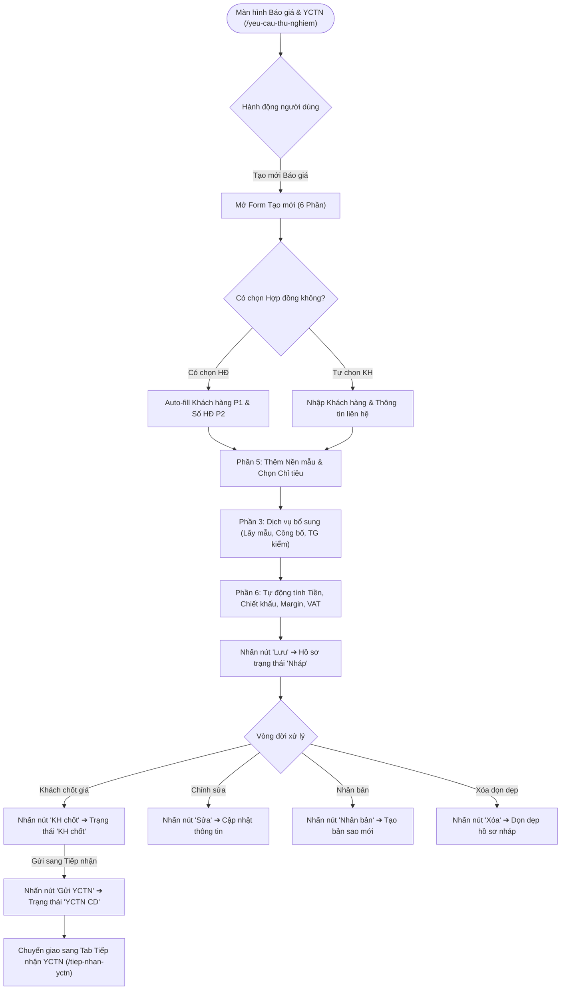
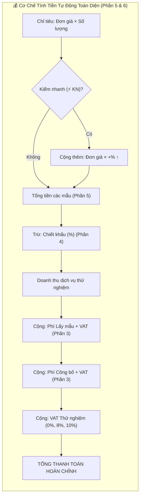

<h1 align="center">UI Test Cases: Test Requests & Quotations Module</h1>

> **Target App:** Hệ thống Quản lý Phòng thí nghiệm VNTEST LIMS (v1.0.0)  
> **Base URL:** `https://vntest-lims.pirago.work/yeu-cau-thu-nghiem`  
> **Auth Scheme:** Session Cookie / JWT Storage State (Local Storage)  
> **Source Page Object:** [`src/pages/test-requests.page.ts`](file:///home/thai.hoang.dinh/VNTEST_Automation/src/pages/test-requests.page.ts)  
> **Test Suite (Playwright):** [`src/tests/test-requests/test-requests.spec.ts`](file:///home/thai.hoang.dinh/VNTEST_Automation/src/tests/test-requests/test-requests.spec.ts)  
> **Test Data:** [`test-data/users.json`](file:///home/thai.hoang.dinh/VNTEST_Automation/test-data/users.json), `test-data/test-requests.json`  
> **Tag / Module:** `Test Requests & Quotations (/yeu-cau-thu-nghiem)`  
> **Quy chuẩn áp dụng:** ISO/IEC/IEEE 29119, Equivalence Partitioning (EP), Boundary Value Analysis (BVA), Page Object Model (POM), `manual_testing_rules.md`.  

---

## 📋 Feature & Flow Catalog (Module Test Requests)

| # | Flow / Feature | Screen / Path | Description | Access / Role | Total Test Cases |
| :---: | :--- | :--- | :--- | :--- | :---: |
| 1 | Bố cục & Hiển thị màn hình | `/yeu-cau-thu-nghiem` | Thanh tab điều hướng, chip trạng thái, bộ lọc, toolbar 6 nút, cấu trúc 2 khung | Kinh doanh, Quản lý | 3 |
| 2 | Trạng thái Toolbar & Điều kiện kích hoạt | `/yeu-cau-thu-nghiem` | Quản lý trạng thái các nút thao tác theo từng trạng thái hồ sơ (Nháp, KH chốt, YCTN DD) | Kinh doanh, Điều phối | 5 |
| 3 | Tìm kiếm, Bộ lọc Chip & Quản lý cột | `/yeu-cau-thu-nghiem` | Lọc 7 chip trạng thái, tìm kiếm Mã BG/Tên KH, popover quản lý ẩn/hiện cột | Toàn quyền xem | 4 |
| 4 | Xem Chi tiết Hồ sơ (Khung phải) | `/yeu-cau-thu-nghiem` | Khung chi tiết 7 phần, banner cảnh báo chỉ đọc cho hồ sơ đã duyệt | Toàn quyền xem | 2 |
| 5 | Thêm mới, Validation & Tính tiền tự động | `/yeu-cau-thu-nghiem` | Form 6 phần: Auto-fill KH, Dịch vụ bổ sung, Công thức tính tiền tự động toàn diện | Sale tạo báo giá | 9 |
| 6 | Quản lý vòng đời Báo giá ("Nháp") | `/yeu-cau-thu-nghiem` | Tạo mới, Chỉnh sửa, Nhân bản (Clone) và Xóa dọn dẹp Báo giá nháp | Sale phụ trách | 1 |
| 7 | Luồng Chuyển trạng thái & Gửi YCTN (E2E) | `/yeu-cau-thu-nghiem` | Chu trình chuyển đổi: Nháp ➔ KH chốt ➔ Gửi YCTN (YCTN CD) sang Tiếp nhận YCTN | Sale, Tiếp nhận | 1 |
| 8 | Bộ lọc Thời gian nâng cao | `/yeu-cau-thu-nghiem` | Lọc theo Ngày nhận & Ngày trả (Từ ngày, Đến ngày, Cùng ngày, Khoảng ngày) | Toàn quyền xem | 8 |
| 9 | Liên kết Hợp đồng & Đồng bộ dữ liệu | `/yeu-cau-thu-nghiem` | Chọn HĐ auto-fill thông tin pháp lý & hóa đơn, tìm kiếm HĐ, xóa HĐ độc lập | Sale tạo báo giá | 14 |
| **Tổng** | | | | | **47 Test Cases** |

---

## 🔄 Business Workflow & Architecture (Sơ Đồ Phân Tích Luồng)

---

## 🧪 Detailed Test Cases (Kịch Bản Kiểm Thử Chi Tiết)

### 1. Bố cục & Hiển thị màn hình (UI & Layout)

| TC ID | Feature | Test Case Title_1 | Test Case Title_2 | Pre-Condition | Test Steps | Test Data | Expected Result | Priority |
| :--- | :--- | :--- | :--- | :--- | :--- | :--- | :--- | :---: |
| **TC_YCTN_001** | Bố cục & Hiển thị | Thanh điều hướng tab và tiện ích Xuất, In | | Đang ở `/yeu-cau-thu-nghiem` | 1. Mở trang Báo giá & Yêu cầu thử nghiệm.  2. Quan sát cụm tab điều hướng trên cùng.  3. Quan sát các nút tiện ích bên phải. | URL: `/yeu-cau-thu-nghiem` | 1. Tab `"BG & YCTN"` đang ở trạng thái kích hoạt (`active`) và tab `"TIẾP NHẬN YCTN"` hiển thị bên cạnh.  2. Hiển thị đầy đủ nút `"Xuất"` và nút `"In"`. | Normal |
| **TC_YCTN_002** | Bố cục & Hiển thị | Chip lọc trạng thái, bộ lọc ngày và Toolbar | | Đang ở `/yeu-cau-thu-nghiem` | 1. Quan sát dãy chip lọc trạng thái hồ sơ.  2. Quan sát bộ lọc khoảng ngày và ô tìm kiếm.  3. Quan sát thanh công cụ thao tác nghiệp vụ. | | 1. Hiển thị đầy đủ 7 chip trạng thái: `"Tất cả"` (mặc định active), `"Nháp"`, `"KH chốt"`, `"YCTN Chờ duyệt"`, `"YCTN Bổ sung"`, `"YCTN Đã duyệt"`, `"YCTN Từ chối"`.  2. Hiển thị bộ lọc ngày gồm dropdown loại ngày (`dateType`), ô `Từ ngày`, ô `Đến ngày` và ô tìm kiếm từ khóa.  3. Hiển thị đầy đủ 6 nút thao tác: `"Nhân bản"`, `"KH chốt"`, `"Gửi YCTN"`, `"Thêm"`, `"Sửa"`, `"Xóa"`. | Normal |
| **TC_YCTN_003** | Bố cục & Hiển thị | Cấu trúc bảng danh sách, phân trang và khung phải | | Đang ở `/yeu-cau-thu-nghiem` | 1. Quan sát cấu trúc bảng danh sách bên trái.  2. Quan sát chân bảng và khung chi tiết bên phải. | | 1. Bảng danh sách hiển thị các cột tiêu đề chuẩn: checkbox, `MÃ BG`, `MÃ YCTN`, `KHÁCH HÀNG`, `NGÀY NHẬN`, `NGÀY TRẢ`, `TRẠNG THÁI`, `TỔNG TIỀN`.  2. Dưới chân bảng hiển thị thông tin phân trang và nút `"Quản lý cột"`.  3. Khung bên phải ở trạng thái mặc định: `"Chọn một báo giá để xem chi tiết"`. | Normal |

---

### 2. Trạng thái Toolbar & Điều kiện kích hoạt nút thao tác

| TC ID | Feature | Test Case Title_1 | Test Case Title_2 | Pre-Condition | Test Steps | Test Data | Expected Result | Priority |
| :--- | :--- | :--- | :--- | :--- | :--- | :--- | :--- | :---: |
| **TC_YCTN_004** | Trạng thái Toolbar | Trạng thái ban đầu khi chưa chọn dòng nào | 0 dòng được chọn | Đang ở danh sách Báo giá | 1. Mở danh sách, chưa tích chọn ô checkbox nào.  2. Quan sát trạng thái 6 nút trên Toolbar. | | 1. Nút `"Thêm"` ở trạng thái kích hoạt (`enabled`).  2. Các nút `"Nhân bản"`, `"KH chốt"`, `"Gửi YCTN"`, `"Sửa"`, `"Xóa"` ở trạng thái vô hiệu hóa (`disabled`), mờ đi. | Normal |
| **TC_YCTN_005** | Trạng thái Toolbar | Tích chọn 1 hồ sơ trạng thái "Nháp" | 1 dòng Nháp | Đang ở danh sách Báo giá | 1. Nhấn chip `"Nháp"`.  2. Tích chọn 1 dòng hồ sơ nháp bất kỳ.  3. Quan sát trạng thái Toolbar. | Chip: `"Nháp"` | 1. Kích hoạt các nút: `"Nhân bản"`, `"KH chốt"`, `"Sửa"`, `"Xóa"`.  2. Nút `"Gửi YCTN"` ở trạng thái vô hiệu hóa (`disabled`) vì chưa qua bước KH chốt. | High |
| **TC_YCTN_006** | Trạng thái Toolbar | Tích chọn 1 hồ sơ trạng thái "KH chốt" | 1 dòng KH chốt | Đang ở danh sách Báo giá | 1. Nhấn chip `"KH chốt"`.  2. Tích chọn 1 dòng hồ sơ KH chốt.  3. Quan sát trạng thái Toolbar. | Chip: `"KH chốt"` | 1. Kích hoạt nút `"Gửi YCTN"` (sáng xanh, sẵn sàng gửi sang Tiếp nhận YCTN).  2. Kích hoạt các nút: `"Nhân bản"`, `"Sửa"`, `"Xóa"`.  3. Nút `"KH chốt"` bị vô hiệu hóa vì hồ sơ đã ở trạng thái này. | High |
| **TC_YCTN_007** | Trạng thái Toolbar | Tích chọn 1 hồ sơ trạng thái "YCTN DD" (Đã duyệt) | 1 dòng Đã duyệt | Đang ở danh sách Báo giá | 1. Nhấn chip `"YCTN Đã duyệt"`.  2. Tích chọn 1 dòng hồ sơ đã duyệt.  3. Quan sát trạng thái Toolbar. | Chip: `"YCTN Đã duyệt"` | 1. Nút `"Nhân bản"` được kích hoạt (cho phép clone hồ sơ đã duyệt để tái sử dụng).  2. Toàn bộ các nút tác động dữ liệu (`"KH chốt"`, `"Gửi YCTN"`, `"Sửa"`, `"Xóa"`) ở trạng thái vô hiệu hóa (`disabled`) để bảo toàn dữ liệu phòng LAB. | High |
| **TC_YCTN_008** | Trạng thái Toolbar | Tích chọn từ 2 hồ sơ trở lên | $\ge 2$ dòng được chọn | Đang ở danh sách Báo giá | 1. Tích chọn từ 2 dòng hồ sơ trở lên (hoặc chọn checkbox tất cả ở tiêu đề bảng).  2. Quan sát trạng thái Toolbar. | Chọn 2 dòng | 1. Các nút thao tác đơn lẻ (`"Sửa"`, `"Nhân bản"`) tự động vô hiệu hóa (`disabled`).  2. Nút `"Xóa"` vẫn giữ trạng thái kích hoạt nếu tất cả các dòng được chọn đều ở trạng thái cho phép xóa hàng loạt. | Normal |

---

### 3. Tìm kiếm, Bộ lọc Chip & Quản lý cột

| TC ID | Feature | Test Case Title_1 | Test Case Title_2 | Pre-Condition | Test Steps | Test Data | Expected Result | Priority |
| :--- | :--- | :--- | :--- | :--- | :--- | :--- | :--- | :---: |
| **TC_YCTN_009** | Tìm kiếm & Bộ lọc | Lọc danh sách theo từng chip trạng thái | | Đang ở danh sách Báo giá | 1. Lần lượt nhấn các chip: `"Nháp"`, `"KH chốt"`, `"YCTN Chờ duyệt"`, `"YCTN Đã duyệt"`, `"Tất cả"`.  2. Quan sát cột `TRẠNG THÁI` của các dòng hiển thị. | Lọc theo 5 chip | 1. Khi nhấn chip nào, bảng chỉ hiển thị đúng các bản ghi có trạng thái tương ứng với chip đó.  2. Nhấn chip `"Tất cả"`: Danh sách khôi phục đầy đủ toàn bộ các trạng thái. | High |
| **TC_YCTN_010** | Tìm kiếm & Bộ lọc | Tìm kiếm theo Mã Báo giá (MÃ BG) | | Đang ở danh sách Báo giá | 1. Nhập Mã Báo giá vào ô tìm kiếm.  2. Quan sát kết quả lọc.  3. Nhấn nút xóa `"Hủy"` (`[×]`) trong ô tìm kiếm. | Mã BG thực tế (VD: `BG-2610-001`) | 1. Bảng chỉ hiển thị dòng bản ghi có cột `MÃ BG` khớp từ khóa.  2. Sau khi nhấn xóa: Ô tìm kiếm về rỗng, bảng khôi phục đầy đủ danh sách ban đầu. | High |
| **TC_YCTN_011** | Tìm kiếm & Bộ lọc | Tìm kiếm theo Tên khách hàng | Từ khóa tồn tại & Không tồn tại | Đang ở danh sách Báo giá | 1. Nhập tên khách hàng thực tế vào ô tìm kiếm.  2. Xóa và nhập từ khóa không tồn tại. | Từ khóa 1: Tên KH có thật Từ khóa 2: `KHONG_TON_TAI_99999` | 1. Với từ khóa 1: Bảng hiển thị các hồ sơ thuộc khách hàng đó.  2. Với từ khóa 2: Bảng hiển thị thông báo danh sách trống `"Không có dữ liệu"`. | Normal |
| **TC_YCTN_012** | Tìm kiếm & Bộ lọc | Mở và kiểm tra popover "Quản lý cột" | | Đang ở danh sách Báo giá | 1. Nhấn nút `"Quản lý cột"` ở góc dưới bảng.  2. Quan sát popover hiển thị danh sách cột.  3. Thử bỏ chọn 1 cột rồi tích chọn lại. | | 1. Popover mở ra với danh sách các checkbox tương ứng các cột của bảng.  2. Khi bỏ tích cột nào, cột đó ẩn ngay trên bảng; tích lại cột hiển thị lại tức thì. | Normal |

---

### 4. Xem Chi tiết Hồ sơ BG & YCTN (Khung Phải)

| TC ID | Feature | Test Case Title_1 | Test Case Title_2 | Pre-Condition | Test Steps | Test Data | Expected Result | Priority |
| :--- | :--- | :--- | :--- | :--- | :--- | :--- | :--- | :---: |
| **TC_YCTN_013** | Xem Chi tiết | Hiển thị đầy đủ 7 phần chi tiết khi chọn dòng | | Đang ở danh sách Báo giá | 1. Nhấn chọn 1 dòng bất kỳ trong bảng.  2. Quan sát khung chi tiết bên phải. | Chọn 1 dòng hợp lệ | 1. Khung bên phải chuyển từ trạng thái trống sang hiển thị đầy đủ thông tin chi tiết.  2. Hiển thị đủ 7 khối thông tin: (1) Thông tin chung & KH, (2) Thông tin xuất hóa đơn, (3) Dịch vụ bổ sung, (4) Điều khoản thanh toán, (5) Danh sách nền mẫu & Chỉ tiêu, (6) Tổng chi phí, (7) Lịch sử xử lý. | High |
| **TC_YCTN_014** | Xem Chi tiết | Banner cảnh báo chỉ đọc cho hồ sơ "YCTN DD" | | Đang ở danh sách Báo giá | 1. Nhấn chip `"YCTN Đã duyệt"`.  2. Nhấn chọn 1 hồ sơ đã duyệt để mở khung chi tiết. | Chip: `"YCTN Đã duyệt"` | 1. Đầu khung chi tiết hiển thị banner cảnh báo chỉ đọc (`readonly` banner): thông báo hồ sơ đã được phê duyệt, không được phép chỉnh sửa trực tiếp. | Normal |

---

### 5. Thêm mới, Validation & Tính tiền tự động (Form 6 Phần)

| TC ID | Feature | Test Case Title_1 | Test Case Title_2 | Pre-Condition | Test Steps | Test Data | Expected Result | Priority |
| :--- | :--- | :--- | :--- | :--- | :--- | :--- | :--- | :---: |
| **TC_YCTN_015** | Thêm mới & Validation | Mở form Thêm mới và Hủy thao tác | | Đang ở danh sách Báo giá | 1. Nhấn nút `"Thêm"` trên Toolbar.  2. Quan sát giao diện form tại khung phải.  3. Nhấn nút `"Huỷ"` ở chân form. | | 1. Khung phải mở form tạo mới Báo giá gồm 6 phần nhập liệu.  2. Nhấn nút `"Huỷ"`: Form đóng lại, khung phải quay về trạng thái chưa chọn hồ sơ ban đầu. | Normal |
| **TC_YCTN_016** | Thêm mới & Validation | Kiểm tra các trường tự động sinh ở chế độ chỉ đọc | | Đang ở form Thêm mới | 1. Mở form tạo mới.  2. Kiểm tra các trường: `Mã báo giá`, `Ngày tạo`, `Người tạo`. | | Các trường `Mã báo giá`, `Ngày tạo`, `Người tạo` hiển thị giá trị mặc định hệ thống và ở chế độ chỉ đọc (`readonly`), người dùng không thể tự sửa. | Normal |
| **TC_YCTN_017** | Thêm mới & Validation | Bỏ trống các trường bắt buộc khi nhấn nút "Lưu" | | Đang ở form Thêm mới | 1. Mở form tạo mới, không nhập dữ liệu.  2. Nhấn nút `"Lưu"`. | Dữ liệu để trống | Hệ thống chặn lưu và viền đỏ báo lỗi các trường bắt buộc: Khách hàng, Ngày nhận mẫu, Ngày trả kết quả, đồng thời báo lỗi chưa có Nền mẫu/Chỉ tiêu phân tích. | High |
| **TC_YCTN_018** | Thêm mới & Validation | Tích chọn "Lấy từ khách hàng" tự động sao chép sang Hóa đơn | | Đang ở form Thêm mới | 1. Kiểm tra checkbox `"Lấy từ khách hàng"` ở Phần 2 ban đầu.  2. Chọn khách hàng tại Phần 1.  3. Tích chọn checkbox `"Lấy từ khách hàng"` ở Phần 2. | Khách hàng có đầy đủ MST, Địa chỉ | 1. Ban đầu khi chưa chọn KH: Checkbox bị vô hiệu hóa.  2. Sau khi chọn KH: Checkbox được kích hoạt.  3. Khi tích chọn: Tên công ty, MST, Địa chỉ, Email hóa đơn ở Phần 2 tự động điền chính xác 100% từ Phần 1. | High |
| **TC_YCTN_019** | Thêm mới & Validation | Dịch vụ bổ sung — Cập nhật Hệ số kiểm nhanh (HS kiểm nhanh) | | Đang ở form Thêm mới | 1. Kiểm tra mặc định `TG kiểm` ở Phần 3.  2. Lần lượt đổi: `24h (×2,5)`, `48h (×2,0)`, `72h (×1,5)`.  3. Chọn `Khác` và nhập hệ số tuỳ chỉnh. | Mặc định: `×1,0` Tùy chỉnh: `1,8` | 1. Mặc định hiển thị `Mặc định (×1,0)`.  2. Khi chọn các mốc định sẵn: Dòng `HS kiểm nhanh` tại Phần 6 tự động cập nhật hệ số tương ứng.  3. Chọn `Khác` và nhập `1,8`: Dòng `HS kiểm nhanh` cập nhật thành `×1,8`. | High |
| **TC_YCTN_020** | Thêm mới & Validation | Dịch vụ bổ sung — Tính Phí DV lấy mẫu (Có VAT) | | Đang ở form Thêm mới | 1. Chuyển hình thức Lấy mẫu sang `"Nhận tận nơi"`.  2. Nhập `Phí lấy mẫu` và chọn `VAT lấy mẫu`. | Phí: `200.000` VAT: `8%` | Dòng `Phí DV lấy mẫu (Có VAT)` tự động tính đúng: $200.000 	imes 1,08 = 216.000$đ và tự động cộng dồn vào `TỔNG THANH TOÁN`. Đổi VAT sang `10%` tự cập nhật thành $220.000$đ. | High |
| **TC_YCTN_021** | Thêm mới & Validation | Dịch vụ bổ sung — Tính Phí DV công bố (Có VAT) | | Đang ở form Thêm mới | 1. Chuyển mục Công bố sang `"Có"`.  2. Nhập `Phí công bố` và chọn `VAT công bố`. | Phí: `500.000` VAT: `5%` | Dòng `Phí DV công bố (Có VAT)` tự động tính: $500.000 	imes 1,05 = 525.000$đ và cộng vào `TỔNG THANH TOÁN`. | High |
| **TC_YCTN_022** | Thêm mới & Validation | Tính tiền tự động toàn diện (Chỉ tiêu, ⚡ KN, Chiết khấu, VAT) | | Đang ở form Thêm mới | 1. Thêm Mẫu 1: Chọn 1 chỉ tiêu (Đơn giá $200.000$đ, SL = $2$).  2. Bật `⚡ KN` trên Mẫu 1 và nhập `+% ↑` = $25\%$.  3. Nhập `Chiết khấu` tại Phần 4 = $10\%$.  4. Kết hợp Phí lấy mẫu ($108.000$đ) và Phí công bố ($220.000$đ). | Đơn giá: `200.000`, SL: `2` KN: `25%`, CK: `10%` Phí mẫu: `108.000`, Phí CB: `220.000` | 1. Tiền gốc mẫu: $200.000 	imes 2 = 400.000$đ.  2. Tiền kiểm nhanh thêm: $400.000 	imes 25\% = 100.000$đ ➔ Tổng tiền mẫu 1 = $500.000$đ.  3. Tiền sau chiết khấu $10\%$: $500.000 	imes 0,9 = 450.000$đ.  4. VAT thử nghiệm $5\%$: $450.000 	imes 1,05 = 472.500$đ.  5. `TỔNG THANH TOÁN` = $472.500 + 108.000 + 220.000 = 800.500$đ. | High |
| **TC_YCTN_023** | Thêm mới & Validation | Thao tác Thêm mẫu, Xóa mẫu và Xóa nền mẫu | | Đang ở form Thêm mới | 1. Nhấn nút `"Thêm mẫu"` trong Phần 5.  2. Thử xóa 1 mẫu con.  3. Thử xóa toàn bộ một khối Nền mẫu. | | 1. Mẫu mới xuất hiện bên dưới Nền mẫu với thứ tự tự động tăng (`Mẫu 2`).  2. Xóa mẫu con: Dòng mẫu biến mất, tổng tiền cập nhật lại.  3. Xóa nền mẫu: Toàn bộ khối nền mẫu và các mẫu/chỉ tiêu con bị gỡ bỏ, tiền được trừ chính xác. | Normal |

---

### 6. Quản lý Vòng đời Báo giá ("Nháp")

| TC ID | Feature | Test Case Title_1 | Test Case Title_2 | Pre-Condition | Test Steps | Test Data | Expected Result | Priority |
| :--- | :--- | :--- | :--- | :--- | :--- | :--- | :--- | :---: |
| **TC_YCTN_024** | Quản lý Báo giá nháp | Tạo mới, Chỉnh sửa, Nhân bản và Xóa dọn dẹp E2E | | Đang ở danh sách Báo giá | 1. Mở form `"Thêm"`, điền đầy đủ thông tin hợp lệ ➔ Nhấn nút `"Lưu"`.  2. Tích chọn bản ghi vừa tạo ➔ Nhấn nút `"Sửa"`, cập nhật Tên mẫu mới ➔ Nhấn nút `"Lưu"`.  3. Tích chọn bản ghi ➔ Nhấn nút `"Nhân bản"` ➔ Nhấn nút `"Lưu"` tạo bản sao.  4. Tích chọn cả 2 bản ghi ➔ Nhấn nút `"Xóa"`, kiểm tra nút `"Hủy"` rồi xác nhận `"Xóa"`. | Tên mẫu: `Mẫu kiểm nghiệm A` Tên sửa: `Mẫu kiểm nghiệm A - Đã cập nhật` | 1. Tạo mới: Hiển thị thông báo `"Đã lưu báo giá."` và bản ghi xuất hiện đầu danh sách.  2. Sửa: Tên mẫu mới cập nhật ngay ngoài bảng danh sách.  3. Nhân bản: Tạo thành công một bản ghi mới với dữ liệu kế thừa 100% từ bản ghi gốc.  4. Xóa: Nhấn nút `"Hủy"` giữ nguyên dữ liệu; xác nhận xóa thì cả 2 bản ghi biến mất khỏi danh sách. | High |

---

### 7. Luồng Chuyển trạng thái & Gửi YCTN sang Tiếp nhận

| TC ID | Feature | Test Case Title_1 | Test Case Title_2 | Pre-Condition | Test Steps | Test Data | Expected Result | Priority |
| :--- | :--- | :--- | :--- | :--- | :--- | :--- | :--- | :---: |
| **TC_YCTN_025** | Luồng Chuyển trạng thái | Chuyển đổi từ Nháp ➔ KH chốt ➔ Gửi YCTN sang tab Tiếp nhận | | Đang ở danh sách Báo giá | 1. Tạo mới một Báo giá hợp lệ ở trạng thái `"Nháp"`.  2. Lọc tab `"Nháp"`, tích chọn bản ghi ➔ Nhấn nút `"KH chốt"`, xác nhận chuyển đổi.  3. Lọc tab `"KH chốt"`, tích chọn bản ghi ➔ Nhấn nút `"Gửi YCTN"`, xác nhận gửi sang bộ phận tiếp nhận.  4. Chuyển sang tab `"TIẾP NHẬN YCTN"` (`/tiep-nhan-yctn`). | Hồ sơ hợp lệ có đủ Ngày nhận, Mẫu, Chỉ tiêu | 1. Sau khi nhấn `"KH chốt"`: Hồ sơ biến mất khỏi chip `"Nháp"` và xuất hiện ngay tại chip `"KH chốt"`.  2. Sau khi nhấn `"Gửi YCTN"`: Hiển thị thông báo `"Đã gửi 1 YCTN sang duyệt."` và hồ sơ chuyển sang chip `"YCTN Chờ duyệt"`.  3. Tại tab `"TIẾP NHẬN YCTN"`: Bản ghi vừa gửi hiển thị ngay trên đầu danh sách với trạng thái `"YCTN CD"`. | High |

---

### 8. Bộ lọc Thời gian nâng cao (Ngày nhận & Ngày trả)

| TC ID | Feature | Test Case Title_1 | Test Case Title_2 | Pre-Condition | Test Steps | Test Data | Expected Result | Priority |
| :--- | :--- | :--- | :--- | :--- | :--- | :--- | :--- | :---: |
| **TC_YCTN_026** | Bộ lọc Thời gian | Lọc theo Ngày nhận — Chỉ chọn Từ ngày | | Đang ở danh sách Báo giá | 1. Chọn tiêu chí `Ngày nhận`.  2. Nhập ô `Từ ngày`, để trống `Đến ngày`. | `Từ ngày`: `20/10/2026` | Mọi dòng hiển thị đều có cột **`NGÀY NHẬN` $\ge$ `20/10/2026`**. | Normal |
| **TC_YCTN_027** | Bộ lọc Thời gian | Lọc theo Ngày nhận — Chỉ chọn Đến ngày | | Đang ở danh sách Báo giá | 1. Chọn tiêu chí `Ngày nhận`.  2. Nhập ô `Đến ngày`, để trống `Từ ngày`. | `Đến ngày`: `22/10/2026` | Mọi dòng hiển thị đều có cột **`NGÀY NHẬN` $\le$ `22/10/2026`**. | Normal |
| **TC_YCTN_028** | Bộ lọc Thời gian | Lọc theo Ngày nhận — Chọn Từ ngày và Đến ngày cùng 1 ngày | | Đang ở danh sách Báo giá | 1. Chọn tiêu chí `Ngày nhận`.  2. Nhập cả `Từ ngày` và `Đến ngày` trùng nhau. | Cùng ngày: `22/10/2026` | Chỉ hiển thị các hồ sơ có cột `NGÀY NHẬN` đúng ngày `22/10/2026`. | Normal |
| **TC_YCTN_029** | Bộ lọc Thời gian | Lọc theo Ngày nhận — Chọn khoảng ngày | | Đang ở danh sách Báo giá | 1. Chọn tiêu chí `Ngày nhận`.  2. Nhập `Từ ngày` $<$ `Đến ngày`. | `Từ`: `20/10/2026` `Đến`: `25/10/2026` | Mọi hồ sơ hiển thị đều có `NGÀY NHẬN` nằm trong khoảng từ `20/10/2026` đến `25/10/2026`. | High |
| **TC_YCTN_030** | Bộ lọc Thời gian | Lọc theo Ngày trả — Chỉ chọn Từ ngày | | Đang ở danh sách Báo giá | 1. Chọn tiêu chí `Ngày trả`.  2. Nhập ô `Từ ngày`, để trống `Đến ngày`. | `Từ ngày`: `25/10/2026` | Mọi dòng hiển thị đều có cột **`NGÀY TRẢ` $\ge$ `25/10/2026`**. | Normal |
| **TC_YCTN_031** | Bộ lọc Thời gian | Lọc theo Ngày trả — Chỉ chọn Đến ngày | | Đang ở danh sách Báo giá | 1. Chọn tiêu chí `Ngày trả`.  2. Nhập ô `Đến ngày`, để trống `Từ ngày`. | `Đến ngày`: `28/10/2026` | Mọi dòng hiển thị đều có cột **`NGÀY TRẢ` $\le$ `28/10/2026`**. | Normal |
| **TC_YCTN_032** | Bộ lọc Thời gian | Lọc theo Ngày trả — Chọn Từ ngày và Đến ngày cùng 1 ngày | | Đang ở danh sách Báo giá | 1. Chọn tiêu chí `Ngày trả`.  2. Nhập `Từ ngày` và `Đến ngày` cùng một ngày. | Cùng ngày: `26/10/2026` | Chỉ hiển thị các hồ sơ có cột `NGÀY TRẢ` đúng ngày `26/10/2026`. | Normal |
| **TC_YCTN_033** | Bộ lọc Thời gian | Lọc theo Ngày trả — Chọn khoảng ngày và Xóa bộ lọc | | Đang ở danh sách Báo giá | 1. Chọn tiêu chí `Ngày trả`, nhập khoảng ngày.  2. Nhấn nút xóa bộ lọc ngày. | `Từ`: `24/10/2026` `Đến`: `30/10/2026` | 1. Lọc chính xác các hồ sơ có `NGÀY TRẢ` trong khoảng chỉ định.  2. Sau khi xóa bộ lọc: Các ô ngày về rỗng, bảng khôi phục đầy đủ số lượng bản ghi ban đầu. | High |

---

### 9. Nghiệp vụ Chọn Hợp đồng & Đồng bộ dữ liệu tạo mới YCTN

| TC ID | Feature | Test Case Title_1 | Test Case Title_2 | Pre-Condition | Test Steps | Test Data | Expected Result | Priority |
| :--- | :--- | :--- | :--- | :--- | :--- | :--- | :--- | :---: |
| **TC_YCTN_034** | Đồng bộ Hợp đồng | Hiển thị danh sách tất cả HĐ khi chưa chọn Khách hàng | | Mở form Thêm mới | 1. Nhấn mở dropdown `"Số hợp đồng"` khi chưa chọn khách hàng. | | Dropdown mở ra hiển thị danh sách tất cả các hợp đồng có trong hệ thống theo định dạng `"[Mã HĐ] · [Tên HĐ]"`. | Normal |
| **TC_YCTN_035** | Đồng bộ Hợp đồng | Tìm kiếm hợp đồng trong dropdown theo từ khóa | | Đang mở dropdown Số HĐ | 1. Gõ từ khóa tìm kiếm vào ô dropdown `"Số hợp đồng"`. | Từ khóa mã hoặc tên HĐ (VD: `HĐ-00231`, `Thái test`) | Danh sách dropdown tự động lọc thu hẹp chỉ hiển thị các hợp đồng khớp với từ khóa tìm kiếm. | Normal |
| **TC_YCTN_036** | Đồng bộ Hợp đồng | Chọn HĐ có đầy đủ thông tin — Tự động điền (Auto-fill) P1 & P2 | | Đang mở form Thêm mới | 1. Chọn 1 hợp đồng có đầy đủ thông tin từ danh sách.  2. Quan sát Phần 1 và Phần 2. | Hợp đồng đầy đủ thông tin | 1. Ô `"Số hợp đồng"` hiển thị mã và tên HĐ đã chọn.  2. Phần 1 tự động điền thông tin khách hàng: Mã KH, Tên KH, Địa chỉ, Số điện thoại.  3. Trường `"Số hợp đồng"` ở Phần 2 (Hóa đơn) tự động điền mã hợp đồng tương ứng. | High |
| **TC_YCTN_037** | Đồng bộ Hợp đồng | Chọn HĐ thiếu một số thông tin phụ trợ | | Đang mở form Thêm mới | 1. Chọn hợp đồng thiếu một số thông tin phụ trợ (như SĐT hoặc Địa chỉ). | Hợp đồng thiếu SĐT | Các trường có dữ liệu được điền chính xác, các trường thiếu để trống bình thường mà không gây crash hoặc lỗi hệ thống. | Normal |
| **TC_YCTN_038** | Đồng bộ Hợp đồng | Thay đổi sang một Hợp đồng khác | | Đã chọn HĐ trước đó | 1. Chọn sang một Hợp đồng khác từ dropdown. | Hợp đồng mới | Toàn bộ thông tin khách hàng tại Phần 1 và `"Số hợp đồng"` tại Phần 2 tự động cập nhật lại theo đúng hợp đồng mới vừa chọn. | High |
| **TC_YCTN_039** | Đồng bộ Hợp đồng | Nhấn nút [×] xóa Số hợp đồng | | Đã chọn HĐ và auto-fill | 1. Nhấn nút `[×]` (clear) tại trường `"Số hợp đồng"`.  2. Quan sát các thông tin khách hàng ở Phần 1. | | 1. Trường `"Số hợp đồng"` trở về trạng thái trống (chưa chọn).  2. Toàn bộ thông tin khách hàng (Tên KH, Địa chỉ, SĐT) đã được điền ở Phần 1 **vẫn giữ nguyên 100%**, không bị xóa mất. | High |
| **TC_YCTN_040** | Đồng bộ Hợp đồng | Mở lại dropdown Số hợp đồng sau khi đã có Khách hàng | | Đã có thông tin KH | 1. Mở lại dropdown `"Số hợp đồng"` sau khi trường này bị xóa rỗng nhưng đã có KH. | Khách hàng hiện tại | Dropdown thông minh tự động lọc và **chỉ hiển thị các hợp đồng thuộc về khách hàng hiện tại**. | Normal |
| **TC_YCTN_041** | Đồng bộ Hợp đồng | Chọn lại Hợp đồng từ danh sách đã lọc theo Khách hàng | | Dropdown đang lọc theo KH | 1. Chọn 1 hợp đồng từ danh sách đã được lọc theo khách hàng. | Hợp đồng thuộc KH | Trường `"Số hợp đồng"` ở Phần 1 và Phần 2 cập nhật lại mã hợp đồng mới được chọn. | Normal |
| **TC_YCTN_042** | Đồng bộ Hợp đồng | Chọn Khách hàng trước khi chọn Hợp đồng | | Mở form Thêm mới | 1. Chọn Khách hàng trước tại trường `"Mã khách hàng"`.  2. Mở dropdown `"Số hợp đồng"`. | Chọn KH cụ thể | Dropdown `"Số hợp đồng"` chỉ liệt kê các hợp đồng thuộc sở hữu của khách hàng đó. | High |
| **TC_YCTN_043** | Đồng bộ Hợp đồng | Chọn Khách hàng chưa từng có hợp đồng nào | | Mở form Thêm mới | 1. Chọn một khách hàng mới chưa từng ký hợp đồng nào trong hệ thống.  2. Mở dropdown `"Số hợp đồng"`. | KH mới chưa có HĐ | Dropdown hiển thị danh sách trống hoặc thông báo `"Không có hợp đồng nào phù hợp"`. | Normal |
| **TC_YCTN_044** | Đồng bộ Hợp đồng | Xóa Khách hàng bằng nút [×] khi đã chọn Hợp đồng | | Đã có KH và HĐ | 1. Nhấn nút `[×]` để xóa sạch trường Khách hàng tại Phần 1.  2. Quan sát xử lý của trường Hợp đồng. | | Hệ thống tự động reset trường `"Số hợp đồng"` về rỗng hoặc mở lại danh sách tất cả các hợp đồng khi dropdown được kích hoạt lại. | Normal |
| **TC_YCTN_045** | Đồng bộ Hợp đồng | Tích "Lấy từ khách hàng" sau khi chọn Hợp đồng | | Đã chọn HĐ auto-fill | 1. Đã chọn HĐ và tự động điền thông tin Phần 1.  2. Tích chọn `"Lấy từ khách hàng"` tại Phần 2. | | Thông tin Tên công ty, MST, Địa chỉ, Email được sao chép sang Phần 2; trường `"Số hợp đồng"` ở Phần 2 giữ nguyên giá trị hợp đồng đã chọn. | High |
| **TC_YCTN_046** | Đồng bộ Hợp đồng | Bỏ tích chọn "Lấy từ khách hàng" ở Phần 2 | | Đang tích sao chép HĐ | 1. Bỏ tích chọn ô `"Lấy từ khách hàng"` tại Phần 2.  2. Thử sửa thông tin Tên hoặc Địa chỉ hóa đơn. | Thông tin hóa đơn mới | Các trường hóa đơn mở khóa cho phép chỉnh sửa độc lập mà không ảnh hưởng ngược lại thông tin khách hàng gốc ở Phần 1. | Normal |
| **TC_YCTN_047** | Đồng bộ Hợp đồng | Tạo mới Báo giá / YCTN hoàn chỉnh có liên kết Hợp đồng | E2E Flow | Đang ở form Thêm mới | 1. Chọn Hợp đồng (auto-fill KH và Số HĐ P2).  2. Điền Ngày nhận, Ngày trả.  3. Thêm Nền mẫu, chọn Chỉ tiêu phân tích.  4. Nhấn nút `"Lưu"`. | HĐ hợp lệ Mẫu: `Mẫu kiểm tra` Chỉ tiêu: có sẵn | 1. Hiển thị thông báo `"Đã lưu báo giá."` và đóng form.  2. Bản ghi mới xuất hiện đầu danh sách với đầy đủ Mã BG, Khách hàng và thông tin liên kết Hợp đồng chính xác. | High |

---

## 💻 Automation Implementation Mapping (Playwright Code)

| Khối Chức Năng | POM Methods / Locators ([`test-requests.page.ts`](file:///home/thai.hoang.dinh/VNTEST_Automation/src/pages/test-requests.page.ts)) | Test Block ([`test-requests.spec.ts`](file:///home/thai.hoang.dinh/VNTEST_Automation/src/tests/test-requests/test-requests.spec.ts)) |
| :--- | :--- | :--- |
| **Khối 01: Bố cục & Hiển thị** | `testRequestsPage.bgAndYctnTab`, `testRequestsPage.receiveYctnTab`, `testRequestsPage.exportButton`, `testRequestsPage.printButton`, `testRequestsPage.table` | `TC_YCTN_001` ➔ `TC_YCTN_003` (3 TCs) |
| **Khối 02: Trạng thái Toolbar** | `testRequestsPage.cloneButton`, `testRequestsPage.confirmCustomerButton`, `testRequestsPage.sendYctnButton`, `testRequestsPage.addButton`, `testRequestsPage.editButton`, `testRequestsPage.deleteButton` | `TC_YCTN_004` ➔ `TC_YCTN_008` (5 TCs) |
| **Khối 03: Tìm kiếm & Bộ lọc** | `testRequestsPage.filterByChip()`, `testRequestsPage.search()`, `testRequestsPage.clearSearch()`, `testRequestsPage.manageColumnsButton` | `TC_YCTN_009` ➔ `TC_YCTN_012` (4 TCs) |
| **Khối 04: Xem Chi tiết (Khung phải)** | `testRequestsPage.selectRow()`, `testRequestsPage.detailPanel`, `testRequestsPage.readonlyBanner` | `TC_YCTN_013` ➔ `TC_YCTN_014` (2 TCs) |
| **Khối 05: Thêm mới & Tính tiền tự động** | `testRequestsPage.openAddForm()`, `testRequestsPage.cancelForm()`, `testRequestsPage.fillCustomerSection()`, `testRequestsPage.calculateFastCheckFee()`, `testRequestsPage.saveForm()` | `TC_YCTN_015` ➔ `TC_YCTN_023` (9 TCs) |
| **Khối 06: Quản lý Báo giá nháp** | `testRequestsPage.createDraftQuotation()`, `testRequestsPage.editQuotation()`, `testRequestsPage.cloneQuotation()`, `testRequestsPage.deleteQuotation()` | `TC_YCTN_024` (1 TC) |
| **Khối 07: Chuyển trạng thái & Gửi YCTN** | `testRequestsPage.confirmCustomer()`, `testRequestsPage.sendYctn()`, `testRequestsPage.receiveYctnTab` | `TC_YCTN_025` (1 TC) |
| **Khối 08: Bộ lọc Thời gian nâng cao** | `testRequestsPage.filterByDateRange()`, `testRequestsPage.clearDateFilter()`, `testRequestsPage.dateTypeTrigger` | `TC_YCTN_026` ➔ `TC_YCTN_033` (8 TCs) |
| **Khối 09: Nghiệp vụ chọn Hợp đồng** | `testRequestsPage.selectContract()`, `testRequestsPage.clearContract()`, `testRequestsPage.copyFromCustomerCheckbox` | `TC_YCTN_034` ➔ `TC_YCTN_047` (14 TCs) |
