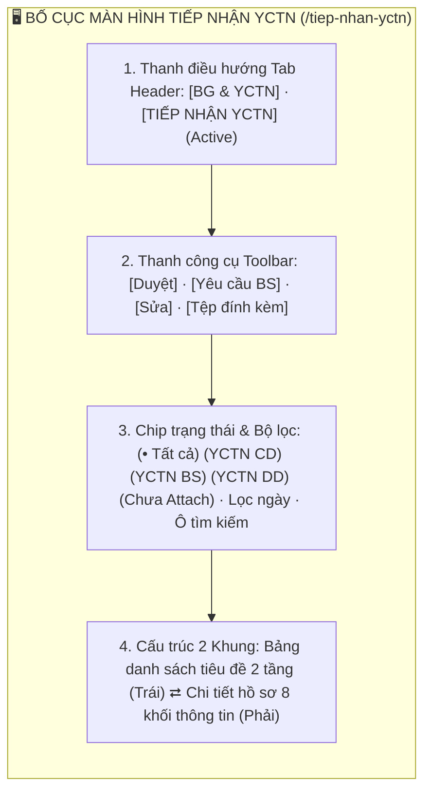
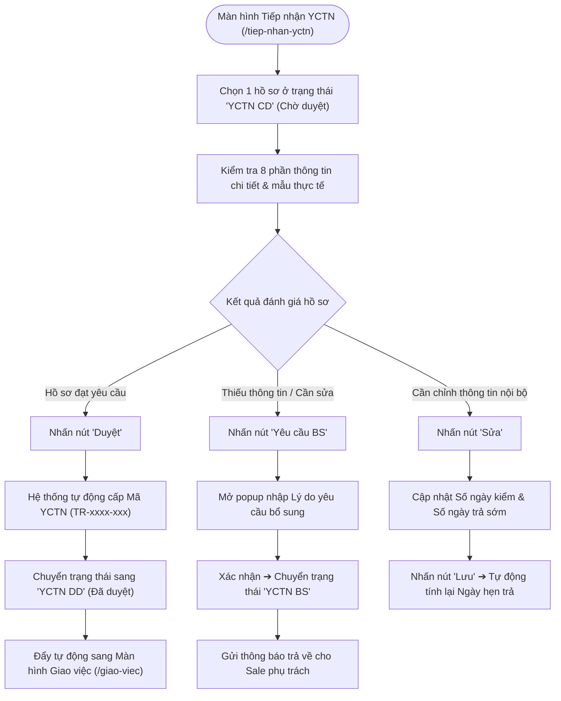
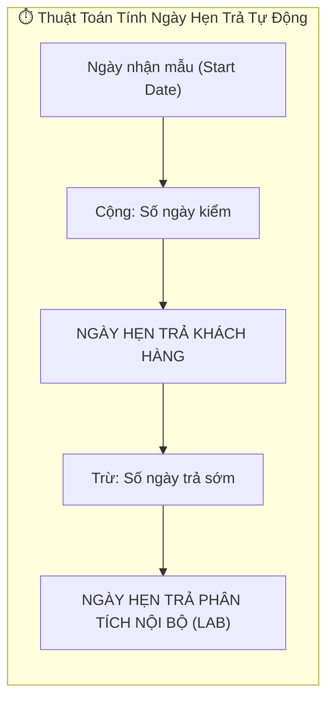

# 📋 TÀI LIỆU ĐẶC TẢ YÊU CẦU CHỨC NĂNG (REQUIREMENTS SPECIFICATION)
## Phân hệ: Tiếp nhận mẫu & Quản lý YCTN — Hệ thống VNTEST LIMS
### Tính năng: Tiếp nhận YCTN & Bàn giao mẫu (Test Request Reception Screen)

---

| Thông tin tài liệu | Chi tiết |
| :--- | :--- |
| **Mã tài liệu** | `REQ_VNTEST_RECEPTION` |
| **Tính năng / Màn hình** | Tiếp nhận YCTN & Bàn giao mẫu (Test Request Reception) |
| **Đường dẫn truy cập** | `/tiep-nhan-yctn` (hoặc chuyển tab từ `/yeu-cau-thu-nghiem`) |
| **Đối tượng sử dụng** | Nhân viên Bộ phận Tiếp nhận mẫu, Trưởng phòng Kỹ thuật, Lãnh đạo, Admin |
| **Trạng thái tài liệu** | `Approved / Ready for Development & Testing` |
| **Cơ sở dữ liệu liên kết** | `quotations`, `test_requests`, `customers`, `samples`, `attachments`, `users` |
| **Test Script Playwright** | [`src/tests/test-request-reception/test-request-reception.spec.ts`](file:///home/thai.hoang.dinh/VNTEST_Automation/src/tests/test-request-reception/test-request-reception.spec.ts) (28 Test Cases) |
| **Page Object Model** | [`src/pages/test-request-reception.page.ts`](file:///home/thai.hoang.dinh/VNTEST_Automation/src/pages/test-request-reception.page.ts) |
| **Dữ liệu kiểm thử** | [`test-data/users.json`](file:///home/thai.hoang.dinh/VNTEST_Automation/test-data/users.json), `test-data/test-requests.json` |

---

## 📑 MỤC LỤC ĐIỀU HƯỚNG NHANH
1. [1. Định vị màn hình & Tổng quan tính năng (Overview & UI Layout)](#1-định-vị-màn-hình--tổng-quan-tính-năng-overview--ui-layout)
2. [2. Sơ đồ phân tích luồng trực quan (Mermaid Flowcharts)](#2-sơ-đồ-phân-tích-luồng-trực-quan-mermaid-flowcharts)
3. [3. Phân quyền & Điều kiện kích hoạt (Access & Permissions)](#3-phân-quyền--điều-kiện-kích-hoạt-access--permissions)
4. [4. Đặc tả chi tiết các Use Cases chức năng (Functional Use Cases)](#4-đặc-tả-chi-tiết-các-use-cases-chức-năng-functional-use-cases)
5. [5. Đặc tả chi tiết trường dữ liệu (Field Specifications Matrix)](#5-đặc-tả-chi-tiết-trường-dữ-liệu-field-specifications-matrix)
6. [6. Ma trận nút bấm & Tương tác giao diện (Action Buttons Matrix)](#6-ma-trận-nút-bấm--tương-tác-giao-diện-action-buttons-matrix)
7. [7. Quy tắc nghiệp vụ & Luồng xử lý lỗi (Business Rules & Error Handling)](#7-quy-tắc-nghiệp-vụ--luồng-xử-lý-lỗi-business-rules--error-handling)
8. [8. Kế hoạch kiểm thử & Ma trận Test Cases Automation (28 Test Cases)](#8-kế-hoạch-kiểm-thử--ma-trận-test-cases-automation-28-test-cases)

---

## 1. ĐỊNH VỊ MÀN HÌNH & TỔNG QUAN TÍNH NĂNG (OVERVIEW & UI WIREFRAME)

### 1.1. Mục đích tính năng
* **Kiểm tra & Tiếp nhận hồ sơ YCTN từ Kinh doanh:** Đóng vai trò chốt chặn kỹ thuật kiểm duyệt thông tin mẫu, số lượng mẫu, chỉ tiêu thử nghiệm và điều kiện pháp lý trước khi chuyển giao vào phòng LAB.
* **Cơ chế Phê duyệt & Tự động cấp mã YCTN (TR...):** Khi nhân viên tiếp nhận nhấn Duyệt, hệ thống tự động sinh Mã YCTN duy nhất dạng `TR-xxxx-xxx`, chuyển trạng thái sang `YCTN Đã duyệt` (`YCTN DD`) và tự động đẩy dữ liệu sang màn hình **Giao việc thử nghiệm**.
* **Luồng Yêu cầu bổ sung (YCTN BS):** Cho phép bộ phận tiếp nhận gửi trả yêu cầu kèm lý do bắt buộc để nhân viên kinh doanh bổ sung thông tin khi hồ sơ chưa đạt chuẩn.
* **Quản lý Thông tin nội bộ & Tính ngày hẹn trả:** Cấu hình Số ngày kiểm, Số ngày trả sớm để hệ thống tự động tính Ngày hẹn trả khách hàng và Ngày hẹn trả kết quả phân tích nội bộ.

### 1.2. Bố cục Giao diện & Các Phân khu Chức năng (UI Layout Matrix)

| Phân khu (Section) | Vị trí hiển thị | Thành phần giao diện chính | Mục đích & Nghiệp vụ |
| :--- | :--- | :--- | :--- |
| **1. Header Tabs** | Trên cùng trang | Cụm tab: `BG & YCTN`, `TIẾP NHẬN YCTN` (active), nút `Xuất`, `In` | Điều hướng qua lại giữa phân hệ Báo giá và Tiếp nhận mẫu |
| **2. Thanh công cụ (Toolbar)** | Dưới Header | Nút `"Duyệt"`, `"Yêu cầu BS"`, `"Sửa"`, `"Tệp đính kèm"` | Thao tác phê duyệt tiếp nhận, yêu cầu bổ sung hoặc chỉnh sửa |
| **3. Chip trạng thái & Bộ lọc** | Dưới Toolbar | 5 Chip trạng thái, dropdown loại ngày, ô Từ ngày/Đến ngày, ô tìm kiếm | Lọc nhanh hồ sơ theo tình trạng kiểm duyệt và hạn trả kết quả |
| **4. Bảng danh sách (Khung trái)**| Nửa bên trái | Bảng tiêu đề ghép 2 tầng: Mã BG, Mã TR, Khách hàng, Ngày nhận/trả, Trạng thái | Hiển thị danh sách tổng quan các hồ sơ YCTN cần tiếp nhận |
| **5. Khung Chi tiết (Khung phải)**| Nửa bên phải | 8 Khối: Thông tin chung, Hóa đơn, DV bổ sung, Thanh toán, Mẫu/Chỉ tiêu, **Thông tin nội bộ**, Chi phí, Lịch sử | Xem chi tiết, cấu hình Số ngày kiểm/trả sớm để tự động tính ngày hẹn |

---

## 2. SƠ ĐỒ PHÂN TÍCH LUỒNG TRỰC QUAN (MERMAID FLOWCHARTS)

### 2.1. Sơ đồ Master Flow Tiếp nhận & Phê duyệt YCTN

### 2.2. Sơ đồ Cơ chế Tính ngày tự động trong Thông tin nội bộ

---

## 3. PHÂN QUYỀN & ĐIỀU KIỆN KÍCH HOẠT (ACCESS & PERMISSIONS)

### 3.1. Ma trận phân quyền truy cập (RBAC Matrix)

| Vai trò người dùng (Role) | Xem danh sách Tiếp nhận | Duyệt YCTN | Yêu cầu bổ sung | Sửa Thông tin nội bộ | Đính kèm tệp | Quản lý cột & Xuất file |
| :--- | :---: | :---: | :---: | :---: | :---: | :---: |
| **Quản trị viên (Admin)** | Toàn quyền | Toàn quyền | Toàn quyền | Toàn quyền | Toàn quyền | Cho phép |
| **Trưởng phòng / Lãnh đạo** | Toàn quyền | Toàn quyền | Toàn quyền | Toàn quyền | Toàn quyền | Cho phép |
| **Nhân viên Tiếp nhận mẫu** | Toàn quyền xem | Được phép | Được phép | Được phép | Được phép | Cho phép |
| **Nhân viên Kinh doanh (Sale)** | Xem hồ sơ của mình | Không | Bổ sung khi có BS | Không | Tải tệp lên | Cho phép |
| **Kiểm nghiệm viên (KNV)** | Không có quyền | Không | Không | Không | Không | Bị chặn |

---

## 4. ĐẶC TẢ CHI TIẾT CÁC USE CASES CHỨC NĂNG (FUNCTIONAL USE CASES)

### UC-01: Bố cục, Điều hướng Tab & Thanh công cụ (Toolbar States)
* **Tác nhân:** Người dùng truy cập màn hình Tiếp nhận YCTN.
* **Tiền điều kiện:** Đã đăng nhập vào hệ thống và mở tab `TIẾP NHẬN YCTN`.
* **Luồng sự kiện chính:**
  1. Khi chưa chọn dòng nào: Các nút `"Duyệt"`, `"Yêu cầu BS"`, `"Sửa"`, `"Tệp đính kèm"` ở trạng thái vô hiệu hóa (`disabled`).
  2. Khi tích chọn 1 dòng `YCTN CD` (Chờ duyệt): Kích hoạt cả 4 nút `"Duyệt"`, `"Yêu cầu BS"`, `"Sửa"`, `"Tệp đính kèm"`.
  3. Khi tích chọn 1 dòng `YCTN BS` (Yêu cầu bổ sung): Kích hoạt các nút `"Duyệt"`, `"Sửa"`, `"Tệp đính kèm"`; nút `"Yêu cầu BS"` bị vô hiệu hóa vì hồ sơ đang chờ Sale bổ sung.
  4. Khi tích chọn 1 dòng `YCTN DD` (Đã duyệt): Khóa toàn bộ các nút tác động dữ liệu (`"Duyệt"`, `"Yêu cầu BS"`, `"Sửa"`); chỉ cho phép thao tác `"Tệp đính kèm"`.
  5. Khi tích chọn nhiều dòng `YCTN CD` cùng lúc (Multi-select): Cho phép duyệt hàng loạt; tự động vô hiệu hóa các nút thao tác đơn lẻ (`"Sửa"`, `"Yêu cầu BS"`).

### UC-02: Tìm kiếm, Bộ lọc 5 Chip Trạng thái & Quản lý Cột
* **Tác nhân:** Người dùng tra cứu hồ sơ tiếp nhận.
* **Luồng sự kiện chính:**
  1. Lọc nhanh danh sách bằng 5 chip trạng thái: `"Tất cả"`, `"YCTN CD"`, `"YCTN BS"`, `"YCTN DD"`, `"Chưa Attach"`.
  2. Tìm kiếm theo Mã Báo giá (`BG...`), Mã YCTN (`TR...`) hoặc Tên khách hàng; dễ dàng xóa tìm kiếm bằng nút `"Hủy"` (`[×]`).
  3. Cấu hình ẩn/hiện cột hiển thị qua popover `"Quản lý cột"`.

### UC-03: Xem Chi tiết Hồ sơ Tiếp nhận (Khung Phải 8 Phần)
* **Tác nhân:** Nhân viên tiếp nhận kiểm tra hồ sơ.
* **Luồng sự kiện chính:**
  1. Nhấn chọn 1 dòng bất kỳ: Khung bên phải hiển thị đầy đủ 8 phần thông tin chi tiết (đặc biệt có khối `6. Thông tin nội bộ`).
  2. Đối với hồ sơ `YCTN Đã duyệt`: Khung chi tiết tự động hiển thị banner cảnh báo chỉ đọc (`readonly banner`).

### UC-04: Chỉnh sửa Thông tin nội bộ & Tính ngày hẹn trả tự động
* **Tác nhân:** Nhân viên tiếp nhận mẫu.
* **Luồng sự kiện chính:**
  1. Chọn hồ sơ `YCTN CD` ➔ Nhấn nút `"Sửa"` trên toolbar.
  2. Thay đổi `Số ngày kiểm` và `Số ngày trả sớm` tại khối 6: Hệ thống tự động tính toán lại `Ngày hẹn trả` khách hàng và `Ngày hẹn trả phân tích` nội bộ theo thời gian thực.
  3. Nhấn nút `"Lưu"`: Cập nhật thành công thông tin nội bộ vào cơ sở dữ liệu.

### UC-05: Thao tác Tệp đính kèm Hồ sơ
* **Tác nhân:** Nhân viên tiếp nhận hoặc Sale.
* **Luồng sự kiện chính:**
  1. Tích chọn hồ sơ và nhấn nút `"Tệp đính kèm"`.
  2. Hộp thoại mở ra hiển thị danh sách các tệp đã tải lên và khu vực tải tệp mới (hỗ trợ PDF, Ảnh, Word).
  3. Cho phép tải tệp mới hoặc nhấn nút `"Hủy"` để đóng hộp thoại an toàn.

### UC-06: Luồng Yêu cầu bổ sung Hồ sơ (YCTN BS)
* **Tác nhân:** Nhân viên tiếp nhận mẫu.
* **Luồng sự kiện chính:**
  1. Tích chọn hồ sơ `YCTN CD` ➔ Nhấn nút `"Yêu cầu BS"`.
  2. Popup mở ra yêu cầu nhập Lý do bổ sung; nếu để trống và nhấn gửi, hệ thống chặn lại và báo lỗi bắt buộc.
  3. Nhập lý do hợp lệ và xác nhận: Hồ sơ chuyển ngay sang trạng thái `YCTN BS`, biến mất khỏi chip `YCTN CD` và xuất hiện ở chip `YCTN BS`.

### UC-07: Luồng Phê duyệt Hồ sơ & Tự động cấp Mã TR... (E2E)
* **Tác nhân:** Nhân viên tiếp nhận mẫu / Trưởng phòng.
* **Luồng sự kiện chính:**
  1. Tích chọn hồ sơ `YCTN CD` ➔ Nhấn nút `"Duyệt"`.
  2. Xác nhận phê duyệt hồ sơ tiếp nhận.
  3. Hệ thống tự động cấp phát Mã YCTN mới dạng `TR-xxxx-xxx`, chuyển hồ sơ sang trạng thái `YCTN Đã duyệt` (`YCTN DD`) và tự động đẩy dữ liệu sang màn hình **Giao việc thử nghiệm**.

### UC-08: Bộ lọc Thời gian nâng cao (Ngày nhận & Ngày trả)
* **Tác nhân:** Người dùng tra cứu theo mốc thời gian nhận mẫu hoặc hẹn trả.
* **Luồng sự kiện chính:**
  1. Hỗ trợ lọc theo: Chỉ chọn `Từ ngày`, chỉ chọn `Đến ngày`, cả 2 ngày trùng nhau, hoặc khoảng ngày cụ thể.
  2. Danh sách lọc chính xác các bản ghi thỏa mãn điều kiện thời gian.

---

## 5. ĐẶC TẢ CHI TIẾT TRƯỜNG DỮ LIỆU (FIELD SPECIFICATIONS MATRIX)

| Tên trường | UI Label | Kiểu dữ liệu | Bắt buộc | Ràng buộc & Validation Rules | Giá trị mặc định / Placeholder | Ghi chú |
| :--- | :--- | :--- | :---: | :--- | :--- | :--- |
| `requestNumber` | **Mã YCTN** | `text` | Hệ thống sinh khi duyệt | Định dạng `TR-xxxx-xxx` tự tăng. Readonly. | Rỗng khi chưa duyệt | Khóa không cho sửa |
| `quotationCode` | **Mã Báo giá** | `text` | Kế thừa | Định dạng `BG-xxxx-xxx` từ màn Báo giá. | Kế thừa từ BG | Liên kết hồ sơ nguồn |
| `testingDays` | **Số ngày kiểm** | `number` | **Bắt buộc** | Số nguyên dương $> 0$. | Mặc định: `3` | Dùng tính ngày hẹn trả |
| `earlyReturnDays`| **Số ngày trả sớm**| `number` | **Bắt buộc** | Số nguyên $\ge 0$ và $<$ Số ngày kiểm. | Mặc định: `1` | Dùng tính hạn phân tích LAB |
| `promiseReturnDate`| **Ngày hẹn trả** | `date` | Tự động tính | `= Ngày nhận + Số ngày kiểm`. | Tự động tính | Trả kết quả cho khách |
| `labReturnDate` | **Ngày hẹn trả PT**| `date` | Tự động tính | `= Ngày hẹn trả - Số ngày trả sớm`. | Tự động tính | Hạn KNV nộp kết quả LAB |
| `rejectReason` | **Lý do bổ sung** | `textarea` | **Bắt buộc khi YCBS**| Không được để trống khi gửi Yêu cầu bổ sung. | `Nhập lý do chi tiết...`| Gửi phản hồi lại cho Sale |

---

## 6. MA TRẬN NÚT BẤM & TƯƠNG TÁC GIAO DIỆN (ACTION BUTTONS MATRIX)

| Tên nút (Button) | Vị trí | Icon / Class | Trạng thái mặc định | Điều kiện kích hoạt | Hành vi khi nhấn | Modal / Thông báo đi kèm |
| :--- | :--- | :--- | :---: | :--- | :--- | :--- |
| **Duyệt** | Toolbar trên bảng | `.btn-approve` | **Vô hiệu hóa** | Tích chọn $\ge 1$ dòng `YCTN CD` | Phê duyệt hồ sơ, cấp mã `TR...` và chuyển sang `YCTN DD` | Thông báo: `"Duyệt YCTN thành công."` |
| **Yêu cầu BS** | Toolbar trên bảng | `.btn-request-supp`| **Vô hiệu hóa** | Tích chọn duy nhất 1 dòng `YCTN CD` | Mở hộp thoại nhập lý do yêu cầu bổ sung | Modal: `"Yêu cầu bổ sung hồ sơ"` |
| **Sửa** | Toolbar trên bảng | `.btn-edit` | **Vô hiệu hóa** | Tích chọn duy nhất 1 dòng (trừ YCTN DD)| Mở chế độ chỉnh sửa Thông tin nội bộ tại khung phải | Tải form sửa thông tin nội bộ |
| **Tệp đính kèm** | Toolbar trên bảng | `.btn-attachment` | **Vô hiệu hóa** | Tích chọn duy nhất 1 dòng bất kỳ | Mở hộp thoại quản lý và tải lên tệp đính kèm | Modal: `"Tệp đính kèm hồ sơ"` |
| **Lưu** | Chân khung phải | `.btn-save` | **Kích hoạt** | Đang ở chế độ sửa | Lưu các thay đổi của Thông tin nội bộ | Thông báo: `"Cập nhật thông tin thành công."` |
| **Huỷ** | Chân khung phải | `.btn-cancel` | **Kích hoạt** | Đang ở chế độ sửa | Hủy bỏ chế độ sửa, hoàn tác dữ liệu cũ | Khung phải về chế độ xem |
| **Quản lý cột** | Dưới chân bảng | `.btn-manage-col` | **Kích hoạt** | Luôn sẵn sàng | Mở popover danh sách các cột để bật/tắt hiển thị | Popover danh sách cột |

---

## 7. QUY TẮC NGHIỆP VỤ & LUỒNG XỬ LÝ LỖI (BUSINESS RULES & ERROR HANDLING)

| Mã lỗi (Code) | Quy tắc nghiệp vụ (Business Rule) | Điều kiện kích hoạt | Vị trí hiển thị | Câu thông báo lỗi hiển thị (Error Message) |
| :--- | :--- | :--- | :--- | :--- |
| `ERR_SUPP_REASON_REQ` | Bắt buộc nhập lý do khi Yêu cầu BS | Để trống lý do khi nhấn Xác nhận bổ sung | Dưới ô Lý do | **"Vui lòng nhập lý do yêu cầu bổ sung."** |
| `ERR_EARLY_DAYS_INVALID`| Số ngày trả sớm phải nhỏ hơn ngày kiểm | Nhập Số ngày trả sớm $\ge$ Số ngày kiểm | Dưới ô Số ngày trả sớm | **"Số ngày trả sớm phải nhỏ hơn tổng số ngày kiểm."** |
| `RULE_APPROVED_LOCK` | Hồ sơ đã duyệt khóa toàn bộ tác động | Hồ sơ ở trạng thái `YCTN Đã duyệt` | Thanh toolbar & Khung chi tiết| Vô hiệu hóa nút Duyệt/Sửa/Yêu cầu BS; hiện readonly banner |
| `RULE_AUTO_GEN_TR` | Tự động sinh mã TR khi duyệt | Nhấn Duyệt hồ sơ `YCTN CD` thành công | Cột Mã YCTN | Tự động cấp mã định danh `TR-xxxx-xxx` duy nhất |

---

## 8. KẾ HOẠCH KIỂM THỬ & MA TRẬN TEST CASES AUTOMATION (28 TEST CASES)

### 8.1. Khối 01: Bố cục, Điều hướng Tab & Thanh công cụ (3 Test Cases)

| Mã TC | Phân nhóm luồng | Tên kịch bản | Thao tác & Dữ liệu kiểm thử | Kết quả mong đợi | Mức độ ưu tiên | Mapping Page Object |
| :--- | :--- | :--- | :--- | :--- | :---: | :--- |
| **TC_TNYCTN_001** | Bố cục & Điều hướng | Điều hướng giữa 2 tab BG & YCTN và TIẾP NHẬN YCTN | 1. Mở trang `/tiep-nhan-yctn`.  2. Nhấn chuyển đổi qua lại giữa tab `"BG & YCTN"` và `"TIẾP NHẬN YCTN"`. | Tab `"TIẾP NHẬN YCTN"` đang ở trạng thái active khi mở; chuyển đổi tab mượt mà, URL cập nhật chính xác giữa `/yeu-cau-thu-nghiem` và `/tiep-nhan-yctn`. | Normal | `testRequestReceptionPage.receiveYctnTab`, `testRequestReceptionPage.bgAndYctnTab` |
| **TC_TNYCTN_002** | Bố cục & Điều hướng | Hiển thị 5 chip trạng thái, bộ lọc ngày và Toolbar | 1. Quan sát dãy 5 chip lọc trạng thái.  2. Quan sát bộ lọc ngày và ô tìm kiếm.  3. Quan sát 4 nút hành động trên thanh công cụ. | 1. Hiển thị đủ 5 chip: `"Tất cả"` (mặc định active), `"YCTN CD"`, `"YCTN BS"`, `"YCTN DD"`, `"Chưa Attach"`.  2. Hiển thị đủ bộ lọc ngày và ô tìm kiếm.  3. Hiển thị đủ 4 nút: `"Duyệt"`, `"Yêu cầu BS"`, `"Sửa"`, `"Tệp đính kèm"`. | Normal | `testRequestReceptionPage.chipAll`, `testRequestReceptionPage.approveButton` |
| **TC_TNYCTN_003** | Bố cục & Điều hướng | Cấu trúc bảng danh sách, tiêu đề 2 tầng và khung phải | 1. Quan sát cấu trúc bảng danh sách bên trái.  2. Quan sát chân bảng và khung chi tiết bên phải. | 1. Bảng danh sách hiển thị các cột tiêu đề ghép 2 tầng chuẩn: checkbox, `MÃ BG`, `MÃ YCTN`, `KHÁCH HÀNG`, `NGÀY NHẬN`, `NGÀY TRẢ`, `TRẠNG THÁI`.  2. Chân bảng có phân trang và nút `"Quản lý cột"`.  3. Khung bên phải ở trạng thái mặc định: `"Chọn một yêu cầu thử nghiệm để xem chi tiết"`. | Normal | `testRequestReceptionPage.table`, `testRequestReceptionPage.manageColumnsButton` |

### 8.2. Khối 02: Trạng thái Toolbar & Điều kiện kích hoạt nút thao tác (5 Test Cases)

| Mã TC | Phân nhóm luồng | Tên kịch bản | Thao tác & Dữ liệu kiểm thử | Kết quả mong đợi | Mức độ ưu tiên | Mapping Page Object |
| :--- | :--- | :--- | :--- | :--- | :---: | :--- |
| **TC_TNYCTN_004** | Trạng thái Toolbar | Trạng thái 4 nút khi chưa chọn dòng nào | 1. Mở danh sách, chưa tích chọn ô checkbox nào.  2. Quan sát trạng thái 4 nút trên toolbar. | Toàn bộ 4 nút `"Duyệt"`, `"Yêu cầu BS"`, `"Sửa"`, `"Tệp đính kèm"` đều ở trạng thái vô hiệu hóa (`disabled`), mờ đi. | Normal | `testRequestReceptionPage.approveButton`, `testRequestReceptionPage.editButton` |
| **TC_TNYCTN_005** | Trạng thái Toolbar | Tích chọn 1 dòng trạng thái "YCTN CD" (Chờ duyệt) | 1. Nhấn chip `"YCTN CD"`.  2. Tích chọn 1 dòng hồ sơ chờ duyệt.  3. Quan sát trạng thái 4 nút. | Cả 4 nút `"Duyệt"`, `"Yêu cầu BS"`, `"Sửa"`, `"Tệp đính kèm"` đều sáng lên và ở trạng thái kích hoạt (`enabled`). | High | `testRequestReceptionPage.selectRow()`, `testRequestReceptionPage.approveButton` |
| **TC_TNYCTN_006** | Trạng thái Toolbar | Tích chọn 1 dòng trạng thái "YCTN BS" (Yêu cầu bổ sung) | 1. Nhấn chip `"YCTN BS"`.  2. Tích chọn 1 dòng hồ sơ yêu cầu bổ sung.  3. Quan sát trạng thái 4 nút. | Các nút `"Duyệt"`, `"Sửa"`, `"Tệp đính kèm"` được kích hoạt; riêng nút `"Yêu cầu BS"` bị vô hiệu hóa vì hồ sơ đang ở trạng thái này. | High | `testRequestReceptionPage.requestSupplementButton` |
| **TC_TNYCTN_007** | Trạng thái Toolbar | Tích chọn 1 dòng trạng thái "YCTN DD" (Đã duyệt) | 1. Nhấn chip `"YCTN DD"`.  2. Tích chọn 1 dòng hồ sơ đã duyệt.  3. Quan sát trạng thái 4 nút. | Nút `"Tệp đính kèm"` được kích hoạt; toàn bộ các nút tác động dữ liệu (`"Duyệt"`, `"Yêu cầu BS"`, `"Sửa"`) bị vô hiệu hóa (`disabled`) để bảo toàn dữ liệu. | High | `testRequestReceptionPage.attachmentButton` |
| **TC_TNYCTN_008** | Trạng thái Toolbar | Tích chọn nhiều dòng "YCTN CD" cùng lúc (Multi-select) | 1. Tích chọn từ 2 dòng hồ sơ `YCTN CD` trở lên.  2. Quan sát trạng thái 4 nút. | Nút `"Duyệt"` vẫn kích hoạt (cho phép duyệt hàng loạt); các nút thao tác đơn lẻ (`"Sửa"`, `"Yêu cầu BS"`, `"Tệp đính kèm"`) tự động vô hiệu hóa (`disabled`). | Normal | `testRequestReceptionPage.selectAllCheckbox` |

### 8.3. Khối 03: Tìm kiếm, Bộ lọc Chip & Quản lý cột (4 Test Cases)

| Mã TC | Phân nhóm luồng | Tên kịch bản | Thao tác & Dữ liệu kiểm thử | Kết quả mong đợi | Mức độ ưu tiên | Mapping Page Object |
| :--- | :--- | :--- | :--- | :--- | :---: | :--- |
| **TC_TNYCTN_009** | Tìm kiếm & Bộ lọc | Lọc danh sách theo từng chip trạng thái | 1. Lần lượt nhấn các chip: `"YCTN CD"`, `"YCTN BS"`, `"YCTN DD"`, `"Chưa Attach"`, `"Tất cả"`.  2. Quan sát kết quả hiển thị trên bảng. | 1. Khi nhấn chip nào, bảng chỉ lọc ra đúng các bản ghi có trạng thái tương ứng.  2. Nhấn chip `"Tất cả"`: Bảng khôi phục hiển thị toàn bộ hồ sơ. | High | `testRequestReceptionPage.filterByChip()` |
| **TC_TNYCTN_010** | Tìm kiếm & Bộ lọc | Tìm kiếm theo Mã Báo giá & Mã YCTN | 1. Nhập Mã BG (`BG...`) vào ô tìm kiếm.  2. Xóa và nhập Mã YCTN (`TR...`).  3. Nhấn nút xóa `"Hủy"` (`[×]`). | 1. Lọc chính xác bản ghi theo Mã BG hoặc Mã TR tương ứng.  2. Sau khi nhấn xóa: Ô tìm kiếm về rỗng, bảng khôi phục đầy đủ danh sách ban đầu. | High | `testRequestReceptionPage.search()`, `testRequestReceptionPage.clearSearch()` |
| **TC_TNYCTN_011** | Tìm kiếm & Bộ lọc | Tìm kiếm theo Tên khách hàng | 1. Nhập tên khách hàng thực tế vào ô tìm kiếm.  2. Xóa và nhập từ khóa không tồn tại: `KHONG_TON_TAI_99999`. | 1. Với từ khóa thực tế: Bảng lọc ra các hồ sơ của khách hàng đó.  2. Với từ khóa không tồn tại: Bảng hiển thị thông báo danh sách trống `"Không có dữ liệu"`. | Normal | `testRequestReceptionPage.search()` |
| **TC_TNYCTN_012** | Tìm kiếm & Bộ lọc | Mở và kiểm tra popover "Quản lý cột" | 1. Nhấn nút `"Quản lý cột"` ở góc dưới bảng.  2. Quan sát popover và thử bỏ chọn 1 cột rồi tích chọn lại. | Popover mở ra với danh sách các checkbox cột; bỏ chọn cột nào thì cột đó ẩn ngay trên bảng, tích lại cột hiển thị lại tức thì. | Normal | `testRequestReceptionPage.manageColumnsButton` |

### 8.4. Khối 04: Xem Chi tiết Hồ sơ (Khung Phải — 2 Test Cases)

| Mã TC | Phân nhóm luồng | Tên kịch bản | Thao tác & Dữ liệu kiểm thử | Kết quả mong đợi | Mức độ ưu tiên | Mapping Page Object |
| :--- | :--- | :--- | :--- | :--- | :---: | :--- |
| **TC_TNYCTN_013** | Xem Chi tiết | Hiển thị đầy đủ 8 phần chi tiết khi chọn dòng | 1. Nhấn chọn 1 dòng bất kỳ trong bảng danh sách.  2. Quan sát khung chi tiết bên phải. | Khung chi tiết bên phải tải đầy đủ 8 khối thông tin: (1) Thông tin chung, (2) Hóa đơn, (3) Dịch vụ bổ sung, (4) Thanh toán, (5) Mẫu & Chỉ tiêu, (6) **Thông tin nội bộ**, (7) Chi phí, (8) Lịch sử. | High | `testRequestReceptionPage.selectRow()`, `testRequestReceptionPage.detailPanel` |
| **TC_TNYCTN_014** | Xem Chi tiết | Banner cảnh báo chỉ đọc cho hồ sơ "YCTN DD" | 1. Nhấn chip `"YCTN DD"`.  2. Nhấn chọn 1 hồ sơ đã duyệt để mở khung chi tiết. | Đầu khung chi tiết hiển thị banner cảnh báo chỉ đọc (`readonly banner`): thông báo hồ sơ đã được phê duyệt tiếp nhận, không cho phép chỉnh sửa trực tiếp. | Normal | `testRequestReceptionPage.readonlyBanner` |

### 8.5. Khối 05: Chỉnh sửa Thông tin nội bộ & Tính ngày hẹn trả (3 Test Cases)

| Mã TC | Phân nhóm luồng | Tên kịch bản | Thao tác & Dữ liệu kiểm thử | Kết quả mong đợi | Mức độ ưu tiên | Mapping Page Object |
| :--- | :--- | :--- | :--- | :--- | :---: | :--- |
| **TC_TNYCTN_015** | Thông tin nội bộ | Mở chế độ chỉnh sửa và Hủy thao tác | 1. Tích chọn hồ sơ `YCTN CD` ➔ Nhấn nút `"Sửa"` trên toolbar.  2. Quan sát khung phải chuyển sang chế độ form sửa.  3. Nhấn nút `"Huỷ"` ở chân form. | 1. Khung phải mở form cho phép chỉnh sửa Thông tin nội bộ.  2. Nhấn nút `"Huỷ"`: Form đóng lại, hoàn tác mọi thay đổi và quay về chế độ xem chi tiết ban đầu. | Normal | `testRequestReceptionPage.editButton`, `testRequestReceptionPage.cancelButton` |
| **TC_TNYCTN_016** | Thông tin nội bộ | Tự động tính Ngày hẹn trả & Ngày hẹn trả PT | 1. Đang ở form sửa Thông tin nội bộ.  2. Thay đổi `Số ngày kiểm`: `5` và `Số ngày trả sớm`: `2`.  3. Quan sát 2 ô Ngày hẹn trả. | 1. `Ngày hẹn trả` (cho khách) tự động tính: `= Ngày nhận + 5 ngày`.  2. `Ngày hẹn trả phân tích` (nội bộ LAB) tự động tính: `= Ngày hẹn trả - 2 ngày`. | High | `testRequestReceptionPage.testingDaysInput`, `testRequestReceptionPage.earlyReturnDaysInput` |
| **TC_TNYCTN_017** | Thông tin nội bộ | Lưu cập nhật Thông tin nội bộ thành công | 1. Điều chỉnh Số ngày kiểm và Số ngày trả sớm hợp lệ.  2. Nhấn nút `"Lưu"` ở chân form. | Hiển thị thông báo lưu thành công; thông tin ngày mới được cập nhật ngay ngoài bảng danh sách và lưu giữ trong khung chi tiết. | High | `testRequestReceptionPage.saveButton` |

### 8.6. Khối 06: Thao tác Tệp đính kèm (1 Test Case)

| Mã TC | Phân nhóm luồng | Tên kịch bản | Thao tác & Dữ liệu kiểm thử | Kết quả mong đợi | Mức độ ưu tiên | Mapping Page Object |
| :--- | :--- | :--- | :--- | :--- | :---: | :--- |
| **TC_TNYCTN_018** | Tệp đính kèm | Mở hộp thoại Tệp đính kèm và Đóng hộp thoại | 1. Tích chọn 1 hồ sơ bất kỳ ➔ Nhấn nút `"Tệp đính kèm"`.  2. Quan sát giao diện hộp thoại tải tệp.  3. Nhấn nút `"Hủy"` hoặc nút `[×]`. | 1. Hộp thoại `Tệp đính kèm` mở ra hiển thị danh sách file và khu vực tải tệp mới.  2. Nhấn nút `"Hủy"`: Hộp thoại đóng lại an toàn, không ảnh hưởng dữ liệu. | Normal | `testRequestReceptionPage.attachmentButton`, `testRequestReceptionPage.closeAttachmentDialog()` |

### 8.7. Khối 07: Luồng Yêu cầu bổ sung Hồ sơ (1 Test Case)

| Mã TC | Phân nhóm luồng | Tên kịch bản | Thao tác & Dữ liệu kiểm thử | Kết quả mong đợi | Mức độ ưu tiên | Mapping Page Object |
| :--- | :--- | :--- | :--- | :--- | :---: | :--- |
| **TC_TNYCTN_019** | Luồng Yêu cầu bổ sung | Validate bắt buộc nhập Lý do và Chuyển sang "YCTN BS" | 1. Tích chọn hồ sơ `YCTN CD` ➔ Nhấn nút `"Yêu cầu BS"`.  2. Để trống lý do và nhấn gửi: Kiểm tra chặn lỗi.  3. Nhập lý do: `Thiếu bản scan phiếu gửi mẫu` ➔ Xác nhận gửi. | 1. Để trống: Hệ thống chặn gửi và báo lỗi: `"Vui lòng nhập lý do yêu cầu bổ sung."`.  2. Nhập lý do hợp lệ: Hồ sơ chuyển sang trạng thái `YCTN BS`, biến mất khỏi chip `YCTN CD` và xuất hiện tại chip `YCTN BS`. | High | `testRequestReceptionPage.requestSupplementButton`, `testRequestReceptionPage.submitSupplementReason()` |

### 8.8. Khối 08: Luồng Phê duyệt YCTN & Tự động cấp Mã TR... (1 Test Case)

| Mã TC | Phân nhóm luồng | Tên kịch bản | Thao tác & Dữ liệu kiểm thử | Kết quả mong đợi | Mức độ ưu tiên | Mapping Page Object |
| :--- | :--- | :--- | :--- | :--- | :---: | :--- |
| **TC_TNYCTN_020** | Luồng Phê duyệt | Duyệt hồ sơ từ "YCTN CD" sang "YCTN DD" — cấp Mã TR... | 1. Tích chọn 1 hồ sơ `YCTN CD` ➔ Nhấn nút `"Duyệt"`.  2. Xác nhận phê duyệt hồ sơ tiếp nhận.  3. Quan sát kết quả và chuyển sang màn Giao việc. | 1. Hồ sơ chuyển sang chip `"YCTN DD"`.  2. Cột `MÃ YCTN` được tự động cấp phát mã mới định dạng `TR-xxxx-xxx`.  3. Dữ liệu hồ sơ vừa duyệt tự động được đẩy sang màn hình Giao việc (`/giao-viec`). | High | `testRequestReceptionPage.approveButton`, `testRequestReceptionPage.confirmApproval()` |

### 8.9. Khối 09: Bộ lọc Thời gian nâng cao (8 Test Cases)

| Mã TC | Phân nhóm luồng | Tên kịch bản | Thao tác & Dữ liệu kiểm thử | Kết quả mong đợi | Mức độ ưu tiên | Mapping Page Object |
| :--- | :--- | :--- | :--- | :--- | :---: | :--- |
| **TC_TNYCTN_021** | Bộ lọc Thời gian | Lọc theo Ngày nhận — Chỉ chọn Từ ngày | 1. Tiêu chí: `Ngày nhận`.  2. Nhập ô `Từ ngày`: `20/10/2026`, để trống `Đến ngày`. | Mọi dòng hiển thị đều có cột **`NGÀY NHẬN` $\ge$ `20/10/2026`**. | Normal | `testRequestReceptionPage.filterByDateRange()` |
| **TC_TNYCTN_022** | Bộ lọc Thời gian | Lọc theo Ngày nhận — Chỉ chọn Đến ngày | 1. Tiêu chí: `Ngày nhận`.  2. Nhập ô `Đến ngày`: `22/10/2026`, để trống `Từ ngày`. | Mọi dòng hiển thị đều có cột **`NGÀY NHẬN` $\le$ `22/10/2026`**. | Normal | `testRequestReceptionPage.filterByDateRange()` |
| **TC_TNYCTN_023** | Bộ lọc Thời gian | Lọc theo Ngày nhận — Chọn Từ ngày và Đến ngày cùng 1 ngày | 1. Tiêu chí: `Ngày nhận`.  2. Nhập cả `Từ ngày` và `Đến ngày`: `22/10/2026`. | Chỉ hiển thị các hồ sơ có cột `NGÀY NHẬN` đúng ngày `22/10/2026`. | Normal | `testRequestReceptionPage.filterByDateRange()` |
| **TC_TNYCTN_024** | Bộ lọc Thời gian | Lọc theo Ngày nhận — Chọn khoảng ngày | 1. Tiêu chí: `Ngày nhận`.  2. Nhập `Từ ngày`: `20/10/2026` ➔ `Đến ngày`: `25/10/2026`. | Mọi hồ sơ hiển thị đều có `NGÀY NHẬN` nằm trong khoảng từ `20/10/2026` đến `25/10/2026`. | High | `testRequestReceptionPage.filterByDateRange()` |
| **TC_TNYCTN_025** | Bộ lọc Thời gian | Lọc theo Ngày trả — Chỉ chọn Từ ngày | 1. Tiêu chí: `Ngày trả`.  2. Nhập ô `Từ ngày`: `25/10/2026`, để trống `Đến ngày`. | Mọi dòng hiển thị đều có cột **`NGÀY TRẢ` $\ge$ `25/10/2026`**. | Normal | `testRequestReceptionPage.filterByDateRange()` |
| **TC_TNYCTN_026** | Bộ lọc Thời gian | Lọc theo Ngày trả — Chỉ chọn Đến ngày | 1. Tiêu chí: `Ngày trả`.  2. Nhập ô `Đến ngày`: `28/10/2026`, để trống `Từ ngày`. | Mọi dòng hiển thị đều có cột **`NGÀY TRẢ` $\le$ `28/10/2026`**. | Normal | `testRequestReceptionPage.filterByDateRange()` |
| **TC_TNYCTN_027** | Bộ lọc Thời gian | Lọc theo Ngày trả — Chọn Từ ngày và Đến ngày cùng 1 ngày | 1. Tiêu chí: `Ngày trả`.  2. Nhập `Từ ngày` và `Đến ngày`: `26/10/2026`. | Chỉ hiển thị các hồ sơ có cột `NGÀY TRẢ` đúng ngày `26/10/2026`. | Normal | `testRequestReceptionPage.filterByDateRange()` |
| **TC_TNYCTN_028** | Bộ lọc Thời gian | Lọc theo Ngày trả — Chọn khoảng ngày và Xóa bộ lọc | 1. Chọn tiêu chí `Ngày trả`, nhập khoảng từ `24/10/2026` đến `30/10/2026`.  2. Nhấn nút xóa bộ lọc ngày. | 1. Lọc chính xác các hồ sơ có `NGÀY TRẢ` trong khoảng chỉ định.  2. Sau khi xóa bộ lọc: Các ô ngày về rỗng, bảng khôi phục đầy đủ số lượng bản ghi ban đầu. | High | `testRequestReceptionPage.clearDateFilter()` |
