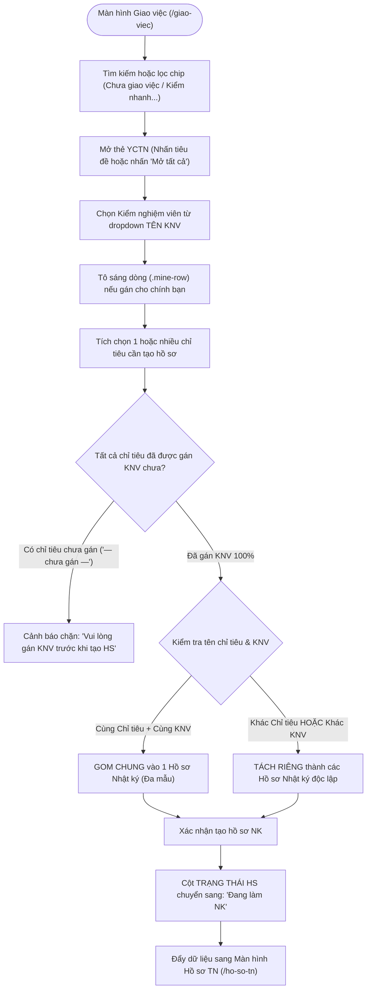
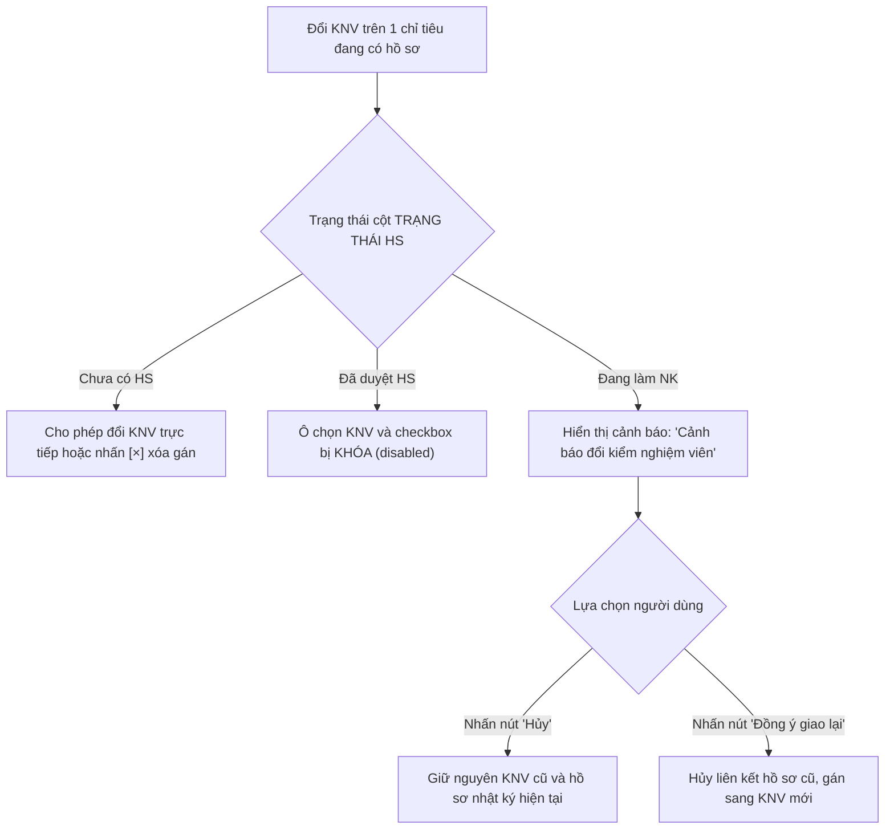

# 📋 TÀI LIỆU ĐẶC TẢ YÊU CẦU CHỨC NĂNG (REQUIREMENTS SPECIFICATION)
## Phân hệ: Thử nghiệm LAB & Quản lý Phân công — Hệ thống VNTEST LIMS
### Tính năng: Giao việc thử nghiệm (Task Assignment Screen)

---

| Thông tin tài liệu | Chi tiết |
| :--- | :--- |
| **Mã tài liệu** | `REQ_VNTEST_ASSIGNMENT` |
| **Tính năng / Màn hình** | Giao việc thử nghiệm (Task Assignment) |
| **Đường dẫn truy cập** | `/giao-viec` (hoặc cụm tab `GIAO VIỆC` trên header) |
| **Đối tượng sử dụng** | Trưởng phòng Kỹ thuật / Trưởng bộ phận thử nghiệm, Kiểm nghiệm viên (KNV), Lãnh đạo, Admin |
| **Trạng thái tài liệu** | `Approved / Ready for Development & Testing` |
| **Cơ sở dữ liệu liên kết** | `task_assignments`, `test_requests`, `samples`, `criteria`, `users`, `test_records` |
| **Test Script Playwright** | [`src/tests/task-assignment/task-assignment.spec.ts`](file:///home/thai.hoang.dinh/VNTEST_Automation/src/tests/task-assignment/task-assignment.spec.ts) (30 Test Cases) |
| **Page Object Model** | [`src/pages/task-assignment.page.ts`](file:///home/thai.hoang.dinh/VNTEST_Automation/src/pages/task-assignment.page.ts) |
| **Dữ liệu kiểm thử** | [`test-data/users.json`](file:///home/thai.hoang.dinh/VNTEST_Automation/test-data/users.json), `test-data/task-assignment.json` |

---

## 📑 MỤC LỤC ĐIỀU HƯỚNG NHANH
1. [1. Định vị màn hình & Tổng quan tính năng (Overview & UI Wireframe)](#1-định-vị-màn-hình--tổng-quan-tính-năng-overview--ui-wireframe)
2. [2. Sơ đồ phân tích luồng trực quan (Mermaid Flowcharts)](#2-sơ-đồ-phân-tích-luồng-trực-quan-mermaid-flowcharts)
3. [3. Phân quyền & Điều kiện kích hoạt (Access & Permissions)](#3-phân-quyền--điều-kiện-kích-hoạt-access--permissions)
4. [4. Đặc tả chi tiết các Use Cases chức năng (Functional Use Cases)](#4-đặc-tả-chi-tiết-các-use-cases-chức-năng-functional-use-cases)
5. [5. Đặc tả chi tiết trường dữ liệu (Field Specifications Matrix)](#5-đặc-tả-chi-tiết-trường-dữ-liệu-field-specifications-matrix)
6. [6. Ma trận nút bấm & Tương tác giao diện (Action Buttons Matrix)](#6-ma-trận-nút-bấm--tương-tác-giao-diện-action-buttons-matrix)
7. [7. Quy tắc nghiệp vụ & Luồng xử lý lỗi (Business Rules & Error Handling)](#7-quy-tắc-nghiệp-vụ--luồng-xử-lý-lỗi-business-rules--error-handling)
8. [8. Kế hoạch kiểm thử & Ma trận Test Cases Automation (30 Test Cases)](#8-kế-hoạch-kiểm-thử--ma-trận-test-cases-automation-30-test-cases)

---

## 1. ĐỊNH VỊ MÀN HÌNH & TỔNG QUAN TÍNH NĂNG (OVERVIEW & UI WIREFRAME)

### 1.1. Mục đích tính năng
* **Điều phối & Phân công chuyên môn phòng LAB:** Quản lý tập trung toàn bộ các chỉ tiêu thử nghiệm của các YCTN đã được phê duyệt (`YCTN DD`), hỗ trợ Trưởng bộ phận phân công KNV phụ trách phù hợp với năng lực kỹ thuật và thiết bị phân tích.
* **Giao diện dạng Thẻ Accordion (Card Collapse/Expand):** Mỗi YCTN là một khối thẻ riêng biệt chứa danh sách các mẫu và bảng 11 cột chi tiết các chỉ tiêu thử nghiệm. Cho phép thu gọn toàn bộ (`▶ Thu gọn tất cả`) hoặc mở rộng toàn bộ (`▼ Mở tất cả`) để quan sát trực quan.
* **Cơ chế Highlight nhiệm vụ cá nhân (.mine-row):** Khi KNV đăng nhập hoặc khi một chỉ tiêu được gán cho chính KNV hiện tại, dòng chỉ tiêu đó lập tức được tô sáng màu vàng nhạt/xanh nổi bật kèm huy hiệu nhận diện.
* **Quy chuẩn Tạo Hồ sơ Nhật ký thử nghiệm (NK Flow):**
  - **Nguyên tắc gom nhóm:** Tích chọn nhiều chỉ tiêu có cùng tên chỉ tiêu và cùng KNV sẽ tự động gộp chung vào 1 Hồ sơ Nhật ký.
  - **Nguyên tắc phân tách:** Tích chọn các chỉ tiêu khác tên hoặc khác KNV sẽ tự động tách thành các Hồ sơ Nhật ký độc lập tương ứng.
  - **Cảnh báo thay đổi KNV khi đang làm NK:** Bắt buộc hiển thị cảnh báo xác nhận trước khi cho phép giao lại việc khi KNV cũ đã bắt đầu nhập nhật ký thử nghiệm.

### 1.2. Sơ đồ Wireframe Bố cục Giao diện (ASCII Text Wireframe)

```text
+-----------------------------------------------------------------------------------------------------------------------+
|  [ GIAO VIỆC (Active) ]   [ HỒ SƠ TN ]   [ TRƯỞNG BP KTRA ]   [ RÀ SOÁT KQ ]                 [ Xuất ]   [ In ]        |
+-----------------------------------------------------------------------------------------------------------------------+
|  TOOLBAR: [ ▶ Thu gọn tất cả ]   [ ▼ Mở tất cả ]   [ Tạo hồ sơ NK ]                                                   |
|  CHIPS: ( Chưa giao việc )  ( Đang làm )  ( Trễ hạn )  ( ⚡ Kiểm nhanh )  ( Thiếu HS )                                 |
|  BỘ LỌC: [Lọc Ngày: Ngày nhận v] [Từ] [Đến]  |  Ô tìm kiếm: [ Nhập mã YCTN (TR...), mã mẫu (S...)...          [x] ]  |
+-----------------------------------------------------------------------------------------------------------------------+
|  THẺ YCTN 1: [▼] TR-2610-001 · Công ty TNHH ABC · Ngày nhận: 20/10/2026 · Hạn trả: 25/10/2026                      |
|  +-----------------------------------------------------------------------------------------------------------------+  |
|  | [x] | STT | MÃ MẪU | TÊN MẪU    | TÊN CHỈ TIÊU | PHƯƠNG PHÁP | TÊN KNV        | TRẠNG THÁI HS | KẾT QUẢ | ...      |  |
|  | [x] | 1   | S-001  | Nước thải  | pH           | TCVN 6492   | [ TháiHD v ] [x]| Đang làm NK   | Chưa có | ...      |  |
|  | [ ] | 2   | S-002  | Nước ngầm  | pH           | TCVN 6492   | [ TháiHD v ] [x]| Chưa có HS    | Chưa có | ...      |  |
|  | [ ] | 3   | S-001  | Nước thải  | COD          | SMEWW 5220C | [— chưa gán —v]| Chưa có HS    | Chưa có | ...      |  |
|  +-----------------------------------------------------------------------------------------------------------------+  |
|                                                                                                                       |
|  THẺ YCTN 2: [▶] TR-2610-002 · Thái test · Ngày nhận: 22/10/2026 · Hạn trả: 27/10/2026 (Đang thu gọn)               |
+-----------------------------------------------------------------------------------------------------------------------+
```

---

## 2. SƠ ĐỒ PHÂN TÍCH LUỒNG TRỰC QUAN (MERMAID FLOWCHARTS)

### 2.1. Sơ đồ Master Flow Phân công & Tạo Hồ sơ Nhật ký



### 2.2. Sơ đồ Xử lý Thay đổi KNV khi đang làm Nhật ký



---

## 3. PHÂN QUYỀN & ĐIỀU KIỆN KÍCH HOẠT (ACCESS & PERMISSIONS)

### 3.1. Ma trận phân quyền truy cập (RBAC Matrix)

| Vai trò người dùng (Role) | Xem danh sách Giao việc | Gán / Đổi KNV | Tạo Hồ sơ Nhật ký | Thu gọn / Mở thẻ | Quản lý bộ lọc |
| :--- | :---: | :---: | :---: | :---: | :---: |
| **Quản trị viên (Admin)** | Toàn quyền | Toàn quyền | Toàn quyền | Cho phép | Cho phép |
| **Trưởng bộ phận Kỹ thuật** | Toàn quyền | Phân công chuyên môn | Toàn quyền | Cho phép | Cho phép |
| **Kiểm nghiệm viên (KNV)** | Xem chỉ tiêu gán cho mình | Không được gán | Tạo HS việc của mình | Cho phép | Cho phép |
| **Nhân viên Kinh doanh (Sale)** | Xem tiến độ YCTN của mình | Không | Không | Cho phép | Cho phép |
| **Kế toán** | Không có quyền | Không | Không | Bị chặn | Bị chặn |

---

## 4. ĐẶC TẢ CHI TIẾT CÁC USE CASES CHỨC NĂNG (FUNCTIONAL USE CASES)

### UC-01: Bố cục Màn hình Giao việc & Điều khiển Thẻ YCTN (Accordion)
* **Tác nhân:** Trưởng bộ phận, KNV.
* **Tiền điều kiện:** Đã đăng nhập vào hệ thống và điều hướng tới `/giao-viec`.
* **Luồng sự kiện chính:**
  1. Hiển thị thanh công cụ với các nút tiện ích: `"▶ Thu gọn tất cả"`, `"▼ Mở tất cả"`, `"Tạo hồ sơ NK"`.
  2. Nhấn `"▶ Thu gọn tất cả"`: Toàn bộ danh sách thẻ YCTN thu gọn chỉ còn thanh tiêu đề thẻ (`.yctn-head`), icon đổi thành `▶`.
  3. Nhấn `"▼ Mở tất cả"`: Mở rộng toàn bộ các thẻ YCTN, hiển thị đầy đủ bảng 11 cột chỉ tiêu bên trong.
  4. Nhấn trực tiếp vào từng tiêu đề thẻ để đóng/mở độc lập từng YCTN riêng lẻ.

### UC-02: Tìm kiếm & Bộ lọc 5 Chip Trạng thái Chuyên biệt
* **Tác nhân:** Người dùng tra cứu nhiệm vụ LAB.
* **Luồng sự kiện chính:**
  1. Lọc nhanh theo 5 chip: `"Chưa giao việc"`, `"Đang làm"`, `"Trễ hạn"`, `"⚡ Kiểm nhanh"`, `"Thiếu HS"`.
  2. Tìm kiếm chính xác hoặc một phần theo Mã YCTN (`TR...`) hoặc Mã mẫu (`S...`); dễ dàng xóa điều kiện lọc bằng nút `"Hủy"` (`[×]`).
  3. Bộ lọc ngày hỗ trợ lọc theo Ngày nhận và Ngày trả (Từ ngày, Đến ngày, Cùng ngày, Khoảng ngày).

### UC-03: Kế thừa YCTN đã duyệt từ Phân hệ Tiếp nhận
* **Tác nhân:** Hệ thống tự động.
* **Luồng sự kiện chính:**
  1. Ngay khi hồ sơ được duyệt thành công tại màn Tiếp nhận (`/tiep-nhan-yctn`), bản ghi tự động xuất hiện trên màn Giao việc dưới dạng thẻ YCTN mới.
  2. Hiển thị đầy đủ thông tin: Mã YCTN, Khách hàng, Ngày nhận, Ngày trả và toàn bộ danh sách các mẫu, chỉ tiêu thử nghiệm tương ứng.

### UC-04: Phân công Kiểm nghiệm viên (KNV Assignment) & Highlight Cá nhân
* **Tác nhân:** Trưởng bộ phận phân công.
* **Luồng sự kiện chính:**
  1. Tại cột `TÊN KNV`, nhấn chọn KNV chuyên trách từ dropdown (chuyển từ `— chưa gán —` sang tên KNV).
  2. Nếu chỉ tiêu được gán cho chính tài khoản đang đăng nhập: Dòng chỉ tiêu lập tức được highlight nổi bật (`.mine-row`).
  3. Đối với chỉ tiêu chưa có hồ sơ (`Chưa có HS`): Cho phép đổi sang KNV khác hoặc nhấn nút `[×]` để xóa sạch KNV (quay về `— chưa gán —`).
  4. Đối với chỉ tiêu đã hoàn tất phê duyệt (`Đã duyệt HS`): Dropdown chọn KNV và ô checkbox bị khóa (`disabled`), không cho phép chỉnh sửa.

### UC-05: Cảnh báo Thay đổi KNV khi đang có Hồ sơ Nhật ký
* **Tác nhân:** Trưởng bộ phận điều chỉnh phân công.
* **Luồng sự kiện chính:**
  1. Khi một chỉ tiêu đang ở trạng thái `Đang làm NK`, nếu Trưởng bộ phận đổi sang KNV khác, hệ thống lập tức bật popup cảnh báo: `"Cảnh báo đổi kiểm nghiệm viên"`.
  2. Nhấn nút `"Hủy"`: Popup đóng lại, giữ nguyên KNV cũ và hồ sơ hiện tại.
  3. Nhấn nút `"Đồng ý giao lại"`: Hệ thống hủy liên kết nhật ký cũ và gán việc cho KNV mới.

### UC-06: Luồng Tạo Hồ sơ Nhật ký Thử nghiệm & Quy tắc Gom/Tách
* **Tác nhân:** Trưởng bộ phận hoặc KNV.
* **Luồng sự kiện chính:**
  1. Tích chọn các chỉ tiêu cần tạo hồ sơ và nhấn nút `"Tạo hồ sơ NK"`.
  2. Chặn lỗi: Nếu có bất kỳ chỉ tiêu nào chưa gán KNV (`— chưa gán —`), hệ thống hiển thị cảnh báo chặn và không cho phép tạo hồ sơ.
  3. Quy tắc gom nhóm: Tích chọn 2 chỉ tiêu có cùng tên chỉ tiêu và cùng KNV sẽ tự động gộp chung vào 1 Hồ sơ Nhật ký đa mẫu.
  4. Quy tắc tách nhóm: Tích chọn các chỉ tiêu khác tên hoặc khác KNV sẽ tự động tách thành các Hồ sơ Nhật ký riêng biệt.
  5. Xác nhận tạo hồ sơ: Cột `TRẠNG THÁI HS` chuyển sang `Đang làm NK` và dữ liệu lập tức xuất hiện bên màn hình **Hồ sơ TN** (`/ho-so-tn`).

---

## 5. ĐẶC TẢ CHI TIẾT TRƯỜNG DỮ LIỆU (FIELD SPECIFICATIONS MATRIX)

| Tên trường | UI Label | Kiểu dữ liệu | Bắt buộc | Ràng buộc & Validation Rules | Giá trị mặc định / Placeholder | Ghi chú |
| :--- | :--- | :--- | :---: | :--- | :--- | :--- |
| `technicianId` | **TÊN KNV** | `dropdown` | **Bắt buộc để tạo HS**| Chọn KNV từ danh sách nhân sự LAB. Đi kèm nút `[×]` hủy gán. | `— chưa gán —` | Tự động highlight `.mine-row` |
| `replicateCount`| **Số mẫu lặp** | `number` | **Bắt buộc** | Số nguyên dương $\ge 1$. Thường là $1$ hoặc $2$ (mẫu lặp đôi).| Mặc định: `1` | Dùng trong công thức tính |
| `recordStatus` | **TRẠNG THÁI HS** | `badge` | Hệ thống sinh | `Chưa có HS`, `Đang làm NK`, `Đã duyệt HS`. Readonly. | `Chưa có HS` | Khóa phân công khi đã duyệt |
| `isFastCheck` | **Kiểm nhanh** | `badge/boolean` | Kế thừa | Hiển thị biểu tượng tia sét `⚡ KN` nếu có dịch vụ kiểm nhanh.| Theo YCTN nguồn | Ưu tiên xử lý trước |

---

## 6. MA TRẬN NÚT BẤM & TƯƠNG TÁC GIAO DIỆN (ACTION BUTTONS MATRIX)

| Tên nút (Button) | Vị trí | Icon / Class | Trạng thái mặc định | Điều kiện kích hoạt | Hành vi khi nhấn | Modal / Thông báo đi kèm |
| :--- | :--- | :--- | :---: | :--- | :--- | :--- |
| **Thu gọn tất cả** | Toolbar trên bảng | `.btn-collapse-all`| **Kích hoạt** | Luôn sẵn sàng | Thu gọn toàn bộ các thẻ YCTN trong danh sách | Đổi icon thẻ sang `▶` |
| **Mở tất cả** | Toolbar trên bảng | `.btn-expand-all` | **Kích hoạt** | Luôn sẵn sàng | Mở rộng toàn bộ các thẻ YCTN trong danh sách | Đổi icon thẻ sang `▼` |
| **Tạo hồ sơ NK** | Toolbar trên bảng | `.btn-create-record`| **Kích hoạt** | Tích chọn $\ge 1$ chỉ tiêu | Mở popup xem trước và cấu hình tạo Hồ sơ Nhật ký | Modal: `"Tạo hồ sơ nhật ký"` |
| **Đồng ý giao lại** | Popup cảnh báo đổi KNV| `.btn-confirm-reassign`| **Kích hoạt**| Đang mở popup cảnh báo | Hủy liên kết hồ sơ cũ và giao lại cho KNV mới | Thông báo giao lại việc |
| **Hủy** | Popup & Modal | `.btn-cancel` | **Kích hoạt** | Luôn sẵn sàng | Đóng popup, giữ nguyên trạng thái cũ | Đóng popup |

---

## 7. QUY TẮC NGHIỆP VỤ & LUỒNG XỬ LÝ LỖI (BUSINESS RULES & ERROR HANDLING)

| Mã lỗi (Code) | Quy tắc nghiệp vụ (Business Rule) | Điều kiện kích hoạt | Vị trí hiển thị | Câu thông báo lỗi hiển thị (Error Message) |
| :--- | :--- | :--- | :--- | :--- |
| `ERR_KNV_NOT_ASSIGNED` | Bắt buộc gán KNV trước khi tạo HS | Tích chọn chỉ tiêu `— chưa gán —` khi tạo HS | Popup cảnh báo | **"Vui lòng phân công Kiểm nghiệm viên cho tất cả các chỉ tiêu đã chọn."** |
| `WARN_REASSIGN_RECORD` | Cảnh báo đổi KNV khi đang làm NK | Đổi KNV trên chỉ tiêu đang có hồ sơ `Đang làm NK` | Modal giữa màn hình | **"Cảnh báo đổi kiểm nghiệm viên: Chỉ tiêu này đang có hồ sơ nhật ký. Bạn có chắc muốn giao lại?"** |
| `RULE_LOCKED_APPROVED` | Khóa phân công khi đã duyệt HS | Chỉ tiêu có trạng thái `Đã duyệt HS` | Dropdown & Checkbox | Khóa vô hiệu hóa (`disabled`), không cho phép tích chọn hoặc đổi KNV |
| `RULE_GROUP_RECORD` | Quy tắc gom nhóm hồ sơ tự động | Chọn nhiều chỉ tiêu cùng tên + cùng KNV | Modal tạo hồ sơ | Tự động gộp chung vào 1 hồ sơ duy nhất |

---

## 8. KẾ HOẠCH KIỂM THỬ & MA TRẬN TEST CASES AUTOMATION (30 TEST CASES)

### 8.1. Khối 01: Bố cục Màn hình Giao việc & Điều khiển Thẻ YCTN (3 Test Cases)

| Mã TC | Phân nhóm luồng | Tên kịch bản | Thao tác & Dữ liệu kiểm thử | Kết quả mong đợi | Mức độ ưu tiên | Mapping Page Object |
| :--- | :--- | :--- | :--- | :--- | :---: | :--- |
| **TC_GV_001** | Bố cục & Hiển thị | Bố cục tổng thể màn hình Giao việc | 1. Mở trang `/giao-viec`.<br><br>2. Quan sát cấu trúc tổng thể màn hình. | Hiển thị cụm tab header (`GIAO VIỆC` đang active), thanh toolbar, 5 chip lọc, bộ lọc ngày, thẻ YCTN và bảng 11 cột chỉ tiêu bên trong. | Normal | `taskAssignmentPage.heading`, `taskAssignmentPage.toolbar` |
| **TC_GV_002** | Điều khiển Thẻ | Tiện ích "Thu gọn tất cả" và "Mở tất cả" | 1. Nhấn nút `"▶ Thu gọn tất cả"`.<br><br>2. Nhấn nút `"▼ Mở tất cả"`. | 1. Nhấn Thu gọn: Toàn bộ bảng chỉ tiêu bị ẩn, chỉ còn dòng tiêu đề thẻ YCTN.<br><br>2. Nhấn Mở tất cả: Toàn bộ bảng chỉ tiêu của tất cả các YCTN mở ra đồng loạt. | Normal | `taskAssignmentPage.collapseAllButton`, `taskAssignmentPage.expandAllButton` |
| **TC_GV_003** | Điều khiển Thẻ | Đóng/mở từng thẻ YCTN riêng lẻ | 1. Nhấp trực tiếp vào thanh tiêu đề của 1 thẻ YCTN bất kỳ (`.yctn-head`). | Thẻ YCTN đó tự động đóng lại (nếu đang mở) hoặc mở ra (nếu đang đóng); các thẻ khác giữ nguyên trạng thái. | Normal | `taskAssignmentPage.toggleCard()` |

### 8.2. Khối 02: Tìm kiếm từ khóa mở rộng (3 Test Cases)

| Mã TC | Phân nhóm luồng | Tên kịch bản | Thao tác & Dữ liệu kiểm thử | Kết quả mong đợi | Mức độ ưu tiên | Mapping Page Object |
| :--- | :--- | :--- | :--- | :--- | :---: | :--- |
| **TC_GV_004** | Tìm kiếm từ khóa | Tìm theo Mã YCTN (TR...) và Xóa từ khóa | 1. Nhập Mã YCTN thực tế: `TR-2610-001`.<br><br>2. Nhấn nút `"Hủy"` (`[×]`) trong ô tìm kiếm. | 1. Bảng chỉ hiển thị đúng thẻ YCTN có mã khớp từ khóa.<br><br>2. Sau khi xóa: Ô tìm kiếm về rỗng, hiển thị lại toàn bộ các thẻ YCTN. | High | `taskAssignmentPage.search()`, `taskAssignmentPage.clearSearch()` |
| **TC_GV_005** | Tìm kiếm từ khóa | Tìm theo Mã mẫu (S...) | 1. Nhập Mã mẫu vào ô tìm kiếm: `S-001` hoặc `S-002`. | Danh sách tự động lọc ra các YCTN có chứa mẫu tương ứng. | High | `taskAssignmentPage.search()` |
| **TC_GV_006** | Tìm kiếm từ khóa | Tìm với từ khóa không tồn tại | 1. Nhập từ khóa không tồn tại: `KHONG_TON_TAI_99999`. | Bảng hiển thị thông báo danh sách trống `"Không tìm thấy YCTN nào phù hợp."`. | Low | `taskAssignmentPage.search()` |

### 8.3. Khối 03: Bộ lọc 5 Chip Trạng thái & Bộ lọc Thời gian (13 Test Cases)

| Mã TC | Phân nhóm luồng | Tên kịch bản | Thao tác & Dữ liệu kiểm thử | Kết quả mong đợi | Mức độ ưu tiên | Mapping Page Object |
| :--- | :--- | :--- | :--- | :--- | :---: | :--- |
| **TC_GV_007** | Bộ lọc Chip | Lọc theo chip "Chưa giao việc" | 1. Nhấn bật/tắt chip `"Chưa giao việc"`. | Danh sách lọc ra các YCTN có ít nhất 1 chỉ tiêu chưa được phân công KNV (`— chưa gán —`). | High | `taskAssignmentPage.filterByChip('unassigned')` |
| **TC_GV_008** | Bộ lọc Chip | Lọc theo chip "Đang làm" | 1. Nhấn bật/tắt chip `"Đang làm"`. | Lọc ra các YCTN có chỉ tiêu đang trong quá trình thử nghiệm. | Normal | `taskAssignmentPage.filterByChip('in_progress')` |
| **TC_GV_009** | Bộ lọc Chip | Lọc theo chip "Trễ hạn" | 1. Nhấn bật/tắt chip `"Trễ hạn"`. | Lọc ra các YCTN có ngày hẹn trả quá hạn so với ngày hiện tại. | High | `taskAssignmentPage.filterByChip('overdue')` |
| **TC_GV_010** | Bộ lọc Chip | Lọc theo chip "Kiểm nhanh" | 1. Nhấn bật/tắt chip `"⚡ Kiểm nhanh"`. | Lọc ra các YCTN có dịch vụ kiểm nhanh ưu tiên. | Normal | `taskAssignmentPage.filterByChip('fast_check')` |
| **TC_GV_011** | Bộ lọc Chip | Lọc theo chip "Thiếu HS" | 1. Nhấn bật/tắt chip `"Thiếu HS"`. | Lọc ra các YCTN có chỉ tiêu đã gán KNV nhưng chưa được tạo Hồ sơ Nhật ký. | High | `taskAssignmentPage.filterByChip('missing_record')` |
| **TC_GV_012** | Bộ lọc Thời gian | Lọc Ngày nhận — Chỉ chọn Từ ngày | 1. Tiêu chí: `Ngày nhận`.<br><br>2. Nhập ô `Từ ngày`, để trống `Đến ngày`. | Mọi thẻ YCTN hiển thị đều có `Ngày nhận` $\ge$ `Từ ngày`. | Normal | `taskAssignmentPage.filterByDateRange()` |
| **TC_GV_013** | Bộ lọc Thời gian | Lọc Ngày nhận — Chỉ chọn Đến ngày | 1. Tiêu chí: `Ngày nhận`.<br><br>2. Nhập ô `Đến ngày`, để trống `Từ ngày`. | Mọi thẻ YCTN hiển thị đều có `Ngày nhận` $\le$ `Đến ngày`. | Normal | `taskAssignmentPage.filterByDateRange()` |
| **TC_GV_014** | Bộ lọc Thời gian | Lọc Ngày nhận — Từ ngày = Đến ngày | 1. Tiêu chí: `Ngày nhận`.<br><br>2. Nhập cả `Từ ngày` và `Đến ngày` trùng nhau. | Chỉ hiển thị các thẻ YCTN có `Ngày nhận` đúng ngày đã chọn. | Normal | `taskAssignmentPage.filterByDateRange()` |
| **TC_GV_015** | Bộ lọc Thời gian | Lọc Ngày nhận — Khoảng ngày | 1. Tiêu chí: `Ngày nhận`.<br><br>2. Nhập `Từ ngày` $<$ `Đến ngày`. | Mọi thẻ YCTN hiển thị đều có `Ngày nhận` nằm trong khoảng chỉ định. | High | `taskAssignmentPage.filterByDateRange()` |
| **TC_GV_016** | Bộ lọc Thời gian | Lọc Ngày trả — Chỉ chọn Từ ngày | 1. Tiêu chí: `Ngày trả`.<br><br>2. Nhập ô `Từ ngày`, để trống `Đến ngày`. | Mọi thẻ YCTN hiển thị đều có `Hạn trả` $\ge$ `Từ ngày`. | Normal | `taskAssignmentPage.filterByDateRange()` |
| **TC_GV_017** | Bộ lọc Thời gian | Lọc Ngày trả — Chỉ chọn Đến ngày | 1. Tiêu chí: `Ngày trả`.<br><br>2. Nhập ô `Đến ngày`, để trống `Từ ngày`. | Mọi thẻ YCTN hiển thị đều có `Hạn trả` $\le$ `Đến ngày`. | Normal | `taskAssignmentPage.filterByDateRange()` |
| **TC_GV_018** | Bộ lọc Thời gian | Lọc Ngày trả — Từ ngày = Đến ngày | 1. Tiêu chí: `Ngày trả`.<br><br>2. Nhập cả `Từ ngày` và `Đến ngày` trùng nhau. | Chỉ hiển thị các thẻ YCTN có `Hạn trả` đúng ngày đã chọn. | Normal | `taskAssignmentPage.filterByDateRange()` |
| **TC_GV_019** | Bộ lọc Thời gian | Lọc Ngày trả — Khoảng ngày và Xóa bộ lọc | 1. Chọn tiêu chí `Ngày trả`, nhập khoảng ngày.<br><br>2. Nhấn nút xóa bộ lọc ngày. | Lọc chính xác các thẻ YCTN; sau khi xóa bộ lọc thì khôi phục toàn bộ danh sách. | High | `taskAssignmentPage.clearDateFilter()` |

### 8.4. Khối 04: Kế thừa Dữ liệu từ Tiếp nhận (1 Test Case)

| Mã TC | Phân nhóm luồng | Tên kịch bản | Thao tác & Dữ liệu kiểm thử | Kết quả mong đợi | Mức độ ưu tiên | Mapping Page Object |
| :--- | :--- | :--- | :--- | :--- | :---: | :--- |
| **TC_GV_020** | Kế thừa Dữ liệu | Hiển thị đầy đủ bản ghi YCTN đã duyệt (TR...) | 1. Duyệt 1 hồ sơ tại màn Tiếp nhận YCTN.<br><br>2. Mở màn hình Giao việc và kiểm tra thẻ YCTN. | Bản ghi YCTN đã duyệt xuất hiện đầy đủ trên màn Giao việc với đúng Mã TR, thông tin khách hàng và danh sách chỉ tiêu con. | High | `taskAssignmentPage.verifyYctnCard()` |

### 8.5. Khối 05: Phân công Kiểm nghiệm viên (5 Test Cases)

| Mã TC | Phân nhóm luồng | Tên kịch bản | Thao tác & Dữ liệu kiểm thử | Kết quả mong đợi | Mức độ ưu tiên | Mapping Page Object |
| :--- | :--- | :--- | :--- | :--- | :---: | :--- |
| **TC_GV_021** | Phân công KNV | Gán KNV cho chỉ tiêu và Highlight dòng cá nhân | 1. Chọn KNV từ dropdown tại dòng đang `— chưa gán —`.<br><br>2. Gán cho chính tài khoản đang đăng nhập. | Tên KNV cập nhật trên dòng; dòng chỉ tiêu tự động được tô sáng highlight nổi bật (`.mine-row`). | High | `taskAssignmentPage.assignTechnician()` |
| **TC_GV_022** | Phân công KNV | Đổi sang KNV khác hoặc Xóa gán KNV bằng nút [×] | 1. Tại chỉ tiêu `Chưa có HS`: Đổi sang KNV B.<br><br>2. Nhấn nút `[×]` cạnh ô KNV. | 1. Đổi sang KNV B thành công.<br><br>2. Nhấn `[×]`: Ô KNV quay về trạng thái `— chưa gán —`. | High | `taskAssignmentPage.clearTechnician()` |
| **TC_GV_023** | Phân công KNV | Đổi KNV khi chỉ tiêu đang có hồ sơ — Nhấn "Hủy" | 1. Đổi KNV trên chỉ tiêu đang có trạng thái `Đang làm NK`.<br><br>2. Xuất hiện popup `"Cảnh báo đổi kiểm nghiệm viên"`.<br><br>3. Nhấn nút `"Hủy"`. | Popup đóng lại; giữ nguyên KNV cũ và hồ sơ nhật ký không bị ảnh hưởng. | Normal | `taskAssignmentPage.cancelReassign()` |
| **TC_GV_024** | Phân công KNV | Đổi KNV khi chỉ tiêu đang có hồ sơ — Nhấn "Đồng ý giao lại" | 1. Đổi KNV trên chỉ tiêu đang có trạng thái `Đang làm NK`.<br><br>2. Nhấn nút `"Đồng ý giao lại"` trên popup cảnh báo. | Hủy liên kết hồ sơ cũ; gán thành công sang KNV mới được chọn. | High | `taskAssignmentPage.confirmReassign()` |
| **TC_GV_025** | Phân công KNV | Trạng thái khóa khi chỉ tiêu đã duyệt hoàn tất | 1. Quan sát dòng chỉ tiêu có trạng thái `Đã duyệt HS`. | Ô dropdown chọn KNV và ô checkbox bị khóa (`disabled`), không cho phép chỉnh sửa hoặc đổi KNV. | High | `taskAssignmentPage.verifyLockedApprovedRow()` |

### 8.6. Khối 06: Luồng Tạo Hồ sơ Nhật ký Thử nghiệm (5 Test Cases)

| Mã TC | Phân nhóm luồng | Tên kịch bản | Thao tác & Dữ liệu kiểm thử | Kết quả mong đợi | Mức độ ưu tiên | Mapping Page Object |
| :--- | :--- | :--- | :--- | :--- | :---: | :--- |
| **TC_GV_026** | Tạo Hồ sơ NK | Cảnh báo chặn khi tích chọn chỉ tiêu chưa gán KNV | 1. Tích chọn chỉ tiêu đang `— chưa gán —`.<br><br>2. Nhấn nút `"Tạo hồ sơ NK"`. | Hệ thống hiển thị cảnh báo chặn: `"Vui lòng gán KNV trước khi tạo hồ sơ NK."`. | High | `taskAssignmentPage.createRecordButton` |
| **TC_GV_027** | Tạo Hồ sơ NK | Quy tắc gom chung 1 hồ sơ khi cùng Chỉ tiêu và KNV | 1. Tích chọn 2 chỉ tiêu có cùng Tên chỉ tiêu và cùng KNV.<br><br>2. Nhấn nút `"Tạo hồ sơ NK"`. | Hệ thống tự động gộp chung 2 mẫu vào duy nhất 1 Hồ sơ Nhật ký trong popup xác nhận. | High | `taskAssignmentPage.createRecordButton` |
| **TC_GV_028** | Tạo Hồ sơ NK | Quy tắc tách riêng nhiều hồ sơ khi khác Chỉ tiêu hoặc KNV | 1. Tích chọn 2 chỉ tiêu khác tên hoặc khác KNV.<br><br>2. Nhấn nút `"Tạo hồ sơ NK"`. | Hệ thống tự động tách thành 2 Hồ sơ Nhật ký độc lập tương ứng. | High | `taskAssignmentPage.createRecordButton` |
| **TC_GV_029** | Tạo Hồ sơ NK | Cảnh báo tách hồ sơ cũ khi chỉ tiêu đã nằm trong HS khác | 1. Tích chọn chỉ tiêu đang có trạng thái `Đang làm NK`.<br><br>2. Nhấn nút `"Tạo hồ sơ NK"`. | Hiển thị cảnh báo tách hồ sơ cũ (`.nk-modal-warning`) nhắc nhở người dùng trước khi tiếp tục. | Normal | `taskAssignmentPage.createRecordButton` |
| **TC_GV_030** | Tạo Hồ sơ NK | Tạo mới Hồ sơ Nhật ký thành công E2E | 1. Tích chọn chỉ tiêu đã gán KNV ➔ Nhấn nút `"Tạo hồ sơ NK"`.<br><br>2. Chỉnh sửa Số mẫu lặp ➔ Nhấn xác nhận. | Cột `TRẠNG THÁI HS` chuyển sang `Đang làm NK`; dữ liệu lập tức xuất hiện bên tab **Hồ sơ TN** (`/ho-so-tn`). | High | `taskAssignmentPage.submitCreateRecord()` |
