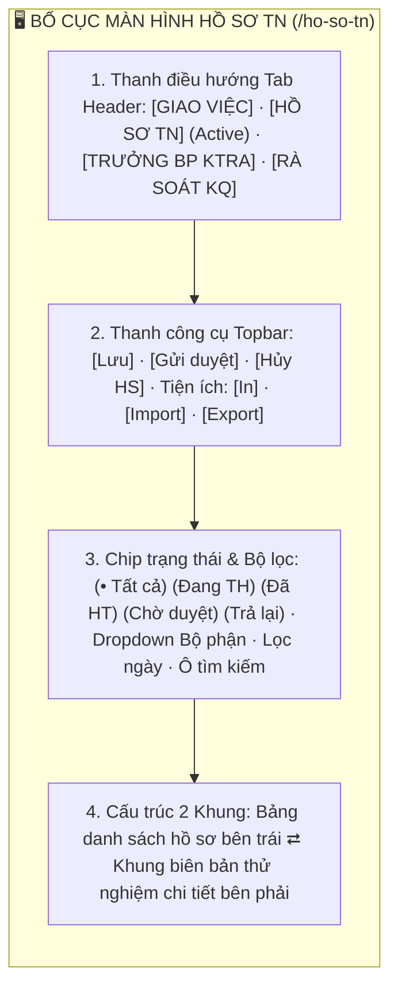
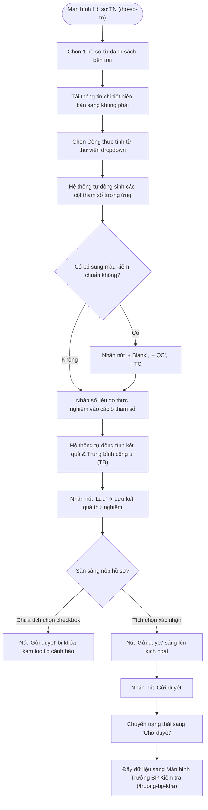
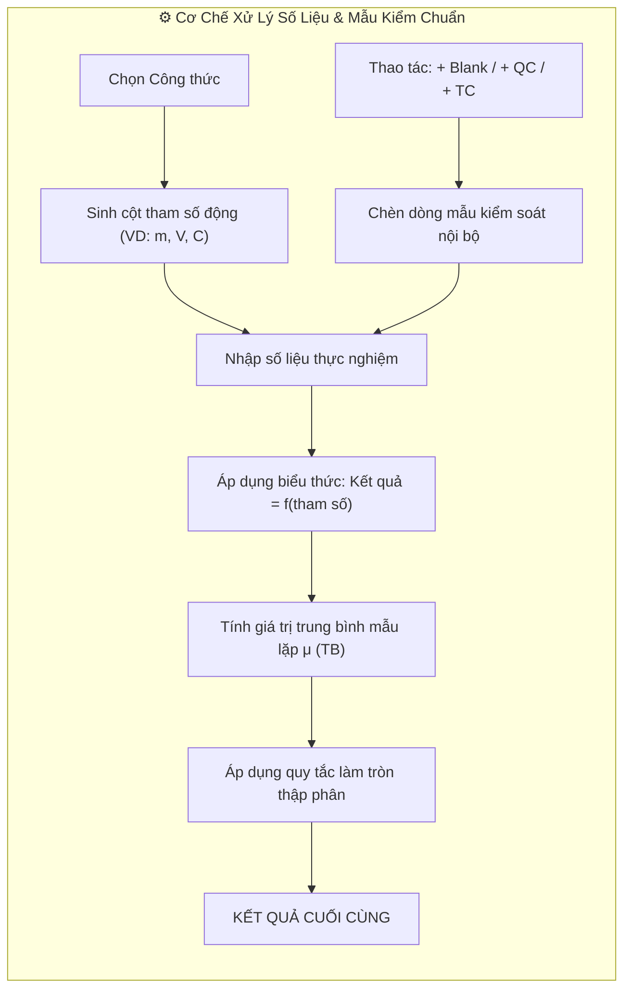

# 📋 TÀI LIỆU ĐẶC TẢ YÊU CẦU CHỨC NĂNG (REQUIREMENTS SPECIFICATION)
## Phân hệ: Thử nghiệm LAB & Quản lý Nhật ký — Hệ thống VNTEST LIMS
### Tính năng: Hồ sơ TN / Nhật ký thử nghiệm (Test Records Screen)

---

| Thông tin tài liệu | Chi tiết |
| :--- | :--- |
| **Mã tài liệu** | `REQ_VNTEST_HO_SO_TN` |
| **Tính năng / Màn hình** | Hồ sơ TN / Nhật ký thử nghiệm (Test Records) |
| **Đường dẫn truy cập** | `/ho-so-tn` (hoặc cụm tab `HỒ SƠ TN` trên header) |
| **Đối tượng sử dụng** | Kiểm nghiệm viên (KNV), Trưởng bộ phận thử nghiệm, Quản lý phòng LAB, Admin |
| **Trạng thái tài liệu** | `Approved / Ready for Development & Testing` |
| **Cơ sở dữ liệu liên kết** | `test_records`, `task_assignments`, `formulas`, `chemicals`, `samples`, `users` |
| **Test Script Playwright** | [`src/tests/ho-so-tn/ho-so-tn.spec.ts`](file:///home/thai.hoang.dinh/VNTEST_Automation/src/tests/ho-so-tn/ho-so-tn.spec.ts) (24 Test Cases) |
| **Page Object Model** | [`src/pages/ho-so-tn.page.ts`](file:///home/thai.hoang.dinh/VNTEST_Automation/src/pages/ho-so-tn.page.ts) |
| **Dữ liệu kiểm thử** | [`test-data/users.json`](file:///home/thai.hoang.dinh/VNTEST_Automation/test-data/users.json), `test-data/ho-so-tn.json` |

---

## 📑 MỤC LỤC ĐIỀU HƯỚNG NHANH
1. [1. Định vị màn hình & Tổng quan tính năng (Overview & UI Layout)](#1-định-vị-màn-hình--tổng-quan-tính-năng-overview--ui-layout)
2. [2. Sơ đồ phân tích luồng trực quan (Mermaid Flowcharts)](#2-sơ-đồ-phân-tích-luồng-trực-quan-mermaid-flowcharts)
3. [3. Phân quyền & Điều kiện kích hoạt (Access & Permissions)](#3-phân-quyền--điều-kiện-kích-hoạt-access--permissions)
4. [4. Đặc tả chi tiết các Use Cases chức năng (Functional Use Cases)](#4-đặc-tả-chi-tiết-các-use-cases-chức-năng-functional-use-cases)
5. [5. Đặc tả chi tiết trường dữ liệu (Field Specifications Matrix)](#5-đặc-tả-chi-tiết-trường-dữ-liệu-field-specifications-matrix)
6. [6. Ma trận nút bấm & Tương tác giao diện (Action Buttons Matrix)](#6-ma-trận-nút-bấm--tương-tác-giao-diện-action-buttons-matrix)
7. [7. Quy tắc nghiệp vụ & Luồng xử lý lỗi (Business Rules & Error Handling)](#7-quy-tắc-nghiệp-vụ--luồng-xử-lý-lỗi-business-rules--error-handling)
8. [8. Kế hoạch kiểm thử & Ma trận Test Cases Automation (24 Test Cases)](#8-kế-hoạch-kiểm-thử--ma-trận-test-cases-automation-24-test-cases)

---

## 1. ĐỊNH VỊ MÀN HÌNH & TỔNG QUAN TÍNH NĂNG (OVERVIEW & UI LAYOUT)

### 1.1. Mục đích tính năng
* **Ghi nhận & Xử lý Nhật ký thử nghiệm điện tử:** Là không gian làm việc chính của Kiểm nghiệm viên (KNV), số hóa toàn bộ sổ tay thí nghiệm truyền thống: ghi nhận hóa chất sử dụng, thiết bị phân tích, số liệu đo đạc thực nghiệm và tự động tính toán kết quả theo công thức.
* **Cơ chế Áp dụng Công thức động (Dynamic Formula Matrix):** Cho phép chọn công thức chuẩn từ thư viện công thức. Hệ thống tự động sinh động các cột tham số tính toán (`m`, `V`, `C`, `f`...), tự động tính giá trị trung bình $\mu$ (TB) và làm tròn số thập phân.
* **Bổ sung Mẫu kiểm soát chất lượng (QA/QC Samples):** Hỗ trợ thêm nhanh các dòng mẫu kiểm chuẩn nội bộ: Mẫu trắng (`+ Blank`), Mẫu lặp QC (`+ QC`), Mẫu thêm chuẩn (`+ TC`) để đảm bảo giá trị đo lường đạt độ tin cậy theo ISO/IEC 17025.
* **Kiểm soát quy trình Gửi duyệt (Submission Guard):** Ràng buộc an toàn: bắt buộc KNV phải tích chọn xác nhận kết quả trước khi nút `"Gửi duyệt"` được kích hoạt, đồng thời cung cấp cơ chế hủy hồ sơ nhật ký có xác nhận bảo mật.

### 1.2. Bố cục Giao diện & Các Phân khu Chức năng (UI Layout Matrix)

| Phân khu (Section) | Vị trí hiển thị | Thành phần giao diện chính | Mục đích & Nghiệp vụ |
| :--- | :--- | :--- | :--- |
| **1. Header Tabs** | Trên cùng trang | Cụm tab: `GIAO VIỆC`, `HỒ SƠ TN` (active), `TRƯỞNG BP KTRA`, `RÀ SOÁT KQ` | Điều hướng giữa các phân hệ quy trình thử nghiệm LAB |
| **2. Thanh công cụ (Topbar)** | Dưới Header | Nút `"Lưu"`, `"Gửi duyệt"`, `"Hủy HS"`, cụm nút tiện ích `"In"`, `"Import"`, `"Export"` | Thao tác lưu tạm kết quả, gửi cấp trên kiểm tra hoặc hủy hồ sơ |
| **3. Chip trạng thái & Bộ lọc** | Dưới Topbar | 4 Chip trạng thái, dropdown lọc Bộ phận, bộ lọc khoảng ngày, ô tìm kiếm | Lọc nhanh hồ sơ theo giai đoạn thực hiện và chuyên môn phòng thử nghiệm |
| **4. Bảng danh sách (Khung trái)**| Nửa bên trái | 6 Cột: Checkbox, `MÃ HỒ SƠ`, `TÊN CHỈ TIÊU`, `NGÀY NHẬN`, `HẠN TRẢ`, `TRẠNG THÁI` | Chọn hồ sơ để nạp dữ liệu chi tiết sang khung bên phải |
| **5. Biên bản chi tiết (Khung phải)**| Nửa bên phải | Thông tin chỉ tiêu, Dropdown Công thức, Bảng Hóa chất sử dụng, Bảng mẫu & tham số đo đạc | Ghi nhận số liệu đo thực nghiệm, thêm mẫu kiểm chuẩn và tính kết quả |

---

## 2. SƠ ĐỒ PHÂN TÍCH LUỒNG TRỰC QUAN (MERMAID FLOWCHARTS)

### 2.1. Sơ đồ Master Flow Nhập kết quả & Gửi duyệt Nhật ký thử nghiệm

### 2.2. Sơ đồ Cơ chế Áp dụng Công thức & Bổ sung Mẫu kiểm chuẩn

---

## 3. PHÂN QUYỀN & ĐIỀU KIỆN KÍCH HOẠT (ACCESS & PERMISSIONS)

### 3.1. Ma trận phân quyền truy cập (RBAC Matrix)

| Vai trò người dùng (Role) | Xem danh sách Hồ sơ TN | Nhập số liệu & Lưu | Gửi duyệt hồ sơ | Hủy hồ sơ | Đổi công thức tính |
| :--- | :---: | :---: | :---: | :---: | :---: |
| **Quản trị viên (Admin)** | Toàn quyền | Toàn quyền | Toàn quyền | Toàn quyền | Toàn quyền |
| **Trưởng bộ phận Kỹ thuật** | Toàn quyền | Xem & Kiểm tra | Duyệt / Trả lại | Phê duyệt hủy | Toàn quyền |
| **Kiểm nghiệm viên (KNV)** | Hồ sơ được phân công | Được phép | Được phép | Đề xuất hủy | Được phép |
| **Nhân viên Kinh doanh (Sale)** | Xem tiến độ YCTN | Không | Không | Không | Bị chặn |
| **Kế toán** | Không có quyền | Không | Không | Không | Bị chặn |

---

## 4. ĐẶC TẢ CHI TIẾT CÁC USE CASES CHỨC NĂNG (FUNCTIONAL USE CASES)

### UC-01: Bố cục, Điều hướng Tab & Thanh công cụ (Toolbar States)
* **Tác nhân:** Kiểm nghiệm viên, Trưởng bộ phận.
* **Tiền điều kiện:** Đã đăng nhập vào hệ thống và điều hướng tới `/ho-so-tn`.
* **Luồng sự kiện chính:**
  1. Hiển thị cụm tab điều hướng Header với tab `HỒ SƠ TN` đang ở trạng thái kích hoạt (`active`).
  2. Bảng danh sách bên trái hiển thị 6 cột thông tin cơ bản kèm phân trang và nút `"Quản lý cột"`.
  3. Khung bên phải tải toàn bộ thông tin biên bản thử nghiệm khi người dùng nhấn chọn 1 dòng hồ sơ.

### UC-02: Kế thừa Dữ liệu Phân công từ Tab Giao việc
* **Tác nhân:** Hệ thống tự động.
* **Luồng sự kiện chính:**
  1. Khi Trưởng bộ phận tạo Hồ sơ Nhật ký tại tab Giao việc (`/giao-viec`), bản ghi mới lập tức xuất hiện tại tab Hồ sơ TN với trạng thái `Đang TH`.
  2. Gom nhóm thông minh: 2 chỉ tiêu cùng tên và cùng KNV được gom chung vào 1 hồ sơ 2 mẫu.
  3. Chỉ tiêu chưa gán KNV bị chặn hoàn toàn, không thể sinh hồ sơ sang Hồ sơ TN.

### UC-03: Tìm kiếm, Bộ lọc 4 Chip Trạng thái & Lọc Bộ phận
* **Tác nhân:** Người dùng tra cứu hồ sơ nhật ký.
* **Luồng sự kiện chính:**
  1. Tìm kiếm chính xác hoặc một phần theo Mã hồ sơ hoặc Tên chỉ tiêu; xóa điều kiện lọc bằng nút `"Hủy"` (`[×]`).
  2. Lọc nhanh theo 4 chip trạng thái: `"Đang TH"`, `"Đã HT"`, `"Chờ duyệt"`, `"Trả lại"`.
  3. Lọc danh sách theo từng Bộ phận phân tích (Hóa học, Vi sinh, Vật lý...).

### UC-04: Thao tác Biên bản Chi tiết & Áp dụng Công thức Động
* **Tác nhân:** Kiểm nghiệm viên phụ trách thử nghiệm.
* **Luồng sự kiện chính:**
  1. Chọn công thức tính từ dropdown: Bảng kết quả tự động sinh các cột tham số tương ứng (`m`, `V`, `C`...).
  2. Bổ sung các dòng mẫu kiểm chuẩn nội bộ bằng các nút: `"+ Blank"`, `"+ QC"`, `"+ TC"`.
  3. Thêm hóa chất và chất chuẩn sử dụng bằng nút `"+ Thêm hóa chất"`.
  4. Nhập thông số thử nghiệm: Nút `"Lưu"` sáng lên cho phép lưu tạm kết quả.

### UC-05: Lưu Kết quả Thử nghiệm & Tính toán Tự động
* **Tác nhân:** Kiểm nghiệm viên.
* **Luồng sự kiện chính:**
  1. Nhập số liệu đo đạc vào các ô tham số.
  2. Hệ thống áp dụng công thức, tự động tính giá trị kết quả và dòng trung bình cộng $\mu$ (TB).
  3. Nhấn nút `"Lưu"`: Hiển thị thông báo lưu thành công, dữ liệu được đồng bộ an toàn.

### UC-06: Luồng Gửi duyệt Hồ sơ & Hủy Hồ sơ
* **Tác nhân:** Kiểm nghiệm viên.
* **Luồng sự kiện chính:**
  1. Khi chưa tích chọn checkbox xác nhận: Nút `"Gửi duyệt"` bị vô hiệu hóa kèm tooltip hướng dẫn.
  2. Khi tích chọn checkbox xác nhận: Nút `"Gửi duyệt"` sáng xanh (kích hoạt).
  3. Nhấn nút `"Gửi duyệt"`: Hồ sơ chuyển trạng thái sang `Chờ duyệt` và tự động đẩy sang màn hình **Trưởng BP Kiểm tra** (`/truong-bp-ktra`).
  4. Nhấn nút `"Hủy HS"`: Mở hộp thoại xác nhận hủy hồ sơ; nhấn `"Đóng"` để hủy thao tác an toàn.

---

## 5. ĐẶC TẢ CHI TIẾT TRƯỜNG DỮ LIỆU (FIELD SPECIFICATIONS MATRIX)

| Tên trường | UI Label | Kiểu dữ liệu | Bắt buộc | Ràng buộc & Validation Rules | Giá trị mặc định / Placeholder | Ghi chú |
| :--- | :--- | :--- | :---: | :--- | :--- | :--- |
| `recordCode` | **Mã hồ sơ** | `text` | Hệ thống sinh | Định dạng `HS-xxxx-xxx` tự tăng. Readonly. | Tự động sinh | Khóa không cho sửa |
| `criterionName` | **Tên chỉ tiêu** | `text` | Kế thừa | Tên chỉ tiêu phân tích theo YCTN. | Kế thừa từ Giao việc | Khóa không cho sửa |
| `formulaId` | **Công thức tính** | `dropdown` | **Bắt buộc** | Chọn từ thư viện công thức được phê duyệt. | `Chọn công thức...` | Sinh cột tham số động |
| `paramValue` | **Giá trị tham số**| `number` | **Bắt buộc** | Số thực hợp lệ $\ge 0$. Format phân cách dấu chấm. | Rỗng | Điền số đo thực nghiệm |
| `qcSampleType` | **Loại mẫu QC** | `badge` | Không | `Blank`, `QC`, `TC`. Tự động gán khi nhấn nút thêm. | Mẫu kiểm tra thường | Dòng kiểm soát nội bộ |
| `chemicalName` | **Tên hóa chất** | `dropdown/text`| Không | Chọn từ danh mục hóa chất phòng LAB kèm số lô. | `Chọn hóa chất...` | Truy xuất nguồn gốc |

---

## 6. MA TRẬN NÚT BẤM & TƯƠNG TÁC GIAO DIỆN (ACTION BUTTONS MATRIX)

| Tên nút (Button) | Vị trí | Icon / Class | Trạng thái mặc định | Điều kiện kích hoạt | Hành vi khi nhấn | Modal / Thông báo đi kèm |
| :--- | :--- | :--- | :---: | :--- | :--- | :--- |
| **Lưu** | Topbar trên bảng | `.btn-save` | **Vô hiệu hóa** | Khi có thay đổi số liệu trong form | Lưu thông số và kết quả thử nghiệm | Thông báo: `"Lưu hồ sơ thành công."` |
| **Gửi duyệt** | Topbar trên bảng | `.btn-submit` | **Vô hiệu hóa** | Tích chọn checkbox xác nhận kết quả | Chuyển trạng thái hồ sơ sang `Chờ duyệt` | Chuyển sang màn Trưởng BP |
| **Hủy HS** | Topbar trên bảng | `.btn-cancel-hs` | **Kích hoạt** | Đang mở hồ sơ | Mở hộp thoại xác nhận hủy hồ sơ nhật ký | Modal: `"Xác nhận hủy hồ sơ"` |
| **+ Blank** | Chân bảng mẫu | `.btn-add-blank` | **Kích hoạt** | Đang mở hồ sơ | Chèn thêm 1 dòng mẫu trắng vào bảng kết quả | Thêm dòng Blank |
| **+ QC** | Chân bảng mẫu | `.btn-add-qc` | **Kích hoạt** | Đang mở hồ sơ | Chèn thêm 1 dòng mẫu kiểm chuẩn QC | Thêm dòng QC |
| **+ TC** | Chân bảng mẫu | `.btn-add-tc` | **Kích hoạt** | Đang mở hồ sơ | Chèn thêm 1 dòng mẫu thêm chuẩn TC | Thêm dòng TC |
| **+ Thêm hóa chất**| Khu vực hóa chất | `.btn-add-chem` | **Kích hoạt** | Đang mở hồ sơ | Mở hàng mới để chọn hóa chất & số lô | Thêm dòng hóa chất |
| **Quản lý cột** | Dưới chân bảng trái | `.btn-manage-col` | **Kích hoạt** | Luôn sẵn sàng | Bật/tắt ẩn hiện các cột của bảng danh sách | Popover danh sách cột |

---

## 7. QUY TẮC NGHIỆP VỤ & LUỒNG XỬ LÝ LỖI (BUSINESS RULES & ERROR HANDLING)

| Mã lỗi (Code) | Quy tắc nghiệp vụ (Business Rule) | Điều kiện kích hoạt | Vị trí hiển thị | Câu thông báo lỗi hiển thị (Error Message) |
| :--- | :--- | :--- | :--- | :--- |
| `ERR_FORMULA_REQUIRED` | Bắt buộc chọn công thức tính | Chưa chọn công thức khi nhập số liệu | Dropdown công thức | **"Vui lòng chọn công thức tính toán trước khi nhập số liệu."** |
| `RULE_CONFIRM_SUBMIT` | Ràng buộc checkbox trước khi gửi | Chưa tích checkbox xác nhận kết quả | Tooltip nút Gửi duyệt | **"Vui lòng tích xác nhận kết quả trước khi gửi duyệt."** |
| `RULE_AUTO_CALC_AVG` | Tự động tính giá trị trung bình | Có $\ge 2$ mẫu lặp hợp lệ | Dòng trung bình $\mu$ (TB) | Tự động tính: $\mu = rac{\sum x_i}{n}$ |
| `RULE_CANCEL_CONFIRM` | Xác nhận an toàn khi hủy hồ sơ | Nhấn nút Hủy HS | Modal xác nhận | **"Bạn có chắc chắn muốn hủy hồ sơ nhật ký này?"** |

---

## 8. KẾ HOẠCH KIỂM THỬ & MA TRẬN TEST CASES AUTOMATION (24 TEST CASES)

### 8.1. Khối 01: Bố cục, Điều hướng Tab & Thanh công cụ (3 Test Cases)

| Mã TC | Phân nhóm luồng | Tên kịch bản | Thao tác & Dữ liệu kiểm thử | Kết quả mong đợi | Mức độ ưu tiên | Mapping Page Object |
| :--- | :--- | :--- | :--- | :--- | :---: | :--- |
| **TC_HSTN_001** | Bố cục & Điều hướng | Hiển thị 4 tab điều hướng Header, nút tiện ích và bộ lọc | 1. Mở trang `/ho-so-tn`.  2. Quan sát cấu trúc tổng thể màn hình. | Hiển thị đủ 4 tab điều hướng Header, tab `HỒ SƠ TN` đang active, cụm nút tiện ích In/Import/Export, 4 chip trạng thái và dropdown bộ phận. | Normal | `hoSoTnPage.tabHoSoTN`, `hoSoTnPage.chipDangTH` |
| **TC_HSTN_002** | Bố cục & Điều hướng | Hiển thị đúng 6 cột tiêu đề của bảng danh sách bên trái | 1. Quan sát cấu trúc bảng danh sách hồ sơ bên trái. | Bảng hiển thị đúng 6 cột tiêu đề chuẩn: checkbox, `MÃ HỒ SƠ`, `TÊN CHỈ TIÊU`, `NGÀY NHẬN`, `HẠN TRẢ`, `TRẠNG THÁI`. | Normal | `hoSoTnPage.table`, `hoSoTnPage.tableHeaders` |
| **TC_HSTN_003** | Bố cục & Điều hướng | Hiển thị khung chi tiết bên phải khi chọn hồ sơ | 1. Nhấn chọn 1 hồ sơ bất kỳ bên bảng trái. | Khung bên phải chuyển từ trạng thái mặc định sang hiển thị đầy đủ biên bản thử nghiệm chi tiết. | High | `hoSoTnPage.selectRecord()`, `hoSoTnPage.detailContainer` |

### 8.2. Khối 02: Kế thừa Dữ liệu Phân công từ Tab Giao việc (3 Test Cases)

| Mã TC | Phân nhóm luồng | Tên kịch bản | Thao tác & Dữ liệu kiểm thử | Kết quả mong đợi | Mức độ ưu tiên | Mapping Page Object |
| :--- | :--- | :--- | :--- | :--- | :---: | :--- |
| **TC_HSTN_004** | Kế thừa Phân công | Giao việc 1 chỉ tiêu đơn lẻ ➔ Hiển thị tại tab Hồ sơ TN | 1. Giao việc 1 chỉ tiêu đơn lẻ tại tab Giao việc.  2. Chuyển sang tab Hồ sơ TN. | Bản ghi mới xuất hiện ngay tại đầu danh sách tab Hồ sơ TN với trạng thái `Đang TH`. | High | `hoSoTnPage.tabHoSoTN`, `hoSoTnPage.tableRows` |
| **TC_HSTN_005** | Kế thừa Phân công | Giao việc gom nhóm 2 chỉ tiêu cùng tên + KNV ➔ Gom chung 1 hồ sơ | 1. Gom nhóm 2 chỉ tiêu cùng tên + cùng KNV tại tab Giao việc.  2. Chuyển sang tab Hồ sơ TN. | Hệ thống gom chung 2 mẫu vào duy nhất 1 hồ sơ nhật ký; mở chi tiết hiển thị đủ cả 2 dòng mẫu. | High | `hoSoTnPage.sampleRows` |
| **TC_HSTN_006** | Kế thừa Phân công | Giao việc chỉ tiêu chưa gán KNV ➔ Chặn không sinh hồ sơ | 1. Kiểm tra chỉ tiêu `— chưa gán —` tại Giao việc. | Bị chặn không cho phép tạo hồ sơ nhật ký; tab Hồ sơ TN không phát sinh bản ghi rác. | High | `hoSoTnPage.tableRows` |

### 8.3. Khối 03: Tương tác Danh sách Hồ sơ (3 Test Cases)

| Mã TC | Phân nhóm luồng | Tên kịch bản | Thao tác & Dữ liệu kiểm thử | Kết quả mong đợi | Mức độ ưu tiên | Mapping Page Object |
| :--- | :--- | :--- | :--- | :--- | :---: | :--- |
| **TC_HSTN_007** | Tương tác Danh sách | Chọn hồ sơ bên bảng trái tải chi tiết tương ứng bên phải | 1. Nhấn lần lượt qua các dòng hồ sơ khác nhau bên bảng trái. | Khung bên phải lập tức nạp đúng dữ liệu chi tiết của hồ sơ đang chọn theo thời gian thực. | High | `hoSoTnPage.selectRecord()` |
| **TC_HSTN_008** | Tương tác Danh sách | Chuyển trang (Pagination) trên bảng danh sách hồ sơ | 1. Nhấn nút chuyển trang (`1`, `2`) ở chân bảng. | Bảng nạp đúng số lượng dòng và cập nhật chỉ số phân trang tương ứng. | Normal | `hoSoTnPage.paginationPageBtns` |
| **TC_HSTN_009** | Tương tác Danh sách | Quản lý ẩn/hiện cột hiển thị bằng nút "Quản lý cột" | 1. Nhấn nút `"Quản lý cột"`.  2. Bỏ chọn và tích chọn lại 1 cột. | Cột ẩn/hiện tức thì trên bảng danh sách theo đúng thao tác của người dùng. | Normal | `hoSoTnPage.btnManageColumns` |

### 8.4. Khối 04: Tìm kiếm từ khóa mở rộng & Bộ lọc (8 Test Cases)

| Mã TC | Phân nhóm luồng | Tên kịch bản | Thao tác & Dữ liệu kiểm thử | Kết quả mong đợi | Mức độ ưu tiên | Mapping Page Object |
| :--- | :--- | :--- | :--- | :--- | :---: | :--- |
| **TC_HSTN_010** | Tìm kiếm & Bộ lọc | Tìm kiếm chính xác theo Mã hồ sơ | 1. Nhập Mã hồ sơ thực tế vào ô tìm kiếm: `HS-2610-001`. | Bảng chỉ lọc hiển thị đúng bản ghi có Mã hồ sơ tương ứng. | High | `hoSoTnPage.search()` |
| **TC_HSTN_011** | Tìm kiếm & Bộ lọc | Tìm kiếm theo Tên chỉ tiêu | 1. Nhập từ khóa tên chỉ tiêu: `pH` hoặc `COD`. | Bảng lọc ra các hồ sơ kiểm nghiệm chỉ tiêu tương ứng. | High | `hoSoTnPage.search()` |
| **TC_HSTN_012** | Tìm kiếm & Bộ lọc | Tìm kiếm với từ khóa không tồn tại | 1. Nhập từ khóa: `KHONG_TON_TAI_99999`. | Bảng hiển thị thông báo danh sách trống `"Không có dữ liệu"`. | Low | `hoSoTnPage.search()` |
| **TC_HSTN_013** | Tìm kiếm & Bộ lọc | Xóa tìm kiếm và bộ lọc bằng nút "Hủy" | 1. Nhấn nút `"Hủy"` (`[×]`) trong ô tìm kiếm. | Ô tìm kiếm về rỗng, bảng khôi phục đầy đủ số lượng bản ghi ban đầu. | Normal | `hoSoTnPage.clearFilter()` |
| **TC_HSTN_014** | Tìm kiếm & Bộ lọc | Lọc theo Chip trạng thái "Đang TH" | 1. Nhấn chip `"Đang TH"`. | Bảng chỉ hiển thị các hồ sơ nhật ký đang trong quá trình thực nghiệm. | High | `hoSoTnPage.chipDangTH` |
| **TC_HSTN_015** | Tìm kiếm & Bộ lọc | Lọc theo Chip trạng thái "Đã HT" | 1. Nhấn chip `"Đã HT"`. | Bảng chỉ hiển thị các hồ sơ đã hoàn thành phân tích. | Normal | `hoSoTnPage.chipDaHT` |
| **TC_HSTN_016** | Tìm kiếm & Bộ lọc | Lọc theo Bộ phận phân tích | 1. Chọn Bộ phận từ dropdown (VD: `Hóa học`, `Vi sinh`). | Bảng lọc các hồ sơ thuộc quyền quản lý của bộ phận được chọn. | High | `hoSoTnPage.bpFilterTrigger` |
| **TC_HSTN_017** | Tìm kiếm & Bộ lọc | Kết hợp tìm kiếm từ khóa với Chip trạng thái | 1. Nhập từ khóa `pH` + Nhấn chip `"Đang TH"`. | Bảng áp dụng đồng thời cả 2 điều kiện lọc (logic AND), trả về kết quả chuẩn xác. | High | `hoSoTnPage.search()`, `hoSoTnPage.chipDangTH` |

### 8.5. Khối 05: Thao tác Hồ sơ Chi tiết & Tính toán Kết quả (4 Test Cases)

| Mã TC | Phân nhóm luồng | Tên kịch bản | Thao tác & Dữ liệu kiểm thử | Kết quả mong đợi | Mức độ ưu tiên | Mapping Page Object |
| :--- | :--- | :--- | :--- | :--- | :---: | :--- |
| **TC_HSTN_018** | Thao tác Biên bản | Chọn công thức tính và sinh động các cột tham số | 1. Chọn 1 công thức từ dropdown `Công thức tính`. | Bảng kết quả tự động sinh động các cột tham số tương ứng với biểu thức tính toán. | High | `hoSoTnPage.formulaSelect` |
| **TC_HSTN_019** | Thao tác Biên bản | Thêm các dòng mẫu kiểm chuẩn (+ Blank, + QC, + TC) | 1. Nhấn lần lượt các nút: `"+ Blank"`, `"+ QC"`, `"+ TC"`. | Bảng mẫu chèn thêm các dòng mẫu kiểm soát chất lượng tương ứng với nhãn nhận diện rõ ràng. | High | `hoSoTnPage.btnBlank`, `hoSoTnPage.btnQC`, `hoSoTnPage.btnTC` |
| **TC_HSTN_020** | Thao tác Biên bản | Trạng thái kích hoạt của nút "Lưu" khi đổi thông số | 1. Nhập thay đổi số liệu trong ô tham số. | Nút `"Lưu"` sáng lên chuyển sang trạng thái kích hoạt (`enabled`). | Normal | `hoSoTnPage.btnSave` |
| **TC_HSTN_021** | Thao tác Biên bản | Thực hiện Lưu kết quả hồ sơ thành công | 1. Nhập đầy đủ thông số hợp lệ ➔ Nhấn nút `"Lưu"`. | Hiển thị thông báo lưu thành công; kết quả và dòng trung bình $\mu$ (TB) được cập nhật chuẩn xác. | High | `hoSoTnPage.btnSave` |

### 8.6. Khối 06: Luồng Gửi duyệt, Hủy hồ sơ & Điều hướng (3 Test Cases)

| Mã TC | Phân nhóm luồng | Tên kịch bản | Thao tác & Dữ liệu kiểm thử | Kết quả mong đợi | Mức độ ưu tiên | Mapping Page Object |
| :--- | :--- | :--- | :--- | :--- | :---: | :--- |
| **TC_HSTN_022** | Luồng Gửi duyệt | Trạng thái và tooltip nút "Gửi duyệt" | 1. Chưa tích checkbox: rê chuột xem tooltip.  2. Tích chọn checkbox xác nhận kết quả. | 1. Chưa tích: Nút `"Gửi duyệt"` bị khóa kèm tooltip cảnh báo.  2. Đã tích: Nút sáng lên, cho phép gửi duyệt hồ sơ sang Trưởng BP. | High | `hoSoTnPage.btnSubmit` |
| **TC_HSTN_023** | Luồng Hủy hồ sơ | Nhấn nút "Hủy HS" mở hộp thoại và Hủy thao tác | 1. Nhấn nút `"Hủy HS"` ➔ Mở popup xác nhận.  2. Nhấn nút `"Đóng"` trên popup. | Popup đóng lại; giữ nguyên hồ sơ nhật ký không bị xóa. | Normal | `hoSoTnPage.btnCancelHS` |
| **TC_HSTN_024** | Điều hướng Tab | Điều hướng qua lại giữa tab GIAO VIỆC và HỒ SƠ TN | 1. Nhấp chuyển đổi giữa tab `"GIAO VIỆC"` và `"HỒ SƠ TN"`. | Chuyển đổi tab mượt mà, giữ nguyên ngữ cảnh làm việc của người dùng. | Normal | `hoSoTnPage.tabGiaoViec`, `hoSoTnPage.tabHoSoTN` |
