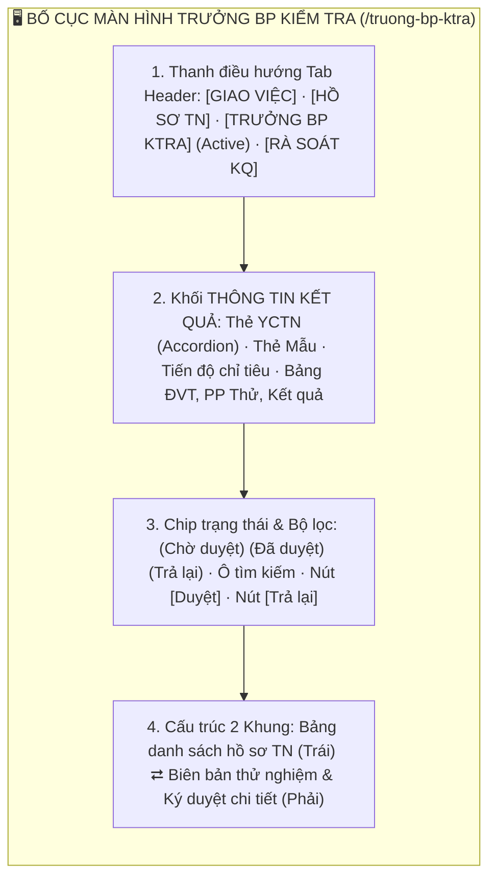
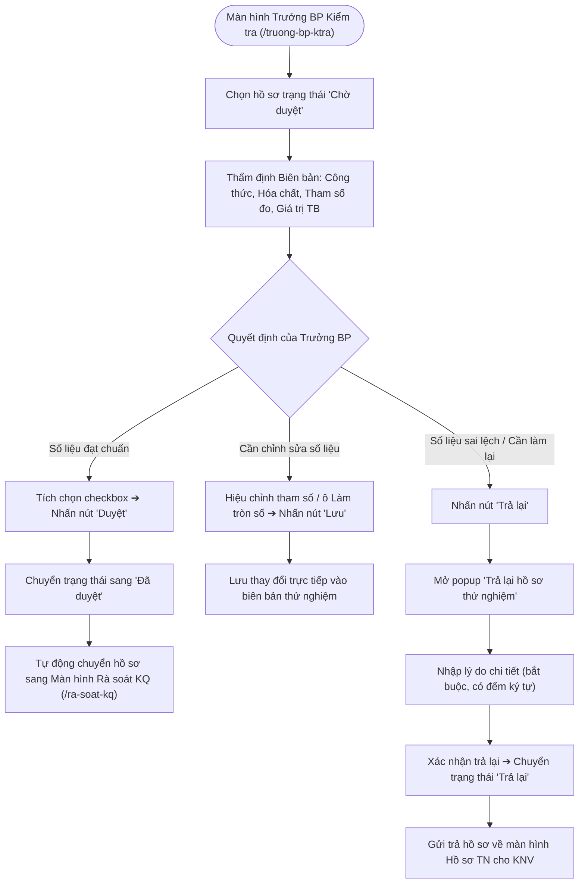
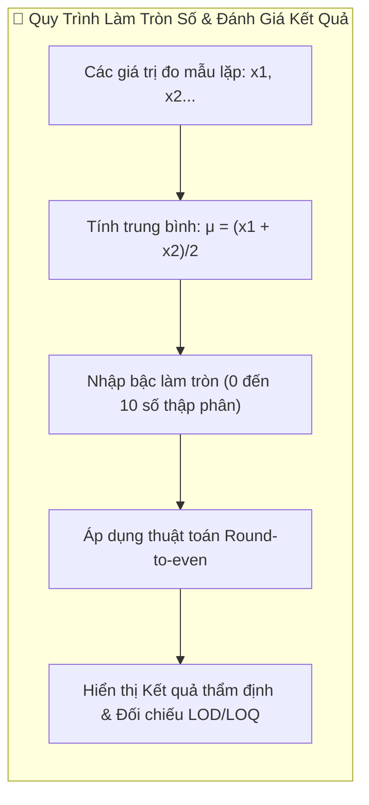

# 📋 TÀI LIỆU ĐẶC TẢ YÊU CẦU CHỨC NĂNG (REQUIREMENTS SPECIFICATION)
## Phân hệ: Thử nghiệm LAB & Kiểm soát chất lượng — Hệ thống VNTEST LIMS
### Tính năng: Trưởng BP Kiểm tra (Technical Review Screen)

---

| Thông tin tài liệu | Chi tiết |
| :--- | :--- |
| **Mã tài liệu** | `REQ_VNTEST_TRUONG_BP_KTRA` |
| **Tính năng / Màn hình** | Trưởng BP Kiểm tra (Technical Review) |
| **Đường dẫn truy cập** | `/truong-bp-ktra` (hoặc cụm tab `TRƯỞNG BP KTRA` trên header) |
| **Đối tượng sử dụng** | Trưởng bộ phận thử nghiệm, Quản lý kỹ thuật phòng LAB, Admin |
| **Trạng thái tài liệu** | `Approved / Ready for Development & Testing` |
| **Cơ sở dữ liệu liên kết** | `test_records`, `technical_reviews`, `formulas`, `chemicals`, `signatures`, `users` |
| **Test Script Playwright** | [`src/tests/truong-bp-ktra/truong-bp-ktra.spec.ts`](file:///home/thai.hoang.dinh/VNTEST_Automation/src/tests/truong-bp-ktra/truong-bp-ktra.spec.ts) (25 Test Cases) |
| **Page Object Model** | [`src/pages/truong-bp-ktra.page.ts`](file:///home/thai.hoang.dinh/VNTEST_Automation/src/pages/truong-bp-ktra.page.ts) |
| **Dữ liệu kiểm thử** | [`test-data/users.json`](file:///home/thai.hoang.dinh/VNTEST_Automation/test-data/users.json), `test-data/truong-bp-ktra.json` |

---

## 📑 MỤC LỤC ĐIỀU HƯỚNG NHANH
1. [1. Định vị màn hình & Tổng quan tính năng (Overview & UI Layout)](#1-định-vị-màn-hình--tổng-quan-tính-năng-overview--ui-layout)
2. [2. Sơ đồ phân tích luồng trực quan (Mermaid Flowcharts)](#2-sơ-đồ-phân-tích-luồng-trực-quan-mermaid-flowcharts)
3. [3. Phân quyền & Điều kiện kích hoạt (Access & Permissions)](#3-phân-quyền--điều-kiện-kích-hoạt-access--permissions)
4. [4. Đặc tả chi tiết các Use Cases chức năng (Functional Use Cases)](#4-đặc-tả-chi-tiết-các-use-cases-chức-năng-functional-use-cases)
5. [5. Đặc tả chi tiết trường dữ liệu (Field Specifications Matrix)](#5-đặc-tả-chi-tiết-trường-dữ-liệu-field-specifications-matrix)
6. [6. Ma trận nút bấm & Tương tác giao diện (Action Buttons Matrix)](#6-ma-trận-nút-bấm--tương-tác-giao-diện-action-buttons-matrix)
7. [7. Quy tắc nghiệp vụ & Luồng xử lý lỗi (Business Rules & Error Handling)](#7-quy-tắc-nghiệp-vụ--luồng-xử-lý-lỗi-business-rules--error-handling)
8. [8. Kế hoạch kiểm thử & Ma trận Test Cases Automation (25 Test Cases)](#8-kế-hoạch-kiểm-thử--ma-trận-test-cases-automation-25-test-cases)

---

## 1. ĐỊNH VỊ MÀN HÌNH & TỔNG QUAN TÍNH NĂNG (OVERVIEW & UI LAYOUT)

### 1.1. Mục đích tính năng
* **Kiểm tra & Phê duyệt kỹ thuật chuyên môn (Technical Review):** Đóng vai trò kiểm soát chất lượng cấp 1 trong phòng LAB, do Trưởng bộ phận trực tiếp thẩm định các số liệu đo đạc, công thức tính toán, hóa chất sử dụng và quy tắc làm tròn trước khi chuyển sang giai đoạn Rà soát kết quả.
* **Theo dõi Tiến độ Mẫu thử nghiệm (Sample Progress Tracker):** Khối `THÔNG TIN KẾT QUẢ` trên cùng hiển thị chi tiết tiến độ hoàn thành của từng mẫu thử (`Mẫu 1: 3/4 chỉ tiêu hoàn thành`), thẻ YCTN dạng accordion cho phép đóng/mở trực quan.
* **Thẩm định & Điều chỉnh Biên bản thử nghiệm:** Cho phép Trưởng BP hiệu chỉnh tham số đo đạc, ghi chú kỹ thuật, điều chỉnh quy tắc làm tròn số thập phân (từ 0 đến 10 số sau dấu phẩy), tải ảnh chữ ký số xác nhận thẩm định.
* **Cơ chế Phê duyệt & Trả lại có lý do:** Cho phép duyệt đơn lẻ hoặc duyệt hàng loạt; luồng trả lại bắt buộc nhập lý do chi tiết kèm đếm ký tự để gửi phản hồi ngược lại cho KNV chỉnh sửa.

### 1.2. Bố cục Giao diện & Các Phân khu Chức năng (UI Layout Matrix)

| Phân khu (Section) | Vị trí hiển thị | Thành phần giao diện chính | Mục đích & Nghiệp vụ |
| :--- | :--- | :--- | :--- |
| **1. Header Tabs** | Trên cùng trang | Cụm tab: `GIAO VIỆC`, `HỒ SƠ TN`, `TRƯỞNG BP KTRA` (active), `RÀ SOÁT KQ` | Điều hướng giữa các phân hệ quy trình kiểm nghiệm LAB |
| **2. Thông tin kết quả (Top)**| Phía trên màn hình | Thẻ YCTN (accordion), Thẻ mẫu con (M1, M2), thanh tiến độ hoàn thành, bảng ĐVT/PP Thử/Kết quả | Giám sát tiến độ thực nghiệm tổng thể của từng YCTN và từng mẫu |
| **3. Thanh công cụ & Bộ lọc** | Dưới Top Section | 3 Chip: `Chờ duyệt`, `Đã duyệt`, `Trả lại`; ô tìm kiếm; nút `"Duyệt"`, `"Trả lại"` | Lọc hồ sơ theo trạng thái kiểm tra và thao tác duyệt/trả lại |
| **4. Bảng hồ sơ (Khung trái)** | Nửa bên trái | Bảng 6 cột: Checkbox, `MÃ HỒ SƠ`, `TÊN CHỈ TIÊU`, `NGÀY NHẬN`, `HẠN TRẢ`, `TRẠNG THÁI` | Chọn hồ sơ cần thẩm định chuyên môn |
| **5. Biên bản thẩm định (Khung phải)**| Nửa bên phải | Bảng hóa chất, bộ chọn công thức & diễn giải, ô Làm tròn số, bảng kết quả tham số $\mu$ (TB), khu vực ký | Thẩm tra phương pháp, kiểm tra sai số, chỉnh sửa ghi chú và ký duyệt |

---

## 2. SƠ ĐỒ PHÂN TÍCH LUỒNG TRỰC QUAN (MERMAID FLOWCHARTS)

### 2.1. Sơ đồ Master Flow Thẩm định & Phê duyệt của Trưởng Bộ Phận

### 2.2. Sơ đồ Cơ chế Làm tròn số & Kiểm tra Sai số Trung bình

---

## 3. PHÂN QUYỀN & ĐIỀU KIỆN KÍCH HOẠT (ACCESS & PERMISSIONS)

### 3.1. Ma trận phân quyền truy cập (RBAC Matrix)

| Vai trò người dùng (Role) | Xem danh sách thẩm định | Phê duyệt hồ sơ | Trả lại hồ sơ | Hiệu chỉnh tham số & Lưu | Tải ảnh chữ ký |
| :--- | :---: | :---: | :---: | :---: | :---: |
| **Quản trị viên (Admin)** | Toàn quyền | Toàn quyền | Toàn quyền | Toàn quyền | Cho phép |
| **Trưởng bộ phận Kỹ thuật** | Toàn quyền | Được phép | Được phép | Được phép | Cho phép |
| **Kiểm nghiệm viên (KNV)** | Xem hồ sơ của mình | Không có quyền | Không có quyền | Không có quyền | Bị chặn |
| **Lãnh đạo phòng LAB** | Toàn quyền xem | Được phép | Được phép | Xem thẩm định | Cho phép |

---

## 4. ĐẶC TẢ CHI TIẾT CÁC USE CASES CHỨC NĂNG (FUNCTIONAL USE CASES)

### UC-01: Bố cục, Điều hướng Tab & Thẻ YCTN (Accordion)
* **Tác nhân:** Trưởng bộ phận.
* **Tiền điều kiện:** Đã đăng nhập vào hệ thống và điều hướng tới `/truong-bp-ktra`.
* **Luồng sự kiện chính:**
  1. Hiển thị khối `THÔNG TIN KẾT QUẢ` trên cùng: mã YCTN, thẻ mẫu con và thanh tiến độ chỉ tiêu hoàn thành.
  2. Cho phép đóng/mở (accordion toggle) từng thẻ YCTN để tiết kiệm không gian quan sát.
  3. Bảng chỉ tiêu trên thẻ mẫu hiển thị đầy đủ: `ĐVT`, `PP THỬ`, `KẾT QUẢ`, `LOD`, `LOQ`, `VL`.

### UC-02: Chip Trạng thái & Tìm kiếm Hồ sơ TN
* **Tác nhân:** Trưởng bộ phận tra cứu hồ sơ.
* **Luồng sự kiện chính:**
  1. Hiển thị 3 chip trạng thái kèm số lượng đếm thực tế: `"Chờ duyệt"`, `"Đã duyệt"`, `"Trả lại"`.
  2. Chuyển đổi giữa các chip trạng thái để nạp danh sách hồ sơ tương ứng.
  3. Tìm kiếm hồ sơ theo Mã HS hoặc Tên chỉ tiêu; nhấn nút `"Hủy"` (`[×]`) để khôi phục toàn bộ danh sách ban đầu.

### UC-03: Thẩm tra Biên bản Thử nghiệm Chi tiết
* **Tác nhân:** Trưởng bộ phận thẩm định kỹ thuật.
* **Luồng sự kiện chính:**
  1. Thẩm tra bảng Hóa chất / chất chuẩn sử dụng và nút `"+ Thêm hóa chất"`.
  2. Kiểm tra bộ chọn Công thức tính và hiển thị diễn giải công thức chi tiết.
  3. Kiểm tra ô nhập `"Làm tròn số"`: Cho phép nhập giá trị thập phân từ $0$ đến $10$.
  4. Hiệu chỉnh các tham số và ghi chú trong Bảng kết quả (Table 3).
  5. Kiểm tra dòng trung bình cộng $\mu$ (TB), nút `"+ Tải ảnh chữ ký"` và khu vực Nhận xét & Ký duyệt.

### UC-04: Toolbar Phê duyệt & Trả lại Hồ sơ
* **Tác nhân:** Trưởng bộ phận.
* **Luồng sự kiện chính:**
  1. Khi chưa chọn dòng nào: Nút `"Duyệt"` và `"Trả lại"` ở trạng thái vô hiệu hóa (`disabled`).
  2. Khi tích chọn $\ge 1$ hồ sơ: Cả 2 nút `"Duyệt"` và `"Trả lại"` đều sáng lên kích hoạt.
  3. Nhấn nút `"Duyệt"`: Hồ sơ chuyển trạng thái sang `Đã duyệt` và tự động đẩy sang phân hệ **Rà soát kết quả** (`/ra-soat-kq`).
  4. Nhấn nút `"Trả lại"`: Mở popup `"Trả lại hồ sơ thử nghiệm"`.

### UC-05: Luồng Trả lại Hồ sơ Thử nghiệm (Reject Flow)
* **Tác nhân:** Trưởng bộ phận.
* **Luồng sự kiện chính:**
  1. Popup yêu cầu nhập Lý do trả lại và hiển thị số lượng ký tự đã nhập.
  2. Nhấn nút `"Đóng"` hoặc icon `[×]`: Đóng popup an toàn, giữ nguyên trạng thái hồ sơ.
  3. Nhập lý do hợp lệ và nhấn xác nhận: Hồ sơ chuyển sang trạng thái `Trả lại`, gửi phản hồi về tab **Hồ sơ TN** cho KNV chỉnh sửa.

### UC-06: Lưu Biên bản Thử nghiệm
* **Tác nhân:** Trưởng bộ phận.
* **Luồng sự kiện chính:**
  1. Sau khi chỉnh sửa tham số hoặc ghi chú trên biên bản, nhấn nút `"Lưu"`.
  2. Hệ thống lưu thành công các thay đổi kỹ thuật của Trưởng bộ phận.

---

## 5. ĐẶC TẢ CHI TIẾT TRƯỜNG DỮ LIỆU (FIELD SPECIFICATIONS MATRIX)

| Tên trường | UI Label | Kiểu dữ liệu | Bắt buộc | Ràng buộc & Validation Rules | Giá trị mặc định / Placeholder | Ghi chú |
| :--- | :--- | :--- | :---: | :--- | :--- | :--- |
| `decimalRound` | **Làm tròn số** | `number` | **Bắt buộc** | Số nguyên từ $0$ đến $10$. | Mặc định: $2$ | Số chữ số thập phân sau dấu phẩy |
| `rejectReason` | **Lý do trả lại**| `textarea` | **Bắt buộc khi trả lại**| Tối thiểu 5 ký tự, tối đa 500 ký tự. Có bộ đếm ký tự.| `Nhập lý do trả lại hồ sơ...` | Gửi phản hồi về cho KNV |
| `reviewNote` | **Ghi chú thẩm định**| `text` | Không | Ghi chú kỹ thuật của Trưởng bộ phận. | Rỗng | Lưu kèm biên bản |
| `signatureImage`| **Chữ ký số** | `image` | Không | File ảnh `.png`, `.jpg` dung lượng $\le 5$MB. | Chưa có chữ ký | Ảnh chữ ký điện tử Trưởng BP |

---

## 6. MA TRẬN NÚT BẤM & TƯƠNG TÁC GIAO DIỆN (ACTION BUTTONS MATRIX)

| Tên nút (Button) | Vị trí | Icon / Class | Trạng thái mặc định | Điều kiện kích hoạt | Hành vi khi nhấn | Modal / Thông báo đi kèm |
| :--- | :--- | :--- | :---: | :--- | :--- | :--- |
| **Duyệt** | Toolbar trên bảng | `.btn-approve` | **Vô hiệu hóa** | Tích chọn $\ge 1$ hồ sơ `Chờ duyệt` | Phê duyệt hồ sơ, chuyển sang màn Rà soát KQ | Thông báo: `"Duyệt hồ sơ thành công."` |
| **Trả lại** | Toolbar trên bảng | `.btn-reject` | **Vô hiệu hóa** | Tích chọn $\ge 1$ hồ sơ `Chờ duyệt` | Mở popup nhập lý do trả lại hồ sơ | Modal: `"Trả lại hồ sơ thử nghiệm"` |
| **Lưu** | Chân biên bản phải | `.btn-save` | **Kích hoạt** | Đang mở biên bản | Lưu các điều chỉnh tham số, ghi chú, làm tròn | Thông báo: `"Đã lưu biên bản."` |
| **+ Tải ảnh chữ ký**| Khu vực ký duyệt | `.btn-upload-sig` | **Kích hoạt** | Đang mở biên bản | Mở cửa sổ chọn file ảnh chữ ký để chèn vào biên bản | Tải ảnh chữ ký |
| **+ Thêm hóa chất**| Khu vực hóa chất | `.btn-add-chem` | **Kích hoạt** | Đang mở biên bản | Thêm dòng hóa chất/chất chuẩn thẩm tra | Thêm dòng hóa chất |
| **Đóng / ×** | Header & chân popup | `.btn-close` / `[×]` | **Kích hoạt** | Đang mở popup | Đóng popup trả lại, giữ nguyên trạng thái hồ sơ | Đóng popup |

---

## 7. QUY TẮC NGHIỆP VỤ & LUỒNG XỬ LÝ LỖI (BUSINESS RULES & ERROR HANDLING)

| Mã lỗi (Code) | Quy tắc nghiệp vụ (Business Rule) | Điều kiện kích hoạt | Vị trí hiển thị | Câu thông báo lỗi hiển thị (Error Message) |
| :--- | :--- | :--- | :--- | :--- |
| `ERR_REJECT_REASON_REQ`| Bắt buộc nhập lý do khi trả lại | Để trống lý do khi nhấn Xác nhận trả lại | Dưới ô Lý do | **"Vui lòng nhập lý do trả lại hồ sơ."** |
| `ERR_ROUND_RANGE` | Bậc làm tròn số từ 0 đến 10 | Nhập số $< 0$ hoặc $> 10$ | Dưới ô Làm tròn | **"Giá trị làm tròn số phải nằm trong khoảng từ 0 đến 10."** |
| `RULE_APPROVE_PIPELINE`| Chuyển giao tự động sau khi duyệt | Nhấn Duyệt hồ sơ thành công | Trạng thái hồ sơ | Chuyển sang `Đã duyệt` ➔ Đẩy sang phân hệ Rà soát KQ |
| `RULE_ACCORDION_TOGGLE`| Đóng mở độc lập thẻ YCTN | Nhấn tiêu đề thẻ YCTN | Thẻ YCTN | Bật/tắt mở rộng bảng chỉ tiêu của YCTN tương ứng |

---

## 8. KẾ HOẠCH KIỂM THỬ & MA TRẬN TEST CASES AUTOMATION (25 TEST CASES)

### 8.1. Khối 01: Khối THÔNG TIN KẾT QUẢ & Thẻ YCTN (4 Test Cases)

| Mã TC | Phân nhóm luồng | Tên kịch bản | Thao tác & Dữ liệu kiểm thử | Kết quả mong đợi | Mức độ ưu tiên | Mapping Page Object |
| :--- | :--- | :--- | :--- | :--- | :---: | :--- |
| **TC_TBP_001** | Bố cục & Thẻ YCTN | Hiển thị khối THÔNG TIN KẾT QUẢ, thẻ mẫu và tiến độ | 1. Mở trang `/truong-bp-ktra`.  2. Quan sát khối `THÔNG TIN KẾT QUẢ` trên cùng. | Hiển thị đầy đủ thông tin YCTN, thẻ mẫu con (`Mẫu 1`) và thanh tiến độ chỉ tiêu hoàn thành. | Normal | `truongBpKtraPage.ttkqSection`, `truongBpKtraPage.sampleProgressText` |
| **TC_TBP_002** | Bố cục & Thẻ YCTN | Thao tác đóng/mở (accordion) thẻ YCTN | 1. Nhấp vào tiêu đề thẻ YCTN (`.yctn-accordion-head`). | Thẻ YCTN tự động đóng lại (nếu đang mở) hoặc mở ra (nếu đang đóng). | Normal | `truongBpKtraPage.yctnAccordionHead` |
| **TC_TBP_003** | Bố cục & Thẻ YCTN | Hiển thị đầy đủ các cột của bảng chỉ tiêu trên thẻ mẫu | 1. Quan sát bảng chỉ tiêu bên trong thẻ mẫu. | Hiển thị đầy đủ các cột: STT, `TÊN CHỈ TIÊU`, `ĐVT`, `PP THỬ`, `KẾT QUẢ`, `LOD`, `LOQ`, `VL`. | Normal | `truongBpKtraPage.ctTableHeaders` |
| **TC_TBP_004** | Bố cục & Thẻ YCTN | Kiểm tra các ô ĐVT, PP THỬ và KẾT QUẢ trên dòng chỉ tiêu | 1. Quan sát từng dòng chỉ tiêu của mẫu. | Các giá trị ĐVT, PP Thử và Kết quả hiển thị đúng định dạng và khớp với biên bản thử nghiệm. | High | `truongBpKtraPage.ctRowDvt`, `truongBpKtraPage.ctRowPpThu`, `truongBpKtraPage.ctRowKq` |

### 8.2. Khối 02: Chip Trạng thái & Tìm kiếm Hồ sơ TN (6 Test Cases)

| Mã TC | Phân nhóm luồng | Tên kịch bản | Thao tác & Dữ liệu kiểm thử | Kết quả mong đợi | Mức độ ưu tiên | Mapping Page Object |
| :--- | :--- | :--- | :--- | :--- | :---: | :--- |
| **TC_TBP_005** | Chip & Tìm kiếm | Hiển thị 3 chip trạng thái kèm số lượng đếm | 1. Quan sát dãy chip trạng thái. | Hiển thị đủ 3 chip: `"Chờ duyệt"`, `"Đã duyệt"`, `"Trả lại"` kèm số lượng đếm thực tế (VD: `Chờ duyệt (5)`). | Normal | `truongBpKtraPage.chipChoDuyet`, `truongBpKtraPage.chipDaDuyet`, `truongBpKtraPage.chipTraLai` |
| **TC_TBP_006** | Chip & Tìm kiếm | Chuyển đổi giữa các chip trạng thái | 1. Lần lượt nhấn các chip: `"Chờ duyệt"`, `"Đã duyệt"`, `"Trả lại"`. | Bảng danh sách nạp chính xác các hồ sơ tương ứng với từng trạng thái kiểm tra. | High | `truongBpKtraPage.filterByChip()` |
| **TC_TBP_007** | Chip & Tìm kiếm | Hiển thị đúng 6 cột tiêu đề của bảng danh sách hồ sơ bên trái | 1. Quan sát cấu trúc bảng danh sách hồ sơ bên trái. | Bảng hiển thị đúng 6 cột: checkbox, `MÃ HỒ SƠ`, `TÊN CHỈ TIÊU`, `NGÀY NHẬN`, `HẠN TRẢ`, `TRẠNG THÁI`. | Normal | `truongBpKtraPage.hsTableHeaders` |
| **TC_TBP_008** | Chip & Tìm kiếm | Tìm kiếm hồ sơ TN theo từ khóa hợp lệ | 1. Nhập Mã HS hoặc Tên chỉ tiêu: `HS-2610-001` hoặc `pH`. | Bảng lọc ra đúng các bản ghi khớp với từ khóa tìm kiếm. | High | `truongBpKtraPage.search()` |
| **TC_TBP_009** | Chip & Tìm kiếm | Tìm kiếm với từ khóa không tồn tại | 1. Nhập từ khóa: `KHONG_TON_TAI_99999`. | Bảng hiển thị thông báo danh sách trống `"Không có dữ liệu"`. | Low | `truongBpKtraPage.search()` |
| **TC_TBP_010** | Chip & Tìm kiếm | Nhấn nút "Hủy" xóa từ khóa tìm kiếm | 1. Nhấn nút `"Hủy"` (`[×]`) trong ô tìm kiếm. | Ô tìm kiếm về rỗng, bảng khôi phục đầy đủ số lượng bản ghi ban đầu. | Normal | `truongBpKtraPage.clearSearch()` |

### 8.3. Khối 03: Biên bản Thử nghiệm Chi tiết (8 Test Cases)

| Mã TC | Phân nhóm luồng | Tên kịch bản | Thao tác & Dữ liệu kiểm thử | Kết quả mong đợi | Mức độ ưu tiên | Mapping Page Object |
| :--- | :--- | :--- | :--- | :--- | :---: | :--- |
| **TC_TBP_011** | Biên bản Chi tiết | Hiển thị Biên bản thử nghiệm đầy đủ các khối chức năng | 1. Nhấn chọn 1 hồ sơ bên bảng trái. | Khung bên phải tải đầy đủ: Bảng hóa chất, Bộ chọn công thức, Bảng kết quả đo và Khu vực nhận xét & ký. | High | `truongBpKtraPage.detailContainer` |
| **TC_TBP_012** | Biên bản Chi tiết | Bảng Hóa chất / chất chuẩn và nút "+ Thêm hóa chất" | 1. Kiểm tra bảng Hóa chất sử dụng.  2. Nhấn nút `"+ Thêm hóa chất"`. | Hiển thị danh sách hóa chất kèm số lô; nhấn thêm mở dòng mới cho phép chọn hóa chất bổ sung. | Normal | `truongBpKtraPage.btnAddChemical` |
| **TC_TBP_013** | Biên bản Chi tiết | Bộ chọn Công thức tính và hiển thị diễn giải công thức | 1. Kiểm tra dropdown Công thức tính.  2. Quan sát phần diễn giải công thức bên dưới. | Hiển thị đúng công thức đã chọn kèm diễn giải biểu thức toán học rõ ràng. | High | `truongBpKtraPage.formulaSelect` |
| **TC_TBP_014** | Biên bản Chi tiết | Ô nhập "Làm tròn số" với các giá trị từ 0 đến 10 | 1. Nhập các giá trị làm tròn: `0`, `2`, `4`, `10`. | Ô tiếp nhận giá trị hợp lệ; kết quả hiển thị tự động định dạng đúng số chữ số thập phân tương ứng. | High | `truongBpKtraPage.roundingInput` |
| **TC_TBP_015** | Biên bản Chi tiết | Các cột tiêu đề trong Bảng kết quả thử nghiệm | 1. Quan sát cấu trúc Bảng kết quả thử nghiệm (Table 3). | Hiển thị đầy đủ các cột tham số động theo công thức, cột kết quả và cột ghi chú. | Normal | `truongBpKtraPage.resultTableHeaders` |
| **TC_TBP_016** | Biên bản Chi tiết | Trưởng BP chỉnh sửa các tham số và ghi chú trong bảng | 1. Chỉnh sửa số liệu đo trong ô tham số.  2. Nhập ghi chú kỹ thuật. | Cho phép chỉnh sửa trực tiếp; kết quả tự động tính toán lại theo giá trị mới. | High | `truongBpKtraPage.editParamInput()` |
| **TC_TBP_017** | Biên bản Chi tiết | Hiển thị dòng trung bình cộng μ (TB) trong Bảng kết quả | 1. Quan sát dòng `Trung bình cộng μ (TB)` ở chân bảng. | Hiển thị giá trị trung bình chính xác của các mẫu lặp theo công thức: $\mu = rac{\sum x_i}{n}$. | High | `truongBpKtraPage.resultAverageRow` |
| **TC_TBP_018** | Biên bản Chi tiết | Nút "+ Tải ảnh chữ ký" và khu vực Nhận xét & Ký | 1. Quan sát khu vực Nhận xét & Ký.  2. Kiểm tra hiển thị nút `"+ Tải ảnh chữ ký"`. | Hiển thị ô nhập nhận xét của Trưởng BP và nút tải ảnh chữ ký số kích hoạt sẵn sàng. | Normal | `truongBpKtraPage.btnUploadSignature` |

### 8.4. Khối 04: Toolbar Phê duyệt & Trả lại Hồ sơ (6 Test Cases)

| Mã TC | Phân nhóm luồng | Tên kịch bản | Thao tác & Dữ liệu kiểm thử | Kết quả mong đợi | Mức độ ưu tiên | Mapping Page Object |
| :--- | :--- | :--- | :--- | :--- | :---: | :--- |
| **TC_TBP_019** | Toolbar Phê duyệt | Nút "Duyệt" và "Trả lại" bị vô hiệu hóa khi chưa chọn dòng | 1. Chưa tích chọn ô checkbox nào trong bảng hồ sơ. | Cả 2 nút `"Duyệt"` và `"Trả lại"` đều ở trạng thái vô hiệu hóa (`disabled`), mờ đi. | Normal | `truongBpKtraPage.btnApprove`, `truongBpKtraPage.btnReject` |
| **TC_TBP_020** | Toolbar Phê duyệt | Tích chọn 1 hồ sơ kích hoạt nút "Duyệt" và "Trả lại" | 1. Tích chọn duy nhất 1 hồ sơ ở trạng thái `Chờ duyệt`. | Cả 2 nút `"Duyệt"` và `"Trả lại"` đều sáng lên chuyển sang trạng thái kích hoạt (`enabled`). | High | `truongBpKtraPage.selectRow()`, `truongBpKtraPage.btnApprove` |
| **TC_TBP_021** | Toolbar Phê duyệt | Tích chọn checkbox "Chọn tất cả" trên tiêu đề bảng | 1. Tích chọn checkbox ở tiêu đề bảng hồ sơ. | Toàn bộ các dòng hồ sơ trong trang được chọn; nút `"Duyệt"` kích hoạt cho phép duyệt hàng loạt. | Normal | `truongBpKtraPage.selectAllCheckbox` |
| **TC_TBP_022** | Toolbar Phê duyệt | Nhấn nút "Trả lại" mở popup "Trả lại hồ sơ thử nghiệm" | 1. Tích chọn 1 hồ sơ ➔ Nhấn nút `"Trả lại"`. | Mở popup `Trả lại hồ sơ thử nghiệm` giữa màn hình với ô nhập lý do bắt buộc. | High | `truongBpKtraPage.btnReject`, `truongBpKtraPage.rejectModal` |
| **TC_TBP_023** | Toolbar Phê duyệt | Đóng popup trả lại bằng nút "Đóng" hoặc icon "×" | 1. Nhấn nút `"Đóng"` hoặc icon `[×]` trên popup trả lại. | Popup đóng lại an toàn, hồ sơ giữ nguyên trạng thái `Chờ duyệt`. | Normal | `truongBpKtraPage.closeRejectModal()` |
| **TC_TBP_024** | Toolbar Phê duyệt | Kiểm tra nhập lý do và đếm ký tự trong popup trả lại | 1. Nhập lý do trả lại: `Kiểm tra lại mẫu lặp số 2`.  2. Quan sát bộ đếm ký tự. | Bộ đếm ký tự cập nhật chính xác theo số lượng ký tự nhập; nút xác nhận trả lại kích hoạt. | High | `truongBpKtraPage.rejectReasonInput` |

### 8.5. Khối 05: Lưu Biên bản Thử nghiệm (1 Test Case)

| Mã TC | Phân nhóm luồng | Tên kịch bản | Thao tác & Dữ liệu kiểm thử | Kết quả mong đợi | Mức độ ưu tiên | Mapping Page Object |
| :--- | :--- | :--- | :--- | :--- | :---: | :--- |
| **TC_TBP_025** | Lưu Biên bản | Kiểm tra nút "Lưu" trên biên bản thử nghiệm | 1. Thay đổi thông số hoặc làm tròn ➔ Nhấn nút `"Lưu"`. | Hiển thị thông báo `"Đã lưu biên bản."`; các điều chỉnh của Trưởng BP được lưu giữ thành công. | High | `truongBpKtraPage.btnSave` |
