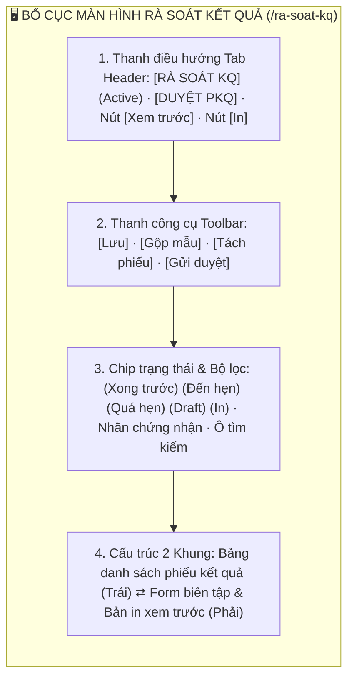
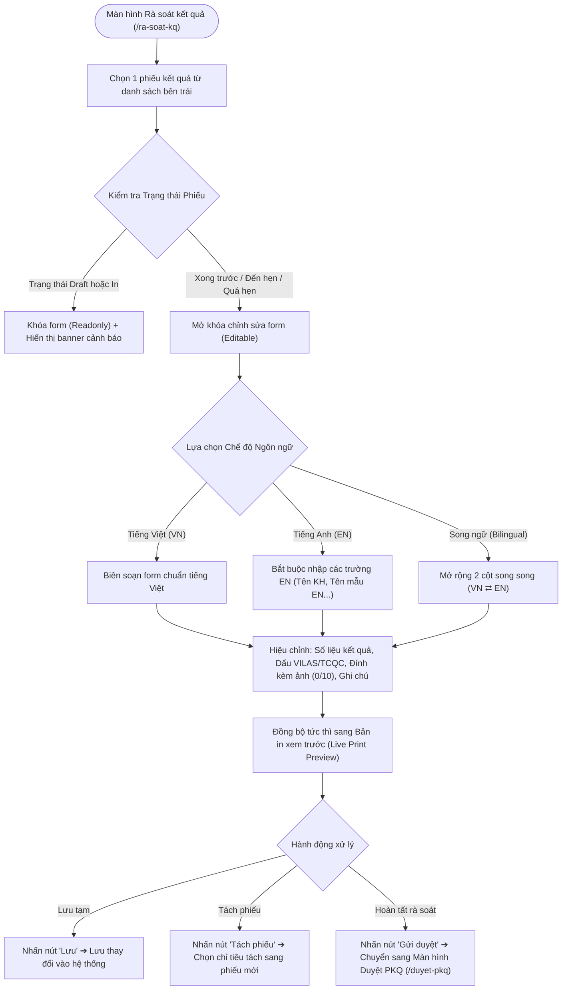
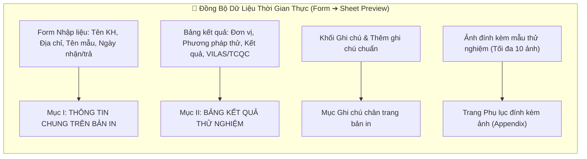
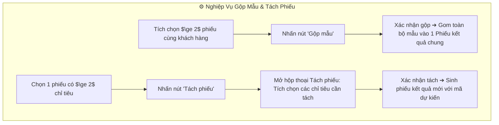

# 📋 TÀI LIỆU ĐẶC TẢ YÊU CẦU CHỨC NĂNG (REQUIREMENTS SPECIFICATION)
## Phân hệ: Rà soát & Phát hành Phiếu Kết Quả — Hệ thống VNTEST LIMS
### Tính năng: Rà soát kết quả thử nghiệm (Results Review Screen)

---

| Thông tin tài liệu | Chi tiết |
| :--- | :--- |
| **Mã tài liệu** | `REQ_VNTEST_RA_SOAT_KQ` |
| **Tính năng / Màn hình** | Rà soát kết quả thử nghiệm (Results Review) |
| **Đường dẫn truy cập** | `/ra-soat-kq` (hoặc cụm tab `RÀ SOÁT KQ` trên header) |
| **Đối tượng sử dụng** | Nhân viên Rà soát kết quả, Trưởng phòng Kỹ thuật, Lãnh đạo phê duyệt, Admin |
| **Trạng thái tài liệu** | `Approved / Ready for Development & Testing` |
| **Cơ sở dữ liệu liên kết** | `test_reports`, `samples`, `criteria`, `attachments`, `report_templates`, `users` |
| **Test Script Playwright** | [`src/tests/ra-soat-kq/ra-soat-kq.spec.ts`](file:///home/thai.hoang.dinh/VNTEST_Automation/src/tests/ra-soat-kq/ra-soat-kq.spec.ts) (116 Test Cases) |
| **Page Object Model** | [`src/pages/ra-soat-kq.page.ts`](file:///home/thai.hoang.dinh/VNTEST_Automation/src/pages/ra-soat-kq.page.ts) |
| **Dữ liệu kiểm thử** | [`test-data/users.json`](file:///home/thai.hoang.dinh/VNTEST_Automation/test-data/users.json), `test-data/ra-soat-kq.json` |

---

## 📑 MỤC LỤC ĐIỀU HƯỚNG NHANH
1. [1. Định vị màn hình & Tổng quan tính năng (Overview & UI Layout)](#1-định-vị-màn-hình--tổng-quan-tính-năng-overview--ui-layout)
2. [2. Sơ đồ phân tích luồng trực quan (Mermaid Flowcharts)](#2-sơ-đồ-phân-tích-luồng-trực-quan-mermaid-flowcharts)
3. [3. Phân quyền & Điều kiện kích hoạt (Access & Permissions)](#3-phân-quyền--điều-kiện-kích-hoạt-access--permissions)
4. [4. Đặc tả chi tiết các Use Cases chức năng (Functional Use Cases)](#4-đặc-tả-chi-tiết-các-use-cases-chức-năng-functional-use-cases)
5. [5. Đặc tả chi tiết trường dữ liệu (Field Specifications Matrix)](#5-đặc-tả-chi-tiết-trường-dữ-liệu-field-specifications-matrix)
6. [6. Ma trận nút bấm & Tương tác giao diện (Action Buttons Matrix)](#6-ma-trận-nút-bấm--tương-tác-giao-diện-action-buttons-matrix)
7. [7. Quy tắc nghiệp vụ & Luồng xử lý lỗi (Business Rules & Error Handling)](#7-quy-tắc-nghiệp-vụ--luồng-xử-lý-lỗi-business-rules--error-handling)
8. [8. Kế hoạch kiểm thử & Ma trận Test Cases Automation (116 Test Cases)](#8-kế-hoạch-kiểm-thử--ma-trận-test-cases-automation-116-test-cases)

---

## 1. ĐỊNH VỊ MÀN HÌNH & TỔNG QUAN TÍNH NĂNG (OVERVIEW & UI LAYOUT)

### 1.1. Mục đích tính năng
* **Thẩm định & Chuẩn bị Phiếu Kết Quả Thử Nghiệm (PKQ):** Là phân hệ trọng yếu chuẩn bị phát hành kết quả thử nghiệm ra bên ngoài, tổng hợp số liệu đo từ phòng LAB, đối chiếu quy chuẩn kỹ thuật (TCVN, QCVN, ISO) và định dạng báo cáo.
* **Hỗ trợ 3 Chế độ Ngôn ngữ (VN / EN / Song ngữ):** Cho phép biên soạn phiếu bằng Tiếng Việt (`VN`), Tiếng Anh (`EN`), hoặc Chế độ Song ngữ (`Bilingual` - mở rộng 2 cột song song hiển thị song song nội dung VN và EN). Dữ liệu được bảo lưu nguyên vẹn khi chuyển đổi qua lại giữa các chế độ.
* **Cơ chế Đồng bộ Bản in ISO/IEC 17025 theo thời gian thực (Live Print Preview):** Tích hợp khung xem trước phiếu in chuẩn khổ A4, đồng bộ tức thì mọi thay đổi về Thông tin khách hàng, Tên mẫu, Bảng kết quả, Đơn vị tính, Phương pháp thử, Dấu chứng nhận (VILAS/TCQC) và Chữ ký số.
* **Nghiệp vụ Xử lý Hồ sơ Nâng cao (Gộp mẫu & Tách phiếu):** Hỗ trợ gộp nhiều mẫu đơn lẻ vào chung một phiếu kết quả hoặc tách một phần chỉ tiêu sang một phiếu mới để phát hành trước theo yêu cầu của khách hàng.

### 1.2. Bố cục Giao diện & Các Phân khu Chức năng (UI Layout Matrix)

| Phân khu (Section) | Vị trí hiển thị | Thành phần giao diện chính | Mục đích & Nghiệp vụ |
| :--- | :--- | :--- | :--- |
| **1. Header & Điều hướng** | Trên cùng trang | Cụm tab: `RÀ SOÁT KQ` (active), `DUYỆT PKQ`, nút toggle `"Xem trước"`, nút `"In"` | Điều hướng giữa rà soát và duyệt PKQ; bật/tắt bản in ISO/IEC 17025 |
| **2. Thanh công cụ (Toolbar)** | Dưới Header | Nút `"Lưu"`, `"Gộp mẫu"`, `"Tách phiếu"`, `"Gửi duyệt"` | Thao tác xử lý nghiệp vụ chính của nhân viên rà soát kết quả |
| **3. Chip trạng thái & Bộ lọc** | Dưới Toolbar | 5 Chip: `Xong trước`, `Đến hẹn`, `Quá hẹn`, `Draft`, `In`; Tag chứng nhận; Ô tìm kiếm | Lọc nhanh phiếu kết quả theo hạn trả và nhãn công nhận (VILAS/TCQC) |
| **4. Bảng danh sách (Khung trái)**| Nửa bên trái | Bảng danh sách phiếu kèm checkbox, Mã YCTN, Tên mẫu, Khách hàng, Trạng thái | Lựa chọn phiếu kết quả để nạp sang form chỉnh sửa hoặc gộp mẫu |
| **5. Form biên tập (Khung phải)** | Nửa bên phải | Radio chọn ngôn ngữ (`VN`/`EN`/`Song ngữ`), Thông tin chung, Ảnh đính kèm (0/10), Bảng kết quả, Ghi chú | Chỉnh sửa số liệu, chọn dấu chứng nhận, thêm ghi chú và đồng bộ bản in |

---

## 2. SƠ ĐỒ PHÂN TÍCH LUỒNG TRỰC QUAN (MERMAID FLOWCHARTS)

### 2.1. Sơ đồ Master Flow Rà soát & Phát hành Phiếu Kết Quả

### 2.2. Sơ đồ Cơ chế Đồng bộ Real-time giữa Form và Bản in ISO/IEC 17025

### 2.3. Sơ đồ Nghiệp vụ Gộp Mẫu & Tách Phiếu Kết Quả

---

## 3. PHÂN QUYỀN & ĐIỀU KIỆN KÍCH HOẠT (ACCESS & PERMISSIONS)

### 3.1. Ma trận phân quyền truy cập (RBAC Matrix)

| Vai trò người dùng (Role) | Xem danh sách Rà soát | Chỉnh sửa số liệu & Lưu | Gộp mẫu / Tách phiếu | Gửi duyệt PKQ | Xem trước & In phiếu |
| :--- | :---: | :---: | :---: | :---: | :---: |
| **Quản trị viên (Admin)** | Toàn quyền | Toàn quyền | Toàn quyền | Toàn quyền | Cho phép |
| **Trưởng phòng / Lãnh đạo** | Toàn quyền | Toàn quyền | Toàn quyền | Toàn quyền | Cho phép |
| **Nhân viên Rà soát KQ** | Toàn quyền xem | Được phép (trừ Draft/In)| Được phép | Được phép | Cho phép |
| **Kiểm nghiệm viên (KNV)** | Xem kết quả của mình | Không | Không | Không | Cho phép xem |
| **Kế toán** | Xem tiến độ trả KQ | Không | Không | Không | Bị chặn |

---

## 4. ĐẶC TẢ CHI TIẾT CÁC USE CASES CHỨC NĂNG (FUNCTIONAL USE CASES)

### UC-01: Phân quyền & Quản lý Trạng thái Phiếu (Khối 01)
* **Tác nhân:** Nhân viên Rà soát kết quả.
* **Luồng sự kiện chính:**
  1. Với trạng thái `Draft` hoặc `In`: Toàn bộ form bị khóa ở chế độ chỉ đọc (`readonly`), hiển thị cảnh báo tương ứng.
  2. Với trạng thái `Xong trước`, `Đến hẹn`, `Quá hẹn`: Hệ thống mở khóa cho phép chỉnh sửa toàn bộ các trường dữ liệu trên form.

### UC-02: Bộ lọc Chip Trạng thái & Nhãn Chứng nhận (Khối 02)
* **Tác nhân:** Người dùng tra cứu phiếu kết quả.
* **Luồng sự kiện chính:**
  1. Lọc theo từng chip trạng thái (`Xong trước`, `Đến hẹn`, `Quá hẹn`, `Draft`, `In`).
  2. Lọc theo các tag chứng nhận công nhận phòng thí nghiệm (`VILAS`, `TCQC`, `Không chứng nhận`).

### UC-03: Chế độ Tiếng Anh - EN Mode (Khối 03)
* **Tác nhân:** Nhân viên biên tập phiếu tiếng Anh.
* **Luồng sự kiện chính:**
  1. Chọn radio `"EN"`: Giao diện chuyển sang các trường có nhãn tiếng Anh (`Customer Name EN`, `Sample Name EN`...).
  2. Bắt buộc kiểm tra các trường tiếng Anh khi nhấn Lưu; nếu để trống hệ thống chặn lưu và viền đỏ báo lỗi.

### UC-04: Chế độ Song ngữ - Bilingual Mode (Khối 04)
* **Tác nhân:** Nhân viên biên tập phiếu song ngữ.
* **Luồng sự kiện chính:**
  1. Chọn radio `"Song ngữ"`: Giao diện mở rộng thành 2 cột song song hiển thị đồng thời cả tiếng Việt và tiếng Anh.
  2. Kế thừa tự động: Cột tiếng Việt tự động điền các thông tin có sẵn, nhân viên chỉ cần bổ sung cột tiếng Anh.

### UC-05: Chuyển đổi Ngôn ngữ & Bảo lưu Dữ liệu (Khối 05)
* **Tác nhân:** Nhân viên rà soát.
* **Luồng sự kiện chính:**
  1. Chuyển từ Song ngữ về VN: Thu gọn về 1 cột VN và bảo lưu toàn bộ dữ liệu EN đã nhập trong bộ nhớ.
  2. Chuyển từ VN sang Song ngữ: Mở lại 2 cột song song và hiển thị lại đầy đủ cả dữ liệu VN và EN đã nhập trước đó.

### UC-06: Thông tin chung & Field Validation (Khối 06)
* **Tác nhân:** Nhân viên rà soát kết quả.
* **Luồng sự kiện chính:**
  1. Kiểm tra định dạng Email khách hàng (RFC format), số điện thoại, ngày nhận mẫu, ngày trả kết quả.
  2. Kiểm tra bắt buộc các trường thông tin cơ sở pháp lý của phiếu kết quả.

### UC-07: Quản lý Hình ảnh Đính kèm 0/10 (Khối 07)
* **Tác nhân:** Nhân viên rà soát.
* **Luồng sự kiện chính:**
  1. Tải lên hình ảnh mẫu thực tế (chấp nhận JPG, PNG dung lượng $\le 5$MB).
  2. Chặn tải lên file sai định dạng (PDF, DOCX) và giới hạn tối đa 10 hình ảnh trên một phiếu.
  3. Xóa ảnh và xem trước ảnh phóng to dễ dàng.

### UC-08: Bảng Kết quả Thử nghiệm & Chỉ tiêu (Khối 08)
* **Tác nhân:** Nhân viên rà soát.
* **Luồng sự kiện chính:**
  1. Chỉnh sửa Kết quả (Result) dạng số hoặc dạng chuỗi chữ đặc biệt (`KPH`, `Không phát hiện`, `< 0.01`).
  2. Đổi Đơn vị tính (`ĐVT`), Phương pháp thử (`PP Thử`), giới hạn phát hiện (`LOD`), giới hạn định lượng (`LOQ`).
  3. Bật/tắt các dấu chứng nhận `VILAS`, `TCQC` và chỉ định `Thầu phụ` cho từng chỉ tiêu.

### UC-09: Ghi chú Phiếu & Gợi ý Chuẩn (Khối 09)
* **Tác nhân:** Nhân viên rà soát.
* **Luồng sự kiện chính:**
  1. Thêm ghi chú tự do bằng nút `"+ Thêm ghi chú"` hoặc chọn ghi chú mẫu từ thư viện gợi ý chuẩn ISO.
  2. Xóa hoặc thay đổi thứ tự các dòng ghi chú dưới chân phiếu kết quả.

### UC-10: Nghiệp vụ Gộp Mẫu (Khối 10)
* **Tác nhân:** Nhân viên rà soát kết quả.
* **Luồng sự kiện chính:**
  1. Điều kiện kích hoạt: Nút `"Gộp mẫu"` chỉ sáng lên khi người dùng tích chọn từ 2 phiếu trở lên có cùng khách hàng.
  2. Xác nhận gộp: Gom toàn bộ danh sách mẫu và chỉ tiêu của các phiếu đã chọn vào chung duy nhất 1 Phiếu kết quả.

### UC-11: Nghiệp vụ Tách Phiếu (Khối 11)
* **Tác nhân:** Nhân viên rà soát kết quả.
* **Luồng sự kiện chính:**
  1. Chọn 1 phiếu có từ 2 chỉ tiêu trở lên và nhấn nút `"Tách phiếu"`.
  2. Hộp thoại mở ra liệt kê danh sách chỉ tiêu; nhân viên tích chọn các chỉ tiêu cần tách ra phiếu mới.
  3. Xác nhận tách: Hệ thống sinh một phiếu kết quả mới với mã dự kiến, các chỉ tiêu được chọn tách khỏi phiếu gốc.

### UC-12: Thao tác Chung & Quản lý Bản in (Khối 12)
* **Tác nhân:** Nhân viên rà soát.
* **Luồng sự kiện chính:**
  1. Thao tác Lưu thành công khi các trường thông tin hợp lệ; chặn lưu khi vi phạm trường bắt buộc.
  2. Bật/tắt nút `"Xem trước"` để ẩn/hiện bản in ISO/IEC 17025 bên phải.
  3. Nhấn nút `"In"` để mở hộp thoại in trình duyệt chuẩn khổ giấy A4.

### UC-13: Đồng bộ Dữ liệu Form sang Bản in Xem trước (Khối 13)
* **Tác nhân:** Hệ thống tự động.
* **Luồng sự kiện chính:**
  1. Mọi thay đổi trên Form (Tên KH, Địa chỉ, Tên mẫu, Ngày nhận, Kết quả chỉ tiêu, Dấu VILAS, Ghi chú) lập tức được phản ánh sang Bản in xem trước trong tích tắc.

### UC-14: Thẩm định Chi tiết Bản in ISO/IEC 17025 (Khối 14)
* **Tác nhân:** Nhân viên rà soát & Trưởng phòng.
* **Luồng sự kiện chính:**
  1. Kiểm tra đầy đủ các thành phần trang in: Header chuẩn (Logo VNTEST, thông tin Viện tiếng Việt & tiếng Anh), Mục I (Thông tin chung), Mục II (Bảng kết quả thử nghiệm), Chân trang (Ghi chú, Dấu chứng nhận và Khu vực chữ ký thẩm định).

---

## 5. ĐẶC TẢ CHI TIẾT TRƯỜNG DỮ LIỆU (FIELD SPECIFICATIONS MATRIX)

| Tên trường | UI Label | Kiểu dữ liệu | Bắt buộc | Ràng buộc & Validation Rules | Giá trị mặc định / Placeholder | Ghi chú |
| :--- | :--- | :--- | :---: | :--- | :--- | :--- |
| `reportCode` | **Mã Phiếu KQ** | `text` | Hệ thống sinh | Định dạng `PKQ-xxxx-xxx` tự tăng. Readonly. | Tự động sinh | Khóa không cho sửa |
| `langMode` | **Chế độ ngôn ngữ**| `radio` | **Bắt buộc** | `VN`, `EN`, `Song ngữ`. | Mặc định: `VN` | Điều khiển hiển thị 1 cột hay 2 cột |
| `customerName` | **Tên khách hàng** | `text` | **Bắt buộc** | Tối đa 255 ký tự. Đồng bộ sang Mục I.1 bản in. | Kế thừa từ YCTN | Cho phép hiệu chỉnh |
| `customerNameEn`| **Customer Name** | `text` | **Bắt buộc khi EN/Song ngữ**| Tên tiếng Anh hợp lệ. | Rỗng | Bắt buộc khi bật EN |
| `customerAddress`| **Địa chỉ** | `text` | **Bắt buộc** | Địa chỉ xuất phiếu của khách hàng. | Kế thừa từ YCTN | Đồng bộ Mục I.2 bản in |
| `sampleName` | **Tên mẫu** | `text` | **Bắt buộc** | Tên mẫu thử nghiệm hiển thị trên phiếu. | Kế thừa từ mẫu | Đồng bộ Mục I.3 bản in |
| `attachedImages`| **Hình ảnh đính kèm**| `file/images`| Không | Tối đa 10 ảnh (`0/10`). Định dạng JPG, PNG $\le 5$MB. | `0/10` | Hiển thị tại phụ lục bản in |
| `resultValue` | **Kết quả** | `text` | **Bắt buộc** | Dạng số thực hoặc chuỗi (`KPH`, `Không phát hiện`, `< 0.01`).| Điền số đo | Đồng bộ cột Kết quả Mục II |
| `vilasStamp` | **Dấu VILAS** | `checkbox` | Không | Boolean `true`/`false`. | Mặc định: `false` | Bật đóng dấu công nhận VILAS |
| `noteText` | **Ghi chú phiếu** | `text` | Không | Tối đa 500 ký tự mỗi dòng ghi chú. | Chọn từ gợi ý chuẩn | Xuất hiện chân trang Mục II |

---

## 6. MA TRẬN NÚT BẤM & TƯƠNG TÁC GIAO DIỆN (ACTION BUTTONS MATRIX)

| Tên nút (Button) | Vị trí | Icon / Class | Trạng thái mặc định | Điều kiện kích hoạt | Hành vi khi nhấn | Modal / Thông báo đi kèm |
| :--- | :--- | :--- | :---: | :--- | :--- | :--- |
| **Lưu** | Toolbar trên bảng | `.btn-save` | **Kích hoạt** | Luôn sẵn sàng | Lưu thông tin chỉnh sửa trên form rà soát | Thông báo: `"Đã lưu phiếu kết quả."` |
| **Gộp mẫu** | Toolbar trên bảng | `.btn-merge` | **Vô hiệu hóa** | Tích chọn $\ge 2$ phiếu cùng khách hàng | Mở hộp thoại xác nhận gộp nhiều mẫu vào 1 phiếu | Modal: `"Xác nhận gộp mẫu"` |
| **Tách phiếu** | Toolbar trên bảng | `.btn-split` | **Vô hiệu hóa** | Tích chọn 1 phiếu có $\ge 2$ chỉ tiêu | Mở hộp thoại chọn chỉ tiêu cần tách ra phiếu mới | Modal: `"Tách phiếu kết quả"` |
| **Gửi duyệt** | Toolbar trên bảng | `.btn-send` | **Kích hoạt** | Phiếu hợp lệ | Gửi phiếu kết quả sang phân hệ Duyệt PKQ | Chuyển sang màn Duyệt PKQ |
| **Xem trước** | Header bên phải | `.btn-toggle-preview`| **Kích hoạt**| Luôn sẵn sàng | Bật/tắt hiển thị khung Bản in xem trước A4 bên phải | Bật/tắt khung Preview A4 |
| **In** | Header bên phải | `.btn-print` | **Kích hoạt** | Luôn sẵn sàng | Mở cửa sổ in ấn chuẩn khổ giấy A4 của trình duyệt | Hộp thoại Print trình duyệt |
| **+ Thêm ghi chú**| Khu vực Ghi chú | `.btn-add-note` | **Kích hoạt** | Đang mở form | Chèn thêm 1 dòng ghi chú tự do vào chân phiếu | Thêm dòng ghi chú |
| **Tải ảnh lên** | Khu vực Hình ảnh | `.btn-upload-img` | **Kích hoạt** | Số ảnh hiện tại $< 10$ | Mở hộp thoại chọn tệp ảnh để đính kèm vào phiếu | Hộp thoại chọn tệp |

---

## 7. QUY TẮC NGHIỆP VỤ & LUỒNG XỬ LÝ LỖI (BUSINESS RULES & ERROR HANDLING)

| Mã lỗi (Code) | Quy tắc nghiệp vụ (Business Rule) | Điều kiện kích hoạt | Vị trí hiển thị | Câu thông báo lỗi hiển thị (Error Message) |
| :--- | :--- | :--- | :--- | :--- |
| `ERR_READONLY_DRAFT` | Khóa chỉnh sửa trạng thái Draft | Mở phiếu có trạng thái `Draft` | Đầu form chỉnh sửa | **"Hồ sơ ở trạng thái Draft chỉ cho phép xem, không được chỉnh sửa."** |
| `ERR_READONLY_PRINTED`| Khóa chỉnh sửa trạng thái In | Mở phiếu có trạng thái `In` | Đầu form chỉnh sửa | **"Hồ sơ đã in kết quả chỉ cho phép xem, không được chỉnh sửa."** |
| `ERR_EN_REQUIRED` | Bắt buộc nhập tiếng Anh khi EN/Song ngữ| Để trống trường tiếng Anh khi lưu ở chế độ EN | Dưới ô tiếng Anh | **"Vui lòng nhập đầy đủ thông tin tiếng Anh bắt buộc."** |
| `ERR_IMAGE_MAX` | Giới hạn tối đa 10 hình ảnh | Tải lên ảnh thứ 11 | Khu vực đính kèm ảnh | **"Mỗi phiếu chỉ được đính kèm tối đa 10 hình ảnh."** |
| `ERR_IMAGE_FORMAT` | Sai định dạng tệp hình ảnh | Tải lên file `.pdf` hoặc `.docx` | Khu vực đính kèm ảnh | **"Chỉ chấp nhận tệp hình ảnh định dạng JPG hoặc PNG."** |
| `RULE_MERGE_SAME_CUST`| Chỉ gộp mẫu của cùng một khách hàng | Chọn các phiếu khác khách hàng khi gộp | Nút Gộp mẫu | Nút `"Gộp mẫu"` tự động bị vô hiệu hóa (`disabled`) |

---

## 8. KẾ HOẠCH KIỂM THỬ & MA TRẬN TEST CASES AUTOMATION (116 TEST CASES)
### 8.1. KHỐI 01: PHÂN QUYỀN & TRẠNG THÁI PHIẾU (6 Test Cases)

| Mã TC | Phân nhóm luồng | Tên kịch bản | Thao tác & Dữ liệu kiểm thử | Kết quả mong đợi | Mức độ ưu tiên | Mapping Page Object |
| :--- | :--- | :--- | :--- | :--- | :---: | :--- |
| **RSKQ_ST_01** | PHÂN QUYỀN & TRẠNG THÁI PHIẾU | Kiểm tra trạng thái Draft - Khóa chỉnh sửa và hiển thị cảnh báo Draft | 1. Kiểm tra bản ghi trạng thái Draft trên danh sách  2. Kiểm tra thanh cảnh báo khóa Draft  3. Kiểm tra các trường nhập liệu bị khóa (disabled/readonly)  4. Kiểm tra nút "Lưu" bị vô hiệu hóa | Hệ thống chặn thao tác hoặc hiển thị cảnh báo lỗi hợp lệ: Kiểm tra trạng thái Draft - Khóa chỉnh sửa và hiển thị cảnh báo Draft. | High | `raSoatKqPage` |
| **RSKQ_ST_02** | PHÂN QUYỀN & TRẠNG THÁI PHIẾU | Kiểm tra trạng thái In - Khóa chỉnh sửa hồ sơ đã in | 1. Mở bản ghi trạng thái "In"  2. Kiểm tra thanh cảnh báo khóa trạng thái In  3. Kiểm tra toàn bộ form nhập liệu ở chế độ chỉ đọc  4. Kiểm tra nút "Lưu" bị vô hiệu hóa | Hệ thống chặn thao tác hoặc hiển thị cảnh báo lỗi hợp lệ: Kiểm tra trạng thái In - Khóa chỉnh sửa hồ sơ đã in. | High | `raSoatKqPage` |
| **RSKQ_ST_03** | PHÂN QUYỀN & TRẠNG THÁI PHIẾU | Kiểm tra trạng thái được phép sửa - Cho phép chỉnh sửa với trạng thái Xong trước | 1. Mở bản ghi trạng thái "Xong trước"  2. Kiểm tra không hiển thị banner khóa Draft / In  3. Kiểm tra các trường nhập liệu không bị khóa | Hệ thống thực hiện đúng kịch bản: Kiểm tra trạng thái được phép sửa - Cho phép chỉnh sửa với trạng thái Xong trước. | Normal | `raSoatKqPage` |
| **RSKQ_ST_04** | PHÂN QUYỀN & TRẠNG THÁI PHIẾU | Kiểm tra trạng thái được phép sửa - Cho phép chỉnh sửa với trạng thái Quá hẹn | 1. Mở bản ghi trạng thái "Quá hẹn"  2. Kiểm tra quyền chỉnh sửa của trạng thái Quá hẹn | Hệ thống thực hiện đúng kịch bản: Kiểm tra trạng thái được phép sửa - Cho phép chỉnh sửa với trạng thái Quá hẹn. | Normal | `raSoatKqPage` |
| **RSKQ_ST_05** | PHÂN QUYỀN & TRẠNG THÁI PHIẾU | Kiểm tra trạng thái được phép sửa - Cho phép chỉnh sửa với trạng thái Đến hẹn | 1. Kiểm tra trạng thái "Đến hẹn" trên chip trạng thái | Hệ thống thực hiện đúng kịch bản: Kiểm tra trạng thái được phép sửa - Cho phép chỉnh sửa với trạng thái Đến hẹn. | Normal | `raSoatKqPage` |
| **RSKQ_ST_06** | PHÂN QUYỀN & TRẠNG THÁI PHIẾU | Luồng Gửi duyệt - Gửi duyệt thành công phiếu kết quả sang màn Duyệt PKQ | 1. Tích chọn 1 phiếu ở trạng thái cho phép duyệt  2. Kiểm tra mở hộp thoại Xác nhận gửi duyệt  3. Đóng hộp thoại gửi duyệt để bảo toàn dữ liệu | Hệ thống thực hiện thành công và cập nhật dữ liệu chính xác: Luồng Gửi duyệt - Gửi duyệt thành công phiếu kết quả sang màn Duyệt PKQ. | High | `raSoatKqPage` |

### 8.2. KHỐI 02: BỘ LỌC & NHÃN CHỨNG NHẬN (3 Test Cases)

| Mã TC | Phân nhóm luồng | Tên kịch bản | Thao tác & Dữ liệu kiểm thử | Kết quả mong đợi | Mức độ ưu tiên | Mapping Page Object |
| :--- | :--- | :--- | :--- | :--- | :---: | :--- |
| **RSKQ_FLT_01** | BỘ LỌC & NHÃN CHỨNG NHẬN | Lọc theo Chip trạng thái - Lọc theo từng trạng thái | 1. Lọc theo chip "Xong trước"  2. Lọc theo chip "Quá hẹn"  3. Lọc theo chip "In" | Hệ thống thực hiện đúng kịch bản: Lọc theo Chip trạng thái - Lọc theo từng trạng thái. | Normal | `raSoatKqPage` |
| **RSKQ_FLT_02** | BỘ LỌC & NHÃN CHỨNG NHẬN | Chọn nhóm chứng nhận - Chọn một hoặc nhiều tag chứng nhận | 1. Mở phiếu cho phép sửa  2. Kiểm tra danh sách các tag chứng nhận hiển thị  3. Nhấn chọn tag "Vimcerts" và kiểm tra toggle  4. Nhấn lần nữa để hoàn nguyên | Hệ thống thực hiện đúng kịch bản: Chọn nhóm chứng nhận - Chọn một hoặc nhiều tag chứng nhận. | Normal | `raSoatKqPage` |
| **RSKQ_FLT_03** | BỘ LỌC & NHÃN CHỨNG NHẬN | Nhập ý kiến điều phối - Lưu nội dung trường Ý kiến nội bộ | 1. Mở phiếu cho phép sửa  2. Kiểm tra trường "Ý kiến"  3. Nhập nội dung ý kiến mới  4. Hoàn nguyên nội dung ý kiến | Hệ thống thực hiện đúng kịch bản: Nhập ý kiến điều phối - Lưu nội dung trường Ý kiến nội bộ. | High | `raSoatKqPage` |

### 8.3. KHỐI 03: CHẾ ĐỘ TIẾNG ANH (EN) (8 Test Cases)

| Mã TC | Phân nhóm luồng | Tên kịch bản | Thao tác & Dữ liệu kiểm thử | Kết quả mong đợi | Mức độ ưu tiên | Mapping Page Object |
| :--- | :--- | :--- | :--- | :--- | :---: | :--- |
| **RSKQ_EN_01** | CHẾ ĐỘ TIẾNG ANH (EN) | Chuyển đổi sang chế độ EN - Hiển thị các trường có nhãn EN | 1. Mở phiếu cho phép sửa và chuyển sang chế độ "EN"  2. Kiểm tra các trường hiển thị nhãn EN duy nhất  3. Hoàn nguyên về Song ngữ | Giao diện hiển thị đầy đủ và đồng bộ chính xác: Chuyển đổi sang chế độ EN - Hiển thị các trường có nhãn EN. | Normal | `raSoatKqPage` |
| **RSKQ_EN_02** | CHẾ ĐỘ TIẾNG ANH (EN) | Kiểm tra trường bắt buộc EN - Bỏ trống Tên KH tiếng Anh | 1. Mở phiếu và chuyển sang chế độ EN  2. Kiểm tra trường Tên KH có đánh dấu bắt buộc (*)  3. Kiểm tra khi Tên KH bỏ trống thì không thể lưu hoặc báo lỗi validation  4. Hoàn nguyên dữ liệu | Hệ thống thực hiện đúng kịch bản: Kiểm tra trường bắt buộc EN - Bỏ trống Tên KH tiếng Anh. | Normal | `raSoatKqPage` |
| **RSKQ_EN_03** | CHẾ ĐỘ TIẾNG ANH (EN) | Kiểm tra trường bắt buộc EN - Bỏ trống Địa chỉ KH tiếng Anh | 1. Chuyển sang chế độ EN  2. Kiểm tra trường Địa chỉ KH có đánh dấu bắt buộc  3. Hoàn nguyên | Hệ thống thực hiện đúng kịch bản: Kiểm tra trường bắt buộc EN - Bỏ trống Địa chỉ KH tiếng Anh. | Normal | `raSoatKqPage` |
| **RSKQ_EN_04** | CHẾ ĐỘ TIẾNG ANH (EN) | Kiểm tra trường bắt buộc EN - Bỏ trống Tên mẫu tiếng Anh | 1. Chuyển sang chế độ EN  2. Kiểm tra trường Tên mẫu có đánh dấu bắt buộc  3. Hoàn nguyên | Hệ thống thực hiện đúng kịch bản: Kiểm tra trường bắt buộc EN - Bỏ trống Tên mẫu tiếng Anh. | Normal | `raSoatKqPage` |
| **RSKQ_EN_05** | CHẾ ĐỘ TIẾNG ANH (EN) | Nhập thông tin tùy chọn EN - Cập nhật Tên Đơn vị SX và Địa chỉ SX tiếng Anh | 1. Chuyển sang chế độ EN  2. Nhập Đơn vị SX và Địa chỉ SX tiếng Anh  3. Hoàn nguyên | Hệ thống thực hiện đúng kịch bản: Nhập thông tin tùy chọn EN - Cập nhật Tên Đơn vị SX và Địa chỉ SX tiếng Anh. | Normal | `raSoatKqPage` |
| **RSKQ_EN_06** | CHẾ ĐỘ TIẾNG ANH (EN) | Nhập thông tin tùy chọn EN - Cập nhật Mô tả mẫu và TG lưu mẫu tiếng Anh | 1. Chuyển sang chế độ EN  2. Nhập Mô tả mẫu và TG lưu mẫu tiếng Anh  3. Hoàn nguyên | Hệ thống thực hiện đúng kịch bản: Nhập thông tin tùy chọn EN - Cập nhật Mô tả mẫu và TG lưu mẫu tiếng Anh. | High | `raSoatKqPage` |
| **RSKQ_EN_07** | CHẾ ĐỘ TIẾNG ANH (EN) | Kiểm tra trường Kết luận EN - Cập nhật nội dung Kết luận tiếng Anh | 1. Chuyển sang chế độ EN  2. Nhập nội dung Kết luận tiếng Anh  3. Hoàn nguyên | Hệ thống thực hiện đúng kịch bản: Kiểm tra trường Kết luận EN - Cập nhật nội dung Kết luận tiếng Anh. | Normal | `raSoatKqPage` |
| **RSKQ_EN_08** | CHẾ ĐỘ TIẾNG ANH (EN) | Lưu phiếu chế độ EN - Nhấn nút "Lưu" thành công toàn bộ dữ liệu tiếng Anh | 1. Chuyển sang chế độ EN  2. Nhập đầy đủ thông tin tiếng Anh hợp lệ  3. Kiểm tra nút "Lưu" được kích hoạt  4. Tải lại trang để giữ nguyên hiện trạng | Hệ thống thực hiện thành công và cập nhật dữ liệu chính xác: Lưu phiếu chế độ EN - Nhấn nút "Lưu" thành công toàn bộ dữ liệu tiếng Anh. | High | `raSoatKqPage` |

### 8.4. KHỐI 04: CHẾ ĐỘ SONG NGỮ (BILINGUAL) (9 Test Cases)

| Mã TC | Phân nhóm luồng | Tên kịch bản | Thao tác & Dữ liệu kiểm thử | Kết quả mong đợi | Mức độ ưu tiên | Mapping Page Object |
| :--- | :--- | :--- | :--- | :--- | :---: | :--- |
| **RSKQ_BI_01** | CHẾ ĐỘ SONG NGỮ (BILINGUAL) | Chuyển đổi sang chế độ Song ngữ - Giao diện mở rộng thành 2 cột song song | 1. Chuyển sang chế độ Song ngữ  2. Kiểm tra các trường mở rộng thành 2 cột VN và EN | Hệ thống thực hiện đúng kịch bản: Chuyển đổi sang chế độ Song ngữ - Giao diện mở rộng thành 2 cột song song. | Normal | `raSoatKqPage` |
| **RSKQ_BI_02** | CHẾ ĐỘ SONG NGỮ (BILINGUAL) | Kiểm tra tính kế thừa dữ liệu - Cột VN tự động hiển thị dữ liệu tiếng Việt có sẵn | 1. Kiểm tra cột VN tại trường Tên KH có chứa dữ liệu tiếng Việt | Giao diện hiển thị đầy đủ và đồng bộ chính xác: Kiểm tra tính kế thừa dữ liệu - Cột VN tự động hiển thị dữ liệu tiếng Việt có sẵn. | Normal | `raSoatKqPage` |
| **RSKQ_BI_03** | CHẾ ĐỘ SONG NGỮ (BILINGUAL) | Kiểm tra trường Tên KH song ngữ - Nhập đồng thời cả Tên KH tiếng Việt và tiếng Anh | 1. Nhập song ngữ cho trường Tên KH  2. Hoàn nguyên | Hệ thống thực hiện đúng kịch bản: Kiểm tra trường Tên KH song ngữ - Nhập đồng thời cả Tên KH tiếng Việt và tiếng Anh. | Normal | `raSoatKqPage` |
| **RSKQ_BI_04** | CHẾ ĐỘ SONG NGỮ (BILINGUAL) | Kiểm tra trường Tên KH song ngữ - Bỏ trống cột VN hoặc cột EN | 1. Bỏ trống cột VN  2. Nhấn nút Lưu và kiểm tra cảnh báo lỗi  3. Hoàn nguyên | Hệ thống thực hiện đúng kịch bản: Kiểm tra trường Tên KH song ngữ - Bỏ trống cột VN hoặc cột EN. | Normal | `raSoatKqPage` |
| **RSKQ_BI_05** | CHẾ ĐỘ SONG NGỮ (BILINGUAL) | Kiểm tra trường Địa chỉ KH song ngữ - Nhập đồng thời Địa chỉ KH tiếng Việt và tiếng Anh | 1. Nhập song ngữ cho trường Địa chỉ KH  2. Hoàn nguyên | Hệ thống thực hiện đúng kịch bản: Kiểm tra trường Địa chỉ KH song ngữ - Nhập đồng thời Địa chỉ KH tiếng Việt và tiếng Anh. | Normal | `raSoatKqPage` |
| **RSKQ_BI_06** | CHẾ ĐỘ SONG NGỮ (BILINGUAL) | Kiểm tra trường Tên mẫu song ngữ - Nhập đồng thời Tên mẫu tiếng Việt và tiếng Anh | 1. Nhập song ngữ cho trường Tên mẫu  2. Hoàn nguyên | Hệ thống thực hiện đúng kịch bản: Kiểm tra trường Tên mẫu song ngữ - Nhập đồng thời Tên mẫu tiếng Việt và tiếng Anh. | Normal | `raSoatKqPage` |
| **RSKQ_BI_07** | CHẾ ĐỘ SONG NGỮ (BILINGUAL) | Kiểm tra trường Tùy chọn song ngữ - Nhập song ngữ cho Đơn vị SX, Địa chỉ SX, Mô tả mẫu, TG lưu mẫu | 1. Kiểm tra các trường tùy chọn đều có 2 cột VN/EN | Hệ thống thực hiện đúng kịch bản: Kiểm tra trường Tùy chọn song ngữ - Nhập song ngữ cho Đơn vị SX, Địa chỉ SX, Mô tả mẫu, TG lưu mẫu. | High | `raSoatKqPage` |
| **RSKQ_BI_08** | CHẾ ĐỘ SONG NGỮ (BILINGUAL) | Kiểm tra trường Kết luận song ngữ - Nhập đồng thời Kết luận tiếng Việt (cột VN) và tiếng Anh (cột EN) | 1. Kiểm tra trường Kết luận có 2 ô textarea VN và EN | Hệ thống thực hiện đúng kịch bản: Kiểm tra trường Kết luận song ngữ - Nhập đồng thời Kết luận tiếng Việt (cột VN) và tiếng Anh (cột EN). | Normal | `raSoatKqPage` |
| **RSKQ_BI_09** | CHẾ ĐỘ SONG NGỮ (BILINGUAL) | Lưu phiếu chế độ Song ngữ - Nhấn nút "Lưu" thành công và xem trước mẫu in phiếu song ngữ | 1. Mở phiếu và bật chế độ Xem trước  2. Kiểm tra toggle "Xem trước"  3. Tắt xem trước | Hệ thống thực hiện thành công và cập nhật dữ liệu chính xác: Lưu phiếu chế độ Song ngữ - Nhấn nút "Lưu" thành công và xem trước mẫu in phiếu song ngữ. | High | `raSoatKqPage` |

### 8.5. KHỐI 05: CHUYỂN ĐỔI NGÔN NGỮ (PERSISTENCE & SWITCH) (10 Test Cases)

| Mã TC | Phân nhóm luồng | Tên kịch bản | Thao tác & Dữ liệu kiểm thử | Kết quả mong đợi | Mức độ ưu tiên | Mapping Page Object |
| :--- | :--- | :--- | :--- | :--- | :---: | :--- |
| **RSKQ_SW_01** | CHUYỂN ĐỔI NGÔN NGỮ (PERSISTENCE & SWITCH) | Chuyển từ Song ngữ về VN - Thu gọn về 1 cột VN và bảo lưu dữ liệu EN đã nhập | 1. Nhập dữ liệu EN ở chế độ Song ngữ  2. Chuyển về chế độ VN  3. Chuyển lại Song ngữ và kiểm tra dữ liệu EN được bảo lưu  4. Hoàn nguyên | Hệ thống thực hiện đúng kịch bản: Chuyển từ Song ngữ về VN - Thu gọn về 1 cột VN và bảo lưu dữ liệu EN đã nhập. | High | `raSoatKqPage` |
| **RSKQ_SW_02** | CHUYỂN ĐỔI NGÔN NGỮ (PERSISTENCE & SWITCH) | Chuyển từ VN sang Song ngữ - Mở lại 2 cột song song và hiển thị lại đầy đủ cả dữ liệu VN và EN | 1. Chuyển từ VN sang Song ngữ  2. Kiểm tra cả 2 cột VN và EN hiển thị | Giao diện hiển thị đầy đủ và đồng bộ chính xác: Chuyển từ VN sang Song ngữ - Mở lại 2 cột song song và hiển thị lại đầy đủ cả dữ liệu VN và EN. | Normal | `raSoatKqPage` |
| **RSKQ_SW_03** | CHUYỂN ĐỔI NGÔN NGỮ (PERSISTENCE & SWITCH) | Chế độ VN - Tiêu đề và nhãn Mục I trên bản in xem trước hiển thị hoàn toàn bằng tiếng Việt | 1. Mở phiếu và chọn chế độ VN  2. Mở khung xem trước  3. Kiểm tra tiêu đề phiếu in tiếng Việt  4. Kiểm tra nhãn mục I.1 và I.2 bằng tiếng Việt  5. Đóng xem trước | Giao diện hiển thị đầy đủ và đồng bộ chính xác: Chế độ VN - Tiêu đề và nhãn Mục I trên bản in xem trước hiển thị hoàn toàn bằng tiếng Việt. | Normal | `raSoatKqPage` |
| **RSKQ_SW_04** | CHUYỂN ĐỔI NGÔN NGỮ (PERSISTENCE & SWITCH) | Chế độ EN - Tiêu đề và nhãn Mục I trên bản in xem trước hiển thị hoàn toàn bằng tiếng Anh | 1. Mở phiếu và chọn chế độ EN  2. Mở khung xem trước  3. Kiểm tra tiêu đề phiếu in tiếng Anh  4. Kiểm tra nhãn mục I.1 và I.2 bằng tiếng Anh  5. Đóng xem trước | Giao diện hiển thị đầy đủ và đồng bộ chính xác: Chế độ EN - Tiêu đề và nhãn Mục I trên bản in xem trước hiển thị hoàn toàn bằng tiếng Anh. | Normal | `raSoatKqPage` |
| **RSKQ_SW_05** | CHUYỂN ĐỔI NGÔN NGỮ (PERSISTENCE & SWITCH) | Chế độ Song ngữ - Tiêu đề và nhãn Mục I trên bản in xem trước hiển thị song ngữ VN / EN | 1. Mở phiếu và chọn chế độ Song ngữ  2. Mở khung xem trước  3. Kiểm tra tiêu đề hiển thị song ngữ  4. Kiểm tra nhãn mục I.1 và I.2 chứa cả tiếng Việt và tiếng Anh  5. Đóng xem trước | Giao diện hiển thị đầy đủ và đồng bộ chính xác: Chế độ Song ngữ - Tiêu đề và nhãn Mục I trên bản in xem trước hiển thị song ngữ VN / EN. | Normal | `raSoatKqPage` |
| **RSKQ_SW_06** | CHUYỂN ĐỔI NGÔN NGỮ (PERSISTENCE & SWITCH) | Chế độ Song ngữ - Nhập tiếng Việt và bỏ trống tiếng Anh ở trường tùy chọn ➔ Lưu hợp lệ và xem trước ổn định | 1. Chuyển sang chế độ Song ngữ  2. Nhập tiếng Việt cho Mô tả mẫu và để trống tiếng Anh  3. Lưu phiếu  4. Mở xem trước và kiểm tra mục Mô tả mẫu hiển thị nội dung tiếng Việt  5. Hoàn nguyên | Hệ thống thực hiện thành công và cập nhật dữ liệu chính xác: Chế độ Song ngữ - Nhập tiếng Việt và bỏ trống tiếng Anh ở trường tùy chọn ➔ Lưu hợp lệ và xem trước ổn định. | High | `raSoatKqPage` |
| **RSKQ_SW_07** | CHUYỂN ĐỔI NGÔN NGỮ (PERSISTENCE & SWITCH) | Chế độ Song ngữ - Bỏ trống tiếng Việt và nhập tiếng Anh ở trường tùy chọn ➔ Lưu hợp lệ và xem trước ổn định | 1. Chuyển sang chế độ Song ngữ  2. Để trống tiếng Việt và nhập tiếng Anh cho Mô tả mẫu  3. Lưu phiếu và kiểm tra không báo lỗi  4. Mở xem trước và kiểm tra mục Mô tả mẫu hiển thị tiếng Anh  5. Hoàn nguyên | Hệ thống thực hiện thành công và cập nhật dữ liệu chính xác: Chế độ Song ngữ - Bỏ trống tiếng Việt và nhập tiếng Anh ở trường tùy chọn ➔ Lưu hợp lệ và xem trước ổn định. | High | `raSoatKqPage` |
| **RSKQ_SW_08** | CHUYỂN ĐỔI NGÔN NGỮ (PERSISTENCE & SWITCH) | Chế độ Song ngữ - Bỏ trống cột EN ở trường bắt buộc "Tên mẫu" ➔ Chặn lưu và báo lỗi validation | 1. Chuyển sang chế độ Song ngữ  2. Nhập cột VN và xóa trắng cột EN trường Tên mẫu  3. Nhấn Lưu và kiểm tra cảnh báo bắt buộc nhập tiếng Anh  4. Hoàn nguyên | Hệ thống chặn thao tác hoặc hiển thị cảnh báo lỗi hợp lệ: Chế độ Song ngữ - Bỏ trống cột EN ở trường bắt buộc "Tên mẫu" ➔ Chặn lưu và báo lỗi validation. | High | `raSoatKqPage` |
| **RSKQ_SW_09** | CHUYỂN ĐỔI NGÔN NGỮ (PERSISTENCE & SWITCH) | Chuyển sang chế độ EN khi trường chỉ có tiếng Việt ➔ Form hiển thị ô rỗng và preview không lẫn tiếng Việt | 1. Chuyển sang chế độ EN  2. Kiểm tra ô nhập EN hiển thị độc lập  3. Mở xem trước ở chế độ EN  4. Hoàn nguyên | Giao diện hiển thị đầy đủ và đồng bộ chính xác: Chuyển sang chế độ EN khi trường chỉ có tiếng Việt ➔ Form hiển thị ô rỗng và preview không lẫn tiếng Việt. | Normal | `raSoatKqPage` |
| **RSKQ_SW_10** | CHUYỂN ĐỔI NGÔN NGỮ (PERSISTENCE & SWITCH) | Chuyển sang chế độ VN khi trường chỉ có tiếng Anh ➔ Form hiển thị 1 cột VN và preview lấy dữ liệu VN | 1. Chuyển sang chế độ VN  2. Kiểm tra form chỉ hiển thị tag VN  3. Mở xem trước và kiểm tra tiêu đề tiếng Việt  4. Hoàn nguyên | Giao diện hiển thị đầy đủ và đồng bộ chính xác: Chuyển sang chế độ VN khi trường chỉ có tiếng Anh ➔ Form hiển thị 1 cột VN và preview lấy dữ liệu VN. | Normal | `raSoatKqPage` |

### 8.6. KHỐI 06: THÔNG TIN CHUNG & FIELD VALIDATION (9 Test Cases)

| Mã TC | Phân nhóm luồng | Tên kịch bản | Thao tác & Dữ liệu kiểm thử | Kết quả mong đợi | Mức độ ưu tiên | Mapping Page Object |
| :--- | :--- | :--- | :--- | :--- | :---: | :--- |
| **RSKQ_CM_01** | THÔNG TIN CHUNG & FIELD VALIDATION | Kiểm tra trường Email KH - Nhập sai định dạng email | 1. Nhập email sai định dạng  2. Hoàn nguyên | Hệ thống thực hiện đúng kịch bản: Kiểm tra trường Email KH - Nhập sai định dạng email. | Normal | `raSoatKqPage` |
| **RSKQ_CM_02** | THÔNG TIN CHUNG & FIELD VALIDATION | Kiểm tra trường Email KH - Nhập email hợp lệ | 1. Nhập email hợp lệ  2. Hoàn nguyên | Hệ thống thực hiện thành công và cập nhật dữ liệu chính xác: Kiểm tra trường Email KH - Nhập email hợp lệ. | High | `raSoatKqPage` |
| **RSKQ_CM_03** | THÔNG TIN CHUNG & FIELD VALIDATION | Kiểm tra trường Số lượng mẫu - Nhập số 0 hoặc số âm | 1. Nhập số 0 vào Số lượng mẫu  2. Hoàn nguyên | Hệ thống thực hiện đúng kịch bản: Kiểm tra trường Số lượng mẫu - Nhập số 0 hoặc số âm. | Normal | `raSoatKqPage` |
| **RSKQ_CM_04** | THÔNG TIN CHUNG & FIELD VALIDATION | Kiểm tra trường Số lượng mẫu - Nhập số nguyên dương hợp lệ | 1. Nhập số nguyên dương hợp lệ  2. Hoàn nguyên | Hệ thống thực hiện thành công và cập nhật dữ liệu chính xác: Kiểm tra trường Số lượng mẫu - Nhập số nguyên dương hợp lệ. | High | `raSoatKqPage` |
| **RSKQ_CM_05** | THÔNG TIN CHUNG & FIELD VALIDATION | Kiểm tra trường Ngày nhận mẫu - Bỏ trống trường bắt buộc | 1. Kiểm tra nhãn Ngày nhận mẫu có dấu * | Hệ thống thực hiện đúng kịch bản: Kiểm tra trường Ngày nhận mẫu - Bỏ trống trường bắt buộc. | Normal | `raSoatKqPage` |
| **RSKQ_CM_06** | THÔNG TIN CHUNG & FIELD VALIDATION | Kiểm tra trường Ngày KT kiểm - Bỏ trống trường bắt buộc | 1. Kiểm tra nhãn Ngày KT kiểm có dấu * | Hệ thống thực hiện đúng kịch bản: Kiểm tra trường Ngày KT kiểm - Bỏ trống trường bắt buộc. | Normal | `raSoatKqPage` |
| **RSKQ_CM_07** | THÔNG TIN CHUNG & FIELD VALIDATION | Kiểm tra trường Ngày trả KQ - Bỏ trống trường bắt buộc | 1. Kiểm tra nhãn Ngày trả KQ có dấu * | Hệ thống thực hiện đúng kịch bản: Kiểm tra trường Ngày trả KQ - Bỏ trống trường bắt buộc. | Normal | `raSoatKqPage` |
| **RSKQ_CM_08** | THÔNG TIN CHUNG & FIELD VALIDATION | Logic Ngày KT kiểm và Ngày trả KQ - Nhập ngày trả KQ nhỏ hơn ngày KT kiểm | 1. Kiểm tra giá trị mặc định của Ngày KT kiểm và Ngày trả KQ | Hệ thống thực hiện đúng kịch bản: Logic Ngày KT kiểm và Ngày trả KQ - Nhập ngày trả KQ nhỏ hơn ngày KT kiểm. | Normal | `raSoatKqPage` |
| **RSKQ_CM_09** | THÔNG TIN CHUNG & FIELD VALIDATION | Kiểm tra trường Tài liệu cung cấp - Cập nhật thông tin tài liệu kèm theo | 1. Cập nhật nội dung Tài liệu cung cấp  2. Hoàn nguyên | Hệ thống thực hiện đúng kịch bản: Kiểm tra trường Tài liệu cung cấp - Cập nhật thông tin tài liệu kèm theo. | Normal | `raSoatKqPage` |

### 8.7. KHỐI 07: HÌNH ẢNH ĐÍNH KÈM (0/10) (5 Test Cases)

| Mã TC | Phân nhóm luồng | Tên kịch bản | Thao tác & Dữ liệu kiểm thử | Kết quả mong đợi | Mức độ ưu tiên | Mapping Page Object |
| :--- | :--- | :--- | :--- | :--- | :---: | :--- |
| **RSKQ_IMG_01** | HÌNH ẢNH ĐÍNH KÈM (0/10) | Tải lên hình ảnh hợp lệ - Đính kèm ảnh định dạng JPG/PNG dung lượng <= 5MB | 1. Kiểm tra input upload file ảnh | Hệ thống thực hiện thành công và cập nhật dữ liệu chính xác: Tải lên hình ảnh hợp lệ - Đính kèm ảnh định dạng JPG/PNG dung lượng <= 5MB. | High | `raSoatKqPage` |
| **RSKQ_IMG_02** | HÌNH ẢNH ĐÍNH KÈM (0/10) | Tải lên file sai định dạng - Đính kèm file PDF hoặc Word | 1. Tải lên file định dạng PDF  2. Kiểm tra hiển thị thông báo lỗi định dạng ảnh | Hệ thống thực hiện đúng kịch bản: Tải lên file sai định dạng - Đính kèm file PDF hoặc Word. | Normal | `raSoatKqPage` |
| **RSKQ_IMG_03** | HÌNH ẢNH ĐÍNH KÈM (0/10) | Tải lên file quá kích thước - Đính kèm ảnh có dung lượng > 5MB | 1. Kiểm tra thông báo giới hạn 5MB trên giao diện dropzone | Hệ thống thực hiện đúng kịch bản: Tải lên file quá kích thước - Đính kèm ảnh có dung lượng > 5MB. | Normal | `raSoatKqPage` |
| **RSKQ_IMG_04** | HÌNH ẢNH ĐÍNH KÈM (0/10) | Tải lên quá số lượng ảnh - Đính kèm vượt quá 10 ảnh | 1. Kiểm tra giới hạn số lượng 10 ảnh | Hệ thống thực hiện đúng kịch bản: Tải lên quá số lượng ảnh - Đính kèm vượt quá 10 ảnh. | Normal | `raSoatKqPage` |
| **RSKQ_IMG_05** | HÌNH ẢNH ĐÍNH KÈM (0/10) | Xóa hình ảnh đính kèm - Xóa ảnh đã tải lên và giảm số lượng đếm | 1. Kiểm tra sự tồn tại của nút xóa ảnh nếu phiếu có ảnh đính kèm | Hệ thống thực hiện đúng kịch bản: Xóa hình ảnh đính kèm - Xóa ảnh đã tải lên và giảm số lượng đếm. | High | `raSoatKqPage` |

### 8.8. KHỐI 08: BẢNG KẾT QUẢ THỬ NGHIỆM & CHỈ TIÊU (13 Test Cases)

| Mã TC | Phân nhóm luồng | Tên kịch bản | Thao tác & Dữ liệu kiểm thử | Kết quả mong đợi | Mức độ ưu tiên | Mapping Page Object |
| :--- | :--- | :--- | :--- | :--- | :---: | :--- |
| **RSKQ_TB_01** | BẢNG KẾT QUẢ THỬ NGHIỆM & CHỈ TIÊU | Chỉnh sửa kết quả chỉ tiêu - Nhập Kết quả Result dạng số | 1. Nhập giá trị số vào ô Kết quả  2. Hoàn nguyên | Hệ thống thực hiện đúng kịch bản: Chỉnh sửa kết quả chỉ tiêu - Nhập Kết quả Result dạng số. | Normal | `raSoatKqPage` |
| **RSKQ_TB_02** | BẢNG KẾT QUẢ THỬ NGHIỆM & CHỈ TIÊU | Chỉnh sửa kết quả chỉ tiêu - Nhập Kết quả Result dạng chuỗi chữ (KPH / Không phát hiện) | 1. Nhập chuỗi "KPH" vào ô Kết quả  2. Hoàn nguyên | Hệ thống thực hiện đúng kịch bản: Chỉnh sửa kết quả chỉ tiêu - Nhập Kết quả Result dạng chuỗi chữ (KPH / Không phát hiện). | Normal | `raSoatKqPage` |
| **RSKQ_TB_03** | BẢNG KẾT QUẢ THỬ NGHIỆM & CHỈ TIÊU | Chỉnh sửa thông số chỉ tiêu - Cập nhật ĐV tính, Phương pháp thử, LOD, LOQ, TC/QC so sánh | 1. Cập nhật ĐV, Phương pháp, LOD, LOQ  2. Hoàn nguyên | Hệ thống thực hiện đúng kịch bản: Chỉnh sửa thông số chỉ tiêu - Cập nhật ĐV tính, Phương pháp thử, LOD, LOQ, TC/QC so sánh. | Normal | `raSoatKqPage` |
| **RSKQ_TB_04** | BẢNG KẾT QUẢ THỬ NGHIỆM & CHỈ TIÊU | Thuộc tính chỉ tiêu - Tích chọn checkbox VILAS và Thầu phụ | 1. Tích chọn VILAS và Thầu phụ  2. Hoàn nguyên | Hệ thống thực hiện đúng kịch bản: Thuộc tính chỉ tiêu - Tích chọn checkbox VILAS và Thầu phụ. | Normal | `raSoatKqPage` |
| **RSKQ_TB_05** | BẢNG KẾT QUẢ THỬ NGHIỆM & CHỈ TIÊU | Thêm mới chỉ tiêu - Nhấn nút "+ Thêm chỉ tiêu" và nhập dòng chỉ tiêu mới | 1. Thêm chỉ tiêu mới  2. Nhập thông tin chỉ tiêu mới tại dòng cuối  3. Hoàn nguyên | Hệ thống thực hiện đúng kịch bản: Thêm mới chỉ tiêu - Nhấn nút "+ Thêm chỉ tiêu" và nhập dòng chỉ tiêu mới. | Normal | `raSoatKqPage` |
| **RSKQ_TB_06** | BẢNG KẾT QUẢ THỬ NGHIỆM & CHỈ TIÊU | Xóa chỉ tiêu - Nhấn nút xóa dòng chỉ tiêu và đánh số lại STT liên tục | 1. Thêm 1 chỉ tiêu tạm rồi xóa  2. Hoàn nguyên | Hệ thống thực hiện đúng kịch bản: Xóa chỉ tiêu - Nhấn nút xóa dòng chỉ tiêu và đánh số lại STT liên tục. | High | `raSoatKqPage` |
| **RSKQ_TB_07** | BẢNG KẾT QUẢ THỬ NGHIỆM & CHỈ TIÊU | Ẩn hiện ghi chú - Nhấn nút "📌 Hiện ghi chú" để bật/tắt cột ghi chú | 1. Bật hiển thị ghi chú chỉ tiêu  2. Tắt hiển thị ghi chú chỉ tiêu | Hệ thống thực hiện đúng kịch bản: Ẩn hiện ghi chú - Nhấn nút "📌 Hiện ghi chú" để bật/tắt cột ghi chú. | Normal | `raSoatKqPage` |
| **RSKQ_TB_08** | BẢNG KẾT QUẢ THỬ NGHIỆM & CHỈ TIÊU | Tên chỉ tiêu tiếng Anh - Hiển thị và chỉnh sửa tên chỉ tiêu bằng tiếng Anh (ví dụ: Aerobic plate count) | 1. Nhập tên chỉ tiêu tiếng Anh  2. Hoàn nguyên | Giao diện hiển thị đầy đủ và đồng bộ chính xác: Tên chỉ tiêu tiếng Anh - Hiển thị và chỉnh sửa tên chỉ tiêu bằng tiếng Anh (ví dụ: Aerobic plate count). | Normal | `raSoatKqPage` |
| **RSKQ_TB_09** | BẢNG KẾT QUẢ THỬ NGHIỆM & CHỈ TIÊU | Kết quả thử nghiệm tiếng Anh - Nhập kết quả định tính bằng tiếng Anh (Not detected, Negative) | 1. Nhập kết quả tiếng Anh  2. Hoàn nguyên | Hệ thống thực hiện đúng kịch bản: Kết quả thử nghiệm tiếng Anh - Nhập kết quả định tính bằng tiếng Anh (Not detected, Negative). | Normal | `raSoatKqPage` |
| **RSKQ_TB_10** | BẢNG KẾT QUẢ THỬ NGHIỆM & CHỈ TIÊU | Đơn vị tính & Phương pháp thử EN - Cập nhật ĐV tính và Phương pháp thử theo chuẩn tiếng Anh/quốc tế | 1. Cập nhật ĐV tính tiếng Anh  2. Hoàn nguyên | Hệ thống thực hiện đúng kịch bản: Đơn vị tính & Phương pháp thử EN - Cập nhật ĐV tính và Phương pháp thử theo chuẩn tiếng Anh/quốc tế. | Normal | `raSoatKqPage` |
| **RSKQ_TB_11** | BẢNG KẾT QUẢ THỬ NGHIỆM & CHỈ TIÊU | Ghi chú chỉ tiêu tiếng Anh - Nhập nội dung ghi chú cho từng chỉ tiêu bằng tiếng Anh | 1. Nhập ghi chú chỉ tiêu  2. Hoàn nguyên | Hệ thống thực hiện đúng kịch bản: Ghi chú chỉ tiêu tiếng Anh - Nhập nội dung ghi chú cho từng chỉ tiêu bằng tiếng Anh. | Normal | `raSoatKqPage` |
| **RSKQ_TB_12** | BẢNG KẾT QUẢ THỬ NGHIỆM & CHỈ TIÊU | Thêm mới chỉ tiêu tiếng Anh - Nhấn nút "+ Thêm chỉ tiêu" và nhập dòng chỉ tiêu mới hoàn toàn bằng tiếng Anh | 1. Thêm chỉ tiêu mới tiếng Anh  2. Hoàn nguyên | Hệ thống thực hiện đúng kịch bản: Thêm mới chỉ tiêu tiếng Anh - Nhấn nút "+ Thêm chỉ tiêu" và nhập dòng chỉ tiêu mới hoàn toàn bằng tiếng Anh. | Normal | `raSoatKqPage` |
| **RSKQ_TB_13** | BẢNG KẾT QUẢ THỬ NGHIỆM & CHỈ TIÊU | Đồng bộ hiển thị mẫu in EN - Bảng chỉ tiêu và kết quả hiển thị chuẩn xác trên mẫu xem trước in phiếu kết quả tiếng Anh | 1. Chuyển EN và mở Xem trước  2. Kiểm tra bảng xem trước hiển thị tiêu đề tiếng Anh  3. Tắt xem trước | Giao diện hiển thị đầy đủ và đồng bộ chính xác: Đồng bộ hiển thị mẫu in EN - Bảng chỉ tiêu và kết quả hiển thị chuẩn xác trên mẫu xem trước in phiếu kết quả tiếng Anh. | Normal | `raSoatKqPage` |

### 8.9. KHỐI 09: GHI CHÚ PHIẾU & GỢI Ý CHUẨN (8 Test Cases)

| Mã TC | Phân nhóm luồng | Tên kịch bản | Thao tác & Dữ liệu kiểm thử | Kết quả mong đợi | Mức độ ưu tiên | Mapping Page Object |
| :--- | :--- | :--- | :--- | :--- | :---: | :--- |
| **RSKQ_NOTE_01** | GHI CHÚ PHIẾU & GỢI Ý CHUẨN | Thêm ghi chú thủ công - Nhấn nút "+ Thêm ghi chú" để thêm mới một dòng ghi chú tự do | 1. Thêm ghi chú thủ công  2. Nhập nội dung ghi chú  3. Hoàn nguyên | Hệ thống thực hiện đúng kịch bản: Thêm ghi chú thủ công - Nhấn nút "+ Thêm ghi chú" để thêm mới một dòng ghi chú tự do. | Normal | `raSoatKqPage` |
| **RSKQ_NOTE_02** | GHI CHÚ PHIẾU & GỢI Ý CHUẨN | Xóa dòng ghi chú - Xóa một dòng ghi chú đã thêm vào phiếu | 1. Thêm rồi xóa dòng ghi chú  2. Hoàn nguyên | Hệ thống thực hiện đúng kịch bản: Xóa dòng ghi chú - Xóa một dòng ghi chú đã thêm vào phiếu. | High | `raSoatKqPage` |
| **RSKQ_NOTE_03** | GHI CHÚ PHIẾU & GỢI Ý CHUẨN | Chọn ghi chú có sẵn - Nhấn nút "📌 Chọn ghi chú có sẵn ▾" và hiển thị danh sách dropdown mẫu ghi chú | 1. Mở popover danh sách ghi chú mẫu  2. Đóng popover | Giao diện hiển thị đầy đủ và đồng bộ chính xác: Chọn ghi chú có sẵn - Nhấn nút "📌 Chọn ghi chú có sẵn ▾" và hiển thị danh sách dropdown mẫu ghi chú. | Normal | `raSoatKqPage` |
| **RSKQ_NOTE_04** | GHI CHÚ PHIẾU & GỢI Ý CHUẨN | Chọn ghi chú có sẵn - Chọn một mẫu ghi chú từ danh mục áp dụng vào phiếu kết quả | 1. Chọn ghi chú "VILAS" từ danh mục có sẵn  2. Kiểm tra ghi chú đã được chèn vào phiếu  3. Hoàn nguyên | Hệ thống thực hiện đúng kịch bản: Chọn ghi chú có sẵn - Chọn một mẫu ghi chú từ danh mục áp dụng vào phiếu kết quả. | Normal | `raSoatKqPage` |
| **RSKQ_NOTE_05** | GHI CHÚ PHIẾU & GỢI Ý CHUẨN | Hiển thị khối gợi ý chuẩn - Hiển thị đầy đủ nội dung gợi ý Kết luận và gợi ý Ghi chú theo cả hai bản VN và EN | 1. Kiểm tra khối gợi ý chuẩn hiển thị cả VN và EN | Giao diện hiển thị đầy đủ và đồng bộ chính xác: Hiển thị khối gợi ý chuẩn - Hiển thị đầy đủ nội dung gợi ý Kết luận và gợi ý Ghi chú theo cả hai bản VN và EN. | Normal | `raSoatKqPage` |
| **RSKQ_NOTE_06** | GHI CHÚ PHIẾU & GỢI Ý CHUẨN | Sao chép nhanh gợi ý Kết luận - Copy nhanh nội dung gợi ý Kết luận áp dụng vào ô "Kết luận" (cột VN và cột EN) | 1. Kiểm tra nội dung gợi ý Kết luận VN và EN | Hệ thống thực hiện đúng kịch bản: Sao chép nhanh gợi ý Kết luận - Copy nhanh nội dung gợi ý Kết luận áp dụng vào ô "Kết luận" (cột VN và cột EN). | Normal | `raSoatKqPage` |
| **RSKQ_NOTE_07** | GHI CHÚ PHIẾU & GỢI Ý CHUẨN | Sao chép nhanh gợi ý Ghi chú - Copy nhanh nội dung gợi ý Ghi chú áp dụng vào phần "Ghi chú phiếu" (cột VN và cột EN) | 1. Kiểm tra nội dung gợi ý Ghi chú VN và EN | Hệ thống thực hiện đúng kịch bản: Sao chép nhanh gợi ý Ghi chú - Copy nhanh nội dung gợi ý Ghi chú áp dụng vào phần "Ghi chú phiếu" (cột VN và cột EN). | Normal | `raSoatKqPage` |
| **RSKQ_NOTE_08** | GHI CHÚ PHIẾU & GỢI Ý CHUẨN | Kiểm tra tính toàn vẹn khi lưu - Nhấn nút "Lưu" lưu thành công toàn bộ Ghi chú phiếu và Kết luận vừa áp dụng từ gợi ý | 1. Kiểm tra nút Lưu sẵn sàng khi có thay đổi  2. Hoàn nguyên | Hệ thống thực hiện thành công và cập nhật dữ liệu chính xác: Kiểm tra tính toàn vẹn khi lưu - Nhấn nút "Lưu" lưu thành công toàn bộ Ghi chú phiếu và Kết luận vừa áp dụng từ gợi ý. | High | `raSoatKqPage` |

### 8.10. KHỐI 10: NGHIỆP VỤ GỘP MẪU (11 Test Cases)

| Mã TC | Phân nhóm luồng | Tên kịch bản | Thao tác & Dữ liệu kiểm thử | Kết quả mong đợi | Mức độ ưu tiên | Mapping Page Object |
| :--- | :--- | :--- | :--- | :--- | :---: | :--- |
| **RSKQ_MRG_01** | NGHIỆP VỤ GỘP MẪU | Điều kiện kích hoạt nút Gộp mẫu - Nút "Gộp mẫu" bị vô hiệu hóa khi chưa tích chọn dòng nào | 1. Đảm bảo chưa chọn dòng nào trên bảng danh sách | Hệ thống thực hiện đúng kịch bản: Điều kiện kích hoạt nút Gộp mẫu - Nút "Gộp mẫu" bị vô hiệu hóa khi chưa tích chọn dòng nào. | High | `raSoatKqPage` |
| **RSKQ_MRG_02** | NGHIỆP VỤ GỘP MẪU | Điều kiện kích hoạt nút Gộp mẫu - Nút "Gộp mẫu" bị vô hiệu hóa khi chỉ tích chọn 1 dòng | 1. Tích chọn duy nhất 1 dòng | Hệ thống thực hiện đúng kịch bản: Điều kiện kích hoạt nút Gộp mẫu - Nút "Gộp mẫu" bị vô hiệu hóa khi chỉ tích chọn 1 dòng. | High | `raSoatKqPage` |
| **RSKQ_MRG_03** | NGHIỆP VỤ GỘP MẪU | Kiểm tra chọn cùng mã YCTN - Tích chọn từ 2 dòng trở lên cùng mã YCTN ➔ Nút "Gộp mẫu" được kích hoạt | 1. Tìm cặp phiếu cùng mã YCTN  2. Tích chọn 2 phiếu cùng YCTN  3. Kiểm tra nút "Gộp mẫu" được kích hoạt | Hệ thống thực hiện đúng kịch bản: Kiểm tra chọn cùng mã YCTN - Tích chọn từ 2 dòng trở lên cùng mã YCTN ➔ Nút "Gộp mẫu" được kích hoạt. | High | `raSoatKqPage` |
| **RSKQ_MRG_04** | NGHIỆP VỤ GỘP MẪU | Kiểm tra chọn khác mã YCTN - Tích chọn các dòng khác mã YCTN ➔ Chặn gộp và cảnh báo | 1. Tìm 2 phiếu khác mã YCTN  2. Tích chọn 2 phiếu khác YCTN  3. Kiểm tra nút "Gộp mẫu" bị vô hiệu hóa với thông báo chặn khác YCTN | Hệ thống chặn thao tác hoặc hiển thị cảnh báo lỗi hợp lệ: Kiểm tra chọn khác mã YCTN - Tích chọn các dòng khác mã YCTN ➔ Chặn gộp và cảnh báo. | High | `raSoatKqPage` |
| **RSKQ_MRG_05** | NGHIỆP VỤ GỘP MẪU | Hiển thị hộp thoại Gộp mẫu - Hiển thị đầy đủ Header, danh sách mẫu tham gia và vai trò (Phiếu chính / Mẫu con) | 1. Mở hộp thoại Gộp mẫu với cặp hợp lệ  2. Kiểm tra các thành phần trong hộp thoại  3. Đóng hộp thoại | Giao diện hiển thị đầy đủ và đồng bộ chính xác: Hiển thị hộp thoại Gộp mẫu - Hiển thị đầy đủ Header, danh sách mẫu tham gia và vai trò (Phiếu chính / Mẫu con). | High | `raSoatKqPage` |
| **RSKQ_MRG_06** | NGHIỆP VỤ GỘP MẪU | Tự động ghép tên mẫu gộp VN - Tự động ghép tên từ các mẫu con nối bằng dấu chấm phẩy | 1. Mở hộp thoại Gộp mẫu  2. Kiểm tra trường Tên mẫu gộp VN được tự động ghép với dấu chấm phẩy | Hệ thống thực hiện đúng kịch bản: Tự động ghép tên mẫu gộp VN - Tự động ghép tên từ các mẫu con nối bằng dấu chấm phẩy. | High | `raSoatKqPage` |
| **RSKQ_MRG_07** | NGHIỆP VỤ GỘP MẪU | Kiểm tra bắt buộc tên mẫu gộp VN - Bỏ trống tên mẫu gộp VN ➔ Báo lỗi bắt buộc nhập | 1. Mở hộp thoại Gộp mẫu  2. Xóa trắng tên mẫu gộp VN  3. Kiểm tra nút "Gộp mẫu" trong hộp thoại bị vô hiệu hóa | Hệ thống thực hiện đúng kịch bản: Kiểm tra bắt buộc tên mẫu gộp VN - Bỏ trống tên mẫu gộp VN ➔ Báo lỗi bắt buộc nhập. | High | `raSoatKqPage` |
| **RSKQ_MRG_08** | NGHIỆP VỤ GỘP MẪU | Tự động sinh Mô tả mẫu gộp - Tự động điền cấu trúc các mẫu con kèm mã lab vào trường Mô tả mẫu | 1. Mở hộp thoại Gộp mẫu  2. Kiểm tra trường Mô tả mẫu tự động sinh cấu trúc danh sách mẫu con | Hệ thống thực hiện đúng kịch bản: Tự động sinh Mô tả mẫu gộp - Tự động điền cấu trúc các mẫu con kèm mã lab vào trường Mô tả mẫu. | High | `raSoatKqPage` |
| **RSKQ_MRG_09** | NGHIỆP VỤ GỘP MẪU | Thống kê dự kiến sau khi gộp - Tính toán chính xác Tổng chỉ tiêu, Tổng ảnh đính kèm và Số phiếu con sẽ xóa | 1. Mở hộp thoại Gộp mẫu  2. Kiểm tra dòng thống kê dự kiến | Hệ thống thực hiện đúng kịch bản: Thống kê dự kiến sau khi gộp - Tính toán chính xác Tổng chỉ tiêu, Tổng ảnh đính kèm và Số phiếu con sẽ xóa. | High | `raSoatKqPage` |
| **RSKQ_MRG_10** | NGHIỆP VỤ GỘP MẪU | Hiển thị Badge mã mẫu con sau khi gộp - Mỗi dòng chỉ tiêu hiển thị đúng Badge mã mẫu con (S00006.01, S00006.02) | 1. Mở phiếu kết quả đã từng gộp mẫu (ví dụ DV152310171/01)  2. Kiểm tra các badge mã mẫu con hoặc mã phiếu con hiển thị trên form | Giao diện hiển thị đầy đủ và đồng bộ chính xác: Hiển thị Badge mã mẫu con sau khi gộp - Mỗi dòng chỉ tiêu hiển thị đúng Badge mã mẫu con (S00006.01, S00006.02). | High | `raSoatKqPage` |
| **RSKQ_MRG_11** | NGHIỆP VỤ GỘP MẪU | Gộp thư viện ảnh đính kèm sau khi gộp - Thư viện ảnh cộng dồn đầy đủ ảnh từ các mẫu con (5/10) | 1. Mở phiếu đã gộp và kiểm tra số đếm ảnh | Hệ thống thực hiện đúng kịch bản: Gộp thư viện ảnh đính kèm sau khi gộp - Thư viện ảnh cộng dồn đầy đủ ảnh từ các mẫu con (5/10). | High | `raSoatKqPage` |

### 8.11. KHỐI 11: NGHIỆP VỤ TÁCH PHIẾU (8 Test Cases)

| Mã TC | Phân nhóm luồng | Tên kịch bản | Thao tác & Dữ liệu kiểm thử | Kết quả mong đợi | Mức độ ưu tiên | Mapping Page Object |
| :--- | :--- | :--- | :--- | :--- | :---: | :--- |
| **RSKQ_SPL_01** | NGHIỆP VỤ TÁCH PHIẾU | Hiển thị hộp thoại Tách phiếu - Hiển thị đúng Phiếu gốc, Mã YCTN, Mã mới dự kiến, Khách hàng, Tên mẫu | 1. Tìm phiếu có thể tách (>= 2 chỉ tiêu)  2. Mở hộp thoại Tách phiếu  3. Kiểm tra thông tin trên hộp thoại  4. Đóng hộp thoại | Giao diện hiển thị đầy đủ và đồng bộ chính xác: Hiển thị hộp thoại Tách phiếu - Hiển thị đúng Phiếu gốc, Mã YCTN, Mã mới dự kiến, Khách hàng, Tên mẫu. | High | `raSoatKqPage` |
| **RSKQ_SPL_02** | NGHIỆP VỤ TÁCH PHIẾU | Danh sách chỉ tiêu trong hộp thoại - Hiển thị đầy đủ danh sách chỉ tiêu, STT, ĐVT, Phương pháp, Kết quả, VILAS và ô Checkbox | 1. Mở hộp thoại Tách phiếu  2. Kiểm tra số lượng checkbox chỉ tiêu | Giao diện hiển thị đầy đủ và đồng bộ chính xác: Danh sách chỉ tiêu trong hộp thoại - Hiển thị đầy đủ danh sách chỉ tiêu, STT, ĐVT, Phương pháp, Kết quả, VILAS và ô Checkbox. | Normal | `raSoatKqPage` |
| **RSKQ_SPL_03** | NGHIỆP VỤ TÁCH PHIẾU | Bộ đếm chỉ tiêu chuyển sang phiếu mới - Hiển thị bộ đếm thời gian thực | 1. Mở hộp thoại Tách phiếu và tích chọn 1 chỉ tiêu | Giao diện hiển thị đầy đủ và đồng bộ chính xác: Bộ đếm chỉ tiêu chuyển sang phiếu mới - Hiển thị bộ đếm thời gian thực. | Normal | `raSoatKqPage` |
| **RSKQ_SPL_04** | NGHIỆP VỤ TÁCH PHIẾU | Chặn tách khi chưa chọn chỉ tiêu - Không cho phép nhấn nút "Tách phiếu" khi chưa tích chọn chỉ tiêu nào (0 chỉ tiêu) | 1. Mở hộp thoại Tách phiếu và kiểm tra khi chưa chọn chỉ tiêu nào | Hệ thống chặn thao tác hoặc hiển thị cảnh báo lỗi hợp lệ: Chặn tách khi chưa chọn chỉ tiêu - Không cho phép nhấn nút "Tách phiếu" khi chưa tích chọn chỉ tiêu nào (0 chỉ tiêu). | High | `raSoatKqPage` |
| **RSKQ_SPL_05** | NGHIỆP VỤ TÁCH PHIẾU | Chặn tách toàn bộ chỉ tiêu - Cảnh báo không thể chuyển 100% chỉ tiêu sang phiếu mới làm rỗng phiếu gốc | 1. Tích chọn toàn bộ chỉ tiêu trong hộp thoại  2. Kiểm tra cảnh báo không thể chọn tất cả và nút Tách phiếu bị vô hiệu hóa | Hệ thống chặn thao tác hoặc hiển thị cảnh báo lỗi hợp lệ: Chặn tách toàn bộ chỉ tiêu - Cảnh báo không thể chuyển 100% chỉ tiêu sang phiếu mới làm rỗng phiếu gốc. | High | `raSoatKqPage` |
| **RSKQ_SPL_06** | NGHIỆP VỤ TÁCH PHIẾU | Thực hiện Tách phiếu thành công - Chọn chỉ tiêu và nhấn nút "Tách phiếu" ➔ Hệ thống chia ra làm 2 phiếu riêng biệt như ban đầu (/01 và /02) | 1. Kiểm tra nút "Tách phiếu" trong modal sẵn sàng khi chọn 1 chỉ tiêu hợp lệ  2. Đóng hộp thoại để tránh ghi đè dữ liệu test | Hệ thống thực hiện thành công và cập nhật dữ liệu chính xác: Thực hiện Tách phiếu thành công - Chọn chỉ tiêu và nhấn nút "Tách phiếu" ➔ Hệ thống chia ra làm 2 phiếu riêng biệt như ban đầu (/01 và /02). | High | `raSoatKqPage` |
| **RSKQ_SPL_07** | NGHIỆP VỤ TÁCH PHIẾU | Kế thừa dữ liệu trên phiếu mới - Phiếu mới kế thừa toàn bộ thông tin chung, hình ảnh mẫu và ghi chú chung | 1. Kiểm tra ghi chú kế thừa hiển thị ở chân hộp thoại | Hệ thống thực hiện đúng kịch bản: Kế thừa dữ liệu trên phiếu mới - Phiếu mới kế thừa toàn bộ thông tin chung, hình ảnh mẫu và ghi chú chung. | Normal | `raSoatKqPage` |
| **RSKQ_SPL_08** | NGHIỆP VỤ TÁCH PHIẾU | Thao tác Hủy trên hộp thoại Tách phiếu - Nhấn nút "Hủy" hoặc đóng hộp thoại ➔ Giữ nguyên cấu trúc phiếu hiện tại | 1. Mở và hủy bằng nút "Hủy"  2. Mở và hủy bằng nút đóng (x) | Hệ thống thực hiện đúng kịch bản: Thao tác Hủy trên hộp thoại Tách phiếu - Nhấn nút "Hủy" hoặc đóng hộp thoại ➔ Giữ nguyên cấu trúc phiếu hiện tại. | High | `raSoatKqPage` |

### 8.12. KHỐI 12: THAO TÁC CHUNG & BẢN IN (9 Test Cases)

| Mã TC | Phân nhóm luồng | Tên kịch bản | Thao tác & Dữ liệu kiểm thử | Kết quả mong đợi | Mức độ ưu tiên | Mapping Page Object |
| :--- | :--- | :--- | :--- | :--- | :---: | :--- |
| **RSKQ_ACT_01** | THAO TÁC CHUNG & BẢN IN | Nút Lưu - Lưu thành công khi các thông tin chỉnh sửa hợp lệ | 1. Mở phiếu và chỉnh sửa hợp lệ  2. Kiểm tra nút "Lưu" được kích hoạt  3. Nhấn nút "Lưu" và kiểm tra toast thành công  4. Hoàn nguyên ý kiến | Hệ thống thực hiện thành công và cập nhật dữ liệu chính xác: Nút Lưu - Lưu thành công khi các thông tin chỉnh sửa hợp lệ. | High | `raSoatKqPage` |
| **RSKQ_ACT_02** | THAO TÁC CHUNG & BẢN IN | Nút Lưu - Chặn lưu và cảnh báo khi vi phạm các trường bắt buộc | 1. Xóa trường bắt buộc Tên KH  2. Nhấn nút Lưu và kiểm tra toast lỗi  3. Hoàn nguyên | Hệ thống chặn thao tác hoặc hiển thị cảnh báo lỗi hợp lệ: Nút Lưu - Chặn lưu và cảnh báo khi vi phạm các trường bắt buộc. | High | `raSoatKqPage` |
| **RSKQ_ACT_03** | THAO TÁC CHUNG & BẢN IN | Nút Lưu - Nhấn nút "Lưu" khi không có thay đổi dữ liệu | 1. Kiểm tra nút "Lưu" bị vô hiệu hóa khi form chưa thay đổi (clean state) | Hệ thống thực hiện đúng kịch bản: Nút Lưu - Nhấn nút "Lưu" khi không có thay đổi dữ liệu. | High | `raSoatKqPage` |
| **RSKQ_ACT_04** | THAO TÁC CHUNG & BẢN IN | Nút Gửi duyệt - Gửi duyệt thành công phiếu kết quả sang màn hình "DUYỆT PKQ" | 1. Tích chọn phiếu kết quả và kiểm tra nút "Gửi duyệt" sẵn sàng  2. Mở modal gửi duyệt và đóng | Hệ thống thực hiện thành công và cập nhật dữ liệu chính xác: Nút Gửi duyệt - Gửi duyệt thành công phiếu kết quả sang màn hình "DUYỆT PKQ". | High | `raSoatKqPage` |
| **RSKQ_ACT_05** | THAO TÁC CHUNG & BẢN IN | Nút Gửi duyệt - Cảnh báo khi gửi duyệt phiếu chưa hoàn thiện đầy đủ kết quả chỉ tiêu | 1. Kiểm tra nút Gửi duyệt bị vô hiệu hóa khi chưa chọn phiếu nào | Hệ thống thực hiện đúng kịch bản: Nút Gửi duyệt - Cảnh báo khi gửi duyệt phiếu chưa hoàn thiện đầy đủ kết quả chỉ tiêu. | High | `raSoatKqPage` |
| **RSKQ_ACT_06** | THAO TÁC CHUNG & BẢN IN | Nút Gửi duyệt - Hủy gửi duyệt trên hộp thoại xác nhận | 1. Mở modal và hủy gửi duyệt | Hệ thống thực hiện đúng kịch bản: Nút Gửi duyệt - Hủy gửi duyệt trên hộp thoại xác nhận. | Normal | `raSoatKqPage` |
| **RSKQ_ACT_07** | THAO TÁC CHUNG & BẢN IN | Switch Xem trước - Bật công tắc "Xem trước" để hiển thị khung xem trước mẫu in phiếu kết quả | 1. Bật Xem trước | Giao diện hiển thị đầy đủ và đồng bộ chính xác: Switch Xem trước - Bật công tắc "Xem trước" để hiển thị khung xem trước mẫu in phiếu kết quả. | Normal | `raSoatKqPage` |
| **RSKQ_ACT_08** | THAO TÁC CHUNG & BẢN IN | Switch Xem trước - Tắt công tắc "Xem trước" để thu gọn khung xem trước mẫu in | 1. Bật rồi tắt Xem trước | Hệ thống thực hiện đúng kịch bản: Switch Xem trước - Tắt công tắc "Xem trước" để thu gọn khung xem trước mẫu in. | Normal | `raSoatKqPage` |
| **RSKQ_ACT_09** | THAO TÁC CHUNG & BẢN IN | Nút Print - Nhấn nút "Print" mở giao diện in phiếu kết quả đúng theo ngôn ngữ đã chọn | 1. Nhấn nút Print | Hệ thống thực hiện đúng kịch bản: Nút Print - Nhấn nút "Print" mở giao diện in phiếu kết quả đúng theo ngôn ngữ đã chọn. | Normal | `raSoatKqPage` |

### 8.13. KHỐI 13: ĐỒNG BỘ CHI TIẾT DỮ LIỆU FORM & BẢN IN XEM TRƯỚC (PREVIEW SYNCHRONIZATION) (7 Test Cases)

| Mã TC | Phân nhóm luồng | Tên kịch bản | Thao tác & Dữ liệu kiểm thử | Kết quả mong đợi | Mức độ ưu tiên | Mapping Page Object |
| :--- | :--- | :--- | :--- | :--- | :---: | :--- |
| **RSKQ_SYNC_01** | ĐỒNG BỘ CHI TIẾT DỮ LIỆU FORM & BẢN IN XEM TRƯỚC (PREVIEW SYNCHRONIZATION) | Đồng bộ Tên khách hàng - Sửa đổi Tên KH trên form ➔ Khung xem trước cập nhật mục I.1 tương ứng | 1. Mở phiếu và bật khung xem trước  2. Nhập giá trị Tên KH mới  3. Kiểm tra giá trị Mục I.1 trên bản in xem trước cập nhật đúng Tên KH  4. Hoàn nguyên | Giao diện hiển thị đầy đủ và đồng bộ chính xác: Đồng bộ Tên khách hàng - Sửa đổi Tên KH trên form ➔ Khung xem trước cập nhật mục I.1 tương ứng. | Normal | `raSoatKqPage` |
| **RSKQ_SYNC_02** | ĐỒNG BỘ CHI TIẾT DỮ LIỆU FORM & BẢN IN XEM TRƯỚC (PREVIEW SYNCHRONIZATION) | Đồng bộ Địa chỉ khách hàng - Sửa đổi Địa chỉ trên form ➔ Khung xem trước cập nhật mục I.2 tương ứng | 1. Mở phiếu và bật khung xem trước  2. Cập nhật Địa chỉ khách hàng  3. Kiểm tra giá trị Mục I.2 trên bản in xem trước cập nhật đúng Địa chỉ  4. Hoàn nguyên | Giao diện hiển thị đầy đủ và đồng bộ chính xác: Đồng bộ Địa chỉ khách hàng - Sửa đổi Địa chỉ trên form ➔ Khung xem trước cập nhật mục I.2 tương ứng. | Normal | `raSoatKqPage` |
| **RSKQ_SYNC_03** | ĐỒNG BỘ CHI TIẾT DỮ LIỆU FORM & BẢN IN XEM TRƯỚC (PREVIEW SYNCHRONIZATION) | Đồng bộ Tên mẫu thử nghiệm - Sửa đổi Tên mẫu trên form ➔ Khung xem trước cập nhật mục I.3 tương ứng | 1. Mở phiếu và bật khung xem trước  2. Cập nhật Tên mẫu  3. Kiểm tra giá trị Mục I.3 trên bản in xem trước cập nhật đúng Tên mẫu  4. Hoàn nguyên | Giao diện hiển thị đầy đủ và đồng bộ chính xác: Đồng bộ Tên mẫu thử nghiệm - Sửa đổi Tên mẫu trên form ➔ Khung xem trước cập nhật mục I.3 tương ứng. | Normal | `raSoatKqPage` |
| **RSKQ_SYNC_04** | ĐỒNG BỘ CHI TIẾT DỮ LIỆU FORM & BẢN IN XEM TRƯỚC (PREVIEW SYNCHRONIZATION) | Đồng bộ Mô tả mẫu - Sửa đổi Mô tả mẫu trên form ➔ Khung xem trước cập nhật mục I.4 tương ứng | 1. Mở phiếu và bật khung xem trước  2. Cập nhật Mô tả mẫu  3. Kiểm tra giá trị Mục I.4 trên bản in xem trước cập nhật đúng Mô tả mẫu  4. Hoàn nguyên | Giao diện hiển thị đầy đủ và đồng bộ chính xác: Đồng bộ Mô tả mẫu - Sửa đổi Mô tả mẫu trên form ➔ Khung xem trước cập nhật mục I.4 tương ứng. | Normal | `raSoatKqPage` |
| **RSKQ_SYNC_05** | ĐỒNG BỘ CHI TIẾT DỮ LIỆU FORM & BẢN IN XEM TRƯỚC (PREVIEW SYNCHRONIZATION) | Đồng bộ Kết luận & Ghi chú - Nhập Kết luận trên form ➔ Khung xem trước cập nhật mục Kết luận tương ứng | 1. Mở phiếu và bật khung xem trước  2. Cập nhật Kết luận  3. Kiểm tra toàn bộ văn bản khung xem trước chứa nội dung Kết luận  4. Hoàn nguyên | Giao diện hiển thị đầy đủ và đồng bộ chính xác: Đồng bộ Kết luận & Ghi chú - Nhập Kết luận trên form ➔ Khung xem trước cập nhật mục Kết luận tương ứng. | Normal | `raSoatKqPage` |
| **RSKQ_SYNC_06** | ĐỒNG BỘ CHI TIẾT DỮ LIỆU FORM & BẢN IN XEM TRƯỚC (PREVIEW SYNCHRONIZATION) | Đồng bộ Chứng nhận - Chọn thẻ chứng nhận trên form ➔ Khung xem trước cập nhật tem chứng nhận VILAS / VIMCERTS | 1. Mở phiếu và bật khung xem trước  2. Kiểm tra tem chứng nhận hiển thị trên đầu phiếu in  3. Đóng xem trước | Giao diện hiển thị đầy đủ và đồng bộ chính xác: Đồng bộ Chứng nhận - Chọn thẻ chứng nhận trên form ➔ Khung xem trước cập nhật tem chứng nhận VILAS / VIMCERTS. | Normal | `raSoatKqPage` |
| **RSKQ_SYNC_07** | ĐỒNG BỘ CHI TIẾT DỮ LIỆU FORM & BẢN IN XEM TRƯỚC (PREVIEW SYNCHRONIZATION) | Đồng bộ Bảng kết quả thử nghiệm - Bảng chỉ tiêu trên bản in xem trước hiển thị đủ các cột STT, Chỉ tiêu, Kết quả | 1. Mở phiếu và bật khung xem trước  2. Kiểm tra bảng kết quả trên tờ in hiển thị  3. Kiểm tra tiêu đề bảng in chứa các cột chuẩn  4. Đóng xem trước | Giao diện hiển thị đầy đủ và đồng bộ chính xác: Đồng bộ Bảng kết quả thử nghiệm - Bảng chỉ tiêu trên bản in xem trước hiển thị đủ các cột STT, Chỉ tiêu, Kết quả. | Normal | `raSoatKqPage` |

### 8.14. KHỐI 14: KIỂM TRA CHI TIẾT CÁC THÀNH PHẦN BÊN TRONG BẢN IN XEM TRƯỚC (Print Preview Sheet Details) (10 Test Cases)

| Mã TC | Phân nhóm luồng | Tên kịch bản | Thao tác & Dữ liệu kiểm thử | Kết quả mong đợi | Mức độ ưu tiên | Mapping Page Object |
| :--- | :--- | :--- | :--- | :--- | :---: | :--- |
| **RSKQ_PREV_01** | KIỂM TRA CHI TIẾT CÁC THÀNH PHẦN BÊN TRONG BẢN IN XEM TRƯỚC (Print Preview Sheet Details) | Cấu trúc tổng thể trang in ISO/IEC 17025 - Hiển thị đầy đủ Header, Mục I, Mục II và Chữ ký | 1. Mở phiếu và bật khung xem trước  2. Kiểm tra Header viện VNTEST và tiêu đề phiếu  3. Kiểm tra Mục I: THÔNG TIN CHUNG (General Information)  4. Kiểm tra Mục II: BẢNG KẾT QUẢ THỬ NGHIỆM (Result Table)  5. Kiểm tra Khu vực Chữ ký đại diện  6. Đóng xem trước | Giao diện hiển thị đầy đủ và đồng bộ chính xác: Cấu trúc tổng thể trang in ISO/IEC 17025 - Hiển thị đầy đủ Header, Mục I, Mục II và Chữ ký. | Normal | `raSoatKqPage` |
| **RSKQ_PREV_02** | KIỂM TRA CHI TIẾT CÁC THÀNH PHẦN BÊN TRONG BẢN IN XEM TRƯỚC (Print Preview Sheet Details) | Header phiếu in - Logo VNTEST, thông tin Viện tiếng Việt & tiếng Anh, SĐT và Email | 1. Mở phiếu và bật khung xem trước  2. Kiểm tra logo VNTEST trên đầu trang in  3. Kiểm tra thông tin Viện VNTEST, SĐT và Email  4. Đóng xem trước | Hệ thống thực hiện đúng kịch bản: Header phiếu in - Logo VNTEST, thông tin Viện tiếng Việt & tiếng Anh, SĐT và Email. | Normal | `raSoatKqPage` |
| **RSKQ_PREV_03** | KIỂM TRA CHI TIẾT CÁC THÀNH PHẦN BÊN TRONG BẢN IN XEM TRƯỚC (Print Preview Sheet Details) | Thẻ chứng nhận & Mã số phiếu - Hiển thị các tem VILAS/VIMCERTS và mã số phiếu | 1. Mở phiếu và bật khung xem trước  2. Kiểm tra tem chứng nhận VILAS / VIMCERTS  3. Kiểm tra mã số phiếu trên tờ in có tiền tố DV  4. Đóng xem trước | Giao diện hiển thị đầy đủ và đồng bộ chính xác: Thẻ chứng nhận & Mã số phiếu - Hiển thị các tem VILAS/VIMCERTS và mã số phiếu. | Normal | `raSoatKqPage` |
| **RSKQ_PREV_04** | KIỂM TRA CHI TIẾT CÁC THÀNH PHẦN BÊN TRONG BẢN IN XEM TRƯỚC (Print Preview Sheet Details) | Mục I.1 & I.2 - Tên khách hàng và Địa chỉ hiển thị chuẩn xác trên bản in | 1. Mở phiếu và bật khung xem trước  2. Kiểm tra Mục I.1 Tên khách hàng  3. Kiểm tra Mục I.2 Địa chỉ khách hàng  4. Đóng xem trước | Giao diện hiển thị đầy đủ và đồng bộ chính xác: Mục I.1 & I.2 - Tên khách hàng và Địa chỉ hiển thị chuẩn xác trên bản in. | Normal | `raSoatKqPage` |
| **RSKQ_PREV_05** | KIỂM TRA CHI TIẾT CÁC THÀNH PHẦN BÊN TRONG BẢN IN XEM TRƯỚC (Print Preview Sheet Details) | Mục I.3 & I.4 - Tên mẫu và Mô tả mẫu hiển thị đầy đủ trên bản in | 1. Mở phiếu và bật khung xem trước  2. Kiểm tra Mục I.3 Tên mẫu  3. Kiểm tra Mục I.4 Mô tả mẫu tồn tại  4. Đóng xem trước | Giao diện hiển thị đầy đủ và đồng bộ chính xác: Mục I.3 & I.4 - Tên mẫu và Mô tả mẫu hiển thị đầy đủ trên bản in. | Normal | `raSoatKqPage` |
| **RSKQ_PREV_06** | KIỂM TRA CHI TIẾT CÁC THÀNH PHẦN BÊN TRONG BẢN IN XEM TRƯỚC (Print Preview Sheet Details) | Mục I.5 đến I.8 - Các mốc ngày tháng hiển thị đúng định dạng trên bản in | 1. Mở phiếu và bật khung xem trước  2. Kiểm tra Ngày nhận mẫu (Mục 5)  3. Kiểm tra Thời gian lưu mẫu (Mục 6)  4. Kiểm tra Ngày thử nghiệm (Mục 7) có định dạng ngày dd/mm/yyyy  5. Đóng xem trước | Giao diện hiển thị đầy đủ và đồng bộ chính xác: Mục I.5 đến I.8 - Các mốc ngày tháng hiển thị đúng định dạng trên bản in. | Normal | `raSoatKqPage` |
| **RSKQ_PREV_07** | KIỂM TRA CHI TIẾT CÁC THÀNH PHẦN BÊN TRONG BẢN IN XEM TRƯỚC (Print Preview Sheet Details) | Mục I.9 - Tài liệu kèm theo hiển thị đúng mã số YCTN tham chiếu | 1. Mở phiếu và bật khung xem trước  2. Kiểm tra tài liệu cung cấp (Mục 9) có chứa mã số YCTN  3. Đóng xem trước | Giao diện hiển thị đầy đủ và đồng bộ chính xác: Mục I.9 - Tài liệu kèm theo hiển thị đúng mã số YCTN tham chiếu. | Normal | `raSoatKqPage` |
| **RSKQ_PREV_08** | KIỂM TRA CHI TIẾT CÁC THÀNH PHẦN BÊN TRONG BẢN IN XEM TRƯỚC (Print Preview Sheet Details) | Mục II Bảng kết quả - Hiển thị đầy đủ các cột STT, Chỉ tiêu, ĐVT, KQ, Phương pháp | 1. Mở phiếu và bật khung xem trước  2. Kiểm tra tiêu đề các cột của bảng kết quả  3. Kiểm tra bảng có ít nhất 1 dòng chỉ tiêu thử nghiệm  4. Đóng xem trước | Giao diện hiển thị đầy đủ và đồng bộ chính xác: Mục II Bảng kết quả - Hiển thị đầy đủ các cột STT, Chỉ tiêu, ĐVT, KQ, Phương pháp. | Normal | `raSoatKqPage` |
| **RSKQ_PREV_09** | KIỂM TRA CHI TIẾT CÁC THÀNH PHẦN BÊN TRONG BẢN IN XEM TRƯỚC (Print Preview Sheet Details) | Badge mã mẫu con - Hiển thị mã mẫu con trong bảng kết quả thử nghiệm nếu là phiếu gộp | 1. Mở phiếu và bật khung xem trước  2. Kiểm tra bảng kết quả trên bản in  3. Đóng xem trước | Giao diện hiển thị đầy đủ và đồng bộ chính xác: Badge mã mẫu con - Hiển thị mã mẫu con trong bảng kết quả thử nghiệm nếu là phiếu gộp. | High | `raSoatKqPage` |
| **RSKQ_PREV_10** | KIỂM TRA CHI TIẾT CÁC THÀNH PHẦN BÊN TRONG BẢN IN XEM TRƯỚC (Print Preview Sheet Details) | Ghi chú chuẩn & Chữ ký đại diện - Hiển thị ghi chú pháp lý và khối chữ ký 2 cấp | 1. Mở phiếu và bật khung xem trước  2. Kiểm tra phần ghi chú chuẩn (KPH, LOD, công nhận VILAS)  3. Kiểm tra chữ ký Phòng kiểm nghiệm (QC Manager)  4. Kiểm tra chữ ký Viện trưởng (Director)  5. Đóng xem trước | Giao diện hiển thị đầy đủ và đồng bộ chính xác: Ghi chú chuẩn & Chữ ký đại diện - Hiển thị ghi chú pháp lý và khối chữ ký 2 cấp. | Normal | `raSoatKqPage` |

