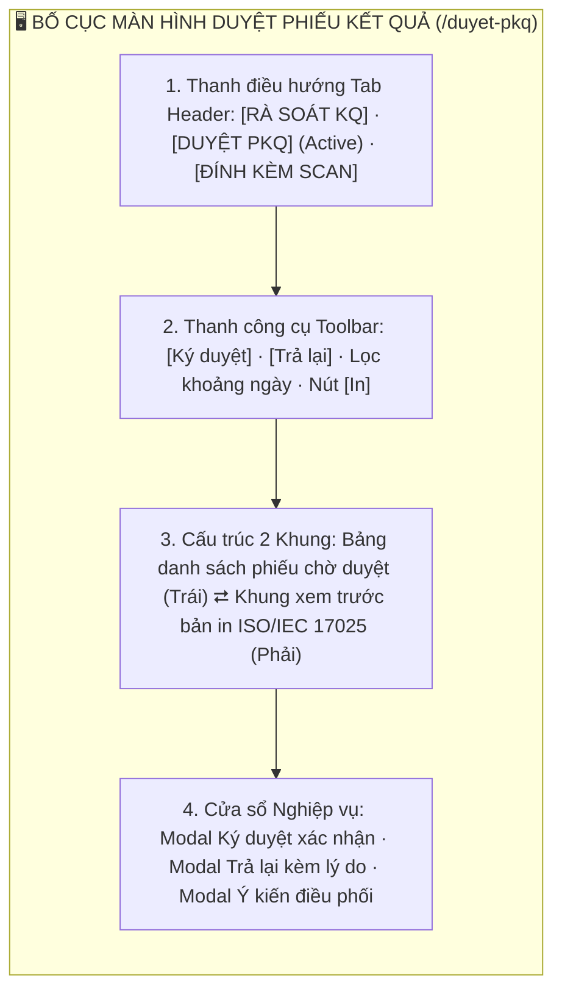
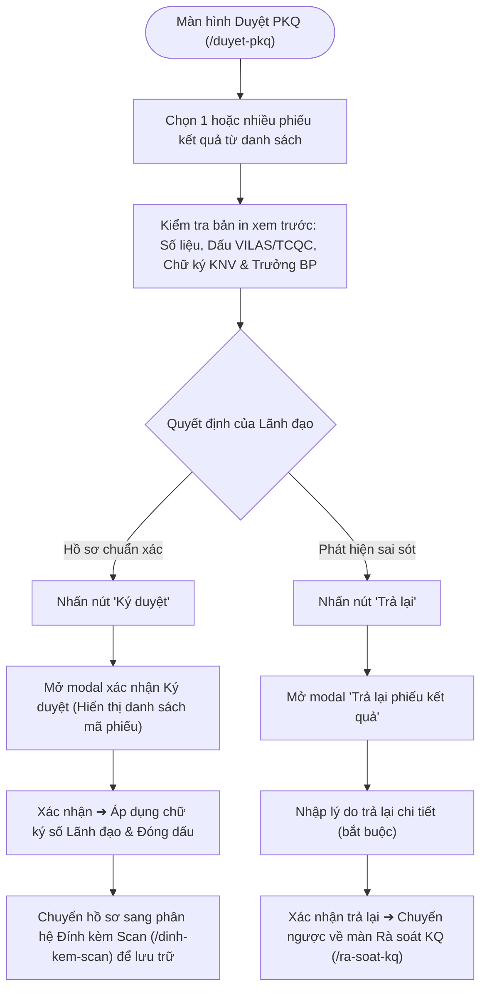
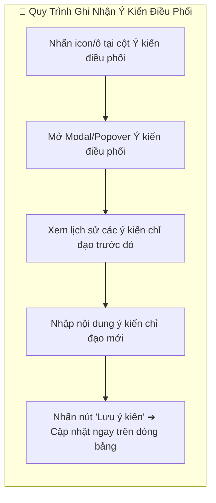

# 📋 TÀI LIỆU ĐẶC TẢ YÊU CẦU CHỨC NĂNG (REQUIREMENTS SPECIFICATION)
## Phân hệ: Rà soát & Phát hành Phiếu Kết Quả — Hệ thống VNTEST LIMS
### Tính năng: Duyệt phiếu kết quả (Report Approval Screen)

---

| Thông tin tài liệu | Chi tiết |
| :--- | :--- |
| **Mã tài liệu** | `REQ_VNTEST_DUYET_PKQ` |
| **Tính năng / Màn hình** | Duyệt phiếu kết quả (Report Approval) |
| **Đường dẫn truy cập** | `/duyet-pkq` (hoặc chuyển tab `DUYỆT PKQ` trên header) |
| **Đối tượng sử dụng** | Lãnh đạo Viện / Giám đốc kỹ thuật, Trưởng phòng thử nghiệm, Admin |
| **Trạng thái tài liệu** | `Approved / Ready for Development & Testing` |
| **Cơ sở dữ liệu liên kết** | `test_reports`, `digital_signatures`, `approvals`, `audit_logs`, `users` |
| **Test Script Playwright** | [`src/tests/duyet-pkq/duyet-pkq.spec.ts`](file:///home/thai.hoang.dinh/VNTEST_Automation/src/tests/duyet-pkq/duyet-pkq.spec.ts) (48 Test Cases) |
| **Page Object Model** | [`src/pages/duyet-pkq.page.ts`](file:///home/thai.hoang.dinh/VNTEST_Automation/src/pages/duyet-pkq.page.ts) |
| **Dữ liệu kiểm thử** | [`test-data/users.json`](file:///home/thai.hoang.dinh/VNTEST_Automation/test-data/users.json), `test-data/duyet-pkq.json` |

---

## 📑 MỤC LỤC ĐIỀU HƯỚNG NHANH
1. [1. Định vị màn hình & Tổng quan tính năng (Overview & UI Layout)](#1-định-vị-màn-hình--tổng-quan-tính-năng-overview--ui-layout)
2. [2. Sơ đồ phân tích luồng trực quan (Mermaid Flowcharts)](#2-sơ-đồ-phân-tích-luồng-trực-quan-mermaid-flowcharts)
3. [3. Phân quyền & Điều kiện kích hoạt (Access & Permissions)](#3-phân-quyền--điều-kiện-kích-hoạt-access--permissions)
4. [4. Đặc tả chi tiết các Use Cases chức năng (Functional Use Cases)](#4-đặc-tả-chi-tiết-các-use-cases-chức-năng-functional-use-cases)
5. [5. Đặc tả chi tiết trường dữ liệu (Field Specifications Matrix)](#5-đặc-tả-chi-tiết-trường-dữ-liệu-field-specifications-matrix)
6. [6. Ma trận nút bấm & Tương tác giao diện (Action Buttons Matrix)](#6-ma-trận-nút-bấm--tương-tác-giao-diện-action-buttons-matrix)
7. [7. Quy tắc nghiệp vụ & Luồng xử lý lỗi (Business Rules & Error Handling)](#7-quy-tắc-nghiệp-vụ--luồng-xử-lý-lỗi-business-rules--error-handling)
8. [8. Kế hoạch kiểm thử & Ma trận Test Cases Automation (48 Test Cases)](#8-kế-hoạch-kiểm-thử--ma-trận-test-cases-automation-48-test-cases)

---

## 1. ĐỊNH VỊ MÀN HÌNH & TỔNG QUAN TÍNH NĂNG (OVERVIEW & UI LAYOUT)

### 1.1. Mục đích tính năng
* **Phê duyệt Cấp cao & Ký số Phiếu Kết Quả Thử Nghiệm:** Là chốt chặn pháp lý cuối cùng trước khi bàn giao kết quả cho khách hàng, do Lãnh đạo Viện / Giám đốc Kỹ thuật thẩm tra toàn diện và ký duyệt điện tử.
* **Cơ chế Phê duyệt & Trả lại Linh hoạt:** Hỗ trợ ký duyệt đơn lẻ hoặc ký duyệt hàng loạt nhiều phiếu cùng lúc. Luồng trả lại cho phép điều phối viên ghi chú ý kiến chi tiết để chuyển ngược hồ sơ về khâu Rà soát kết quả chỉnh sửa.
* **Đồng bộ Khung Xem trước Bản in A4 (Print Preview Sheet):** Cho phép xem trước trực quan 100% hình thức bản in A4 của phiếu kết quả, kiểm tra chính xác từng vị trí con dấu (VILAS/TCQC), thông tin pháp lý, kết quả thử nghiệm và khu vực chữ ký số trước khi nhấn phê duyệt.
* **Nghiệp vụ Cột Ý kiến điều phối (Comment Modal):** Cho phép xem nhanh hoặc chỉnh sửa ý kiến chỉ đạo trực tiếp trên từng dòng phiếu kết quả qua cửa sổ popover/modal tiện lợi.

### 1.2. Bố cục Giao diện & Các Phân khu Chức năng (UI Layout Matrix)

| Phân khu (Section) | Vị trí hiển thị | Thành phần giao diện chính | Mục đích & Nghiệp vụ |
| :--- | :--- | :--- | :--- |
| **1. Header & Tab** | Trên cùng trang | Cụm tab: `RÀ SOÁT KQ`, `DUYỆT PKQ` (active), `ĐÍNH KÈM SCAN` | Chuyển đổi giữa các phân hệ trong chu trình phát hành kết quả |
| **2. Thanh công cụ (Toolbar)** | Dưới Header | Nút `"Ký duyệt"`, `"Trả lại"`, bộ lọc ngày, nút `"In"` | Thao tác phê duyệt ký số hoặc trả lại phiếu chờ sửa |
| **3. Bảng danh sách (Khung trái)**| Nửa bên trái | Bảng danh sách: checkbox, Mã YCTN, Số phiếu, Khách hàng, Cột Ý kiến điều phối | Lựa chọn phiếu kết quả cần duyệt đơn lẻ hoặc hàng loạt |
| **4. Khung xem trước (Khung phải)**| Nửa bên phải | Bản in A4 ISO/IEC 17025 thu nhỏ: Logo, Tiêu đề, Thông tin chung, Bảng kết quả, Chữ ký số | Thẩm tra hình thức và tính chính xác của bản in trước khi ký |
| **5. Cửa sổ thao tác (Modal)** | Trung tâm màn hình | Modal Ký duyệt, Modal Trả lại có lý do, Modal Ý kiến điều phối | Xác nhận các hành động nghiệp vụ quan trọng và ghi nhận nhật ký |

---

## 2. SƠ ĐỒ PHÂN TÍCH LUỒNG TRỰC QUAN (MERMAID FLOWCHARTS)

### 2.1. Sơ đồ Master Flow Ký duyệt & Trả lại Phiếu Kết Quả

### 2.2. Sơ đồ Quy trình Quản lý Ý kiến Điều phối

---

## 3. PHÂN QUYỀN & ĐIỀU KIỆN KÍCH HOẠT (ACCESS & PERMISSIONS)

### 3.1. Ma trận phân quyền truy cập (RBAC Matrix)

| Vai trò người dùng (Role) | Xem danh sách Chờ duyệt | Ký duyệt phiếu đơn lẻ | Ký duyệt hàng loạt | Trả lại phiếu | Ghi ý kiến điều phối | In bản in |
| :--- | :---: | :---: | :---: | :---: | :---: | :---: |
| **Quản trị viên (Admin)** | Toàn quyền | Toàn quyền | Toàn quyền | Toàn quyền | Toàn quyền | Cho phép |
| **Lãnh đạo Viện / Giám đốc**| Toàn quyền | Thẩm quyền ký | Thẩm quyền ký | Được phép | Được phép | Cho phép |
| **Trưởng phòng thử nghiệm** | Xem phiếu phòng mình | Ký nháy | Ký nháy | Đề xuất trả lại | Ghi ý kiến | Cho phép |
| **Nhân viên Rà soát KQ** | Xem tiến độ duyệt | Không có quyền | Không có quyền | Không có quyền | Xem ý kiến | Bị chặn ký |

---

## 4. ĐẶC TẢ CHI TIẾT CÁC USE CASES CHỨC NĂNG (FUNCTIONAL USE CASES)

### UC-01: Bố cục, Điều hướng Tab & Thanh công cụ (Khối 01)
* **Tác nhân:** Lãnh đạo, Trưởng phòng.
* **Tiền điều kiện:** Đã đăng nhập vào hệ thống và điều hướng tới `/duyet-pkq`.
* **Luồng sự kiện chính:**
  1. Hiển thị tab `DUYỆT PKQ` đang active; cụm nút thao tác gồm: `"Ký duyệt"`, `"Trả lại"`, `"In"` và bộ lọc ngày.
  2. Bảng danh sách bên trái hiển thị danh sách các phiếu kết quả kèm cột Ý kiến điều phối.
  3. Khung bên phải hiển thị bản in A4 xem trước của phiếu đang được chọn.

### UC-02: Đồng bộ Khung Xem trước Bản in (Khối 02)
* **Tác nhân:** Hệ thống tự động.
* **Luồng sự kiện chính:**
  1. Khi người dùng nhấn chọn bất kỳ dòng phiếu kết quả nào trong bảng danh sách, khung bên phải lập tức nạp bản in tương ứng.
  2. Toàn bộ thông tin: Mã phiếu, Tên khách hàng, Tên mẫu, Bảng chỉ tiêu và Chữ ký số KNV/Trưởng BP được đồng bộ chính xác 100%.

### UC-03: Kiểm tra Chi tiết các Giá trị bên trong Phiếu in (Khối 03)
* **Tác nhân:** Lãnh đạo thẩm định.
* **Luồng sự kiện chính:**
  1. Thẩm tra cấu trúc trang in chuẩn ISO/IEC 17025.
  2. Kiểm tra Header: Logo VNTEST, Tên Viện song ngữ, Số điện thoại, Email.
  3. Kiểm tra Mục I: Tên KH, Địa chỉ, Tên mẫu, Ngày nhận, Ngày trả.
  4. Kiểm tra Mục II: Danh sách chỉ tiêu, Đơn vị tính, Phương pháp thử, Kết quả, Dấu VILAS/TCQC.

### UC-04: Nghiệp vụ Cột Ý kiến điều phối (Khối 04)
* **Tác nhân:** Lãnh đạo, Điều phối viên.
* **Luồng sự kiện chính:**
  1. Nhấn vào ô tại cột `Ý kiến điều phối` trên dòng phiếu để mở modal ghi nhận ý kiến.
  2. Cho phép xem lịch sử ghi chú chỉ đạo hoặc nhập thêm ý kiến mới và lưu lại.
  3. Dòng bảng cập nhật hiển thị ngay nội dung ý kiến điều phối mới nhất.

### UC-05: Bộ lọc, Tìm kiếm & Quản lý Cột (Khối 05)
* **Tác nhân:** Người dùng tra cứu phiếu kết quả.
* **Luồng sự kiện chính:**
  1. Lọc theo khoảng ngày (Từ ngày, Đến ngày).
  2. Tìm kiếm theo Mã phiếu hoặc Tên khách hàng; nhấn nút `"Hủy"` (`[×]`) để xóa nhanh từ khóa.
  3. Quản lý ẩn/hiện cột hiển thị qua popover `"Quản lý cột"`.

### UC-06: Nghiệp vụ Ký duyệt Phiếu Kết Quả (Khối 06)
* **Tác nhân:** Lãnh đạo có thẩm quyền ký.
* **Luồng sự kiện chính:**
  1. Tích chọn 1 hoặc nhiều phiếu kết quả ➔ Nhấn nút `"Ký duyệt"`.
  2. Modal Ký duyệt mở ra hiển thị danh sách các mã phiếu được chọn.
  3. Nhấn xác nhận ký: Hệ thống áp dụng chữ ký điện tử của Lãnh đạo, chuyển trạng thái phiếu sang `Đã ký duyệt` và đẩy sang phân hệ **Đính kèm Scan**.

### UC-07: Nghiệp vụ Trả lại Phiếu về Khâu Rà soát (Khối 07)
* **Tác nhân:** Lãnh đạo phê duyệt.
* **Luồng sự kiện chính:**
  1. Tích chọn phiếu kết quả có sai sót ➔ Nhấn nút `"Trả lại"`.
  2. Modal Trả lại mở ra yêu cầu nhập Lý do chi tiết (bắt buộc).
  3. Xác nhận trả lại: Hồ sơ chuyển ngược về màn hình **Rà soát kết quả** (`/ra-soat-kq`) kèm thông báo lỗi cho nhân viên rà soát.

### UC-08: Thao tác Chọn Hàng loạt & Nút In (Khối 08)
* **Tác nhân:** Người dùng.
* **Luồng sự kiện chính:**
  1. Tích chọn checkbox trên tiêu đề bảng để chọn tất cả các phiếu trong trang.
  2. Nhấn nút `"In"` để mở hộp thoại in trình duyệt chuẩn khổ A4.

---

## 5. ĐẶC TẢ CHI TIẾT TRƯỜNG DỮ LIỆU (FIELD SPECIFICATIONS MATRIX)

| Tên trường | UI Label | Kiểu dữ liệu | Bắt buộc | Ràng buộc & Validation Rules | Giá trị mặc định / Placeholder | Ghi chú |
| :--- | :--- | :--- | :---: | :--- | :--- | :--- |
| `reportCode` | **Số phiếu** | `text` | Hệ thống sinh | Định dạng `PKQ-xxxx-xxx` tự tăng. Readonly. | Tự động sinh | Khóa không cho sửa |
| `requestNumber` | **Mã YCTN** | `text` | Kế thừa | Mã YCTN liên kết dạng `TR-xxxx-xxx`. | Kế thừa | Khóa không cho sửa |
| `coordinatorNote`| **Ý kiến điều phối**| `text` | Không | Ghi chú chỉ đạo của điều phối viên / lãnh đạo. | `Nhập ý kiến...` | Mở modal chỉnh sửa |
| `rejectReason` | **Lý do trả lại** | `textarea` | **Bắt buộc khi trả lại**| Tối thiểu 5 ký tự. Không được để trống. | `Nhập lý do trả lại...` | Gửi phản hồi về Rà soát |
| `approvalConfirm`| **Xác nhận ký** | `checkbox/btn` | **Bắt buộc** | Xác nhận áp dụng chữ ký số pháp lý. | `false` | Khóa khi chưa tích |

---

## 6. MA TRẬN NÚT BẤM & TƯƠNG TÁC GIAO DIỆN (ACTION BUTTONS MATRIX)

| Tên nút (Button) | Vị trí | Icon / Class | Trạng thái mặc định | Điều kiện kích hoạt | Hành vi khi nhấn | Modal / Thông báo đi kèm |
| :--- | :--- | :--- | :---: | :--- | :--- | :--- |
| **Ký duyệt** | Toolbar trên bảng | `.btn-approve` | **Vô hiệu hóa** | Tích chọn $\ge 1$ phiếu kết quả | Mở modal xác nhận ký duyệt phiếu | Modal: `"Ký duyệt phiếu kết quả"` |
| **Trả lại** | Toolbar trên bảng | `.btn-reject` | **Vô hiệu hóa** | Tích chọn $\ge 1$ phiếu kết quả | Mở modal nhập lý do trả lại phiếu | Modal: `"Trả lại phiếu kết quả"` |
| **In** | Toolbar trên bảng | `.btn-print` | **Kích hoạt** | Luôn sẵn sàng | Mở cửa sổ in ấn chuẩn khổ A4 của trình duyệt | Hộp thoại Print trình duyệt |
| **Xác nhận ký** | Trong Modal Ký duyệt| `.btn-confirm-sign`| **Kích hoạt** | Đang mở modal ký duyệt | Áp dụng chữ ký số và hoàn tất duyệt phiếu | Thông báo: `"Ký duyệt thành công."` |
| **Xác nhận trả lại**| Trong Modal Trả lại| `.btn-confirm-reject`| **Kích hoạt**| Đã nhập lý do trả lại | Chuyển ngược hồ sơ về màn Rà soát KQ | Thông báo: `"Đã trả lại phiếu."` |
| **Lưu ý kiến** | Modal Ý kiến ĐP | `.btn-save-comment`| **Kích hoạt** | Đang mở modal ý kiến | Lưu ghi chú chỉ đạo vào phiếu kết quả | Thông báo lưu ý kiến |
| **Hủy / Đóng** | Chân các Modal | `.btn-cancel` / `[×]` | **Kích hoạt** | Luôn sẵn sàng | Đóng modal an toàn, giữ nguyên trạng thái | Đóng modal |

---

## 7. QUY TẮC NGHIỆP VỤ & LUỒNG XỬ LÝ LỖI (BUSINESS RULES & ERROR HANDLING)

| Mã lỗi (Code) | Quy tắc nghiệp vụ (Business Rule) | Điều kiện kích hoạt | Vị trí hiển thị | Câu thông báo lỗi hiển thị (Error Message) |
| :--- | :--- | :--- | :--- | :--- |
| `ERR_REJECT_REASON_REQ`| Bắt buộc nhập lý do khi trả lại | Để trống lý do khi nhấn Xác nhận trả lại | Dưới ô Lý do | **"Vui lòng nhập lý do trả lại phiếu kết quả."** |
| `RULE_APPROVE_PIPELINE`| Chuyển giao tự động sau khi ký duyệt | Ký duyệt thành công | Trạng thái phiếu | Chuyển sang `Đã ký duyệt` ➔ Đẩy sang phân hệ Đính kèm Scan |
| `RULE_SYNC_PRINT_PREV` | Đồng bộ 100% dữ liệu sang bản in A4 | Chọn dòng phiếu kết quả | Khung bên phải | Tải tức thì bản in xem trước A4 của đúng phiếu đó |

---

## 8. KẾ HOẠCH KIỂM THỬ & MA TRẬN TEST CASES AUTOMATION (48 TEST CASES)
### 8.1. KHỐI 01: BỐ CỤC & HIỂN THỊ TỔNG QUAN (Layout & Navigation) (4 Test Cases)

| Mã TC | Phân nhóm luồng | Tên kịch bản | Thao tác & Dữ liệu kiểm thử | Kết quả mong đợi | Mức độ ưu tiên | Mapping Page Object |
| :--- | :--- | :--- | :--- | :--- | :---: | :--- |
| **TC_DPKQ_001** | BỐ CỤC & HIỂN THỊ TỔNG QUAN (Layout & Navigation) | Kiểm tra điều hướng đúng màn hình Duyệt PKQ và tiêu đề trang hiển thị đúng | 1. Kiểm tra đường dẫn URL hiện tại  2. Kiểm tra tiêu đề trang | Giao diện hiển thị đầy đủ và đồng bộ chính xác: Kiểm tra điều hướng đúng màn hình Duyệt PKQ và tiêu đề trang hiển thị đúng. | Normal | `duyetPkqPage` |
| **TC_DPKQ_002** | BỐ CỤC & HIỂN THỊ TỔNG QUAN (Layout & Navigation) | Kiểm tra hiển thị đầy đủ 3 Tab điều hướng lớn: RÀ SOÁT KQ, DUYỆT PKQ, ĐÍNH KÈM SCAN | 1. Kiểm tra hiển thị tab RÀ SOÁT KQ  2. Kiểm tra hiển thị tab DUYỆT PKQ và trạng thái active  3. Kiểm tra hiển thị tab ĐÍNH KÈM SCAN | Giao diện hiển thị đầy đủ và đồng bộ chính xác: Kiểm tra hiển thị đầy đủ 3 Tab điều hướng lớn: RÀ SOÁT KQ, DUYỆT PKQ, ĐÍNH KÈM SCAN. | Normal | `duyetPkqPage` |
| **TC_DPKQ_003** | BỐ CỤC & HIỂN THỊ TỔNG QUAN (Layout & Navigation) | Kiểm tra chuyển tab mượt mà: Nhấn RÀ SOÁT KQ và ĐÍNH KÈM SCAN | 1. Nhấn tab RÀ SOÁT KQ  2. Quay lại tab DUYỆT PKQ  3. Nhấn tab ĐÍNH KÈM SCAN  4. Quay lại tab DUYỆT PKQ | Hệ thống thực hiện đúng kịch bản: Kiểm tra chuyển tab mượt mà: Nhấn RÀ SOÁT KQ và ĐÍNH KÈM SCAN. | Normal | `duyetPkqPage` |
| **TC_DPKQ_004** | BỐ CỤC & HIỂN THỊ TỔNG QUAN (Layout & Navigation) | Kiểm tra trạng thái mặc định của thanh Toolbar khi chưa chọn phiếu nào | 1. Kiểm tra nút "Trả lại" bị vô hiệu hóa khi 0 dòng được chọn  2. Kiểm tra nút "Ký duyệt" bị vô hiệu hóa khi 0 dòng được chọn  3. Kiểm tra nút "Print" hiển thị sẵn sàng  4. Kiểm tra bộ lọc ngày nhận (Từ - Đến) hiển thị | Hệ thống thực hiện đúng kịch bản: Kiểm tra trạng thái mặc định của thanh Toolbar khi chưa chọn phiếu nào. | Normal | `duyetPkqPage` |

### 8.2. KHỐI 02: ĐỒNG BỘ KHUNG XEM TRƯỚC BẢN IN (Preview Synchronization) (4 Test Cases)

| Mã TC | Phân nhóm luồng | Tên kịch bản | Thao tác & Dữ liệu kiểm thử | Kết quả mong đợi | Mức độ ưu tiên | Mapping Page Object |
| :--- | :--- | :--- | :--- | :--- | :---: | :--- |
| **TC_DPKQ_005** | ĐỒNG BỘ KHUNG XEM TRƯỚC BẢN IN (Preview Synchronization) | Tự động nạp và hiển thị bản in xem trước của phiếu đầu tiên khi vừa vào trang | 1. Kiểm tra danh sách có ít nhất 1 phiếu kết quả  2. Lấy mã PKQ của dòng đầu tiên  3. Kiểm tra khung xem trước hiển thị đúng mã số phiếu đầu tiên | Giao diện hiển thị đầy đủ và đồng bộ chính xác: Tự động nạp và hiển thị bản in xem trước của phiếu đầu tiên khi vừa vào trang. | Normal | `duyetPkqPage` |
| **TC_DPKQ_006** | ĐỒNG BỘ KHUNG XEM TRƯỚC BẢN IN (Preview Synchronization) | Nhấn chọn phiếu khác trong danh sách ➔ Khung xem trước tự động cập nhật đồng bộ | 1. Lấy mã PKQ của dòng 2  2. Nhấn chọn dòng 2 để xem trước  3. Kiểm tra khung xem trước đã đồng bộ sang mã phiếu dòng 2 | Giao diện hiển thị đầy đủ và đồng bộ chính xác: Nhấn chọn phiếu khác trong danh sách ➔ Khung xem trước tự động cập nhật đồng bộ. | Normal | `duyetPkqPage` |
| **TC_DPKQ_007** | ĐỒNG BỘ KHUNG XEM TRƯỚC BẢN IN (Preview Synchronization) | Kiểm tra mã số phiếu trên tờ in (Mã số/ Code: DV...) trùng khớp 100% với Mã PKQ | 1. Thao tác kiểm tra trên giao diện. | Hệ thống thực hiện đúng kịch bản: Kiểm tra mã số phiếu trên tờ in (Mã số/ Code: DV...) trùng khớp 100% với Mã PKQ. | Normal | `duyetPkqPage` |
| **TC_DPKQ_008** | ĐỒNG BỘ KHUNG XEM TRƯỚC BẢN IN (Preview Synchronization) | Kiểm tra cấu trúc tổng thể trang in chuẩn ISO/IEC 17025 hiển thị đầy đủ các phần | 1. Kiểm tra Header viện VNTEST và tiêu đề phiếu  2. Kiểm tra Mục I: THÔNG TIN CHUNG (General Information)  3. Kiểm tra Mục II: BẢNG KẾT QUẢ THỬ NGHIỆM (Result Table)  4. Kiểm tra Khu vực Chữ ký đại diện | Giao diện hiển thị đầy đủ và đồng bộ chính xác: Kiểm tra cấu trúc tổng thể trang in chuẩn ISO/IEC 17025 hiển thị đầy đủ các phần. | Normal | `duyetPkqPage` |

### 8.3. KHỐI 03: KIỂM TRA CHI TIẾT CÁC GIÁ TRỊ BÊN TRONG PHIẾU IN (Print Preview Sheet Details) (10 Test Cases)

| Mã TC | Phân nhóm luồng | Tên kịch bản | Thao tác & Dữ liệu kiểm thử | Kết quả mong đợi | Mức độ ưu tiên | Mapping Page Object |
| :--- | :--- | :--- | :--- | :--- | :---: | :--- |
| **TC_DPKQ_009** | KIỂM TRA CHI TIẾT CÁC GIÁ TRỊ BÊN TRONG PHIẾU IN (Print Preview Sheet Details) | Kiểm tra khối Header phiếu in - Logo VNTEST, thông tin Viện tiếng Việt & tiếng Anh | 1. Kiểm tra logo VNTEST trên đầu trang  2. Kiểm tra tên Viện kiểm nghiệm và kiểm định chất lượng VNTEST | Hệ thống thực hiện đúng kịch bản: Kiểm tra khối Header phiếu in - Logo VNTEST, thông tin Viện tiếng Việt & tiếng Anh. | Normal | `duyetPkqPage` |
| **TC_DPKQ_010** | KIỂM TRA CHI TIẾT CÁC GIÁ TRỊ BÊN TRONG PHIẾU IN (Print Preview Sheet Details) | Kiểm tra các thẻ chứng nhận VILAS 1296, VIMCERTS 323 hiển thị trên phiếu in | 1. Lấy danh sách các chứng nhận hiển thị ở góc trên phiếu in | Giao diện hiển thị đầy đủ và đồng bộ chính xác: Kiểm tra các thẻ chứng nhận VILAS 1296, VIMCERTS 323 hiển thị trên phiếu in. | Normal | `duyetPkqPage` |
| **TC_DPKQ_011** | KIỂM TRA CHI TIẾT CÁC GIÁ TRỊ BÊN TRONG PHIẾU IN (Print Preview Sheet Details) | Kiểm tra Mục I.1 "Customer\'s Name / Tên khách hàng" hiển thị đúng tên đơn vị | 1. Lấy giá trị Tên khách hàng trên bản in xem trước | Giao diện hiển thị đầy đủ và đồng bộ chính xác: Kiểm tra Mục I.1 "Customer\'s Name / Tên khách hàng" hiển thị đúng tên đơn vị. | Normal | `duyetPkqPage` |
| **TC_DPKQ_012** | KIỂM TRA CHI TIẾT CÁC GIÁ TRỊ BÊN TRONG PHIẾU IN (Print Preview Sheet Details) | Kiểm tra Mục I.2 "Address / Địa chỉ" hiển thị chính xác địa chỉ khách hàng | 1. Kiểm tra nhãn mục 2 là Address / Địa chỉ  2. Kiểm tra địa chỉ có giá trị hợp lệ | Giao diện hiển thị đầy đủ và đồng bộ chính xác: Kiểm tra Mục I.2 "Address / Địa chỉ" hiển thị chính xác địa chỉ khách hàng. | Normal | `duyetPkqPage` |
| **TC_DPKQ_013** | KIỂM TRA CHI TIẾT CÁC GIÁ TRỊ BÊN TRONG PHIẾU IN (Print Preview Sheet Details) | Kiểm tra Mục I.3 "Name of Sample / Tên mẫu" và Mục I.4 "Sample Description" | 1. Kiểm tra Tên mẫu trên bản in khớp với tên mẫu ở danh sách  2. Kiểm tra Mục I.4 Mô tả mẫu tồn tại | Hệ thống thực hiện đúng kịch bản: Kiểm tra Mục I.3 "Name of Sample / Tên mẫu" và Mục I.4 "Sample Description". | Normal | `duyetPkqPage` |
| **TC_DPKQ_014** | KIỂM TRA CHI TIẾT CÁC GIÁ TRỊ BÊN TRONG PHIẾU IN (Print Preview Sheet Details) | Kiểm tra Mục I.5 đến I.8 - Các mốc ngày tháng hiển thị đúng định dạng | 1. Kiểm tra Ngày nhận mẫu (Mục 5) khớp với bảng danh sách  2. Kiểm tra Thời gian lưu mẫu (Mục 6)  3. Kiểm tra Ngày thử nghiệm (Mục 7) có định dạng ngày dd/mm/yyyy | Giao diện hiển thị đầy đủ và đồng bộ chính xác: Kiểm tra Mục I.5 đến I.8 - Các mốc ngày tháng hiển thị đúng định dạng. | Normal | `duyetPkqPage` |
| **TC_DPKQ_015** | KIỂM TRA CHI TIẾT CÁC GIÁ TRỊ BÊN TRONG PHIẾU IN (Print Preview Sheet Details) | Kiểm tra Mục I.9 "Documents provided / Tài liệu kèm theo" hiển thị đúng mã số YCTN | 1. Kiểm tra tài liệu cung cấp chứa mã số YCTN tham chiếu | Giao diện hiển thị đầy đủ và đồng bộ chính xác: Kiểm tra Mục I.9 "Documents provided / Tài liệu kèm theo" hiển thị đúng mã số YCTN. | Normal | `duyetPkqPage` |
| **TC_DPKQ_016** | KIỂM TRA CHI TIẾT CÁC GIÁ TRỊ BÊN TRONG PHIẾU IN (Print Preview Sheet Details) | Kiểm tra Mục II "Bảng kết quả thử nghiệm" hiển thị đầy đủ các cột STT, Chỉ tiêu, ĐVT, KQ, Phương pháp | 1. Kiểm tra tiêu đề các cột của bảng kết quả  2. Kiểm tra bảng có ít nhất 1 dòng chỉ tiêu thử nghiệm | Giao diện hiển thị đầy đủ và đồng bộ chính xác: Kiểm tra Mục II "Bảng kết quả thử nghiệm" hiển thị đầy đủ các cột STT, Chỉ tiêu, ĐVT, KQ, Phương pháp. | Normal | `duyetPkqPage` |
| **TC_DPKQ_017** | KIỂM TRA CHI TIẾT CÁC GIÁ TRỊ BÊN TRONG PHIẾU IN (Print Preview Sheet Details) | Kiểm tra hiển thị Badge mã mẫu con trong bảng chỉ tiêu (nếu là phiếu gộp) | 1. Kiểm tra bảng kết quả trên bản in | Giao diện hiển thị đầy đủ và đồng bộ chính xác: Kiểm tra hiển thị Badge mã mẫu con trong bảng chỉ tiêu (nếu là phiếu gộp). | Normal | `duyetPkqPage` |
| **TC_DPKQ_018** | KIỂM TRA CHI TIẾT CÁC GIÁ TRỊ BÊN TRONG PHIẾU IN (Print Preview Sheet Details) | Kiểm tra Khu vực Ghi chú chuẩn và Khu vực Chữ ký đại diện (QC Manager & Viện trưởng) | 1. Kiểm tra phần ghi chú chuẩn (KPH, LOD, công nhận VILAS)  2. Kiểm tra chữ ký Phòng kiểm nghiệm (QC Manager)  3. Kiểm tra chữ ký Viện trưởng (Director) | Hệ thống thực hiện đúng kịch bản: Kiểm tra Khu vực Ghi chú chuẩn và Khu vực Chữ ký đại diện (QC Manager & Viện trưởng). | Normal | `duyetPkqPage` |

### 8.4. KHỐI 04: NGHIỆP VỤ CỘT Ý KIẾN ĐIỀU PHỐI (Comment Cell & Modal) (8 Test Cases)

| Mã TC | Phân nhóm luồng | Tên kịch bản | Thao tác & Dữ liệu kiểm thử | Kết quả mong đợi | Mức độ ưu tiên | Mapping Page Object |
| :--- | :--- | :--- | :--- | :--- | :---: | :--- |
| **TC_DPKQ_019** | NGHIỆP VỤ CỘT Ý KIẾN ĐIỀU PHỐI (Comment Cell & Modal) | Kiểm tra trạng thái mặc định của cột Ý kiến - Placeholder "—" và tooltip hướng dẫn | 1. Kiểm tra ô ý kiến hiển thị  2. Kiểm tra tooltip khi hover vào ô ý kiến | Hệ thống thực hiện đúng kịch bản: Kiểm tra trạng thái mặc định của cột Ý kiến - Placeholder "—" và tooltip hướng dẫn. | Normal | `duyetPkqPage` |
| **TC_DPKQ_020** | NGHIỆP VỤ CỘT Ý KIẾN ĐIỀU PHỐI (Comment Cell & Modal) | Nhấn vào ô Ý kiến ➔ Mở modal "Cập nhật ý kiến điều phối" hiển thị đúng Mã PKQ và Mã YCTN | 1. Mở modal ý kiến  2. Kiểm tra tiêu đề modal  3. Kiểm tra mã PKQ và mã YCTN trên header modal  4. Đóng modal | Giao diện hiển thị đầy đủ và đồng bộ chính xác: Nhấn vào ô Ý kiến ➔ Mở modal "Cập nhật ý kiến điều phối" hiển thị đúng Mã PKQ và Mã YCTN. | Normal | `duyetPkqPage` |
| **TC_DPKQ_021** | NGHIỆP VỤ CỘT Ý KIẾN ĐIỀU PHỐI (Comment Cell & Modal) | Kiểm tra nút "Lưu ý kiến" bị vô hiệu hóa khi ô nhập trống hoặc chưa có thay đổi | 1. Kiểm tra nút "Lưu ý kiến" ban đầu khi chưa gõ gì | Hệ thống thực hiện đúng kịch bản: Kiểm tra nút "Lưu ý kiến" bị vô hiệu hóa khi ô nhập trống hoặc chưa có thay đổi. | Normal | `duyetPkqPage` |
| **TC_DPKQ_022** | NGHIỆP VỤ CỘT Ý KIẾN ĐIỀU PHỐI (Comment Cell & Modal) | Thêm mới ý kiến điều phối hợp lệ và nhấn "Lưu ý kiến" ➔ Cập nhật thành công | 1. Nhập ý kiến và nhấn Lưu ý kiến  2. Kiểm tra ngoài bảng danh sách hiển thị nội dung ý kiến vừa lưu | Hệ thống thực hiện thành công và cập nhật dữ liệu chính xác: Thêm mới ý kiến điều phối hợp lệ và nhấn "Lưu ý kiến" ➔ Cập nhật thành công. | High | `duyetPkqPage` |
| **TC_DPKQ_023** | NGHIỆP VỤ CỘT Ý KIẾN ĐIỀU PHỐI (Comment Cell & Modal) | Lưu ý kiến nhanh bằng tổ hợp phím tắt Ctrl + Enter ➔ Cập nhật thành công | 1. Nhập ý kiến và nhấn Ctrl+Enter  2. Kiểm tra ngoài bảng danh sách đã lưu nội dung | Hệ thống thực hiện thành công và cập nhật dữ liệu chính xác: Lưu ý kiến nhanh bằng tổ hợp phím tắt Ctrl + Enter ➔ Cập nhật thành công. | High | `duyetPkqPage` |
| **TC_DPKQ_024** | NGHIỆP VỤ CỘT Ý KIẾN ĐIỀU PHỐI (Comment Cell & Modal) | Kiểm tra giới hạn ký tự ô ý kiến - Bộ đếm 0/1000 và không vượt quá 1000 ký tự | 1. Kiểm tra thuộc tính maxlength="1000"  2. Nhập chuỗi 50 ký tự và kiểm tra bộ đếm  3. Đóng modal và xác nhận hủy bỏ thay đổi | Hệ thống thực hiện đúng kịch bản: Kiểm tra giới hạn ký tự ô ý kiến - Bộ đếm 0/1000 và không vượt quá 1000 ký tự. | Normal | `duyetPkqPage` |
| **TC_DPKQ_025** | NGHIỆP VỤ CỘT Ý KIẾN ĐIỀU PHỐI (Comment Cell & Modal) | Hủy cập nhật ý kiến bằng nút "Hủy" hoặc "Đóng" ➔ Giữ nguyên nội dung ban đầu | 1. Mở modal và nhập nội dung mới  2. Nhấn nút đóng và xác nhận hủy bỏ thay đổi  3. Kiểm tra nội dung ngoài bảng danh sách được giữ nguyên | Hệ thống thực hiện đúng kịch bản: Hủy cập nhật ý kiến bằng nút "Hủy" hoặc "Đóng" ➔ Giữ nguyên nội dung ban đầu. | Normal | `duyetPkqPage` |
| **TC_DPKQ_026** | NGHIỆP VỤ CỘT Ý KIẾN ĐIỀU PHỐI (Comment Cell & Modal) | Xóa bỏ ý kiến đã lưu ➔ Ô nhập rỗng và lưu ➔ Cột hiển thị lại placeholder "—" | 1. Xóa trắng ô ý kiến và nhấn Lưu  2. Kiểm tra hiển thị lại dấu gạch ngang placeholder | Giao diện hiển thị đầy đủ và đồng bộ chính xác: Xóa bỏ ý kiến đã lưu ➔ Ô nhập rỗng và lưu ➔ Cột hiển thị lại placeholder "—". | Normal | `duyetPkqPage` |

### 8.5. KHỐI 05: BỘ LỌC, TÌM KIẾM & QUẢN LÝ CỘT (Filter & Column Management) (5 Test Cases)

| Mã TC | Phân nhóm luồng | Tên kịch bản | Thao tác & Dữ liệu kiểm thử | Kết quả mong đợi | Mức độ ưu tiên | Mapping Page Object |
| :--- | :--- | :--- | :--- | :--- | :---: | :--- |
| **TC_DPKQ_027** | BỘ LỌC, TÌM KIẾM & QUẢN LÝ CỘT (Filter & Column Management) | Lọc danh sách theo khoảng thời gian Ngày nhận (TỪ ngày - ĐẾN ngày) | 1. Kiểm tra các trigger chọn ngày nhận | Hệ thống thực hiện đúng kịch bản: Lọc danh sách theo khoảng thời gian Ngày nhận (TỪ ngày - ĐẾN ngày). | Normal | `duyetPkqPage` |
| **TC_DPKQ_028** | BỘ LỌC, TÌM KIẾM & QUẢN LÝ CỘT (Filter & Column Management) | Kiểm tra nút thao tác menu ⋮ trên từng tiêu đề cột | 1. Kiểm tra các nút menu ⋮ trên tiêu đề cột | Hệ thống thực hiện đúng kịch bản: Kiểm tra nút thao tác menu ⋮ trên từng tiêu đề cột. | Normal | `duyetPkqPage` |
| **TC_DPKQ_029** | BỘ LỌC, TÌM KIẾM & QUẢN LÝ CỘT (Filter & Column Management) | Mở popover "Quản lý cột" và ẩn một cột ➔ Cột tương ứng bị ẩn khỏi bảng | 1. Mở popover Quản lý cột  2. Kiểm tra nội dung popover Quản lý cột hiển thị  3. Đóng popover | Hệ thống thực hiện đúng kịch bản: Mở popover "Quản lý cột" và ẩn một cột ➔ Cột tương ứng bị ẩn khỏi bảng. | Normal | `duyetPkqPage` |
| **TC_DPKQ_030** | BỘ LỌC, TÌM KIẾM & QUẢN LÝ CỘT (Filter & Column Management) | Nhấn nút "ĐẶT LẠI" trong popover Quản lý cột ➔ Khôi phục hiển thị đầy đủ các cột | 1. Mở popover Quản lý cột  2. Kiểm tra nút ĐẶT LẠI hiển thị  3. Đóng popover | Giao diện hiển thị đầy đủ và đồng bộ chính xác: Nhấn nút "ĐẶT LẠI" trong popover Quản lý cột ➔ Khôi phục hiển thị đầy đủ các cột. | Normal | `duyetPkqPage` |
| **TC_DPKQ_031** | BỘ LỌC, TÌM KIẾM & QUẢN LÝ CỘT (Filter & Column Management) | Thay đổi số lượng bản ghi hiển thị trên một trang (Dropdown phân trang) | 1. Kiểm tra dòng phân trang hiển thị tổng số PKQ | Giao diện hiển thị đầy đủ và đồng bộ chính xác: Thay đổi số lượng bản ghi hiển thị trên một trang (Dropdown phân trang). | Normal | `duyetPkqPage` |

### 8.6. KHỐI 06: NGHIỆP VỤ KÝ DUYỆT PHIẾU KẾT QUẢ (Approve Flow) (4 Test Cases)

| Mã TC | Phân nhóm luồng | Tên kịch bản | Thao tác & Dữ liệu kiểm thử | Kết quả mong đợi | Mức độ ưu tiên | Mapping Page Object |
| :--- | :--- | :--- | :--- | :--- | :---: | :--- |
| **TC_DPKQ_032** | NGHIỆP VỤ KÝ DUYỆT PHIẾU KẾT QUẢ (Approve Flow) | Tích chọn 1 phiếu kết quả ➔ Nút "Ký duyệt" chuyển sang trạng thái kích hoạt (enabled) | 1. Kiểm tra ban đầu nút Ký duyệt bị vô hiệu hóa  2. Tích chọn dòng 1  3. Kiểm tra nút Ký duyệt đã được kích hoạt | Hệ thống thực hiện thành công và cập nhật dữ liệu chính xác: Tích chọn 1 phiếu kết quả ➔ Nút "Ký duyệt" chuyển sang trạng thái kích hoạt (enabled). | High | `duyetPkqPage` |
| **TC_DPKQ_033** | NGHIỆP VỤ KÝ DUYỆT PHIẾU KẾT QUẢ (Approve Flow) | Nhấn nút "Ký duyệt" ➔ Mở modal "Xác nhận ký duyệt phiếu kết quả" hiển thị đúng mã phiếu | 1. Tích chọn phiếu và mở modal Ký duyệt  2. Kiểm tra modal hiển thị với đúng mã phiếu  3. Đóng modal bằng nút Hủy | Hệ thống thực hiện thành công và cập nhật dữ liệu chính xác: Nhấn nút "Ký duyệt" ➔ Mở modal "Xác nhận ký duyệt phiếu kết quả" hiển thị đúng mã phiếu. | High | `duyetPkqPage` |
| **TC_DPKQ_034** | NGHIỆP VỤ KÝ DUYỆT PHIẾU KẾT QUẢ (Approve Flow) | Hủy ký duyệt trên modal (nhấn "Hủy" hoặc nút đóng) ➔ Giữ nguyên trạng thái phiếu | 1. Mở modal và đóng bằng nút close [x]  2. Kiểm tra trạng thái phiếu không thay đổi | Hệ thống thực hiện thành công và cập nhật dữ liệu chính xác: Hủy ký duyệt trên modal (nhấn "Hủy" hoặc nút đóng) ➔ Giữ nguyên trạng thái phiếu. | High | `duyetPkqPage` |
| **TC_DPKQ_035** | NGHIỆP VỤ KÝ DUYỆT PHIẾU KẾT QUẢ (Approve Flow) | Kiểm tra thông báo hướng dẫn chuyển trạng thái trên modal ký duyệt | 1. Kiểm tra nội dung mô tả chuyển trạng thái sang Đã duyệt / In ấn (Printed) | Hệ thống thực hiện thành công và cập nhật dữ liệu chính xác: Kiểm tra thông báo hướng dẫn chuyển trạng thái trên modal ký duyệt. | High | `duyetPkqPage` |

### 8.7. KHỐI 07: NGHIỆP VỤ TRẢ LẠI PHIẾU VỀ KHÂU RÀ SOÁT (Reject/Return Flow) (6 Test Cases)

| Mã TC | Phân nhóm luồng | Tên kịch bản | Thao tác & Dữ liệu kiểm thử | Kết quả mong đợi | Mức độ ưu tiên | Mapping Page Object |
| :--- | :--- | :--- | :--- | :--- | :---: | :--- |
| **TC_DPKQ_036** | NGHIỆP VỤ TRẢ LẠI PHIẾU VỀ KHÂU RÀ SOÁT (Reject/Return Flow) | Tích chọn 1 phiếu kết quả ➔ Nút "Trả lại" chuyển sang trạng thái kích hoạt (enabled) | 1. Kiểm tra ban đầu nút Trả lại bị vô hiệu hóa  2. Tích chọn dòng 1  3. Kiểm tra nút Trả lại đã được kích hoạt | Hệ thống thực hiện đúng kịch bản: Tích chọn 1 phiếu kết quả ➔ Nút "Trả lại" chuyển sang trạng thái kích hoạt (enabled). | High | `duyetPkqPage` |
| **TC_DPKQ_037** | NGHIỆP VỤ TRẢ LẠI PHIẾU VỀ KHÂU RÀ SOÁT (Reject/Return Flow) | Nhấn nút "Trả lại" ➔ Mở modal "Xác nhận trả lại phiếu kết quả" hiển thị đúng mã phiếu | 1. Tích chọn phiếu và mở modal Trả lại  2. Kiểm tra modal hiển thị đúng tiêu đề và mã phiếu  3. Đóng modal | Giao diện hiển thị đầy đủ và đồng bộ chính xác: Nhấn nút "Trả lại" ➔ Mở modal "Xác nhận trả lại phiếu kết quả" hiển thị đúng mã phiếu. | High | `duyetPkqPage` |
| **TC_DPKQ_038** | NGHIỆP VỤ TRẢ LẠI PHIẾU VỀ KHÂU RÀ SOÁT (Reject/Return Flow) | Kiểm tra bắt buộc nhập "Lý do trả lại *" ➔ Bỏ trống thì nút Xác nhận bị vô hiệu hóa | 1. Kiểm tra khi ô Lý do trả lại rỗng thì nút Xác nhận trả lại bị disabled  2. Khi nhập lý do thì nút Xác nhận sáng lên | Hệ thống thực hiện đúng kịch bản: Kiểm tra bắt buộc nhập "Lý do trả lại *" ➔ Bỏ trống thì nút Xác nhận bị vô hiệu hóa. | High | `duyetPkqPage` |
| **TC_DPKQ_039** | NGHIỆP VỤ TRẢ LẠI PHIẾU VỀ KHÂU RÀ SOÁT (Reject/Return Flow) | Kiểm tra giới hạn độ dài lý do trả lại - Bộ đếm ký tự 0/1000 | 1. Kiểm tra bộ đếm ban đầu 0/1000  2. Nhập 40 ký tự và kiểm tra bộ đếm cập nhật | Hệ thống thực hiện đúng kịch bản: Kiểm tra giới hạn độ dài lý do trả lại - Bộ đếm ký tự 0/1000. | High | `duyetPkqPage` |
| **TC_DPKQ_040** | NGHIỆP VỤ TRẢ LẠI PHIẾU VỀ KHÂU RÀ SOÁT (Reject/Return Flow) | Hủy trả lại phiếu (nhấn nút "Hủy" hoặc nút đóng) ➔ Giữ nguyên trạng thái phiếu | 1. Mở modal và đóng bằng nút close [x]  2. Kiểm tra trạng thái phiếu không thay đổi | Hệ thống thực hiện đúng kịch bản: Hủy trả lại phiếu (nhấn nút "Hủy" hoặc nút đóng) ➔ Giữ nguyên trạng thái phiếu. | High | `duyetPkqPage` |
| **TC_DPKQ_041** | NGHIỆP VỤ TRẢ LẠI PHIẾU VỀ KHÂU RÀ SOÁT (Reject/Return Flow) | Kiểm tra hướng dẫn trạng thái trên modal trả lại (chuyển về khâu Rà soát) | 1. Kiểm tra ghi chú giải thích về khâu Rà soát (Review) | Hệ thống thực hiện đúng kịch bản: Kiểm tra hướng dẫn trạng thái trên modal trả lại (chuyển về khâu Rà soát). | High | `duyetPkqPage` |

### 8.8. KHỐI 08: THAO TÁC CHỌN HÀNG LOẠT & NÚT IN (Print & Batch Actions) (7 Test Cases)

| Mã TC | Phân nhóm luồng | Tên kịch bản | Thao tác & Dữ liệu kiểm thử | Kết quả mong đợi | Mức độ ưu tiên | Mapping Page Object |
| :--- | :--- | :--- | :--- | :--- | :---: | :--- |
| **TC_DPKQ_042** | THAO TÁC CHỌN HÀNG LOẠT & NÚT IN (Print & Batch Actions) | Tích chọn Header checkbox (Select all) ➔ Tự động chọn tất cả các dòng phiếu trên bảng | 1. Nhấn tích chọn Header checkbox  2. Kiểm tra toàn bộ các dòng đều được tích chọn | Hệ thống thực hiện đúng kịch bản: Tích chọn Header checkbox (Select all) ➔ Tự động chọn tất cả các dòng phiếu trên bảng. | Normal | `duyetPkqPage` |
| **TC_DPKQ_043** | THAO TÁC CHỌN HÀNG LOẠT & NÚT IN (Print & Batch Actions) | Bỏ tích chọn Header checkbox ➔ Tự động bỏ chọn tất cả các dòng phiếu | 1. Tích chọn tất cả rồi bỏ chọn tất cả | Hệ thống thực hiện đúng kịch bản: Bỏ tích chọn Header checkbox ➔ Tự động bỏ chọn tất cả các dòng phiếu. | Normal | `duyetPkqPage` |
| **TC_DPKQ_044** | THAO TÁC CHỌN HÀNG LOẠT & NÚT IN (Print & Batch Actions) | Tích chọn nhiều phiếu ➔ Nút "Ký duyệt" và "Trả lại" cùng sáng lên | 1. Tích chọn toàn bộ phiếu  2. Kiểm tra cả 2 nút tác vụ đều sáng (enabled) | Hệ thống thực hiện thành công và cập nhật dữ liệu chính xác: Tích chọn nhiều phiếu ➔ Nút "Ký duyệt" và "Trả lại" cùng sáng lên. | High | `duyetPkqPage` |
| **TC_DPKQ_045** | THAO TÁC CHỌN HÀNG LOẠT & NÚT IN (Print & Batch Actions) | Mở modal Ký duyệt hàng loạt ➔ Hiển thị danh sách đầy đủ tất cả các mã phiếu đã chọn | 1. Lấy mã của 2 dòng đầu  2. Tích chọn 2 dòng và mở modal Ký duyệt  3. Kiểm tra modal liệt kê đầy đủ cả 2 mã phiếu | Hệ thống thực hiện thành công và cập nhật dữ liệu chính xác: Mở modal Ký duyệt hàng loạt ➔ Hiển thị danh sách đầy đủ tất cả các mã phiếu đã chọn. | High | `duyetPkqPage` |
| **TC_DPKQ_046** | THAO TÁC CHỌN HÀNG LOẠT & NÚT IN (Print & Batch Actions) | Mở modal Trả lại hàng loạt ➔ Hiển thị danh sách đầy đủ các mã phiếu kèm 1 ô lý do trả lại | 1. Tích chọn 2 dòng và mở modal Trả lại  2. Kiểm tra modal liệt kê cả 2 mã phiếu | Giao diện hiển thị đầy đủ và đồng bộ chính xác: Mở modal Trả lại hàng loạt ➔ Hiển thị danh sách đầy đủ các mã phiếu kèm 1 ô lý do trả lại. | High | `duyetPkqPage` |
| **TC_DPKQ_047** | THAO TÁC CHỌN HÀNG LOẠT & NÚT IN (Print & Batch Actions) | Bỏ chọn lần lượt từng dòng cho đến khi hết ➔ Nút "Ký duyệt" và "Trả lại" tự động disabled | 1. Tích chọn 1 dòng ➔ Nút Ký duyệt & Trả lại sáng lên  2. Bỏ tích chọn dòng đó ➔ Nút Ký duyệt & Trả lại bị disabled | Hệ thống thực hiện thành công và cập nhật dữ liệu chính xác: Bỏ chọn lần lượt từng dòng cho đến khi hết ➔ Nút "Ký duyệt" và "Trả lại" tự động disabled. | High | `duyetPkqPage` |
| **TC_DPKQ_048** | THAO TÁC CHỌN HÀNG LOẠT & NÚT IN (Print & Batch Actions) | Nhấn nút "Print" trên thanh công cụ ➔ Kích hoạt giao diện in phiếu đang xem trước | 1. Kiểm tra nút Print hiển thị và nhấn được  2. Nhấn nút Print | Hệ thống thực hiện đúng kịch bản: Nhấn nút "Print" trên thanh công cụ ➔ Kích hoạt giao diện in phiếu đang xem trước. | Normal | `duyetPkqPage` |

