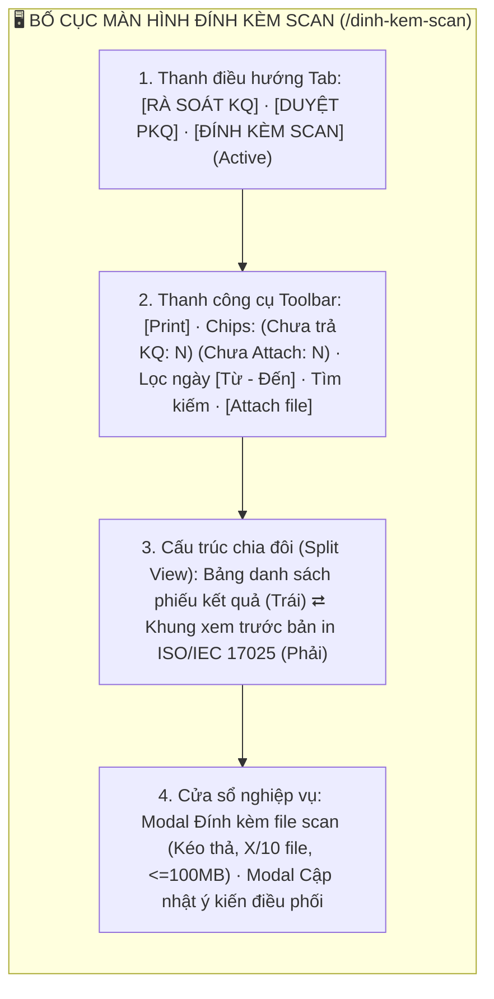
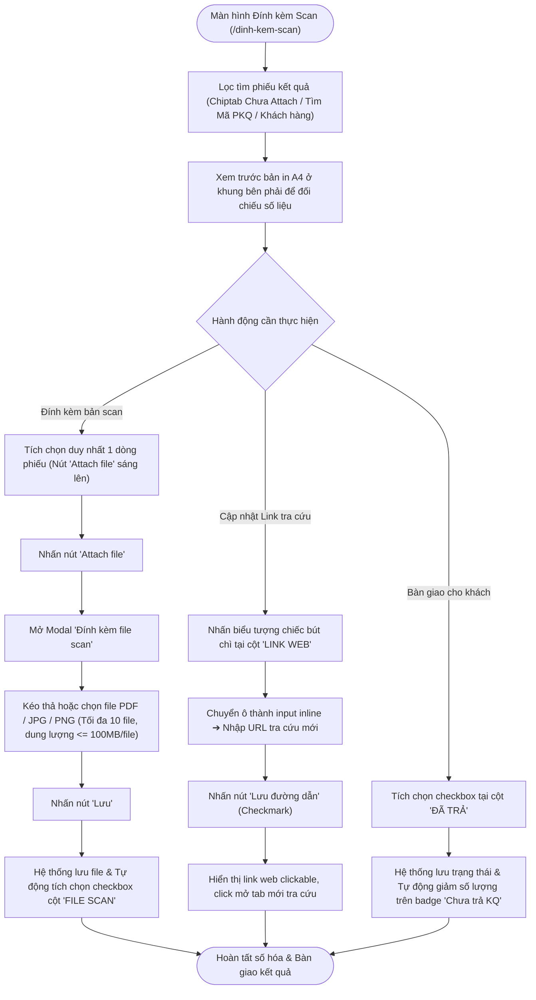
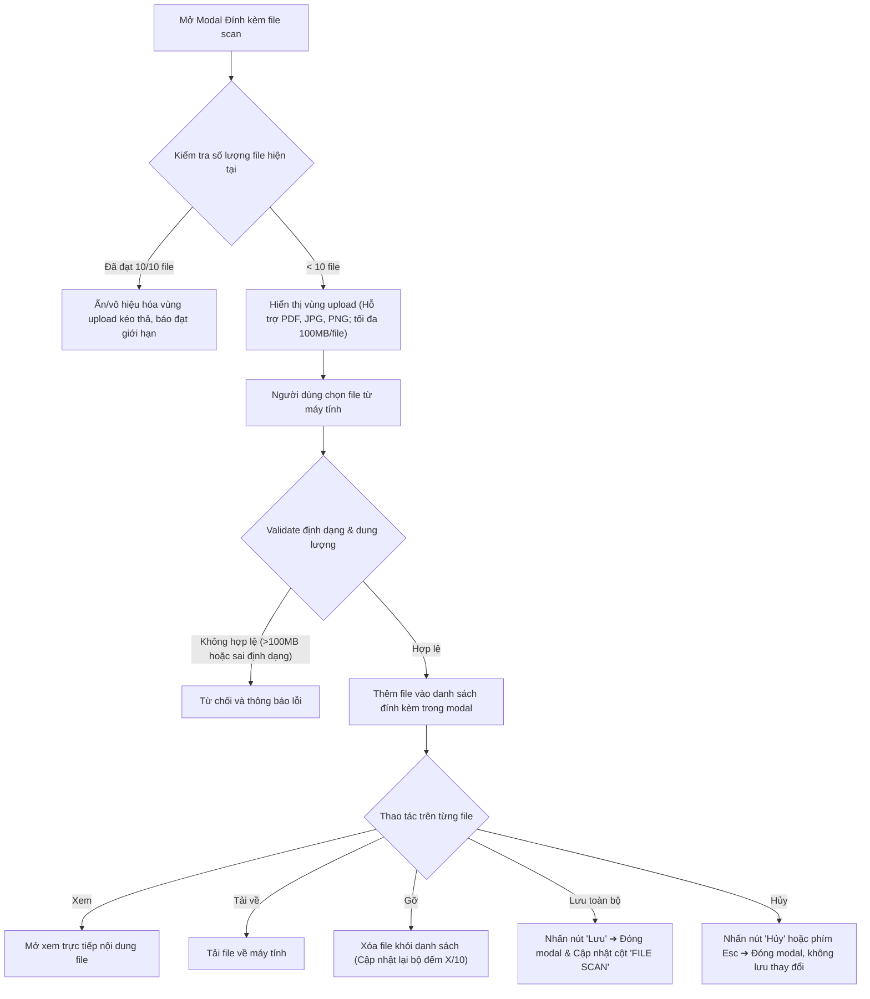
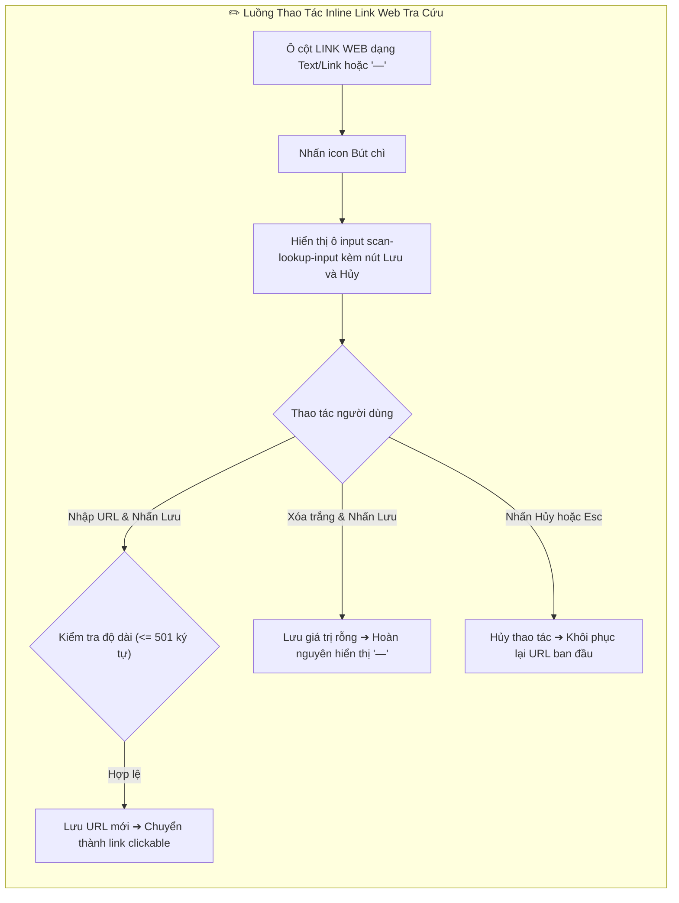

# 📋 TÀI LIỆU ĐẶC TẢ YÊU CẦU CHỨC NĂNG (REQUIREMENTS SPECIFICATION)
## Phân hệ: Rà soát & Phát hành Phiếu Kết Quả — Hệ thống VNTEST LIMS
### Tính năng: Đính kèm file Scan & Tra cứu kết quả (Scan Attachment & Public Lookup Management)

---

| Thông tin tài liệu | Chi tiết |
| :--- | :--- |
| **Mã tài liệu** | `REQ_VNTEST_DINH_KEM_SCAN` |
| **Tính năng / Màn hình** | Đính kèm file Scan & Tra cứu kết quả (Scan Attachment & Lookup Management) |
| **Đường dẫn truy cập** | `/dinh-kem-scan` (hoặc chuyển tab `ĐÍNH KÈM SCAN` trên thanh điều hướng) |
| **Đối tượng sử dụng** | Nhân viên Lưu trữ & Bàn giao kết quả, Trưởng phòng thử nghiệm, Lãnh đạo Viện, Admin |
| **Trạng thái tài liệu** | `Approved / Ready for Development & Testing` |
| **Cơ sở dữ liệu liên kết** | `test_reports`, `scanned_attachments`, `public_lookup_links`, `handover_logs`, `comments` |
| **Test Script Playwright** | [`src/tests/dinh-kem-scan/dinh-kem-scan.spec.ts`](file:///home/thai.hoang.dinh/VNTEST_Automation/src/tests/dinh-kem-scan/dinh-kem-scan.spec.ts) (57 Test Cases) |
| **Page Object Model** | [`src/pages/dinh-kem-scan.page.ts`](file:///home/thai.hoang.dinh/VNTEST_Automation/src/pages/dinh-kem-scan.page.ts) |
| **Dữ liệu kiểm thử** | [`test-data/users.json`](file:///home/thai.hoang.dinh/VNTEST_Automation/test-data/users.json), `test-data/dinh-kem-scan.json` |

---

## 📑 MỤC LỤC ĐIỀU HƯỚNG NHANH
1. [1. Định vị màn hình & Tổng quan tính năng (Overview & UI Layout)](#1-định-vị-màn-hình--tổng-quan-tính-năng-overview--ui-layout)
2. [2. Sơ đồ phân tích luồng trực quan (Mermaid Flowcharts)](#2-sơ-đồ-phân-tích-luồng-trực-quan-mermaid-flowcharts)
3. [3. Phân quyền & Điều kiện kích hoạt (Access & Permissions)](#3-phân-quyền--điều-kiện-kích-hoạt-access--permissions)
4. [4. Đặc tả chi tiết các Use Cases chức năng (Functional Use Cases)](#4-đặc-tả-chi-tiết-các-use-cases-chức-năng-functional-use-cases)
5. [5. Đặc tả chi tiết trường dữ liệu (Field Specifications Matrix)](#5-đặc-tả-chi-tiết-trường-dữ-liệu-field-specifications-matrix)
6. [6. Ma trận nút bấm & Tương tác giao diện (Action Buttons Matrix)](#6-ma-trận-nút-bấm--tương-tác-giao-diện-action-buttons-matrix)
7. [7. Quy tắc nghiệp vụ & Luồng xử lý lỗi (Business Rules & Error Handling)](#7-quy-tắc-nghiệp-vụ--luồng-xử-lý-lỗi-business-rules--error-handling)
8. [8. Kế hoạch kiểm thử & Ma trận Test Cases Automation (57 Test Cases)](#8-kế-hoạch-kiểm-thử--ma-trận-test-cases-automation-57-test-cases)

---

## 1. ĐỊNH VỊ MÀN HÌNH & TỔNG QUAN TÍNH NĂNG (OVERVIEW & UI LAYOUT)

### 1.1. Mục đích tính năng
* **Quản lý Đính kèm File Scan Pháp lý:** Lưu trữ các bản quét (scan) PDF/ảnh có đầy đủ con dấu đỏ và chữ ký sống thực tế của Lãnh đạo Viện VNTEST sau khi phiếu đã được phê duyệt và in phát hành.
* **Đồng bộ Tự động Cột "FILE SCAN":** Hệ thống tự động kiểm tra và đánh dấu tích xanh vào cột "FILE SCAN" trên danh sách khi phiếu có ít nhất 1 file đính kèm hợp lệ, giúp người dùng nhận biết ngay tình trạng số hóa hồ sơ.
* **Quản lý & Chỉnh sửa Inline Đường dẫn Tra cứu (Link Web):** Cho phép nhập, cập nhật, xóa hoặc mở liên kết tra cứu kết quả thử nghiệm trực tuyến cho khách hàng ngay tại ô bảng mà không cần mở modal phức tạp.
* **Theo dõi Tiến độ Bàn giao ("Đã trả KQ"):** Đánh dấu trạng thái đã bàn giao kết quả cho khách hàng, tự động cập nhật số lượng trên chip lọc `"Chưa trả KQ"` và `"Chưa Attach"` theo thời gian thực (real-time badge synchronization).
* **Đồng bộ Khung Xem trước Bản in A4 (Split View):** Duy trì khung xem trước bản in ISO/IEC 17025 ở nửa bên phải, tự động đổi phiếu khi click chọn dòng bên trái để người dùng đối chiếu nhanh số liệu trước khi upload bản scan.

### 1.2. Bố cục Giao diện & Các Phân khu Chức năng (UI Layout Matrix)

| Phân khu (Section) | Vị trí hiển thị | Thành phần giao diện chính | Mục đích & Nghiệp vụ |
| :--- | :--- | :--- | :--- |
| **1. Header & Tab** | Trên cùng trang | Cụm 3 tab: `RÀ SOÁT KQ`, `DUYỆT PKQ`, `ĐÍNH KÈM SCAN` (active) | Chuyển đổi qua lại giữa 3 khâu cốt lõi trong chu trình phát hành kết quả thử nghiệm |
| **2. Thanh công cụ (Toolbar)** | Dưới Header | Nút `"Print"`, Chiptabs `"Chưa trả KQ"`, `"Chưa Attach"`, bộ lọc ngày `Từ - Đến`, ô tìm kiếm, nút `"Attach file"` | Lọc nhanh trạng thái bàn giao/file scan, tìm kiếm đa tiêu chí và kích hoạt upload file scan |
| **3. Bảng danh sách (Khung trái)** | Nửa bên trái màn hình | Bảng dữ liệu: checkbox chọn dòng, Mã YCTN/PKQ, Khách hàng, Mẫu, Ngày nhận/trả, Cột `"ĐÃ TRẢ"`, Cột `"FILE SCAN"`, Cột `"LINK WEB"`, Cột `"Ý KIẾN"` | Xem tổng quan phiếu, chỉnh sửa inline link web tra cứu, tích chọn trạng thái bàn giao và mở modal upload |
| **4. Khung xem trước (Khung phải)** | Nửa bên phải màn hình | Bản in A4 ISO/IEC 17025 thu nhỏ: Logo VNTEST, Thẻ chứng nhận (VILAS/VIMCERTS), Thông tin chung, Bảng kết quả, Chữ ký số | Thẩm tra đối chiếu thông tin giữa bản in gốc điện tử và bản scan giấy trước khi bàn giao |
| **5. Cửa sổ nghiệp vụ (Modal)** | Trung tâm màn hình | Modal Đính kèm file scan (Upload X/10 file), Modal Cập nhật ý kiến điều phối | Thao tác tải lên/gỡ bỏ file scan và trao đổi chỉ đạo điều phối nội bộ |

---

## 2. SƠ ĐỒ PHÂN TÍCH LUỒNG TRỰC QUAN (MERMAID FLOWCHARTS)

### 2.1. Sơ đồ Master Flow Đính kèm Scan & Hoàn tất Bàn giao

### 2.2. Sơ đồ Quy trình Quản lý File Scan (Modal Attach File)

### 2.3. Sơ đồ Quy trình Sửa Inline Đường dẫn Tra cứu (Link Web)

---

## 3. PHÂN QUYỀN & ĐIỀU KIỆN KÍCH HOẠT (ACCESS & PERMISSIONS)

### 3.1. Ma trận phân quyền truy cập (RBAC Matrix)

| Vai trò người dùng (Role) | Xem danh sách Phiếu | Đính kèm / Xóa File Scan | Sửa Link Web Tra cứu | Đánh dấu "Đã trả KQ" | Cập nhật Ý kiến | In phiếu xem trước |
| :--- | :---: | :---: | :---: | :---: | :---: | :---: |
| **Quản trị viên (Admin)** | Toàn quyền | Toàn quyền | Toàn quyền | Toàn quyền | Toàn quyền | Cho phép |
| **Nhân viên Lưu trữ & Trả KQ** | Toàn quyền | Toàn quyền (Tải/Gỡ) | Toàn quyền | Toàn quyền | Toàn quyền | Cho phép |
| **Trưởng phòng thử nghiệm** | Toàn quyền | Toàn quyền | Toàn quyền | Toàn quyền | Toàn quyền | Cho phép |
| **Kỹ thuật viên thử nghiệm** | Chỉ xem | Không có quyền | Không có quyền | Không có quyền | Chỉ xem | Không cho phép |

### 3.2. Tiền điều kiện & Ràng buộc chuyển trạng thái
* **Tiền điều kiện vào màn hình:** Người dùng đã hoàn thành đăng nhập hệ thống VNTEST LIMS với tài khoản có quyền truy cập phân hệ kết quả.
* **Điều kiện sáng nút "Attach file":** Phải tích chọn **chính xác 1 dòng phiếu** trong danh sách. Nếu chưa chọn dòng nào (0 dòng) hoặc chọn từ 2 dòng trở lên, nút `"Attach file"` sẽ tự động bị vô hiệu hóa (disabled).
* **Ràng buộc đính kèm:** Mỗi phiếu kết quả cho phép đính kèm tối đa **10 files**, định dạng được chấp nhận bao gồm `.pdf`, `.jpg`, `.jpeg`, `.png`, dung lượng tối đa **100MB** cho mỗi file.
* **Ràng buộc Link tra cứu:** Độ dài tối đa 501 ký tự. Cho phép nhập URL hợp lệ hoặc xóa trống để đưa về ký tự placeholder `" — "`.

---

## 4. ĐẶC TẢ CHI TIẾT CÁC USE CASES CHỨC NĂNG (FUNCTIONAL USE CASES)

### UC-01: Bố cục, Điều hướng Tab & Tiêu đề Trang (Khối 01)
* **Tác nhân:** Người dùng mọi quyền hạn.
* **Tiền điều kiện:** Người dùng truy cập URL `/dinh-kem-scan`.
* **Luồng sự kiện chính:**
  1. Người dùng truy cập đường dẫn `/dinh-kem-scan`.
  2. Hệ thống kiểm tra xác thực và hiển thị tiêu đề trang chuẩn xác.
  3. Cụm 3 tab điều hướng lớn hiển thị rõ ràng: `RÀ SOÁT KQ`, `DUYỆT PKQ`, `ĐÍNH KÈM SCAN` với tab `ĐÍNH KÈM SCAN` ở trạng thái active.
  4. Người dùng có thể nhấn chuyển sang tab `RÀ SOÁT KQ` hoặc `DUYỆT PKQ` và chuyển ngược lại mượt mà không bị tải lại toàn trang.

### UC-02: Bố cục Chia đôi (Split View) & Đồng bộ Khung Xem trước Bản in (Khối 02)
* **Tác nhân:** Người dùng thao tác thẩm tra hồ sơ.
* **Mô tả:** Màn hình được bố cục dạng chia đôi: Bên trái là danh sách bảng dữ liệu, bên phải là khung xem trước bản in A4 ISO/IEC 17025.
* **Luồng sự kiện chính:**
  1. Khi vừa tải trang xong, hệ thống tự động nạp và hiển thị bản in xem trước của dòng phiếu đầu tiên trong danh sách vào khung bên phải.
  2. Mã số phiếu trên tờ in (`Mã số/ Code: DV...`) trùng khớp 100% với Mã PKQ của dòng đang được chọn.
  3. Khi người dùng click chọn một dòng khác trên bảng danh sách, khung bên phải tự động cập nhật đồng bộ sang nội dung bản in của phiếu tương ứng ngay lập tức.
  4. Bản in thể hiện đầy đủ cấu trúc ISO/IEC 17025: Header, Logo, Các thẻ chứng nhận (VILAS/VIMCERTS), Thông tin chung, Bảng kết quả, Ghi chú và Khu vực chữ ký đại diện.

### UC-03: Lọc nhanh bằng Chiptab & Cập nhật Badge Số lượng Real-time (Khối 03)
* **Tác nhân:** Nhân viên lưu trữ, Trưởng phòng.
* **Mô tả:** Sử dụng 2 chiptab lọc nhanh `"Chưa trả KQ"` và `"Chưa Attach"` kèm số lượng đếm thực tế.
* **Luồng sự kiện chính:**
  1. Trên toolbar hiển thị 2 chiptab kèm số lượng: `Chưa trả KQ (N)` và `Chưa Attach (N)`.
  2. Nhấn chiptab `"Chưa trả KQ"` lần 1 ➔ Kích hoạt lọc, bảng chỉ hiển thị những phiếu chưa được bàn giao (cột `"ĐÃ TRẢ"` chưa tích).
  3. Nhấn chiptab `"Chưa trả KQ"` lần 2 ➔ Hủy kích hoạt lọc, bảng hiển thị lại danh sách đầy đủ.
  4. Nhấn chiptab `"Chưa Attach"` lần 1 ➔ Kích hoạt lọc, bảng chỉ hiển thị những phiếu chưa có file scan đính kèm (cột `"FILE SCAN"` chưa tích).
  5. Nhấn chiptab `"Chưa Attach"` lần 2 ➔ Hủy kích hoạt lọc, bảng hoàn nguyên trạng thái.
  6. Chuyển đổi qua lại giữa 2 chiptab giúp cập nhật danh sách lọc tức thì.

### UC-04: Lọc Khoảng Ngày & Popup Lịch (Khối 04)
* **Tác nhân:** Người dùng tra cứu theo thời gian.
* **Luồng sự kiện chính:**
  1. Dropdown chọn loại ngày: Mặc định là `"Ngày trả"`, hỗ trợ chuyển sang `"Ngày nhận"`.
  2. Nhấn vào ô `"Từ"` ➔ Mở popup lịch `.date-calendar` cho phép chọn ngày bắt đầu, có nút `"Hôm nay"` và nút `"Xóa"`.
  3. Nhấn vào ô `"Đến"` ➔ Mở popup lịch chọn ngày kết thúc.
  4. Nhấn nút `"Hôm nay"` trong popup ➔ Tự động điền ngày hiện tại.
  5. Nhấn nút `"Xóa"` trong popup ➔ Xóa trắng giá trị ngày đã chọn, hệ thống cập nhật lại danh sách.

### UC-05: Tìm kiếm theo Đa Tiêu chí (Khối 05)
* **Tác nhân:** Người dùng tra cứu phiếu.
* **Luồng sự kiện chính:**
  1. Người dùng nhập từ khóa vào ô tìm kiếm: Hỗ trợ tìm kiếm theo Mã YCTN (`TR...`), Mã PKQ (`DV...`), Tên khách hàng, Tên mẫu thử nghiệm.
  2. Hệ thống lọc và trả về danh sách các dòng thỏa mãn từ khóa.
  3. Nếu nhập từ khóa không tồn tại trên hệ thống, bảng hiển thị thông báo `"Không có phiếu phù hợp"`.
  4. Khi xóa sạch từ khóa trong ô tìm kiếm, bảng khôi phục đầy đủ dữ liệu ban đầu.

### UC-06: Đánh dấu Tình trạng "Đã trả KQ" (Khối 06)
* **Tác nhân:** Nhân viên bàn giao kết quả.
* **Mô tả:** Quản lý bàn giao kết quả thử nghiệm cho khách hàng trực tiếp qua checkbox trên từng dòng.
* **Luồng sự kiện chính:**
  1. Người dùng quan sát checkbox tại cột `"ĐÃ TRẢ"` trên từng dòng phiếu.
  2. Nhấp chuột vào checkbox để đánh dấu `"Đã trả KQ"`: Checkbox chuyển sang trạng thái đã tích, đồng thời số lượng trên badge chiptab `"Chưa trả KQ"` tự động giảm đi 1.
  3. Nhấp chuột lần nữa để bỏ đánh dấu: Checkbox bỏ tích, đồng thời số lượng trên badge chiptab `"Chưa trả KQ"` tự động tăng lên 1.
  4. Trường hợp đang bật chiptab lọc `"Chưa trả KQ"`, khi đánh dấu một dòng thành Đã trả, dòng đó sẽ được xử lý cập nhật trạng thái đồng bộ ngay trên giao diện.

### UC-07: Quản lý Đính kèm File Scan & Modal Attach (Khối 07)
* **Tác nhân:** Nhân viên lưu trữ hồ sơ.
* **Mô tả:** Tải lên, xem trước, tải về hoặc gỡ bỏ các file scan đính kèm cho phiếu kết quả.
* **Luồng sự kiện chính:**
  1. Khi chưa tích chọn dòng nào hoặc chọn nhiều hơn 1 dòng: Nút `"Attach file"` ở trạng thái disabled.
  2. Khi tích chọn chính xác 1 dòng phiếu: Nút `"Attach file"` tự động sáng lên (enabled).
  3. Người dùng nhấn nút `"Attach file"`: Hệ thống mở modal `"Đính kèm file scan"` hiển thị mã phiếu kết quả tương ứng.
  4. Modal hiển thị bộ đếm `X/10 file`, danh sách các file đã đính kèm kèm các nút tác vụ: `"Xem"`, `"Tải về"`, `"Gỡ"`.
  5. Khu vực tải lên hỗ trợ kéo thả hoặc chọn file qua input với định dạng hợp lệ (`PDF`, `JPG`, `PNG`), dung lượng tối đa 100MB/file.
  6. Khi tải file hợp lệ lên và nhấn nút `"Lưu"`: File được lưu trữ lên hệ thống, modal đóng lại, đồng thời cột `"FILE SCAN"` của dòng phiếu đó tự động được tích chọn dấu tích xanh.
  7. Nếu nhấn nút `"Hủy"` hoặc phím `Escape`: Modal đóng lại mà không lưu các thao tác chưa xác nhận.

### UC-08: Nghiệp vụ Cột Đường dẫn Tra cứu Link Web (Khối 08)
* **Tác nhân:** Nhân viên số hóa kết quả.
* **Mô tả:** Quản lý đường dẫn tra cứu kết quả trực tuyến cho khách hàng ngay tại ô bảng.
* **Luồng sự kiện chính:**
  1. Cột `"LINK WEB"` hiển thị liên kết URL tra cứu (nếu đã có) hoặc ký hiệu `" — "` (nếu chưa có).
  2. Khi người dùng click vào URL tra cứu hợp lệ: Hệ thống mở một tab trình duyệt mới dẫn tới trang tra cứu tương ứng.
  3. Khi nhấn vào biểu tượng chiếc bút chì bên cạnh ô: Ô chuyển sang chế độ chỉnh sửa inline (`scan-lookup-input`) kèm nút `"Lưu đường dẫn"` (icon Checkmark) và nút `"Hủy sửa"` (icon Hủy).
  4. Người dùng có thể:
     - **Thêm mới link:** Nhập URL và nhấn Lưu ➔ Ô hiển thị link mới.
     - **Sửa link:** Thay đổi nội dung URL và nhấn Lưu ➔ Cập nhật URL mới.
     - **Xóa link:** Xóa sạch nội dung trong ô input và nhấn Lưu ➔ Ô hoàn nguyên về ký hiệu `" — "`.
     - **Hủy sửa:** Nhấn nút Hủy hoặc phím `Escape` ➔ Giữ nguyên giá trị cũ trước khi sửa.
  5. Ô input có ràng buộc độ dài tối đa 501 ký tự (`maxlength="501"`).

### UC-09: Nghiệp vụ Cột Ý kiến Điều phối (Khối 09)
* **Tác nhân:** Trưởng phòng, Điều phối viên, Nhân viên lưu trữ.
* **Luồng sự kiện chính:**
  1. Cột `"Ý KIẾN"` hiển thị nội dung ý kiến ghi chú hoặc ký tự `" — "` nếu chưa có.
  2. Nhấp vào ô ý kiến: Mở modal `"Cập nhật ý kiến điều phối"`, hiển thị tiêu đề kèm Mã PKQ và Mã YCTN tương ứng.
  3. Người dùng thao tác:
     - **Thêm mới ý kiến:** Nhập nội dung vào textarea và nhấn nút `"Lưu"` ➔ Cập nhật ý kiến lên dòng bảng.
     - **Sửa ý kiến:** Chỉnh sửa nội dung và nhấn nút `"Lưu"` ➔ Lưu nội dung sửa đổi.
     - **Xóa ý kiến:** Xóa sạch nội dung trong textarea và nhấn nút `"Lưu"` ➔ Đưa ô ý kiến về `" — "`.
     - **Hủy sửa:** Nhấn nút `"Hủy"` hoặc nút đóng `[×]` ➔ Đóng modal và giữ nguyên nội dung ban đầu.

### UC-10: Quản lý Cột, Phân trang & Nút In (Khối 10)
* **Tác nhân:** Người dùng mọi quyền hạn.
* **Luồng sự kiện chính:**
  1. Nhấn nút `"Quản lý cột"`: Mở menu cho phép ẩn/hiện các cột hiển thị trên bảng; có nút `"ĐẶT LẠI"` để khôi phục cấu hình mặc định.
  2. Phân trang hiển thị đầy đủ thông tin số lượng bản ghi, hỗ trợ chuyển trang trước/sau và chọn số lượng bản ghi hiển thị trên mỗi trang (`Page size: 20`).
  3. Nhấn nút `"Print"` trên thanh công cụ: Kích hoạt hộp thoại in ấn chuẩn của trình duyệt để in phiếu kết quả đang được nạp tại khung xem trước bên phải.

---

## 5. ĐẶC TẢ CHI TIẾT TRƯỜNG DỮ LIỆU (FIELD SPECIFICATIONS MATRIX)

| STT | Tên trường hiển thị | Mã trường / Selector | Phân loại | Bắt buộc | Ràng buộc nghiệp vụ & Validation |
| :---: | :--- | :--- | :---: | :---: | :--- |
| 1 | **Mã YCTN** | `td:nth-child(2) .top` | Text / Code | Có | Mã yêu cầu thử nghiệm sinh tự động (Ví dụ: `TR-2610-001`), hiển thị dòng trên |
| 2 | **Mã PKQ** | `td:nth-child(2) .bot` | Text / Code | Có | Mã phiếu kết quả thử nghiệm sinh tự động (Ví dụ: `DV26-00001`), hiển thị dòng dưới |
| 3 | **Tên khách hàng** | `td:nth-child(3) .top` | Text | Có | Tên công ty hoặc cá nhân khách hàng, hiển thị dòng trên |
| 4 | **Tên mẫu** | `td:nth-child(3) .bot` | Text | Có | Tên mẫu thử nghiệm đối ứng, hiển thị dòng dưới |
| 5 | **Ngày nhận** | `td:nth-child(4)` | Date | Có | Định dạng `dd/mm/yyyy`, ngày phòng Lab tiếp nhận mẫu thử |
| 6 | **Ngày trả** | `td:nth-child(5)` | Date | Có | Định dạng `dd/mm/yyyy`, ngày hẹn trả kết quả thử nghiệm |
| 7 | **Đã trả (Checkbox)** | `td:nth-child(6) input[type="checkbox"]` | Checkbox | Không | Trạng thái đã bàn giao kết quả cho khách hàng. Tích chọn giúp giảm badge `Chưa trả KQ` |
| 8 | **File scan (Checkbox)** | `td:nth-child(7) input[type="checkbox"]` | Checkbox (Readonly) | Tự động | Tự động tích xanh khi phiếu có ít nhất 1 file scan đính kèm. Không cho click trực tiếp |
| 9 | **Link Web Tra cứu** | `td:nth-child(8) input.scan-lookup-input` | Text / URL | Không | Đường dẫn tra cứu online. Độ dài tối đa 501 ký tự (`maxlength="501"`), placeholder `" — "` |
| 10 | **Ý kiến điều phối** | `td:nth-child(9)` | Text / Area | Không | Ghi chú điều phối nội bộ, mở modal cập nhật khi click, placeholder `" — "` |
| 11 | **File đính kèm scan** | `modalAttachFileInput` | File Upload | Không | Hỗ trợ `.pdf`, `.jpg`, `.jpeg`, `.png`. Tối đa 10 file, dung lượng <= 100MB/file |
| 12 | **Từ ngày / Đến ngày** | `.from-to-date-filter` | Date Filter | Không | Lọc khoảng thời gian tiếp nhận hoặc trả kết quả. Hỗ trợ popup lịch có nút Hôm nay & Xóa |
| 13 | **Ô tìm kiếm chung** | `searchInput` | Search Input | Không | Tìm kiếm realtime theo Mã YCTN, Mã PKQ, Tên khách hàng, Tên mẫu |

---

## 6. MA TRẬN NÚT BẤM & TƯƠNG TÁC GIAO DIỆN (ACTION BUTTONS MATRIX)

| STT | Tên nút bấm / Thao tác | Vị trí hiển thị | Trạng thái mặc định | Điều kiện kích hoạt | Hành vi hệ thống khi thao tác |
| :---: | :--- | :--- | :---: | :--- | :--- |
| 1 | **Tab "RÀ SOÁT KQ"** | Thanh tab Header | Khả dụng | Nhấp chuột | Chuyển hướng sang màn hình Rà soát kết quả (`/ra-soat-kq`) |
| 2 | **Tab "DUYỆT PKQ"** | Thanh tab Header | Khả dụng | Nhấp chuột | Chuyển hướng sang màn hình Duyệt phiếu kết quả (`/duyet-pkq`) |
| 3 | **Tab "ĐÍNH KÈM SCAN"** | Thanh tab Header | Active | Đang mở màn hình | Giữ nguyên trạng thái active của tab hiện tại |
| 4 | **Nút "Print"** | Thanh công cụ Toolbar | Khả dụng | Khung xem trước có phiếu | Kích hoạt cửa sổ in ấn của trình duyệt cho phiếu đang nạp xem trước |
| 5 | **Chiptab "Chưa trả KQ"** | Thanh công cụ Toolbar | Khả dụng | Nhấp chuột | Bật/tắt chế độ lọc các phiếu chưa bàn giao cho khách hàng (kèm badge đếm) |
| 6 | **Chiptab "Chưa Attach"** | Thanh công cụ Toolbar | Khả dụng | Nhấp chuột | Bật/tắt chế độ lọc các phiếu chưa có file scan đính kèm (kèm badge đếm) |
| 7 | **Nút "Attach file"** | Thanh công cụ Toolbar | **Vô hiệu hóa (Disabled)** | **Tích chọn duy nhất 1 dòng** | Mở Modal `"Đính kèm file scan"` của phiếu được chọn để upload file |
| 8 | **Nút bút chì "Sửa link web"**| Cột LINK WEB từng dòng | Khả dụng | Nhấp chuột | Chuyển ô sang chế độ input inline kèm nút Lưu và Hủy |
| 9 | **Nút Lưu đường dẫn (✓)** | Cột LINK WEB (chế độ sửa)| Khả dụng | Nhấp chuột | Lưu URL mới và chuyển lại dạng text/link clickable |
| 10 | **Nút Hủy sửa link (✕)** | Cột LINK WEB (chế độ sửa)| Khả dụng | Nhấp chuột / Phím Esc | Hủy sửa, khôi phục lại URL ban đầu |
| 11 | **Ô "Ý kiến"** | Cột Ý KIẾN từng dòng | Khả dụng | Nhấp chuột | Mở Modal `"Cập nhật ý kiến điều phối"` của phiếu kết quả |
| 12 | **Nút "Lưu" (Modal Attach)** | Chân Modal Attach | Khả dụng | Có thay đổi file | Lưu toàn bộ danh sách file scan, đóng modal, cập nhật tích xanh cột FILE SCAN |
| 13 | **Nút "Hủy" (Modal Attach)** | Chân Modal Attach | Khả dụng | Nhấp chuột | Đóng modal đính kèm mà không lưu các thay đổi |
| 14 | **Nút "Lưu" (Modal Ý kiến)** | Chân Modal Ý kiến | Khả dụng | Nhấp chuột | Lưu nội dung ghi chú điều phối và cập nhật lên dòng bảng |
| 15 | **Nút "Hủy" (Modal Ý kiến)** | Chân Modal Ý kiến | Khả dụng | Nhấp chuột | Đóng modal ý kiến và giữ nguyên nội dung cũ |
| 16 | **Nút "Quản lý cột"** | Trên thanh bảng danh sách | Khả dụng | Nhấp chuột | Mở menu tùy chọn ẩn/hiện cột hiển thị của bảng danh sách |

---

## 7. QUY TẮC NGHIỆP VỤ & LUỒNG XỬ LÝ LỖI (BUSINESS RULES & ERROR HANDLING)

### 7.1. Quy tắc nghiệp vụ trọng yếu (Business Rules - BR)
* **BR-01 (Quy tắc Kích hoạt Nút Attach file):** Nút `"Attach file"` CHỈ được phép sáng lên (enabled) khi người dùng tích chọn **chính xác 1 dòng phiếu**. Nếu tích chọn 0 dòng hoặc từ 2 dòng trở lên, nút bắt buộc phải bị làm mờ (disabled) để tránh upload nhầm file giữa nhiều phiếu khác nhau.
* **BR-02 (Quy tắc Đồng bộ Cột File Scan):** Khi người dùng upload ít nhất 1 file đính kèm hợp lệ vào modal và nhấn nút `"Lưu"`, hệ thống bắt buộc phải tự động đánh dấu tích xanh vào checkbox tại cột `"FILE SCAN"`. Nếu toàn bộ file bị gỡ bỏ, checkbox cột `"FILE SCAN"` phải tự động bỏ tích.
* **BR-03 (Quy tắc Giới hạn File Scan Đính kèm):** Mỗi phiếu kết quả chỉ được phép lưu trữ tối đa **10 file scan**. Khi đã đạt 10/10 file, hệ thống sẽ ẩn hoặc vô hiệu hóa vùng upload. Định dạng file bắt buộc là `.pdf`, `.jpg`, `.jpeg`, `.png`; dung lượng mỗi file không vượt quá **100MB**.
* **BR-04 (Quy tắc Đồng bộ Badge Chiptab):** Badge số lượng trên 2 chiptab `"Chưa trả KQ"` và `"Chưa Attach"` phản ánh thời gian thực số lượng phiếu tương ứng. Khi đánh dấu hoặc bỏ đánh dấu checkbox `"ĐÃ TRẢ"` hay đính kèm file scan, các badge tương ứng phải tự động tăng/giảm ngay lập tức mà không cần F5 tải lại trang.
* **BR-05 (Quy tắc Ràng buộc Link Tra cứu):** Ô nhập đường dẫn tra cứu online có độ dài tối đa 501 ký tự. Trường hợp xóa trắng ô input và Lưu, hệ thống sẽ gán giá trị rỗng và hiển thị ký tự đại diện `" — "`.
* **BR-06 (Quy tắc Đồng bộ Khung Xem trước):** Danh sách bên trái và Khung xem trước bên phải luôn phải ở trạng thái đồng bộ 100%. Khi tải trang, mặc định hiển thị bản in của dòng 1. Khi người dùng click chọn dòng bất kỳ, tờ in bên phải phải chuyển ngay sang phiếu đó.

### 7.2. Luồng xử lý ngoại lệ & Thông báo lỗi (Error Handling Matrix)

| Mã lỗi / Tình huống ngoại lệ | Nguyên nhân kích hoạt | Phản hồi của hệ thống & Thông báo hiển thị | Hướng xử lý cho người dùng |
| :--- | :--- | :--- | :--- |
| **ERR_SCAN_FILE_SIZE** | Upload file scan vượt quá 100MB | Hiển thị cảnh báo: *"Dung lượng file vượt quá giới hạn cho phép (100MB/file)."* | Nén file hoặc chọn file khác có kích thước nhỏ hơn |
| **ERR_SCAN_FILE_TYPE** | Chọn file không đúng định dạng PDF/JPG/PNG | Thuộc tính `accept` của input chặn chọn, hoặc thông báo: *"Định dạng tệp không được hỗ trợ."* | Chọn đúng tệp định dạng `.pdf`, `.jpg` hoặc `.png` |
| **ERR_SCAN_MAX_FILES** | Cố tình upload thêm khi đã có đủ 10 files | Ẩn vùng kéo thả và thông báo: *"Đã đạt giới hạn tối đa 10 tệp đính kèm cho phiếu này."* | Gỡ bớt các file cũ không cần thiết trước khi tải thêm file mới |
| **ERR_SEARCH_NO_DATA** | Tìm kiếm từ khóa không khớp với bất kỳ phiếu nào | Bảng ẩn toàn bộ dòng dữ liệu và hiển thị thông báo: *"Không có phiếu phù hợp."* | Nhấn nút xóa từ khóa hoặc kiểm tra lại chuỗi tìm kiếm |
| **ERR_URL_MAXLENGTH** | Nhập link web vượt quá 501 ký tự | Thuộc tính `maxlength="501"` tự động cắt ngắn chuỗi, ngăn người dùng gõ thêm | Rút gọn đường dẫn URL hoặc sử dụng link rút gọn hợp lệ |

---

## 8. KẾ HOẠCH KIỂM THỬ & MA TRẬN TEST CASES AUTOMATION (57 TEST CASES)

### 8.1. Thống kê độ phủ kiểm thử theo Phân nhóm chức năng

| Nhóm chức năng (Feature Scope) | Số kịch bản (TCs) | Tỷ lệ độ phủ | Trạng thái Automation |
| :--- | :---: | :---: | :---: |
| **Khối 01: Điều hướng Tab & Tiêu đề trang** | 03 | 5.3% | `Passed 100%` |
| **Khối 02: Bố cục chia đôi & Đồng bộ Khung xem trước** | 05 | 8.8% | `Passed 100%` |
| **Khối 03: Bộ lọc Chiptab & Đồng bộ Badge Real-time** | 06 | 10.5% | `Passed 100%` |
| **Khối 04: Bộ lọc Khoảng ngày & Popup Lịch** | 05 | 8.8% | `Passed 100%` |
| **Khối 05: Tìm kiếm theo Đa tiêu chí** | 06 | 10.5% | `Passed 100%` |
| **Khối 06: Nghiệp vụ Cột Đã trả KQ & Cập nhật Badge** | 04 | 7.0% | `Passed 100%` |
| **Khối 07: Quản lý Đính kèm File Scan & Modal Attach** | 11 | 19.3% | `Passed 100%` |
| **Khối 08: Nghiệp vụ Cột Đường dẫn Tra cứu Link Web** | 08 | 14.0% | `Passed 100%` |
| **Khối 09: Nghiệp vụ Cột Ý kiến Điều phối & Modal** | 06 | 10.5% | `Passed 100%` |
| **Khối 10: Quản lý Cột, Phân trang & Nút In** | 03 | 5.3% | `Passed 100%` |
| **TỔNG CỘNG ĐỘ PHỦ KIỂM THỬ** | **57 Test Cases** | **100%** | **Playwright Automated** |

---

### 8.2. Chi tiết Ma trận Test Cases Automation (57 Test Cases)

### 8.2.1. KHỐI 01: ĐIỀU HƯỚNG TAB & TIÊU ĐỀ TRANG (Navigation & Tabs) (3 Test Cases)

| Mã TC | Phân nhóm luồng | Tên kịch bản | Thao tác & Dữ liệu kiểm thử | Kết quả mong đợi | Mức độ ưu tiên | Mapping Page Object |
| :--- | :--- | :--- | :--- | :--- | :---: | :--- |
| **TC_DKSCAN_001** | 01: ĐIỀU HƯỚNG TAB & TIÊU ĐỀ TRANG | Kiểm tra điều hướng đúng URL /dinh-kem-scan và tiêu đề trang hiển thị đúng | 1. Truy cập đường dẫn URL /dinh-kem-scan.  2. Chờ trang tải hoàn tất dữ liệu.  3. Kiểm tra URL hiện tại và tiêu đề hiển thị trên thanh tiêu đề của trang. | 1. URL trình duyệt duy trì chính xác /dinh-kem-scan.  2. Tiêu đề hiển thị chuẩn xác nhận diện phân hệ Đính kèm scan của hệ thống VNTEST LIMS. | Critical | `dinhKemScanPage` |
| **TC_DKSCAN_002** | 01: ĐIỀU HƯỚNG TAB & TIÊU ĐỀ TRANG | Kiểm tra hiển thị cụm 3 tab điều hướng lớn: RÀ SOÁT KQ, DUYỆT PKQ, ĐÍNH KÈM SCAN | 1. Quan sát khu vực thanh điều hướng cấp cao phía trên cùng màn hình.  2. Kiểm tra sự hiện diện của 3 tab: RÀ SOÁT KQ, DUYỆT PKQ và ĐÍNH KÈM SCAN.  3. Kiểm tra trạng thái kích hoạt (active) của tab ĐÍNH KÈM SCAN. | 1. Cả 3 tab lớn hiển thị đầy đủ, rõ ràng và đúng chính tả.  2. Tab ĐÍNH KÈM SCAN hiển thị nổi bật ở trạng thái active (được chọn). | Critical | `dinhKemScanPage` |
| **TC_DKSCAN_003** | 01: ĐIỀU HƯỚNG TAB & TIÊU ĐỀ TRANG | Kiểm tra chuyển tab mượt mà: Nhấn RÀ SOÁT KQ, DUYỆT PKQ và quay lại ĐÍNH KÈM SCAN | 1. Nhấn tab "RÀ SOÁT KQ" và kiểm tra giao diện phân hệ rà soát kết quả.  2. Nhấn tab "DUYỆT PKQ" và kiểm tra giao diện phân hệ duyệt phiếu.  3. Nhấn tab "ĐÍNH KÈM SCAN" để quay lại phân hệ đính kèm scan. | 1. Chuyển đổi qua lại giữa 3 phân hệ diễn ra mượt mà, không gặp lỗi trắng trang.  2. Khi quay lại ĐÍNH KÈM SCAN, dữ liệu danh sách và khung xem trước được khôi phục đầy đủ. | High | `dinhKemScanPage` |

### 8.2.2. KHỐI 02: BỐ CỤC CHIA ĐÔI & ĐỒNG BỘ KHUNG XEM TRƯỚC BẢN IN (Split View & Preview Sync) (5 Test Cases)

| Mã TC | Phân nhóm luồng | Tên kịch bản | Thao tác & Dữ liệu kiểm thử | Kết quả mong đợi | Mức độ ưu tiên | Mapping Page Object |
| :--- | :--- | :--- | :--- | :--- | :---: | :--- |
| **TC_DKSCAN_004** | 02: BỐ CỤC CHIA ĐÔI & ĐỒNG BỘ KHUNG XEM TRƯỚC BẢN IN | Kiểm tra bố cục giao diện chia đôi (Split View): Danh sách bên trái & Tờ in bên phải | 1. Tải màn hình Đính kèm scan.  2. Quan sát phân bổ không gian hiển thị trên màn hình.  3. Kiểm tra vùng bảng danh sách ở nửa bên trái và khung xem trước bản in ở nửa bên phải. | 1. Giao diện chia đôi trực quan, cân đối giữa danh sách quản lý và bản in xem trước.  2. Khung xem trước bản in hiển thị sắc nét mô phỏng khổ giấy A4 chuẩn. | High | `dinhKemScanPage` |
| **TC_DKSCAN_005** | 02: BỐ CỤC CHIA ĐÔI & ĐỒNG BỘ KHUNG XEM TRƯỚC BẢN IN | Kiểm tra tự động hiển thị bản in xem trước của phiếu đầu tiên khi vừa vào trang | 1. Truy cập vào màn hình Đính kèm scan khi danh sách có sẵn các phiếu kết quả.  2. Lấy thông tin Mã PKQ của dòng đầu tiên trên bảng danh sách bên trái.  3. Kiểm tra nội dung hiển thị trong khung xem trước bên phải. | 1. Khung xem trước tự động nạp nội dung của phiếu kết quả dòng đầu tiên.  2. Không xuất hiện tình trạng khung xem trước bị trống rỗng khi vừa vào trang. | Critical | `dinhKemScanPage` |
| **TC_DKSCAN_006** | 02: BỐ CỤC CHIA ĐÔI & ĐỒNG BỘ KHUNG XEM TRƯỚC BẢN IN | Kiểm tra Mã số phiếu trên tờ in (Mã số/ Code: DV...) trùng khớp 100% với Mã PKQ | 1. Lấy mã phiếu kết quả (bắt đầu bằng DV...) tại dòng đang được chọn trong danh sách.  2. Đối chiếu với thông tin mã số tại mục Mã số / Code trên đầu bản in xem trước. | 1. Mã số trên bản in khớp chính xác 100% với Mã PKQ của dòng tương ứng trên bảng danh sách.  2. Đảm bảo tính nhất quán dữ liệu giữa bảng quản trị và tờ in pháp lý. | High | `dinhKemScanPage` |
| **TC_DKSCAN_007** | 02: BỐ CỤC CHIA ĐÔI & ĐỒNG BỘ KHUNG XEM TRƯỚC BẢN IN | Khi click chọn một dòng khác trong danh sách ➔ Khung xem trước tự động cập nhật đồng bộ | 1. Nhấp chuột vào một dòng phiếu khác (ví dụ: dòng số 2) trong bảng danh sách.  2. Quan sát phản hồi của khung xem trước bản in bên phải.  3. Kiểm tra mã phiếu và thông tin khách hàng trên bản in sau khi click. | 1. Khung xem trước lập tức cập nhật đồng bộ sang nội dung của dòng phiếu vừa click chọn.  2. Thời gian phản hồi cập nhật tức thì, mượt mà và chính xác. | Critical | `dinhKemScanPage` |
| **TC_DKSCAN_008** | 02: BỐ CỤC CHIA ĐÔI & ĐỒNG BỘ KHUNG XEM TRƯỚC BẢN IN | Kiểm tra cấu trúc tổng thể trang in chuẩn ISO/IEC 17025 hiển thị đầy đủ các phần | 1. Kiểm tra phần Header: Logo VNTEST, Tên đơn vị bằng tiếng Việt & tiếng Anh, các chứng nhận VILAS/VIMCERTS.  2. Kiểm tra Mục I: THÔNG TIN CHUNG (General Information).  3. Kiểm tra Mục II: KẾT QUẢ THỬ NGHIỆM (Test Results) dạng bảng.  4. Kiểm tra Mục Ghi chú và Khu vực Chữ ký đại diện. | 1. Toàn bộ các phân mục của bản in chuẩn ISO/IEC 17025 được hiển thị đầy đủ và chuẩn xác.  2. Bố cục bản in mô phỏng trung thực phiếu kết quả chính thức khi in ra giấy. | High | `dinhKemScanPage` |

### 8.2.3. KHỐI 03: BỘ LỌC CHIPTAB & ĐỒNG BỘ BADGE REAL-TIME (Chiptab Filters & Badges) (6 Test Cases)

| Mã TC | Phân nhóm luồng | Tên kịch bản | Thao tác & Dữ liệu kiểm thử | Kết quả mong đợi | Mức độ ưu tiên | Mapping Page Object |
| :--- | :--- | :--- | :--- | :--- | :---: | :--- |
| **TC_DKSCAN_009** | 03: BỘ LỌC CHIPTAB & ĐỒNG BỘ BADGE REAL-TIME | Kiểm tra hiển thị 2 chiptab Chưa trả KQ và Chưa Attach kèm badge số lượng real-time | 1. Quan sát thanh công cụ phía trên bảng danh sách.  2. Kiểm tra nhãn và số đếm hiển thị trên chiptab "Chưa trả KQ".  3. Kiểm tra nhãn và số đếm hiển thị trên chiptab "Chưa Attach". | 1. Cả 2 chiptab hiển thị rõ ràng, nổi bật trên thanh công cụ.  2. Badge số lượng hiển thị các số nguyên không âm thể hiện đúng số lượng phiếu thực tế. | High | `dinhKemScanPage` |
| **TC_DKSCAN_010** | 03: BỘ LỌC CHIPTAB & ĐỒNG BỘ BADGE REAL-TIME | Nhấn chiptab Chưa trả KQ lần 1 ➔ Kích hoạt lọc, danh sách chỉ hiển thị phiếu chưa trả KQ | 1. Nhấn vào chiptab "Chưa trả KQ".  2. Quan sát sự thay đổi kiểu hiển thị của chiptab.  3. Kiểm tra giá trị tại cột "ĐÃ TRẢ" của tất cả các dòng đang hiển thị trên bảng. | 1. Chiptab chuyển sang trạng thái active (được kích hoạt lọc).  2. Toàn bộ các dòng trên bảng đều có checkbox tại cột "ĐÃ TRẢ" ở trạng thái chưa tích chọn. | High | `dinhKemScanPage` |
| **TC_DKSCAN_011** | 03: BỘ LỌC CHIPTAB & ĐỒNG BỘ BADGE REAL-TIME | Nhấn chiptab Chưa trả KQ lần 2 ➔ Tắt lọc, danh sách hiển thị lại toàn bộ các phiếu | 1. Khi chiptab "Chưa trả KQ" đang được kích hoạt, nhấn vào chiptab này thêm một lần nữa.  2. Quan sát trạng thái của chiptab.  3. Kiểm tra danh sách hiển thị trên bảng dữ liệu. | 1. Chiptab tắt trạng thái active và trở về giao diện bình thường.  2. Bảng dữ liệu khôi phục hiển thị đầy đủ cả phiếu đã trả và chưa trả kết quả. | High | `dinhKemScanPage` |
| **TC_DKSCAN_012** | 03: BỘ LỌC CHIPTAB & ĐỒNG BỘ BADGE REAL-TIME | Nhấn chiptab Chưa Attach lần 1 ➔ Kích hoạt lọc, danh sách chỉ hiển thị phiếu chưa có file scan | 1. Nhấn vào chiptab "Chưa Attach".  2. Kiểm tra trạng thái kích hoạt của chiptab.  3. Kiểm tra cột "FILE SCAN" của các dòng phiếu trong danh sách. | 1. Chiptab chuyển sang trạng thái active.  2. Danh sách chỉ bao gồm các phiếu chưa có file scan đính kèm (cột "FILE SCAN" chưa được tích chọn). | High | `dinhKemScanPage` |
| **TC_DKSCAN_013** | 03: BỘ LỌC CHIPTAB & ĐỒNG BỘ BADGE REAL-TIME | Nhấn chiptab Chưa Attach lần 2 ➔ Tắt lọc, danh sách quay lại trạng thái ban đầu | 1. Nhấn vào chiptab "Chưa Attach" lần thứ hai để hủy lọc.  2. Kiểm tra số lượng dòng và trạng thái hiển thị của danh sách. | 1. Chiptab hoàn nguyên về trạng thái không chọn.  2. Bảng danh sách hiển thị lại toàn bộ các phiếu kết quả. | High | `dinhKemScanPage` |
| **TC_DKSCAN_014** | 03: BỘ LỌC CHIPTAB & ĐỒNG BỘ BADGE REAL-TIME | Chuyển đổi qua lại giữa 2 chiptab Chưa trả KQ và Chưa Attach ➔ Lọc cập nhật tương ứng | 1. Nhấn kích hoạt chiptab "Chưa trả KQ" ➔ Kiểm tra kết quả lọc.  2. Nhấn chuyển trực tiếp sang chiptab "Chưa Attach" ➔ Kiểm tra kết quả lọc.  3. Nhấn tắt chiptab để trở về mặc định. | 1. Hệ thống xử lý chuyển đổi trạng thái lọc nhanh chóng, không bị xung đột bộ lọc.  2. Dữ liệu bảng cập nhật tương ứng đúng theo từng tiêu chí chiptab được chọn. | Normal | `dinhKemScanPage` |

### 8.2.4. KHỐI 04: BỘ LỌC KHOẢNG NGÀY & POPUP LỊCH (Date Range & Calendar Popup) (5 Test Cases)

| Mã TC | Phân nhóm luồng | Tên kịch bản | Thao tác & Dữ liệu kiểm thử | Kết quả mong đợi | Mức độ ưu tiên | Mapping Page Object |
| :--- | :--- | :--- | :--- | :--- | :---: | :--- |
| **TC_DKSCAN_015** | 04: BỘ LỌC KHOẢNG NGÀY & POPUP LỊCH | Kiểm tra dropdown chọn loại ngày: Mặc định Ngày trả, cho phép chọn Ngày nhận | 1. Quan sát bộ chọn loại ngày tại góc trái bộ lọc thời gian.  2. Kiểm tra giá trị mặc định đang được chọn.  3. Mở danh sách lựa chọn và đổi sang tiêu chí "Ngày nhận". | 1. Tiêu chí mặc định là "Ngày trả".  2. Cho phép người dùng chuyển đổi linh hoạt giữa "Ngày trả" và "Ngày nhận" để phục vụ các mục đích tra cứu khác nhau. | High | `dinhKemScanPage` |
| **TC_DKSCAN_016** | 04: BỘ LỌC KHOẢNG NGÀY & POPUP LỊCH | Nhấn vào ô TỪ dd/mm/yyyy ➔ Mở popup lịch .date-calendar có nút Hôm nay và Xóa | 1. Nhấp chuột vào ô chọn ngày "Từ".  2. Quan sát sự xuất hiện của popup lịch.  3. Kiểm tra các nút tiện ích ở chân popup lịch. | 1. Popup lịch hiển thị ngay phía dưới ô nhập liệu với lưới ngày rõ ràng.  2. Hiển thị đầy đủ nút "Hôm nay" và nút "Xóa" ở phần chân popup. | High | `dinhKemScanPage` |
| **TC_DKSCAN_017** | 04: BỘ LỌC KHOẢNG NGÀY & POPUP LỊCH | Nhấn vào ô ĐẾN dd/mm/yyyy ➔ Mở popup lịch chọn ngày kết thúc | 1. Nhấp chuột vào ô chọn ngày "Đến".  2. Quan sát hiển thị của popup lịch chọn ngày kết thúc.  3. Chọn một ngày bất kỳ trên lưới lịch. | 1. Popup lịch mở ra chính xác cho phép chọn ngày kết thúc khoảng thời gian.  2. Ngày được chọn được điền đúng định dạng vào ô "Đến" và bảng lọc lại dữ liệu. | High | `dinhKemScanPage` |
| **TC_DKSCAN_018** | 04: BỘ LỌC KHOẢNG NGÀY & POPUP LỊCH | Nhấn nút Hôm nay trong popup lịch ➔ Tự động điền ngày hôm nay vào ô | 1. Mở popup lịch tại ô chọn ngày.  2. Nhấn nút "Hôm nay" tại chân popup.  3. Kiểm tra giá trị ngày vừa được điền vào ô. | 1. Hệ thống tự động điền ngày hiện tại (theo thời gian thực của máy chủ) vào ô ngày.  2. Popup lịch tự động đóng lại. | Normal | `dinhKemScanPage` |
| **TC_DKSCAN_019** | 04: BỘ LỌC KHOẢNG NGÀY & POPUP LỊCH | Nhấn nút Xóa trong popup lịch ➔ Xóa trắng ngày đã chọn, khôi phục danh sách | 1. Mở popup lịch tại ô đã có sẵn ngày đã chọn.  2. Nhấn nút "Xóa" tại chân popup.  3. Kiểm tra giá trị ô nhập liệu và danh sách phiếu. | 1. Giá trị ngày trong ô được xóa trắng về định dạng rỗng.  2. Hệ thống hoàn nguyên phạm vi lọc thời gian và cập nhật lại bảng danh sách. | Normal | `dinhKemScanPage` |

### 8.2.5. KHỐI 05: TÌM KIẾM THEO ĐA TIÊU CHÍ (Multi-criteria Search) (6 Test Cases)

| Mã TC | Phân nhóm luồng | Tên kịch bản | Thao tác & Dữ liệu kiểm thử | Kết quả mong đợi | Mức độ ưu tiên | Mapping Page Object |
| :--- | :--- | :--- | :--- | :--- | :---: | :--- |
| **TC_DKSCAN_020** | 05: TÌM KIẾM THEO ĐA TIÊU CHÍ | Tìm kiếm theo Mã YCTN ➔ Lọc ra đúng các phiếu thuộc YCTN đó | 1. Lấy mã YCTN của một phiếu kết quả trên danh sách (ví dụ: TR-...).  2. Nhập mã YCTN vào ô tìm kiếm.  3. Quan sát kết quả lọc hiển thị trên bảng. | 1. Bảng dữ liệu chỉ hiển thị các phiếu thuộc đúng Mã YCTN đã nhập.  2. Tốc độ tìm kiếm nhanh chóng và dữ liệu khớp chính xác. | Critical | `dinhKemScanPage` |
| **TC_DKSCAN_021** | 05: TÌM KIẾM THEO ĐA TIÊU CHÍ | Tìm kiếm theo Mã PKQ (DV...) ➔ Lọc ra chính xác phiếu có mã đó | 1. Lấy mã phiếu kết quả DV... của một bản ghi cụ thể.  2. Nhập mã PKQ vào ô tìm kiếm.  3. Kiểm tra bản ghi duy nhất được lọc ra trên bảng. | 1. Hệ thống lọc ra chính xác duy nhất phiếu có mã PKQ tương ứng.  2. Khung xem trước bên phải tự động hiển thị tờ in của phiếu này. | Critical | `dinhKemScanPage` |
| **TC_DKSCAN_022** | 05: TÌM KIẾM THEO ĐA TIÊU CHÍ | Tìm kiếm theo Tên khách hàng ➔ Lọc ra các phiếu của khách hàng tương ứng | 1. Nhập một phần hoặc toàn bộ tên đơn vị khách hàng vào ô tìm kiếm.  2. Kiểm tra cột Khách hàng của các dòng kết quả trả về. | 1. Toàn bộ các dòng hiển thị đều chứa chuỗi tên khách hàng đã nhập.  2. Hỗ trợ tìm kiếm không phân biệt chữ hoa, chữ thường và có dấu. | High | `dinhKemScanPage` |
| **TC_DKSCAN_023** | 05: TÌM KIẾM THEO ĐA TIÊU CHÍ | Tìm kiếm theo Tên mẫu thử nghiệm ➔ Lọc ra các phiếu có tên mẫu tương ứng | 1. Nhập từ khóa tên mẫu thử nghiệm (ví dụ: Nước thải, Đất, Không khí...) vào ô tìm kiếm.  2. Kiểm tra danh sách kết quả lọc. | 1. Danh sách lọc ra đúng các phiếu kết quả thuộc loại mẫu thử nghiệm đã nhập.  2. Các phiếu khác loại mẫu tự động bị ẩn khỏi bảng. | High | `dinhKemScanPage` |
| **TC_DKSCAN_024** | 05: TÌM KIẾM THEO ĐA TIÊU CHÍ | Tìm kiếm từ khóa không tồn tại ➔ Hiển thị thông báo Không có phiếu phù hợp | 1. Nhập chuỗi ký tự ngẫu nhiên không có trên hệ thống vào ô tìm kiếm.  2. Quan sát giao diện bảng danh sách. | 1. Bảng dữ liệu không hiển thị dòng kết quả nào.  2. Hiển thị thông báo rõ ràng: "Không có phiếu phù hợp". | Normal | `dinhKemScanPage` |
| **TC_DKSCAN_025** | 05: TÌM KIẾM THEO ĐA TIÊU CHÍ | Xóa từ khóa tìm kiếm ➔ Bảng khôi phục lại danh sách đầy đủ ban đầu | 1. Xóa toàn bộ chuỗi tìm kiếm trong ô nhập liệu (hoặc nhấn biểu tượng [x]).  2. Kiểm tra bảng dữ liệu danh sách. | 1. Hệ thống xóa bộ lọc từ khóa tức thì.  2. Toàn bộ danh sách phiếu kết quả ban đầu được nạp lại đầy đủ. | Normal | `dinhKemScanPage` |

### 8.2.6. KHỐI 06: NGHIỆP VỤ CỘT ĐÃ TRẢ KẾT QUẢ & CẬP NHẬT BADGE (Handover Status & Badge Sync) (4 Test Cases)

| Mã TC | Phân nhóm luồng | Tên kịch bản | Thao tác & Dữ liệu kiểm thử | Kết quả mong đợi | Mức độ ưu tiên | Mapping Page Object |
| :--- | :--- | :--- | :--- | :--- | :---: | :--- |
| **TC_DKSCAN_026** | 06: NGHIỆP VỤ CỘT ĐÃ TRẢ KẾT QUẢ & CẬP NHẬT BADGE | Kiểm tra hiển thị checkbox cột ĐÃ TRẢ trên từng dòng kèm tooltip hướng dẫn | 1. Quan sát cột thứ 6 ("ĐÃ TRẢ") trên bảng danh sách phiếu.  2. Kiểm tra sự hiện diện của checkbox trên mỗi dòng.  3. Rê chuột qua checkbox để xem tooltip giải thích. | 1. Mỗi dòng phiếu đều có một checkbox tương tác riêng biệt tại cột "ĐÃ TRẢ".  2. Tooltip hiển thị rõ ràng hướng dẫn đánh dấu trạng thái bàn giao kết quả. | High | `dinhKemScanPage` |
| **TC_DKSCAN_027** | 06: NGHIỆP VỤ CỘT ĐÃ TRẢ KẾT QUẢ & CẬP NHẬT BADGE | Click đánh dấu Đã trả KQ ➔ Checkbox được tích và badge Chưa trả KQ tự động giảm 1 | 1. Ghi nhận số lượng ban đầu trên badge chiptab "Chưa trả KQ".  2. Tìm dòng phiếu chưa bàn giao và click vào checkbox tại cột "ĐÃ TRẢ".  3. Kiểm tra trạng thái checkbox và số lượng mới trên badge chiptab. | 1. Checkbox chuyển sang trạng thái đã được tích chọn.  2. Số lượng trên badge "Chưa trả KQ" tự động giảm đi đúng 1 đơn vị theo thời gian thực. | Critical | `dinhKemScanPage` |
| **TC_DKSCAN_028** | 06: NGHIỆP VỤ CỘT ĐÃ TRẢ KẾT QUẢ & CẬP NHẬT BADGE | Click bỏ đánh dấu Đã trả KQ ➔ Checkbox bỏ tích và badge Chưa trả KQ tự động tăng 1 | 1. Ghi nhận số lượng hiện tại trên badge chiptab "Chưa trả KQ".  2. Click vào checkbox đã tích tại cột "ĐÃ TRẢ" của một dòng phiếu.  3. Kiểm tra trạng thái checkbox và số lượng cập nhật trên badge chiptab. | 1. Checkbox chuyển về trạng thái bỏ tích (chưa bàn giao).  2. Số lượng trên badge "Chưa trả KQ" tự động tăng thêm đúng 1 đơn vị ngay lập tức. | Critical | `dinhKemScanPage` |
| **TC_DKSCAN_029** | 06: NGHIỆP VỤ CỘT ĐÃ TRẢ KẾT QUẢ & CẬP NHẬT BADGE | Khi đang bật chiptab Chưa trả KQ, đánh dấu Đã trả 1 dòng ➔ Cập nhật checkbox và badge | 1. Kích hoạt chiptab "Chưa trả KQ" để lọc danh sách.  2. Click đánh dấu đã trả tại cột "ĐÃ TRẢ" cho một dòng phiếu.  3. Quan sát phản hồi của giao diện và badge đếm. | 1. Dòng phiếu được cập nhật trạng thái bàn giao thành công.  2. Badge "Chưa trả KQ" giảm 1 và giao diện bảng được xử lý mượt mà, chính xác. | High | `dinhKemScanPage` |

### 8.2.7. KHỐI 07: QUẢN LÝ ĐÍNH KÈM FILE SCAN & MODAL ATTACH (Scan File Attachments & Modal) (11 Test Cases)

| Mã TC | Phân nhóm luồng | Tên kịch bản | Thao tác & Dữ liệu kiểm thử | Kết quả mong đợi | Mức độ ưu tiên | Mapping Page Object |
| :--- | :--- | :--- | :--- | :--- | :---: | :--- |
| **TC_DKSCAN_030** | 07: QUẢN LÝ ĐÍNH KÈM FILE SCAN & MODAL ATTACH | Kiểm tra trạng thái nút Attach file: Bị disabled khi chưa chọn dòng nào (0 dòng) | 1. Đảm bảo toàn bộ checkbox chọn dòng trên bảng đều chưa được tích chọn.  2. Quan sát trạng thái của nút "Attach file" trên thanh công cụ. | 1. Nút "Attach file" ở trạng thái vô hiệu hóa (disabled / làm mờ).  2. Người dùng không thể nhấn kích hoạt modal khi chưa chọn đối tượng thao tác. | Critical | `dinhKemScanPage` |
| **TC_DKSCAN_031** | 07: QUẢN LÝ ĐÍNH KÈM FILE SCAN & MODAL ATTACH | Tích chọn chính xác 1 dòng phiếu ➔ Nút Attach file tự động sáng lên (enabled) | 1. Nhấp chọn checkbox ở cột đầu tiên của duy nhất 1 dòng phiếu.  2. Quan sát nút "Attach file" trên thanh công cụ. | 1. Nút "Attach file" chuyển sang trạng thái khả dụng (enabled / sáng rõ).  2. Người dùng có thể nhấn nút để mở modal đính kèm file. | Critical | `dinhKemScanPage` |
| **TC_DKSCAN_032** | 07: QUẢN LÝ ĐÍNH KÈM FILE SCAN & MODAL ATTACH | Tích chọn từ 2 dòng phiếu trở lên ➔ Nút Attach file tự động bị disabled | 1. Tích chọn thêm một dòng phiếu thứ 2 (chọn >= 2 dòng).  2. Quan sát trạng thái của nút "Attach file". | 1. Nút "Attach file" tự động chuyển về trạng thái vô hiệu hóa (disabled).  2. Ngăn chặn triệt để rủi ro đính kèm nhầm lẫn file scan giữa nhiều phiếu kết quả. | High | `dinhKemScanPage` |
| **TC_DKSCAN_033** | 07: QUẢN LÝ ĐÍNH KÈM FILE SCAN & MODAL ATTACH | Nhấn nút Attach file khi chọn 1 dòng ➔ Mở modal tiêu đề Đính kèm file scan kèm mã phiếu | 1. Tích chọn 1 dòng phiếu trong danh sách.  2. Nhấn nút "Attach file" trên thanh công cụ.  3. Kiểm tra sự xuất hiện và tiêu đề của modal đính kèm. | 1. Modal mở ra ngay giữa màn hình với lớp nền mờ che chắn phía sau.  2. Tiêu đề modal ghi rõ "Đính kèm file scan" kèm đúng Mã PKQ của dòng đang chọn. | Critical | `dinhKemScanPage` |
| **TC_DKSCAN_034** | 07: QUẢN LÝ ĐÍNH KÈM FILE SCAN & MODAL ATTACH | Kiểm tra hiển thị bộ đếm X/10 file và danh sách file đã đính kèm trong modal | 1. Quan sát phần đầu nội dung modal đính kèm.  2. Kiểm tra bộ đếm số lượng tệp (dạng X/10 file).  3. Kiểm tra danh sách các file đã được đính kèm trước đó (nếu có). | 1. Bộ đếm hiển thị chính xác tỷ lệ số file hiện tại trên giới hạn 10 file.  2. Danh sách liệt kê rõ tên file, dung lượng và định dạng của từng tệp. | High | `dinhKemScanPage` |
| **TC_DKSCAN_035** | 07: QUẢN LÝ ĐÍNH KÈM FILE SCAN & MODAL ATTACH | Kiểm tra các nút thao tác trên file đính kèm: Xem, Tải về, Gỡ hiển thị đầy đủ | 1. Quan sát dòng tệp đính kèm trong danh sách modal.  2. Kiểm tra sự hiện diện của các nút chức năng: "Xem", "Tải về", "Gỡ". | 1. Các nút tác vụ hiển thị đầy đủ và rõ ràng trên từng dòng tệp.  2. Cho phép người dùng kiểm tra nội dung file trực tiếp hoặc tải về máy tính thuận tiện. | High | `dinhKemScanPage` |
| **TC_DKSCAN_036** | 07: QUẢN LÝ ĐÍNH KÈM FILE SCAN & MODAL ATTACH | Kiểm tra vùng upload kéo thả: Hướng dẫn định dạng PDF, JPG, PNG và giới hạn 100MB/file | 1. Quan sát khu vực kéo thả tệp tải lên trong modal.  2. Kiểm tra các dòng chữ hướng dẫn định dạng và kích thước tối đa cho phép. | 1. Khu vực upload có viền nét đứt trực quan, hướng dẫn rõ chấp nhận định dạng PDF, JPG, PNG.  2. Ghi chú rõ ràng giới hạn dung lượng không vượt quá 100MB cho mỗi tệp. | High | `dinhKemScanPage` |
| **TC_DKSCAN_037** | 07: QUẢN LÝ ĐÍNH KÈM FILE SCAN & MODAL ATTACH | Tải lên file hợp lệ (PDF/PNG) qua file input ➔ File xuất hiện trong danh sách modal | 1. Chọn một tệp tài liệu scan hợp lệ dạng .pdf hoặc ảnh .png có dung lượng nhỏ hơn 100MB.  2. Tải tệp lên thông qua vùng upload.  3. Kiểm tra sự xuất hiện của tệp trong danh sách modal. | 1. Tệp tải lên thành công và xuất hiện ngay trong danh sách tệp đính kèm của modal.  2. Bộ đếm số lượng tệp tự động tăng thêm 1 (ví dụ: từ 0/10 lên 1/10). | Critical | `dinhKemScanPage` |
| **TC_DKSCAN_038** | 07: QUẢN LÝ ĐÍNH KÈM FILE SCAN & MODAL ATTACH | Logic Tự động đồng bộ Cột FILE SCAN: Thêm file và Lưu ➔ Cột FILE SCAN tự động được check | 1. Tải lên tệp scan hợp lệ và nhấn nút "Lưu" trong modal.  2. Chờ modal đóng lại và quan sát dòng phiếu tương ứng trên bảng danh sách.  3. Kiểm tra trạng thái checkbox tại cột "FILE SCAN". | 1. Modal đóng lại sau khi lưu thành công.  2. Checkbox tại cột "FILE SCAN" của dòng phiếu đó tự động được tích chọn dấu tích xanh. | Critical | `dinhKemScanPage` |
| **TC_DKSCAN_039** | 07: QUẢN LÝ ĐÍNH KÈM FILE SCAN & MODAL ATTACH | Nhấn nút Hủy hoặc phím Escape ➔ Modal đóng lại mà không lưu các thay đổi | 1. Mở modal đính kèm và thực hiện tải lên một tệp mới.  2. Nhấn nút "Hủy" ở chân modal hoặc nhấn phím Escape trên bàn phím.  3. Mở lại modal để kiểm tra danh sách tệp. | 1. Modal đóng lại ngay lập tức.  2. Tệp vừa tải lên trong phiên thao tác chưa lưu không được ghi nhận vào hệ thống. | High | `dinhKemScanPage` |
| **TC_DKSCAN_040** | 07: QUẢN LÝ ĐÍNH KÈM FILE SCAN & MODAL ATTACH | Thử chọn file có định dạng không được hỗ trợ ➔ Kiểm tra ràng buộc thuộc tính accept | 1. Kiểm tra thuộc tính accept cấu hình trên phần tử input file của vùng tải lên.  2. Thử nghiệm hành vi chọn các định dạng không nằm trong danh mục (ví dụ: .exe, .zip...). | 1. Input file chỉ cho phép chọn các định dạng được quy định (.pdf, .jpg, .jpeg, .png).  2. Ngăn chặn triệt để nguy cơ đưa các tệp tin không an toàn lên máy chủ lưu trữ. | High | `dinhKemScanPage` |

### 8.2.8. KHỐI 08: NGHIỆP VỤ CỘT ĐƯỜNG DẪN TRA CỨU LINK WEB (Web Lookup Link Inline Editing) (8 Test Cases)

| Mã TC | Phân nhóm luồng | Tên kịch bản | Thao tác & Dữ liệu kiểm thử | Kết quả mong đợi | Mức độ ưu tiên | Mapping Page Object |
| :--- | :--- | :--- | :--- | :--- | :---: | :--- |
| **TC_DKSCAN_041** | 08: NGHIỆP VỤ CỘT ĐƯỜNG DẪN TRA CỨU LINK WEB | Kiểm tra cột LINK WEB hiển thị đường dẫn dạng liên kết tra cứu hoặc placeholder — | 1. Quan sát cột thứ 8 ("LINK WEB") trên bảng danh sách.  2. Kiểm tra cách hiển thị đối với phiếu đã có đường dẫn tra cứu và phiếu chưa có đường dẫn. | 1. Phiếu đã có URL hiển thị dạng liên kết văn bản màu xanh có thể click.  2. Phiếu chưa có đường dẫn hiển thị ký tự đại diện " — " gọn gàng, không bị vỡ giao diện. | High | `dinhKemScanPage` |
| **TC_DKSCAN_042** | 08: NGHIỆP VỤ CỘT ĐƯỜNG DẪN TRA CỨU LINK WEB | Click vào đường dẫn tra cứu ➔ Mở tab mới với URL tra cứu kết quả tương ứng | 1. Tìm một dòng phiếu có đường dẫn tra cứu hợp lệ.  2. Nhấp chuột vào đường dẫn tra cứu.  3. Kiểm tra hành vi mở trang của trình duyệt. | 1. Trình duyệt tự động mở một tab mới với URL tra cứu tương ứng.  2. Tab làm việc hiện tại của VNTEST LIMS không bị điều hướng hay gián đoạn. | High | `dinhKemScanPage` |
| **TC_DKSCAN_043** | 08: NGHIỆP VỤ CỘT ĐƯỜNG DẪN TRA CỨU LINK WEB | Nhấn nút bút chì Sửa đường dẫn tra cứu ➔ Chuyển thành ô input inline kèm nút Lưu và Hủy | 1. Nhấn vào biểu tượng chiếc bút chì nhỏ tại ô cột "LINK WEB" của một dòng phiếu.  2. Quan sát sự thay đổi giao diện tại ô dữ liệu đó. | 1. Ô dữ liệu chuyển thành ô input inline (scan-lookup-input) chứa giá trị hiện tại.  2. Xuất hiện nút "Lưu đường dẫn" (icon Checkmark) và nút "Hủy sửa" (icon Hủy) ngay cạnh ô input. | Critical | `dinhKemScanPage` |
| **TC_DKSCAN_044** | 08: NGHIỆP VỤ CỘT ĐƯỜNG DẪN TRA CỨU LINK WEB | Thao tác THÊM link web mới (khi ô đang là —) ➔ Nhập URL và Lưu thành công | 1. Nhấn nút bút chì tại ô đang có giá trị là " — ".  2. Nhập một đường dẫn URL hợp lệ vào ô input.  3. Nhấn nút "Lưu đường dẫn" (icon Checkmark). | 1. Hệ thống lưu thành công đường dẫn tra cứu mới.  2. Ô dữ liệu chuyển từ ký tự " — " thành liên kết tra cứu mới vừa nhập. | Critical | `dinhKemScanPage` |
| **TC_DKSCAN_045** | 08: NGHIỆP VỤ CỘT ĐƯỜNG DẪN TRA CỨU LINK WEB | Thao tác SỬA link web hiện có ➔ Sửa sang URL mới và Lưu thành công | 1. Nhấn nút bút chì tại ô đã có sẵn một URL tra cứu.  2. Thay đổi đường dẫn sang một URL mới.  3. Nhấn nút "Lưu đường dẫn". | 1. Giá trị URL mới được cập nhật thành công vào cơ sở dữ liệu.  2. Liên kết hiển thị trên ô bảng lập tức chuyển sang URL mới. | Critical | `dinhKemScanPage` |
| **TC_DKSCAN_046** | 08: NGHIỆP VỤ CỘT ĐƯỜNG DẪN TRA CỨU LINK WEB | Thao tác XÓA link web về — ➔ Xóa trắng ô input và Lưu thành công | 1. Nhấn nút bút chì tại ô đã có liên kết tra cứu.  2. Xóa sạch toàn bộ ký tự trong ô input để trở thành chuỗi rỗng.  3. Nhấn nút "Lưu đường dẫn". | 1. Hệ thống ghi nhận việc xóa bỏ liên kết tra cứu.  2. Ô dữ liệu hoàn nguyên về hiển thị ký tự đại diện " — ". | Critical | `dinhKemScanPage` |
| **TC_DKSCAN_047** | 08: NGHIỆP VỤ CỘT ĐƯỜNG DẪN TRA CỨU LINK WEB | Thao tác HỦY sửa link web ➔ Nhấn nút Hủy hoặc Escape, giữ nguyên URL ban đầu | 1. Nhấn nút bút chì để kích hoạt chế độ sửa inline.  2. Nhập một đoạn văn bản bất kỳ.  3. Nhấn nút "Hủy sửa" (icon Hủy) hoặc nhấn phím Escape trên bàn phím. | 1. Chế độ chỉnh sửa inline lập tức bị hủy bỏ.  2. Giá trị của ô được giữ nguyên y hệt trạng thái ban đầu trước khi sửa. | High | `dinhKemScanPage` |
| **TC_DKSCAN_048** | 08: NGHIỆP VỤ CỘT ĐƯỜNG DẪN TRA CỨU LINK WEB | Kiểm tra ràng buộc maxlength 501 ký tự của ô input sửa đường dẫn tra cứu | 1. Kích hoạt chế độ sửa inline tại cột "LINK WEB".  2. Kiểm tra thuộc tính maxlength được khai báo trên phần tử input.  3. Thử dán một chuỗi đường dẫn dài vượt quá 501 ký tự. | 1. Thuộc tính maxlength được cấu hình chuẩn xác là 501 ký tự.  2. Hệ thống tự động cắt bỏ phần ký tự vượt quá, bảo vệ an toàn cho cơ sở dữ liệu. | High | `dinhKemScanPage` |

### 8.2.9. KHỐI 09: NGHIỆP VỤ CỘT Ý KIẾN ĐIỀU PHỐI (Coordination Comments & Modal) (6 Test Cases)

| Mã TC | Phân nhóm luồng | Tên kịch bản | Thao tác & Dữ liệu kiểm thử | Kết quả mong đợi | Mức độ ưu tiên | Mapping Page Object |
| :--- | :--- | :--- | :--- | :--- | :---: | :--- |
| **TC_DKSCAN_049** | 09: NGHIỆP VỤ CỘT Ý KIẾN ĐIỀU PHỐI | Kiểm tra cột Ý KIẾN: Hiển thị placeholder — khi chưa có ý kiến và nội dung khi đã có | 1. Quan sát cột thứ 9 ("Ý KIẾN") trên bảng danh sách phiếu kết quả.  2. Kiểm tra quy cách hiển thị của các ô chưa có ý kiến và các ô đã có ghi chú. | 1. Ô chưa có ghi chú hiển thị placeholder " — ".  2. Ô đã có nội dung hiển thị đoạn trích dẫn ý kiến điều phối rõ ràng, trực quan. | High | `dinhKemScanPage` |
| **TC_DKSCAN_050** | 09: NGHIỆP VỤ CỘT Ý KIẾN ĐIỀU PHỐI | Nhấn vào ô ý kiến ➔ Mở modal Cập nhật ý kiến điều phối, hiển thị đúng Mã PKQ và YCTN | 1. Nhấp chuột vào một ô tại cột "Ý KIẾN" của một dòng phiếu.  2. Quan sát sự xuất hiện của modal cập nhật ý kiến điều phối.  3. Kiểm tra thông tin hiển thị tại phần tiêu đề và mã phiếu trên modal. | 1. Modal mở ra nhanh chóng với khung nhập liệu textarea rộng rãi.  2. Hiển thị chính xác Mã PKQ và Mã YCTN của phiếu đang được thao tác. | Critical | `dinhKemScanPage` |
| **TC_DKSCAN_051** | 09: NGHIỆP VỤ CỘT Ý KIẾN ĐIỀU PHỐI | Thao tác THÊM ý kiến mới (khi ô đang là —) ➔ Nhập nội dung và Lưu thành công | 1. Mở modal ý kiến tại ô đang có giá trị là " — ".  2. Nhập nội dung chỉ đạo điều phối vào khung textarea.  3. Nhấn nút "Lưu" trong modal. | 1. Hệ thống lưu thành công nội dung ý kiến mới và đóng modal.  2. Ô ý kiến tại dòng tương ứng trên bảng cập nhật nội dung vừa lưu. | Critical | `dinhKemScanPage` |
| **TC_DKSCAN_052** | 09: NGHIỆP VỤ CỘT Ý KIẾN ĐIỀU PHỐI | Thao tác SỬA ý kiến hiện có ➔ Sửa nội dung trong textarea và Lưu thành công | 1. Mở modal ý kiến tại ô đã có sẵn nội dung.  2. Chỉnh sửa hoặc bổ sung thêm thông tin vào khung textarea.  3. Nhấn nút "Lưu". | 1. Nội dung mới được lưu trữ và cập nhật vào cơ sở dữ liệu.  2. Dòng phiếu trên bảng hiển thị nội dung ý kiến mới sau khi chỉnh sửa. | Critical | `dinhKemScanPage` |
| **TC_DKSCAN_053** | 09: NGHIỆP VỤ CỘT Ý KIẾN ĐIỀU PHỐI | Thao tác XÓA ý kiến về — ➔ Xóa sạch textarea và Lưu thành công | 1. Mở modal ý kiến tại ô đã có nội dung.  2. Xóa sạch toàn bộ văn bản trong khung textarea.  3. Nhấn nút "Lưu". | 1. Hệ thống xóa nội dung ghi chú điều phối cũ.  2. Ô ý kiến trên dòng bảng hoàn nguyên về hiển thị placeholder " — ". | Critical | `dinhKemScanPage` |
| **TC_DKSCAN_054** | 09: NGHIỆP VỤ CỘT Ý KIẾN ĐIỀU PHỐI | Thao tác HỦY sửa ý kiến ➔ Bấm nút Hủy, giữ nguyên ý kiến ban đầu | 1. Mở modal ý kiến và thay đổi nội dung trong khung textarea.  2. Nhấn nút "Hủy" hoặc nút đóng modal [x].  3. Kiểm tra nội dung trên ô dòng bảng và mở lại modal để đối chiếu. | 1. Modal đóng lại mà không lưu các thay đổi vừa nhập.  2. Nội dung ý kiến ban đầu của phiếu được bảo toàn nguyên vẹn 100%. | High | `dinhKemScanPage` |

### 8.2.10. KHỐI 10: QUẢN LÝ CỘT, PHÂN TRANG & NÚT IN (Column Mgmt, Pagination & Print Action) (3 Test Cases)

| Mã TC | Phân nhóm luồng | Tên kịch bản | Thao tác & Dữ liệu kiểm thử | Kết quả mong đợi | Mức độ ưu tiên | Mapping Page Object |
| :--- | :--- | :--- | :--- | :--- | :---: | :--- |
| **TC_DKSCAN_055** | 10: QUẢN LÝ CỘT, PHÂN TRANG & NÚT IN | Nhấn nút Quản lý cột ➔ Mở menu cấu hình cột; kiểm tra nút ĐẶT LẠI | 1. Nhấn nút "Quản lý cột" trên thanh công cụ bảng.  2. Quan sát menu danh sách các cột hiển thị.  3. Kiểm tra chức năng của nút "ĐẶT LẠI". | 1. Menu danh sách cột mở ra cho phép bật/tắt hiển thị từng cột.  2. Nút "ĐẶT LẠI" cho phép khôi phục cấu hình cột mặc định nhanh chóng. | High | `dinhKemScanPage` |
| **TC_DKSCAN_056** | 10: QUẢN LÝ CỘT, PHÂN TRANG & NÚT IN | Kiểm tra phân trang: Chuyển trang và thay đổi kích thước trang (Page size: 20) | 1. Quan sát thanh phân trang ở góc dưới bảng danh sách.  2. Kiểm tra thông số tổng số bản ghi và kích thước trang mặc định (20 dòng/trang).  3. Thử nghiệm chuyển sang trang kế tiếp và trang trước. | 1. Thanh phân trang hiển thị chính xác thông số bản ghi thực tế.  2. Chuyển đổi giữa các trang dữ liệu mượt mà, chính xác và đồng bộ. | Normal | `dinhKemScanPage` |
| **TC_DKSCAN_057** | 10: QUẢN LÝ CỘT, PHÂN TRANG & NÚT IN | Nhấn nút Print trên thanh công cụ ➔ Kích hoạt giao diện in phiếu đang xem trước | 1. Kiểm tra trạng thái khả dụng của nút "Print" trên thanh công cụ.  2. Nhấn nút "Print".  3. Quan sát phản hồi kích hoạt in ấn của hệ thống. | 1. Nút "Print" phản hồi ngay lập tức khi được nhấp.  2. Kích hoạt giao diện in ấn chuẩn của trình duyệt cho đúng bản in của phiếu đang nạp xem trước. | High | `dinhKemScanPage` |
