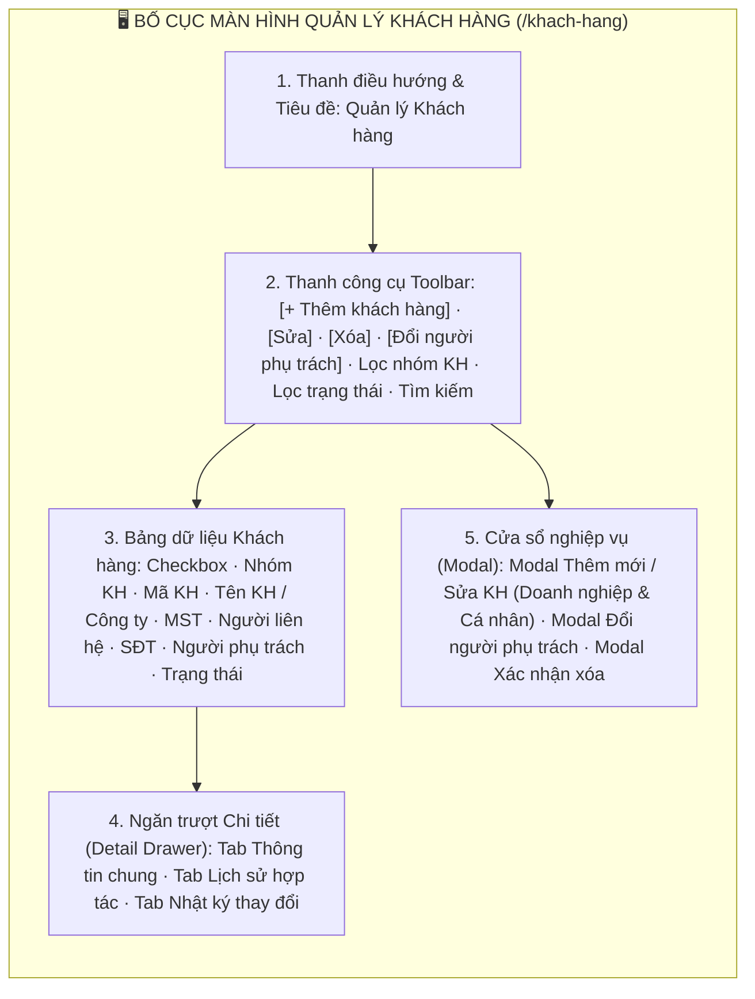
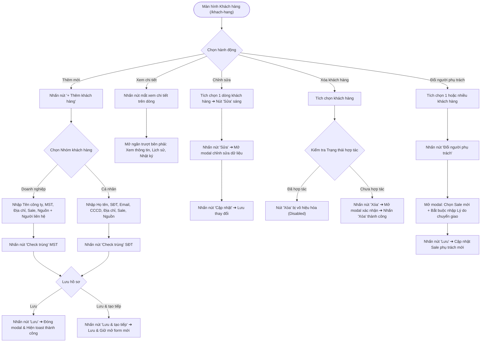
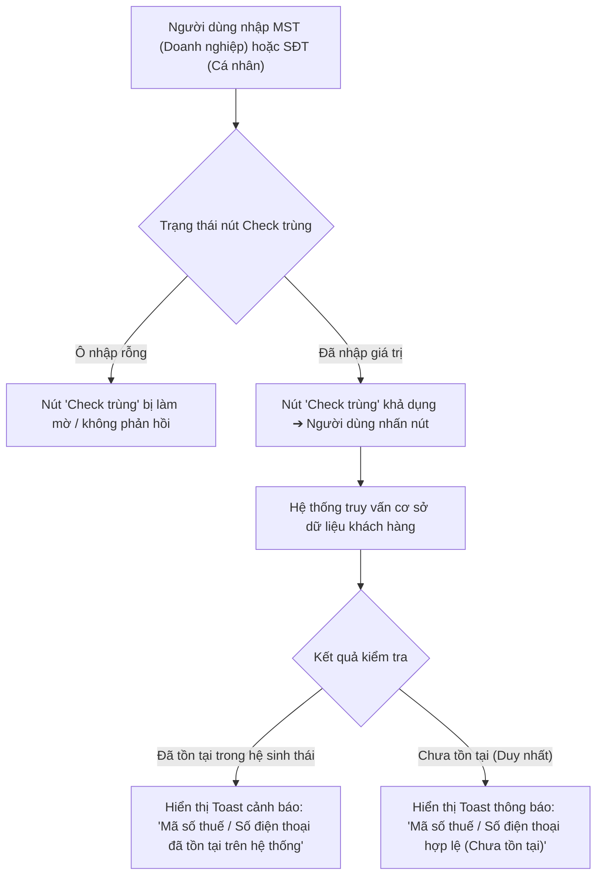
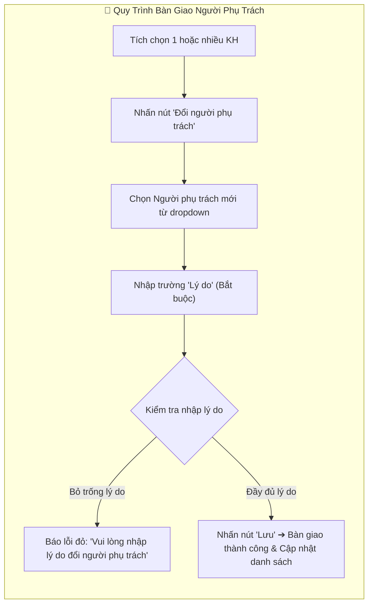

# 📋 TÀI LIỆU ĐẶC TẢ YÊU CẦU CHỨC NĂNG (REQUIREMENTS SPECIFICATION)
## Phân hệ: Quản lý Quan hệ Khách hàng (CRM) — Hệ thống VNTEST LIMS
### Tính năng: Quản lý Khách hàng (Customer Management Screen)

---

| Thông tin tài liệu | Chi tiết |
| :--- | :--- |
| **Mã tài liệu** | `REQ_VNTEST_CUSTOMERS` |
| **Tính năng / Màn hình** | Quản lý Khách hàng (Customer Management Screen) |
| **Đường dẫn truy cập** | `/khach-hang` (Menu Quản lý Khách hàng trên thanh điều hướng) |
| **Đối tượng sử dụng** | Nhân viên Kinh doanh (Sale), Trưởng phòng Kinh doanh, Kế toán, Admin |
| **Trạng thái tài liệu** | `Approved / Ready for Development & Testing` |
| **Cơ sở dữ liệu liên kết** | `customers`, `contacts`, `contracts`, `test_requests`, `users`, `audit_logs` |
| **Test Script Playwright** | [`src/tests/customers/customers.spec.ts`](file:///home/thai.hoang.dinh/VNTEST_Automation/src/tests/customers/customers.spec.ts) (41 Test Cases) |
| **Page Object Model** | [`src/pages/customers.page.ts`](file:///home/thai.hoang.dinh/VNTEST_Automation/src/pages/customers.page.ts) |
| **Dữ liệu kiểm thử** | [`test-data/users.json`](file:///home/thai.hoang.dinh/VNTEST_Automation/test-data/users.json), `test-data/customers.json` |

---

## 📑 MỤC LỤC ĐIỀU HƯỚNG NHANH
1. [1. Định vị màn hình & Tổng quan tính năng (Overview & UI Layout)](#1-định-vị-màn-hình--tổng-quan-tính-năng-overview--ui-layout)
2. [2. Sơ đồ phân tích luồng trực quan (Mermaid Flowcharts)](#2-sơ-đồ-phân-tích-luồng-trực-quan-mermaid-flowcharts)
3. [3. Phân quyền & Điều kiện kích hoạt (Access & Permissions)](#3-phân-quyền--điều-kiện-kích-hoạt-access--permissions)
4. [4. Đặc tả chi tiết các Use Cases chức năng (Functional Use Cases)](#4-đặc-tả-chi-tiết-các-use-cases-chức-năng-functional-use-cases)
5. [5. Đặc tả chi tiết trường dữ liệu (Field Specifications Matrix)](#5-đặc-tả-chi-tiết-trường-dữ-liệu-field-specifications-matrix)
6. [6. Ma trận nút bấm & Tương tác giao diện (Action Buttons Matrix)](#6-ma-trận-nút-bấm--tương-tác-giao-diện-action-buttons-matrix)
7. [7. Quy tắc nghiệp vụ & Luồng xử lý lỗi (Business Rules & Error Handling)](#7-quy-tắc-nghiệp-vụ--luồng-xử-lý-lỗi-business-rules--error-handling)
8. [8. Kế hoạch kiểm thử & Ma trận Test Cases Automation (41 Test Cases)](#8-kế-hoạch-kiểm-thử--ma-trận-test-cases-automation-41-test-cases)

---

## 1. ĐỊNH VỊ MÀN HÌNH & TỔNG QUAN TÍNH NĂNG (OVERVIEW & UI LAYOUT)

### 1.1. Mục đích tính năng
* **Quản trị Toàn diện Dữ liệu Khách hàng:** Quản lý cơ sở dữ liệu khách hàng của Viện VNTEST bao gồm cả hai nhóm đối tượng: Khách hàng Doanh nghiệp (Doanh nghiệp, Tổ chức, Cơ quan) và Khách hàng Cá nhân.
* **Cơ chế Kiểm tra Trùng lặp Thông minh (Check Trùng MST & SĐT):** Hỗ trợ tính năng kiểm tra trùng lặp thời gian thực đối với Mã số thuế doanh nghiệp (MST công ty), Mã số thuế xuất hóa đơn và Số điện thoại khách hàng cá nhân trước khi lưu hồ sơ.
* **Ngăn Chi tiết Khách hàng Đa năng (Customer Detail Drawer):** Cung cấp giao diện trượt xem chi tiết thông tin hồ sơ, lịch sử hợp đồng/yêu cầu thử nghiệm và nhật ký thay đổi (Change Log) mà không cần chuyển trang.
* **Quy tắc Bảo toàn Dữ liệu Hợp tác:** Chặn tuyệt đối hành vi xóa khách hàng đã có phát sinh hợp đồng hoặc yêu cầu thử nghiệm (`Đã hợp tác`), chỉ cho phép xóa những khách hàng tiềm năng chưa từng phát sinh dịch vụ (`Chưa hợp tác`).
* **Bàn giao & Đổi Người phụ trách (Change PIC Flow):** Cho phép điều chuyển người phụ trách quản lý khách hàng đơn lẻ hoặc chuyển giao hàng loạt cho Sale mới kèm ghi nhận lý do điều chuyển bắt buộc.

### 1.2. Bố cục Giao diện & Các Phân khu Chức năng (UI Layout Matrix)

| Phân khu (Section) | Vị trí hiển thị | Thành phần giao diện chính | Mục đích & Nghiệp vụ |
| :--- | :--- | :--- | :--- |
| **1. Header & Tiêu đề** | Trên cùng trang | Breadcrumb, Tiêu đề màn hình `"Khách hàng"` | Định vị trang quản lý đối tượng khách hàng của Viện |
| **2. Thanh công cụ (Toolbar)** | Dưới Header | Nút `"+ Thêm mới"`, `"Sửa"`, `"Xóa"`, `"Đổi người phụ trách"`, Bộ lọc Nhóm KH, Bộ lọc Trạng thái, Ô tìm kiếm | Thao tác tác vụ nhanh, kích hoạt modal và lọc danh sách đa chiều |
| **3. Bảng dữ liệu (Grid Table)** | Trung tâm màn hình | Checkbox chọn dòng, Cột Nhóm KH (Doanh nghiệp/Cá nhân), Tên đơn vị, MST, Người liên hệ, SĐT, Sale phụ trách, Trạng thái (Đã hợp tác/Chưa hợp tác), Nút xem chi tiết | Hiển thị danh sách khách hàng phân trang, chọn đơn lẻ hoặc hàng loạt để thao tác |
| **4. Ngăn trượt Chi tiết (Drawer)**| Trượt từ mép phải | 3 Tab: `"Thông tin chung"`, `"Lịch sử hợp tác"`, `"Nhật ký thay đổi"`, nút Đóng `[×]` | Tra cứu toàn diện hồ sơ và lịch sử làm việc của một khách hàng |
| **5. Cửa sổ Modal nghiệp vụ** | Trung tâm màn hình | Modal Thêm/Sửa KH (kèm nút Check trùng), Modal Đổi người phụ trách (kèm lý do), Modal Xác nhận xóa | Thực hiện các giao dịch tạo mới, cập nhật và điều chuyển khách hàng |

---

## 2. SƠ ĐỒ PHÂN TÍCH LUỒNG TRỰC QUAN (MERMAID FLOWCHARTS)

### 2.1. Sơ đồ Master Flow Quản lý Khách hàng

### 2.2. Sơ đồ Luồng Kiểm tra Trùng lặp (Check Trùng MST / SĐT)

### 2.3. Sơ đồ Luồng Đổi Người phụ trách (Change PIC)

---

## 3. PHÂN QUYỀN & ĐIỀU KIỆN KÍCH HOẠT (ACCESS & PERMISSIONS)

### 3.1. Ma trận phân quyền truy cập (RBAC Matrix)

| Vai trò người dùng (Role) | Xem danh sách KH | Thêm mới KH | Sửa thông tin KH | Xóa KH chưa hợp tác | Xóa KH đã hợp tác | Đổi người phụ trách | Check trùng |
| :--- | :---: | :---: | :---: | :---: | :---: | :---: | :---: |
| **Quản trị viên (Admin)** | Toàn quyền | Toàn quyền | Toàn quyền | Toàn quyền | **Bị hệ thống chặn** | Toàn quyền (đơn lẻ & hàng loạt) | Khả dụng |
| **Trưởng phòng Kinh doanh**| Xem toàn bộ | Thêm mới | Sửa mọi KH | Xóa KH chưa hợp tác | **Bị hệ thống chặn** | Đổi Sale cho nhân viên | Khả dụng |
| **Nhân viên Sale (Kinh doanh)**| Xem KH của mình | Thêm mới | Sửa KH của mình | Xóa KH chưa hợp tác của mình | **Bị hệ thống chặn** | Đề xuất đổi Sale | Khả dụng |
| **Kế toán / CSKH** | Xem toàn bộ | Không có quyền | Sửa thông tin hóa đơn | Không có quyền | **Bị hệ thống chặn** | Xem lịch sử | Khả dụng |

### 3.2. Tiền điều kiện & Ràng buộc chuyển trạng thái
* **Quy tắc Vô hiệu hóa Nút Xóa (BR-Delete):** Đối với bất kỳ khách hàng nào có trạng thái `"Đã hợp tác"` (đã phát sinh hợp đồng hoặc báo giá yêu cầu thử nghiệm), nút `"Xóa"` bắt buộc phải ở trạng thái **vô hiệu hóa (disabled)**. Tuyệt đối không cho phép xóa để bảo toàn tính toàn vẹn dữ liệu kế toán và nhật ký thử nghiệm.
* **Quy tắc Kích hoạt Nút Sửa & Đổi người phụ trách:**
  - Nút `"Sửa"`: Chỉ sáng lên khi tích chọn **chính xác 1 dòng** khách hàng.
  - Nút `"Đổi người phụ trách"`: Sáng lên khi tích chọn **từ 1 dòng trở lên** (hỗ trợ chuyển giao hàng loạt nhiều khách hàng cùng lúc).
* **Ràng buộc Người liên hệ (Khách Doanh nghiệp):** Khi tạo mới khách hàng Doanh nghiệp, người dùng **bắt buộc phải khai báo ít nhất 1 người liên hệ** (Họ tên, Số điện thoại) trước khi nhấn Lưu.

---

## 4. ĐẶC TẢ CHI TIẾT CÁC USE CASES CHỨC NĂNG (FUNCTIONAL USE CASES)

### UC-01: Bố cục Màn hình & Thanh công cụ (Khối 01)
* **Tác nhân:** Người dùng mọi vai trò.
* **Mô tả:** Hiển thị tổng quan màn hình quản lý khách hàng, kiểm tra tính đầy đủ của thanh công cụ và bảng danh sách.
* **Luồng sự kiện chính:**
  1. Người dùng điều hướng tới `/khach-hang`.
  2. Bảng danh sách hiển thị đầy đủ các cột thông tin chuẩn.
  3. Thanh công cụ hiển thị nút `"+ Thêm khách hàng"`, ô tìm kiếm, bộ lọc Nhóm khách hàng, bộ lọc Trạng thái và bộ lọc ngày.
  4. Khi chưa tích chọn dòng nào: Các nút thao tác ngữ cảnh (`"Sửa"`, `"Xóa"`, `"Đổi người phụ trách"`) ở trạng thái vô hiệu hóa (disabled).

### UC-02: Thêm mới Khách hàng Doanh nghiệp & Cá nhân (Khối 02)
* **Tác nhân:** Nhân viên Sale, Admin.
* **Luồng sự kiện chính:**
  1. Người dùng nhấn nút `"+ Thêm khách hàng"` trên thanh công cụ.
  2. Hệ thống hiển thị Modal tạo mới với lựa chọn nhóm khách hàng: `"Doanh nghiệp"` hoặc `"Cá nhân"`.
  3. **Khách hàng Doanh nghiệp:**
     - Người dùng nhập Tên công ty, Mã số thuế, Địa chỉ, chọn Người phụ trách (Sale), Nguồn khách hàng.
     - Nhấn nút thêm Người liên hệ và nhập Họ tên, SĐT, Email người liên hệ.
     - Nhấn nút `"Lưu"` ➔ Đóng modal, hiển thị thông báo tạo thành công, bản ghi mới xuất hiện trên danh sách.
  4. **Khách hàng Cá nhân:**
     - Người dùng chuyển sang tab `"Cá nhân"`.
     - Nhập Họ tên, Số điện thoại, Email, Số CCCD/CMND, Địa chỉ, chọn Sale và Nguồn.
     - Nhấn nút `"Lưu"` ➔ Lưu thành công và đóng modal.
     - Hoặc nhấn nút `"Lưu & tạo tiếp"` ➔ Lưu bản ghi hiện tại và làm mới form để tiếp tục nhập khách hàng kế tiếp.
  5. **Ngoại lệ Validation:**
     - Nếu bỏ trống các trường bắt buộc ➔ Báo lỗi vi phạm trường bắt buộc.
     - Nếu tạo khách Doanh nghiệp nhưng chưa thêm người liên hệ ➔ Báo lỗi: `"Vui lòng nhập thông tin người liên hệ"`.

### UC-03: Ngăn Chi tiết Khách hàng (Khối 03)
* **Tác nhân:** Người dùng tra cứu hồ sơ.
* **Luồng sự kiện chính:**
  1. Nhấp vào biểu tượng xem chi tiết (icon mắt) tại dòng khách hàng.
  2. Ngăn trượt chi tiết (Drawer) mở ra từ mép phải màn hình.
  3. Hiển thị thông tin tổng thể khách hàng với 3 tab:
     - Tab `"Thông tin chung"`: Đầy đủ tên, MST, địa chỉ, người liên hệ, Sale phụ trách.
     - Tab `"Lịch sử hợp tác"`: Danh sách các hợp đồng và YCTN đã phát sinh.
     - Tab `"Nhật ký thay đổi"`: Lịch sử các lần chỉnh sửa thông tin hoặc đổi người phụ trách.
  4. Nhấn nút đóng `[×]` để thu gọn ngăn chi tiết về bảng danh sách.

### UC-04: Chỉnh sửa Thông tin Khách hàng (Khối 04)
* **Tác nhân:** Nhân viên Sale phụ trách, Admin.
* **Luồng sự kiện chính:**
  1. Tích chọn duy nhất 1 khách hàng trên danh sách ➔ Nút `"Sửa"` sáng lên.
  2. Nhấn nút `"Sửa"` ➔ Mở modal chứa dữ liệu hiện tại của khách hàng.
  3. Người dùng cập nhật các trường thông tin cần thiết.
  4. Nhấn nút `"Cập nhật"` ➔ Lưu thay đổi thành công, đóng modal và cập nhật ngay trên dòng bảng.
  5. Nếu nhấn nút `"Hủy"` ➔ Đóng modal và hủy bỏ mọi chỉnh sửa chưa lưu.

### UC-05: Xóa Khách hàng & Ràng buộc Hợp tác (Khối 05)
* **Tác nhân:** Người dùng có quyền quản trị hoặc Sale sở hữu.
* **Luồng sự kiện chính:**
  1. Tích chọn khách hàng có trạng thái `"Đã hợp tác"` ➔ Nút `"Xóa"` ở trạng thái disabled, người dùng không thể bấm.
  2. Tích chọn khách hàng có trạng thái `"Chưa hợp tác"` ➔ Nút `"Xóa"` sáng lên (enabled).
  3. Nhấn nút `"Xóa"` ➔ Hiển thị modal cảnh báo xác nhận xóa.
  4. Nếu nhấn nút `"Hủy"` ➔ Đóng modal, khách hàng vẫn được giữ nguyên.
  5. Nếu nhấn nút `"Xóa"` xác nhận ➔ Bản ghi bị xóa khỏi hệ thống, danh sách nạp lại dữ liệu mới.

### UC-06: Tìm kiếm Đa Tiêu chí (Khối 06)
* **Tác nhân:** Người dùng mọi quyền hạn.
* **Luồng sự kiện chính:**
  1. Nhập từ khóa vào ô tìm kiếm: Hệ thống hỗ trợ tìm kiếm theo Tên công ty/Họ tên, Mã số thuế (MST) và Số điện thoại người liên hệ.
  2. Bảng dữ liệu tự động lọc ra các bản ghi thỏa mãn từ khóa tương ứng.
  3. Khi nhập từ khóa không tồn tại ➔ Hiển thị bảng trống kèm thông báo không có kết quả phù hợp.
  4. Xóa trắng ô tìm kiếm ➔ Bảng khôi phục lại danh sách đầy đủ ban đầu.

### UC-07: Bộ lọc Danh sách & Kết hợp (Khối 07)
* **Tác nhân:** Người dùng lọc báo cáo.
* **Luồng sự kiện chính:**
  1. Lọc theo Nhóm khách hàng: Chọn `"Doanh nghiệp"` hoặc `"Cá nhân"` ➔ Bảng chỉ hiển thị đối tượng thuộc nhóm được chọn.
  2. Lọc theo Trạng thái hợp tác: Chọn `"Đã hợp tác"` hoặc `"Chưa hợp tác"` ➔ Bảng cập nhật danh sách tương ứng.
  3. Lọc theo khoảng Ngày liên hệ: Chọn ngày bắt đầu và kết thúc qua popup lịch; có nút xóa bộ lọc ngày.
  4. Hỗ trợ kết hợp đồng thời giữa từ khóa tìm kiếm và bộ lọc trạng thái để thu hẹp phạm vi chính xác.

### UC-08: Đổi Người Phụ Trách Đơn lẻ & Hàng loạt (Khối 08)
* **Tác nhân:** Trưởng phòng Kinh doanh, Admin.
* **Luồng sự kiện chính:**
  1. Tích chọn 1 hoặc nhiều khách hàng từ bảng danh sách.
  2. Nhấn nút `"Đổi người phụ trách"` trên thanh công cụ.
  3. Modal hiển thị: Danh sách các khách hàng được chọn, dropdown chọn Sale mới và ô textarea `"Lý do"`.
  4. Nếu bỏ trống trường Sale mới hoặc bỏ trống trường Lý do ➔ Báo lỗi validation bắt buộc.
  5. Khi đã chọn Sale mới và nhập đầy đủ lý do ➔ Nhấn nút `"Lưu"`.
  6. Hệ thống chuyển giao quyền quản lý khách hàng cho Sale mới, ghi nhận vào nhật ký thay đổi và cập nhật ngay tên Sale trên bảng danh sách.

### UC-09: Nghiệp vụ Kiểm tra Trùng lặp (Check Trùng) (Khối 09)
* **Tác nhân:** Nhân viên Sale khi tạo mới hoặc sửa hồ sơ.
* **Luồng sự kiện chính:**
  1. Khi chưa nhập dữ liệu: Các nút `"Check trùng"` ở trạng thái disabled.
  2. **Check trùng MST Công ty:**
     - Nhập MST hợp lệ và nhấn nút Check trùng.
     - Nếu MST đã có trên hệ thống ➔ Hiển thị Toast cảnh báo trùng lặp.
     - Nếu MST chưa có trên hệ thống ➔ Hiển thị Toast thông báo MST hợp lệ.
  3. **Check trùng MST Xuất hóa đơn:** Tương tự quy trình kiểm tra MST công ty.
  4. **Check trùng SĐT Khách hàng Cá nhân:**
     - Nhập số điện thoại cá nhân và nhấn nút Check trùng.
     - Nếu SĐT đã được đăng ký bởi khách hàng khác ➔ Cảnh báo trùng lặp.
     - Nếu SĐT chưa từng đăng ký ➔ Thông báo số điện thoại hợp lệ.

---

## 5. ĐẶC TẢ CHI TIẾT TRƯỜNG DỮ LIỆU (FIELD SPECIFICATIONS MATRIX)

| STT | Tên trường hiển thị | Phân nhóm form | Phân loại | Bắt buộc | Ràng buộc nghiệp vụ & Validation |
| :---: | :--- | :--- | :---: | :---: | :--- |
| 1 | **Nhóm khách hàng** | Thông tin chung | Radio / Button | Có | Lựa chọn giữa `"Doanh nghiệp"` hoặc `"Cá nhân"` |
| 2 | **Người phụ trách (Sale)** | Thông tin chung | Select Dropdown | Có | Danh sách nhân sự phòng kinh doanh đang hoạt động |
| 3 | **Nguồn khách hàng** | Thông tin chung | Select Dropdown | Không | Nguồn tiếp cận: Khách quen, Hotline, Website, Giới thiệu... |
| 4 | **Tên công ty** | Khách Doanh nghiệp | Text Input | Có | Tên đầy đủ trên giấy phép kinh doanh (Ví dụ: `Công ty TNHH ABC`) |
| 5 | **Mã số thuế (MST)** | Khách Doanh nghiệp | Text Input | Có | 10 hoặc 13 chữ số, có nút `"Check trùng"` bên cạnh |
| 6 | **MST xuất hóa đơn** | Khách Doanh nghiệp | Text Input | Không | Mã số thuế nhận hóa đơn VAT, có nút `"Check trùng"` |
| 7 | **Địa chỉ doanh nghiệp** | Khách Doanh nghiệp | Text Input | Có | Địa chỉ đăng ký kinh doanh |
| 8 | **Họ tên người liên hệ** | Người liên hệ | Text Input | Có | Bắt buộc ít nhất 1 người liên hệ đối với khách Doanh nghiệp |
| 9 | **SĐT người liên hệ** | Người liên hệ | Text Input | Có | Định dạng số điện thoại 10 chữ số |
| 10 | **Email người liên hệ** | Người liên hệ | Text Input | Không | Định dạng email chuẩn (RFC 5322) |
| 11 | **Họ và tên cá nhân** | Khách Cá nhân | Text Input | Có | Họ tên đầy đủ khách hàng cá nhân |
| 12 | **SĐT khách cá nhân** | Khách Cá nhân | Text Input | Có | 10 chữ số, có nút `"Check trùng"` bên cạnh |
| 13 | **Số CCCD/CMND** | Khách Cá nhân | Text Input | Không | 9 hoặc 12 chữ số định danh công dân |
| 14 | **Email cá nhân** | Khách Cá nhân | Text Input | Không | Định dạng email chuẩn |
| 15 | **Địa chỉ cá nhân** | Khách Cá nhân | Text Input | Không | Địa chỉ thường trú hoặc liên lạc |
| 16 | **Lý do đổi người phụ trách**| Đổi Sale (Modal) | Textarea | Có | Bắt buộc nhập khi bàn giao Sale mới, tối thiểu 5 ký tự |

---

## 6. MA TRẬN NÚT BẤM & TƯƠNG TÁC GIAO DIỆN (ACTION BUTTONS MATRIX)

| STT | Tên nút bấm / Icon | Vị trí hiển thị | Trạng thái mặc định | Điều kiện kích hoạt | Hành vi hệ thống khi thao tác |
| :---: | :--- | :--- | :---: | :--- | :--- |
| 1 | **Nút "+ Thêm khách hàng"** | Thanh công cụ Toolbar | Khả dụng | Nhấp chuột | Mở Modal Thêm mới Khách hàng (mặc định form Doanh nghiệp) |
| 2 | **Nút "Sửa"** | Thanh công cụ Toolbar | **Vô hiệu hóa** | **Tích chọn chính xác 1 dòng** | Mở Modal Chỉnh sửa thông tin khách hàng đang được chọn |
| 3 | **Nút "Xóa"** | Thanh công cụ Toolbar | **Vô hiệu hóa** | **Chọn KH chưa hợp tác** | Mở Modal Xác nhận xóa khách hàng |
| 4 | **Nút "Đổi người phụ trách"**| Thanh công cụ Toolbar | **Vô hiệu hóa** | **Tích chọn >= 1 dòng** | Mở Modal Bàn giao Sale mới cho danh sách khách hàng được chọn |
| 5 | **Icon mắt "Xem chi tiết"** | Cột cuối từng dòng | Khả dụng | Nhấp chuột | Mở Ngăn trượt Chi tiết Khách hàng (Drawer) từ mép phải |
| 6 | **Nút "Check trùng" MST** | Cạnh ô nhập MST | Vô hiệu hóa khi rỗng | Đã nhập MST | Gửi request kiểm tra trùng lặp MST và hiển thị Toast kết quả |
| 7 | **Nút "Check trùng" SĐT** | Cạnh ô nhập SĐT cá nhân| Vô hiệu hóa khi rỗng | Đã nhập SĐT | Gửi request kiểm tra trùng lặp SĐT và hiển thị Toast kết quả |
| 8 | **Nút "+ Thêm người liên hệ"**| Form Khách Doanh nghiệp| Khả dụng | Nhấp chuột | Thêm một khối nhập thông tin người liên hệ mới |
| 9 | **Nút "Lưu" (Modal Thêm/Sửa)**| Chân Modal KH | Khả dụng | Nhấp chuột | Validate dữ liệu, lưu hồ sơ khách hàng và đóng modal |
| 10 | **Nút "Lưu & tạo tiếp"** | Chân Modal KH | Khả dụng | Nhấp chuột | Lưu hồ sơ hiện tại và làm mới các ô nhập để nhập khách tiếp theo |
| 11 | **Nút "Hủy" (Modal KH)** | Chân Modal KH | Khả dụng | Nhấp chuột | Đóng modal và hủy bỏ mọi dữ liệu đang nhập dở |
| 12 | **Nút "Lưu" (Modal Đổi Sale)**| Chân Modal Đổi Sale | Khả dụng | Có chọn Sale & nhập lý do | Bàn giao người phụ trách mới và cập nhật danh sách |
| 13 | **Nút "Xác nhận xóa"** | Chân Modal Xóa KH | Khả dụng | Nhấp chuột | Thực hiện xóa mềm/xóa vĩnh viễn khách hàng chưa hợp tác |

---

## 7. QUY TẮC NGHIỆP VỤ & LUỒNG XỬ LÝ LỖI (BUSINESS RULES & ERROR HANDLING)

### 7.1. Quy tắc nghiệp vụ trọng yếu (Business Rules - BR)
* **BR-01 (Chặn Xóa Khách Hàng Đã Hợp Tác):** Hệ thống cấm tuyệt đối hành vi xóa bất kỳ khách hàng nào đã có hợp đồng hoặc yêu cầu thử nghiệm gắn kèm (`Đã hợp tác`). Khi chọn khách hàng này, nút `"Xóa"` bắt buộc phải bị disabled.
* **BR-02 (Ràng buộc Người Liên Hệ Doanh Nghiệp):** Đối với khách hàng Doanh nghiệp, người liên hệ là mắt xích liên lạc bắt buộc. Hệ thống chặn lưu nếu người dùng chưa khai báo ít nhất một người liên hệ có đầy đủ Tên và Số điện thoại.
* **BR-03 (Ràng buộc Bắt Buộc Lý Do Đổi Sale):** Khi bàn giao khách hàng cho người phụ trách mới, trường `"Lý do"` là bắt buộc nhập để lưu vết nhật ký kiểm toán (Audit Trail), giúp ban lãnh đạo truy soát nguyên nhân điều chuyển.
* **BR-04 (Kiểm Tra Trùng Lập Trực Quan):** Cho phép người dùng chủ động check trùng MST và SĐT trước khi gửi form, đồng thời hệ thống vẫn chạy cơ chế validate trùng lặp tự động ở bước submit để bảo đảm tính duy nhất của dữ liệu.
* **BR-05 (Ràng Buộc Kích Hoạt Thao Tác Hàng Loạt):**
  - Nút `"Sửa"`: Chỉ sáng khi chọn đúng 1 khách hàng.
  - Nút `"Xóa"`: Sáng khi chọn khách hàng chưa hợp tác.
  - Nút `"Đổi người phụ trách"`: Sáng khi chọn từ 1 khách hàng trở lên (cho phép đổi hàng loạt).

### 7.2. Luồng xử lý ngoại lệ & Thông báo lỗi (Error Handling Matrix)

| Mã lỗi / Tình huống ngoại lệ | Nguyên nhân kích hoạt | Phản hồi của hệ thống & Thông báo hiển thị | Hướng xử lý cho người dùng |
| :--- | :--- | :--- | :--- |
| **ERR_CUST_REQUIRED_FIELDS** | Bỏ trống các trường bắt buộc (Tên, MST, Địa chỉ...) | Hiển thị thông báo: *"Vui lòng điền đầy đủ các trường bắt buộc."* | Bổ sung đầy đủ thông tin vào các ô viền đỏ |
| **ERR_CUST_NO_CONTACT** | Tạo khách Doanh nghiệp nhưng không có người liên hệ | Hiển thị thông báo: *"Vui lòng nhập thông tin người liên hệ."* | Nhấn nút `"+ Thêm người liên hệ"` và nhập thông tin |
| **ERR_CUST_DUP_TAXCODE** | MST đã được sử dụng bởi khách hàng khác | Toast thông báo: *"Mã số thuế đã tồn tại trên hệ thống!"* | Kiểm tra lại thông tin MST hoặc tra cứu khách hàng cũ |
| **ERR_CUST_DUP_PHONE** | SĐT cá nhân đã tồn tại trên hệ thống | Toast thông báo: *"Số điện thoại đã tồn tại trên hệ thống!"* | Kiểm tra lại số điện thoại cá nhân khách hàng |
| **ERR_CUST_CHANGE_PIC_NO_REASON**| Đổi Sale nhưng để trống trường lý do | Hiển thị thông báo: *"Vui lòng nhập lý do đổi người phụ trách."* | Nhập lý do bàn giao khách hàng chi tiết |
| **ERR_CUST_SEARCH_NOT_FOUND** | Tìm kiếm từ khóa không khớp dữ liệu nào | Bảng ẩn dữ liệu và hiển thị: *"Không tìm thấy khách hàng phù hợp."* | Nhập lại từ khóa hoặc xóa bộ lọc tìm kiếm |

---

## 8. KẾ HOẠCH KIỂM THỬ & MA TRẬN TEST CASES AUTOMATION (41 TEST CASES)

### 8.1. Thống kê độ phủ kiểm thử theo Phân nhóm chức năng

| Nhóm chức năng (Feature Scope) | Số kịch bản (TCs) | Tỷ lệ độ phủ | Trạng thái Automation |
| :--- | :---: | :---: | :---: |
| **Khối 01: Bố cục màn hình & Thanh công cụ** | 02 | 4.9% | `Passed 100%` |
| **Khối 02: Tạo mới Khách hàng (Doanh nghiệp & Cá nhân)** | 08 | 19.5% | `Passed 100%` |
| **Khối 03: Ngăn Chi tiết Khách hàng (Drawer)** | 02 | 4.9% | `Passed 100%` |
| **Khối 04: Chỉnh sửa thông tin Khách hàng** | 03 | 7.3% | `Passed 100%` |
| **Khối 05: Xóa Khách hàng & Ràng buộc Hợp tác** | 03 | 7.3% | `Passed 100%` |
| **Khối 06: Tìm kiếm Đa tiêu chí** | 05 | 12.2% | `Passed 100%` |
| **Khối 07: Bộ lọc Danh sách & Kết hợp** | 06 | 14.6% | `Passed 100%` |
| **Khối 08: Đổi Người phụ trách (Đơn lẻ & Hàng loạt)** | 06 | 14.6% | `Passed 100%` |
| **Khối 09: Nghiệp vụ Kiểm tra Trùng lặp (Check trùng)** | 06 | 14.6% | `Passed 100%` |
| **TỔNG CỘNG ĐỘ PHỦ KIỂM THỬ** | **41 Test Cases** | **100%** | **Playwright Automated** |

---

### 8.2. Chi tiết Ma trận Test Cases Automation (41 Test Cases)

### 8.2.1. KHỐI 01: BỐ CỤC MÀN HÌNH & THANH CÔNG CỤ (Layout & Toolbar Controls) (2 Test Cases)

| Mã TC | Phân nhóm luồng | Tên kịch bản | Thao tác & Dữ liệu kiểm thử | Kết quả mong đợi | Mức độ ưu tiên | Mapping Page Object |
| :--- | :--- | :--- | :--- | :--- | :---: | :--- |
| **TC_CUST_001** | 01: BỐ CỤC MÀN HÌNH & THANH CÔNG CỤ | Hiển thị đầy đủ các thành phần màn hình danh sách Khách hàng | 1. Điều hướng tới màn hình Khách hàng tại /khach-hang.  2. Kiểm tra hiển thị tiêu đề, các nút trên thanh công cụ và bảng danh sách.  3. Kiểm tra các bộ lọc nhóm khách hàng, trạng thái và khoảng ngày. | 1. Màn hình hiển thị đầy đủ, sắc nét toàn bộ các phân khu chức năng.  2. Bảng danh sách nạp dữ liệu hoàn chỉnh, không gặp bất kỳ lỗi hiển thị nào. | Normal | `customersPage` |
| **TC_CUST_002** | 01: BỐ CỤC MÀN HÌNH & THANH CÔNG CỤ | Trạng thái ban đầu của các nút thao tác hàng loạt khi chưa chọn dòng | 1. Tải màn hình khi chưa có dòng nào được tích chọn checkbox.  2. Quan sát trạng thái của các nút "Sửa", "Xóa" và "Đổi người phụ trách". | 1. Toàn bộ các nút thao tác tác vụ ngữ cảnh ("Sửa", "Xóa", "Đổi người phụ trách") đều ở trạng thái vô hiệu hóa (disabled).  2. Ngăn ngừa người dùng kích hoạt các hành động khi chưa chọn đối tượng dữ liệu. | Normal | `customersPage` |

### 8.2.2. KHỐI 02: TẠO MỚI KHÁCH HÀNG (DOANH NGHIỆP & CÁ NHÂN) (Create Customer Flow) (8 Test Cases)

| Mã TC | Phân nhóm luồng | Tên kịch bản | Thao tác & Dữ liệu kiểm thử | Kết quả mong đợi | Mức độ ưu tiên | Mapping Page Object |
| :--- | :--- | :--- | :--- | :--- | :---: | :--- |
| **TC_CUST_003** | 02: TẠO MỚI KHÁCH HÀNG | Mở và đóng hộp thoại Thêm Khách hàng mới bằng nút "Hủy" | 1. Nhấn nút "+ Thêm khách hàng" trên thanh công cụ.  2. Kiểm tra modal thêm khách hàng xuất hiện.  3. Nhấn nút "Hủy" ở chân modal. | 1. Modal mở ra đúng form nhập liệu tạo mới.  2. Khi nhấn nút "Hủy", modal đóng lại an toàn mà không phát sinh dữ liệu thừa. | Low | `customersPage` |
| **TC_CUST_004** | 02: TẠO MỚI KHÁCH HÀNG | Bỏ trống toàn bộ các trường bắt buộc khi tạo mới | 1. Mở modal thêm khách hàng mới.  2. Để trống toàn bộ các ô nhập liệu và nhấn nút "Lưu". | 1. Hệ thống chặn lưu dữ liệu.  2. Hiển thị thông báo lỗi yêu cầu điền đầy đủ các trường bắt buộc và đánh dấu viền đỏ các ô thiếu. | High | `customersPage` |
| **TC_CUST_005** | 02: TẠO MỚI KHÁCH HÀNG | Bỏ trống thông tin Người liên hệ khi tạo mới khách hàng | 1. Nhập đầy đủ thông tin doanh nghiệp (Tên công ty, MST, Địa chỉ, Sale) nhưng không thêm người liên hệ.  2. Nhấn nút "Lưu". | 1. Hệ thống chặn lưu và hiển thị cảnh báo: "Vui lòng nhập thông tin người liên hệ".  2. Đảm bảo mỗi khách Doanh nghiệp luôn có ít nhất một đầu mối liên lạc. | High | `customersPage` |
| **TC_CUST_006** | 02: TẠO MỚI KHÁCH HÀNG | Thêm mới khách hàng Doanh nghiệp thành công | 1. Mở modal thêm khách hàng Doanh nghiệp.  2. Nhập đầy đủ Tên công ty, MST duy nhất, Địa chỉ, chọn Sale và Nguồn.  3. Thêm thông tin Người liên hệ (Họ tên, SĐT).  4. Nhấn nút "Lưu". | 1. Hiển thị Toast thông báo tạo khách hàng thành công và đóng modal.  2. Khách hàng mới xuất hiện ngay trên dòng đầu của danh sách với đầy đủ thông tin. | Critical | `customersPage` |
| **TC_CUST_032** | 02: TẠO MỚI KHÁCH HÀNG | Chuyển đổi qua lại giữa nhóm khách hàng Doanh nghiệp và Cá nhân trên form tạo mới | 1. Mở modal tạo mới khách hàng.  2. Nhấn chuyển sang nút "Cá nhân" ➔ Kiểm tra form hiển thị các trường cá nhân.  3. Nhấn chuyển lại nút "Doanh nghiệp" ➔ Kiểm tra form hiển thị các trường doanh nghiệp. | 1. Form chuyển đổi linh hoạt các trường tương ứng theo từng nhóm khách hàng.  2. Giao diện thay đổi mượt mà, không bị mất cân đối bố cục. | Normal | `customersPage` |
| **TC_CUST_033** | 02: TẠO MỚI KHÁCH HÀNG | Bỏ trống các trường bắt buộc khi tạo mới khách hàng Cá nhân | 1. Chọn tab "Cá nhân" trên form tạo mới.  2. Để trống Họ tên và Số điện thoại cá nhân.  3. Nhấn nút "Lưu". | 1. Hệ thống không lưu bản ghi.  2. Hiển thị cảnh báo bắt buộc nhập các thông tin định danh cá nhân. | High | `customersPage` |
| **TC_CUST_034** | 02: TẠO MỚI KHÁCH HÀNG | Thêm mới khách hàng Cá nhân thành công | 1. Chọn nhóm khách hàng "Cá nhân".  2. Nhập Họ và tên, SĐT duy nhất, Địa chỉ, CCCD, chọn Sale phụ trách.  3. Nhấn nút "Lưu". | 1. Hiển thị thông báo tạo khách hàng thành công và đóng modal.  2. Bản ghi khách hàng cá nhân mới xuất hiện trên danh sách với nhóm là "Cá nhân". | Critical | `customersPage` |
| **TC_CUST_035** | 02: TẠO MỚI KHÁCH HÀNG | Thêm mới khách hàng Cá nhân bằng nút "Lưu & tạo tiếp" | 1. Nhập đầy đủ thông tin khách hàng cá nhân hợp lệ.  2. Nhấn nút "Lưu & tạo tiếp" ở chân modal. | 1. Bản ghi hiện tại được lưu thành công vào cơ sở dữ liệu.  2. Modal vẫn giữ mở và các trường nhập liệu được làm mới sẵn sàng cho lần nhập tiếp theo. | Normal | `customersPage` |

### 8.2.3. KHỐI 03: NGĂN CHI TIẾT KHÁCH HÀNG (Customer Detail Drawer) (2 Test Cases)

| Mã TC | Phân nhóm luồng | Tên kịch bản | Thao tác & Dữ liệu kiểm thử | Kết quả mong đợi | Mức độ ưu tiên | Mapping Page Object |
| :--- | :--- | :--- | :--- | :--- | :---: | :--- |
| **TC_CUST_007** | 03: NGĂN CHI TIẾT KHÁCH HÀNG | Mở và đóng ngăn Chi tiết Khách hàng | 1. Nhấn nút biểu tượng mắt xem chi tiết tại một dòng khách hàng.  2. Kiểm tra ngăn trượt chi tiết mở ra từ mép phải.  3. Nhấn nút đóng [x] tại ngăn chi tiết. | 1. Ngăn chi tiết trượt ra mượt mà từ bên phải màn hình.  2. Khi nhấn đóng [x], ngăn chi tiết thu gọn lại hoàn toàn. | Critical | `customersPage` |
| **TC_CUST_008** | 03: NGĂN CHI TIẾT KHÁCH HÀNG | Kiểm tra tính toàn vẹn thông tin khách hàng trong ngăn chi tiết | 1. Mở ngăn chi tiết của một khách hàng cụ thể.  2. Kiểm tra đối chiếu Tên công ty, MST, Người liên hệ giữa danh sách và ngăn chi tiết.  3. Kiểm tra các tab Thông tin, Lịch sử hợp tác và Nhật ký thay đổi. | 1. Dữ liệu trong ngăn chi tiết trùng khớp 100% với dữ liệu hiển thị trên bảng danh sách.  2. Toàn bộ các tab lịch sử đều có thể chuyển đổi và nạp dữ liệu chuẩn xác. | High | `customersPage` |

### 8.2.4. KHỐI 04: CHỈNH SỬA THÔNG TIN KHÁCH HÀNG (Update Customer Flow) (3 Test Cases)

| Mã TC | Phân nhóm luồng | Tên kịch bản | Thao tác & Dữ liệu kiểm thử | Kết quả mong đợi | Mức độ ưu tiên | Mapping Page Object |
| :--- | :--- | :--- | :--- | :--- | :---: | :--- |
| **TC_CUST_009** | 04: CHỈNH SỬA THÔNG TIN KHÁCH HÀNG | Kích hoạt nút "Sửa" khi chọn dòng khách hàng trong danh sách | 1. Tích chọn duy nhất 1 dòng khách hàng.  2. Quan sát trạng thái của nút "Sửa" trên thanh công cụ.  3. Bỏ tích chọn dòng đó và quan sát lại nút "Sửa". | 1. Nút "Sửa" tự động sáng lên (enabled) khi tích chọn 1 dòng.  2. Nút "Sửa" tự động bị vô hiệu hóa khi bỏ chọn. | Normal | `customersPage` |
| **TC_CUST_010** | 04: CHỈNH SỬA THÔNG TIN KHÁCH HÀNG | Mở và đóng hộp thoại Sửa khách hàng bằng nút "Hủy" | 1. Tích chọn 1 dòng và nhấn nút "Sửa".  2. Kiểm tra modal chỉnh sửa nạp đúng thông tin khách hàng đã chọn.  3. Nhấn nút "Hủy". | 1. Modal mở ra hiển thị đầy đủ thông tin cũ của khách hàng.  2. Khi nhấn "Hủy", modal đóng lại và thông tin trên danh sách không đổi. | Low | `customersPage` |
| **TC_CUST_011** | 04: CHỈNH SỬA THÔNG TIN KHÁCH HÀNG | Cập nhật thông tin khách hàng thành công | 1. Mở modal sửa khách hàng.  2. Cập nhật lại tên công ty hoặc địa chỉ liên lạc.  3. Nhấn nút "Cập nhật". | 1. Hiển thị Toast cập nhật thành công và đóng modal.  2. Giá trị mới hiển thị ngay lập tức trên bảng danh sách và trong ngăn chi tiết. | Critical | `customersPage` |

### 8.2.5. KHỐI 05: XÓA KHÁCH HÀNG & RÀNG BUỘC HỢP TÁC (Delete Customer & Business Rules) (3 Test Cases)

| Mã TC | Phân nhóm luồng | Tên kịch bản | Thao tác & Dữ liệu kiểm thử | Kết quả mong đợi | Mức độ ưu tiên | Mapping Page Object |
| :--- | :--- | :--- | :--- | :--- | :---: | :--- |
| **TC_CUST_012** | 05: XÓA KHÁCH HÀNG & RÀNG BUỘC HỢP TÁC | Vô hiệu hóa nút "Xóa" đối với khách hàng đã hợp tác | 1. Tìm một khách hàng có trạng thái "Đã hợp tác".  2. Tích chọn dòng khách hàng đó.  3. Kiểm tra trạng thái của nút "Xóa" trên thanh công cụ. | 1. Nút "Xóa" ở trạng thái vô hiệu hóa (disabled / làm mờ).  2. Người dùng không thể nhấn xóa khách hàng đã có hợp đồng hoặc YCTN phát sinh. | High | `customersPage` |
| **TC_CUST_013** | 05: XÓA KHÁCH HÀNG & RÀNG BUỘC HỢP TÁC | Mở và hủy xác nhận xóa khách hàng bằng nút "Hủy" | 1. Tích chọn khách hàng có trạng thái "Chưa hợp tác".  2. Nhấn nút "Xóa" trên thanh công cụ ➔ Mở modal xác nhận xóa.  3. Nhấn nút "Hủy" trong modal xác nhận. | 1. Modal xác nhận xóa hiển thị thông điệp cảnh báo rõ ràng.  2. Khi nhấn "Hủy", modal đóng lại và bản ghi khách hàng vẫn được giữ nguyên. | Low | `customersPage` |
| **TC_CUST_014** | 05: XÓA KHÁCH HÀNG & RÀNG BUỘC HỢP TÁC | Xóa khách hàng chưa hợp tác thành công | 1. Tích chọn một khách hàng chưa từng hợp tác.  2. Nhấn nút "Xóa" để mở modal xác nhận.  3. Nhấn nút xác nhận "Xóa" trong modal. | 1. Hiển thị thông báo xóa khách hàng thành công và đóng modal.  2. Bản ghi khách hàng biến mất khỏi bảng dữ liệu danh sách. | Critical | `customersPage` |

### 8.2.6. KHỐI 06: TÌM KIẾM ĐA TIÊU CHÍ (Multi-criteria Search) (5 Test Cases)

| Mã TC | Phân nhóm luồng | Tên kịch bản | Thao tác & Dữ liệu kiểm thử | Kết quả mong đợi | Mức độ ưu tiên | Mapping Page Object |
| :--- | :--- | :--- | :--- | :--- | :---: | :--- |
| **TC_CUST_015** | 06: TÌM KIẾM ĐA TIÊU CHÍ | Tìm kiếm khách hàng theo Tên công ty | 1. Nhập một đoạn tên công ty của khách hàng vào ô tìm kiếm.  2. Quan sát kết quả lọc trên bảng dữ liệu. | 1. Bảng dữ liệu lọc ra đúng các khách hàng có tên công ty chứa chuỗi tìm kiếm.  2. Tìm kiếm nhanh chóng và không phân biệt chữ hoa/thường. | Critical | `customersPage` |
| **TC_CUST_016** | 06: TÌM KIẾM ĐA TIÊU CHÍ | Tìm kiếm khách hàng theo Mã số thuế (MST) | 1. Nhập mã số thuế chính xác của một doanh nghiệp vào ô tìm kiếm.  2. Kiểm tra dòng dữ liệu trả về. | 1. Bảng lọc ra chính xác khách hàng có MST tương ứng.  2. Dữ liệu khớp chính xác 100%. | High | `customersPage` |
| **TC_CUST_017** | 06: TÌM KIẾM ĐA TIÊU CHÍ | Tìm kiếm khách hàng theo Số điện thoại người liên hệ | 1. Nhập số điện thoại của người liên hệ vào ô tìm kiếm.  2. Kiểm tra các dòng khách hàng được lọc ra. | 1. Hệ thống tìm và lọc ra đúng khách hàng sở hữu người liên hệ có số điện thoại đó.  2. Đảm bảo tính liên kết tìm kiếm giữa doanh nghiệp và người đại diện. | High | `customersPage` |
| **TC_CUST_018** | 06: TÌM KIẾM ĐA TIÊU CHÍ | Tìm kiếm với từ khóa không tồn tại trong hệ thống | 1. Nhập một chuỗi ký tự ngẫu nhiên không có trên hệ thống vào ô tìm kiếm.  2. Quan sát bảng dữ liệu. | 1. Bảng không hiển thị bản ghi nào.  2. Hiển thị thông báo không tìm thấy khách hàng phù hợp. | Normal | `customersPage` |
| **TC_CUST_019** | 06: TÌM KIẾM ĐA TIÊU CHÍ | Xóa từ khóa tìm kiếm để hoàn nguyên danh sách | 1. Xóa toàn bộ ký tự trong ô tìm kiếm.  2. Kiểm tra danh sách hiển thị. | 1. Bộ lọc tìm kiếm được gỡ bỏ ngay lập tức.  2. Danh sách khách hàng hiển thị lại đầy đủ như trạng thái ban đầu. | Normal | `customersPage` |

### 8.2.7. KHỐI 07: BỘ LỌC DANH SÁCH & KẾT HỢP (Filters & Filter Combination) (6 Test Cases)

| Mã TC | Phân nhóm luồng | Tên kịch bản | Thao tác & Dữ liệu kiểm thử | Kết quả mong đợi | Mức độ ưu tiên | Mapping Page Object |
| :--- | :--- | :--- | :--- | :--- | :---: | :--- |
| **TC_CUST_020** | 07: BỘ LỌC DANH SÁCH & KẾT HỢP | Lọc danh sách theo Nhóm khách hàng "Doanh nghiệp" | 1. Nhấn mở bộ lọc Nhóm khách hàng.  2. Chọn tiêu chí "Doanh nghiệp".  3. Kiểm tra cột Nhóm KH của tất cả các dòng trên bảng. | 1. Toàn bộ các dòng hiển thị đều thuộc nhóm "Doanh nghiệp".  2. Các khách hàng cá nhân tự động bị ẩn khỏi bảng. | High | `customersPage` |
| **TC_CUST_021** | 07: BỘ LỌC DANH SÁCH & KẾT HỢP | Lọc danh sách theo Nhóm khách hàng "Cá nhân" | 1. Chọn tiêu chí nhóm "Cá nhân" trong bộ lọc.  2. Quan sát danh sách kết quả. | 1. Danh sách chỉ bao gồm các khách hàng cá nhân.  2. Dữ liệu hiển thị đúng chuẩn đối tượng cá nhân. | High | `customersPage` |
| **TC_CUST_022** | 07: BỘ LỌC DANH SÁCH & KẾT HỢP | Lọc danh sách theo Trạng thái "Đã hợp tác" | 1. Nhấn mở bộ lọc Trạng thái.  2. Chọn giá trị "Đã hợp tác".  3. Kiểm tra cột Trạng thái của các dòng kết quả. | 1. Toàn bộ các khách hàng hiển thị đều có badge trạng thái là "Đã hợp tác".  2. Không xuất hiện khách hàng chưa hợp tác. | High | `customersPage` |
| **TC_CUST_023** | 07: BỘ LỌC DANH SÁCH & KẾT HỢP | Lọc danh sách theo Trạng thái "Chưa hợp tác" | 1. Chọn giá trị "Chưa hợp tác" trong bộ lọc trạng thái.  2. Kiểm tra danh sách bảng. | 1. Danh sách chỉ lọc ra các khách hàng có trạng thái "Chưa hợp tác".  2. Nút Xóa có thể kích hoạt đối với các khách hàng này. | High | `customersPage` |
| **TC_CUST_024** | 07: BỘ LỌC DANH SÁCH & KẾT HỢP | Lọc khách hàng theo khoảng Ngày liên hệ và xóa bộ lọc ngày | 1. Chọn ngày bắt đầu tại ô "Từ" và ngày kết thúc tại ô "Đến".  2. Kiểm tra dữ liệu lọc theo khoảng thời gian.  3. Nhấn xóa bộ lọc ngày. | 1. Danh sách lọc chính xác các khách hàng có ngày liên hệ trong khoảng chọn.  2. Khi xóa ngày, danh sách được khôi phục về trạng thái đầy đủ. | Normal | `customersPage` |
| **TC_CUST_025** | 07: BỘ LỌC DANH SÁCH & KẾT HỢP | Kết hợp tìm kiếm từ khóa với bộ lọc Trạng thái | 1. Chọn bộ lọc Trạng thái là "Đã hợp tác".  2. Đồng thời nhập từ khóa tên công ty vào ô tìm kiếm.  3. Kiểm tra kết quả lọc giao thoa. | 1. Danh sách chỉ hiển thị các khách hàng vừa thỏa mãn tên công ty vừa có trạng thái đã hợp tác.  2. Cơ chế lọc kết hợp đa điều kiện hoạt động chính xác và mượt mà. | High | `customersPage` |

### 8.2.8. KHỐI 08: ĐỔI NGƯỜI PHỤ TRÁCH ĐƠN LẺ & HÀNG LOẠT (Change PIC Flow) (6 Test Cases)

| Mã TC | Phân nhóm luồng | Tên kịch bản | Thao tác & Dữ liệu kiểm thử | Kết quả mong đợi | Mức độ ưu tiên | Mapping Page Object |
| :--- | :--- | :--- | :--- | :--- | :---: | :--- |
| **TC_CUST_026** | 08: ĐỔI NGƯỜI PHỤ TRÁCH ĐƠN LẺ & HÀNG LOẠT | Mở và đóng hộp thoại Đổi người phụ trách bằng nút "Hủy" | 1. Tích chọn 1 khách hàng.  2. Nhấn nút "Đổi người phụ trách" trên thanh công cụ.  3. Nhấn nút "Hủy" trong modal. | 1. Modal đổi người phụ trách mở ra hiển thị mã và tên khách hàng.  2. Nhấn nút "Hủy" giúp đóng modal mà không thay đổi người phụ trách. | Low | `customersPage` |
| **TC_CUST_027** | 08: ĐỔI NGƯỜI PHỤ TRÁCH ĐƠN LẺ & HÀNG LOẠT | Đóng hộp thoại Đổi người phụ trách bằng nút "Đóng" [×] | 1. Mở modal Đổi người phụ trách.  2. Nhấn nút biểu tượng đóng [x] ở góc trên bên phải modal. | 1. Modal đóng lại ngay lập tức.  2. Giữ nguyên trạng thái ban đầu của hệ thống. | Low | `customersPage` |
| **TC_CUST_028** | 08: ĐỔI NGƯỜI PHỤ TRÁCH ĐƠN LẺ & HÀNG LOẠT | Bỏ trống toàn bộ các trường bắt buộc khi đổi người phụ trách | 1. Mở modal Đổi người phụ trách.  2. Không chọn Sale mới và không nhập lý do.  3. Nhấn nút "Lưu". | 1. Hệ thống chặn thao tác lưu.  2. Hiển thị thông báo yêu cầu chọn người phụ trách mới và nhập lý do. | High | `customersPage` |
| **TC_CUST_029** | 08: ĐỔI NGƯỜI PHỤ TRÁCH ĐƠN LẺ & HÀNG LOẠT | Bỏ trống trường Lý do khi đổi người phụ trách | 1. Đã chọn một Sale mới trong danh sách.  2. Để trống ô nhập lý do.  3. Nhấn nút "Lưu". | 1. Hệ thống báo lỗi bắt buộc nhập lý do chuyển giao.  2. Đảm bảo tuân thủ quy tắc ghi nhận lý do kiểm toán. | High | `customersPage` |
| **TC_CUST_030** | 08: ĐỔI NGƯỜI PHỤ TRÁCH ĐƠN LẺ & HÀNG LOẠT | Đổi người phụ trách cho một khách hàng thành công | 1. Tích chọn 1 khách hàng.  2. Mở modal, chọn Sale mới từ dropdown và nhập lý do chi tiết.  3. Nhấn nút "Lưu". | 1. Hiển thị Toast thông báo đổi người phụ trách thành công và đóng modal.  2. Cột Người phụ trách của dòng khách hàng đó được cập nhật sang tên Sale mới. | Critical | `customersPage` |
| **TC_CUST_031** | 08: ĐỔI NGƯỜI PHỤ TRÁCH ĐƠN LẺ & HÀNG LOẠT | Đổi người phụ trách hàng loạt cho nhiều khách hàng | 1. Tích chọn từ 2 khách hàng trở lên trên bảng danh sách.  2. Nhấn nút "Đổi người phụ trách".  3. Kiểm tra modal hiển thị danh sách tất cả các khách hàng được chọn.  4. Chọn Sale mới, nhập lý do và nhấn nút "Lưu". | 1. Hệ thống cập nhật hàng loạt người phụ trách cho toàn bộ các khách hàng đã chọn.  2. Đóng modal và toàn bộ các dòng được chọn đều hiển thị tên Sale mới. | Critical | `customersPage` |

### 8.2.9. KHỐI 09: NGHIỆP VỤ KIỂM TRA TRÙNG LẶP (Check Duplicate Flow) (6 Test Cases)

| Mã TC | Phân nhóm luồng | Tên kịch bản | Thao tác & Dữ liệu kiểm thử | Kết quả mong đợi | Mức độ ưu tiên | Mapping Page Object |
| :--- | :--- | :--- | :--- | :--- | :---: | :--- |
| **TC_CUST_036** | 09: NGHIỆP VỤ KIỂM TRA TRÙNG LẶP | Trạng thái ban đầu của các nút "Check trùng" khi chưa nhập dữ liệu | 1. Mở modal thêm khách hàng mới.  2. Quan sát các nút "Check trùng" bên cạnh ô MST và ô SĐT khi chưa gõ dữ liệu. | 1. Các nút "Check trùng" ở trạng thái vô hiệu hóa (disabled).  2. Ngăn ngừa việc gửi request kiểm tra rỗng lên máy chủ. | Normal | `customersPage` |
| **TC_CUST_037** | 09: NGHIỆP VỤ KIỂM TRA TRÙNG LẶP | Kiểm tra trùng MST công ty khi Mã số thuế KHÔNG trùng lặp | 1. Nhập một mã số thuế doanh nghiệp mới chưa từng có trong hệ thống.  2. Nhấn nút "Check trùng" bên cạnh ô MST công ty. | 1. Hệ thống gửi request xác thực và phản hồi nhanh chóng.  2. Hiển thị Toast thông báo: Mã số thuế hợp lệ, chưa tồn tại trên hệ thống. | High | `customersPage` |
| **TC_CUST_038** | 09: NGHIỆP VỤ KIỂM TRA TRÙNG LẶP | Kiểm tra trùng MST công ty khi Mã số thuế ĐÃ TỒN TẠI trên hệ thống | 1. Nhập mã số thuế của một công ty đã có sẵn trong danh sách khách hàng.  2. Nhấn nút "Check trùng". | 1. Hệ thống phát hiện trùng lặp.  2. Hiển thị Toast cảnh báo: Mã số thuế đã tồn tại trên hệ thống. | Critical | `customersPage` |
| **TC_CUST_039** | 09: NGHIỆP VỤ KIỂM TRA TRÙNG LẶP | Kiểm tra trùng MST xuất hóa đơn khi Mã số thuế ĐÃ TỒN TẠI trên hệ thống | 1. Nhập mã số thuế đã có vào ô "MST xuất hóa đơn".  2. Nhấn nút "Check trùng" tương ứng. | 1. Hệ thống kiểm tra trong danh mục hóa đơn và khách hàng.  2. Hiển thị cảnh báo trùng lặp MST xuất hóa đơn. | High | `customersPage` |
| **TC_CUST_040** | 09: NGHIỆP VỤ KIỂM TRA TRÙNG LẶP | Kiểm tra trùng Số điện thoại khách hàng Cá nhân khi SĐT ĐÃ TỒN TẠI trên hệ thống | 1. Chuyển sang form khách hàng Cá nhân.  2. Nhập số điện thoại đã thuộc về một khách hàng khác.  3. Nhấn nút "Check trùng" bên cạnh ô SĐT. | 1. Hệ thống phát hiện xung đột số điện thoại.  2. Hiển thị Toast cảnh báo: Số điện thoại đã tồn tại trên hệ thống. | Critical | `customersPage` |
| **TC_CUST_041** | 09: NGHIỆP VỤ KIỂM TRA TRÙNG LẶP | Kiểm tra trùng Số điện thoại khách hàng Cá nhân khi SĐT KHÔNG trùng lặp | 1. Nhập một số điện thoại mới hoàn toàn chưa từng đăng ký.  2. Nhấn nút "Check trùng". | 1. Hệ thống xác nhận số điện thoại là duy nhất.  2. Hiển thị Toast thông báo: Số điện thoại hợp lệ (chưa tồn tại). | High | `customersPage` |
