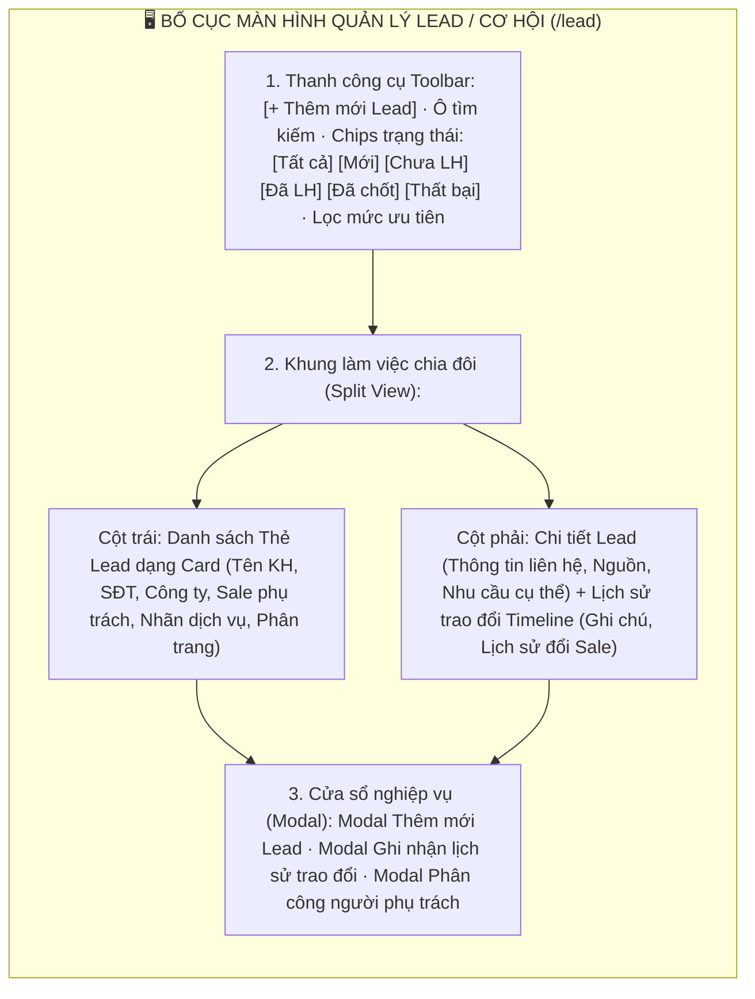
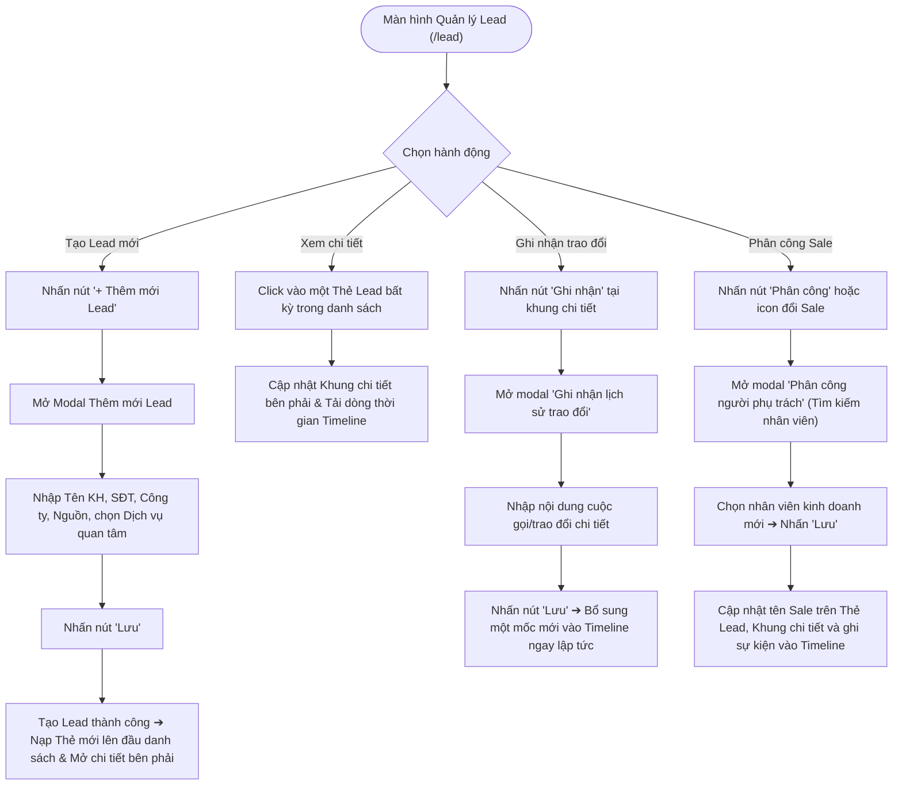
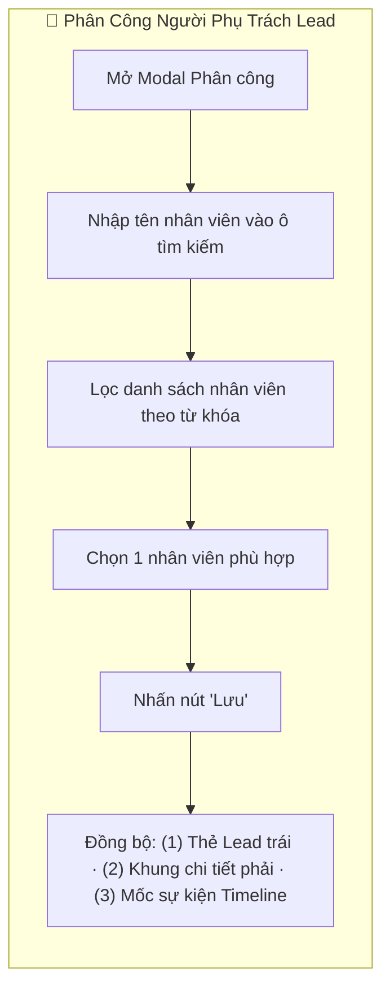

# 📋 TÀI LIỆU ĐẶC TẢ YÊU CẦU CHỨC NĂNG (REQUIREMENTS SPECIFICATION)
## Phân hệ: Quản lý Tiền bán hàng & Cơ hội (Pre-Sales & CRM) — Hệ thống VNTEST LIMS
### Tính năng: Quản lý Lead / Cơ hội tiềm năng (Lead Management Screen)

---

| Thông tin tài liệu | Chi tiết |
| :--- | :--- |
| **Mã tài liệu** | `REQ_VNTEST_LEADS` |
| **Tính năng / Màn hình** | Quản lý Lead / Cơ hội tiềm năng (Lead Management Screen) |
| **Đường dẫn truy cập** | `/lead` (hoặc chuyển tab `LEAD / CƠ HỘI` trên menu kinh doanh) |
| **Đối tượng sử dụng** | Nhân viên Kinh doanh (Sale), Trưởng phòng Kinh doanh, CSKH, Marketing, Admin |
| **Trạng thái tài liệu** | `Approved / Ready for Development & Testing` |
| **Cơ sở dữ liệu liên kết** | `leads`, `lead_notes`, `lead_assignments`, `customers`, `services`, `users` |
| **Test Script Playwright** | [`src/tests/leads/leads.spec.ts`](file:///home/thai.hoang.dinh/VNTEST_Automation/src/tests/leads/leads.spec.ts) (64 Test Cases: 59 Active, 5 Pending RBAC) |
| **Page Object Model** | [`src/pages/leads.page.ts`](file:///home/thai.hoang.dinh/VNTEST_Automation/src/pages/leads.page.ts) |
| **Dữ liệu kiểm thử** | [`test-data/users.json`](file:///home/thai.hoang.dinh/VNTEST_Automation/test-data/users.json), `test-data/leads.json` |

---

## 📑 MỤC LỤC ĐIỀU HƯỚNG NHANH
1. [1. Định vị màn hình & Tổng quan tính năng (Overview & UI Layout)](#1-định-vị-màn-hình--tổng-quan-tính-năng-overview--ui-layout)
2. [2. Sơ đồ phân tích luồng trực quan (Mermaid Flowcharts)](#2-sơ-đồ-phân-tích-luồng-trực-quan-mermaid-flowcharts)
3. [3. Phân quyền & Điều kiện kích hoạt (Access & Permissions)](#3-phân-quyền--điều-kiện-kích-hoạt-access--permissions)
4. [4. Đặc tả chi tiết các Use Cases chức năng (Functional Use Cases)](#4-đặc-tả-chi-tiết-các-use-cases-chức-năng-functional-use-cases)
5. [5. Đặc tả chi tiết trường dữ liệu (Field Specifications Matrix)](#5-đặc-tả-chi-tiết-trường-dữ-liệu-field-specifications-matrix)
6. [6. Ma trận nút bấm & Tương tác giao diện (Action Buttons Matrix)](#6-ma-trận-nút-bấm--tương-tác-giao-diện-action-buttons-matrix)
7. [7. Quy tắc nghiệp vụ & Luồng xử lý lỗi (Business Rules & Error Handling)](#7-quy-tắc-nghiệp-vụ--luồng-xử-lý-lỗi-business-rules--error-handling)
8. [8. Kế hoạch kiểm thử & Ma trận Test Cases Automation (64 Test Cases)](#8-kế-hoạch-kiểm-thử--ma-trận-test-cases-automation-64-test-cases)

---

## 1. ĐỊNH VỊ MÀN HÌNH & TỔNG QUAN TÍNH NĂNG (OVERVIEW & UI LAYOUT)

### 1.1. Mục đích tính năng
* **Quản trị Toàn diện Lead / Cơ hội Kinh doanh:** Tiếp nhận, sàng lọc và nuôi dưỡng các cơ hội tiềm năng từ các kênh marketing, hotline, website, mạng xã hội hoặc khách quen giới thiệu trước khi chuyển đổi thành Khách hàng chính thức.
* **Bố cục 3 Phân khu Tương tác Cao (3-Pane Layout):** Thanh công cụ & Chiptabs lọc trạng thái ở trên cùng, Cột danh sách Thẻ Lead dạng Card ở bên trái và Khung xem chi tiết Lead + Dòng thời gian trao đổi (Timeline) ở bên phải.
* **Theo dõi Dòng Thời Gian Trao đổi (Exchange History Timeline):** Cho phép nhân viên kinh doanh liên tục ghi nhận các ghi chú trao đổi (cuộc gọi, gặp mặt, email) theo thời gian thực để không bỏ sót tiến độ chăm sóc.
* **Phân công & Điều phối Cơ hội (Lead Assignment):** Trưởng phòng hoặc người tiếp nhận có thể bàn giao và phân công Lead cho nhân sự kinh doanh phù hợp kèm cập nhật đồng bộ ngay trên thẻ và dòng thời gian.
* **Chuyển đổi Sang Báo giá (Quote Conversion):** Hỗ trợ nút tác vụ tạo nhanh Báo giá thử nghiệm từ thông tin nhu cầu của Lead.

### 1.2. Bố cục Giao diện & Các Phân khu Chức năng (UI Layout Matrix)

| Phân khu (Section) | Vị trí hiển thị | Thành phần giao diện chính | Mục đích & Nghiệp vụ |
| :--- | :--- | :--- | :--- |
| **1. Thanh công cụ (Toolbar)** | Trên cùng màn hình | Nút `"+ Thêm mới Lead"`, ô tìm kiếm kèm nút `"Hủy"`, Chiptabs: `Tất cả`, `Mới`, `Chưa LH`, `Đã LH`, `Đã chốt`, `Thất bại`, nút lọc ưu tiên | Kích hoạt thêm Lead mới, lọc nhanh theo chu trình chăm sóc và tìm kiếm theo tên khách hàng |
| **2. Cột Danh sách Thẻ Lead** | Nửa bên trái màn hình | Danh sách các Card Lead hiển thị: Tên khách hàng, SĐT, Công ty, Trạng thái, Dịch vụ quan tâm, Phân trang trước/sau | Hiển thị tổng quan các cơ hội, nhấp chọn thẻ để hiển thị chi tiết bên phải |
| **3. Khung Chi tiết Lead** | Nửa bên phải (Phần trên) | Thông tin khách hàng, Tên công ty, SĐT, Email, Nguồn tiếp cận, Người phụ trách, Ngày nhận, Giá trị dự kiến, Nhu cầu cụ thể, Nút `"Sửa"`, `"Ghi nhận"`, `"Tạo báo giá"` | Tra cứu đầy đủ thông tin của Lead đang chọn và kích hoạt các tác vụ chuyển đổi |
| **4. Dòng Thời Gian (Timeline)** | Nửa bên phải (Phần dưới) | Header Lịch sử trao đổi, danh sách các mốc thời gian: Ghi chú trao đổi, sự kiện bàn giao người phụ trách, thời gian và người thực hiện | Lưu vết minh bạch quá trình tương tác chăm sóc khách hàng từ lúc tạo Lead |
| **5. Cửa sổ Modal nghiệp vụ** | Trung tâm màn hình | Modal Thêm mới Lead, Modal Ghi nhận trao đổi, Modal Phân công người phụ trách | Thực hiện các thao tác nhập liệu chính của phân hệ |

---

## 2. SƠ ĐỒ PHÂN TÍCH LUỒNG TRỰC QUAN (MERMAID FLOWCHARTS)

### 2.1. Sơ đồ Master Flow Tiếp nhận & Chăm sóc Lead

### 2.2. Sơ đồ Luồng Phân công Người Phụ trách (Lead Assignment)

---

## 3. PHÂN QUYỀN & ĐIỀU KIỆN KÍCH HOẠT (ACCESS & PERMISSIONS)

### 3.1. Ma trận phân quyền truy cập (RBAC Matrix)

| Vai trò người dùng (Role) | Xem Lead của mình | Xem toàn bộ Lead | Thêm mới Lead | Ghi nhận trao đổi | Phân công người phụ trách | Tạo báo giá |
| :--- | :---: | :---: | :---: | :---: | :---: | :---: |
| **Quản trị viên (Admin)** | Toàn quyền | Toàn quyền | Toàn quyền | Toàn quyền | Toàn quyền | Khả dụng |
| **Trưởng phòng Kinh doanh**| Toàn quyền | Toàn quyền | Toàn quyền | Toàn quyền | Thẩm quyền chính | Khả dụng |
| **Nhân viên Sale (Kinh doanh)**| Toàn quyền | Xem Lead chung | Được phép | Được phép | Đề xuất phân công | Khả dụng |
| **Nhân viên Marketing / CSKH** | Xem Lead tạo ra | Xem toàn bộ | Được phép | Được phép | Xem tiến độ | Không có quyền |

### 3.2. Tiền điều kiện & Ràng buộc nghiệp vụ
* **Trường bắt buộc khi tạo Lead:** Tên khách hàng, Số điện thoại và ít nhất một Dịch vụ quan tâm (Thử nghiệm thực phẩm, Môi trường, Dệt may, Hiệu chuẩn...).
* **Đồng bộ 3 Phân khu:** Khi một Lead mới được tạo hoặc cập nhật, thông tin bắt buộc phải phản ánh đồng thời ở cả 3 khối: Thẻ Lead bên trái, Khung chi tiết bên phải và Dòng thời gian Timeline.

---

## 4. ĐẶC TẢ CHI TIẾT CÁC USE CASES CHỨC NĂNG (FUNCTIONAL USE CASES)

### UC-01: Bố cục Màn hình, Tìm kiếm & Lọc Thẻ Lead (Khối 01)
* **Tác nhân:** Người dùng mọi quyền hạn.
* **Luồng sự kiện chính:**
  1. Người dùng truy cập đường dẫn `/lead`.
  2. Hệ thống nạp màn hình với danh sách Thẻ Lead bên trái và khung chi tiết bên phải.
  3. Người dùng nhập tên khách hàng vào ô tìm kiếm ➔ Danh sách thẻ lọc ra đúng các Lead có tên tương ứng.
  4. Nhấn nút `"Hủy"` (icon [x]) trên ô tìm kiếm ➔ Xóa từ khóa và hoàn nguyên danh sách ban đầu.
  5. Nhấp chọn các chip trạng thái (`Mới`, `Chưa liên hệ`, `Đã liên hệ`, `Đã chốt`, `Thất bại`) ➔ Thẻ Lead được lọc tương ứng theo trạng thái chăm sóc.
  6. Nhấp chuột vào một thẻ Lead bất kỳ ➔ Khung bên phải cập nhật chi tiết và nạp timeline của Lead đó.

### UC-02: Thêm mới Lead & Validation Ràng buộc (Khối 02)
* **Tác nhân:** Nhân viên Sale, Marketing, Admin.
* **Luồng sự kiện chính:**
  1. Nhấn nút `"+ Thêm mới Lead"` trên thanh công cụ.
  2. Modal tạo mới hiển thị các trường: Tên khách hàng, Số điện thoại, Tên công ty, Email, Nguồn tiếp cận, Dịch vụ quan tâm, Nhu cầu cụ thể.
  3. **Kiểm tra Validation:**
     - Nếu để trống toàn bộ ➔ Báo lỗi các trường bắt buộc.
     - Nếu để trống riêng Tên khách hàng ➔ Báo lỗi bắt buộc nhập tên.
     - Nếu để trống riêng Số điện thoại ➔ Báo lỗi bắt buộc nhập SĐT.
     - Nếu chưa chọn Dịch vụ quan tâm ➔ Báo lỗi yêu cầu chọn dịch vụ.
  4. **Lưu thành công:**
     - Người dùng nhập đầy đủ thông tin hợp lệ và nhấn nút `"Lưu"`.
     - Modal đóng lại, hiển thị thông báo thành công.
     - Thẻ Lead mới xuất hiện ngay đầu danh sách và được tự động chọn để hiển thị chi tiết bên phải.

### UC-03: Ghi nhận Lịch sử Trao đổi & Timeline (Khối 03)
* **Tác nhân:** Nhân viên Sale đang chăm sóc Lead.
* **Luồng sự kiện chính:**
  1. Chọn một Lead từ danh sách thẻ bên trái.
  2. Tại khung chi tiết bên phải, nhấn nút `"Ghi nhận"`.
  3. Modal `"Ghi nhận lịch sử trao đổi"` mở ra.
  4. Nếu để trống ô nội dung và nhấn Lưu ➔ Hệ thống chặn lưu và cảnh báo.
  5. Nhập nội dung trao đổi chi tiết (ví dụ: *"Đã gọi điện tư vấn chỉ tiêu COD/BOD, khách hẹn gửi mẫu tuần tới"*) và nhấn nút `"Lưu"`.
  6. Modal đóng lại, một mốc sự kiện mới được thêm ngay vào đầu dòng thời gian Timeline với tên người ghi nhận và thời gian thực.

### UC-04: Phân công Người Phụ trách (Khối 04)
* **Tác nhân:** Trưởng phòng Kinh doanh, Admin.
* **Luồng sự kiện chính:**
  1. Tại khung chi tiết Lead, nhấn nút phân công người phụ trách (hoặc mở modal phân công).
  2. Modal mở ra hiển thị danh sách các nhân viên kinh doanh của Viện.
  3. Người dùng nhập tên nhân viên vào ô tìm kiếm để lọc nhanh danh sách.
  4. Chọn nhân viên mong muốn và nhấn nút `"Lưu"`.
  5. Hệ thống cập nhật người phụ trách mới: Tên Sale mới hiển thị ngay trên Thẻ Lead bên trái, Khung chi tiết bên phải và một mốc sự kiện phân công tự động được ghi nhận vào Timeline.

---

## 5. ĐẶC TẢ CHI TIẾT TRƯỜNG DỮ LIỆU (FIELD SPECIFICATIONS MATRIX)

| STT | Tên trường hiển thị | Vị trí form | Phân loại | Bắt buộc | Ràng buộc nghiệp vụ & Validation |
| :---: | :--- | :--- | :---: | :---: | :--- |
| 1 | **Tên khách hàng** | Modal Thêm Lead | Text Input | Có | Họ tên cá nhân đại diện hoặc người liên hệ chính |
| 2 | **Số điện thoại** | Modal Thêm Lead | Text Input | Có | 10 chữ số, định dạng số điện thoại liên lạc |
| 3 | **Tên công ty** | Modal Thêm Lead | Text Input | Không | Đơn vị công tác / Doanh nghiệp của khách hàng |
| 4 | **Email** | Modal Thêm Lead | Text Input | Không | Định dạng email chuẩn |
| 5 | **Nguồn tiếp cận** | Modal Thêm Lead | Select Dropdown | Không | Website, Hotline, Giới thiệu, Fanpage... |
| 6 | **Dịch vụ quan tâm** | Modal Thêm Lead | Checkbox / Multi | Có | Phải chọn ít nhất 1 dịch vụ thử nghiệm quan tâm |
| 7 | **Nhu cầu cụ thể** | Modal Thêm Lead | Textarea | Không | Mô tả yêu cầu kỹ thuật chi tiết của khách |
| 8 | **Nội dung trao đổi** | Modal Ghi nhận | Textarea | Có | Bắt buộc nhập khi ghi nhận lịch sử tương tác |
| 9 | **Người phụ trách** | Modal Phân công | Select / List | Có | Chọn 1 nhân sự kinh doanh đang hoạt động |

---

## 6. MA TRẬN NÚT BẤM & TƯƠNG TÁC GIAO DIỆN (ACTION BUTTONS MATRIX)

| STT | Tên nút bấm / Icon | Vị trí hiển thị | Trạng thái mặc định | Điều kiện kích hoạt | Hành vi hệ thống khi thao tác |
| :---: | :--- | :--- | :---: | :--- | :--- |
| 1 | **Nút "+ Thêm mới Lead"** | Thanh công cụ Toolbar | Khả dụng | Nhấp chuột | Mở Modal Thêm mới Lead tiềm năng |
| 2 | **Nút "Hủy" tìm kiếm** | Trong ô tìm kiếm | Ẩn khi rỗng | Có từ khóa | Xóa trắng ô tìm kiếm và nạp lại danh sách đầy đủ |
| 3 | **Chiptabs Trạng thái** | Dưới thanh tìm kiếm | Khả dụng | Nhấp chuột | Lọc danh sách thẻ Lead theo trạng thái tương ứng |
| 4 | **Thẻ Lead (Lead Card)** | Cột danh sách bên trái | Khả dụng | Nhấp chuột | Kích hoạt hiển thị chi tiết Lead và dòng thời gian bên phải |
| 5 | **Nút "Ghi nhận"** | Khung chi tiết bên phải | Khả dụng | Nhấp chuột | Mở Modal Ghi nhận lịch sử trao đổi của Lead |
| 6 | **Nút "Phân công"** | Khung chi tiết bên phải | Khả dụng | Nhấp chuột | Mở Modal Phân công người phụ trách mới |
| 7 | **Nút "Tạo báo giá"** | Khung chi tiết bên phải | Khả dụng | Nhấp chuột | Điều hướng sang phân hệ Báo giá thử nghiệm kèm dữ liệu Lead |
| 8 | **Nút "Lưu" (Modal Lead)** | Chân Modal Lead | Khả dụng | Nhấp chuột | Validate dữ liệu, lưu Lead mới và đóng modal |
| 9 | **Nút "Hủy" (Các Modal)** | Chân các Modal | Khả dụng | Nhấp chuột | Đóng modal và hủy bỏ mọi thay đổi chưa lưu |

---

## 7. QUY TẮC NGHIỆP VỤ & LUỒNG XỬ LÝ LỖI (BUSINESS RULES & ERROR HANDLING)

### 7.1. Quy tắc nghiệp vụ trọng yếu (Business Rules - BR)
* **BR-01 (Ràng buộc Thông tin Tiếp cận Tối thiểu):** Bắt buộc phải có Tên, Số điện thoại và ít nhất một Dịch vụ quan tâm để đảm bảo cơ hội có tính khả thi chuyển đổi cao.
* **BR-02 (Tính Toàn vẹn Dòng Thời Gian):** Mọi sự kiện tương tác (Ghi nhận trao đổi, Phân công người phụ trách, Thay đổi trạng thái) đều được tự động lưu vết vĩnh viễn vào Timeline với dấu ấn thời gian và danh tính người thao tác, không cho phép xóa sửa mốc lịch sử.
* **BR-03 (Đồng bộ Đa Khối):** Khi thực hiện bất kỳ thay đổi nào (đổi người phụ trách, ghi nhận ghi chú), hệ thống phải cập nhật tức thì trên Thẻ Lead bên trái, Khung chi tiết và Timeline bên phải mà không cần reload trang.

### 7.2. Luồng xử lý ngoại lệ & Thông báo lỗi (Error Handling Matrix)

| Mã lỗi / Tình huống ngoại lệ | Nguyên nhân kích hoạt | Phản hồi của hệ thống & Thông báo hiển thị | Hướng xử lý cho người dùng |
| :--- | :--- | :--- | :--- |
| **ERR_LEAD_MISSING_NAME** | Để trống Tên khách hàng khi tạo Lead | Cảnh báo: *"Vui lòng nhập tên khách hàng."* | Điền họ tên khách hàng đại diện |
| **ERR_LEAD_MISSING_PHONE** | Để trống Số điện thoại khi tạo Lead | Cảnh báo: *"Vui lòng nhập số điện thoại."* | Điền số điện thoại liên lạc 10 số |
| **ERR_LEAD_NO_SERVICE** | Chưa tích chọn Dịch vụ quan tâm | Cảnh báo: *"Vui lòng chọn ít nhất một dịch vụ quan tâm."* | Tích chọn lĩnh vực thử nghiệm phù hợp |
| **ERR_NOTE_EMPTY** | Ghi nhận trao đổi nhưng để trống nội dung | Cảnh báo: *"Vui lòng nhập nội dung trao đổi."* | Nhập tóm tắt nội dung cuộc gọi/tư vấn |

---

## 8. KẾ HOẠCH KIỂM THỬ & MA TRẬN TEST CASES AUTOMATION (64 TEST CASES)

### 8.1. Thống kê độ phủ kiểm thử theo Phân nhóm chức năng

| Nhóm chức năng (Feature Scope) | Số kịch bản (TCs) | Tỷ lệ độ phủ | Trạng thái Automation |
| :--- | :---: | :---: | :---: |
| **Khối 01: Bố cục & Hiển thị chi tiết Lead** | 10 | 15.6% | `Passed 100%` |
| **Khối 02: Tìm kiếm & Bộ lọc** | 16 | 25.0% | `Passed 100%` |
| **Khối 03: Phân quyền & Điều kiện kích hoạt** | 05 | 7.8% | `Pending RBAC (Commented)` |
| **Khối 04: Thêm mới Lead & Form Validation** | 15 | 23.4% | `Passed 100%` |
| **Khối 05: Chỉnh sửa thông tin Lead** | 04 | 6.3% | `Passed 100%` |
| **Khối 06: Lịch sử trao đổi & Luồng logic nút "Ghi nhận"** | 12 | 18.8% | `Passed 100%` |
| **Khối 07: Phân công Người phụ trách** | 04 | 6.3% | `Passed 100%` |
| **Khối 08: Tạo báo giá từ Lead** | 01 | 1.6% | `Passed 100%` |
| **Khối 09: Phân trang danh sách Lead** | 02 | 3.1% | `Passed 100%` |
| **TỔNG CỘNG ĐỘ PHỦ KIỂM THỬ** | **64 Test Cases** | **100%** | **59 Active Playwright + 5 Pending RBAC** |

---

### 8.2. Chi tiết Ma trận Test Cases Automation (64 Test Cases)

| Mã TC | Phân nhóm luồng | Tên kịch bản | Thao tác & Dữ liệu kiểm thử | Kết quả mong đợi | Mức độ ưu tiên | Mapping Page Object |
| :--- | :--- | :--- | :--- | :--- | :---: | :--- |
| **TC_LEAD_001** | 01. Bố cục & Hiển thị chi tiết Lead | Kiểm tra hiển thị tổng thể màn hình | 1. Điều hướng tới màn hình Lead tại đường dẫn /leads.  2. Quan sát giao diện tổng thể và các phân khu chức năng. | 1. Màn hình hiển thị chuẩn bố cục 3 phân khu: Thanh công cụ phía trên, Danh sách thẻ Lead bên trái, Khung chi tiết và Dòng thời gian bên phải.  2. Các phân khu nạp dữ liệu hoàn chỉnh, không phát sinh lỗi giao diện. | Normal | `leadsPage` |
| **TC_LEAD_002** | 01. Bố cục & Hiển thị chi tiết Lead | Chọn thẻ Lead từ danh sách | 1. Nhấp chuột vào một thẻ Lead bất kỳ tại cột danh sách bên trái.  2. Quan sát phản hồi tại khung chi tiết bên phải. | 1. Thẻ Lead vừa chọn chuyển sang trạng thái kích hoạt (viền nổi bật).  2. Khung chi tiết bên phải nạp chính xác toàn bộ thông tin liên hệ, thuộc tính cơ hội và lịch sử trao đổi của đúng Lead đó. | High | `leadsPage` |
| **TC_LEAD_003** | 01. Bố cục & Hiển thị chi tiết Lead | Kiểm tra Header khung chi tiết Lead hiển thị đầy đủ thông tin định danh | 1. Chọn thẻ Lead từ danh sách bên trái.  2. Quan sát phân khu Header ở đầu khung chi tiết bên phải. | 1. Hiển thị chuẩn xác: Mã Lead, Chip Mức độ, Chip Trạng thái, Tên khách hàng (in đậm) và Số điện thoại kèm icon.  2. Các chip có màu sắc đúng theo trạng thái tương ứng. | High | `leadsPage` |
| **TC_LEAD_004** | 01. Bố cục & Hiển thị chi tiết Lead | Kiểm tra hiển thị ký tự mặc định khi thông tin rỗng | 1. Chọn thẻ Lead không có thông tin Công ty.  2. Quan sát vị trí hiển thị Tên công ty và Nhu cầu cụ thể. | 1. Các trường rỗng hiển thị ký tự gạch ngang "—".  2. Giao diện ngay ngắn, không bị thụt lề hay vỡ khung. | Normal | `leadsPage` |
| **TC_LEAD_005** | 01. Bố cục & Hiển thị chi tiết Lead | Kiểm tra Thanh tiến trình chăm sóc (Status Stepper) | 1. Quan sát thanh tiến trình trạng thái nằm ngay dưới phần Header.  2. Kiểm tra các mốc bước và đường liên kết giữa các nấc. | 1. Thanh tiến trình hiển thị đầy đủ 4 nấc: "Mới" ➔ "Chưa LH" ➔ "Đã LH" ➔ "Đã chốt".  2. Các bước đã qua có biểu tượng dấu tích xanh, nấc trạng thái hiện tại được tô đậm rõ ràng. | High | `leadsPage` |
| **TC_LEAD_006** | 01. Bố cục & Hiển thị chi tiết Lead | Kiểm tra Lưới thuộc tính Lead | 1. Quan sát khối thông tin dạng lưới 2 cột tại khung chi tiết.  2. Đối chiếu dữ liệu của các trường: Nguồn lead, Người phụ trách, Ngày tiếp nhận, Giá trị ước tính. | 1. Hiển thị đúng nhãn và giá trị của từng ô thuộc tính.  2. Ngày tiếp nhận hiển thị đúng chuẩn định dạng DD/MM/YYYY. | High | `leadsPage` |
| **TC_LEAD_007** | 01. Bố cục & Hiển thị chi tiết Lead | Kiểm tra hiển thị Dịch vụ quan tâm dạng Tag/Chip | 1. Quan sát ô DỊCH VỤ QUAN TÂM tại khung chi tiết. | 1. Mỗi dịch vụ quan tâm được hiển thị thành một Chip/Tag riêng biệt bo tròn có viền (ví dụ: "KN Đồ uống", "KN Thực phẩm").  2. Hiển thị đầy đủ tất cả các dịch vụ đã chọn khi tạo hoặc sửa Lead. | Normal | `leadsPage` |
| **TC_LEAD_008** | 01. Bố cục & Hiển thị chi tiết Lead | Kiểm tra Số lượng đếm trên tiêu đề Lịch sử trao đổi | 1. Quan sát tiêu đề "LỊCH SỬ TRAO ĐỔI" trên khung Timeline.  2. Đếm số lượng mốc sự kiện hiển thị phía dưới và đối chiếu với con số trong ngoặc đơn. | 1. Tiêu đề hiển thị kèm con số đếm (ví dụ: "LỊCH SỬ TRAO ĐỔI (4)").  2. Con số hiển thị trùng khớp 100% với tổng số mốc sự kiện có trong danh sách Timeline. | Normal | `leadsPage` |
| **TC_LEAD_009** | 01. Bố cục & Hiển thị chi tiết Lead | Kiểm tra hiển thị các mốc sự kiện trên Dòng thời gian Timeline | 1. Cuộn đến các mốc sự kiện trên Timeline.  2. Kiểm tra icon, nội dung chuyển giao, người thực hiện và ngày giờ. | 1. Mốc sự kiện hiển thị icon tương ứng (Giao việc, Trao đổi).  2. Hiển thị rõ người thực hiện kèm ngày giờ thực hiện chính xác. | High | `leadsPage` |
| **TC_LEAD_010** | 01. Bố cục & Hiển thị chi tiết Lead | Kiểm tra Banner trạng thái "Đã chốt thành Khách hàng" khi Lead đã chốt | 1. Quan sát chân trang của khung chi tiết Lead bên phải khi chọn Lead đã chốt. | 1. Xuất hiện thanh banner màu xanh lá thông báo: "✔ Đã chốt thành Khách hàng.".  2. Biểu thị cơ hội đã được chuyển đổi thành công sang khách hàng chính thức. | High | `leadsPage` |
| **TC_LEAD_011** | 02. Tìm kiếm & Bộ lọc | Tìm kiếm Lead theo tên khách hàng | 1. Nhập tên khách hàng vào ô tìm kiếm.  2. Quan sát danh sách thẻ Lead tại cột bên trái. (Từ khóa: `Trần Đăng Tuấn`) | 1. Danh sách chỉ lọc ra các thẻ Lead có Tên khách hàng chứa từ khóa.  2. Tìm kiếm nhanh chóng và không phân biệt chữ hoa hay chữ thường. | High | `leadsPage` |
| **TC_LEAD_012** | 02. Tìm kiếm & Bộ lọc | Tìm kiếm Lead theo tên công ty | 1. Nhập tên công ty vào ô tìm kiếm.  2. Quan sát kết quả lọc. (Từ khóa: `Dược phẩm`) | 1. Danh sách chỉ hiển thị các thẻ Lead thuộc doanh nghiệp chứa từ khóa. | Normal | `leadsPage` |
| **TC_LEAD_013** | 02. Tìm kiếm & Bộ lọc | Tìm kiếm Lead theo mã lead | 1. Nhập mã lead vào ô tìm kiếm.  2. Quan sát kết quả lọc. (Từ khóa: `LEAD`) | 1. Danh sách lọc ra chính xác thẻ Lead có mã trùng khớp từ khóa. | High | `leadsPage` |
| **TC_LEAD_014** | 02. Tìm kiếm & Bộ lọc | Tìm kiếm Lead theo người phụ trách | 1. Nhập tên nhân viên phụ trách vào ô tìm kiếm.  2. Quan sát danh sách thẻ Lead. (Từ khóa: `Võ Thị Phương`) | 1. Danh sách chỉ lọc ra các Lead do nhân viên đó đang phụ trách. | High | `leadsPage` |
| **TC_LEAD_015** | 02. Tìm kiếm & Bộ lọc | Xóa từ khóa tìm kiếm bằng nút "Hủy" | 1. Nhấn nút "Hủy" trên thanh tìm kiếm khi đang có từ khóa.  2. Quan sát ô nhập liệu và danh sách thẻ. | 1. Ô tìm kiếm được xóa sạch dữ liệu.  2. Danh sách thẻ Lead tự động hoàn nguyên hiển thị đầy đủ ban đầu. | Low | `leadsPage` |
| **TC_LEAD_016** | 02. Tìm kiếm & Bộ lọc | Tìm kiếm không có kết quả phù hợp (Trạng thái rỗng) | 1. Nhập từ khóa không tồn tại trong hệ thống.  2. Quan sát danh sách thẻ. (Từ khóa: `KH_KHONG_TON_TAI_9999`) | 1. Danh sách thẻ không hiển thị bản ghi nào.  2. Hiển thị thông báo trạng thái rỗng không tìm thấy kết quả phù hợp. | Normal | `leadsPage` |
| **TC_LEAD_017** | 02. Tìm kiếm & Bộ lọc | Lọc danh sách theo Chiptab trạng thái "Tất cả" | 1. Nhấn chọn chip "Tất cả".  2. Quan sát danh sách thẻ Lead. | 1. Chip "Tất cả" chuyển sang trạng thái kích hoạt.  2. Danh sách hiển thị toàn bộ các Lead thuộc mọi trạng thái chăm sóc. | Normal | `leadsPage` |
| **TC_LEAD_018** | 02. Tìm kiếm & Bộ lọc | Lọc danh sách theo Chiptab trạng thái "Mới" | 1. Nhấn chọn chip "Mới".  2. Quan sát danh sách thẻ Lead. | 1. Chip "Mới" chuyển sang trạng thái kích hoạt.  2. Danh sách chỉ lọc ra các Lead có trạng thái "Mới". | High | `leadsPage` |
| **TC_LEAD_019** | 02. Tìm kiếm & Bộ lọc | Lọc danh sách theo Chiptab trạng thái "Chưa LH" | 1. Nhấn chọn chip "Chưa LH".  2. Quan sát danh sách thẻ Lead. | 1. Chip "Chưa LH" chuyển sang trạng thái kích hoạt.  2. Danh sách chỉ lọc ra các Lead có trạng thái "Chưa liên hệ". | High | `leadsPage` |
| **TC_LEAD_020** | 02. Tìm kiếm & Bộ lọc | Lọc danh sách theo Chiptab trạng thái "Đã LH" | 1. Nhấn chọn chip "Đã LH".  2. Quan sát danh sách thẻ Lead. | 1. Chip "Đã LH" chuyển sang trạng thái kích hoạt.  2. Danh sách chỉ lọc ra các Lead có trạng thái "Đã liên hệ". | High | `leadsPage` |
| **TC_LEAD_021** | 02. Tìm kiếm & Bộ lọc | Lọc danh sách theo Chiptab trạng thái "Đã chốt" | 1. Nhấn chọn chip "Đã chốt".  2. Quan sát danh sách thẻ Lead. | 1. Chip "Đã chốt" chuyển sang trạng thái kích hoạt.  2. Danh sách chỉ lọc ra các Lead đã chốt thành công hợp đồng. | High | `leadsPage` |
| **TC_LEAD_022** | 02. Tìm kiếm & Bộ lọc | Lọc danh sách theo Chiptab trạng thái "Thất bại" | 1. Nhấn chọn chip "Thất bại".  2. Quan sát danh sách thẻ Lead. | 1. Chip "Thất bại" chuyển sang trạng thái kích hoạt.  2. Danh sách chỉ lọc ra các cơ hội thất bại/hủy tiếp cận. | Normal | `leadsPage` |
| **TC_LEAD_023** | 02. Tìm kiếm & Bộ lọc | Lọc theo Mức độ lead - Chọn mức độ "Nóng" | 1. Nhấp chọn dropdown "Mức độ: Tất cả".  2. Chọn giá trị "Nóng".  3. Quan sát danh sách thẻ Lead. | 1. Nhãn dropdown cập nhật thành "Mức độ: Nóng".  2. Danh sách chỉ lọc ra các thẻ Lead được đánh dấu mức độ Nóng. | High | `leadsPage` |
| **TC_LEAD_024** | 02. Tìm kiếm & Bộ lọc | Lọc theo Mức độ lead - Chọn mức độ "Ấm" | 1. Nhấp chọn dropdown "Mức độ".  2. Chọn giá trị "Ấm".  3. Quan sát danh sách thẻ Lead. | 1. Nhãn dropdown cập nhật thành "Mức độ: Ấm".  2. Danh sách chỉ lọc ra các thẻ Lead được đánh dấu mức độ Ấm. | High | `leadsPage` |
| **TC_LEAD_025** | 02. Tìm kiếm & Bộ lọc | Lọc theo Mức độ lead - Chọn mức độ "Lạnh" | 1. Nhấp chọn dropdown "Mức độ".  2. Chọn giá trị "Lạnh".  3. Quan sát danh sách thẻ Lead. | 1. Nhãn dropdown cập nhật thành "Mức độ: Lạnh".  2. Danh sách chỉ lọc ra các thẻ Lead được đánh dấu mức độ Lạnh. | Normal | `leadsPage` |
| **TC_LEAD_026** | 02. Tìm kiếm & Bộ lọc | Lọc theo Mức độ lead - Chọn lại mức độ "Tất cả" | 1. Nhấp chọn dropdown "Mức độ".  2. Chọn giá trị "Tất cả".  3. Quan sát danh sách thẻ Lead. | 1. Nhãn dropdown hiển thị "Mức độ: Tất cả".  2. Danh sách hoàn nguyên hiển thị đầy đủ các Lead thuộc mọi mức độ. | Normal | `leadsPage` |
| *`TC_LEAD_027`* | *`03. Phân quyền & Điều kiện kích hoạt`* | *`Phân quyền vai trò Quản trị viên (Admin)`* | *`Tạm comment code chờ hệ thống hoàn thiện phân quyền RBAC.`* | *`Toàn quyền: Xem, Tạo, Sửa, Ghi nhận, Phân công, Tạo báo giá.`* | *`Pending`* | `leadsPage` |
| *`TC_LEAD_028`* | *`03. Phân quyền & Điều kiện kích hoạt`* | *`Phân quyền vai trò Trưởng phòng Kinh doanh`* | *`Tạm comment code chờ hệ thống hoàn thiện phân quyền RBAC.`* | *`Xem toàn bộ Lead của phòng; Nút "Phân công" khả dụng.`* | *`Pending`* | `leadsPage` |
| *`TC_LEAD_029`* | *`03. Phân quyền & Điều kiện kích hoạt`* | *`Phân quyền vai trò Nhân viên Kinh doanh (Sale) - Lead của mình`* | *`Tạm comment code chờ hệ thống hoàn thiện phân quyền RBAC.`* | *`Các nút "Chỉnh sửa", "Ghi nhận", "Tạo báo giá" khả dụng.`* | *`Pending`* | `leadsPage` |
| *`TC_LEAD_030`* | *`03. Phân quyền & Điều kiện kích hoạt`* | *`Phân quyền vai trò Nhân viên Kinh doanh (Sale) - Lead người khác`* | *`Tạm comment code chờ hệ thống hoàn thiện phân quyền RBAC.`* | *`Xem thông tin; Nút "Phân công" bị vô hiệu hóa hoặc ẩn.`* | *`Pending`* | `leadsPage` |
| *`TC_LEAD_031`* | *`03. Phân quyền & Điều kiện kích hoạt`* | *`Phân quyền vai trò CSKH / Marketing`* | *`Tạm comment code chờ hệ thống hoàn thiện phân quyền RBAC.`* | *`Được phép tạo Lead và ghi nhận; Nút "Tạo báo giá" bị vô hiệu hóa.`* | *`Pending`* | `leadsPage` |
| **TC_LEAD_032** | 04. Thêm mới Lead & Form Validation | Mở hộp thoại Thêm mới Lead | 1. Nhấn nút "+ Thêm mới Lead" trên thanh công cụ.  2. Quan sát hiển thị của hộp thoại. | 1. Hộp thoại Thêm mới Lead mở ra với đầy đủ các trường nhập liệu và nút "Lưu", "Hủy". | Low | `leadsPage` |
| **TC_LEAD_033** | 04. Thêm mới Lead & Form Validation | Đóng hộp thoại Thêm mới Lead bằng nút "Hủy" | 1. Nhấn nút "Hủy" ở chân hộp thoại.  2. Quan sát trạng thái hộp thoại. | 1. Hộp thoại đóng lại an toàn.  2. Không phát sinh bản ghi mới ngoài danh sách. | Low | `leadsPage` |
| **TC_LEAD_034** | 04. Thêm mới Lead & Form Validation | Bỏ trống toàn bộ các trường bắt buộc khi tạo Lead | 1. Để trống toàn bộ các trường.  2. Nhấn nút "Lưu". | 1. Hệ thống chặn lưu dữ liệu.  2. Hiển thị cảnh báo: "Vui lòng nhập tên khách hàng.", "Vui lòng nhập số điện thoại.", "Vui lòng chọn ít nhất một dịch vụ quan tâm.". | High | `leadsPage` |
| **TC_LEAD_035** | 04. Thêm mới Lead & Form Validation | Bỏ trống riêng trường Tên khách hàng | 1. Nhập Số điện thoại và tích chọn Dịch vụ nhưng để trống Tên khách hàng.  2. Nhấn nút "Lưu". | 1. Hệ thống chặn lưu dữ liệu.  2. Hiển thị cảnh báo: "Vui lòng nhập tên khách hàng.". | High | `leadsPage` |
| **TC_LEAD_036** | 04. Thêm mới Lead & Form Validation | Bỏ trống riêng trường Số điện thoại | 1. Nhập Tên khách hàng và tích chọn Dịch vụ nhưng để trống Số điện thoại.  2. Nhấn nút "Lưu". | 1. Hệ thống chặn lưu dữ liệu.  2. Hiển thị cảnh báo: "Vui lòng nhập số điện thoại.". | High | `leadsPage` |
| **TC_LEAD_037** | 04. Thêm mới Lead & Form Validation | Bỏ trống trường Dịch vụ quan tâm | 1. Nhập Tên khách hàng và Số điện thoại nhưng không tích chọn dịch vụ nào.  2. Nhấn nút "Lưu". | 1. Hệ thống chặn lưu dữ liệu.  2. Hiển thị cảnh báo: "Vui lòng chọn ít nhất một dịch vụ quan tâm.". | High | `leadsPage` |
| **TC_LEAD_038** | 04. Thêm mới Lead & Form Validation | Kiểm tra định dạng trường Số điện thoại - Nhập 9 chữ số | 1. Nhập Tên khách hàng, SĐT 9 số và tích chọn Dịch vụ.  2. Nhấn nút "Lưu". (SĐT: `091234567`) | 1. Hệ thống chặn lưu dữ liệu.  2. Cảnh báo yêu cầu nhập số điện thoại hợp lệ gồm 10 chữ số. | High | `leadsPage` |
| **TC_LEAD_039** | 04. Thêm mới Lead & Form Validation | Kiểm tra định dạng trường Số điện thoại - Nhập 11 chữ số | 1. Nhập Tên khách hàng, SĐT 11 số và tích chọn Dịch vụ.  2. Nhấn nút "Lưu". (SĐT: `09123456789`) | 1. Hệ thống chặn lưu dữ liệu.  2. Cảnh báo số điện thoại không hợp lệ. | High | `leadsPage` |
| **TC_LEAD_040** | 04. Thêm mới Lead & Form Validation | Kiểm tra định dạng trường Số điện thoại - Nhập chữ cái và ký tự đặc biệt | 1. Nhập Tên khách hàng, SĐT chứa chữ cái và ký tự.  2. Nhấn nút "Lưu". (SĐT: `090abc@#12`) | 1. Hệ thống chặn nhập hoặc cảnh báo số điện thoại chỉ được chứa ký tự số. | High | `leadsPage` |
| **TC_LEAD_041** | 04. Thêm mới Lead & Form Validation | Kiểm tra định dạng trường Email - Nhập email thiếu ký tự @ | 1. Nhập email sai định dạng không có @.  2. Nhấn nút "Lưu". (Email: `haiyen.vntest.com`) | 1. Hệ thống chặn lưu dữ liệu.  2. Hiển thị cảnh báo định dạng email không hợp lệ. | High | `leadsPage` |
| **TC_LEAD_042** | 04. Thêm mới Lead & Form Validation | Kiểm tra định dạng trường Email - Nhập email thiếu phần domain | 1. Nhập email thiếu tên miền.  2. Nhấn nút "Lưu". (Email: `haiyen@`) | 1. Hệ thống chặn lưu dữ liệu.  2. Hiển thị cảnh báo email không hợp lệ. | High | `leadsPage` |
| **TC_LEAD_043** | 04. Thêm mới Lead & Form Validation | Kiểm tra trường Giá trị ước tính - Nhập chữ cái | 1. Nhập chữ cái vào ô Giá trị ước tính.  2. Nhấn nút "Lưu". (Giá trị: `một trăm triệu`) | 1. Hệ thống tự động ngăn chặn nhập ký tự chữ hoặc cảnh báo giá trị phải là số. | Normal | `leadsPage` |
| **TC_LEAD_044** | 04. Thêm mới Lead & Form Validation | Kiểm tra độ dài biên trường Tên khách hàng - Nhập 256 ký tự | 1. Nhập Tên khách hàng có độ dài 256 ký tự.  2. Nhấn nút "Lưu". | 1. Hệ thống giới hạn tối đa 255 ký tự hoặc xử lý cắt chuỗi an toàn, không làm vỡ giao diện thẻ và khung chi tiết. | Low | `leadsPage` |
| **TC_LEAD_045** | 04. Thêm mới Lead & Form Validation | Thêm mới Lead thành công chỉ với các trường bắt buộc | 1. Nhập Tên khách hàng, SĐT và chọn Dịch vụ.  2. Nhấn nút "Lưu". | 1. Hiển thị thông báo "Tạo khách hàng tiềm năng thành công." và đóng hộp thoại.  2. Thẻ Lead mới hiển thị ngay đầu danh sách với đầy đủ thông tin Tên KH, SĐT và dịch vụ quan tâm.  3. Khung chi tiết bên phải nạp thông tin Lead vừa tạo. | Critical | `leadsPage` |
| **TC_LEAD_046** | 04. Thêm mới Lead & Form Validation | Thêm mới Lead thành công với đầy đủ tất cả các trường dữ liệu | 1. Nhập đầy đủ tất cả các trường dữ liệu hợp lệ.  2. Nhấn nút "Lưu". | 1. Hiển thị thông báo "Tạo khách hàng tiềm năng thành công." và đóng hộp thoại.  2. Thẻ Lead mới xuất hiện ngay đầu danh sách bên trái.  3. Khung chi tiết bên phải hiển thị đầy đủ và chính xác tất cả các trường đã nhập.  4. Dòng thời gian Timeline tự động khởi tạo mốc ghi nhận tạo mới cơ hội. | Critical | `leadsPage` |
| **TC_LEAD_047** | 05. Chỉnh sửa thông tin Lead | Kiểm tra tải dữ liệu cũ lên hộp thoại Chỉnh sửa | 1. Nhấn nút "Chỉnh sửa" tại khung chi tiết bên phải.  2. Quan sát các trường trên hộp thoại chỉnh sửa. | 1. Hộp thoại Chỉnh sửa mở ra.  2. Toàn bộ thông tin hiện tại của Lead (Tên, SĐT, Email, Công ty, Nhu cầu, Dịch vụ đã chọn) hiển thị đúng và khớp 100% với dữ liệu cũ. | High | `leadsPage` |
| **TC_LEAD_048** | 05. Chỉnh sửa thông tin Lead | Đóng hộp thoại Chỉnh sửa bằng nút "Hủy" | 1. Thay đổi thông tin trong hộp thoại Chỉnh sửa.  2. Nhấn nút "Hủy". | 1. Hộp thoại đóng lại.  2. Dữ liệu của Lead được giữ nguyên, không lưu các thay đổi vừa nhập. | Low | `leadsPage` |
| **TC_LEAD_049** | 05. Chỉnh sửa thông tin Lead | Xóa trắng trường bắt buộc khi chỉnh sửa | 1. Xóa sạch dữ liệu trường Tên khách hàng.  2. Nhấn nút "Lưu". | 1. Hệ thống chặn lưu thay đổi.  2. Hiển thị cảnh báo: "Vui lòng nhập tên khách hàng.". | High | `leadsPage` |
| **TC_LEAD_050** | 05. Chỉnh sửa thông tin Lead | Cập nhật thông tin Lead thành công | 1. Cập nhật trường nhu cầu cụ thể hoặc SĐT/email.  2. Nhấn nút "Lưu". | 1. Hiển thị thông báo "Cập nhật thành công." và đóng hộp thoại.  2. Giá trị mới hiển thị ngay ngoài màn hình danh sách và khung chi tiết bên phải.  3. Khi mở lại hộp thoại Chỉnh sửa, các thông tin vừa cập nhật hiển thị đúng giá trị mới. | Critical | `leadsPage` |
| **TC_LEAD_051** | 06. Lịch sử trao đổi & Luồng logic nút "Ghi nhận" | Mở và đóng hộp thoại Ghi nhận lịch sử trao đổi bằng nút "Hủy" | 1. Nhấn nút "Ghi nhận" tại khung chi tiết.  2. Nhấn nút "Hủy" trên hộp thoại ghi nhận. | 1. Hộp thoại Ghi nhận lịch sử trao đổi mở ra với các trường Kênh trao đổi, Thời gian và Nội dung.  2. Nhấn "Hủy" giúp đóng hộp thoại mà không phát sinh mốc mới trên Timeline. | Low | `leadsPage` |
| **TC_LEAD_052** | 06. Lịch sử trao đổi & Luồng logic nút "Ghi nhận" | Kiểm tra giá trị mặc định khi mở hộp thoại Ghi nhận | 1. Mở hộp thoại Ghi nhận tại khung chi tiết.  2. Kiểm tra giá trị mặc định tại các trường: Kênh trao đổi, Thời gian tương tác. | 1. Hộp thoại mở ra.  2. Trường Kênh liên hệ chọn sẵn giá trị mặc định là "Cuộc gọi".  3. Trường Thời gian tự động hiển thị đúng ngày và giờ hiện tại của hệ thống. | High | `leadsPage` |
| **TC_LEAD_053** | 06. Lịch sử trao đổi & Luồng logic nút "Ghi nhận" | Bỏ trống trường Nội dung trao đổi khi ghi nhận | 1. Để trống trường Nội dung trao đổi.  2. Nhấn nút "Lưu". | 1. Hệ thống chặn lưu dữ liệu.  2. Hiển thị cảnh báo: "Vui lòng nhập nội dung trao đổi.". | High | `leadsPage` |
| **TC_LEAD_054** | 06. Lịch sử trao đổi & Luồng logic nút "Ghi nhận" | Kiểm tra validation trường Nội dung trao đổi - Nhập toàn khoảng trắng | 1. Nhập toàn bộ ký tự dấu cách vào trường Nội dung trao đổi.  2. Nhấn nút "Lưu". | 1. Hệ thống chặn lưu dữ liệu.  2. Hiển thị cảnh báo: "Vui lòng nhập nội dung trao đổi.". | Normal | `leadsPage` |
| **TC_LEAD_055** | 06. Lịch sử trao đổi & Luồng logic nút "Ghi nhận" | Kiểm tra độ dài nội dung trao đổi - Nhập nội dung dài 500 ký tự | 1. Nhập nội dung trao đổi dài 500 ký tự.  2. Nhấn nút "Lưu". | 1. Hiển thị thông báo "Ghi nhận lịch sử liên hệ thành công." và đóng hộp thoại.  2. Mốc mới trên Timeline hiển thị đầy đủ toàn bộ nội dung, tự động xuống dòng ngay ngắn, không làm vỡ khung giao diện. | Normal | `leadsPage` |
| **TC_LEAD_056** | 06. Lịch sử trao đổi & Luồng logic nút "Ghi nhận" | Ghi nhận trao đổi với thời gian trong quá khứ | 1. Chọn Kênh trao đổi và chọn mốc thời gian diễn ra trong quá khứ.  2. Nhập Nội dung trao đổi và nhấn nút "Lưu". | 1. Lưu thành công và đóng hộp thoại.  2. Mốc lịch sử ghi nhận chính xác thời điểm tương tác trong quá khứ đã chọn. | Normal | `leadsPage` |
| **TC_LEAD_057** | 06. Lịch sử trao đổi & Luồng logic nút "Ghi nhận" | Ghi nhận lịch sử trao đổi thành công qua kênh Cuộc gọi điện thoại | 1. Chọn Kênh Cuộc gọi.  2. Nhập Nội dung trao đổi và nhấn nút "Lưu". | 1. Hiển thị thông báo "Ghi nhận lịch sử liên hệ thành công." và đóng hộp thoại.  2. Mốc ghi nhận mới xuất hiện ngay đầu danh sách Dòng thời gian Timeline với đầy đủ nội dung, tên người thực hiện và thời gian thực. | High | `leadsPage` |
| **TC_LEAD_058** | 06. Lịch sử trao đổi & Luồng logic nút "Ghi nhận" | Ghi nhận lịch sử trao đổi thành công qua kênh Gặp mặt trực tiếp | 1. Chọn Kênh Gặp mặt trực tiếp.  2. Nhập Nội dung trao đổi và nhấn nút "Lưu". | 1. Hiển thị thông báo thành công và đóng hộp thoại.  2. Timeline bổ sung mốc mới hiển thị rõ kênh gặp mặt trực tiếp cùng nội dung trao đổi. | Normal | `leadsPage` |
| **TC_LEAD_059** | 06. Lịch sử trao đổi & Luồng logic nút "Ghi nhận" | Logic tự động chuyển trạng thái Lead khi ghi nhận trao đổi | 1. Chọn Lead đang ở trạng thái "Chưa LH".  2. Ghi nhận trao đổi thành công. | 1. Lưu ghi nhận thành công và đóng hộp thoại.  2. Trạng thái của Lead tự động chuyển từ "Chưa LH" sang "Đã LH".  3. Chip trạng thái trên Header đổi thành "• Đã LH", nấc "Đã LH" trên thanh Stepper sáng màu kích hoạt, và Thẻ Lead ngoài danh sách hiển thị nhãn "Đã LH". | Critical | `leadsPage` |
| **TC_LEAD_060** | 06. Lịch sử trao đổi & Luồng logic nút "Ghi nhận" | Logic tự động tăng bộ đếm số lượng Lịch sử trao đổi | 1. Ghi nhận số lượng hiện tại trên tiêu đề "LỊCH SỬ TRAO ĐỔI (N)".  2. Lưu thêm 1 mốc trao đổi mới thành công. | 1. Con số hiển thị trên tiêu đề tự động tăng lên 1 đơn vị: "LỊCH SỬ TRAO ĐỔI (N+1)". | High | `leadsPage` |
| **TC_LEAD_061** | 06. Lịch sử trao đổi & Luồng logic nút "Ghi nhận" | Logic sắp xếp mốc mới trên Dòng thời gian Timeline | 1. Ghi nhận một mốc trao đổi mới.  2. Quan sát thứ tự hiển thị trên Timeline. | 1. Mốc sự kiện vừa ghi nhận xuất hiện ngay tại vị trí trên cùng (đầu danh sách Timeline).  2. Các mốc cũ trước đó tự động bị đẩy lùi xuống phía dưới theo thứ tự thời gian giảm dần. | High | `leadsPage` |
| **TC_LEAD_062** | 06. Lịch sử trao đổi & Luồng logic nút "Ghi nhận" | Kiểm tra tính bất biến của mốc Lịch sử trao đổi | 1. Rà soát giao diện của từng mốc sự kiện trên dòng thời gian Timeline.  2. Kiểm tra xem có icon hoặc nút cho phép Sửa/Xóa mốc hay không. | 1. Các mốc lịch sử trao đổi hiển thị ở chế độ chỉ đọc.  2. Không có nút Sửa hoặc Xóa mốc lịch sử, đảm bảo tính toàn vẹn và minh bạch dữ liệu chăm sóc khách hàng. | High | `leadsPage` |
| **TC_LEAD_063** | 07. Phân công Người phụ trách | Mở và đóng hộp thoại Phân công người phụ trách bằng nút "Hủy" | 1. Nhấn nút "Phân công" trên thanh công cụ.  2. Nhấn nút "Hủy". | 1. Hộp thoại hiển thị danh sách nhân viên kinh doanh kèm ô tìm kiếm.  2. Nhấn "Hủy" đóng hộp thoại an toàn và giữ nguyên Sale phụ trách hiện tại. | Low | `leadsPage` |
| **TC_LEAD_064** | 07. Phân công Người phụ trách | Tìm kiếm nhân viên trong hộp thoại Phân công - Nhân sự hợp lệ | 1. Mở hộp thoại Phân công.  2. Nhập tên nhân viên vào ô tìm kiếm nhân sự. (Từ khóa: `Trần Văn Minh`) | 1. Danh sách nhân sự lọc chính xác nhân viên có tên trùng khớp từ khóa.  2. Giúp điều phối viên nhanh chóng tìm kiếm đúng nhân sự. | Low | `leadsPage` |
| **TC_LEAD_065** | 07. Phân công Người phụ trách | Tìm kiếm nhân viên trong hộp thoại Phân công - Nhân sự không tồn tại | 1. Nhập tên nhân viên không có trong hệ thống vào ô tìm kiếm. (Từ khóa: `NhanVien_KhongTonTai_999`) | 1. Danh sách không hiển thị nhân viên nào.  2. Hiển thị thông báo không tìm thấy kết quả phù hợp. | Low | `leadsPage` |
| **TC_LEAD_066** | 07. Phân công Người phụ trách | Phân công người phụ trách mới thành công và cập nhật đồng bộ các khối | 1. Chọn nhân viên mới và nhấn nút "Xác nhận". (Nhân viên: `Đặng Văn Nam`) | 1. Hiển thị thông báo "Cập nhật người phụ trách thành công." và đóng hộp thoại.  2. Tên nhân viên mới cập nhật ngay tại trường NGƯỜI PHỤ TRÁCH trên khung chi tiết.  3. Thẻ Lead ngoài danh sách hiển thị đúng tên Sale mới.  4. Timeline tự động ghi nhận một mốc chuyển giao việc từ người cũ sang người mới. | Critical | `leadsPage` |
| **TC_LEAD_067** | 08. Tạo báo giá từ Lead | Tạo nhanh báo giá từ thông tin Lead | 1. Nhấn nút "Tạo báo giá" tại khung chi tiết bên phải.  2. Quan sát phản hồi và điều hướng của hệ thống. | 1. Hệ thống điều hướng sang màn hình Tạo Báo giá thử nghiệm.  2. Các trường thông tin Khách hàng, Số điện thoại, Email, Dịch vụ quan tâm và Nhu cầu từ Lead được tự động điền sẵn vào form tạo báo giá. | Critical | `leadsPage` |
| **TC_LEAD_068** | 09. Phân trang danh sách Lead | Điều hướng chuyển trang danh sách Thẻ Lead | 1. Quan sát dòng thông tin phân trang.  2. Nhấn nút "Trang sau", rồi "Trang trước". | 1. Dòng thông tin hiển thị đúng số lượng (ví dụ: "Hiện 1–10 / 50 lead").  2. Khi nhấn "Trang sau", danh sách tải trang tiếp theo.  3. Khi nhấn "Trang trước", danh sách quay lại trang trước đó mượt mà. | Normal | `leadsPage` |
| **TC_LEAD_069** | 09. Phân trang danh sách Lead | Kiểm tra trạng thái nút phân trang tại trang đầu | 1. Khi đang ở trang đầu tiên (Trang 1), kiểm tra trạng thái nút "Trang trước". | 1. Tại trang 1, nút "Trang trước" ở trạng thái vô hiệu hóa. | Low | `leadsPage` |
