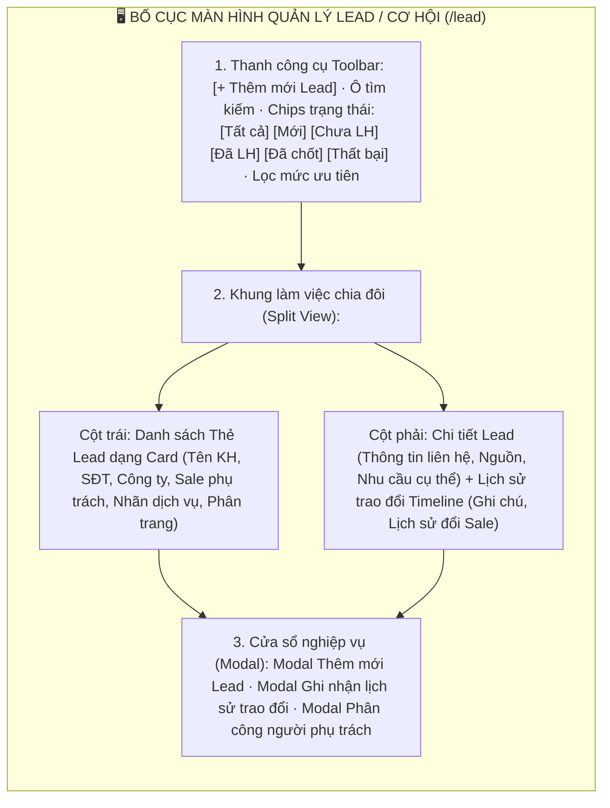
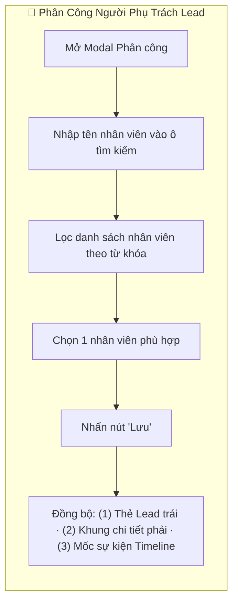

# 📋 TÀI LIỆU ĐẶC TẢ YÊU CẦU CHỨC NĂNG (REQUIREMENTS SPECIFICATION)
## Phân hệ: Quản lý Tiền bán hàng & Cơ hội (Pre-Sales & CRM) — Hệ thống VNTEST LIMS
### Tính năng: Quản lý Lead / Cơ hội tiềm năng (Lead Management Screen)

---

| Thông tin tài liệu | Chi tiết |
| :--- | :--- |
| **Mã tài liệu** | `REQ_VNTEST_LEADS` |
| **Tính năng / Màn hình** | Quản lý Lead / Cơ hội tiềm năng (Lead Management Screen) |
| **Đường dẫn truy cập** | `/lead` (hoặc chuyển tab `LEAD / CƠ HỘI` trên menu kinh doanh) |
| **Đối tượng sử dụng** | Nhân viên Kinh doanh (Sale), Trưởng phòng Kinh doanh, CSKH, Marketing, Admin |
| **Trạng thái tài liệu** | `Approved / Ready for Development & Testing` |
| **Cơ sở dữ liệu liên kết** | `leads`, `lead_notes`, `lead_assignments`, `customers`, `services`, `users` |
| **Test Script Playwright** | [`src/tests/leads/leads.spec.ts`](file:///home/thai.hoang.dinh/VNTEST_Automation/src/tests/leads/leads.spec.ts) (17 Test Cases) |
| **Page Object Model** | [`src/pages/leads.page.ts`](file:///home/thai.hoang.dinh/VNTEST_Automation/src/pages/leads.page.ts) |
| **Dữ liệu kiểm thử** | [`test-data/users.json`](file:///home/thai.hoang.dinh/VNTEST_Automation/test-data/users.json), `test-data/leads.json` |

---

## 📑 MỤC LỤC ĐIỀU HƯỚNG NHANH
1. [1. Định vị màn hình & Tổng quan tính năng (Overview & UI Layout)](#1-định-vị-màn-hình--tổng-quan-tính-năng-overview--ui-layout)
2. [2. Sơ đồ phân tích luồng trực quan (Mermaid Flowcharts)](#2-sơ-đồ-phân-tích-luồng-trực-quan-mermaid-flowcharts)
3. [3. Phân quyền & Điều kiện kích hoạt (Access & Permissions)](#3-phân-quyền--điều-kiện-kích-hoạt-access--permissions)
4. [4. Đặc tả chi tiết các Use Cases chức năng (Functional Use Cases)](#4-đặc-tả-chi-tiết-các-use-cases-chức-năng-functional-use-cases)
5. [5. Đặc tả chi tiết trường dữ liệu (Field Specifications Matrix)](#5-đặc-tả-chi-tiết-trường-dữ-liệu-field-specifications-matrix)
6. [6. Ma trận nút bấm & Tương tác giao diện (Action Buttons Matrix)](#6-ma-trận-nút-bấm--tương-tác-giao-diện-action-buttons-matrix)
7. [7. Quy tắc nghiệp vụ & Luồng xử lý lỗi (Business Rules & Error Handling)](#7-quy-tắc-nghiệp-vụ--luồng-xử-lý-lỗi-business-rules--error-handling)
8. [8. Kế hoạch kiểm thử & Ma trận Test Cases Automation (17 Test Cases)](#8-kế-hoạch-kiểm-thử--ma-trận-test-cases-automation-17-test-cases)

---

## 1. ĐỊNH VỊ MÀN HÌNH & TỔNG QUAN TÍNH NĂNG (OVERVIEW & UI LAYOUT)

### 1.1. Mục đích tính năng
* **Quản trị Toàn diện Lead / Cơ hội Kinh doanh:** Tiếp nhận, sàng lọc và nuôi dưỡng các cơ hội tiềm năng từ các kênh marketing, hotline, website, mạng xã hội hoặc khách quen giới thiệu trước khi chuyển đổi thành Khách hàng chính thức.
* **Bố cục 3 Phân khu Tương tác Cao (3-Pane Layout):** Thanh công cụ & Chiptabs lọc trạng thái ở trên cùng, Cột danh sách Thẻ Lead dạng Card ở bên trái và Khung xem chi tiết Lead + Dòng thời gian trao đổi (Timeline) ở bên phải.
* **Theo dõi Dòng Thời Gian Trao đổi (Exchange History Timeline):** Cho phép nhân viên kinh doanh liên tục ghi nhận các ghi chú trao đổi (cuộc gọi, gặp mặt, email) theo thời gian thực để không bỏ sót tiến độ chăm sóc.
* **Phân công & Điều phối Cơ hội (Lead Assignment):** Trưởng phòng hoặc người tiếp nhận có thể bàn giao và phân công Lead cho nhân sự kinh doanh phù hợp kèm cập nhật đồng bộ ngay trên thẻ và dòng thời gian.
* **Chuyển đổi Sang Báo giá (Quote Conversion):** Hỗ trợ nút tác vụ tạo nhanh Báo giá thử nghiệm từ thông tin nhu cầu của Lead.

### 1.2. Bố cục Giao diện & Các Phân khu Chức năng (UI Layout Matrix)

| Phân khu (Section) | Vị trí hiển thị | Thành phần giao diện chính | Mục đích & Nghiệp vụ |
| :--- | :--- | :--- | :--- |
| **1. Thanh công cụ (Toolbar)** | Trên cùng màn hình | Nút `"+ Thêm mới Lead"`, ô tìm kiếm kèm nút `"Hủy"`, Chiptabs: `Tất cả`, `Mới`, `Chưa LH`, `Đã LH`, `Đã chốt`, `Thất bại`, nút lọc ưu tiên | Kích hoạt thêm Lead mới, lọc nhanh theo chu trình chăm sóc và tìm kiếm theo tên khách hàng |
| **2. Cột Danh sách Thẻ Lead** | Nửa bên trái màn hình | Danh sách các Card Lead hiển thị: Tên khách hàng, SĐT, Công ty, Trạng thái, Dịch vụ quan tâm, Phân trang trước/sau | Hiển thị tổng quan các cơ hội, nhấp chọn thẻ để hiển thị chi tiết bên phải |
| **3. Khung Chi tiết Lead** | Nửa bên phải (Phần trên) | Thông tin khách hàng, Tên công ty, SĐT, Email, Nguồn tiếp cận, Người phụ trách, Ngày nhận, Giá trị dự kiến, Nhu cầu cụ thể, Nút `"Sửa"`, `"Ghi nhận"`, `"Tạo báo giá"` | Tra cứu đầy đủ thông tin của Lead đang chọn và kích hoạt các tác vụ chuyển đổi |
| **4. Dòng Thời Gian (Timeline)** | Nửa bên phải (Phần dưới) | Header Lịch sử trao đổi, danh sách các mốc thời gian: Ghi chú trao đổi, sự kiện bàn giao người phụ trách, thời gian và người thực hiện | Lưu vết minh bạch quá trình tương tác chăm sóc khách hàng từ lúc tạo Lead |
| **5. Cửa sổ Modal nghiệp vụ** | Trung tâm màn hình | Modal Thêm mới Lead, Modal Ghi nhận trao đổi, Modal Phân công người phụ trách | Thực hiện các thao tác nhập liệu chính của phân hệ |

---

## 2. SƠ ĐỒ PHÂN TÍCH LUỒNG TRỰC QUAN (MERMAID FLOWCHARTS)

### 2.1. Sơ đồ Master Flow Tiếp nhận & Chăm sóc Lead

### 2.2. Sơ đồ Luồng Phân công Người Phụ trách (Lead Assignment)

---

## 3. PHÂN QUYỀN & ĐIỀU KIỆN KÍCH HOẠT (ACCESS & PERMISSIONS)

### 3.1. Ma trận phân quyền truy cập (RBAC Matrix)

| Vai trò người dùng (Role) | Xem Lead của mình | Xem toàn bộ Lead | Thêm mới Lead | Ghi nhận trao đổi | Phân công người phụ trách | Tạo báo giá |
| :--- | :---: | :---: | :---: | :---: | :---: | :---: |
| **Quản trị viên (Admin)** | Toàn quyền | Toàn quyền | Toàn quyền | Toàn quyền | Toàn quyền | Khả dụng |
| **Trưởng phòng Kinh doanh**| Toàn quyền | Toàn quyền | Toàn quyền | Toàn quyền | Thẩm quyền chính | Khả dụng |
| **Nhân viên Sale (Kinh doanh)**| Toàn quyền | Xem Lead chung | Được phép | Được phép | Đề xuất phân công | Khả dụng |
| **Nhân viên Marketing / CSKH** | Xem Lead tạo ra | Xem toàn bộ | Được phép | Được phép | Xem tiến độ | Không có quyền |

### 3.2. Tiền điều kiện & Ràng buộc nghiệp vụ
* **Trường bắt buộc khi tạo Lead:** Tên khách hàng, Số điện thoại và ít nhất một Dịch vụ quan tâm (Thử nghiệm thực phẩm, Môi trường, Dệt may, Hiệu chuẩn...).
* **Đồng bộ 3 Phân khu:** Khi một Lead mới được tạo hoặc cập nhật, thông tin bắt buộc phải phản ánh đồng thời ở cả 3 khối: Thẻ Lead bên trái, Khung chi tiết bên phải và Dòng thời gian Timeline.

---

## 4. ĐẶC TẢ CHI TIẾT CÁC USE CASES CHỨC NĂNG (FUNCTIONAL USE CASES)

### UC-01: Bố cục Màn hình, Tìm kiếm & Lọc Thẻ Lead (Khối 01)
* **Tác nhân:** Người dùng mọi quyền hạn.
* **Luồng sự kiện chính:**
  1. Người dùng truy cập đường dẫn `/lead`.
  2. Hệ thống nạp màn hình với danh sách Thẻ Lead bên trái và khung chi tiết bên phải.
  3. Người dùng nhập tên khách hàng vào ô tìm kiếm ➔ Danh sách thẻ lọc ra đúng các Lead có tên tương ứng.
  4. Nhấn nút `"Hủy"` (icon [x]) trên ô tìm kiếm ➔ Xóa từ khóa và hoàn nguyên danh sách ban đầu.
  5. Nhấp chọn các chip trạng thái (`Mới`, `Chưa liên hệ`, `Đã liên hệ`, `Đã chốt`, `Thất bại`) ➔ Thẻ Lead được lọc tương ứng theo trạng thái chăm sóc.
  6. Nhấp chuột vào một thẻ Lead bất kỳ ➔ Khung bên phải cập nhật chi tiết và nạp timeline của Lead đó.

### UC-02: Thêm mới Lead & Validation Ràng buộc (Khối 02)
* **Tác nhân:** Nhân viên Sale, Marketing, Admin.
* **Luồng sự kiện chính:**
  1. Nhấn nút `"+ Thêm mới Lead"` trên thanh công cụ.
  2. Modal tạo mới hiển thị các trường: Tên khách hàng, Số điện thoại, Tên công ty, Email, Nguồn tiếp cận, Dịch vụ quan tâm, Nhu cầu cụ thể.
  3. **Kiểm tra Validation:**
     - Nếu để trống toàn bộ ➔ Báo lỗi các trường bắt buộc.
     - Nếu để trống riêng Tên khách hàng ➔ Báo lỗi bắt buộc nhập tên.
     - Nếu để trống riêng Số điện thoại ➔ Báo lỗi bắt buộc nhập SĐT.
     - Nếu chưa chọn Dịch vụ quan tâm ➔ Báo lỗi yêu cầu chọn dịch vụ.
  4. **Lưu thành công:**
     - Người dùng nhập đầy đủ thông tin hợp lệ và nhấn nút `"Lưu"`.
     - Modal đóng lại, hiển thị thông báo thành công.
     - Thẻ Lead mới xuất hiện ngay đầu danh sách và được tự động chọn để hiển thị chi tiết bên phải.

### UC-03: Ghi nhận Lịch sử Trao đổi & Timeline (Khối 03)
* **Tác nhân:** Nhân viên Sale đang chăm sóc Lead.
* **Luồng sự kiện chính:**
  1. Chọn một Lead từ danh sách thẻ bên trái.
  2. Tại khung chi tiết bên phải, nhấn nút `"Ghi nhận"`.
  3. Modal `"Ghi nhận lịch sử trao đổi"` mở ra.
  4. Nếu để trống ô nội dung và nhấn Lưu ➔ Hệ thống chặn lưu và cảnh báo.
  5. Nhập nội dung trao đổi chi tiết (ví dụ: *"Đã gọi điện tư vấn chỉ tiêu COD/BOD, khách hẹn gửi mẫu tuần tới"*) và nhấn nút `"Lưu"`.
  6. Modal đóng lại, một mốc sự kiện mới được thêm ngay vào đầu dòng thời gian Timeline với tên người ghi nhận và thời gian thực.

### UC-04: Phân công Người Phụ trách (Khối 04)
* **Tác nhân:** Trưởng phòng Kinh doanh, Admin.
* **Luồng sự kiện chính:**
  1. Tại khung chi tiết Lead, nhấn nút phân công người phụ trách (hoặc mở modal phân công).
  2. Modal mở ra hiển thị danh sách các nhân viên kinh doanh của Viện.
  3. Người dùng nhập tên nhân viên vào ô tìm kiếm để lọc nhanh danh sách.
  4. Chọn nhân viên mong muốn và nhấn nút `"Lưu"`.
  5. Hệ thống cập nhật người phụ trách mới: Tên Sale mới hiển thị ngay trên Thẻ Lead bên trái, Khung chi tiết bên phải và một mốc sự kiện phân công tự động được ghi nhận vào Timeline.

---

## 5. ĐẶC TẢ CHI TIẾT TRƯỜNG DỮ LIỆU (FIELD SPECIFICATIONS MATRIX)

| STT | Tên trường hiển thị | Vị trí form | Phân loại | Bắt buộc | Ràng buộc nghiệp vụ & Validation |
| :---: | :--- | :--- | :---: | :---: | :--- |
| 1 | **Tên khách hàng** | Modal Thêm Lead | Text Input | Có | Họ tên cá nhân đại diện hoặc người liên hệ chính |
| 2 | **Số điện thoại** | Modal Thêm Lead | Text Input | Có | 10 chữ số, định dạng số điện thoại liên lạc |
| 3 | **Tên công ty** | Modal Thêm Lead | Text Input | Không | Đơn vị công tác / Doanh nghiệp của khách hàng |
| 4 | **Email** | Modal Thêm Lead | Text Input | Không | Định dạng email chuẩn |
| 5 | **Nguồn tiếp cận** | Modal Thêm Lead | Select Dropdown | Không | Website, Hotline, Giới thiệu, Fanpage... |
| 6 | **Dịch vụ quan tâm** | Modal Thêm Lead | Checkbox / Multi | Có | Phải chọn ít nhất 1 dịch vụ thử nghiệm quan tâm |
| 7 | **Nhu cầu cụ thể** | Modal Thêm Lead | Textarea | Không | Mô tả yêu cầu kỹ thuật chi tiết của khách |
| 8 | **Nội dung trao đổi** | Modal Ghi nhận | Textarea | Có | Bắt buộc nhập khi ghi nhận lịch sử tương tác |
| 9 | **Người phụ trách** | Modal Phân công | Select / List | Có | Chọn 1 nhân sự kinh doanh đang hoạt động |

---

## 6. MA TRẬN NÚT BẤM & TƯƠNG TÁC GIAO DIỆN (ACTION BUTTONS MATRIX)

| STT | Tên nút bấm / Icon | Vị trí hiển thị | Trạng thái mặc định | Điều kiện kích hoạt | Hành vi hệ thống khi thao tác |
| :---: | :--- | :--- | :---: | :--- | :--- |
| 1 | **Nút "+ Thêm mới Lead"** | Thanh công cụ Toolbar | Khả dụng | Nhấp chuột | Mở Modal Thêm mới Lead tiềm năng |
| 2 | **Nút "Hủy" tìm kiếm** | Trong ô tìm kiếm | Ẩn khi rỗng | Có từ khóa | Xóa trắng ô tìm kiếm và nạp lại danh sách đầy đủ |
| 3 | **Chiptabs Trạng thái** | Dưới thanh tìm kiếm | Khả dụng | Nhấp chuột | Lọc danh sách thẻ Lead theo trạng thái tương ứng |
| 4 | **Thẻ Lead (Lead Card)** | Cột danh sách bên trái | Khả dụng | Nhấp chuột | Kích hoạt hiển thị chi tiết Lead và dòng thời gian bên phải |
| 5 | **Nút "Ghi nhận"** | Khung chi tiết bên phải | Khả dụng | Nhấp chuột | Mở Modal Ghi nhận lịch sử trao đổi của Lead |
| 6 | **Nút "Phân công"** | Khung chi tiết bên phải | Khả dụng | Nhấp chuột | Mở Modal Phân công người phụ trách mới |
| 7 | **Nút "Tạo báo giá"** | Khung chi tiết bên phải | Khả dụng | Nhấp chuột | Điều hướng sang phân hệ Báo giá thử nghiệm kèm dữ liệu Lead |
| 8 | **Nút "Lưu" (Modal Lead)** | Chân Modal Lead | Khả dụng | Nhấp chuột | Validate dữ liệu, lưu Lead mới và đóng modal |
| 9 | **Nút "Hủy" (Các Modal)** | Chân các Modal | Khả dụng | Nhấp chuột | Đóng modal và hủy bỏ mọi thay đổi chưa lưu |

---

## 7. QUY TẮC NGHIỆP VỤ & LUỒNG XỬ LÝ LỖI (BUSINESS RULES & ERROR HANDLING)

### 7.1. Quy tắc nghiệp vụ trọng yếu (Business Rules - BR)
* **BR-01 (Ràng buộc Thông tin Tiếp cận Tối thiểu):** Bắt buộc phải có Tên, Số điện thoại và ít nhất một Dịch vụ quan tâm để đảm bảo cơ hội có tính khả thi chuyển đổi cao.
* **BR-02 (Tính Toàn vẹn Dòng Thời Gian):** Mọi sự kiện tương tác (Ghi nhận trao đổi, Phân công người phụ trách, Thay đổi trạng thái) đều được tự động lưu vết vĩnh viễn vào Timeline với dấu ấn thời gian và danh tính người thao tác, không cho phép xóa sửa mốc lịch sử.
* **BR-03 (Đồng bộ Đa Khối):** Khi thực hiện bất kỳ thay đổi nào (đổi người phụ trách, ghi nhận ghi chú), hệ thống phải cập nhật tức thì trên Thẻ Lead bên trái, Khung chi tiết và Timeline bên phải mà không cần reload trang.

### 7.2. Luồng xử lý ngoại lệ & Thông báo lỗi (Error Handling Matrix)

| Mã lỗi / Tình huống ngoại lệ | Nguyên nhân kích hoạt | Phản hồi của hệ thống & Thông báo hiển thị | Hướng xử lý cho người dùng |
| :--- | :--- | :--- | :--- |
| **ERR_LEAD_MISSING_NAME** | Để trống Tên khách hàng khi tạo Lead | Cảnh báo: *"Vui lòng nhập tên khách hàng."* | Điền họ tên khách hàng đại diện |
| **ERR_LEAD_MISSING_PHONE** | Để trống Số điện thoại khi tạo Lead | Cảnh báo: *"Vui lòng nhập số điện thoại."* | Điền số điện thoại liên lạc 10 số |
| **ERR_LEAD_NO_SERVICE** | Chưa tích chọn Dịch vụ quan tâm | Cảnh báo: *"Vui lòng chọn ít nhất một dịch vụ quan tâm."* | Tích chọn lĩnh vực thử nghiệm phù hợp |
| **ERR_NOTE_EMPTY** | Ghi nhận trao đổi nhưng để trống nội dung | Cảnh báo: *"Vui lòng nhập nội dung trao đổi."* | Nhập tóm tắt nội dung cuộc gọi/tư vấn |

---

## 8. KẾ HOẠCH KIỂM THỬ & MA TRẬN TEST CASES AUTOMATION (17 TEST CASES)

### 8.1. Thống kê độ phủ kiểm thử theo Phân nhóm chức năng

| Nhóm chức năng (Feature Scope) | Số kịch bản (TCs) | Tỷ lệ độ phủ | Trạng thái Automation |
| :--- | :---: | :---: | :---: |
| **Khối 01: Bố cục, Tìm kiếm, Lọc Chip & Xem chi tiết** | 05 | 29.4% | `Passed 100%` |
| **Khối 02: Tạo mới Lead & Validation bắt buộc** | 06 | 35.3% | `Passed 100%` |
| **Khối 03: Ghi nhận Lịch sử trao đổi & Timeline** | 03 | 17.6% | `Passed 100%` |
| **Khối 04: Phân công Người phụ trách mới** | 03 | 17.6% | `Passed 100%` |
| **TỔNG CỘNG ĐỘ PHỦ KIỂM THỬ** | **17 Test Cases** | **100%** | **Playwright Automated** |

---

### 8.2. Chi tiết Ma trận Test Cases Automation (17 Test Cases)

### 8.2.1. KHỐI 01: BỐ CỤC, TÌM KIẾM, LỌC CHIP & XEM CHI TIẾT (Layout, Search, Filter & Detail) (5 Test Cases)

| Mã TC | Phân nhóm luồng | Tên kịch bản | Thao tác & Dữ liệu kiểm thử | Kết quả mong đợi | Mức độ ưu tiên | Mapping Page Object |
| :--- | :--- | :--- | :--- | :--- | :---: | :--- |
| **TC_LEAD_001** | 01: BỐ CỤC, TÌM KIẾM, LỌC CHIP & XEM CHI TIẾT | Hiển thị đầy đủ các thành phần màn hình danh sách Lead | 1. Điều hướng tới màn hình Lead tại /lead.  2. Kiểm tra hiển thị tiêu đề, thanh công cụ, các chip trạng thái và danh sách thẻ Lead.  3. Kiểm tra khung chi tiết Lead và dòng thời gian ở bên phải. | 1. Giao diện hiển thị sắc nét, chuẩn bố cục chia đôi với đầy đủ danh sách thẻ và khung chi tiết.  2. Các phân khu chức năng nạp dữ liệu hoàn chỉnh. | Low | `leadsPage` |
| **TC_LEAD_002** | 01: BỐ CỤC, TÌM KIẾM, LỌC CHIP & XEM CHI TIẾT | Tìm kiếm Lead theo tên khách hàng | 1. Nhập một phần tên khách hàng vào ô tìm kiếm.  2. Quan sát danh sách thẻ Lead được lọc ra ở cột bên trái. | 1. Danh sách chỉ hiển thị các thẻ Lead có tên khách hàng chứa từ khóa tìm kiếm.  2. Tìm kiếm nhanh chóng và không phân biệt chữ hoa/thường. | High | `leadsPage` |
| **TC_LEAD_003** | 01: BỐ CỤC, TÌM KIẾM, LỌC CHIP & XEM CHI TIẾT | Xóa từ khóa tìm kiếm bằng nút "Hủy" | 1. Khi đang có từ khóa tìm kiếm trong ô, nhấn nút "Hủy" (icon [x]).  2. Quan sát phản hồi của ô nhập liệu và danh sách thẻ. | 1. Ô tìm kiếm được xóa sạch từ khóa.  2. Danh sách thẻ Lead khôi phục lại toàn bộ dữ liệu ban đầu. | Low | `leadsPage` |
| **TC_LEAD_004** | 01: BỐ CỤC, TÌM KIẾM, LỌC CHIP & XEM CHI TIẾT | Lọc danh sách theo chip trạng thái | 1. Nhấp chọn lần lượt các chip trạng thái: "Mới", "Chưa liên hệ", "Đã liên hệ".  2. Kiểm tra trạng thái của các thẻ Lead hiển thị tương ứng. | 1. Chip được chọn chuyển sang trạng thái active.  2. Danh sách chỉ bao gồm các Lead có trạng thái trùng khớp với chip được chọn. | High | `leadsPage` |
| **TC_LEAD_005** | 01: BỐ CỤC, TÌM KIẾM, LỌC CHIP & XEM CHI TIẾT | Chọn thẻ Lead để xem chi tiết bên phải | 1. Nhấp chuột vào một thẻ Lead bất kỳ trong danh sách bên trái.  2. Quan sát khung chi tiết và timeline ở bên phải. | 1. Thẻ Lead được viền sáng biểu thị trạng thái đang chọn.  2. Khung bên phải nạp chính xác thông tin chi tiết và dòng thời gian của Lead tương ứng. | High | `leadsPage` |

### 8.2.2. KHỐI 02: TẠO MỚI LEAD & VALIDATION BẮT BUỘC (Create Lead & Validation) (6 Test Cases)

| Mã TC | Phân nhóm luồng | Tên kịch bản | Thao tác & Dữ liệu kiểm thử | Kết quả mong đợi | Mức độ ưu tiên | Mapping Page Object |
| :--- | :--- | :--- | :--- | :--- | :---: | :--- |
| **TC_LEAD_006** | 02: TẠO MỚI LEAD & VALIDATION BẮT BUỘC | Mở và đóng hộp thoại Thêm mới Lead bằng nút "Hủy" | 1. Nhấn nút "+ Thêm mới Lead" trên thanh công cụ.  2. Kiểm tra modal thêm mới mở ra.  3. Nhấn nút "Hủy" ở chân modal. | 1. Modal mở ra đúng form tạo mới cơ hội.  2. Khi nhấn nút "Hủy", modal đóng lại an toàn mà không lưu dữ liệu. | Low | `leadsPage` |
| **TC_LEAD_007** | 02: TẠO MỚI LEAD & VALIDATION BẮT BUỘC | Bỏ trống toàn bộ các trường bắt buộc khi tạo Lead | 1. Mở modal tạo mới Lead.  2. Để trống toàn bộ các trường và nhấn nút "Lưu". | 1. Hệ thống chặn lưu dữ liệu.  2. Đánh dấu viền đỏ và hiển thị cảnh báo yêu cầu nhập các trường bắt buộc. | High | `leadsPage` |
| **TC_LEAD_008** | 02: TẠO MỚI LEAD & VALIDATION BẮT BUỘC | Bỏ trống riêng trường Tên khách hàng | 1. Nhập Số điện thoại và chọn Dịch vụ nhưng để trống Tên khách hàng.  2. Nhấn nút "Lưu". | 1. Hệ thống hiển thị cảnh báo: "Vui lòng nhập tên khách hàng".  2. Ngăn ngừa tạo Lead khuyết danh. | High | `leadsPage` |
| **TC_LEAD_009** | 02: TẠO MỚI LEAD & VALIDATION BẮT BUỘC | Bỏ trống riêng trường Số điện thoại | 1. Nhập Tên khách hàng và chọn Dịch vụ nhưng để trống Số điện thoại.  2. Nhấn nút "Lưu". | 1. Hệ thống hiển thị cảnh báo: "Vui lòng nhập số điện thoại".  2. Đảm bảo luôn có kênh liên lạc với khách hàng. | High | `leadsPage` |
| **TC_LEAD_010** | 02: TẠO MỚI LEAD & VALIDATION BẮT BUỘC | Chưa chọn Dịch vụ quan tâm | 1. Nhập Tên khách hàng và Số điện thoại nhưng không tích chọn dịch vụ nào.  2. Nhấn nút "Lưu". | 1. Hệ thống cảnh báo yêu cầu chọn ít nhất một dịch vụ quan tâm.  2. Đảm bảo tính khả thi định hướng kinh doanh. | High | `leadsPage` |
| **TC_LEAD_011** | 02: TẠO MỚI LEAD & VALIDATION BẮT BUỘC | Thêm mới Lead thành công và kiểm tra hiển thị đồng bộ ở cả 3 khối | 1. Nhập đầy đủ Tên khách hàng, SĐT, Tên công ty, chọn Dịch vụ quan tâm.  2. Nhấn nút "Lưu".  3. Kiểm tra hiển thị trên Thẻ Lead bên trái, Khung chi tiết và Timeline bên phải. | 1. Hiển thị thông báo tạo Lead thành công và đóng modal.  2. Thẻ Lead mới xuất hiện ngay đầu danh sách, khung chi tiết hiển thị đúng thông tin và Timeline ghi nhận mốc khởi tạo. | Critical | `leadsPage` |

### 8.2.3. KHỐI 03: GHI NHẬN LỊCH SỬ TRAO ĐỔI & DÒNG THỜI GIAN (Exchange History & Timeline) (3 Test Cases)

| Mã TC | Phân nhóm luồng | Tên kịch bản | Thao tác & Dữ liệu kiểm thử | Kết quả mong đợi | Mức độ ưu tiên | Mapping Page Object |
| :--- | :--- | :--- | :--- | :--- | :---: | :--- |
| **TC_LEAD_012** | 03: GHI NHẬN LỊCH SỬ TRAO ĐỔI & DÒNG THỜI GIAN | Mở và đóng hộp thoại Ghi nhận lịch sử trao đổi bằng nút "Hủy" | 1. Tại khung chi tiết Lead bên phải, nhấn nút "Ghi nhận".  2. Kiểm tra modal ghi nhận trao đổi mở ra.  3. Nhấn nút "Hủy". | 1. Modal mở ra với khung textarea nhập nội dung trao đổi.  2. Nhấn "Hủy" giúp đóng modal mà không phát sinh mốc lịch sử mới. | Low | `leadsPage` |
| **TC_LEAD_013** | 03: GHI NHẬN LỊCH SỬ TRAO ĐỔI & DÒNG THỜI GIAN | Bỏ trống trường Nội dung trao đổi khi ghi nhận | 1. Mở modal Ghi nhận trao đổi.  2. Để trống ô nội dung và nhấn nút "Lưu". | 1. Hệ thống báo lỗi bắt buộc nhập nội dung trao đổi.  2. Chặn việc ghi nhận các mốc lịch sử rỗng. | Low | `leadsPage` |
| **TC_LEAD_014** | 03: GHI NHẬN LỊCH SỬ TRAO ĐỔI & DÒNG THỜI GIAN | Ghi nhận lịch sử trao đổi thành công và cập nhật timeline | 1. Nhập nội dung trao đổi chi tiết vào textarea.  2. Nhấn nút "Lưu".  3. Kiểm tra sự xuất hiện của mốc mới trên dòng thời gian Timeline. | 1. Modal đóng lại sau khi lưu thành công.  2. Mốc ghi nhận mới xuất hiện ngay trên đầu Timeline với đầy đủ nội dung, tên người ghi và thời gian thực. | High | `leadsPage` |

### 8.2.4. KHỐI 04: PHÂN CÔNG NGƯỜI PHỤ TRÁCH (Lead Assignment Flow) (3 Test Cases)

| Mã TC | Phân nhóm luồng | Tên kịch bản | Thao tác & Dữ liệu kiểm thử | Kết quả mong đợi | Mức độ ưu tiên | Mapping Page Object |
| :--- | :--- | :--- | :--- | :--- | :---: | :--- |
| **TC_LEAD_015** | 04: PHÂN CÔNG NGƯỜI PHỤ TRÁCH | Mở và đóng hộp thoại Phân công người phụ trách bằng nút "Hủy" | 1. Nhấn nút phân công người phụ trách tại khung chi tiết.  2. Kiểm tra modal phân công mở ra.  3. Nhấn nút "Hủy". | 1. Modal hiển thị danh sách nhân viên kinh doanh kèm ô tìm kiếm.  2. Nhấn "Hủy" đóng modal an toàn và giữ nguyên Sale phụ trách hiện tại. | Low | `leadsPage` |
| **TC_LEAD_016** | 04: PHÂN CÔNG NGƯỜI PHỤ TRÁCH | Tìm kiếm nhân viên phụ trách trong danh sách phân công | 1. Mở modal phân công người phụ trách.  2. Nhập tên nhân viên vào ô tìm kiếm nhân sự.  3. Quan sát danh sách nhân sự được lọc ra. | 1. Danh sách nhân sự lọc chính xác nhân viên có tên trùng khớp từ khóa.  2. Giúp điều phối viên nhanh chóng tìm kiếm đúng nhân sự. | Low | `leadsPage` |
| **TC_LEAD_017** | 04: PHÂN CÔNG NGƯỜI PHỤ TRÁCH | Phân công người phụ trách mới thành công và cập nhật đồng bộ các khối | 1. Chọn một nhân sự kinh doanh mới và nhấn nút "Lưu".  2. Kiểm tra đồng bộ tên Sale mới trên Thẻ Lead bên trái, Khung chi tiết và mốc sự kiện trên Timeline. | 1. Hiển thị thông báo phân công thành công và đóng modal.  2. Tên Sale mới cập nhật ngay trên Thẻ Lead, Khung chi tiết và một mốc phân công mới được ghi vào Timeline. | Critical | `leadsPage` |
