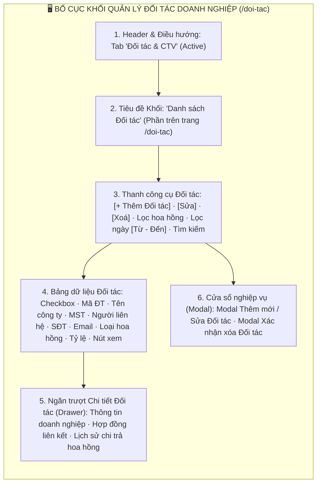
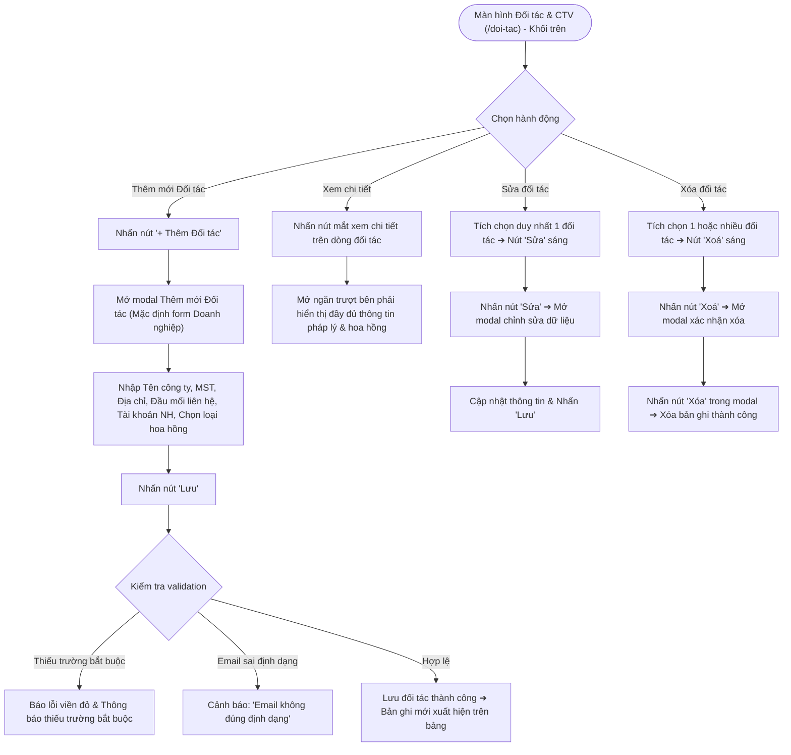

# 📋 TÀI LIỆU ĐẶC TẢ YÊU CẦU CHỨC NĂNG (REQUIREMENTS SPECIFICATION)
## Phân hệ: Quản trị Đối tác & Kênh Phân phối — Hệ thống VNTEST LIMS
### Tính năng: Quản lý Đối tác Doanh nghiệp (Business Partners Screen)

---

| Thông tin tài liệu | Chi tiết |
| :--- | :--- |
| **Mã tài liệu** | `REQ_VNTEST_PARTNERS` |
| **Tính năng / Màn hình** | Quản lý Đối tác Doanh nghiệp (Business Partners Screen) |
| **Đường dẫn truy cập** | `/doi-tac` (Khối danh sách Đối tác Doanh nghiệp - Phía trên) |
| **Đối tượng sử dụng** | Nhân viên Kinh doanh, Trưởng phòng Kinh doanh, Kế toán, Ban Giám đốc, Admin |
| **Trạng thái tài liệu** | `Approved / Ready for Development & Testing` |
| **Cơ sở dữ liệu liên kết** | `partners`, `commissions`, `contracts`, `users`, `audit_logs` |
| **Test Script Playwright** | [`src/tests/partners/partners.spec.ts`](file:///home/thai.hoang.dinh/VNTEST_Automation/src/tests/partners/partners.spec.ts) (18 Test Cases) |
| **Page Object Model** | [`src/pages/partners.page.ts`](file:///home/thai.hoang.dinh/VNTEST_Automation/src/pages/partners.page.ts) |
| **Dữ liệu kiểm thử** | [`test-data/users.json`](file:///home/thai.hoang.dinh/VNTEST_Automation/test-data/users.json), `test-data/partners.json` |

---

## 📑 MỤC LỤC ĐIỀU HƯỚNG NHANH
1. [1. Định vị màn hình & Tổng quan tính năng (Overview & UI Layout)](#1-định-vị-màn-hình--tổng-quan-tính-năng-overview--ui-layout)
2. [2. Sơ đồ phân tích luồng trực quan (Mermaid Flowcharts)](#2-sơ-đồ-phân-tích-luồng-trực-quan-mermaid-flowcharts)
3. [3. Phân quyền & Điều kiện kích hoạt (Access & Permissions)](#3-phân-quyền--điều-kiện-kích-hoạt-access--permissions)
4. [4. Đặc tả chi tiết các Use Cases chức năng (Functional Use Cases)](#4-đặc-tả-chi-tiết-các-use-cases-chức-năng-functional-use-cases)
5. [5. Đặc tả chi tiết trường dữ liệu (Field Specifications Matrix)](#5-đặc-tả-chi-tiết-trường-dữ-liệu-field-specifications-matrix)
6. [6. Ma trận nút bấm & Tương tác giao diện (Action Buttons Matrix)](#6-ma-trận-nút-bấm--tương-tác-giao-diện-action-buttons-matrix)
7. [7. Quy tắc nghiệp vụ & Luồng xử lý lỗi (Business Rules & Error Handling)](#7-quy-tắc-nghiệp-vụ--luồng-xử-lý-lỗi-business-rules--error-handling)
8. [8. Kế hoạch kiểm thử & Ma trận Test Cases Automation (18 Test Cases)](#8-kế-hoạch-kiểm-thử--ma-trận-test-cases-automation-18-test-cases)

---

## 1. ĐỊNH VỊ MÀN HÌNH & TỔNG QUAN TÍNH NĂNG (OVERVIEW & UI LAYOUT)

### 1.1. Mục đích tính năng
* **Quản trị Mạng lưới Đối tác Doanh nghiệp:** Quản lý danh mục các công ty, tổ chức, viện nghiên cứu liên kết giới thiệu hoặc phối hợp thực hiện dịch vụ thử nghiệm với Viện VNTEST.
* **Cơ chế Quản lý Chính sách Hoa hồng (Commission Policies):** Cung cấp cấu hình chính sách chiết khấu hoa hồng linh hoạt: Hoa hồng Cố định (Fixed Commission Rate) hoặc Hoa hồng Lũy tiến (Progressive Rate) theo doanh số mang lại.
* **Bố cục Phân tầng Trang Đối tác & CTV (/doi-tac):** Trang `/doi-tac` được chia làm 2 khối dữ liệu rõ rệt: Khối trên dành cho **Đối tác Doanh nghiệp (Partners)** và Khối dưới dành cho **Cộng tác viên Cá nhân (Collaborators)**, mỗi khối sở hữu thanh công cụ và bảng danh sách độc lập.
* **Bảo toàn Tính Nhất quán Ngữ cảnh:** Tích chọn 1 đối tác kích hoạt nút `"Sửa"` và `"Xóa"`, tích chọn từ 2 đối tác trở lên chỉ duy trì nút xóa hàng loạt (nếu hợp lệ) và làm mờ nút sửa.

### 1.2. Bố cục Giao diện & Các Phân khu Chức năng (UI Layout Matrix)

| Phân khu (Section) | Vị trí hiển thị | Thành phần giao diện chính | Mục đích & Nghiệp vụ |
| :--- | :--- | :--- | :--- |
| **1. Header & Tab** | Trên cùng trang | Tab `Đối tác & CTV` (active) | Định vị phân hệ quản trị mạng lưới đối tác và CTV |
| **2. Tiêu đề Khối Đối tác**| Phía trên bảng | Tiêu đề khối `Danh sách Đối tác` và mô tả chức năng | Tách biệt rõ ràng với khối CTV ở phía dưới |
| **3. Thanh công cụ (Toolbar)** | Dưới Tiêu đề khối | Nút `"+ Thêm Đối tác"`, `"Sửa"`, `"Xoá"`, Lọc loại hoa hồng, Lọc ngày `Từ - Đến`, Ô tìm kiếm | Thao tác tác vụ nhanh trên danh sách đối tác doanh nghiệp |
| **4. Bảng danh sách Đối tác** | Nửa trên màn hình | Checkbox chọn dòng, Mã ĐT, Tên công ty, MST, Người liên hệ, SĐT, Email, Loại hoa hồng, Tỷ lệ %, Nút xem chi tiết | Hiển thị thông tin đối tác dạng bảng phân trang |
| **5. Ngăn Chi tiết (Drawer)** | Trượt từ mép phải | Thông tin pháp lý công ty, tài khoản ngân hàng, đầu mối liên hệ, chính sách hoa hồng | Tra cứu hồ sơ đối tác mà không cần chuyển màn hình |
| **6. Cửa sổ Modal nghiệp vụ** | Trung tâm màn hình | Modal Thêm/Sửa Đối tác (Doanh nghiệp), Modal Xác nhận xóa | Nhập liệu tạo mới, cập nhật và xóa bỏ đối tác |

---

## 2. SƠ ĐỒ PHÂN TÍCH LUỒNG TRỰC QUAN (MERMAID FLOWCHARTS)

### 2.1. Sơ đồ Master Flow Quản lý Đối tác Doanh nghiệp

---

## 3. PHÂN QUYỀN & ĐIỀU KIỆN KÍCH HOẠT (ACCESS & PERMISSIONS)

### 3.1. Ma trận phân quyền truy cập (RBAC Matrix)

| Vai trò người dùng (Role) | Xem danh sách Đối tác | Thêm mới Đối tác | Sửa thông tin | Xóa đối tác | Cấu hình hoa hồng |
| :--- | :---: | :---: | :---: | :---: | :---: |
| **Quản trị viên (Admin)** | Toàn quyền | Toàn quyền | Toàn quyền | Toàn quyền | Toàn quyền |
| **Ban Giám đốc** | Toàn quyền | Thêm mới | Duyệt sửa | Phê duyệt xóa | Phê duyệt tỷ lệ |
| **Trưởng phòng Kinh doanh**| Xem toàn bộ | Thêm mới | Sửa đối tác | Đề xuất xóa | Đề xuất tỷ lệ |
| **Nhân viên Sale (Kinh doanh)**| Xem đối tác của mình | Thêm mới | Sửa đối tác của mình | Bị chặn xóa | Xem tỷ lệ |

### 3.2. Tiền điều kiện & Ràng buộc chuyển trạng thái
* **Quy tắc Nút Sửa & Xóa:**
  - Khi chưa chọn dòng: Cả nút `"Sửa"` và `"Xoá"` ở trạng thái disabled.
  - Khi chọn duy nhất 1 dòng: Cả 2 nút `"Sửa"` và `"Xoá"` đều được kích hoạt sáng lên (enabled).
  - Khi chọn từ 2 dòng trở lên: Nút `"Sửa"` bị disabled, nút `"Xoá"` duy trì enabled (hỗ trợ xóa hàng loạt).

---

## 4. ĐẶC TẢ CHI TIẾT CÁC USE CASES CHỨC NĂNG (FUNCTIONAL USE CASES)

### UC-01: Bố cục Khối Đối tác & Thanh Công cụ (Khối 01)
* **Tác nhân:** Người dùng mọi quyền hạn.
* **Luồng sự kiện chính:**
  1. Người dùng điều hướng tới `/doi-tac`.
  2. Hệ thống hiển thị tab `Đối tác & CTV`, khối danh sách Đối tác Doanh nghiệp ở nửa trên và khối CTV ở nửa dưới.
  3. Thanh công cụ đối tác hiển thị đầy đủ các nút tác vụ, bộ lọc hoa hồng và ô tìm kiếm.
  4. Trạng thái các nút tác vụ thay đổi linh hoạt theo số lượng dòng được tích chọn checkbox.

### UC-02: Bộ lọc Hoa hồng & Tìm kiếm Đối tác (Khối 02)
* **Tác nhân:** Nhân viên kinh doanh, Kế toán.
* **Luồng sự kiện chính:**
  1. Lọc theo Loại hoa hồng: Chọn `"Lũy tiến"` hoặc `"Cố định"` ➔ Danh sách lọc ra đúng các đối tác áp dụng chính sách tương ứng.
  2. Tìm kiếm theo Tên công ty: Nhập từ khóa tên đối tác ➔ Bảng lọc ra các doanh nghiệp phù hợp.
  3. Tìm kiếm từ khóa không tồn tại ➔ Hiển thị bảng trống và thông báo không tìm thấy kết quả.

### UC-03: Thêm mới Đối tác & Validation Dữ liệu (Khối 03)
* **Tác nhân:** Nhân viên kinh doanh, Trưởng phòng.
* **Luồng sự kiện chính:**
  1. Nhấn nút `"+ Thêm Đối tác"` trên thanh công cụ khối Đối tác.
  2. Modal tạo mới mở ra với các trường thông tin doanh nghiệp, người liên hệ và chính sách hoa hồng.
  3. Nếu để trống các trường bắt buộc (Tên công ty, MST, Địa chỉ...) ➔ Báo lỗi vi phạm trường bắt buộc.
  4. Nếu nhập email sai định dạng (ví dụ: `abc@xyz`) ➔ Báo lỗi định dạng email không hợp lệ.
  5. Nhập đầy đủ thông tin hợp lệ và nhấn nút `"Lưu"` ➔ Lưu đối tác thành công, đóng modal và hiển thị ngay trên bảng.

### UC-04: Xem Chi tiết, Sửa & Xóa Đối tác (Khối 04)
* **Tác nhân:** Người quản lý đối tác.
* **Luồng sự kiện chính:**
  1. Nhấn biểu tượng xem chi tiết trên dòng ➔ Mở ngăn trượt Drawer hiển thị toàn bộ hồ sơ đối tác.
  2. Tích chọn 1 đối tác và nhấn nút `"Sửa"` ➔ Mở modal chỉnh sửa dữ liệu, nhấn `"Hủy"` giúp đóng an toàn.
  3. Tích chọn đối tác và nhấn nút `"Xoá"` ➔ Mở modal xác nhận xóa, nhấn `"Hủy"` để hủy thao tác xóa.

---

## 5. ĐẶC TẢ CHI TIẾT TRƯỜNG DỮ LIỆU (FIELD SPECIFICATIONS MATRIX)

| STT | Tên trường hiển thị | Phân loại | Bắt buộc | Ràng buộc nghiệp vụ & Validation |
| :---: | :--- | :---: | :---: | :--- |
| 1 | **Tên công ty** | Text Input | Có | Tên đầy đủ trên ĐKKD của đối tác doanh nghiệp |
| 2 | **Tên tiếng Anh / Viết tắt** | Text Input | Không | Tên giao dịch quốc tế |
| 3 | **Mã số thuế (MST)** | Text Input | Có | 10 hoặc 13 chữ số |
| 4 | **Địa chỉ doanh nghiệp** | Text Input | Có | Địa chỉ trụ sở chính |
| 5 | **Họ tên người liên hệ** | Text Input | Có | Đầu mối làm việc trực tiếp tại đối tác |
| 6 | **SĐT người liên hệ** | Text Input | Có | Số điện thoại liên lạc 10 số |
| 7 | **Email người liên hệ** | Text Input | Không | Bắt buộc đúng định dạng email (RFC 5322) |
| 8 | **Số tài khoản ngân hàng** | Text Input | Không | Tài khoản nhận hoa hồng chiết khấu |
| 9 | **Ngân hàng & Chi nhánh** | Text Input | Không | Tên ngân hàng thụ hưởng |
| 10 | **Loại hoa hồng** | Radio Button | Có | Lựa chọn giữa `"Cố định"` hoặc `"Lũy tiến"` |
| 11 | **Tỷ lệ hoa hồng (%)** | Number Input | Có | Tỷ lệ chiết khấu phần trăm (0% - 100%) |

---

## 6. MA TRẬN NÚT BẤM & TƯƠNG TÁC GIAO DIỆN (ACTION BUTTONS MATRIX)

| STT | Tên nút bấm / Icon | Vị trí hiển thị | Trạng thái mặc định | Điều kiện kích hoạt | Hành vi hệ thống khi thao tác |
| :---: | :--- | :--- | :---: | :--- | :--- |
| 1 | **Nút "+ Thêm Đối tác"** | Toolbar khối Đối tác | Khả dụng | Nhấp chuột | Mở Modal Thêm mới Đối tác Doanh nghiệp |
| 2 | **Nút "Sửa"** | Toolbar khối Đối tác | **Vô hiệu hóa** | **Tích chọn đúng 1 dòng** | Mở Modal Chỉnh sửa thông tin đối tác |
| 3 | **Nút "Xoá"** | Toolbar khối Đối tác | **Vô hiệu hóa** | **Tích chọn >= 1 dòng** | Mở Modal Xác nhận xóa đối tác |
| 4 | **Icon mắt "Xem chi tiết"** | Cột cuối từng dòng | Khả dụng | Nhấp chuột | Mở Ngăn trượt Chi tiết Đối tác (Drawer) |
| 5 | **Nút "Lưu" (Modal Đối tác)**| Chân Modal | Khả dụng | Nhấp chuột | Validate dữ liệu, lưu đối tác và đóng modal |
| 6 | **Nút "Hủy" (Modal Đối tác)**| Chân Modal | Khả dụng | Nhấp chuột | Đóng modal và hủy bỏ mọi dữ liệu đang nhập |

---

## 7. QUY TẮC NGHIỆP VỤ & LUỒNG XỬ LÝ LỖI (BUSINESS RULES & ERROR HANDLING)

### 7.1. Quy tắc nghiệp vụ trọng yếu (Business Rules - BR)
* **BR-01 (Độc lập Ngữ cảnh 2 Khối):** Thao tác trên thanh công cụ của khối Đối tác Doanh nghiệp chỉ tác động đến bảng dữ liệu Đối tác, tuyệt đối không gây ảnh hưởng đến dữ liệu của khối Cộng tác viên ở phía dưới.
* **BR-02 (Ràng buộc Tỷ lệ Hoa hồng):** Tỷ lệ hoa hồng phải là số dương hợp lệ, nằm trong khoảng từ 0% đến 100%. Nếu chọn hoa hồng lũy tiến, phải có điều kiện hạn mức doanh số đối ứng.

### 7.2. Luồng xử lý ngoại lệ & Thông báo lỗi (Error Handling Matrix)

| Mã lỗi / Tình huống ngoại lệ | Nguyên nhân kích hoạt | Phản hồi của hệ thống & Thông báo hiển thị | Hướng xử lý cho người dùng |
| :--- | :--- | :--- | :--- |
| **ERR_PART_REQUIRED** | Bỏ trống các trường bắt buộc khi tạo đối tác | Cảnh báo: *"Vui lòng nhập đầy đủ các thông tin bắt buộc."* | Điền đầy đủ Tên công ty, MST, Địa chỉ |
| **ERR_PART_EMAIL_FORMAT** | Nhập email không đúng chuẩn (thiếu @ hoặc domain) | Cảnh báo: *"Email không đúng định dạng."* | Nhập đúng định dạng email (ví dụ: `contact@company.vn`) |
| **ERR_PART_NOT_FOUND** | Tìm kiếm từ khóa không khớp | Bảng hiển thị: *"Không tìm thấy đối tác phù hợp."* | Kiểm tra lại từ khóa tìm kiếm |

---

## 8. KẾ HOẠCH KIỂM THỬ & MA TRẬN TEST CASES AUTOMATION (18 TEST CASES)

### 8.1. Thống kê độ phủ kiểm thử theo Phân nhóm chức năng

| Nhóm chức năng (Feature Scope) | Số kịch bản (TCs) | Tỷ lệ độ phủ | Trạng thái Automation |
| :--- | :---: | :---: | :---: |
| **Khối 01: Bố cục, Điều hướng & Trạng thái nút thao tác** | 07 | 38.9% | `Passed 100%` |
| **Khối 02: Bộ lọc Hoa hồng & Tìm kiếm đối tác** | 04 | 22.2% | `Passed 100%` |
| **Khối 03: Thêm mới Đối tác & Validation dữ liệu** | 04 | 22.2% | `Passed 100%` |
| **Khối 04: Xem Chi tiết, Sửa & Xóa Đối tác** | 03 | 16.7% | `Passed 100%` |
| **TỔNG CỘNG ĐỘ PHỦ KIỂM THỬ** | **18 Test Cases** | **100%** | **Playwright Automated** |

---

### 8.2. Chi tiết Ma trận Test Cases Automation (18 Test Cases)

### 8.2.1. KHỐI 01: BỐ CỤC, ĐIỀU HƯỚNG & TRẠNG THÁI NÚT THAO TÁC (Layout, Navigation & Buttons) (7 Test Cases)

| Mã TC | Phân nhóm luồng | Tên kịch bản | Thao tác & Dữ liệu kiểm thử | Kết quả mong đợi | Mức độ ưu tiên | Mapping Page Object |
| :--- | :--- | :--- | :--- | :--- | :---: | :--- |
| **TC_PART_001** | 01: BỐ CỤC, ĐIỀU HƯỚNG & TRẠNG THÁI NÚT THAO TÁC | Hiển thị đầy đủ thanh điều hướng và tab Đối tác & CTV | 1. Điều hướng tới màn hình tại /doi-tac.  2. Kiểm tra tab điều hướng Đối tác & CTV hiển thị active. | 1. Giao diện nạp đầy đủ, tab Đối tác & CTV hiển thị ở trạng thái active. | Low | `partnersPage` |
| **TC_PART_002** | 01: BỐ CỤC, ĐIỀU HƯỚNG & TRẠNG THÁI NÚT THAO TÁC | Hiển thị đầy đủ thanh công cụ và các nút thao tác | 1. Quan sát thanh công cụ của khối Đối tác.  2. Kiểm tra hiển thị nút "+ Thêm Đối tác", "Sửa", "Xoá" và ô tìm kiếm. | 1. Toàn bộ các nút chức năng trên thanh công cụ hiển thị rõ ràng, đúng chính tả. | Low | `partnersPage` |
| **TC_PART_003** | 01: BỐ CỤC, ĐIỀU HƯỚNG & TRẠNG THÁI NÚT THAO TÁC | Hiển thị bảng dữ liệu danh sách đối tác với các cột chuẩn | 1. Quan sát bảng dữ liệu khối Đối tác.  2. Kiểm tra các tiêu đề cột: Mã ĐT, Tên công ty, MST, Người liên hệ, SĐT, Email, Loại hoa hồng, Tỷ lệ. | 1. Bảng dữ liệu có đầy đủ các cột chuẩn theo đặc tả quản lý đối tác. | Low | `partnersPage` |
| **TC_PART_005** | 01: BỐ CỤC, ĐIỀU HƯỚNG & TRẠNG THÁI NÚT THAO TÁC | Trạng thái ban đầu của các nút thao tác khi chưa chọn dòng | 1. Tải màn hình khi chưa có checkbox dòng nào được chọn.  2. Kiểm tra trạng thái của các nút "Sửa" và "Xoá". | 1. Cả 2 nút "Sửa" và "Xoá" đều ở trạng thái vô hiệu hóa (disabled). | Low | `partnersPage` |
| **TC_PART_006** | 01: BỐ CỤC, ĐIỀU HƯỚNG & TRẠNG THÁI NÚT THAO TÁC | Kích hoạt nút "Sửa" và "Xoá" khi tích chọn duy nhất 1 đối tác | 1. Tích chọn checkbox của duy nhất 1 dòng đối tác.  2. Quan sát trạng thái của nút "Sửa" và "Xoá". | 1. Cả 2 nút "Sửa" và "Xoá" đều tự động sáng lên (enabled) sẵn sàng thao tác. | High | `partnersPage` |
| **TC_PART_007** | 01: BỐ CỤC, ĐIỀU HƯỚNG & TRẠNG THÁI NÚT THAO TÁC | Trạng thái nút thao tác khi chọn từ 2 đối tác trở lên | 1. Tích chọn thêm một dòng đối tác thứ 2 (chọn >= 2 dòng).  2. Quan sát phản hồi của các nút tác vụ. | 1. Nút "Sửa" tự động bị vô hiệu hóa (disabled).  2. Nút "Xoá" tiếp tục duy trì trạng thái khả dụng để hỗ trợ xóa hàng loạt. | High | `partnersPage` |
| **TC_PART_008** | 01: BỐ CỤC, ĐIỀU HƯỚNG & TRẠNG THÁI NÚT THAO TÁC | Bỏ chọn dòng đối tác đưa nút thao tác về trạng thái ban đầu | 1. Bỏ tích chọn dòng đối tác vừa chọn.  2. Kiểm tra trạng thái các nút thao tác. | 1. Các nút "Sửa" và "Xoá" tự động trở về trạng thái vô hiệu hóa ban đầu. | Low | `partnersPage` |

### 8.2.2. KHỐI 02: BỘ LỌC HOA HỒNG & TÌM KIẾM ĐỐI TÁC (Commission Filter & Search) (4 Test Cases)

| Mã TC | Phân nhóm luồng | Tên kịch bản | Thao tác & Dữ liệu kiểm thử | Kết quả mong đợi | Mức độ ưu tiên | Mapping Page Object |
| :--- | :--- | :--- | :--- | :--- | :---: | :--- |
| **TC_PART_010** | 02: BỘ LỌC HOA HỒNG & TÌM KIẾM ĐỐI TÁC | Lọc theo Loại hoa hồng "Lũy tiến" | 1. Mở bộ lọc Loại hoa hồng.  2. Chọn tiêu chí "Lũy tiến".  3. Kiểm tra các dòng đối tác trên bảng. | 1. Bảng chỉ hiển thị các đối tác có chính sách hoa hồng là "Lũy tiến". | High | `partnersPage` |
| **TC_PART_011** | 02: BỘ LỌC HOA HỒNG & TÌM KIẾM ĐỐI TÁC | Lọc theo Loại hoa hồng "Cố định" | 1. Chọn tiêu chí hoa hồng "Cố định" trong bộ lọc.  2. Kiểm tra danh sách bảng. | 1. Danh sách lọc ra đúng các đối tác áp dụng hoa hồng "Cố định". | High | `partnersPage` |
| **TC_PART_017** | 02: BỘ LỌC HOA HỒNG & TÌM KIẾM ĐỐI TÁC | Tìm kiếm đối tác theo Tên công ty | 1. Nhập một đoạn tên công ty của đối tác vào ô tìm kiếm.  2. Quan sát kết quả lọc. | 1. Bảng lọc ra đúng các đối tác có tên công ty chứa chuỗi tìm kiếm. | High | `partnersPage` |
| **TC_PART_021** | 02: BỘ LỌC HOA HỒNG & TÌM KIẾM ĐỐI TÁC | Tìm kiếm với từ khóa không tồn tại | 1. Nhập chuỗi ký tự ngẫu nhiên không có trên hệ thống vào ô tìm kiếm.  2. Quan sát bảng dữ liệu. | 1. Bảng không hiển thị bản ghi nào và xuất hiện thông báo không có kết quả phù hợp. | Low | `partnersPage` |

### 8.2.3. KHỐI 03: THÊM MỚI ĐỐI TÁC & VALIDATION DỮ LIỆU (Create Partner & Validation) (4 Test Cases)

| Mã TC | Phân nhóm luồng | Tên kịch bản | Thao tác & Dữ liệu kiểm thử | Kết quả mong đợi | Mức độ ưu tiên | Mapping Page Object |
| :--- | :--- | :--- | :--- | :--- | :---: | :--- |
| **TC_PART_023** | 03: THÊM MỚI ĐỐI TÁC & VALIDATION DỮ LIỆU | Mở và đóng hộp thoại Thêm Đối tác mới bằng nút "Hủy" | 1. Nhấn nút "+ Thêm Đối tác" trên thanh công cụ.  2. Kiểm tra modal mở ra.  3. Nhấn nút "Hủy" ở chân modal. | 1. Modal mở ra đúng form thêm mới đối tác.  2. Khi nhấn nút "Hủy", modal đóng lại an toàn mà không lưu dữ liệu. | Low | `partnersPage` |
| **TC_PART_024** | 03: THÊM MỚI ĐỐI TÁC & VALIDATION DỮ LIỆU | Bỏ trống toàn bộ các trường bắt buộc khi tạo mới đối tác Doanh nghiệp | 1. Mở modal thêm đối tác.  2. Để trống toàn bộ các trường và nhấn nút "Lưu". | 1. Hệ thống chặn lưu dữ liệu và hiển thị cảnh báo các trường bắt buộc. | High | `partnersPage` |
| **TC_PART_025** | 03: THÊM MỚI ĐỐI TÁC & VALIDATION DỮ LIỆU | Kiểm tra định dạng trường Email khi nhập sai | 1. Nhập một chuỗi không phải email hợp lệ (ví dụ: `email_sai_dinh_dang`) vào ô Email người liên hệ.  2. Nhấn nút "Lưu". | 1. Hệ thống báo lỗi định dạng email không hợp lệ. | Low | `partnersPage` |
| **TC_PART_026** | 03: THÊM MỚI ĐỐI TÁC & VALIDATION DỮ LIỆU | Thêm mới đối tác Doanh nghiệp thành công và xóa dọn dẹp dữ liệu | 1. Nhập đầy đủ Tên công ty, MST, Địa chỉ, Người liên hệ, SĐT, Email hợp lệ và tỷ lệ hoa hồng.  2. Nhấn nút "Lưu".  3. Kiểm tra đối tác mới xuất hiện trên danh sách. | 1. Lưu đối tác thành công và đóng modal.  2. Bản ghi mới xuất hiện ngay trên dòng đầu bảng danh sách đối tác. | Critical | `partnersPage` |

### 8.2.4. KHỐI 04: XEM CHI TIẾT, SỬA & XÓA ĐỐI TÁC (View, Edit & Delete) (3 Test Cases)

| Mã TC | Phân nhóm luồng | Tên kịch bản | Thao tác & Dữ liệu kiểm thử | Kết quả mong đợi | Mức độ ưu tiên | Mapping Page Object |
| :--- | :--- | :--- | :--- | :--- | :---: | :--- |
| **TC_PART_032** | 04: XEM CHI TIẾT, SỬA & XÓA ĐỐI TÁC | Mở và đóng ngăn xem chi tiết đối tác | 1. Nhấn nút biểu tượng mắt xem chi tiết trên một dòng đối tác.  2. Kiểm tra ngăn chi tiết Drawer mở ra từ mép phải.  3. Nhấn nút đóng [x] tại ngăn chi tiết. | 1. Ngăn chi tiết trượt ra hiển thị đầy đủ thông tin đối tác.  2. Nhấn [x] giúp thu gọn ngăn chi tiết an toàn. | High | `partnersPage` |
| **TC_PART_035** | 04: XEM CHI TIẾT, SỬA & XÓA ĐỐI TÁC | Mở và đóng hộp thoại Sửa Đối tác bằng nút "Hủy" | 1. Tích chọn 1 đối tác và nhấn nút "Sửa".  2. Kiểm tra modal sửa nạp dữ liệu cũ.  3. Nhấn nút "Hủy". | 1. Modal mở ra với đầy đủ thông tin của đối tác đã chọn.  2. Nhấn "Hủy" đóng modal mà không làm thay đổi thông tin trên bảng. | Low | `partnersPage` |
| **TC_PART_037** | 04: XEM CHI TIẾT, SỬA & XÓA ĐỐI TÁC | Mở và đóng hộp thoại Xác nhận xóa đối tác bằng nút "Hủy" | 1. Tích chọn đối tác và nhấn nút "Xoá".  2. Kiểm tra modal xác nhận xóa mở ra.  3. Nhấn nút "Hủy". | 1. Modal xác nhận xóa hiển thị thông điệp cảnh báo rõ ràng.  2. Khi nhấn "Hủy", modal đóng lại và bản ghi đối tác vẫn được giữ nguyên. | Low | `partnersPage` |
