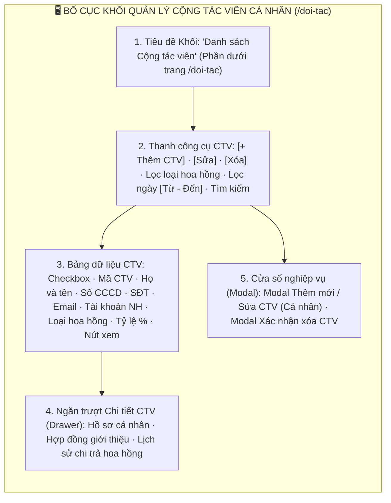
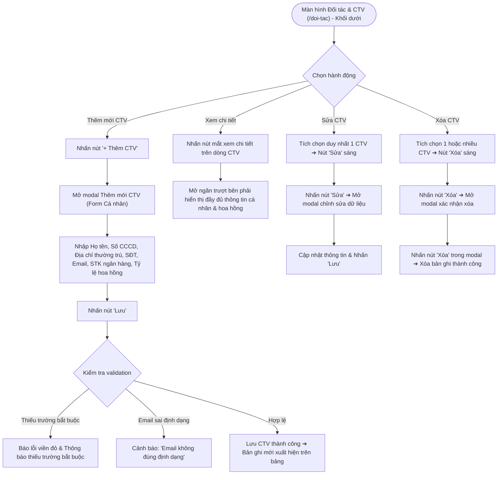

# 📋 TÀI LIỆU ĐẶC TẢ YÊU CẦU CHỨC NĂNG (REQUIREMENTS SPECIFICATION)
## Phân hệ: Quản trị Đối tác & Kênh Phân phối — Hệ thống VNTEST LIMS
### Tính năng: Quản lý Cộng tác viên Cá nhân (Collaborators Screen)

---

| Thông tin tài liệu | Chi tiết |
| :--- | :--- |
| **Mã tài liệu** | `REQ_VNTEST_COLLABORATORS` |
| **Tính năng / Màn hình** | Quản lý Cộng tác viên Cá nhân (Collaborators Screen) |
| **Đường dẫn truy cập** | `/doi-tac` (Khối danh sách Cộng tác viên Cá nhân - Phía dưới) |
| **Đối tượng sử dụng** | Nhân viên Kinh doanh, Trưởng phòng Kinh doanh, Kế toán, Ban Giám đốc, Admin |
| **Trạng thái tài liệu** | `Approved / Ready for Development & Testing` |
| **Cơ sở dữ liệu liên kết** | `collaborators`, `commissions`, `contracts`, `users`, `audit_logs` |
| **Test Script Playwright** | [`src/tests/collaborators/collaborators.spec.ts`](file:///home/thai.hoang.dinh/VNTEST_Automation/src/tests/collaborators/collaborators.spec.ts) (18 Test Cases) |
| **Page Object Model** | [`src/pages/collaborators.page.ts`](file:///home/thai.hoang.dinh/VNTEST_Automation/src/pages/collaborators.page.ts) |
| **Dữ liệu kiểm thử** | [`test-data/users.json`](file:///home/thai.hoang.dinh/VNTEST_Automation/test-data/users.json), `test-data/collaborators.json` |

---

## 📑 MỤC LỤC ĐIỀU HƯỚNG NHANH
1. [1. Định vị màn hình & Tổng quan tính năng (Overview & UI Layout)](#1-định-vị-màn-hình--tổng-quan-tính-năng-overview--ui-layout)
2. [2. Sơ đồ phân tích luồng trực quan (Mermaid Flowcharts)](#2-sơ-đồ-phân-tích-luồng-trực-quan-mermaid-flowcharts)
3. [3. Phân quyền & Điều kiện kích hoạt (Access & Permissions)](#3-phân-quyền--điều-kiện-kích-hoạt-access--permissions)
4. [4. Đặc tả chi tiết các Use Cases chức năng (Functional Use Cases)](#4-đặc-tả-chi-tiết-các-use-cases-chức-năng-functional-use-cases)
5. [5. Đặc tả chi tiết trường dữ liệu (Field Specifications Matrix)](#5-đặc-tả-chi-tiết-trường-dữ-liệu-field-specifications-matrix)
6. [6. Ma trận nút bấm & Tương tác giao diện (Action Buttons Matrix)](#6-ma-trận-nút-bấm--tương-tác-giao-diện-action-buttons-matrix)
7. [7. Quy tắc nghiệp vụ & Luồng xử lý lỗi (Business Rules & Error Handling)](#7-quy-tắc-nghiệp-vụ--luồng-xử-lý-lỗi-business-rules--error-handling)
8. [8. Kế hoạch kiểm thử & Ma trận Test Cases Automation (18 Test Cases)](#8-kế-hoạch-kiểm-thử--ma-trận-test-cases-automation-18-test-cases)

---

## 1. ĐỊNH VỊ MÀN HÌNH & TỔNG QUAN TÍNH NĂNG (OVERVIEW & UI LAYOUT)

### 1.1. Mục đích tính năng
* **Quản trị Danh bạ Cộng tác viên Cá nhân (CTV):** Quản lý hồ sơ các chuyên gia, cá nhân liên kết ngoài giới thiệu các hợp đồng thử nghiệm cho Viện VNTEST.
* **Theo dõi Chính sách Chi trả Hoa hồng Cá nhân:** Hỗ trợ thiết lập tỷ lệ hoa hồng cố định hoặc lũy tiến, tài khoản ngân hàng thụ hưởng và thông tin căn cước công dân (CCCD) để phục vụ kê khai thuế thu nhập cá nhân (TNCN).
* **Khối Dữ liệu Độc lập Phía dưới tại /doi-tac:** Khối Cộng tác viên nằm ở nửa dưới của trang `/doi-tac`, sở hữu thanh công cụ riêng (`+ Thêm CTV`, `Sửa`, `Xóa`), bộ lọc hoa hồng và bảng dữ liệu độc lập hoàn toàn với khối Đối tác Doanh nghiệp ở phía trên.
* **Ngăn Chi tiết & Quản lý Trực quan:** Cung cấp ngăn trượt xem chi tiết hồ sơ CTV, lịch sử hợp đồng mang lại và các đợt quyết toán hoa hồng.

### 1.2. Bố cục Giao diện & Các Phân khu Chức năng (UI Layout Matrix)

| Phân khu (Section) | Vị trí hiển thị | Thành phần giao diện chính | Mục đích & Nghiệp vụ |
| :--- | :--- | :--- | :--- |
| **1. Tiêu đề Khối CTV** | Giữa trang `/doi-tac` | Tiêu đề khối `Danh sách Cộng tác viên` và mô tả chức năng | Tách biệt với khối Đối tác Doanh nghiệp ở phía trên |
| **2. Thanh công cụ (Toolbar)** | Dưới Tiêu đề khối CTV | Nút `"+ Thêm CTV"`, `"Sửa"`, `"Xóa"`, Lọc hoa hồng, Lọc ngày `Từ - Đến`, Ô tìm kiếm | Thao tác tác vụ nhanh trên danh sách cộng tác viên cá nhân |
| **3. Bảng danh sách CTV** | Nửa dưới màn hình | Checkbox chọn dòng, Mã CTV, Họ và tên, CCCD, SĐT, Email, STK ngân hàng, Loại hoa hồng, Tỷ lệ %, Nút xem | Quản lý danh sách cộng tác viên dạng bảng phân trang |
| **4. Ngăn Chi tiết (Drawer)** | Trượt từ mép phải | Thông tin CCCD, địa chỉ thường trú, tài khoản ngân hàng, lịch sử hợp đồng mang về | Tra cứu nhanh hồ sơ cộng tác viên |
| **5. Cửa sổ Modal nghiệp vụ** | Trung tâm màn hình | Modal Thêm/Sửa CTV (Form Cá nhân), Modal Xác nhận xóa | Nhập liệu tạo mới, cập nhật và xóa bỏ cộng tác viên |

---

## 2. SƠ ĐỒ PHÂN TÍCH LUỒNG TRỰC QUAN (MERMAID FLOWCHARTS)

### 2.1. Sơ đồ Master Flow Quản lý Cộng tác viên Cá nhân

---

## 3. PHÂN QUYỀN & ĐIỀU KIỆN KÍCH HOẠT (ACCESS & PERMISSIONS)

### 3.1. Ma trận phân quyền truy cập (RBAC Matrix)

| Vai trò người dùng (Role) | Xem danh sách CTV | Thêm mới CTV | Sửa thông tin | Xóa CTV | Cấu hình hoa hồng |
| :--- | :---: | :---: | :---: | :---: | :---: |
| **Quản trị viên (Admin)** | Toàn quyền | Toàn quyền | Toàn quyền | Toàn quyền | Toàn quyền |
| **Ban Giám đốc** | Toàn quyền | Thêm mới | Duyệt sửa | Phê duyệt xóa | Phê duyệt tỷ lệ |
| **Trưởng phòng Kinh doanh**| Xem toàn bộ | Thêm mới | Sửa CTV | Đề xuất xóa | Đề xuất tỷ lệ |
| **Nhân viên Sale (Kinh doanh)**| Xem CTV của mình | Thêm mới | Sửa CTV của mình | Bị chặn xóa | Xem tỷ lệ |

### 3.2. Tiền điều kiện & Ràng buộc ngữ cảnh
* **Ràng buộc Nút Sửa & Xóa:**
  - Chưa chọn dòng: Cả 2 nút `"Sửa"` và `"Xóa"` ở trạng thái disabled.
  - Chọn duy nhất 1 CTV: Cả 2 nút `"Sửa"` và `"Xóa"` đều được kích hoạt sáng rõ (enabled).
  - Chọn từ 2 CTV trở lên: Nút `"Sửa"` bị disabled, nút `"Xóa"` tiếp tục enabled để hỗ trợ xóa hàng loạt.

---

## 4. ĐẶC TẢ CHI TIẾT CÁC USE CASES CHỨC NĂNG (FUNCTIONAL USE CASES)

### UC-01: Bố cục Khối CTV & Trạng thái Nút Thao tác (Khối 01)
* **Tác nhân:** Người dùng mọi quyền hạn.
* **Luồng sự kiện chính:**
  1. Người dùng cuộn xuống khối danh sách Cộng tác viên tại `/doi-tac`.
  2. Bảng hiển thị đầy đủ các cột chuẩn: Mã CTV, Họ tên, CCCD, SĐT, Email, STK ngân hàng, Loại hoa hồng, Tỷ lệ %.
  3. Thanh công cụ hiển thị nút `"+ Thêm CTV"`, `"Sửa"`, `"Xóa"` và ô tìm kiếm.
  4. Trạng thái các nút tác vụ thay đổi linh hoạt theo số lượng dòng được tích chọn checkbox.

### UC-02: Bộ lọc Hoa hồng & Tìm kiếm CTV (Khối 02)
* **Tác nhân:** Nhân viên kinh doanh, Kế toán.
* **Luồng sự kiện chính:**
  1. Lọc theo Loại hoa hồng: Chọn `"Cố định"` hoặc `"Lũy tiến"` ➔ Bảng lọc ra đúng các CTV áp dụng chính sách tương ứng.
  2. Tìm kiếm theo Họ và tên: Nhập tên CTV vào ô tìm kiếm ➔ Bảng hiển thị danh sách CTV phù hợp.
  3. Tìm kiếm từ khóa không tồn tại ➔ Hiển thị thông báo không có kết quả phù hợp.

### UC-03: Thêm mới CTV & Validation Dữ liệu (Khối 03)
* **Tác nhân:** Nhân viên kinh doanh, Trưởng phòng.
* **Luồng sự kiện chính:**
  1. Nhấn nút `"+ Thêm CTV"` trên thanh công cụ khối CTV.
  2. Modal tạo mới mở ra với các trường thông tin cá nhân và tài khoản thụ hưởng.
  3. Nếu để trống các trường bắt buộc (Họ tên, SĐT, CCCD...) ➔ Báo lỗi vi phạm trường bắt buộc.
  4. Nếu nhập email sai định dạng ➔ Cảnh báo định dạng email không hợp lệ.
  5. Nhập đầy đủ thông tin hợp lệ và nhấn nút `"Lưu"` ➔ Lưu CTV thành công, đóng modal và hiển thị ngay trên bảng.

### UC-04: Xem Chi tiết, Sửa & Xóa CTV (Khối 04)
* **Tác nhân:** Người quản lý CTV.
* **Luồng sự kiện chính:**
  1. Nhấn icon mắt xem chi tiết trên dòng CTV ➔ Mở ngăn trượt Drawer hiển thị toàn bộ hồ sơ.
  2. Tích chọn 1 CTV và nhấn nút `"Sửa"` ➔ Mở modal chỉnh sửa dữ liệu, nhấn `"Hủy"` giúp đóng an toàn.
  3. Tích chọn CTV và nhấn nút `"Xóa"` ➔ Mở modal xác nhận xóa, nhấn `"Hủy"` để hủy thao tác xóa.

---

## 5. ĐẶC TẢ CHI TIẾT TRƯỜNG DỮ LIỆU (FIELD SPECIFICATIONS MATRIX)

| STT | Tên trường hiển thị | Phân loại | Bắt buộc | Ràng buộc nghiệp vụ & Validation |
| :---: | :--- | :---: | :---: | :--- |
| 1 | **Họ và tên CTV** | Text Input | Có | Họ tên đầy đủ cá nhân cộng tác viên |
| 2 | **Số CCCD/CMND** | Text Input | Có | 9 hoặc 12 chữ số định danh cá nhân |
| 3 | **Địa chỉ thường trú** | Text Input | Có | Địa chỉ ghi trên CCCD |
| 4 | **Số điện thoại** | Text Input | Có | Định dạng số điện thoại 10 số |
| 5 | **Email** | Text Input | Không | Định dạng email chuẩn (RFC 5322) |
| 6 | **Số tài khoản ngân hàng** | Text Input | Không | Tài khoản nhận hoa hồng chiết khấu |
| 7 | **Ngân hàng & Chi nhánh** | Text Input | Không | Tên ngân hàng thụ hưởng |
| 8 | **Loại hoa hồng** | Radio Button | Có | Lựa chọn giữa `"Cố định"` hoặc `"Lũy tiến"` |
| 9 | **Tỷ lệ hoa hồng (%)** | Number Input | Có | Tỷ lệ chiết khấu phần trăm (0% - 100%) |

---

## 6. MA TRẬN NÚT BẤM & TƯƠNG TÁC GIAO DIỆN (ACTION BUTTONS MATRIX)

| STT | Tên nút bấm / Icon | Vị trí hiển thị | Trạng thái mặc định | Điều kiện kích hoạt | Hành vi hệ thống khi thao tác |
| :---: | :--- | :--- | :---: | :--- | :--- |
| 1 | **Nút "+ Thêm CTV"** | Toolbar khối CTV | Khả dụng | Nhấp chuột | Mở Modal Thêm mới Cộng tác viên Cá nhân |
| 2 | **Nút "Sửa"** | Toolbar khối CTV | **Vô hiệu hóa** | **Tích chọn đúng 1 dòng** | Mở Modal Chỉnh sửa thông tin CTV |
| 3 | **Nút "Xóa"** | Toolbar khối CTV | **Vô hiệu hóa** | **Tích chọn >= 1 dòng** | Mở Modal Xác nhận xóa CTV |
| 4 | **Icon mắt "Xem chi tiết"** | Cột cuối từng dòng | Khả dụng | Nhấp chuột | Mở Ngăn trượt Chi tiết CTV (Drawer) |
| 5 | **Nút "Lưu" (Modal CTV)** | Chân Modal | Khả dụng | Nhấp chuột | Validate dữ liệu, lưu CTV và đóng modal |
| 6 | **Nút "Hủy" (Modal CTV)** | Chân Modal | Khả dụng | Nhấp chuột | Đóng modal và hủy bỏ mọi dữ liệu đang nhập |

---

## 7. QUY TẮC NGHIỆP VỤ & LUỒNG XỬ LÝ LỖI (BUSINESS RULES & ERROR HANDLING)

### 7.1. Quy tắc nghiệp vụ trọng yếu (Business Rules - BR)
* **BR-01 (Độc lập Dữ liệu 2 Khối):** Thao tác tạo mới, sửa, xóa trên khối CTV chỉ tác động đến bảng CTV, không gây ảnh hưởng đến bảng Đối tác Doanh nghiệp ở phía trên.
* **BR-02 (Thông tin Thuế TNCN):** Số CCCD và Địa chỉ thường trú là thông tin bắt buộc đối với CTV để phục vụ quyết toán thuế TNCN khi phát sinh chi trả hoa hồng.

### 7.2. Luồng xử lý ngoại lệ & Thông báo lỗi (Error Handling Matrix)

| Mã lỗi / Tình huống ngoại lệ | Nguyên nhân kích hoạt | Phản hồi của hệ thống & Thông báo hiển thị | Hướng xử lý cho người dùng |
| :--- | :--- | :--- | :--- |
| **ERR_CTV_REQUIRED** | Bỏ trống các trường bắt buộc khi tạo CTV | Cảnh báo: *"Vui lòng nhập đầy đủ các thông tin bắt buộc."* | Điền đầy đủ Họ tên, CCCD, SĐT, Địa chỉ |
| **ERR_CTV_EMAIL_FORMAT** | Nhập email không đúng định dạng chuẩn | Cảnh báo: *"Email không đúng định dạng."* | Kiểm tra và nhập đúng định dạng email |
| **ERR_CTV_NOT_FOUND** | Tìm kiếm từ khóa không khớp CTV nào | Bảng hiển thị: *"Không tìm thấy cộng tác viên phù hợp."* | Kiểm tra lại từ khóa tìm kiếm |

---

## 8. KẾ HOẠCH KIỂM THỬ & MA TRẬN TEST CASES AUTOMATION (18 TEST CASES)

### 8.1. Thống kê độ phủ kiểm thử theo Phân nhóm chức năng

| Nhóm chức năng (Feature Scope) | Số kịch bản (TCs) | Tỷ lệ độ phủ | Trạng thái Automation |
| :--- | :---: | :---: | :---: |
| **Khối 01: Bố cục, Điều hướng & Trạng thái nút thao tác** | 07 | 38.9% | `Passed 100%` |
| **Khối 02: Bộ lọc Hoa hồng & Tìm kiếm CTV** | 04 | 22.2% | `Passed 100%` |
| **Khối 03: Thêm mới CTV & Validation dữ liệu** | 04 | 22.2% | `Passed 100%` |
| **Khối 04: Xem Chi tiết, Sửa & Xóa CTV** | 03 | 16.7% | `Passed 100%` |
| **TỔNG CỘNG ĐỘ PHỦ KIỂM THỬ** | **18 Test Cases** | **100%** | **Playwright Automated** |

---

### 8.2. Chi tiết Ma trận Test Cases Automation (18 Test Cases)

### 8.2.1. KHỐI 01: BỐ CỤC, ĐIỀU HƯỚNG & TRẠNG THÁI NÚT THAO TÁC (Layout, Navigation & Buttons) (7 Test Cases)

| Mã TC | Phân nhóm luồng | Tên kịch bản | Thao tác & Dữ liệu kiểm thử | Kết quả mong đợi | Mức độ ưu tiên | Mapping Page Object |
| :--- | :--- | :--- | :--- | :--- | :---: | :--- |
| **TC_CTV_001** | 01: BỐ CỤC, ĐIỀU HƯỚNG & TRẠNG THÁI NÚT THAO TÁC | Hiển thị đầy đủ tiêu đề khối Cộng tác viên và mô tả chức năng | 1. Điều hướng tới màn hình tại /doi-tac.  2. Cuộn xuống khối danh sách Cộng tác viên.  3. Kiểm tra tiêu đề khối và phần mô tả chức năng. | 1. Tiêu đề khối Cộng tác viên hiển thị nổi bật, rõ ràng.  2. Phần mô tả chức năng định hướng chính xác mục đích quản lý CTV cá nhân. | Low | `collaboratorsPage` |
| **TC_CTV_002** | 01: BỐ CỤC, ĐIỀU HƯỚNG & TRẠNG THÁI NÚT THAO TÁC | Hiển thị đầy đủ thanh công cụ và các nút thao tác khối CTV | 1. Quan sát thanh công cụ của khối CTV.  2. Kiểm tra hiển thị nút "+ Thêm CTV", "Sửa", "Xóa" và ô tìm kiếm. | 1. Toàn bộ các nút chức năng trên thanh công cụ khối CTV hiển thị đầy đủ, đúng ngữ nghĩa. | Low | `collaboratorsPage` |
| **TC_CTV_003** | 01: BỐ CỤC, ĐIỀU HƯỚNG & TRẠNG THÁI NÚT THAO TÁC | Hiển thị bảng dữ liệu danh sách CTV với các cột chuẩn | 1. Quan sát bảng dữ liệu khối CTV.  2. Kiểm tra các tiêu đề cột: Mã CTV, Họ và tên, CCCD, SĐT, Email, STK ngân hàng, Loại hoa hồng, Tỷ lệ %. | 1. Bảng dữ liệu có đầy đủ các cột chuẩn theo đặc tả quản lý cộng tác viên cá nhân. | Low | `collaboratorsPage` |
| **TC_CTV_005** | 01: BỐ CỤC, ĐIỀU HƯỚNG & TRẠNG THÁI NÚT THAO TÁC | Trạng thái ban đầu của các nút thao tác CTV khi chưa chọn dòng | 1. Tải màn hình khi chưa có checkbox dòng CTV nào được chọn.  2. Kiểm tra trạng thái của các nút "Sửa" và "Xóa". | 1. Cả 2 nút "Sửa" và "Xóa" đều ở trạng thái vô hiệu hóa (disabled). | Low | `collaboratorsPage` |
| **TC_CTV_006** | 01: BỐ CỤC, ĐIỀU HƯỚNG & TRẠNG THÁI NÚT THAO TÁC | Kích hoạt nút "Sửa" và "Xóa" khi tích chọn duy nhất 1 CTV | 1. Tích chọn checkbox của duy nhất 1 dòng CTV.  2. Quan sát trạng thái của nút "Sửa" và "Xóa". | 1. Cả 2 nút "Sửa" và "Xóa" đều tự động sáng lên (enabled) sẵn sàng thao tác. | High | `collaboratorsPage` |
| **TC_CTV_007** | 01: BỐ CỤC, ĐIỀU HƯỚNG & TRẠNG THÁI NÚT THAO TÁC | Trạng thái nút thao tác khi chọn từ 2 CTV trở lên | 1. Tích chọn thêm một dòng CTV thứ 2 (chọn >= 2 dòng).  2. Quan sát phản hồi của các nút tác vụ. | 1. Nút "Sửa" tự động bị vô hiệu hóa (disabled).  2. Nút "Xóa" tiếp tục duy trì trạng thái khả dụng để hỗ trợ xóa hàng loạt. | High | `collaboratorsPage` |
| **TC_CTV_008** | 01: BỐ CỤC, ĐIỀU HƯỚNG & TRẠNG THÁI NÚT THAO TÁC | Bỏ chọn dòng CTV đưa nút thao tác về trạng thái ban đầu | 1. Bỏ tích chọn dòng CTV vừa chọn.  2. Kiểm tra trạng thái các nút thao tác. | 1. Các nút "Sửa" và "Xóa" tự động trở về trạng thái vô hiệu hóa ban đầu. | Low | `collaboratorsPage` |

### 8.2.2. KHỐI 02: BỘ LỌC HOA HỒNG & TÌM KIẾM CTV (Commission Filter & Search) (4 Test Cases)

| Mã TC | Phân nhóm luồng | Tên kịch bản | Thao tác & Dữ liệu kiểm thử | Kết quả mong đợi | Mức độ ưu tiên | Mapping Page Object |
| :--- | :--- | :--- | :--- | :--- | :---: | :--- |
| **TC_CTV_010** | 02: BỘ LỌC HOA HỒNG & TÌM KIẾM CTV | Lọc CTV theo Loại hoa hồng "Cố định" | 1. Mở bộ lọc Loại hoa hồng của khối CTV.  2. Chọn tiêu chí "Cố định".  3. Kiểm tra các dòng CTV trên bảng. | 1. Bảng chỉ hiển thị các CTV có chính sách hoa hồng là "Cố định". | High | `collaboratorsPage` |
| **TC_CTV_011** | 02: BỘ LỌC HOA HỒNG & TÌM KIẾM CTV | Lọc CTV theo Loại hoa hồng "Lũy tiến" | 1. Chọn tiêu chí hoa hồng "Lũy tiến" trong bộ lọc.  2. Kiểm tra danh sách bảng. | 1. Danh sách lọc ra đúng các CTV áp dụng hoa hồng "Lũy tiến". | High | `collaboratorsPage` |
| **TC_CTV_018** | 02: BỘ LỌC HOA HỒNG & TÌM KIẾM CTV | Tìm kiếm CTV theo Họ và tên | 1. Nhập một đoạn họ tên của CTV vào ô tìm kiếm khối CTV.  2. Quan sát kết quả lọc. | 1. Bảng lọc ra đúng các CTV có tên chứa chuỗi tìm kiếm. | High | `collaboratorsPage` |
| **TC_CTV_022** | 02: BỘ LỌC HOA HỒNG & TÌM KIẾM CTV | Tìm kiếm CTV với từ khóa không tồn tại | 1. Nhập chuỗi ký tự ngẫu nhiên không có trên hệ thống vào ô tìm kiếm CTV.  2. Quan sát bảng dữ liệu. | 1. Bảng không hiển thị bản ghi nào và xuất hiện thông báo không có kết quả phù hợp. | Low | `collaboratorsPage` |

### 8.2.3. KHỐI 03: THÊM MỚI CTV & VALIDATION DỮ LIỆU (Create CTV & Validation) (4 Test Cases)

| Mã TC | Phân nhóm luồng | Tên kịch bản | Thao tác & Dữ liệu kiểm thử | Kết quả mong đợi | Mức độ ưu tiên | Mapping Page Object |
| :--- | :--- | :--- | :--- | :--- | :---: | :--- |
| **TC_CTV_024** | 03: THÊM MỚI CTV & VALIDATION DỮ LIỆU | Mở và đóng hộp thoại Thêm Cộng tác viên mới bằng nút "Hủy" | 1. Nhấn nút "+ Thêm CTV" trên thanh công cụ khối CTV.  2. Kiểm tra modal mở ra.  3. Nhấn nút "Hủy" ở chân modal. | 1. Modal mở ra đúng form thêm mới CTV cá nhân.  2. Khi nhấn nút "Hủy", modal đóng lại an toàn mà không lưu dữ liệu. | Low | `collaboratorsPage` |
| **TC_CTV_025** | 03: THÊM MỚI CTV & VALIDATION DỮ LIỆU | Bỏ trống toàn bộ các trường bắt buộc khi tạo mới CTV | 1. Mở modal thêm CTV.  2. Để trống toàn bộ các trường và nhấn nút "Lưu". | 1. Hệ thống chặn lưu dữ liệu và hiển thị cảnh báo các trường bắt buộc. | High | `collaboratorsPage` |
| **TC_CTV_026** | 03: THÊM MỚI CTV & VALIDATION DỮ LIỆU | Kiểm tra trường Email khi nhập sai định dạng | 1. Nhập một chuỗi không phải email hợp lệ (ví dụ: `email_sai_dinh_dang`) vào ô Email CTV.  2. Nhấn nút "Lưu". | 1. Hệ thống báo lỗi định dạng email không hợp lệ. | Low | `collaboratorsPage` |
| **TC_CTV_027** | 03: THÊM MỚI CTV & VALIDATION DỮ LIỆU | Thêm mới Cộng tác viên thành công và xóa dọn dẹp dữ liệu | 1. Nhập đầy đủ Họ tên, CCCD, Địa chỉ, SĐT, Email hợp lệ và tỷ lệ hoa hồng.  2. Nhấn nút "Lưu".  3. Kiểm tra CTV mới xuất hiện trên danh sách. | 1. Lưu CTV thành công và đóng modal.  2. Bản ghi mới xuất hiện ngay trên dòng đầu bảng danh sách CTV. | Critical | `collaboratorsPage` |

### 8.2.4. KHỐI 04: XEM CHI TIẾT, SỬA & XÓA CTV (View, Edit & Delete) (3 Test Cases)

| Mã TC | Phân nhóm luồng | Tên kịch bản | Thao tác & Dữ liệu kiểm thử | Kết quả mong đợi | Mức độ ưu tiên | Mapping Page Object |
| :--- | :--- | :--- | :--- | :--- | :---: | :--- |
| **TC_CTV_031** | 04: XEM CHI TIẾT, SỬA & XÓA CTV | Mở và đóng ngăn xem chi tiết cộng tác viên | 1. Nhấn nút biểu tượng mắt xem chi tiết trên một dòng CTV.  2. Kiểm tra ngăn chi tiết Drawer mở ra từ mép phải.  3. Nhấn nút đóng [x] tại ngăn chi tiết. | 1. Ngăn chi tiết trượt ra hiển thị đầy đủ thông tin CTV cá nhân.  2. Nhấn [x] giúp thu gọn ngăn chi tiết an toàn. | High | `collaboratorsPage` |
| **TC_CTV_034** | 04: XEM CHI TIẾT, SỬA & XÓA CTV | Mở và đóng hộp thoại Sửa Cộng tác viên bằng nút "Hủy" | 1. Tích chọn 1 CTV và nhấn nút "Sửa".  2. Kiểm tra modal sửa nạp dữ liệu cũ.  3. Nhấn nút "Hủy". | 1. Modal mở ra với đầy đủ thông tin của CTV đã chọn.  2. Nhấn "Hủy" đóng modal mà không làm thay đổi thông tin trên bảng. | Low | `collaboratorsPage` |
| **TC_CTV_036** | 04: XEM CHI TIẾT, SỬA & XÓA CTV | Mở và đóng hộp thoại Xác nhận xóa CTV bằng nút "Hủy" | 1. Tích chọn CTV và nhấn nút "Xóa".  2. Kiểm tra modal xác nhận xóa mở ra.  3. Nhấn nút "Hủy". | 1. Modal xác nhận xóa hiển thị thông điệp cảnh báo rõ ràng.  2. Khi nhấn "Hủy", modal đóng lại và bản ghi CTV vẫn được giữ nguyên. | Low | `collaboratorsPage` |
