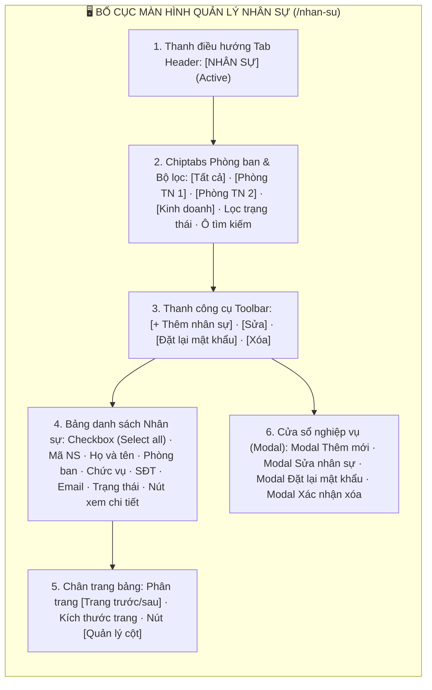
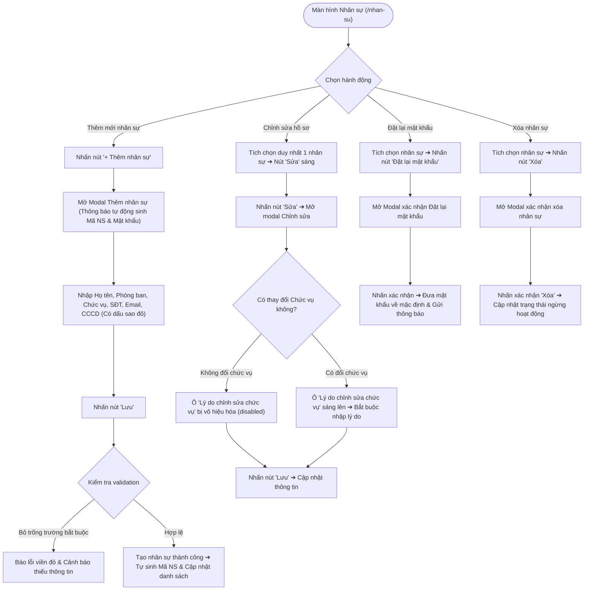

# 📋 TÀI LIỆU ĐẶC TẢ YÊU CẦU CHỨC NĂNG (REQUIREMENTS SPECIFICATION)
## Phân hệ: Quản trị Hệ thống & Nhân sự (Admin & HR) — Hệ thống VNTEST LIMS
### Tính năng: Quản lý Nhân sự & Phân quyền (Personnel Management Screen)

---

| Thông tin tài liệu | Chi tiết |
| :--- | :--- |
| **Mã tài liệu** | `REQ_VNTEST_PERSONNEL` |
| **Tính năng / Màn hình** | Quản lý Nhân sự & Phân quyền (Personnel Management Screen) |
| **Đường dẫn truy cập** | `/nhan-su` (Menu Nhân sự trên thanh điều hướng hệ thống) |
| **Đối tượng sử dụng** | Quản trị viên hệ thống (Admin), Trưởng phòng Nhân sự, Ban Giám đốc |
| **Trạng thái tài liệu** | `Approved / Ready for Development & Testing` |
| **Cơ sở dữ liệu liên kết** | `personnel`, `departments`, `roles`, `permissions`, `users`, `audit_logs` |
| **Test Script Playwright** | [`src/tests/personnel/personnel.spec.ts`](file:///home/thai.hoang.dinh/VNTEST_Automation/src/tests/personnel/personnel.spec.ts) (27 Test Cases) |
| **Page Object Model** | [`src/pages/personnel.page.ts`](file:///home/thai.hoang.dinh/VNTEST_Automation/src/pages/personnel.page.ts) |
| **Dữ liệu kiểm thử** | [`test-data/users.json`](file:///home/thai.hoang.dinh/VNTEST_Automation/test-data/users.json), `test-data/personnel.json` |

---

## 📑 MỤC LỤC ĐIỀU HƯỚNG NHANH
1. [1. Định vị màn hình & Tổng quan tính năng (Overview & UI Layout)](#1-định-vị-màn-hình--tổng-quan-tính-năng-overview--ui-layout)
2. [2. Sơ đồ phân tích luồng trực quan (Mermaid Flowcharts)](#2-sơ-đồ-phân-tích-luồng-trực-quan-mermaid-flowcharts)
3. [3. Phân quyền & Điều kiện kích hoạt (Access & Permissions)](#3-phân-quyền--điều-kiện-kích-hoạt-access--permissions)
4. [4. Đặc tả chi tiết các Use Cases chức năng (Functional Use Cases)](#4-đặc-tả-chi-tiết-các-use-cases-chức-năng-functional-use-cases)
5. [5. Đặc tả chi tiết trường dữ liệu (Field Specifications Matrix)](#5-đặc-tả-chi-tiết-trường-dữ-liệu-field-specifications-matrix)
6. [6. Ma trận nút bấm & Tương tác giao diện (Action Buttons Matrix)](#6-ma-trận-nút-bấm--tương-tác-giao-diện-action-buttons-matrix)
7. [7. Quy tắc nghiệp vụ & Luồng xử lý lỗi (Business Rules & Error Handling)](#7-quy-tắc-nghiệp-vụ--luồng-xử-lý-lỗi-business-rules--error-handling)
8. [8. Kế hoạch kiểm thử & Ma trận Test Cases Automation (27 Test Cases)](#8-kế-hoạch-kiểm-thử--ma-trận-test-cases-automation-27-test-cases)

---

## 1. ĐỊNH VỊ MÀN HÌNH & TỔNG QUAN TÍNH NĂNG (OVERVIEW & UI LAYOUT)

### 1.1. Mục đích tính năng
* **Quản trị Toàn diện Danh bạ Nhân sự Viện:** Quản lý thông tin hồ sơ của toàn bộ cán bộ công nhân viên thuộc Viện VNTEST bao gồm các phòng ban: Ban Giám đốc, Phòng Thử nghiệm, Phòng Kinh doanh, Kế toán, Tiếp nhận mẫu và Hành chính.
* **Tự động Khởi tạo Mã Nhân sự & Mật khẩu Mặc định:** Hệ thống sở hữu cơ chế tự động sinh Mã NS duy nhất theo quy tắc đánh số và cấp phát mật khẩu khởi tạo an toàn khi thêm mới nhân sự.
* **Cơ chế Đổi Chức vụ có Kiểm toán (Audit Requirement):** Bắt buộc người dùng phải nhập trường `"Lý do chỉnh sửa chức vụ"` khi có sự thay đổi về chức danh của nhân sự nhằm phục vụ truy vết thuyên chuyển công tác.
* **Đặt lại Mật khẩu & Bảo mật Tài khoản:** Cho phép quản trị viên đặt lại mật khẩu về mặc định cho nhân sự khi có sự cố quên mật khẩu qua modal xác nhận chuyên biệt.
* **Ngăn Chi tiết Hồ sơ (Personnel Detail Drawer):** Mở xem chi tiết hồ sơ năng lực, bằng cấp, chứng chỉ và lịch sử công tác của nhân sự dạng trượt tiện lợi.

### 1.2. Bố cục Giao diện & Các Phân khu Chức năng (UI Layout Matrix)

| Phân khu (Section) | Vị trí hiển thị | Thành phần giao diện chính | Mục đích & Nghiệp vụ |
| :--- | :--- | :--- | :--- |
| **1. Header & Điều hướng** | Trên cùng trang | Tab `NHÂN SỰ` (active) | Định vị phân hệ quản lý nhân sự của Viện |
| **2. Chiptabs Phòng ban & Lọc**| Dưới Header | Chips: `Tất cả`, `Phòng ban 1`, `Phòng ban 2`..., dropdown trạng thái, ô tìm kiếm | Lọc nhanh nhân sự theo cơ cấu tổ chức phòng ban |
| **3. Thanh công cụ (Toolbar)** | Trên bảng danh sách | Nút `"+ Thêm nhân sự"`, `"Sửa"`, `"Đặt lại mật khẩu"`, `"Xóa"` | Thực hiện các tác vụ quản trị nhân sự và tài khoản |
| **4. Bảng dữ liệu Nhân sự** | Trung tâm màn hình | Checkbox chọn dòng, Mã NS, Họ và tên, Phòng ban, Chức vụ, SĐT, Email, Trạng thái (Hoạt động/Nghỉ việc), Icon mắt xem chi tiết | Hiển thị danh sách nhân sự phân trang |
| **5. Chân trang & Quản lý cột**| Dưới bảng dữ liệu | Phân trang, thông tin số lượng bản ghi, nút `"Quản lý cột"` (mở popover) | Điều hướng trang và cấu hình ẩn/hiện cột hiển thị |
| **6. Cửa sổ Modal nghiệp vụ** | Trung tâm màn hình | Modal Thêm mới (thông báo tự sinh mã/pass), Modal Sửa (ràng buộc lý do đổi chức vụ), Modal Reset mật khẩu, Modal Xác nhận xóa | Thao tác các giao dịch dữ liệu nhân sự |

---

## 2. SƠ ĐỒ PHÂN TÍCH LUỒNG TRỰC QUAN (MERMAID FLOWCHARTS)

### 2.1. Sơ đồ Master Flow Quản trị Nhân sự & Tài khoản

---

## 3. PHÂN QUYỀN & ĐIỀU KIỆN KÍCH HOẠT (ACCESS & PERMISSIONS)

### 3.1. Ma trận phân quyền truy cập (RBAC Matrix)

| Vai trò người dùng (Role) | Xem danh sách | Thêm nhân sự | Sửa hồ sơ | Đổi chức vụ | Đặt lại mật khẩu | Xóa nhân sự |
| :--- | :---: | :---: | :---: | :---: | :---: | :---: |
| **Quản trị viên (Admin)** | Toàn quyền | Toàn quyền | Toàn quyền | Bắt buộc nhập lý do | Toàn quyền | Toàn quyền |
| **Ban Giám đốc** | Toàn quyền | Thêm mới | Sửa hồ sơ | Phê duyệt đổi | Yêu cầu reset | Phê duyệt xóa |
| **Trưởng phòng / Quản lý**| Xem nhân sự phòng | Đề xuất thêm | Xem hồ sơ | Đề xuất đổi | Không có quyền | Không có quyền |
| **Nhân viên thông thường** | Xem danh bạ nội bộ | Bị chặn | Bị chặn | Bị chặn | Bị chặn | Bị chặn |

### 3.2. Tiền điều kiện & Ràng buộc chuyển trạng thái
* **Quy tắc Trạng thái Nút Thao tác:**
  - Chưa chọn dòng nào (0 dòng): Cả 4 nút (`"Thêm nhân sự"`, `"Sửa"`, `"Đặt lại mật khẩu"`, `"Xóa"`) thì nút Thêm sáng, 3 nút còn lại bị vô hiệu hóa (disabled).
  - Tích chọn duy nhất 1 dòng: Toàn bộ các nút thao tác (`"Sửa"`, `"Đặt lại mật khẩu"`, `"Xóa"`) đều sáng lên (enabled).
  - Tích chọn từ 2 dòng trở lên: Nút `"Sửa"` và `"Đặt lại mật khẩu"` bị disabled; nút `"Xóa"` tiếp tục duy trì enabled (hỗ trợ xóa hàng loạt).
  - Bỏ chọn dòng: Đưa toàn bộ các nút tác vụ về trạng thái vô hiệu hóa ban đầu.
* **Ràng buộc Mã Nhân sự:** Trường `"Mã NS"` ở chế độ chỉ đọc (readonly) vĩnh viễn, do hệ thống tự sinh và không ai có quyền chỉnh sửa.

---

## 4. ĐẶC TẢ CHI TIẾT CÁC USE CASES CHỨC NĂNG (FUNCTIONAL USE CASES)

### UC-01: Bố cục, Thanh công cụ & Chiptabs Phòng ban (Khối 01)
* **Tác nhân:** Người dùng quản trị nhân sự.
* **Luồng sự kiện chính:**
  1. Người dùng truy cập `/nhan-su`.
  2. Hệ thống hiển thị tab `NHÂN SỰ` active, các chiptab phòng ban, bộ lọc trạng thái và 4 nút thao tác chính.
  3. Bảng dữ liệu hiển thị đầy đủ các cột chuẩn, phân trang và nút `"Quản lý cột"` ở chân bảng.
  4. Nhấn chọn checkbox trên Header bảng ➔ Tự động chọn tất cả các dòng nhân sự hiển thị.
  5. Nhấp chọn các chip phòng ban (ví dụ: `Phòng/ban 1`) ➔ Bảng chỉ lọc ra nhân sự thuộc phòng ban đó. Nhấn `Tất cả` để quay lại danh sách toàn viện.
  6. Nhập từ khóa tìm kiếm nhân sự ➔ Bảng lọc realtime theo tên hoặc mã; nhấn nút `"Hủy"` để xóa từ khóa.
  7. Nhấn nút `"Quản lý cột"` ở chân bảng ➔ Mở popover cho phép tùy chỉnh ẩn/hiện cột.

### UC-02: Thêm mới Nhân sự & Validation Dữ liệu (Khối 02)
* **Tác nhân:** Admin, Nhân viên nhân sự.
* **Luồng sự kiện chính:**
  1. Nhấn nút `"+ Thêm nhân sự"` trên thanh công cụ.
  2. Modal hiển thị tiêu đề cùng thông báo cơ chế tự động sinh Mã NS và Mật khẩu mặc định.
  3. Các trường thông tin bắt buộc đều có dấu sao đỏ (`*`) trực quan.
  4. Nếu nhấn nút `"Lưu"` khi để trống toàn bộ ➔ Hệ thống chặn lưu và báo lỗi các trường bắt buộc.
  5. Đóng modal bằng nút `"Hủy"` hoặc biểu tượng đóng `[×]` ➔ Đóng an toàn, không lưu dữ liệu thừa.
  6. Nhập đầy đủ thông tin hợp lệ và nhấn nút `"Lưu"` ➔ Thêm mới thành công, bản ghi mới xuất hiện trên danh sách với Mã NS tự sinh.

### UC-03: Chỉnh sửa Hồ sơ & Ràng buộc Lý do Đổi Chức vụ (Khối 03)
* **Tác nhân:** Quản trị viên, Trưởng phòng.
* **Luồng sự kiện chính:**
  1. Tích chọn duy nhất 1 nhân sự và nhấn nút `"Sửa"`.
  2. Modal mở ra nạp toàn bộ thông tin hiện tại của nhân sự.
  3. Trường `"Mã NS"` ở chế độ chỉ đọc (readonly), không cho phép sửa đổi.
  4. **Kiểm tra ràng buộc trường Lý do chỉnh sửa chức vụ:**
     - Khi chưa đổi chức vụ ➔ Ô textarea `"Lý do chỉnh sửa chức vụ"` bị vô hiệu hóa (disabled).
     - Khi người dùng thay đổi chức vụ sang vị trí mới ➔ Ô `"Lý do chỉnh sửa chức vụ"` tự động sáng lên và bắt buộc phải nhập lý do trước khi Lưu.
  5. Nhấn nút `"Hủy"` ➔ Đóng modal và giữ nguyên hồ sơ ban đầu.

### UC-04: Đặt lại Mật khẩu & Xóa Nhân sự (Khối 04)
* **Tác nhân:** Quản trị viên hệ thống.
* **Luồng sự kiện chính:**
  1. **Đặt lại mật khẩu:**
     - Tích chọn nhân sự và nhấn nút `"Đặt lại mật khẩu"`.
     - Modal xác nhận mở ra. Nhấn `"Hủy"` để đóng an toàn; nhấn xác nhận để đưa mật khẩu về mặc định.
  2. **Xóa nhân sự:**
     - Tích chọn nhân sự và nhấn nút `"Xóa"`.
     - Modal xác nhận xóa mở ra. Nhấn `"Hủy"` để đóng an toàn; nhấn xác nhận để xóa/chuyển trạng thái nhân sự.
  3. **Xem chi tiết:** Nhấn icon mắt trên dòng ➔ Mở ngăn trượt Drawer xem toàn bộ lý lịch nhân sự.

---

## 5. ĐẶC TẢ CHI TIẾT TRƯỜNG DỮ LIỆU (FIELD SPECIFICATIONS MATRIX)

| STT | Tên trường hiển thị | Vị trí form | Phân loại | Bắt buộc | Ràng buộc nghiệp vụ & Validation |
| :---: | :--- | :--- | :---: | :---: | :--- |
| 1 | **Mã nhân sự (Mã NS)** | Form Thêm/Sửa | Text Code | Tự động | Tự sinh khi thêm mới; chế độ chỉ đọc (readonly) khi chỉnh sửa |
| 2 | **Họ và tên nhân sự** | Form Thêm/Sửa | Text Input | Có (*) | Họ và tên đầy đủ, có dấu sao đỏ bắt buộc |
| 3 | **Phòng ban** | Form Thêm/Sửa | Select Dropdown | Có (*) | Chọn 1 phòng ban trực thuộc Viện |
| 4 | **Chức vụ** | Form Thêm/Sửa | Select Dropdown | Có (*) | Vị trí công tác (Kỹ thuật viên, Trưởng phòng, Giám đốc...) |
| 5 | **Số điện thoại** | Form Thêm/Sửa | Text Input | Có (*) | Định dạng số điện thoại 10 số |
| 6 | **Email công vụ** | Form Thêm/Sửa | Text Input | Có (*) | Định dạng email công vụ (@vntest.vn) |
| 7 | **Số CCCD/CMND** | Form Thêm/Sửa | Text Input | Có (*) | Định dạng 9 hoặc 12 số |
| 8 | **Lý do chỉnh sửa chức vụ**| Form Sửa | Textarea | Điều kiện | Vô hiệu hóa nếu không đổi chức vụ; bắt buộc nhập nếu thay đổi chức vụ |
| 9 | **Trạng thái hoạt động** | Form Sửa | Select / Radio | Có | `Đang làm việc` hoặc `Đã nghỉ việc` |

---

## 6. MA TRẬN NÚT BẤM & TƯƠNG TÁC GIAO DIỆN (ACTION BUTTONS MATRIX)

| STT | Tên nút bấm / Icon | Vị trí hiển thị | Trạng thái mặc định | Điều kiện kích hoạt | Hành vi hệ thống khi thao tác |
| :---: | :--- | :--- | :---: | :--- | :--- |
| 1 | **Nút "+ Thêm nhân sự"** | Thanh công cụ Toolbar | Khả dụng | Nhấp chuột | Mở Modal Thêm mới nhân sự (thông báo tự sinh mã/pass) |
| 2 | **Nút "Sửa"** | Thanh công cụ Toolbar | **Vô hiệu hóa** | **Tích chọn đúng 1 dòng** | Mở Modal Chỉnh sửa hồ sơ nhân sự đã chọn |
| 3 | **Nút "Đặt lại mật khẩu"** | Thanh công cụ Toolbar | **Vô hiệu hóa** | **Tích chọn đúng 1 dòng** | Mở Modal Xác nhận đặt lại mật khẩu về mặc định |
| 4 | **Nút "Xóa"** | Thanh công cụ Toolbar | **Vô hiệu hóa** | **Tích chọn >= 1 dòng** | Mở Modal Xác nhận xóa nhân sự khỏi hệ thống |
| 5 | **Icon mắt "Xem chi tiết"** | Cột cuối từng dòng | Khả dụng | Nhấp chuột | Mở Ngăn trượt Chi tiết Hồ sơ Nhân sự (Drawer) |
| 6 | **Nút "Quản lý cột"** | Chân bảng dữ liệu | Khả dụng | Nhấp chuột | Mở Popover cấu hình bật/tắt hiển thị các cột |
| 7 | **Nút "Lưu" (Modal NS)** | Chân Modal NS | Khả dụng | Nhấp chuột | Validate dữ liệu, lưu hồ sơ nhân sự và đóng modal |
| 8 | **Nút "Hủy" (Các Modal)** | Chân các Modal | Khả dụng | Nhấp chuột | Đóng modal và hủy bỏ mọi thay đổi chưa lưu |

---

## 7. QUY TẮC NGHIỆP VỤ & LUỒNG XỬ LÝ LỖI (BUSINESS RULES & ERROR HANDLING)

### 7.1. Quy tắc nghiệp vụ trọng yếu (Business Rules - BR)
* **BR-01 (Bảo Vệ Tính Toàn Vẹn Mã NS):** Mã nhân sự sinh tự động là định danh bất biến (immutable identifier) trên toàn hệ thống LIMS, tuyệt đối không được phép chỉnh sửa sau khi tạo lập.
* **BR-02 (Ràng Buộc Kiểm Toán Khi Đổi Chức Vụ):** Khi thay đổi chức vụ của nhân sự, hệ thống bắt buộc kích hoạt ô `"Lý do chỉnh sửa chức vụ"` và yêu cầu người dùng phải nhập giải trình rõ ràng trước khi cho phép bấm nút Lưu.
* **BR-03 (Bảo Mật Tài Khoản & Mật Khẩu Khởi Tạo):** Khi tạo mới, mật khẩu được hệ thống sinh tự động theo quy chuẩn bảo mật và yêu cầu nhân sự đổi mật khẩu trong lần đăng nhập đầu tiên.

### 7.2. Luồng xử lý ngoại lệ & Thông báo lỗi (Error Handling Matrix)

| Mã lỗi / Tình huống ngoại lệ | Nguyên nhân kích hoạt | Phản hồi của hệ thống & Thông báo hiển thị | Hướng xử lý cho người dùng |
| :--- | :--- | :--- | :--- |
| **ERR_NS_REQUIRED** | Bỏ trống các trường bắt buộc có sao đỏ (*) | Cảnh báo: *"Vui lòng nhập đầy đủ các trường bắt buộc."* | Điền đầy đủ Họ tên, Phòng ban, Chức vụ, SĐT |
| **ERR_NS_ROLE_NO_REASON** | Thay đổi chức vụ nhưng không nhập lý do | Cảnh báo: *"Vui lòng nhập lý do chỉnh sửa chức vụ."* | Nhập lý do chuyển đổi vị trí công tác |
| **ERR_NS_NOT_FOUND** | Tìm kiếm từ khóa không có nhân sự nào khớp | Bảng hiển thị thông báo không tìm thấy kết quả | Kiểm tra lại từ khóa tìm kiếm |

---

## 8. KẾ HOẠCH KIỂM THỬ & MA TRẬN TEST CASES AUTOMATION (27 TEST CASES)

### 8.1. Thống kê độ phủ kiểm thử theo Phân nhóm chức năng

| Nhóm chức năng (Feature Scope) | Số kịch bản (TCs) | Tỷ lệ độ phủ | Trạng thái Automation |
| :--- | :---: | :---: | :---: |
| **Khối 01: Bố cục, Điều hướng, Toolbar & Quản lý cột** | 09 | 34.6% | `Passed 100%` |
| **Khối 02: Thêm mới Nhân sự & Validation sao đỏ** | 05 | 19.2% | `Passed 100%` |
| **Khối 03: Chỉnh sửa Nhân sự & Ràng buộc Lý do chức vụ** | 04 | 15.4% | `Passed 100%` |
| **Khối 04: Đặt lại Mật khẩu & Xóa Nhân sự** | 04 | 15.4% | `Passed 100%` |
| **Khối 05: Xem Chi tiết, Tìm kiếm & Lọc Chip Phòng ban** | 04 | 15.4% | `Passed 100%` |
| **TỔNG CỘNG ĐỘ PHỦ KIỂM THỬ** | **27 Test Cases** | **100%** | **Playwright Automated** |

---

### 8.2. Chi tiết Ma trận Test Cases Automation (27 Test Cases)

### 8.2.1. KHỐI 01: BỐ CỤC, ĐIỀU HƯỚNG, TOOLBAR & QUẢN LÝ CỘT (Layout, Toolbar & Columns) (9 Test Cases)

| Mã TC | Phân nhóm luồng | Tên kịch bản | Thao tác & Dữ liệu kiểm thử | Kết quả mong đợi | Mức độ ưu tiên | Mapping Page Object |
| :--- | :--- | :--- | :--- | :--- | :---: | :--- |
| **TC_NS_001** | 01: BỐ CỤC, ĐIỀU HƯỚNG, TOOLBAR & QUẢN LÝ CỘT | Hiển thị đầy đủ tiêu đề tab "NHÂN SỰ", các chip phòng ban, bộ lọc và ô tìm kiếm | 1. Điều hướng tới màn hình tại /nhan-su.  2. Kiểm tra hiển thị tiêu đề tab NHÂN SỰ ở trạng thái active.  3. Kiểm tra cụm chip phòng ban, dropdown trạng thái và ô tìm kiếm. | 1. Giao diện nạp đầy đủ, tab NHÂN SỰ nổi bật active.  2. Toàn bộ các bộ lọc và ô tìm kiếm hiển thị sẵn sàng tương tác. | Low | `personnelPage` |
| **TC_NS_002** | 01: BỐ CỤC, ĐIỀU HƯỚNG, TOOLBAR & QUẢN LÝ CỘT | Hiển thị đầy đủ 4 nút thao tác chính trên thanh công cụ | 1. Quan sát thanh công cụ phía trên bảng danh sách.  2. Kiểm tra sự hiện diện của 4 nút: "+ Thêm nhân sự", "Sửa", "Đặt lại mật khẩu", "Xóa". | 1. Cả 4 nút thao tác hiển thị đầy đủ, rõ ràng và đúng chuẩn nhận diện. | Low | `personnelPage` |
| **TC_NS_003** | 01: BỐ CỤC, ĐIỀU HƯỚNG, TOOLBAR & QUẢN LÝ CỘT | Hiển thị bảng danh sách nhân sự với đầy đủ các cột dữ liệu chuẩn | 1. Quan sát các cột tiêu đề của bảng danh sách nhân sự.  2. Kiểm tra các cột: Checkbox, Mã NS, Họ và tên, Phòng ban, Chức vụ, SĐT, Email, Trạng thái, Thao tác. | 1. Bảng dữ liệu có đầy đủ các cột thông tin chuẩn theo nghiệp vụ quản lý nhân sự. | Low | `personnelPage` |
| **TC_NS_004** | 01: BỐ CỤC, ĐIỀU HƯỚNG, TOOLBAR & QUẢN LÝ CỘT | Hiển thị thông tin phân trang và nút "Quản lý cột" ở chân bảng | 1. Cuộn xuống chân bảng dữ liệu.  2. Kiểm tra thanh phân trang và nút "Quản lý cột". | 1. Thanh phân trang hiển thị chính xác tổng số bản ghi.  2. Nút "Quản lý cột" hiển thị rõ ràng ở góc chân bảng. | Low | `personnelPage` |
| **TC_NS_005** | 01: BỐ CỤC, ĐIỀU HƯỚNG, TOOLBAR & QUẢN LÝ CỘT | Trạng thái ban đầu của các nút thao tác khi chưa chọn dòng nào | 1. Tải màn hình khi chưa có dòng nào được chọn checkbox.  2. Quan sát trạng thái của các nút tác vụ trên toolbar. | 1. Các nút "Sửa", "Đặt lại mật khẩu", "Xóa" đều ở trạng thái vô hiệu hóa (disabled).  2. Chỉ có nút "+ Thêm nhân sự" ở trạng thái khả dụng. | Low | `personnelPage` |
| **TC_NS_006** | 01: BỐ CỤC, ĐIỀU HƯỚNG, TOOLBAR & QUẢN LÝ CỘT | Kích hoạt toàn bộ các nút thao tác khi tích chọn duy nhất 1 nhân sự | 1. Tích chọn checkbox của duy nhất 1 dòng nhân sự.  2. Quan sát trạng thái của các nút tác vụ trên toolbar. | 1. Toàn bộ các nút ("Sửa", "Đặt lại mật khẩu", "Xóa") đều tự động sáng lên (enabled). | High | `personnelPage` |
| **TC_NS_007** | 01: BỐ CỤC, ĐIỀU HƯỚNG, TOOLBAR & QUẢN LÝ CỘT | Trạng thái các nút thao tác khi chọn từ 2 nhân sự trở lên | 1. Tích chọn thêm dòng nhân sự thứ 2 (chọn >= 2 dòng).  2. Quan sát phản hồi của các nút tác vụ. | 1. Các nút "Sửa" và "Đặt lại mật khẩu" tự động bị vô hiệu hóa.  2. Nút "Xóa" tiếp tục duy trì trạng thái khả dụng để hỗ trợ xóa hàng loạt. | High | `personnelPage` |
| **TC_NS_008** | 01: BỐ CỤC, ĐIỀU HƯỚNG, TOOLBAR & QUẢN LÝ CỘT | Bỏ chọn dòng đưa các nút thao tác về trạng thái vô hiệu hóa ban đầu | 1. Bỏ tích chọn dòng nhân sự vừa chọn.  2. Kiểm tra trạng thái các nút thao tác. | 1. Toàn bộ các nút ngữ cảnh tự động trở về trạng thái vô hiệu hóa ban đầu. | Low | `personnelPage` |
| **TC_NS_009** | 01: BỐ CỤC, ĐIỀU HƯỚNG, TOOLBAR & QUẢN LÝ CỘT | Chọn tất cả các dòng qua checkbox trên header bảng | 1. Nhấn tích chọn checkbox trên hàng Header của bảng.  2. Kiểm tra checkbox của toàn bộ các dòng nhân sự đang hiển thị. | 1. Toàn bộ các dòng nhân sự trên bảng đều được tích chọn đồng loạt.  2. Nút "Xóa" sáng lên sẵn sàng cho thao tác hàng loạt. | High | `personnelPage` |

### 8.2.2. KHỐI 02: THÊM MỚI NHÂN SỰ & VALIDATION SAO ĐỎ (Add Personnel & Validation) (5 Test Cases)

| Mã TC | Phân nhóm luồng | Tên kịch bản | Thao tác & Dữ liệu kiểm thử | Kết quả mong đợi | Mức độ ưu tiên | Mapping Page Object |
| :--- | :--- | :--- | :--- | :--- | :---: | :--- |
| **TC_NS_010** | 02: THÊM MỚI NHÂN SỰ & VALIDATION SAO ĐỎ | Mở và kiểm tra cấu trúc tiêu đề cùng thông báo tự tạo mã/mật khẩu | 1. Nhấn nút "+ Thêm nhân sự" trên thanh công cụ.  2. Quan sát tiêu đề modal và dòng thông báo hướng dẫn. | 1. Modal mở ra đúng form thêm mới nhân sự.  2. Hiển thị thông báo rõ ràng về việc hệ thống sẽ tự động tạo Mã NS và Mật khẩu mặc định. | Low | `personnelPage` |
| **TC_NS_011** | 02: THÊM MỚI NHÂN SỰ & VALIDATION SAO ĐỎ | Đóng hộp thoại "Thêm nhân sự" bằng nút "Hủy" | 1. Mở modal thêm nhân sự.  2. Nhấn nút "Hủy" ở chân modal. | 1. Modal đóng lại an toàn mà không phát sinh dữ liệu thừa. | Low | `personnelPage` |
| **TC_NS_012** | 02: THÊM MỚI NHÂN SỰ & VALIDATION SAO ĐỎ | Đóng hộp thoại "Thêm nhân sự" bằng biểu tượng đóng [×] | 1. Mở modal thêm nhân sự.  2. Nhấn biểu tượng đóng [x] ở góc trên modal. | 1. Modal đóng lại ngay lập tức và giữ nguyên trạng thái danh sách. | Low | `personnelPage` |
| **TC_NS_013** | 02: THÊM MỚI NHÂN SỰ & VALIDATION SAO ĐỎ | Bỏ trống toàn bộ các trường bắt buộc khi nhấn nút "Lưu" | 1. Mở modal thêm nhân sự và để trống toàn bộ các ô nhập liệu.  2. Nhấn nút "Lưu". | 1. Hệ thống chặn lưu dữ liệu.  2. Hiển thị cảnh báo và đánh dấu viền đỏ các trường bắt buộc. | High | `personnelPage` |
| **TC_NS_014** | 02: THÊM MỚI NHÂN SỰ & VALIDATION SAO ĐỎ | Kiểm tra các trường thông tin bắt buộc phải có dấu sao đỏ | 1. Quan sát các nhãn trường trong modal thêm nhân sự.  2. Kiểm tra sự hiện diện của ký hiệu dấu sao đỏ (*). | 1. Các trường bắt buộc (Họ tên, Phòng ban, Chức vụ, SĐT, Email) đều có dấu sao đỏ rõ ràng. | Low | `personnelPage` |
| **TC_NS_015** | Thêm mới Nhân sự & Validation sao đỏ | Thêm mới nhân sự thành công khi điền đầy đủ và hợp lệ các trường bắt buộc | 1. Nhấn nút "+ Thêm nhân sự" để mở form.  2. Điền đầy đủ và hợp lệ Họ tên, Email, Giới tính, Ngày sinh, CCCD, SĐT, Phòng ban, Chức vụ, Hợp đồng, Trạng thái.  3. Nhấn nút "Lưu". | 1. Hệ thống lưu thành công nhân sự mới và đóng modal.  2. Bản ghi mới xuất hiện trên danh sách với Mã NS tự sinh (NS-...) và đầy đủ thông tin. | Critical | `personnelPage` |

### 8.2.3. KHỐI 03: CHỈNH SỬA NHÂN SỰ & RÀNG BUỘC LÝ DO CHỨC VỤ (Edit & Role Change Rule) (4 Test Cases)

| Mã TC | Phân nhóm luồng | Tên kịch bản | Thao tác & Dữ liệu kiểm thử | Kết quả mong đợi | Mức độ ưu tiên | Mapping Page Object |
| :--- | :--- | :--- | :--- | :--- | :---: | :--- |
| **TC_NS_016** | 03: CHỈNH SỬA NHÂN SỰ & RÀNG BUỘC LÝ DO CHỨC VỤ | Mở hộp thoại "Chỉnh sửa nhân sự" khi chọn 1 nhân sự và nhấn nút "Sửa" | 1. Tích chọn 1 dòng nhân sự và nhấn nút "Sửa".  2. Kiểm tra modal chỉnh sửa nạp đầy đủ thông tin nhân sự đã chọn. | 1. Modal mở ra với đầy đủ thông tin của nhân sự đang chọn. | High | `personnelPage` |
| **TC_NS_017** | 03: CHỈNH SỬA NHÂN SỰ & RÀNG BUỘC LÝ DO CHỨC VỤ | Kiểm tra trường "Mã NS" ở chế độ chỉ đọc (readonly) không thể sửa | 1. Quan sát ô nhập liệu "Mã NS" trong modal chỉnh sửa.  2. Thử nhấp chuột và gõ ký tự vào ô Mã NS. | 1. Ô "Mã NS" ở chế độ chỉ đọc (readonly), không cho phép chỉnh sửa.  2. Đảm bảo tính toàn vẹn định danh của nhân sự. | High | `personnelPage` |
| **TC_NS_018** | 03: CHỈNH SỬA NHÂN SỰ & RÀNG BUỘC LÝ DO CHỨC VỤ | Kiểm tra trường "Lý do chỉnh sửa chức vụ" bị vô hiệu hóa khi chưa đổi chức vụ | 1. Mở modal chỉnh sửa nhân sự khi chưa thay đổi giá trị trong dropdown Chức vụ.  2. Quan sát ô textarea "Lý do chỉnh sửa chức vụ". | 1. Ô textarea lý do bị vô hiệu hóa (disabled / làm mờ).  2. Người dùng không cần và không thể nhập lý do khi chưa thay đổi chức vụ. | Low | `personnelPage` |
| **TC_NS_019** | 03: CHỈNH SỬA NHÂN SỰ & RÀNG BUỘC LÝ DO CHỨC VỤ | Đóng hộp thoại "Chỉnh sửa nhân sự" bằng nút "Hủy" | 1. Mở modal chỉnh sửa nhân sự.  2. Nhấn nút "Hủy". | 1. Modal đóng lại an toàn và bảo lưu nguyên vẹn dữ liệu cũ. | Low | `personnelPage` |

### 8.2.4. KHỐI 04: ĐẶT LẠI MẬT KHẨU & XÓA NHÂN SỰ (Reset Password & Delete) (4 Test Cases)

| Mã TC | Phân nhóm luồng | Tên kịch bản | Thao tác & Dữ liệu kiểm thử | Kết quả mong đợi | Mức độ ưu tiên | Mapping Page Object |
| :--- | :--- | :--- | :--- | :--- | :---: | :--- |
| **TC_NS_020** | 04: ĐẶT LẠI MẬT KHẨU & XÓA NHÂN SỰ | Mở hộp thoại "Xác nhận đặt lại mật khẩu" khi chọn nhân sự | 1. Tích chọn 1 nhân sự và nhấn nút "Đặt lại mật khẩu".  2. Quan sát modal xác nhận đặt lại mật khẩu. | 1. Modal xác nhận mở ra hiển thị thông điệp cảnh báo đặt lại mật khẩu về mặc định. | High | `personnelPage` |
| **TC_NS_021** | 04: ĐẶT LẠI MẬT KHẨU & XÓA NHÂN SỰ | Đóng hộp thoại "Xác nhận đặt lại mật khẩu" bằng nút "Hủy" | 1. Mở modal xác nhận đặt lại mật khẩu.  2. Nhấn nút "Hủy". | 1. Modal đóng lại an toàn mà không thực hiện thay đổi mật khẩu của nhân sự. | Low | `personnelPage` |
| **TC_NS_022** | 04: ĐẶT LẠI MẬT KHẨU & XÓA NHÂN SỰ | Mở hộp thoại "Xác nhận xóa nhân sự" khi chọn nhân sự và nhấn "Xóa" | 1. Tích chọn nhân sự và nhấn nút "Xóa".  2. Quan sát modal xác nhận xóa nhân sự. | 1. Modal xác nhận xóa mở ra với thông điệp cảnh báo rõ ràng. | Critical | `personnelPage` |
| **TC_NS_023** | 04: ĐẶT LẠI MẬT KHẨU & XÓA NHÂN SỰ | Đóng hộp thoại "Xác nhận xóa nhân sự" bằng nút "Hủy" | 1. Mở modal xác nhận xóa nhân sự.  2. Nhấn nút "Hủy". | 1. Modal đóng lại an toàn và bản ghi nhân sự vẫn được bảo toàn nguyên vẹn. | Low | `personnelPage` |

### 8.2.5. KHỐI 05: XEM CHI TIẾT, TÌM KIẾM & LỌC CHIP PHÒNG BAN (View, Search & Filter) (4 Test Cases)

| Mã TC | Phân nhóm luồng | Tên kịch bản | Thao tác & Dữ liệu kiểm thử | Kết quả mong đợi | Mức độ ưu tiên | Mapping Page Object |
| :--- | :--- | :--- | :--- | :--- | :---: | :--- |
| **TC_NS_024** | 05: XEM CHI TIẾT, TÌM KIẾM & LỌC CHIP PHÒNG BAN | Mở ngăn chi tiết nhân sự khi nhấn biểu tượng mắt (view) trên dòng | 1. Nhấn biểu tượng mắt (view) trên một dòng nhân sự.  2. Quan sát ngăn chi tiết trượt ra từ mép phải. | 1. Ngăn chi tiết Drawer mở ra hiển thị toàn bộ hồ sơ năng lực và lý lịch của nhân sự. | High | `personnelPage` |
| **TC_NS_025** | 05: XEM CHI TIẾT, TÌM KIẾM & LỌC CHIP PHÒNG BAN | Nhập từ khóa tìm kiếm nhân sự và kiểm tra kích hoạt nút "Hủy" | 1. Nhập từ khóa tên nhân sự vào ô tìm kiếm.  2. Kiểm tra danh sách lọc và sự xuất hiện của nút "Hủy" (icon [x]) trong ô. | 1. Danh sách lọc ra đúng nhân sự khớp từ khóa.  2. Nút "Hủy" hiển thị sẵn sàng để xóa trắng từ khóa tìm kiếm. | High | `personnelPage` |
| **TC_NS_027** | 05: XEM CHI TIẾT, TÌM KIẾM & LỌC CHIP PHÒNG BAN | Lọc theo danh mục chip Phòng/ban 1 và quay lại Tất cả | 1. Nhấn chip "Phòng/ban 1" ➔ Kiểm tra kết quả lọc.  2. Nhấn chip "Tất cả" ➔ Kiểm tra danh sách hiển thị lại toàn bộ. | 1. Danh sách lọc chính xác nhân sự theo phòng ban tương ứng.  2. Khi quay lại Tất cả, toàn bộ nhân sự viện được khôi phục. | High | `personnelPage` |
| **TC_NS_027** | 05: XEM CHI TIẾT, TÌM KIẾM & LỌC CHIP PHÒNG BAN | Mở popover "Quản lý cột" từ nút ở chân bảng | 1. Nhấn nút "Quản lý cột" ở chân bảng.  2. Quan sát popover cấu hình danh sách cột. | 1. Popover mở ra cho phép người dùng tùy chọn ẩn/hiện từng cột hiển thị trên bảng. | Low | `personnelPage` |
