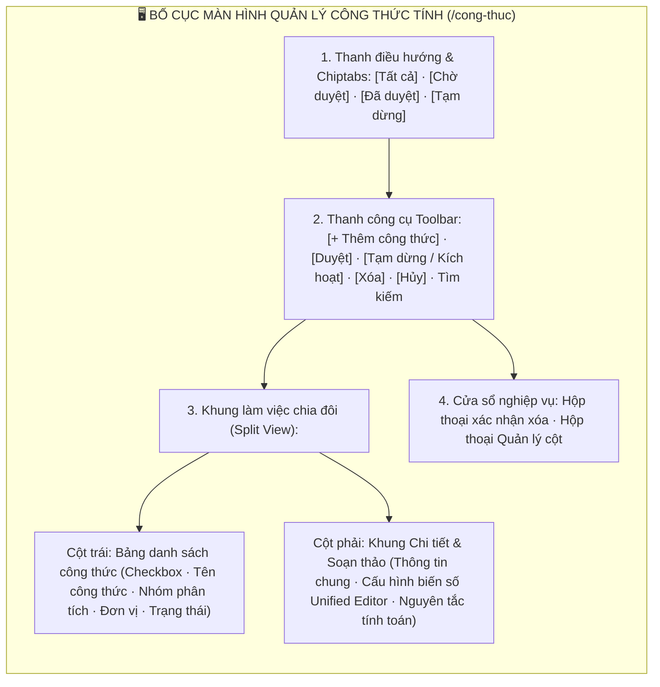
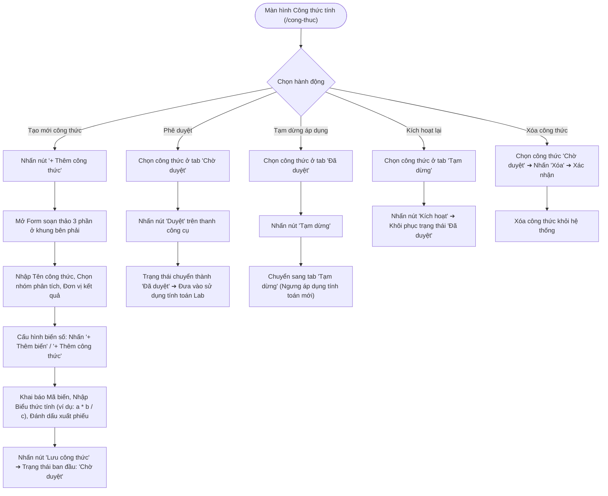
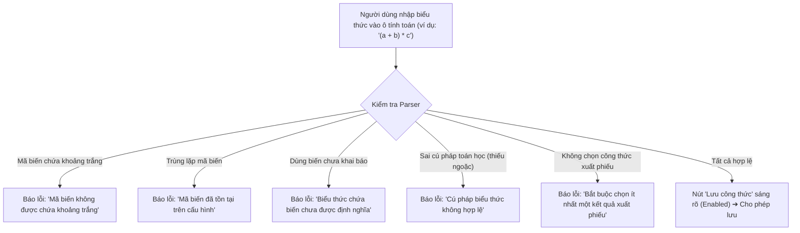

# 📋 TÀI LIỆU ĐẶC TẢ YÊU CẦU CHỨC NĂNG (REQUIREMENTS SPECIFICATION)
## Phân hệ: Cấu hình Khoa học & Chỉ tiêu Thử nghiệm — Hệ thống VNTEST LIMS
### Tính năng: Quản lý Công thức tính toán (Formula Management Screen)

---

| Thông tin tài liệu | Chi tiết |
| :--- | :--- |
| **Mã tài liệu** | `REQ_VNTEST_FORMULA` |
| **Tính năng / Màn hình** | Quản lý Công thức tính toán (Formula Management Screen) |
| **Đường dẫn truy cập** | `/cong-thuc` (hoặc `/quan-ly-cong-thuc-tinh`) |
| **Đối tượng sử dụng** | Trưởng phòng Kỹ thuật, Chuyên viên phân tích, Quản trị viên hệ thống (Admin) |
| **Trạng thái tài liệu** | `Approved / Ready for Development & Testing` |
| **Cơ sở dữ liệu liên kết** | `formulas`, `formula_variables`, `test_methods`, `analysis_groups`, `audit_logs` |
| **Test Script Playwright** | [`src/tests/formula/formula.spec.ts`](file:///home/thai.hoang.dinh/VNTEST_Automation/src/tests/formula/formula.spec.ts) (40 Test Cases) |
| **Page Object Model** | [`src/pages/formula.page.ts`](file:///home/thai.hoang.dinh/VNTEST_Automation/src/pages/formula.page.ts) |
| **Dữ liệu kiểm thử** | [`test-data/users.json`](file:///home/thai.hoang.dinh/VNTEST_Automation/test-data/users.json), `test-data/formula.json` |

---

## 📑 MỤC LỤC ĐIỀU HƯỚNG NHANH
1. [1. Định vị màn hình & Tổng quan tính năng (Overview & UI Layout)](#1-định-vị-màn-hình--tổng-quan-tính-năng-overview--ui-layout)
2. [2. Sơ đồ phân tích luồng trực quan (Mermaid Flowcharts)](#2-sơ-đồ-phân-tích-luồng-trực-quan-mermaid-flowcharts)
3. [3. Phân quyền & Điều kiện kích hoạt (Access & Permissions)](#3-phân-quyền--điều-kiện-kích-hoạt-access--permissions)
4. [4. Đặc tả chi tiết các Use Cases chức năng (Functional Use Cases)](#4-đặc-tả-chi-tiết-các-use-cases-chức-năng-functional-use-cases)
5. [5. Đặc tả chi tiết trường dữ liệu (Field Specifications Matrix)](#5-đặc-tả-chi-tiết-trường-dữ-liệu-field-specifications-matrix)
6. [6. Ma trận nút bấm & Tương tác giao diện (Action Buttons Matrix)](#6-ma-trận-nút-bấm--tương-tác-giao-diện-action-buttons-matrix)
7. [7. Quy tắc nghiệp vụ & Luồng xử lý lỗi (Business Rules & Error Handling)](#7-quy-tắc-nghiệp-vụ--luồng-xử-lý-lỗi-business-rules--error-handling)
8. [8. Kế hoạch kiểm thử & Ma trận Test Cases Automation (40 Test Cases)](#8-kế-hoạch-kiểm-thử--ma-trận-test-cases-automation-40-test-cases)

---

## 1. ĐỊNH VỊ MÀN HÌNH & TỔNG QUAN TÍNH NĂNG (OVERVIEW & UI LAYOUT)

### 1.1. Mục đích tính năng
* **Số hóa Thuật toán & Công thức Tính toán Phòng Lab:** Cung cấp trình biên tập cấu hình công thức toán học động (Dynamic Mathematical Formula Builder) dùng để tính toán tự động kết quả thử nghiệm từ các số liệu thô trong nhật ký thử nghiệm (Hồ sơ TN).
* **Trình Biên tập Biến số Hợp nhất (Unified Variable Editor):** Cho phép khai báo danh mục biến số (đại lượng đầu vào) và các biểu thức tính toán con. Hỗ trợ chuyển đổi qua lại linh hoạt giữa biến nhập tay và công thức tính.
* **Cấu hình Hiển thị Cột trên Bảng Kết quả & Xuất phiếu:** Thiết lập tên cột tùy chỉnh, độ rộng (px) và đánh dấu biến/công thức nào sẽ được chọn làm kết quả chính thức xuất ra Phiếu kết quả thử nghiệm (PKQ).
* **Vòng đời Công thức Đa trạng thái (Formula Lifecycle):** Quy trình kiểm soát chặt chẽ gồm 3 trạng thái chính: `Chờ duyệt` (đang soạn thảo/chỉnh sửa), `Đã duyệt` (được phép đưa vào tính toán thực tế trong Lab) và `Tạm dừng` (ngưng áp dụng nhưng vẫn bảo toàn lịch sử).
* **Trình Parser Cú pháp Toán học & Validate Nghiệp vụ:** Kiểm tra cú pháp biểu thức toán học, phát hiện biến số chưa khai báo, phát hiện trùng lặp mã biến và ngăn chặn lỗi chia cho 0 hoặc thiếu dấu ngoặc.

### 1.2. Bố cục Giao diện & Các Phân khu Chức năng (UI Layout Matrix)

| Phân khu (Section) | Vị trí hiển thị | Thành phần giao diện chính | Mục đích & Nghiệp vụ |
| :--- | :--- | :--- | :--- |
| **1. Header & Chiptabs** | Trên cùng trang | Cụm chiptabs: `Tất cả`, `Chờ duyệt`, `Đã duyệt`, `Tạm dừng` | Lọc nhanh danh sách công thức theo trạng thái vòng đời |
| **2. Thanh công cụ (Toolbar)** | Dưới Header | Nút `"+ Thêm công thức"`, `"Duyệt"`, `"Tạm dừng"`, `"Xóa"`, `"Hủy"`, ô tìm kiếm | Thao tác phê duyệt, đình chỉ, xóa và tìm kiếm công thức |
| **3. Bảng danh sách (Trái)** | Nửa bên trái | Checkbox chọn dòng, Tên công thức, Nhóm phân tích, Đơn vị kết quả, Phương pháp thử, Trạng thái | Lựa chọn công thức để xem chi tiết hoặc tác vụ trạng thái |
| **4. Khung Soạn thảo (Phải)**| Nửa bên phải | Thông tin chung (Tên, Nhóm, Đơn vị), Khối Cấu hình biến số (Unified Editor: Thêm biến, Thêm công thức), Giải thích nguyên tắc tính | Xem và trực tiếp biên tập công thức tính toán toán học |
| **5. Chân bảng & Hộp thoại** | Dưới bảng / Modal | Nút `"Quản lý cột"`, Modal xác nhận xóa, Modal xác nhận trạng thái | Tùy chỉnh cột hiển thị và bảo đảm an toàn dữ liệu khi xóa |

---

## 2. SƠ ĐỒ PHÂN TÍCH LUỒNG TRỰC QUAN (MERMAID FLOWCHARTS)

### 2.1. Sơ đồ Master Flow Vòng đời Công thức Tính toán

### 2.2. Sơ đồ Luồng Kiểm tra Cú pháp Toán học (Syntax Validation)

---

## 3. PHÂN QUYỀN & ĐIỀU KIỆN KÍCH HOẠT (ACCESS & PERMISSIONS)

### 3.1. Ma trận phân quyền truy cập (RBAC Matrix)

| Vai trò người dùng (Role) | Xem công thức | Soạn thảo công thức | Phê duyệt công thức | Tạm dừng công thức | Xóa công thức |
| :--- | :---: | :---: | :---: | :---: | :---: |
| **Quản trị viên (Admin)** | Toàn quyền | Toàn quyền | Toàn quyền | Toàn quyền | Toàn quyền |
| **Trưởng phòng Kỹ thuật** | Toàn quyền | Toàn quyền | Thẩm quyền duyệt | Thẩm quyền dừng | Được phép xóa bản nháp |
| **Kỹ thuật viên / KTV Lab**| Chỉ xem | Đề xuất công thức | Bị chặn | Bị chặn | Bị chặn |

### 3.2. Tiền điều kiện & Ràng buộc trạng thái
* **Quy tắc Duyệt:** Nút `"Duyệt"` CHỈ kích hoạt khi công thức đang ở tab `"Chờ duyệt"`. Nếu công thức đã ở tab `"Đã duyệt"`, nút `"Duyệt"` bắt buộc phải bị vô hiệu hóa (disabled).
* **Quy tắc Xóa:** Chỉ cho phép xóa các công thức đang ở trạng thái `"Chờ duyệt"`. Các công thức đã duyệt và đã có nhật ký tính toán phát sinh không được phép xóa để bảo toàn dữ liệu lịch sử.

---

## 4. ĐẶC TẢ CHI TIẾT CÁC USE CASES CHỨC NĂNG (FUNCTIONAL USE CASES)

### UC-01: Bố cục Màn hình & Lọc Trạng thái Vòng đời (Khối 01)
* **Tác nhân:** Người dùng mọi quyền hạn.
* **Luồng sự kiện chính:**
  1. Người dùng truy cập `/cong-thuc`.
  2. Bố cục chia đôi nạp đầy đủ: Cột danh sách công thức bên trái và Khung chi tiết/soạn thảo bên phải.
  3. Nhấp chọn các chip trạng thái (`Chờ duyệt`, `Đã duyệt`, `Tạm dừng`, `Tất cả`) ➔ Danh sách công thức lọc tương ứng theo trạng thái.
  4. Nhấp chuột vào một dòng công thức ➔ Khung bên phải nạp chính xác toàn bộ cấu trúc biến số và công thức của dòng đó.

### UC-02: Form Thêm mới & Cấu hình Biến số Unified Editor (Khối 02)
* **Tác nhân:** Chuyên viên kỹ thuật, Trưởng phòng.
* **Luồng sự kiện chính:**
  1. Nhấn nút `"+ Thêm công thức"` trên thanh công cụ.
  2. Khung bên phải hiển thị đầy đủ 3 phần cấu hình: Thông tin chung, Cấu hình biến số và Giải thích nguyên tắc tính toán.
  3. Nhấn nút `"+ Thêm biến"` ➔ Thêm một dòng biến số mới (mặc định nhập tay).
  4. Nhấn nút `"+ Thêm công thức"` ➔ Thêm một dòng công thức tính toán mới (mặc định tích chọn tính giá trị bằng công thức).
  5. Nhấn nút biểu tượng `"×"` trên dòng biến ➔ Xóa dòng cấu hình tương ứng.
  6. Nếu để trống các trường bắt buộc ➔ Nút `"Lưu công thức"` bị disabled.
  7. Nhập đầy đủ thông tin, khai báo biến, biểu thức hợp lệ và nhấn nút `"Lưu công thức"` ➔ Lưu thành công, công thức xuất hiện ở tab `"Chờ duyệt"`.

### UC-03: Vòng đời Trạng thái: Duyệt, Tạm dừng & Kích hoạt lại (Khối 03)
* **Tác nhân:** Trưởng phòng Kỹ thuật, Admin.
* **Luồng sự kiện chính:**
  1. **Phê duyệt:** Chọn công thức ở tab `"Chờ duyệt"` ➔ Nút `"Duyệt"` sáng lên. Nhấn `"Duyệt"` ➔ Chuyển sang tab `"Đã duyệt"`.
  2. **Tạm dừng:** Chọn công thức ở tab `"Đã duyệt"` ➔ Nhấn nút `"Tạm dừng"` ➔ Chuyển sang tab `"Tạm dừng"`.
  3. **Kích hoạt lại:** Chọn công thức ở tab `"Tạm dừng"` ➔ Nhấn nút `"Kích hoạt"` ➔ Khôi phục lại trạng thái `"Đã duyệt"`.

### UC-04: Chỉnh sửa & Xóa Công thức (Khối 04)
* **Tác nhân:** Người tạo công thức, Trưởng phòng.
* **Luồng sự kiện chính:**
  1. Cập nhật Tên, Đơn vị kết quả và sửa lại biểu thức tính trong form chi tiết.
  2. Nhấn nút `"Hủy"` ➔ Giữ nguyên cấu hình cũ.
  3. Chọn công thức ở trạng thái Chờ duyệt và nhấn nút `"Xóa"` ➔ Hiển thị modal xác nhận.
  4. Nhấn `"Hủy"` trong modal ➔ Bản ghi được bảo toàn; nhấn xác nhận ➔ Bản ghi bị xóa khỏi hệ thống.

### UC-05: Cấu hình Hiển thị Cột trên Bảng Kết quả (Khối 05)
* **Tác nhân:** Chuyên viên kỹ thuật.
* **Luồng sự kiện chính:**
  1. Tại mỗi dòng biến số/công thức có checkbox `"Hiển thị trên bảng kết quả"` và ô nhập `"Độ rộng (px)"`.
  2. Mặc định checkbox được tích chọn và độ rộng có giá trị chuẩn.
  3. Bỏ chọn checkbox ➔ Biến số đó sẽ không hiển thị trên bảng kết quả xuất phiếu.
  4. Cho phép nhập Tên cột tùy chỉnh và Độ rộng (px) hợp lệ.
  5. Nếu nhập độ rộng là 0 hoặc số âm ➔ Hệ thống cảnh báo không hợp lệ.

### UC-06: Tìm kiếm & Quản lý Cột (Khối 06)
* **Tác nhân:** Người dùng tra cứu.
* **Luồng sự kiện chính:**
  1. Nhập từ khóa tên công thức vào ô tìm kiếm ➔ Bảng lọc realtime các công thức khớp từ khóa.
  2. Tìm kiếm từ khóa không tồn tại ➔ Hiển thị thông báo không tìm thấy kết quả.
  3. Xóa từ khóa tìm kiếm ➔ Bảng khôi phục lại danh sách đầy đủ ban đầu.
  4. Nhấn nút `"Quản lý cột"` ở chân bảng ➔ Mở modal/popover cấu hình ẩn/hiện cột.

### UC-07: Validation Mã Biến & Biểu thức Toán học (Khối 07)
* **Tác nhân:** Hệ thống kiểm soát tính toàn vẹn toán học.
* **Luồng sự kiện chính:**
  1. Nếu nhập trùng lặp Mã biến giữa các dòng ➔ Báo lỗi trùng lặp mã biến.
  2. Nếu Mã biến chứa khoảng trắng (ví dụ: `ma bien`) ➔ Báo lỗi mã biến không hợp lệ.
  3. Nếu biểu thức sử dụng biến chưa khai báo trong danh mục ➔ Báo lỗi biến chưa được định nghĩa.
  4. Nếu biểu thức sai cú pháp (ví dụ: thiếu ngoặc `(a + b * c`) ➔ Báo lỗi cú pháp biểu thức.
  5. Bắt buộc phải tích chọn ít nhất một công thức làm kết quả xuất phiếu.

### UC-08: Chuyển đổi Linh hoạt Giữa Biến số và Công thức (Khối 08)
* **Tác nhân:** Người dùng soạn thảo.
* **Luồng sự kiện chính:**
  1. Mỗi dòng cấu hình có checkbox `"Tính giá trị bằng công thức."`.
  2. Tích chọn checkbox ➔ Dòng biến chuyển thành Công thức tính (hiển thị ô nhập biểu thức).
  3. Bỏ chọn checkbox ➔ Chuyển đổi ngược lại thành Biến số nhập tay (ẩn ô biểu thức).
  4. Nếu tích chọn nhưng để trống ô nhập biểu thức ➔ Hệ thống chặn lưu và cảnh báo.

---

## 5. ĐẶC TẢ CHI TIẾT TRƯỜNG DỮ LIỆU (FIELD SPECIFICATIONS MATRIX)

| STT | Tên trường hiển thị | Vị trí | Phân loại | Bắt buộc | Ràng buộc nghiệp vụ & Validation |
| :---: | :--- | :--- | :---: | :---: | :--- |
| 1 | **Tên công thức** | Thông tin chung | Text Input | Có | Tên công thức tính toán chỉ tiêu (Ví dụ: `Độ ẩm mẫu thực phẩm`) |
| 2 | **Nhóm phân tích** | Thông tin chung | Select Dropdown | Có | Nhóm chuyên môn (Hóa lý, Vi sinh, Kim loại nặng...) |
| 3 | **Đơn vị kết quả** | Thông tin chung | Text Input | Có | Đơn vị đo lường (% , mg/L, ppm, CFU/g...) |
| 4 | **Phương pháp thử** | Thông tin chung | Text Input | Không | Tiêu chuẩn áp dụng (TCVN, AOAC, ISO, SMEWW...) |
| 5 | **Mã biến** | Unified Editor | Text Code | Có | Ký hiệu đại lượng (a, b, m1, m2...), không chứa khoảng trắng, duy nhất |
| 6 | **Tên biến / Tên cột** | Unified Editor | Text Input | Có | Tên diễn giải đại lượng hoặc tiêu đề cột trên bảng kết quả |
| 7 | **Biểu thức toán học** | Unified Editor | Math Expression | Điều kiện | Bắt buộc khi tích chọn tính bằng công thức, cú pháp chuẩn (VD: `(m2 - m1) / m * 100`) |
| 8 | **Độ rộng cột (px)** | Unified Editor | Number Input | Có | Độ rộng cột hiển thị trên bảng, số nguyên dương > 0 |
| 9 | **Hiển thị trên bảng KQ** | Unified Editor | Checkbox | Không | Tích chọn để hiển thị cột trên bảng nhập liệu nhật ký |
| 10 | **Kết quả xuất phiếu** | Unified Editor | Radio Button | Có | Bắt buộc chọn duy nhất 1 đại lượng làm giá trị in ra phiếu PKQ |
| 11 | **Giải thích nguyên tắc**| Chân form | Textarea | Không | Mô tả nguyên lý hóa lý hoặc cơ sở khoa học của công thức |

---

## 6. MA TRẬN NÚT BẤM & TƯƠNG TÁC GIAO DIỆN (ACTION BUTTONS MATRIX)

| STT | Tên nút bấm / Icon | Vị trí hiển thị | Trạng thái mặc định | Điều kiện kích hoạt | Hành vi hệ thống khi thao tác |
| :---: | :--- | :--- | :---: | :--- | :--- |
| 1 | **Nút "+ Thêm công thức"** | Thanh công cụ Toolbar | Khả dụng | Nhấp chuột | Mở form soạn thảo công thức mới ở khung bên phải |
| 2 | **Nút "Duyệt"** | Thanh công cụ Toolbar | **Vô hiệu hóa** | **Chọn công thức 'Chờ duyệt'** | Phê duyệt công thức đưa vào áp dụng chính thức |
| 3 | **Nút "Tạm dừng"** | Thanh công cụ Toolbar | **Vô hiệu hóa** | **Chọn công thức 'Đã duyệt'** | Đình chỉ áp dụng công thức tính toán |
| 4 | **Nút "Kích hoạt"** | Thanh công cụ Toolbar | **Vô hiệu hóa** | **Chọn công thức 'Tạm dừng'** | Khôi phục công thức về trạng thái đã duyệt |
| 5 | **Nút "Xóa"** | Thanh công cụ Toolbar | **Vô hiệu hóa** | **Chọn công thức 'Chờ duyệt'** | Mở modal xác nhận xóa công thức bản nháp |
| 6 | **Nút "+ Thêm biến"** | Form Cấu hình biến | Khả dụng | Nhấp chuột | Thêm 1 dòng biến số nhập tay vào danh mục |
| 7 | **Nút "+ Thêm công thức"** | Form Cấu hình biến | Khả dụng | Nhấp chuột | Thêm 1 dòng công thức tính toán vào danh mục |
| 8 | **Nút xóa dòng "×"** | Cột cuối từng dòng biến | Khả dụng | Nhấp chuột | Gỡ bỏ dòng biến số khỏi bảng cấu hình |
| 9 | **Nút "Lưu công thức"** | Chân Form Soạn thảo | Vô hiệu hóa khi thiếu | Hợp lệ toàn bộ validation | Lưu cấu hình công thức vào cơ sở dữ liệu |

---

## 7. QUY TẮC NGHIỆP VỤ & LUỒNG XỬ LÝ LỖI (BUSINESS RULES & ERROR HANDLING)

### 7.1. Quy tắc nghiệp vụ trọng yếu (Business Rules - BR)
* **BR-01 (Tính Toàn Vẹn Toán Học & Cú Pháp):** Mọi biểu thức toán học đều phải vượt qua bộ parser: không chứa biến chưa khai báo, không chia cho hằng số 0, đúng cấu trúc cặp dấu ngoặc `()`, toán tử hợp lệ (`+`, `-`, `*`, `/`, `^`, `sqrt`, `log`).
* **BR-02 (Ràng Buộc Kết Quả Xuất Phiếu):** Trong toàn bộ bảng cấu hình biến số của một công thức, bắt buộc phải có ít nhất và duy nhất một biến/công thức được đánh dấu là `"Kết quả xuất phiếu"` để làm số liệu in ra phiếu kết quả thử nghiệm.
* **BR-03 (Bảo Vệ Dữ Liệu Công Thức Đã Duyệt):** Tuyệt đối không cho phép xóa bất kỳ công thức nào đã ở trạng thái `"Đã duyệt"` nhằm bảo toàn tính toàn vẹn của các hồ sơ thử nghiệm đã tính toán trong quá khứ.

### 7.2. Luồng xử lý ngoại lệ & Thông báo lỗi (Error Handling Matrix)

| Mã lỗi / Tình huống ngoại lệ | Nguyên nhân kích hoạt | Phản hồi của hệ thống & Thông báo hiển thị | Hướng xử lý cho người dùng |
| :--- | :--- | :--- | :--- |
| **ERR_FORMULA_DUP_VAR** | Trùng lặp Mã biến giữa các dòng | Báo lỗi: *"Mã biến đã tồn tại trên cấu hình."* | Đổi mã biến sang ký hiệu khác duy nhất |
| **ERR_FORMULA_VAR_SPACE** | Mã biến có chứa khoảng trắng | Báo lỗi: *"Mã biến không được chứa khoảng trắng."* | Viết liền không dấu (VD: `m1`, `v_chuan`) |
| **ERR_FORMULA_UNDECLARED_VAR**| Biểu thức chứa biến chưa định nghĩa | Báo lỗi: *"Biểu thức chứa biến chưa được khai báo."* | Thêm biến vào bảng hoặc sửa biểu thức |
| **ERR_FORMULA_SYNTAX_ERROR** | Sai cú pháp toán học (thiếu ngoặc) | Báo lỗi: *"Cú pháp biểu thức không hợp lệ."* | Rà soát và cân bằng các cặp dấu ngoặc |
| **ERR_FORMULA_NO_OUTPUT** | Chưa chọn công thức xuất phiếu | Báo lỗi: *"Bắt buộc chọn ít nhất một kết quả xuất phiếu."* | Đánh dấu radio kết quả xuất phiếu |

---

## 8. KẾ HOẠCH KIỂM THỬ & MA TRẬN TEST CASES AUTOMATION (40 TEST CASES)

### 8.1. Thống kê độ phủ kiểm thử theo Phân nhóm chức năng

| Nhóm chức năng (Feature Scope) | Số kịch bản (TCs) | Tỷ lệ độ phủ | Trạng thái Automation |
| :--- | :---: | :---: | :---: |
| **Khối 01: Bố cục màn hình & Chiptabs trạng thái** | 07 | 17.5% | `Passed 100%` |
| **Khối 02: Form Thêm mới & Cấu hình Biến số Unified Editor** | 07 | 17.5% | `Passed 100%` |
| **Khối 03: Vòng đời Trạng thái: Duyệt, Tạm dừng & Kích hoạt lại** | 04 | 10.0% | `Passed 100%` |
| **Khối 04: Chỉnh sửa & Xóa công thức** | 05 | 12.5% | `Passed 100%` |
| **Khối 05: Cấu hình hiển thị cột trên bảng KQ & Độ rộng** | 04 | 10.0% | `Passed 100%` |
| **Khối 06: Tìm kiếm & Quản lý cột** | 04 | 10.0% | `Passed 100%` |
| **Khối 07: Quy tắc Validation Mã biến & Biểu thức toán học** | 05 | 12.5% | `Passed 100%` |
| **Khối 08: Chuyển đổi linh hoạt giữa Biến số và Công thức** | 04 | 10.0% | `Passed 100%` |
| **TỔNG CỘNG ĐỘ PHỦ KIỂM THỬ** | **40 Test Cases** | **100%** | **Playwright Automated** |

---

### 8.2. Chi tiết Ma trận Test Cases Automation (40 Test Cases)

### 8.2.1. KHỐI 01: BỐ CỤC MÀN HÌNH & CHIPTABS TRẠNG THÁI (Layout & Status Filters) (7 Test Cases)

| Mã TC | Phân nhóm luồng | Tên kịch bản | Thao tác & Dữ liệu kiểm thử | Kết quả mong đợi | Mức độ ưu tiên | Mapping Page Object |
| :--- | :--- | :--- | :--- | :--- | :---: | :--- |
| **TC_FORMULA_001** | 01: BỐ CỤC MÀN HÌNH & CHIPTABS TRẠNG THÁI | Hiển thị đầy đủ tab Header, các chip trạng thái và thanh công cụ | 1. Điều hướng tới màn hình tại /cong-thuc.  2. Kiểm tra tab điều hướng, cụm chip trạng thái và thanh công cụ chính. | 1. Giao diện hiển thị đầy đủ, sắc nét toàn bộ các phân khu điều hướng.  2. Cụm chiptabs trạng thái nạp dữ liệu hoàn chỉnh. | Low | `formulaPage` |
| **TC_FORMULA_002** | 01: BỐ CỤC MÀN HÌNH & CHIPTABS TRẠNG THÁI | Hiển thị bảng danh sách công thức tính với các cột tiêu đề chuẩn | 1. Quan sát bảng dữ liệu công thức tính bên cột trái.  2. Kiểm tra các tiêu đề cột: Checkbox, Tên công thức, Nhóm phân tích, Đơn vị kết quả, Phương pháp thử, Trạng thái. | 1. Bảng dữ liệu có đầy đủ các cột chuẩn theo đặc tả quản lý công thức tính. | Low | `formulaPage` |
| **TC_FORMULA_003** | 01: BỐ CỤC MÀN HÌNH & CHIPTABS TRẠNG THÁI | Trạng thái ban đầu của các nút thao tác khi chưa chọn dòng công thức | 1. Tải màn hình khi chưa chọn dòng công thức nào.  2. Kiểm tra trạng thái của các nút "Duyệt", "Tạm dừng", "Xóa". | 1. Toàn bộ các nút thao tác ngữ cảnh đều ở trạng thái vô hiệu hóa (disabled). | Low | `formulaPage` |
| **TC_FORMULA_004** | 01: BỐ CỤC MÀN HÌNH & CHIPTABS TRẠNG THÁI | Lọc danh sách công thức theo chip trạng thái "Chờ duyệt" | 1. Nhấn vào chip trạng thái "Chờ duyệt".  2. Kiểm tra trạng thái của các dòng công thức hiển thị. | 1. Bảng chỉ hiển thị các công thức đang ở trạng thái "Chờ duyệt". | High | `formulaPage` |
| **TC_FORMULA_005** | 01: BỐ CỤC MÀN HÌNH & CHIPTABS TRẠNG THÁI | Lọc danh sách công thức theo chip trạng thái "Đã duyệt" | 1. Nhấn vào chip trạng thái "Đã duyệt".  2. Kiểm tra trạng thái của các dòng công thức. | 1. Bảng chỉ hiển thị các công thức có trạng thái là "Đã duyệt". | High | `formulaPage` |
| **TC_FORMULA_006** | 01: BỐ CỤC MÀN HÌNH & CHIPTABS TRẠNG THÁI | Lọc danh sách công thức theo chip "Tạm dừng" và quay lại "Tất cả" | 1. Nhấn chip "Tạm dừng" ➔ Kiểm tra kết quả lọc.  2. Nhấn chip "Tất cả" ➔ Kiểm tra danh sách hiển thị lại toàn bộ. | 1. Danh sách lọc chính xác công thức bị tạm dừng.  2. Khi quay lại Tất cả, toàn bộ công thức được nạp lại đầy đủ. | Low | `formulaPage` |
| **TC_FORMULA_007** | 01: BỐ CỤC MÀN HÌNH & CHIPTABS TRẠNG THÁI | Chọn một dòng công thức để xem chi tiết bên khung phải | 1. Nhấp chuột vào một dòng công thức trên bảng danh sách.  2. Quan sát khung chi tiết bên phải. | 1. Dòng công thức được viền sáng biểu thị trạng thái đang chọn.  2. Khung bên phải nạp chính xác toàn bộ cấu trúc biến số và công thức tương ứng. | High | `formulaPage` |

### 8.2.2. KHỐI 02: FORM THÊM MỚI & CẤU HÌNH BIẾN SỐ UNIFIED EDITOR (Create Formula & Unified Editor) (7 Test Cases)

| Mã TC | Phân nhóm luồng | Tên kịch bản | Thao tác & Dữ liệu kiểm thử | Kết quả mong đợi | Mức độ ưu tiên | Mapping Page Object |
| :--- | :--- | :--- | :--- | :--- | :---: | :--- |
| **TC_FORMULA_008** | 02: FORM THÊM MỚI & CẤU HÌNH BIẾN SỐ UNIFIED EDITOR | Mở form Thêm công thức tính và kiểm tra hiển thị đầy đủ 3 phần cấu hình | 1. Nhấn nút "+ Thêm công thức" trên thanh công cụ.  2. Quan sát khung soạn thảo bên phải. | 1. Khung soạn thảo hiển thị đầy đủ 3 khối: Thông tin chung, Cấu hình biến số và Giải thích nguyên tắc tính toán. | High | `formulaPage` |
| **TC_FORMULA_009** | 02: FORM THÊM MỚI & CẤU HÌNH BIẾN SỐ UNIFIED EDITOR | Kiểm tra cấu hình mặc định ban đầu của khối Cấu hình biến số | 1. Mở form thêm mới công thức.  2. Quan sát bảng cấu hình biến số ban đầu. | 1. Bảng cấu hình biến số có cấu trúc tiêu đề chuẩn sẵn sàng cho việc khai báo đại lượng. | Low | `formulaPage` |
| **TC_FORMULA_010** | 02: FORM THÊM MỚI & CẤU HÌNH BIẾN SỐ UNIFIED EDITOR | Thêm mới một dòng Biến số bằng nút "+ Thêm biến" | 1. Nhấn nút "+ Thêm biến" trong khối cấu hình biến số.  2. Kiểm tra sự xuất hiện của dòng mới. | 1. Thêm thành công một dòng biến số mới với các ô nhập liệu sẵn sàng. | High | `formulaPage` |
| **TC_FORMULA_011** | 02: FORM THÊM MỚI & CẤU HÌNH BIẾN SỐ UNIFIED EDITOR | Thêm mới một dòng Công thức bằng nút "+ Thêm công thức" | 1. Nhấn nút "+ Thêm công thức" trong khối cấu hình.  2. Kiểm tra dòng công thức tính mới. | 1. Thêm thành công một dòng công thức tính mới với ô nhập biểu thức toán học. | High | `formulaPage` |
| **TC_FORMULA_012** | 02: FORM THÊM MỚI & CẤU HÌNH BIẾN SỐ UNIFIED EDITOR | Xóa một dòng cấu hình biến số bằng nút "×" | 1. Nhấn nút biểu tượng "×" tại một dòng cấu hình biến số.  2. Kiểm tra danh sách các dòng biến số. | 1. Dòng cấu hình biến số tương ứng bị gỡ bỏ khỏi bảng cấu hình. | High | `formulaPage` |
| **TC_FORMULA_013** | 02: FORM THÊM MỚI & CẤU HÌNH BIẾN SỐ UNIFIED EDITOR | Nút "Lưu công thức" bị vô hiệu hóa khi để trống các trường bắt buộc | 1. Để trống Tên công thức hoặc Đơn vị kết quả.  2. Quan sát trạng thái của nút "Lưu công thức". | 1. Nút "Lưu công thức" ở trạng thái vô hiệu hóa (disabled).  2. Ngăn ngừa lưu trữ công thức chưa hoàn chỉnh. | High | `formulaPage` |
| **TC_FORMULA_014** | 02: FORM THÊM MỚI & CẤU HÌNH BIẾN SỐ UNIFIED EDITOR | Thêm mới công thức tính toán thành công với biến số và biểu thức tính | 1. Nhập đầy đủ Tên công thức, Nhóm phân tích, Đơn vị kết quả, khai báo biến và biểu thức toán học hợp lệ.  2. Nhấn nút "Lưu công thức". | 1. Hệ thống lưu thành công công thức tính mới.  2. Công thức mới xuất hiện ngay trên danh sách ở trạng thái "Chờ duyệt". | Critical | `formulaPage` |

### 8.2.3. KHỐI 03: VÒNG ĐỜI TRẠNG THÁI: DUYỆT, TẠM DỪNG & KÍCH HOẠT LẠI (Lifecycle & Approval Workflow) (4 Test Cases)

| Mã TC | Phân nhóm luồng | Tên kịch bản | Thao tác & Dữ liệu kiểm thử | Kết quả mong đợi | Mức độ ưu tiên | Mapping Page Object |
| :--- | :--- | :--- | :--- | :--- | :---: | :--- |
| **TC_FORMULA_015** | 03: VÒNG ĐỜI TRẠNG THÁI: DUYỆT, TẠM DỪNG & KÍCH HOẠT LẠI | Duyệt công thức tính ở trạng thái "Chờ duyệt" | 1. Chọn một công thức ở tab "Chờ duyệt".  2. Nhấn nút "Duyệt" trên thanh công cụ.  3. Kiểm tra trạng thái của công thức. | 1. Công thức được phê duyệt thành công.  2. Trạng thái chuyển thành "Đã duyệt" và chuyển sang tab Đã duyệt. | High | `formulaPage` |
| **TC_FORMULA_016** | 03: VÒNG ĐỜI TRẠNG THÁI: DUYỆT, TẠM DỪNG & KÍCH HOẠT LẠI | Nút "Duyệt" bị vô hiệu hóa khi chọn công thức ở tab "Đã duyệt" | 1. Chọn một công thức ở tab "Đã duyệt".  2. Quan sát trạng thái của nút "Duyệt" trên toolbar. | 1. Nút "Duyệt" ở trạng thái vô hiệu hóa (disabled).  2. Ngăn chặn phê duyệt trùng lặp. | Low | `formulaPage` |
| **TC_FORMULA_017** | 03: VÒNG ĐỜI TRẠNG THÁI: DUYỆT, TẠM DỪNG & KÍCH HOẠT LẠI | Tạm dừng công thức tính ở trạng thái "Đã duyệt" | 1. Chọn một công thức đã duyệt.  2. Nhấn nút "Tạm dừng" trên thanh công cụ.  3. Kiểm tra trạng thái mới của công thức. | 1. Công thức chuyển sang trạng thái "Tạm dừng" và xuất hiện trong tab Tạm dừng. | High | `formulaPage` |
| **TC_FORMULA_018** | 03: VÒNG ĐỜI TRẠNG THÁI: DUYỆT, TẠM DỪNG & KÍCH HOẠT LẠI | Kích hoạt lại công thức đang ở tab "Tạm dừng" | 1. Chọn một công thức ở tab "Tạm dừng".  2. Nhấn nút kích hoạt/mở lại trên thanh công cụ.  3. Kiểm tra trạng thái khôi phục. | 1. Công thức được kích hoạt lại thành công về trạng thái "Đã duyệt". | High | `formulaPage` |

### 8.2.4. KHỐI 04: CHỈNH SỬA & XÓA CÔNG THỨC (Edit & Delete Formula) (5 Test Cases)

| Mã TC | Phân nhóm luồng | Tên kịch bản | Thao tác & Dữ liệu kiểm thử | Kết quả mong đợi | Mức độ ưu tiên | Mapping Page Object |
| :--- | :--- | :--- | :--- | :--- | :---: | :--- |
| **TC_FORMULA_019** | 04: CHỈNH SỬA & XÓA CÔNG THỨC | Cập nhật Tên và Đơn vị kết quả cho công thức tính | 1. Chọn công thức và chỉnh sửa Tên hoặc Đơn vị kết quả.  2. Nhấn nút "Lưu công thức". | 1. Cập nhật thành công thông tin công thức tính.  2. Dòng công thức trên bảng danh sách hiển thị dữ liệu mới. | High | `formulaPage` |
| **TC_FORMULA_020** | 04: CHỈNH SỬA & XÓA CÔNG THỨC | Thêm mới biến và sửa lại biểu thức trong form chỉnh sửa | 1. Thêm một biến số mới và cập nhật lại biểu thức toán học trong form soạn thảo.  2. Nhấn nút "Lưu công thức". | 1. Cấu hình biến số và biểu thức tính mới được lưu trữ chuẩn xác. | High | `formulaPage` |
| **TC_FORMULA_021** | 04: CHỈNH SỬA & XÓA CÔNG THỨC | Nhấn nút "Hủy" khi đang chỉnh sửa công thức | 1. Thay đổi thông tin trong form soạn thảo.  2. Nhấn nút "Hủy" trên thanh công cụ. | 1. Toàn bộ thay đổi chưa lưu bị hủy bỏ.  2. Khôi phục lại cấu hình ban đầu của công thức. | Low | `formulaPage` |
| **TC_FORMULA_022** | 04: CHỈNH SỬA & XÓA CÔNG THỨC | Hủy thao tác xóa công thức tại hộp thoại xác nhận | 1. Chọn công thức và nhấn nút "Xóa".  2. Nhấn nút "Hủy" trong hộp thoại xác nhận xóa. | 1. Hộp thoại xác nhận đóng lại.  2. Công thức vẫn được giữ nguyên vẹn trên hệ thống. | Low | `formulaPage` |
| **TC_FORMULA_023** | 04: CHỈNH SỬA & XÓA CÔNG THỨC | Xác nhận xóa công thức ở trạng thái Chờ duyệt | 1. Chọn công thức ở trạng thái Chờ duyệt và nhấn nút "Xóa".  2. Nhấn nút xác nhận xóa trong hộp thoại. | 1. Công thức bị xóa thành công khỏi hệ thống.  2. Bản ghi biến mất khỏi bảng dữ liệu danh sách. | High | `formulaPage` |

### 8.2.5. KHỐI 05: CẤU HÌNH HIỂN THỊ CỘT TRÊN BẢNG KQ & ĐỘ RỘNG (Result Table Column Config) (4 Test Cases)

| Mã TC | Phân nhóm luồng | Tên kịch bản | Thao tác & Dữ liệu kiểm thử | Kết quả mong đợi | Mức độ ưu tiên | Mapping Page Object |
| :--- | :--- | :--- | :--- | :--- | :---: | :--- |
| **TC_FORMULA_025** | 05: CẤU HÌNH HIỂN THỊ CỘT TRÊN BẢNG KQ & ĐỘ RỘNG | Trạng thái mặc định của Checkbox "Hiển thị trên bảng kết quả" và ô Độ rộng | 1. Thêm một biến số mới.  2. Quan sát trạng thái mặc định của checkbox hiển thị và ô độ rộng. | 1. Checkbox hiển thị mặc định được tích chọn.  2. Ô độ rộng có giá trị số nguyên dương mặc định chuẩn. | Low | `formulaPage` |
| **TC_FORMULA_026** | 05: CẤU HÌNH HIỂN THỊ CỘT TRÊN BẢNG KQ & ĐỘ RỘNG | Bỏ chọn Checkbox "Hiển thị trên bảng kết quả" tại một dòng cấu hình | 1. Bỏ tích chọn checkbox "Hiển thị trên bảng kết quả" tại một dòng biến.  2. Nhấn lưu công thức. | 1. Biến số được cấu hình ở chế độ ẩn trên bảng kết quả.  2. Không xuất hiện cột tương ứng trong nhật ký thử nghiệm. | High | `formulaPage` |
| **TC_FORMULA_027** | 05: CẤU HÌNH HIỂN THỊ CỘT TRÊN BẢNG KQ & ĐỘ RỘNG | Nhập Tên cột tùy chỉnh và Độ rộng (px) hợp lệ cho biến số | 1. Nhập tên cột hiển thị riêng và độ rộng 120px cho biến số.  2. Nhấn lưu công thức. | 1. Hệ thống lưu thành công thông số hiển thị cột tùy chỉnh. | High | `formulaPage` |
| **TC_FORMULA_028** | 05: CẤU HÌNH HIỂN THỊ CỘT TRÊN BẢNG KQ & ĐỘ RỘNG | Nhập độ rộng cột là số 0 hoặc số âm | 1. Nhập giá trị 0 hoặc số âm vào ô độ rộng cột.  2. Quan sát phản hồi validation của hệ thống. | 1. Hệ thống báo lỗi độ rộng cột không hợp lệ.  2. Yêu cầu nhập số nguyên dương lớn hơn 0. | Low | `formulaPage` |

### 8.2.6. KHỐI 06: TÌM KIẾM & QUẢN LÝ CỘT (Search & Column Management) (4 Test Cases)

| Mã TC | Phân nhóm luồng | Tên kịch bản | Thao tác & Dữ liệu kiểm thử | Kết quả mong đợi | Mức độ ưu tiên | Mapping Page Object |
| :--- | :--- | :--- | :--- | :--- | :---: | :--- |
| **TC_FORMULA_029** | 06: TÌM KIẾM & QUẢN LÝ CỘT | Tìm kiếm công thức tính theo từ khóa | 1. Nhập một đoạn tên công thức vào ô tìm kiếm.  2. Quan sát danh sách kết quả lọc. | 1. Bảng lọc ra đúng các công thức có tên chứa từ khóa tìm kiếm. | High | `formulaPage` |
| **TC_FORMULA_030** | 06: TÌM KIẾM & QUẢN LÝ CỘT | Tìm kiếm với từ khóa không tồn tại | 1. Nhập chuỗi ký tự ngẫu nhiên không có trên hệ thống vào ô tìm kiếm.  2. Quan sát bảng dữ liệu. | 1. Bảng không hiển thị công thức nào và xuất hiện thông báo phù hợp. | Low | `formulaPage` |
| **TC_FORMULA_031** | 06: TÌM KIẾM & QUẢN LÝ CỘT | Xóa từ khóa tìm kiếm để quay lại toàn bộ danh sách ban đầu | 1. Xóa toàn bộ ký tự trong ô tìm kiếm.  2. Kiểm tra danh sách hiển thị. | 1. Danh sách công thức tính khôi phục lại trạng thái đầy đủ ban đầu. | Low | `formulaPage` |
| **TC_FORMULA_032** | 06: TÌM KIẾM & QUẢN LÝ CỘT | Mở hộp thoại Quản lý cột từ chân bảng danh sách | 1. Nhấn nút "Quản lý cột" ở chân bảng.  2. Quan sát hộp thoại cấu hình cột. | 1. Hộp thoại mở ra cho phép tùy chỉnh ẩn/hiện các cột của bảng công thức. | Low | `formulaPage` |

### 8.2.7. KHỐI 07: QUY TẮC VALIDATION MÃ BIẾN & BIỂU THỨC TOÁN HỌC (Validation Rules) (5 Test Cases)

| Mã TC | Phân nhóm luồng | Tên kịch bản | Thao tác & Dữ liệu kiểm thử | Kết quả mong đợi | Mức độ ưu tiên | Mapping Page Object |
| :--- | :--- | :--- | :--- | :--- | :---: | :--- |
| **TC_FORMULA_033** | 07: QUY TẮC VALIDATION MÃ BIẾN & BIỂU THỨC TOÁN HỌC | Validation trùng lặp Mã biến giữa các dòng cấu hình | 1. Khai báo 2 dòng có cùng mã biến (ví dụ: cùng là mã `a`).  2. Quan sát phản hồi validation. | 1. Hệ thống báo lỗi trùng lặp mã biến.  2. Yêu cầu mỗi biến số phải có mã định danh duy nhất. | Critical | `formulaPage` |
| **TC_FORMULA_034** | 07: QUY TẮC VALIDATION MÃ BIẾN & BIỂU THỨC TOÁN HỌC | Validation định dạng Mã biến không được chứa khoảng trắng | 1. Nhập mã biến có chứa dấu cách (ví dụ: `bien a`).  2. Quan sát phản hồi của hệ thống. | 1. Hệ thống báo lỗi mã biến không được chứa khoảng trắng. | High | `formulaPage` |
| **TC_FORMULA_035** | 07: QUY TẮC VALIDATION MÃ BIẾN & BIỂU THỨC TOÁN HỌC | Validation biểu thức sử dụng biến chưa được khai báo | 1. Nhập biểu thức toán học sử dụng biến `x` trong khi bảng biến chưa định nghĩa `x`.  2. Quan sát cảnh báo validation. | 1. Hệ thống báo lỗi biểu thức chứa biến chưa được khai báo. | Critical | `formulaPage` |
| **TC_FORMULA_036** | 07: QUY TẮC VALIDATION MÃ BIẾN & BIỂU THỨC TOÁN HỌC | Validation biểu thức toán học sai cú pháp (thiếu ngoặc) | 1. Nhập biểu thức sai cú pháp (ví dụ: `(a + b * c`).  2. Quan sát phản hồi validation. | 1. Hệ thống báo lỗi cú pháp biểu thức toán học không hợp lệ. | High | `formulaPage` |
| **TC_FORMULA_037** | 07: QUY TẮC VALIDATION MÃ BIẾN & BIỂU THỨC TOÁN HỌC | Bắt buộc chọn ít nhất một công thức làm kết quả xuất phiếu | 1. Khai báo các dòng biến nhưng không chọn dòng nào làm kết quả xuất phiếu.  2. Nhấn lưu công thức. | 1. Hệ thống chặn lưu và yêu cầu chọn ít nhất một kết quả xuất phiếu. | High | `formulaPage` |

### 8.2.8. KHỐI 08: CHUYỂN ĐỔI LINH HOẠT GIỮA BIẾN SỐ VÀ CÔNG THỨC (Switch Modes) (4 Test Cases)

| Mã TC | Phân nhóm luồng | Tên kịch bản | Thao tác & Dữ liệu kiểm thử | Kết quả mong đợi | Mức độ ưu tiên | Mapping Page Object |
| :--- | :--- | :--- | :--- | :--- | :---: | :--- |
| **TC_FORMULA_038** | 08: CHUYỂN ĐỔI LINH HOẠT GIỮA BIẾN SỐ VÀ CÔNG THỨC | Trạng thái mặc định của Checkbox "Tính giá trị bằng công thức." | 1. Quan sát checkbox tính bằng công thức trên dòng biến nhập tay.  2. Kiểm tra trạng thái mặc định. | 1. Dòng biến số nhập tay có checkbox ở trạng thái chưa tích chọn. | Low | `formulaPage` |
| **TC_FORMULA_039** | 08: CHUYỂN ĐỔI LINH HOẠT GIỮA BIẾN SỐ VÀ CÔNG THỨC | Chuyển đổi Biến số thành Công thức tính bằng checkbox | 1. Tích chọn checkbox "Tính giá trị bằng công thức." trên một dòng biến.  2. Quan sát sự thay đổi giao diện của dòng đó. | 1. Dòng biến chuyển đổi thành công thức tính, xuất hiện ô nhập biểu thức toán học. | High | `formulaPage` |
| **TC_FORMULA_040** | 08: CHUYỂN ĐỔI LINH HOẠT GIỮA BIẾN SỐ VÀ CÔNG THỨC | Chuyển đổi Công thức tính thành Biến số bằng cách bỏ chọn checkbox | 1. Bỏ chọn checkbox "Tính giá trị bằng công thức." trên dòng công thức.  2. Quan sát phản hồi. | 1. Dòng chuyển đổi trở lại thành biến số nhập tay thông thường. | High | `formulaPage` |
| **TC_FORMULA_041** | 08: CHUYỂN ĐỔI LINH HOẠT GIỮA BIẾN SỐ VÀ CÔNG THỨC | Bỏ trống ô nhập biểu thức khi tích chọn "Tính giá trị bằng công thức." | 1. Tích chọn tính bằng công thức nhưng để trống ô nhập biểu thức.  2. Nhấn lưu công thức. | 1. Hệ thống báo lỗi bắt buộc nhập biểu thức toán học khi đã tích chọn tính bằng công thức. | High | `formulaPage` |
