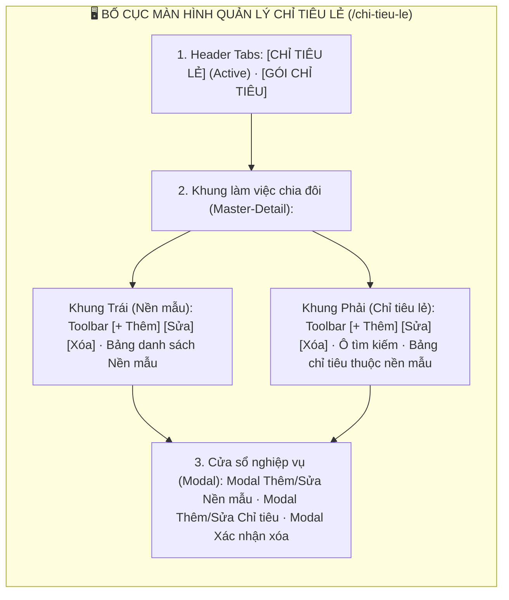
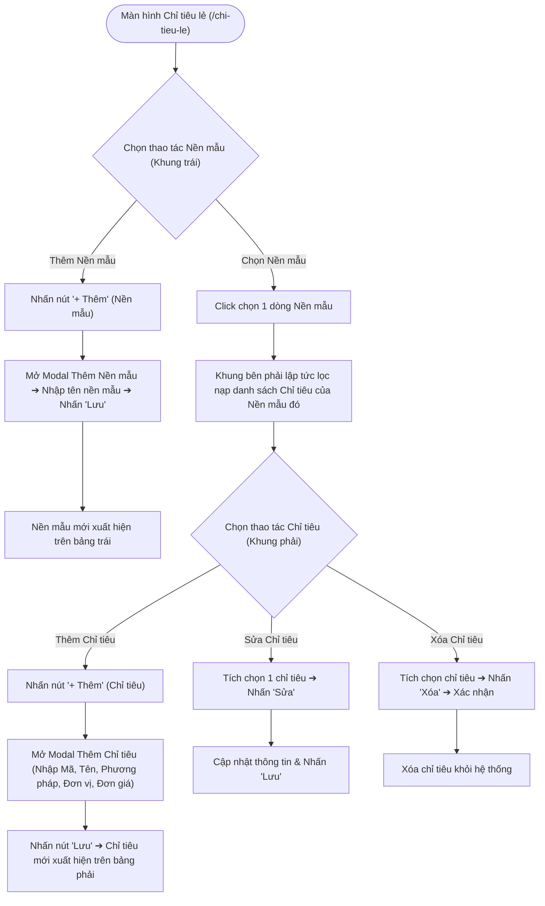

# 📋 TÀI LIỆU ĐẶC TẢ YÊU CẦU CHỨC NĂNG (REQUIREMENTS SPECIFICATION)
## Phân hệ: Cấu hình Khoa học & Danh mục Thử nghiệm — Hệ thống VNTEST LIMS
### Tính năng: Quản lý Chỉ tiêu lẻ & Nền mẫu (Single Criteria & Matrix Management Screen)

---

| Thông tin tài liệu | Chi tiết |
| :--- | :--- |
| **Mã tài liệu** | `REQ_VNTEST_SINGLE_CRITERIA` |
| **Tính năng / Màn hình** | Quản lý Chỉ tiêu lẻ & Nền mẫu (Single Criteria & Matrix Management Screen) |
| **Đường dẫn truy cập** | `/chi-tieu-le` (hoặc chuyển tab `CHỈ TIÊU LẺ` trên menu kỹ thuật) |
| **Đối tượng sử dụng** | Quản trị danh mục kỹ thuật, Trưởng phòng thử nghiệm, Ban Giám đốc |
| **Trạng thái tài liệu** | `Approved / Ready for Development & Testing` |
| **Cơ sở dữ liệu liên kết** | `sample_matrices`, `single_criteria`, `test_methods`, `units`, `audit_logs` |
| **Test Script Playwright** | [`src/tests/single-criteria/single-criteria.spec.ts`](file:///home/thai.hoang.dinh/VNTEST_Automation/src/tests/single-criteria/single-criteria.spec.ts) (17 Test Cases) |
| **Page Object Model** | [`src/pages/single-criteria.page.ts`](file:///home/thai.hoang.dinh/VNTEST_Automation/src/pages/single-criteria.page.ts) |
| **Dữ liệu kiểm thử** | [`test-data/users.json`](file:///home/thai.hoang.dinh/VNTEST_Automation/test-data/users.json), `test-data/single-criteria.json` |

---

## 📑 MỤC LỤC ĐIỀU HƯỚNG NHANH
1. [1. Định vị màn hình & Tổng quan tính năng (Overview & UI Layout)](#1-định-vị-màn-hình--tổng-quan-tính-năng-overview--ui-layout)
2. [2. Sơ đồ phân tích luồng trực quan (Mermaid Flowcharts)](#2-sơ-đồ-phân-tích-luồng-trực-quan-mermaid-flowcharts)
3. [3. Phân quyền & Điều kiện kích hoạt (Access & Permissions)](#3-phân-quyền--điều-kiện-kích-hoạt-access--permissions)
4. [4. Đặc tả chi tiết các Use Cases chức năng (Functional Use Cases)](#4-đặc-tả-chi-tiết-các-use-cases-chức-năng-functional-use-cases)
5. [5. Đặc tả chi tiết trường dữ liệu (Field Specifications Matrix)](#5-đặc-tả-chi-tiết-trường-dữ-liệu-field-specifications-matrix)
6. [6. Ma trận nút bấm & Tương tác giao diện (Action Buttons Matrix)](#6-ma-trận-nút-bấm--tương-tác-giao-diện-action-buttons-matrix)
7. [7. Quy tắc nghiệp vụ & Luồng xử lý lỗi (Business Rules & Error Handling)](#7-quy-tắc-nghiệp-vụ--luồng-xử-lý-lỗi-business-rules--error-handling)
8. [8. Kế hoạch kiểm thử & Ma trận Test Cases Automation (17 Test Cases)](#8-kế-hoạch-kiểm-thử--ma-trận-test-cases-automation-17-test-cases)

---

## 1. ĐỊNH VỊ MÀN HÌNH & TỔNG QUAN TÍNH NĂNG (OVERVIEW & UI LAYOUT)

### 1.1. Mục đích tính năng
* **Quản trị Danh mục Nền mẫu & Chỉ tiêu Thử nghiệm:** Thiết lập danh mục khoa học chuẩn về Nền mẫu thử nghiệm (Sample Matrices: Nước thải, Đất, Không khí, Thực phẩm...) và hệ thống Chỉ tiêu lẻ tương ứng cho từng nền mẫu.
* **Bố cục Master-Detail 2 Khung Trực quan (analyte-split layout):**
  - Khung bên trái (Left Pane): Quản trị Nền mẫu (Thêm, Sửa, Xóa nền mẫu).
  - Khung bên phải (Right Pane): Quản trị Danh sách Chỉ tiêu lẻ thuộc nền mẫu được chọn (Thêm, Sửa, Xóa chỉ tiêu, Đơn vị tính, Phương pháp thử, Đơn giá).
* **Đồng bộ Dữ liệu Danh mục Cấp dưới:** Khi người dùng click chọn bất kỳ nền mẫu nào bên khung trái, khung bên phải lập tức lọc và hiển thị chính xác toàn bộ các chỉ tiêu kỹ thuật thuộc về nền mẫu đó.
* **Bảo vệ Tính Toàn vẹn Dữ liệu:** Chặn việc xóa nền mẫu hoặc chỉ tiêu nếu đã có phát sinh hợp đồng hoặc nhật ký thử nghiệm đang sử dụng.

### 1.2. Bố cục Giao diện & Các Phân khu Chức năng (UI Layout Matrix)

| Phân khu (Section) | Vị trí hiển thị | Thành phần giao diện chính | Mục đích & Nghiệp vụ |
| :--- | :--- | :--- | :--- |
| **1. Header & Tab** | Trên cùng trang | Tab `CHỈ TIÊU LẺ` (active), `GÓI CHỈ TIÊU` | Chuyển đổi giữa quản lý chỉ tiêu đơn lẻ và gói chỉ tiêu tổng hợp |
| **2. Khung Nền mẫu (Trái)** | Nửa bên trái | Nút `"+ Thêm nền mẫu"`, `"Sửa"`, `"Xóa"`, bảng danh sách nền mẫu | Quản lý danh mục nền mẫu thử nghiệm (Master) |
| **3. Khung Chỉ tiêu (Phải)**| Nửa bên phải | Nút `"+ Thêm chỉ tiêu"`, `"Sửa"`, `"Xóa"`, ô tìm kiếm, bảng chỉ tiêu | Quản lý danh sách chỉ tiêu thuộc nền mẫu đang chọn (Detail) |
| **4. Cửa sổ Modal nghiệp vụ** | Trung tâm màn hình | Modal Thêm/Sửa Nền mẫu, Modal Thêm/Sửa Chỉ tiêu, Modal Xác nhận xóa | Nhập liệu tạo mới, cập nhật thông số và xác nhận xóa an toàn |

---

## 2. SƠ ĐỒ PHÂN TÍCH LUỒNG TRỰC QUAN (MERMAID FLOWCHARTS)

### 2.1. Sơ đồ Master Flow Quản trị Nền mẫu & Chỉ tiêu lẻ

---

## 3. PHÂN QUYỀN & ĐIỀU KIỆN KÍCH HOẠT (ACCESS & PERMISSIONS)

### 3.1. Ma trận phân quyền truy cập (RBAC Matrix)

| Vai trò người dùng (Role) | Xem danh mục | Thêm/Sửa Nền mẫu | Xóa Nền mẫu | Thêm/Sửa Chỉ tiêu | Xóa Chỉ tiêu |
| :--- | :---: | :---: | :---: | :---: | :---: |
| **Quản trị viên (Admin)** | Toàn quyền | Toàn quyền | Toàn quyền | Toàn quyền | Toàn quyền |
| **Trưởng phòng Kỹ thuật** | Toàn quyền | Toàn quyền | Thẩm quyền xóa | Toàn quyền | Thẩm quyền xóa |
| **Kỹ thuật viên Thử nghiệm**| Chỉ xem | Không có quyền | Không có quyền | Không có quyền | Không có quyền |

### 3.2. Tiền điều kiện & Ràng buộc ngữ cảnh
* **Ràng buộc Nút Thao tác:**
  - Chưa chọn dòng: Cả nút `"Sửa"` và `"Xóa"` ở cả 2 khung đều ở trạng thái vô hiệu hóa (disabled).
  - Tích chọn 1 dòng: Kích hoạt nút `"Sửa"` và `"Xóa"` tương ứng của khung đó.

---

## 4. ĐẶC TẢ CHI TIẾT CÁC USE CASES CHỨC NĂNG (FUNCTIONAL USE CASES)

### UC-01: Bố cục 2 Khung & Trạng thái Nút Thao tác (Khối 01)
* **Tác nhân:** Người dùng mọi quyền hạn.
* **Luồng sự kiện chính:**
  1. Người dùng điều hướng tới `/chi-tieu-le`.
  2. Bố cục hiển thị đầy đủ: Khung bên trái quản lý Nền mẫu và Khung bên phải quản lý Chỉ tiêu lẻ.
  3. Khi chưa tích chọn dòng nào ở cả 2 khung ➔ Các nút `"Sửa"` và `"Xóa"` đều ở trạng thái disabled.

### UC-02: Quản lý Nền mẫu - Khung Trái (Khối 02)
* **Tác nhân:** Quản trị danh mục kỹ thuật.
* **Luồng sự kiện chính:**
  1. Nhấn nút `"+ Thêm"` tại khung Nền mẫu ➔ Mở modal Thêm Nền mẫu; nhấn `"Hủy"` đóng modal an toàn.
  2. Nếu để trống trường Tên nền mẫu và nhấn Lưu ➔ Hệ thống chặn lưu và báo lỗi trường bắt buộc.
  3. Nhập tên nền mẫu hợp lệ và nhấn Lưu ➔ Thêm mới nền mẫu thành công.
  4. Tích chọn nền mẫu và nhấn nút `"Sửa"` ➔ Chỉnh sửa tên nền mẫu thành công.
  5. Tích chọn nền mẫu và nhấn nút `"Xóa"` ➔ Mở modal xác nhận xóa; nhấn `"Hủy"` để hủy, nhấn xác nhận để xóa nền mẫu thành công.

### UC-03: Quản lý Chỉ tiêu lẻ - Khung Phải (Khối 03)
* **Tác nhân:** Quản trị danh mục kỹ thuật.
* **Luồng sự kiện chính:**
  1. Chọn một nền mẫu bên khung trái để nạp danh sách chỉ tiêu tương ứng bên khung phải.
  2. Nhấn nút `"+ Thêm"` tại khung Chỉ tiêu ➔ Mở modal Thêm Chỉ tiêu; nhấn `"Hủy"` đóng modal an toàn.
  3. Nếu để trống toàn bộ form và nhấn Lưu ➔ Báo lỗi các trường bắt buộc (Mã, Tên, Đơn vị, Phương pháp).
  4. Nhập đầy đủ thông tin chỉ tiêu hợp lệ và nhấn Lưu ➔ Thêm mới chỉ tiêu lẻ thành công.
  5. Tích chọn 1 chỉ tiêu và nhấn nút `"Sửa"` ➔ Cập nhật thông tin chỉ tiêu thành công.
  6. Tích chọn chỉ tiêu và nhấn nút `"Xóa"` ➔ Mở modal xác nhận; nhấn xác nhận để xóa chỉ tiêu khỏi hệ thống.

### UC-04: Tìm kiếm Chỉ tiêu theo Mã & Tên (Khối 04)
* **Tác nhân:** Người dùng tra cứu.
* **Luồng sự kiện chính:**
  1. Nhập mã chỉ tiêu hoặc tên chỉ tiêu vào ô tìm kiếm ở khung bên phải.
  2. Bảng lọc ra đúng các chỉ tiêu khớp từ khóa.
  3. Nhấn nút `"Hủy"` (icon [x]) trên ô tìm kiếm ➔ Xóa nội dung tìm kiếm và khôi phục danh sách đầy đủ ban đầu.

---

## 5. ĐẶC TẢ CHI TIẾT TRƯỜNG DỮ LIỆU (FIELD SPECIFICATIONS MATRIX)

| STT | Tên trường hiển thị | Phân nhóm | Phân loại | Bắt buộc | Ràng buộc nghiệp vụ & Validation |
| :---: | :--- | :--- | :---: | :---: | :--- |
| 1 | **Tên nền mẫu** | Nền mẫu | Text Input | Có | Tên nền mẫu thử nghiệm (Nước thải, Đất, Thực phẩm...), duy nhất |
| 2 | **Mã chỉ tiêu** | Chỉ tiêu | Text Code | Có | Mã ký hiệu chỉ tiêu (pH, COD, BOD5, Pb, Cd...), duy nhất trong nền mẫu |
| 3 | **Tên chỉ tiêu** | Chỉ tiêu | Text Input | Có | Tên đầy đủ của chỉ tiêu phân tích |
| 4 | **Phương pháp thử** | Chỉ tiêu | Text Input | Có | Tiêu chuẩn thử nghiệm áp dụng (TCVN, SMEWW, AOAC...) |
| 5 | **Đơn vị tính** | Chỉ tiêu | Text Input | Có | Đơn vị đo lường (% , mg/L, ppm, CFU/g...) |
| 6 | **Giới hạn phát hiện (LOD/LOQ)**| Chỉ tiêu | Text Input | Không | Ngưỡng phát hiện kỹ thuật |
| 7 | **Đơn giá thử nghiệm** | Chỉ tiêu | Number Input | Có | Đơn giá niêm yết (VNĐ) |

---

## 6. MA TRẬN NÚT BẤM & TƯƠNG TÁC GIAO DIỆN (ACTION BUTTONS MATRIX)

| STT | Tên nút bấm / Icon | Vị trí hiển thị | Trạng thái mặc định | Điều kiện kích hoạt | Hành vi hệ thống khi thao tác |
| :---: | :--- | :--- | :---: | :--- | :--- |
| 1 | **Nút "+ Thêm" (Nền mẫu)** | Toolbar Khung trái | Khả dụng | Nhấp chuột | Mở Modal Thêm mới Nền mẫu thử nghiệm |
| 2 | **Nút "Sửa" (Nền mẫu)** | Toolbar Khung trái | **Vô hiệu hóa** | **Tích chọn 1 Nền mẫu** | Mở Modal Chỉnh sửa tên nền mẫu |
| 3 | **Nút "Xóa" (Nền mẫu)** | Toolbar Khung trái | **Vô hiệu hóa** | **Tích chọn 1 Nền mẫu** | Mở Modal Xác nhận xóa nền mẫu |
| 4 | **Nút "+ Thêm" (Chỉ tiêu)** | Toolbar Khung phải | Khả dụng | Nhấp chuột | Mở Modal Thêm mới Chỉ tiêu lẻ |
| 5 | **Nút "Sửa" (Chỉ tiêu)** | Toolbar Khung phải | **Vô hiệu hóa** | **Tích chọn 1 Chỉ tiêu** | Mở Modal Chỉnh sửa thông tin chỉ tiêu |
| 6 | **Nút "Xóa" (Chỉ tiêu)** | Toolbar Khung phải | **Vô hiệu hóa** | **Tích chọn 1 Chỉ tiêu** | Mở Modal Xác nhận xóa chỉ tiêu |
| 7 | **Nút "Hủy" tìm kiếm** | Ô tìm kiếm Khung phải | Ẩn khi rỗng | Có từ khóa | Xóa trắng ô tìm kiếm và nạp lại danh sách đầy đủ |

---

## 7. QUY TẮC NGHIỆP VỤ & LUỒNG XỬ LÝ LỖI (BUSINESS RULES & ERROR HANDLING)

### 7.1. Quy tắc nghiệp vụ trọng yếu (Business Rules - BR)
* **BR-01 (Mối quan hệ Phụ thuộc Nền mẫu - Chỉ tiêu):** Mỗi chỉ tiêu lẻ bắt buộc phải trực thuộc một nền mẫu xác định. Khi xóa một nền mẫu, hệ thống yêu cầu xử lý chuyển giao hoặc xác nhận xóa liên đới các chỉ tiêu con.
* **BR-02 (Ràng buộc Dữ liệu Bắt buộc):** Khi tạo mới chỉ tiêu lẻ, các trường Mã chỉ tiêu, Tên chỉ tiêu, Đơn vị tính và Phương pháp thử là bắt buộc nhập đầy đủ để phục vụ cấu hình báo giá và kết quả thử nghiệm.

### 7.2. Luồng xử lý ngoại lệ & Thông báo lỗi (Error Handling Matrix)

| Mã lỗi / Tình huống ngoại lệ | Nguyên nhân kích hoạt | Phản hồi của hệ thống & Thông báo hiển thị | Hướng xử lý cho người dùng |
| :--- | :--- | :--- | :--- |
| **ERR_MATRIX_NAME_REQUIRED** | Bỏ trống Tên nền mẫu khi tạo | Cảnh báo: *"Vui lòng nhập tên nền mẫu."* | Điền tên nền mẫu hợp lệ |
| **ERR_CRITERIA_REQUIRED** | Bỏ trống các trường bắt buộc của chỉ tiêu | Cảnh báo: *"Vui lòng nhập đầy đủ các trường bắt buộc."* | Điền Mã, Tên, Đơn vị, Phương pháp thử |
| **ERR_CRITERIA_NOT_FOUND** | Tìm kiếm từ khóa không có chỉ tiêu nào khớp | Bảng hiển thị thông báo không tìm thấy kết quả | Kiểm tra lại từ khóa tìm kiếm |

---

## 8. KẾ HOẠCH KIỂM THỬ & MA TRẬN TEST CASES AUTOMATION (17 TEST CASES)

### 8.1. Thống kê độ phủ kiểm thử theo Phân nhóm chức năng

| Nhóm chức năng (Feature Scope) | Số kịch bản (TCs) | Tỷ lệ độ phủ | Trạng thái Automation |
| :--- | :---: | :---: | :---: |
| **Khối 01: Bố cục 2 khung & Trạng thái nút thao tác** | 02 | 11.8% | `Passed 100%` |
| **Khối 02: Quản lý Nền mẫu (Khung trái)** | 06 | 35.3% | `Passed 100%` |
| **Khối 03: Quản lý Chỉ tiêu lẻ (Khung phải)** | 07 | 41.2% | `Passed 100%` |
| **Khối 04: Tìm kiếm Chỉ tiêu theo Mã & Tên** | 02 | 11.8% | `Passed 100%` |
| **TỔNG CỘNG ĐỘ PHỦ KIỂM THỬ** | **17 Test Cases** | **100%** | **Playwright Automated** |

---

### 8.2. Chi tiết Ma trận Test Cases Automation (17 Test Cases)

### 8.2.1. KHỐI 01: BỐ CỤC 2 KHUNG & TRẠNG THÁI NÚT THAO TÁC (Split View & Action Buttons) (2 Test Cases)

| Mã TC | Phân nhóm luồng | Tên kịch bản | Thao tác & Dữ liệu kiểm thử | Kết quả mong đợi | Mức độ ưu tiên | Mapping Page Object |
| :--- | :--- | :--- | :--- | :--- | :---: | :--- |
| **TC_SC_001** | 01: BỐ CỤC 2 KHUNG & TRẠNG THÁI NÚT THAO TÁC | Hiển thị đầy đủ các thành phần màn hình Chỉ tiêu lẻ | 1. Điều hướng tới màn hình tại /chi-tieu-le.  2. Kiểm tra tab điều hướng, khung Nền mẫu bên trái và khung Chỉ tiêu bên phải. | 1. Giao diện hiển thị sắc nét với bố cục 2 khung Master-Detail trực quan.  2. Cả 2 khung nạp dữ liệu hoàn chỉnh, không có lỗi hiển thị. | Low | `singleCriteriaPage` |
| **TC_SC_002** | 01: BỐ CỤC 2 KHUNG & TRẠNG THÁI NÚT THAO TÁC | Trạng thái ban đầu của các nút thao tác khi chưa chọn dòng | 1. Tải màn hình khi chưa chọn dòng nào ở cả 2 khung.  2. Quan sát trạng thái các nút "Sửa" và "Xóa" trên cả 2 thanh công cụ. | 1. Toàn bộ các nút "Sửa" và "Xóa" ở cả 2 khung đều ở trạng thái vô hiệu hóa (disabled).  2. Chỉ các nút "+ Thêm" ở trạng thái khả dụng. | Low | `singleCriteriaPage` |

### 8.2.2. KHỐI 02: QUẢN LÝ NỀN MẪU (KHUNG TRÁI: THÊM, SỬA, XÓA) (Sample Matrix Management) (6 Test Cases)

| Mã TC | Phân nhóm luồng | Tên kịch bản | Thao tác & Dữ liệu kiểm thử | Kết quả mong đợi | Mức độ ưu tiên | Mapping Page Object |
| :--- | :--- | :--- | :--- | :--- | :---: | :--- |
| **TC_SC_003** | 02: QUẢN LÝ NỀN MẪU | Mở và đóng hộp thoại Thêm Nền mẫu bằng nút "Hủy" | 1. Nhấn nút "+ Thêm" tại khung Nền mẫu.  2. Kiểm tra modal mở ra.  3. Nhấn nút "Hủy" ở chân modal. | 1. Modal mở ra đúng form thêm nền mẫu mới.  2. Nhấn nút "Hủy" đóng modal an toàn mà không lưu dữ liệu. | Low | `singleCriteriaPage` |
| **TC_SC_004** | 02: QUẢN LÝ NỀN MẪU | Validate trường bắt buộc khi tạo Nền mẫu để trống | 1. Mở modal thêm nền mẫu.  2. Để trống ô nhập tên nền mẫu và nhấn nút "Lưu". | 1. Hệ thống chặn lưu dữ liệu.  2. Hiển thị thông báo bắt buộc nhập tên nền mẫu. | High | `singleCriteriaPage` |
| **TC_SC_005** | 02: QUẢN LÝ NỀN MẪU | Thêm mới Nền mẫu thành công | 1. Nhập tên nền mẫu hợp lệ và nhấn nút "Lưu".  2. Kiểm tra sự xuất hiện của nền mẫu mới. | 1. Hệ thống lưu thành công nền mẫu mới.  2. Nền mẫu mới xuất hiện ngay trên bảng danh sách nền mẫu bên trái. | Critical | `singleCriteriaPage` |
| **TC_SC_006** | 02: QUẢN LÝ NỀN MẪU | Sửa tên Nền mẫu thành công | 1. Tích chọn 1 nền mẫu và nhấn nút "Sửa".  2. Thay đổi tên nền mẫu và nhấn nút "Lưu". | 1. Cập nhật thành công tên nền mẫu.  2. Tên mới hiển thị ngay lập tức trên dòng bảng tương ứng. | High | `singleCriteriaPage` |
| **TC_SC_007** | 02: QUẢN LÝ NỀN MẪU | Hủy thao tác xóa Nền mẫu trong hộp thoại xác nhận | 1. Tích chọn nền mẫu và nhấn nút "Xóa".  2. Nhấn nút "Hủy" trong hộp thoại xác nhận xóa. | 1. Hộp thoại xác nhận đóng lại.  2. Nền mẫu vẫn được bảo toàn nguyên vẹn trên hệ thống. | Low | `singleCriteriaPage` |
| **TC_SC_008** | 02: QUẢN LÝ NỀN MẪU | Xóa Nền mẫu thành công khỏi hệ thống | 1. Tích chọn nền mẫu cần xóa và nhấn nút "Xóa".  2. Nhấn nút xác nhận xóa trong hộp thoại. | 1. Nền mẫu bị xóa thành công khỏi hệ thống.  2. Bản ghi biến mất khỏi bảng danh sách nền mẫu. | Critical | `singleCriteriaPage` |

### 8.2.3. KHỐI 03: QUẢN LÝ CHỈ TIÊU LẺ (KHUNG PHẢI: THÊM, SỬA, XÓA) (Single Criteria Management) (7 Test Cases)

| Mã TC | Phân nhóm luồng | Tên kịch bản | Thao tác & Dữ liệu kiểm thử | Kết quả mong đợi | Mức độ ưu tiên | Mapping Page Object |
| :--- | :--- | :--- | :--- | :--- | :---: | :--- |
| **TC_SC_009** | 03: QUẢN LÝ CHỈ TIÊU LẺ | Mở và đóng hộp thoại Thêm Chỉ tiêu bằng nút "Hủy" | 1. Nhấn nút "+ Thêm" tại khung Chỉ tiêu.  2. Kiểm tra modal thêm chỉ tiêu mở ra.  3. Nhấn nút "Hủy". | 1. Modal mở ra đúng form thêm chỉ tiêu lẻ.  2. Khi nhấn "Hủy", modal đóng lại mà không phát sinh dữ liệu. | Low | `singleCriteriaPage` |
| **TC_SC_010** | 03: QUẢN LÝ CHỈ TIÊU LẺ | Validate các trường bắt buộc khi để trống toàn bộ form Thêm Chỉ tiêu | 1. Mở modal thêm chỉ tiêu.  2. Để trống toàn bộ các ô nhập liệu và nhấn nút "Lưu". | 1. Hệ thống chặn lưu dữ liệu.  2. Hiển thị cảnh báo yêu cầu điền đầy đủ các trường bắt buộc. | High | `singleCriteriaPage` |
| **TC_SC_011** | 03: QUẢN LÝ CHỈ TIÊU LẺ | Thêm mới Chỉ tiêu lẻ thành công với đầy đủ thông tin hợp lệ | 1. Nhập đầy đủ Mã chỉ tiêu, Tên chỉ tiêu, Phương pháp thử, Đơn vị tính và Đơn giá hợp lệ.  2. Nhấn nút "Lưu". | 1. Lưu chỉ tiêu lẻ thành công.  2. Chỉ tiêu mới xuất hiện ngay trên bảng danh sách chỉ tiêu bên phải. | Critical | `singleCriteriaPage` |
| **TC_SC_012** | 03: QUẢN LÝ CHỈ TIÊU LẺ | Hủy bỏ thao tác chỉnh sửa Chỉ tiêu bằng nút "Hủy" | 1. Tích chọn 1 chỉ tiêu và nhấn nút "Sửa".  2. Thay đổi dữ liệu và nhấn nút "Hủy". | 1. Modal chỉnh sửa đóng lại an toàn.  2. Dữ liệu của chỉ tiêu trên bảng được bảo toàn nguyên vẹn. | Low | `singleCriteriaPage` |
| **TC_SC_013** | 03: QUẢN LÝ CHỈ TIÊU LẺ | Cập nhật thông tin Chỉ tiêu lẻ thành công | 1. Tích chọn chỉ tiêu và nhấn nút "Sửa".  2. Chỉnh sửa đơn giá hoặc phương pháp thử và nhấn nút "Lưu". | 1. Cập nhật thông tin chỉ tiêu thành công.  2. Bảng danh sách hiển thị các giá trị mới vừa chỉnh sửa. | Critical | `singleCriteriaPage` |
| **TC_SC_014** | 03: QUẢN LÝ CHỈ TIÊU LẺ | Hủy bỏ thao tác xóa Chỉ tiêu lẻ trong hộp thoại xác nhận | 1. Tích chọn chỉ tiêu và nhấn nút "Xóa".  2. Nhấn nút "Hủy" trong hộp thoại xác nhận. | 1. Hộp thoại xác nhận đóng lại.  2. Bản ghi chỉ tiêu vẫn được giữ nguyên vẹn trên hệ thống. | Low | `singleCriteriaPage` |
| **TC_SC_015** | 03: QUẢN LÝ CHỈ TIÊU LẺ | Xác nhận xóa Chỉ tiêu lẻ thành công khỏi hệ thống | 1. Tích chọn chỉ tiêu và nhấn nút "Xóa".  2. Nhấn nút xác nhận xóa trong hộp thoại. | 1. Chỉ tiêu bị xóa thành công khỏi hệ thống.  2. Bản ghi biến mất khỏi bảng danh sách chỉ tiêu. | Critical | `singleCriteriaPage` |

### 8.2.4. KHỐI 04: TÌM KIẾM CHỈ TIÊU THEO MÃ & TÊN (Search Criteria Flow) (2 Test Cases)

| Mã TC | Phân nhóm luồng | Tên kịch bản | Thao tác & Dữ liệu kiểm thử | Kết quả mong đợi | Mức độ ưu tiên | Mapping Page Object |
| :--- | :--- | :--- | :--- | :--- | :---: | :--- |
| **TC_SC_016** | 04: TÌM KIẾM CHỈ TIÊU THEO MÃ & TÊN | Tìm kiếm Chỉ tiêu theo mã hoặc tên chỉ tiêu | 1. Nhập mã chỉ tiêu hoặc tên chỉ tiêu vào ô tìm kiếm ở khung bên phải.  2. Quan sát bảng dữ liệu chỉ tiêu. | 1. Bảng lọc ra đúng các chỉ tiêu có mã hoặc tên trùng khớp từ khóa tìm kiếm. | High | `singleCriteriaPage` |
| **TC_SC_017** | 04: TÌM KIẾM CHỈ TIÊU THEO MÃ & TÊN | Xóa nội dung tìm kiếm bằng nút "Hủy" trên ô tìm kiếm | 1. Khi đang có từ khóa trong ô tìm kiếm, nhấn nút "Hủy" (icon [x]).  2. Kiểm tra danh sách hiển thị. | 1. Ô tìm kiếm được xóa sạch từ khóa.  2. Bảng chỉ tiêu khôi phục lại danh sách đầy đủ ban đầu. | Low | `singleCriteriaPage` |
