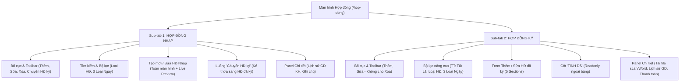

# TỔNG HỢP TOÀN BỘ KỊCH BẢN KIỂM THỬ (MASTER TEST PLAN)
## MODULE QUẢN LÝ HỢP ĐỒNG — HỆ THỐNG VNTEST LIMS (`/hop-dong`)

> **Mục tiêu:** Tài liệu đặc tả và kiểm thử tự động toàn diện cho màn hình Hợp đồng, bao quát trọn vẹn cả 2 sub-tab **Hợp đồng nháp** và **Hợp đồng ký**, màn hình soạn thảo kèm Live Preview, luồng chuyển đổi trạng thái, hộp thoại quản lý hợp đồng đã ký và slide-over detail panel (khung xem chi tiết).

---

---

## 📑 MỤC LỤC CÁC KHỐI CHỨC NĂNG

- [KHỐI 01: Bố cục, Điều hướng & Trạng thái thanh công cụ (UI & Navigation)](#khối-01-bố-cục-điều-hướng--trạng-thái-thanh-công-cụ-ui--navigation)
- [KHỐI 02: Tìm kiếm từ khóa mở rộng (Comprehensive Search)](#khối-02-tìm-kiếm-từ-khóa-mở-rộng-comprehensive-search)
- [KHỐI 03: Bộ lọc Thời gian theo 3 Tiêu chí Ngày (Date Range Filters)](#khối-03-bộ-lọc-thời-gian-theo-3-tiêu-chí-ngày-date-range-filters)
- [KHỐI 04: Bộ lọc Trạng thái (TT) & Loại hợp đồng (Loại HĐ)](#khối-04-bộ-lọc-trạng-thái-tt--loại-hợp-đồng-loại-hđ)
- [KHỐI 05: Quản lý Hợp đồng nháp (Tạo mới, Live Preview, Auto-fill & Phân quyền Sale)](#khối-05-quản-lý-hợp-đồng-nháp-tạo-mới-live-preview-auto-fill--phân-quyền-sale)
- [KHỐI 06: Luồng Nút chức năng "Chuyển HĐ ký" (Kế thừa & Chuyển đổi)](#khối-06-luồng-nút-chức-năng-chuyển-hđ-ký-kế-thừa--chuyển-đổi)
- [KHỐI 07: Quản lý & Chỉnh sửa Hợp đồng đã ký (Form 5 Sections & Ràng buộc Cột Tính DS)](#khối-07-quản-lý--chỉnh-sửa-hợp-đồng-đã-ký-form-5-sections--ràng-buộc-cột-tính-ds)
- [KHỐI 08: Khung Xem Chi tiết bên trong (Detail Panel, Lịch sử GD KH, Tải tài liệu, Ghi chú)](#khối-08-khung-xem-chi-tiết-bên-trong-detail-panel-lịch-sử-gd-kh-tải-tài-liệu-ghi-chú)
- [KHỐI 09: Cơ chế Cảnh báo Thay đổi Chưa lưu "Đóng hộp thoại?"](#khối-09-cơ-chế-cảnh-báo-thay-đổi-chưa-lưu-đóng-hộp-thoại)

---

### KHỐI 01: Bố cục, Điều hướng & Trạng thái thanh công cụ (UI & Navigation)

| Mã TC | Tên kịch bản | Thao tác thực hiện | Kết quả mong đợi |
| :--- | :--- | :--- | :--- |
| **TC_NAV_01** | Hiển thị các thành phần tổng quan màn hình Hợp đồng | Truy cập URL `/hop-dong`. | Hiển thị cụm tab module `KH - ĐT - HĐ`, tab `HỢP ĐỒNG` đang active kèm tổng số lượng (VD: `128`), 2 sub-tab `Hợp đồng nháp` và `Hợp đồng ký`, bộ lọc, thanh tìm kiếm và bảng dữ liệu. |
| **TC_NAV_02** | Chuyển đổi qua lại giữa 2 sub-tab `Hợp đồng nháp` và `Hợp đồng ký` | Nhấp chọn giữa 2 sub-tab. | - Tab `Hợp đồng nháp`: Toolbar có 4 nút `"Thêm"`, `"Sửa"`, `"Xóa"`, `"Chuyển HĐ ký"`; bộ lọc ẩn dropdown `TT`. - Tab `Hợp đồng ký`: Toolbar chỉ có 2 nút `"Thêm"`, `"Sửa"` (không có nút Xóa); bộ lọc hiện thêm `TT: Tất cả`; bảng có thêm 4 cột: `GIÁ TRỊ SAU VAT`, `GIẢM TRỪ PHÍ`, `TÀI LIỆU`, `TÍNH DS`. |
| **TC_NAV_03** | Trạng thái ban đầu của Toolbar khi CHƯA chọn dòng (0 dòng) | Mở danh sách, chưa tích chọn ô checkbox nào. | Các nút `"Sửa"`, `"Xóa"`, `"Chuyển HĐ ký"` (ở tab Nháp) và nút `"Sửa"` (ở tab Ký) ở trạng thái vô hiệu hóa (`disabled`), mờ đi. |
| **TC_NAV_04** | Trạng thái Toolbar khi tích chọn ĐÚNG 1 dòng | Tích chọn 1 dòng hợp đồng bất kỳ. | Các nút `"Sửa"`, `"Xóa"`, `"Chuyển HĐ ký"` sáng lên (kích hoạt). Hiển thị dòng trạng thái: `Đang chọn 1 HĐ`. |
| **TC_NAV_05** | Trạng thái Toolbar khi tích chọn NHIỀU dòng (>= 2 dòng) | Tích chọn 2 dòng trở lên (hoặc tích chọn tất cả ở Header). | - Nút `"Sửa"` và nút `"Chuyển HĐ ký"` tự động **vô hiệu hóa** (chỉ cho phép thao tác đơn lẻ từng HĐ). - Nút `"Xóa"` (ở tab Nháp) **vẫn kích hoạt** (cho phép xóa hàng loạt). |
| **TC_NAV_06** | Quản lý ẩn/hiện cột và Phân trang | Nhấn `"Quản lý cột"`, chuyển trang (`1`, `2`) và đổi số dòng/trang (`20`). | Popover mở cho phép tích chọn cột; bảng phân trang mượt mà đúng số bản ghi. |

---

### KHỐI 02: Tìm kiếm từ khóa mở rộng (Comprehensive Search)

| Mã TC | Tên kịch bản | Dữ liệu kiểm thử (Test Data) | Kết quả mong đợi |
| :--- | :--- | :--- | :--- |
| **TC_SRC_01** | Tìm chính xác theo Mã hợp đồng | `HĐ-00231` (tab Nháp) / `HĐ-00230` (tab Ký) | Hiển thị duy nhất 1 bản ghi khớp chính xác Mã HĐ. |
| **TC_SRC_02** | Tìm một phần theo tiền tố / hậu tố Mã HĐ | `HĐ-0022` hoặc `00231` | Lọc ra danh sách tất cả các hợp đồng chứa cụm ký tự tương ứng. |
| **TC_SRC_03** | Tìm Mã HĐ không phân biệt hoa / thường | `hđ-00231` hoặc `Hđ-00231` | Không phân biệt hoa thường, vẫn trả về đúng `HĐ-00231`. |
| **TC_SRC_04** | Tìm chính xác toàn bộ Số hợp đồng (chứa `.`, `/`, `_`) | `28.286.001/HĐDV/VNTEST_1` hoặc `28.812.001/HĐDV/VNTEST` | Trả về đúng bản ghi có Số HĐ tương ứng. |
| **TC_SRC_05** | Tìm một phần Số HĐ theo cụm số đầu / giữa / đuôi | `28.286.001`, `BIEN.031D`, `/HĐDV/VNTEST` | Lọc ra các hợp đồng có chứa cụm phân đoạn đó. |
| **TC_SRC_06** | Tìm chính xác / một phần Tên hợp đồng | `Hợp đồng kiểm nghiệm mẫu_22`, `mẫu_14`, `(Màu Vàng)` | Lọc chính xác các hợp đồng có tên chứa từ khóa. |
| **TC_SRC_07** | Tìm Tên HĐ bằng chữ thường / chữ HOA / không dấu | `hợp đồng kiểm nghiệm mẫu_22`, `Hop dong kiem nghiem` | Trả về đúng bản ghi tương ứng. |
| **TC_SRC_08** | Tìm chính xác / một phần Tên KH (Cá nhân & Doanh nghiệp) | `Thái test`, `Công ty TNHH ABC Việt Nam`, `Toàn Cầu` | Lọc ra tất cả hợp đồng của khách hàng đó. |
| **TC_SRC_09** | Tìm Tên KH có ký tự đặc biệt (`&`, `#`, `()`) | `Sơn & Hóa chất`, `(Đơn vị #495)`, `#498` | Lọc chính xác các doanh nghiệp có ký tự đặc thù. |
| **TC_SRC_10** | Mở rộng tìm kiếm theo Mã KH / Mã CTV / Tên Sale | `KH-0164`, `CTV-002`, `Admin User` | Kiểm tra phạm vi lọc các trường mã định danh phụ trợ trên bảng. |
| **TC_SRC_11** | Tìm kiếm từ khóa có khoảng trắng thừa đầu/cuối | `"   HĐ-00231   "`, `"  Thái test  "` | Hệ thống tự động trim khoảng trắng thừa, trả về kết quả đúng. |
| **TC_SRC_12** | Tìm kiếm với từ khóa không tồn tại / ký tự lạ | `KHONG_TON_TAI_99999`, `@#$%^&*~` | Bảng hiển thị thông báo: `"Không tìm thấy hợp đồng nào phù hợp."`. |
| **TC_SRC_13** | Xóa từ khóa tìm kiếm bằng nút `"Hủy"` (`.clear-btn`) | Nhập từ khóa ➔ Nút `"Hủy"` xuất hiện ➔ Bấm nút `"Hủy"` | Ô tìm kiếm về rỗng, nút `"Hủy"` ẩn đi, bảng khôi phục đầy đủ số lượng ban đầu. |
| **TC_SRC_14** | Giữ từ khóa khi chuyển đổi giữa 2 tab `Hợp đồng nháp` ↔ `Hợp đồng ký` | Nhập `Thái test` tại tab Nháp ➔ Chuyển sang tab Ký | Từ khóa giữ nguyên trên ô tìm kiếm, tab Ký hiển thị đúng hợp đồng `HĐ-00230` của `Thái test`. |

---

### KHỐI 03: Bộ lọc Thời gian theo 3 Tiêu chí Ngày (Date Range Filters)

> Áp dụng độc lập cho cả 3 tiêu chí trong dropdown: **`Ngày ký`**, **`Hết hiệu lực`**, **`Ngày hết hạn`**.

| Mã TC | Tên kịch bản | Thao tác & Test Data | Kết quả mong đợi |
| :--- | :--- | :--- | :--- |
| **TC_DATE_01** | Kiểm tra hiển thị dropdown loại ngày và popup lịch | Nhấn mở dropdown loại ngày; nhấn ô `TỪ dd/mm/yyyy` | Dropdown hiện đủ 3 lựa chọn: `Ngày ký` (mặc định), `Hết hiệu lực`, `Ngày hết hạn`. Popup lịch có đủ nút `Hôm nay`, `Xóa`. |
| **TC_DATE_02** | Lọc theo **`Ngày ký`** — Chỉ chọn **`TỪ ngày`** | Tiêu chí: `Ngày ký` `TỪ`: `28/10/2026` `ĐẾN`: `dd/mm/yyyy` | Mọi dòng hiển thị đều có cột **`NGÀY KÝ` >= `28/10/2026`** (VD: `28/10`, `30/10`, `31/10`, `01/11`, `02/11/2026`). |
| **TC_DATE_03** | Lọc theo **`Ngày ký`** — Chỉ chọn **`ĐẾN ngày`** | Tiêu chí: `Ngày ký` `TỪ`: `dd/mm/yyyy` `ĐẾN`: `27/10/2026` | Mọi dòng hiển thị đều có cột **`NGÀY KÝ` <= `27/10/2026`** (VD: `27/10`, `26/10`, `01/10`, `01/08/2026`). |
| **TC_DATE_04** | Lọc theo **`Ngày ký`** — Chọn **`TỪ ngày` trùng `ĐẾN ngày`** | Tiêu chí: `Ngày ký` `TỪ`: `28/10/2026` `ĐẾN`: `28/10/2026` | Mọi dòng hiển thị đều có cột **`NGÀY KÝ` = `28/10/2026`** (`HĐ-00228`, `HĐ-00226` ở tab Nháp; `HĐ-00227` ở tab Ký). |
| **TC_DATE_05** | Lọc theo **`Ngày ký`** — Chọn khoảng **`TỪ ngày` < `ĐẾN ngày`** | Tiêu chí: `Ngày ký` `TỪ`: `26/10/2026` `ĐẾN`: `31/10/2026` | Mọi dòng hiển thị đều có cột **`NGÀY KÝ`** nằm trong đoạn `[26/10/2026, 31/10/2026]`. |
| **TC_DATE_06** | Lọc theo **`Hết hiệu lực`** — Đầy đủ 4 trường hợp (Từ, Đến, Trùng ngày, Khoảng ngày) | Tiêu chí: `Hết hiệu lực` `TỪ`: `27/11/2026` - `ĐẾN`: `30/11/2026` | Mọi dòng hiển thị đều có cột **`HẾT HIỆU LỰC`** thỏa mãn đúng mốc thời gian đã lọc. |
| **TC_DATE_07** | Lọc theo **`Ngày hết hạn`** — Đầy đủ 4 trường hợp (Từ, Đến, Trùng ngày, Khoảng ngày) | Tiêu chí: `Ngày hết hạn` `TỪ`: `25/12/2026` - `ĐẾN`: `31/12/2026` | Mọi dòng hiển thị đều có cột **`NGÀY HẾT HẠN`** thỏa mãn đúng mốc thời gian đã lọc. |
| **TC_DATE_08** | Chuyển đổi qua lại giữa 3 loại ngày khi đang chọn sẵn khoảng `TỪ - ĐẾN` | Đang chọn `26/10 - 31/10` ở `Ngày ký` ➔ Đổi sang `Hết hiệu lực` ➔ Đổi sang `Ngày hết hạn` | Khoảng ngày giữ nguyên, bảng lập tức tính toán lọc lại dữ liệu đối chiếu sang cột tương ứng mới. |
| **TC_DATE_09** | Xóa bộ lọc ngày bằng nút `"Hủy lọc theo ngày"` `[×]` | Nhấn nút `[×]` cạnh bộ lọc ngày. | Cả 2 ô `TỪ` và `ĐẾN` đều trở về `dd/mm/yyyy`, bảng khôi phục toàn bộ danh sách ban đầu. |

---

### KHỐI 04: Bộ lọc Trạng thái (TT) & Loại hợp đồng (Loại HĐ)

| Mã TC | Tên kịch bản | Thao tác & Test Data | Kết quả mong đợi |
| :--- | :--- | :--- | :--- |
| **TC_FLT_01** | Kiểm tra hiển thị dropdown `TT` theo Tab | Xem tab `Hợp đồng nháp` vs `Hợp đồng ký` | Tab Nháp ẩn dropdown `TT`; tab Ký hiển thị dropdown `TT: Tất cả` gồm 4 tùy chọn: `Tất cả`, `Chưa thực hiện`, `Đang thực hiện`, `Hoàn thành`. |
| **TC_FLT_02** | Lọc theo từng Trạng thái tại tab `Hợp đồng ký` | Lần lượt chọn `Chưa thực hiện`, `Đang thực hiện`, `Hoàn thành` | Cột `TRẠNG THÁI` của tất cả các dòng hiển thị đều khớp chính xác với trạng thái đã chọn (VD: `HĐ-00227` với Chưa thực hiện; `HĐ-00230` với Hoàn thành). |
| **TC_FLT_03** | Lọc theo 8 Loại hợp đồng (`Loại HĐ`) | Chọn từng loại: `Hợp đồng nguyên tắc — khung tổng`, `Kiểm nghiệm thông thường`, `Công bố sản phẩm`, `Đào tạo`, `Công bố kết hợp kiểm nghiệm`, `Quan trắc môi trường`, `Đấu thầu`, `Khác` | Cột `LOẠI HĐ` của mọi dòng hiển thị đều khớp chính xác với loại đã chọn (VD: chọn `Đấu thầu` ra `HĐ-00223`). |
| **TC_FLT_04** | Kết hợp đồng thời `TT` + `Loại HĐ` (tab Ký) | `TT: Đang thực hiện` + `Loại HĐ: Kiểm nghiệm thông thường` | Chỉ hiển thị các hợp đồng vừa Đang thực hiện, vừa thuộc loại Kiểm nghiệm thông thường (`HĐ-00224`). |
| **TC_FLT_05** | Kết hợp `TT` + `Loại HĐ` không có bản ghi nào | `TT: Chưa thực hiện` + `Loại HĐ: Đấu thầu` | Bảng hiển thị thông báo `"Không tìm thấy hợp đồng nào phù hợp."`. |

---

### KHỐI 05: Quản lý Hợp đồng nháp (Tạo mới, Live Preview, Auto-fill & Phân quyền Sale)

| Mã TC | Tên kịch bản | Thao tác thực hiện | Kết quả mong đợi |
| :--- | :--- | :--- | :--- |
| **TC_DFT_01** | Mở và đóng màn hình Tạo hợp đồng nháp (`📝 Tạo hợp đồng nháp`) | Nhấn nút `"Thêm"` trên tab Nháp ➔ Nhấn nút `"Đóng"`. | Mở giao diện soạn thảo toàn màn hình (`.hd-fullscreen`); nhấn `"Đóng"` (khi chưa sửa gì) thì đóng về danh sách. |
| **TC_DFT_02** | Validate các trường bắt buộc khi tạo HĐ nháp | Để trống các trường bắt buộc (`Khách hàng`, `Số HĐ`, `Tên HĐ`...) ➔ Nhấn `"Lưu nháp"`. | Báo lỗi đỏ dưới trường (`"Vui lòng chọn khách hàng."`) và thông báo nổi `"Thông tin nhập chưa hợp lệ. Vui lòng kiểm tra lại."`. |
| **TC_DFT_03** | **Phân quyền trường Khách hàng** — Chỉ hiện khách do Sale đang đăng nhập phụ trách | Nhấn dropdown `— Chọn khách hàng —`. | Hiển thị dòng chú thích `⚡ Chỉ hiện khách hàng do bạn phụ trách.`. Danh sách chỉ hiện khách thuộc Sale đăng nhập, không có khách của Sale khác. |
| **TC_DFT_04** | **Phân quyền trường Báo giá** — Chỉ hiện báo giá do Sale đang đăng nhập phụ trách | Nhấn dropdown `— Chọn báo giá —`. | Hiển thị `⚡ Chỉ hiện báo giá do bạn phụ trách.`. Danh sách chỉ trả về các báo giá của Sale hiện tại. |
| **TC_DFT_05** | **Auto-fill thông tin Bên A khi Khách hàng có đầy đủ thông tin** | Chọn khách hàng có đầy đủ hồ sơ. | Tự động điền đầy đủ: `ĐỊA CHỈ TRỤ SỞ`, `ĐIỆN THOẠI`, `MÃ SỐ THUẾ`, `TÊN ĐẠI DIỆN`, `CHỨC VỤ`, `EMAIL KHÁCH HÀNG`, `SỐ TÀI KHOẢN`, `TÊN NGÂN HÀNG`. |
| **TC_DFT_06** | **Auto-fill khi Khách hàng bị khuyết / thiếu một số trường** | Chọn khách hàng chỉ có MST, thiếu SĐT/Email/STK. | Các trường có dữ liệu thì điền; các trường thiếu thì **để trống hoàn toàn `""`**, không hiển thị `undefined` hay lỗi. |
| **TC_DFT_07** | **Trường "DANH XƯNG" là tự chọn độc lập** | Chuyển đổi giữa `Ông` và `Bà`. | Người dùng tự do chọn `Ông`/`Bà`, không bị ghi đè bởi auto-fill. |
| **TC_DFT_08** | **Đồng bộ Live Preview sang văn bản Hợp đồng khung bên phải (Real-time Sync)** | Nhập/đổi Tên KH, Địa chỉ, SĐT, MST, Người đại diện, Chức vụ, Danh xưng ở form trái. | Văn bản hợp đồng bên phải (`CỘNG HÒA XÃ HỘI CHỦ NGHĨA VIỆT NAM...`) tại mục `BÊN A` tự động cập nhật khớp từng chữ ngay lập tức. Trường nào thiếu thì hiển thị dấu `...`. |
| **TC_DFT_09** | Nhấn nút `"Auto"` sinh ngẫu nhiên Số hợp đồng | Nhấn nút `"Auto"` cạnh ô `SỐ HỢP ĐỒNG *`. | Tự động sinh số hợp đồng mới theo định dạng chuẩn (VD: `29.xxx.001/HĐDV/VNTEST`). |
| **TC_DFT_10** | Tự động tính ngày `HẾT HIỆU LỰC` khi đổi `NGÀY KÝ` hoặc `HIỆU LỰC (NGÀY)` | Đổi Ngày ký hoặc đổi số ngày hiệu lực (mặc định `30`). | Ô `HẾT HIỆU LỰC` tự động cộng dồn số ngày chính xác; đồng bộ sang điều khoản Điều 3 của văn bản hợp đồng bên phải. |
| **TC_DFT_11** | Tạo mới Hợp đồng nháp thành công | Điền đầy đủ thông tin hợp lệ ➔ Nhấn `"Lưu nháp"`. | Đóng màn hình soạn thảo; bản ghi mới xuất hiện đầu danh sách `Hợp đồng nháp` với trạng thái `Nháp`. |
| **TC_DFT_12** | Tiện ích `"Xuất Word"` và `"In"` trong màn soạn thảo | Nhấn nút `"Xuất Word"` và `"In"`. | Kích hoạt tải về file Word `.docx` và mở cửa sổ in ấn trình duyệt. |
| **TC_DFT_13** | **Chỉnh sửa Hợp đồng nháp (`Sửa`) & Đồng bộ 3 màn hình (Form, List, Detail)** | 1. Tích chọn 1 HĐ nháp ➔ Nhấn nút `"Sửa"` trên toolbar (hoặc nút `"Chỉnh sửa"` ở chân detail panel).  2. Thay đổi các thông tin: Tên HĐ mới, chọn Khách hàng mới, đổi Ngày ký, đổi Thời hạn hiệu lực.  3. Nhấn nút `"Lưu nháp"`.  4. Mở biểu tượng con mắt để xem panel chi tiết.  5. Mở lại form chỉnh sửa để kiểm tra. | 1. Hiển thị thông báo lưu thành công và đóng màn hình soạn thảo.  2. **Đồng bộ ngoài màn hình danh sách (List):** Dòng hợp đồng đó lập tức cập nhật chính xác các thông tin mới tại các cột tương ứng (Tên HĐ, Mã KH, Ngày ký, Hết hiệu lực, Ngày hết hạn).  3. **Đồng bộ bên trong màn xem chi tiết (Detail Panel):** Mở xem chi tiết hiển thị đúng Tên HĐ mới trên header, Loại HĐ, Mã KH mới, dòng `[HĐ-N] ... ·HD HIỆN TẠI` trong bảng Lịch sử GD cập nhật theo đúng thông tin vừa sửa.  4. **Lưu giữ khi mở lại:** Khi mở lại màn hình chỉnh sửa, toàn bộ các trường nhập liệu và khung Live Preview bên phải giữ nguyên 100% dữ liệu mới vừa cập nhật. |
| **TC_DFT_14** | **Xóa Hợp đồng nháp (`Xóa`)** | Tích chọn 1 hoặc nhiều HĐ nháp ➔ Nhấn nút `"Xóa"` ➔ Kiểm tra Hủy xóa / Xác nhận xóa. | Hủy thì giữ nguyên; Xác nhận xóa thì bản ghi biến mất khỏi danh sách, giảm số đếm badge `Hợp đồng nháp`. |

---

### KHỐI 06: Luồng Nút chức năng "Chuyển HĐ ký" (Kế thừa & Chuyển đổi)

| Mã TC | Tên kịch bản | Thao tác thực hiện | Kết quả mong đợi |
| :--- | :--- | :--- | :--- |
| **TC_CNV_01** | Điều kiện kích hoạt nút `"Chuyển HĐ ký"` | Thử khi: (1) Chưa chọn dòng, (2) Chọn 1 dòng, (3) Chọn >= 2 dòng. | (1) 0 dòng: `disabled`; (2) Chọn 1 dòng: `enabled` (sáng xanh); (3) Chọn >= 2 dòng: tự động `disabled`. |
| **TC_CNV_02** | Tự động kế thừa dữ liệu khi nhấn `"Chuyển HĐ ký"` | Chọn dòng `HĐ-00231` (`Thái test`) ➔ Nhấn `"Chuyển HĐ ký"`. | Mở hộp thoại `Thêm hợp đồng đã ký`: mục ① gắn sẵn `HĐ-00231...`; mục ② sao chép 100% (Số HĐ, Loại HĐ, Tên HĐ, Khách hàng, Mã KH `KH-0164` readonly, Ngày ký, Hiệu lực); mục ④ tự động gắn **File Word mềm** (`HD-28-286-001-HĐDV-VNTEST_1.docx`) nhãn `OK`. |
| **TC_CNV_03** | Đổi HĐ nháp nguồn khác trong hộp thoại chuyển | Chọn sang `HĐ-00229` tại dropdown nguồn. | Toàn bộ mục ② và tên File Word mềm tại mục ④ tự động cập nhật lại theo `HĐ-00229`. |
| **TC_CNV_04** | Validate bắt buộc File scan hợp đồng đã ký khi chuyển | Nhấn `"Lưu hợp đồng đã ký"` khi chưa đính kèm file scan. | Viền cam báo lỗi `has-error`, hiển thị thông báo lỗi và Toast: **`"Vui lòng đính kèm ít nhất một bản scan hợp đồng đã ký."`**. |
| **TC_CNV_05** | Hoàn tất chuyển Hợp đồng nháp sang Hợp đồng ký thành công (E2E) | Nhập Giá trị sau VAT, Giảm trừ phí, Trạng thái, đính kèm file scan PDF ➔ Nhấn `"Lưu hợp đồng đã ký"`. | 1. Hợp đồng vừa chuyển **biến mất khỏi tab `Hợp đồng nháp`** (badge giảm 1). 2. Hợp đồng **xuất hiện ngay tại tab `Hợp đồng ký`** (badge tăng 1) với đủ Giá trị sau VAT, Giảm trừ phí, Trạng thái, và cột `TÀI LIỆU` hiển thị `2` (Word mềm + Scan). |

---

### KHỐI 07: Quản lý & Chỉnh sửa Hợp đồng đã ký (Form 5 Sections & Ràng buộc Cột Tính DS)

| Mã TC | Tên kịch bản | Thao tác thực hiện | Kết quả mong đợi |
| :--- | :--- | :--- | :--- |
| **TC_SGN_01** | Thêm mới HĐ đã ký trực tiếp (Tự nhập từ đầu) | Tại tab `Hợp đồng ký`, nhấn `"Thêm"` ➔ Nhập thông tin 5 sections. | Nhập đầy đủ Số HĐ, Loại HĐ, Tên HĐ, Khách hàng (Mã KH tự điền readonly), Ngày ký, Hiệu lực, Giá trị sau VAT, đính kèm file scan PDF ➔ Lưu thành công lên đầu danh sách tab Ký. |
| **TC_SGN_02** | Validate các trường bắt buộc trên Form 5 sections | Để trống Số HĐ, Tên HĐ, KH, Giá trị sau VAT, hoặc chưa đính kèm file scan. | Báo lỗi tương ứng tại từng trường bắt buộc có dấu `*`, chặn không cho lưu. |
| **TC_SGN_03** | Định dạng tiền tệ và tính toán tài chính (Mục ③) | Nhập `GIÁ TRỊ HỢP ĐỒNG SAU VAT` (`20000000`) và `GIẢM TRỪ PHÍ` (`200000`). | Ô input tự định dạng dấu chấm phân cách `20.000.000` và `200.000`. Ngoài bảng danh sách hiển thị đúng `20.000.000 đ` và `−200.000 đ`. |
| **TC_SGN_04** | **Chỉnh sửa Hợp đồng đã ký (`Sửa`) & Đồng bộ 3 màn hình (Form, List, Detail)** | 1. Tích chọn 1 HĐ đã ký ➔ Nhấn nút `"Sửa"` trên toolbar (hoặc nút `"Chỉnh sửa"` ở chân detail panel).  2. Sửa các thông tin: Tên HĐ mới, Trạng thái (VD: từ `Chưa thực hiện` sang `Hoàn thành`), Giá trị sau VAT mới, Giảm trừ phí mới, thay đổi tích chọn `TÍNH VÀO DOANH SỐ THÁNG`, sửa Ghi chú.  3. Nhấn nút `"Lưu hợp đồng đã ký"`.  4. Mở biểu tượng con mắt để xem panel chi tiết.  5. Mở lại form chỉnh sửa để kiểm tra. | 1. Hiển thị thông báo lưu thành công và đóng hộp thoại.  2. **Đồng bộ ngoài màn hình danh sách (List):** Dòng hợp đồng đó lập tức cập nhật chính xác các thông tin mới tại các cột tương ứng: Tên HĐ mới, Trạng thái mới (`Hoàn thành`), Giá trị sau VAT mới (`đ`), Giảm trừ phí mới (`đ`), Cột `TÍNH DS` cập nhật trạng thái tích chọn mới.  3. **Đồng bộ bên trong màn xem chi tiết (Detail Panel):** Mở xem chi tiết hiển thị đúng Tên HĐ mới trên header, Badge Trạng thái mới (`● Hoàn thành`), dòng `[HĐ] ... ·HD HIỆN TẠI` trong bảng Lịch sử GD hiển thị đúng số tiền mới, mục `ĐỢT THANH TOÁN` cập nhật đúng tổng giá trị mới (`Đã thu ... / ... đ`), và ô Ghi chú hiển thị nội dung mới.  4. **Lưu giữ khi mở lại:** Khi mở lại hộp thoại chỉnh sửa, toàn bộ các trường nhập liệu và file đính kèm giữ nguyên 100% dữ liệu mới vừa cập nhật. |
| **TC_SGN_05** | **Ràng buộc Cột `TÍNH DS` ngoài bảng — Display-only (Readonly)** | Thử nhấp chuột trực tiếp vào checkbox tại cột `TÍNH DS` ngoài bảng. | Checkbox có thuộc tính `disabled`, **hoàn toàn không cho phép tích/bỏ tích trực tiếp từ ngoài bảng**; trạng thái checked/unchecked không thay đổi. |
| **TC_SGN_06** | **Cập nhật trạng thái Cột `TÍNH DS` thông qua Form Sửa** | Mở sửa hợp đồng ➔ Tích hoặc bỏ tích ô `TÍNH VÀO DOANH SỐ THÁNG (Có tính)` tại Mục ③ ➔ Lưu form. | Ngoài bảng danh sách, ô tại cột `TÍNH DS` của dòng đó tự động cập nhật tương ứng: tích xanh `[✓]` (nếu có tính) hoặc ô xám rỗng `[ ]` (nếu không tính). |

---

### KHỐI 08: Khung Xem Chi tiết bên trong (Detail Panel — So sánh HĐ Nháp vs HĐ Ký)

> **Lưu ý kiểm thử đặc thù:** Khung xem chi tiết trượt từ bên phải (`.contract-detail-panel.open`) khi nhấn biểu tượng con mắt (`.px-view-button`) có cấu trúc khác nhau rõ rệt giữa **Hợp đồng nháp** và **Hợp đồng ký**. Bắt buộc phải kiểm tra riêng biệt trên cả 2 tab.

#### 8.1. Khung Xem Chi tiết tại tab HỢP ĐỒNG NHÁP (Draft Detail Panel)
| Mã TC | Tên kịch bản | Thao tác thực hiện | Kết quả mong đợi (Đối chiếu ảnh chụp thực tế) |
| :--- | :--- | :--- | :--- |
| **TC_DTL_01** | Hiển thị Header & Thông tin định danh HĐ nháp | Tại tab `Hợp đồng nháp`, nhấn biểu tượng con mắt tại dòng `HĐ-00231`. | 1. Header hiển thị: Icon văn bản + `Tên hợp đồng` (VD: `Hợp đồng kiểm nghiệm mẫu_22`) + Nút đóng `[×]`. 2. Dòng thông tin metadata: - `MÃ HĐ`: `HĐ-00231` - `KH`: `KH-0164` - `LOẠI`: Badge `KIỂM NGHIỆM THÔNG THƯỜNG` - **Trạng thái**: Badge màu xám `● Nháp`. |
| **TC_DTL_02** | **Bảng "🕒 LỊCH SỬ GD" trên HĐ nháp — Liệt kê HĐ cũ, YCTN cũ & Nhãn "·HD HIỆN TẠI"** | Mở xem chi tiết HĐ nháp (`HĐ-00231`) của khách hàng (`KH-0164`). Quan sát danh sách các dòng giao dịch. | 1. Tiêu đề hiển thị: `🕒 LỊCH SỬ GD` kèm thông tin mã KH và tổng số giao dịch (VD: `KH KH-0164 · 4 GD`).  2. Liệt kê toàn bộ lịch sử giao dịch trong quá khứ của khách hàng đó: bao gồm cả các **Hợp đồng cũ** (`[HĐ-N]`, `[HĐ]`) và các **Yêu cầu tiếp nhận (YCTN) cũ** (`[YCTN]`) theo đúng thứ tự/ngày thực hiện.  3. **Chỉ duy nhất bản ghi hợp đồng nháp hiện tại đang mở** được gắn thêm note/nhãn định danh nổi bật màu xanh ngọc: **`[HĐ-N] HĐ-00231 ·HD HIỆN TẠI`**; các hợp đồng cũ và YCTN cũ khác KHÔNG có note này.  4. Cột `GIÁ TRỊ (Đ)` của HĐ nháp hiện tại hiển thị `0`. |
| **TC_DTL_02B** | **Kiểm tra công thức tính "TỔNG GIÁ TRỊ" trong Lịch sử GD (Chỉ cộng dồn giao dịch có tiền > 0, bỏ qua giá trị 0)** | Quan sát từng dòng giao dịch và đối chiếu với dòng chân bảng `TỔNG GIÁ TRỊ` của khách hàng `KH-0164`. | 1. Hệ thống tự động tính tổng: **chỉ cộng dồn các giao dịch có giá trị tiền `GIÁ TRỊ (Đ) > 0`** (cụ thể dòng `HĐ-00230` có giá trị `20.000.000`).  2. Các giao dịch có giá trị bằng `0` (như HĐ nháp hiện tại `HĐ-00231` = `0`, các YCTN chưa có phí `TR152300046` = `0`, `TR152300045` = `0`) **tuyệt đối KHÔNG được cộng thêm vào tổng**.  3. Dòng chân bảng hiển thị đúng: **`TỔNG GIÁ TRỊ: 20.000.000 đ`** (màu xanh lá), khớp chuẩn xác với tổng các dòng có tiền cộng lại.  4. Với khách hàng mà tất cả các giao dịch đều có giá trị bằng `0`, dòng chân bảng hiển thị `TỔNG GIÁ TRỊ: 0 đ`. |
| **TC_DTL_03** | Mục "📁 ĐỢT THANH TOÁN" trên HĐ nháp | Quan sát mục Đợt thanh toán của HĐ nháp. | 1. Tiêu đề hiển thị: `📁 ĐỢT THANH TOÁN (0)` kèm tỷ lệ `Đã thu 0 / 0 đ`. 2. Nội dung hiển thị icon ví tiền kèm thông báo: `Chưa có đợt thanh toán nào.`. |
| **TC_DTL_04** | **Kiểm tra KHÔNG có mục "Báo giá & Tài liệu đính kèm" trên HĐ nháp** | Kiểm tra toàn bộ chiều dọc panel chi tiết của HĐ nháp. | Hợp đồng nháp **hoàn toàn KHÔNG hiển thị** mục `BÁO GIÁ & TÀI LIỆU ĐÍNH KÈM` (vì bản nháp chưa được ký và chưa đính kèm file scan). |
| **TC_DTL_05** | Mục "GHI CHÚ" nội bộ trên HĐ nháp | 1. Quan sát ô Textarea ghi chú (nút `Lưu ghi chú` bị `disabled`). 2. Sửa/nhập ghi chú mới. 3. Nhấn nút `"Lưu ghi chú"`. | 1. Nút `Lưu ghi chú` kích hoạt khi có thay đổi văn bản. 2. Nhấn lưu thành công; đóng panel và mở lại thì nội dung ghi chú vẫn được bảo toàn. |
| **TC_DTL_06** | Nhấn nút "Chỉnh sửa" tại chân panel HĐ nháp & Xác thực đồng bộ sau khi sửa | 1. Nhấn nút `"Chỉnh sửa"` (màu xanh lá có icon bút chì) ở chân panel.  2. Sửa thông tin (Tên HĐ, Thời hạn...) ➔ Nhấn `"Lưu nháp"`.  3. Mở lại danh sách và mở lại panel chi tiết. | 1. Đóng panel chi tiết và mở thẳng màn hình soạn thảo toàn màn hình **`📝 Chỉnh sửa hợp đồng nháp`** với đúng dữ liệu của hợp đồng đó.  2. Sau khi lưu: Thông tin mới cập nhật ngay tại dòng hợp đồng ngoài bảng danh sách.  3. Khi nhấn xem lại panel chi tiết: Header Tên HĐ và các thông tin liên quan hiển thị chuẩn xác theo giá trị mới vừa sửa. |
| **TC_DTL_07** | Đóng panel HĐ nháp bằng nút "Đóng" hoặc nút `[×]` | Nhấn nút `"Đóng"` ở chân panel hoặc nút `[×]` ở góc trên. | Panel trượt đóng lại mượt mà, trả lại toàn bộ không gian danh sách bảng. |

---

#### 8.2. Khung Xem Chi tiết tại tab HỢP ĐỒNG KÝ (Signed Detail Panel)
| Mã TC | Tên kịch bản | Thao tác thực hiện | Kết quả mong đợi |
| :--- | :--- | :--- | :--- |
| **TC_DTL_08** | Hiển thị Header & Badge trạng thái vòng đời trên HĐ ký | Tại tab `Hợp đồng ký`, nhấn biểu tượng con mắt tại dòng `HĐ-00230`. | 1. Header hiển thị đúng Tên HĐ, `MÃ HĐ: HĐ-00230`, `KH: KH-0164`, Loại HĐ. 2. **Badge trạng thái có màu theo vòng đời thực tế**: hiển thị `● Hoàn thành` (màu xanh lá), `● Đang thực hiện` (màu xanh dương), hoặc `● Chưa thực hiện` (màu xám). |
| **TC_DTL_09** | **Bảng "🕒 LỊCH SỬ GD" trên HĐ ký — Liệt kê HĐ cũ, YCTN cũ & Nhãn "·HD HIỆN TẠI"** | Mở xem chi tiết HĐ ký (`HĐ-00230`) của khách hàng (`KH-0164`). Quan sát danh sách các dòng giao dịch. | 1. Liệt kê toàn bộ các **Hợp đồng cũ** (gồm cả HĐ nháp `[HĐ-N]` và HĐ ký khác `[HĐ]`) cùng các **YCTN cũ** (`[YCTN]`) của khách hàng đó.  2. **Chỉ duy nhất dòng hợp đồng đã ký hiện tại đang mở** được gắn thêm note/nhãn định danh nổi bật màu xanh ngọc: **`[HĐ] HĐ-00230 ·HD HIỆN TẠI`** (phân biệt rõ ràng với các dòng khác).  3. Cột `GIÁ TRỊ (Đ)` của dòng HĐ hiện tại hiển thị chính xác giá trị hợp đồng sau VAT (VD: `20.000.000`). |
| **TC_DTL_09B** | **Kiểm tra công thức tính "TỔNG GIÁ TRỊ" trên HĐ ký (Cộng dồn giá trị HĐ hiện tại và các giao dịch có tiền khác)** | Quan sát từng dòng giao dịch và dòng chân bảng `TỔNG GIÁ TRỊ` trong panel chi tiết HĐ ký. | 1. Giá trị sau VAT của chính HĐ ký hiện tại được **tính cộng dồn vào `TỔNG GIÁ TRỊ`**.  2. Cộng dồn cùng với tất cả các HĐ ký khác hoặc YCTN có phí (`GIÁ TRỊ > 0`) của khách hàng.  3. Các giao dịch có giá trị bằng `0` (như HĐ nháp cũ `HĐ-00231` = `0`, các YCTN chưa có phí `0`) **không được cộng thêm vào tổng**.  4. Dòng chân bảng `TỔNG GIÁ TRỊ` hiển thị chuẩn xác khớp với phép tính tổng các dòng có tiền. |
| **TC_DTL_10** | Mục "📁 ĐỢT THANH TOÁN" trên HĐ ký | Quan sát tiến độ thu tiền trên HĐ ký. | Hiển thị đúng tỷ lệ thanh toán theo giá trị thực tế của hợp đồng: **`Đã thu 0 / 20.000.000 đ`** (tử số là số tiền đã thu, mẫu số là tổng giá trị sau VAT của hợp đồng). |
| **TC_DTL_11** | **Mục "BÁO GIÁ & TÀI LIỆU ĐÍNH KÈM" và nút "Tải về" trên HĐ ký** | Quan sát danh sách tài liệu đính kèm trên panel HĐ ký ➔ Nhấn nút `"Tải về"` (`.btn-download-atc`). | 1. Hiển thị mục `BÁO GIÁ & TÀI LIỆU ĐÍNH KÈM` gồm đầy đủ các file đã đính kèm (File scan PDF/ảnh, File Word mềm, VD: `jpg-1mb.jpg`, `HD-28-286...docx`). 2. Bên cạnh mỗi file có nút icon `"Tải về"`. 3. Nhấn vào nút `"Tải về"` kích hoạt sự kiện tải file về máy tính thành công. |
| **TC_DTL_12** | Mục "GHI CHÚ" nội bộ trên HĐ ký | Nhập và lưu ghi chú nội bộ cho HĐ đã ký. | Lưu thành công nội dung ghi chú và hiển thị đúng khi mở lại. |
| **TC_DTL_13** | Nhấn nút "Chỉnh sửa" tại chân panel HĐ ký & Xác thực đồng bộ sau khi sửa | 1. Nhấn nút `"Chỉnh sửa"` ở chân panel chi tiết HĐ ký.  2. Sửa thông tin (Trạng thái, Giá trị sau VAT, Giảm trừ phí, Tính doanh số...) ➔ Nhấn `"Lưu hợp đồng đã ký"`.  3. Mở lại danh sách và mở lại panel chi tiết. | 1. Đóng panel chi tiết và mở thẳng hộp thoại **`Chỉnh sửa hợp đồng đã ký`** (Form 5 sections) với đầy đủ thông tin cũ.  2. Sau khi lưu: Thông tin mới cập nhật ngay ngoài bảng danh sách (Trạng thái, Giá trị, Giảm trừ, Checkbox Tính DS).  3. Khi nhấn xem lại panel chi tiết: Header Tên HĐ, Badge trạng thái mới, dòng `·HD HIỆN TẠI` trong bảng Lịch sử GD, và mục `ĐỢT THANH TOÁN` đều cập nhật chính xác theo các giá trị mới vừa sửa. |

---

### KHỐI 09: Cơ chế Cảnh báo Thay đổi Chưa lưu "Đóng hộp thoại?"

| Mã TC | Tên kịch bản | Thao tác thực hiện | Kết quả mong đợi |
| :--- | :--- | :--- | :--- |
| **TC_WRN_01** | Đóng form khi CHƯA có thay đổi (Clean State) | Mở form Tạo mới hoặc Sửa ➔ Chưa gõ gì ➔ Nhấn `"Đóng"` / `"Hủy"` / `[×]`. | Đóng form ngay lập tức, **KHÔNG** hiện popup `"Đóng hộp thoại?"`. |
| **TC_WRN_02** | Kích hoạt cảnh báo `"Đóng hộp thoại?"` khi ĐÃ có thay đổi (Dirty State) | Đã nhập/sửa ít nhất 1 trường ➔ Nhấn `"Đóng"` / `"Hủy"` / nút `[×]` / Click ra ngoài (Backdrop). | Hiển thị hộp thoại cảnh báo: Tiêu đề: **`"Đóng hộp thoại?"`**; Nội dung: **`"Bạn có thay đổi chưa lưu. Đóng sẽ mất các thay đổi này."`**; có 2 nút `"Tiếp tục nhập"` và `"Đóng"`. |
| **TC_WRN_03** | Chọn `"Tiếp tục nhập"` trên popup cảnh báo | Nhấn nút `"Tiếp tục nhập"` (hoặc nút `[×]` trên popup cảnh báo). | Popup cảnh báo đóng lại; form Tạo mới/Sửa vẫn giữ nguyên cùng toàn bộ dữ liệu đang nhập dở. |
| **TC_WRN_04** | Chọn `"Đóng"` trên popup cảnh báo | Nhấn nút `"Đóng"` (màu xanh) trên popup cảnh báo. | Đóng hoàn toàn form Tạo mới/Sửa, hủy bỏ mọi thay đổi chưa lưu, quay về danh sách. |

---

### 🚀 KẾ HOẠCH TRIỂN KHAI AUTOMATION (Cấu trúc Source Code)
Toàn bộ các kịch bản trên sẽ được tích hợp vào kiến trúc Automation hiện tại của dự án:
- **Page Object Model:** [contracts.page.ts](file:///home/thai.hoang.dinh/VNTEST_Automation/src/pages/contracts.page.ts) (định nghĩa locators semantic, phương thức thao tác 2 tab, form 5 sections, live preview, auto-fill, date picker, search/filter, dialog guard, và detail panel).
- **Test Spec:** [contracts.spec.ts](file:///home/thai.hoang.dinh/VNTEST_Automation/src/tests/contracts/contracts.spec.ts) (chia thành 9 `describe` blocks tương ứng 9 khối trên, chạy ổn định trên Playwright).
- **Fixture:** Khai báo `contractsPage` trong [base.fixture.ts](file:///home/thai.hoang.dinh/VNTEST_Automation/src/fixtures/base.fixture.ts).
